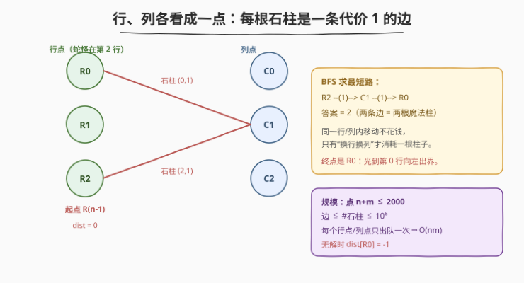

# Codeforces 173B 密室与魔法石柱 题解

## 1. 题目概述

- **题目链接**：https://codeforces.com/problemset/problem/173/B
- **比赛来源**：Croc Champ 2012 - Round 1 · Problem B（UTC 2012-04-06）
- **难度**：1800
- **标签**：图论、最短路、DFS/BFS
- **评测类型**：普通
- **限制**：时间 2 s / 内存 256 MB

**题意**：密室是一个 $n\times m$ 的网格，有些格子是石柱（`#`），其余为空地（`.`）。光线（蛇怪的目光）穿过普通石柱时不改变方向；若把某根石柱变成**魔法石柱**，光线打上去会同时向**四个方向**反射出去。

蛇怪在**右下角格子的右侧**，视线向**左**（沿最后一行横着射入）。密室的门在**左上角格子的左侧**，进门的人朝右看（沿第一行看向右）。求最少要把多少根石柱变成魔法，才能让蛇怪的目光沿"直行 + 在魔法柱上分叉转向"的路径抵达门口的人；无解输出 `-1`。

**约束**：

- $2\le n,m\le 1000$，网格最多 $10^6$ 个格子，其中 `#` 也不超过 $10^6$ 个。
- 每根柱子要么普通要么魔法，代价是"被变成魔法的格子数"，同一根柱子只算一次。注意魔法柱会向四个方向同时反射，所以一条光线路径上每个转角都对应一个**不同的**魔法格。
- $10^6$ 的规模要求 $O(nm)$ 或 $O(nm\log)$；任何"枚举哪些柱子变魔法"的指数做法都不可行。
- 无解要输出 `-1`：例如最后一行没有石柱，光线就一直向左射出网格，永远无法转向。

## 2. 示例与观察

官方样例 1（输入 / 输出原样）：

```text
输入：
3 3
.#.
...
.#.

输出：
2
```

两根石柱分别在 $(0,1)$（0 起，第 1 行第 2 列）与 $(2,1)$。把这两根都变成魔法：

1. 蛇怪的光从右下角左侧射入，沿第 3 行向左走，撞上 $(2,1)$ 的魔法柱，向四个方向反射；
2. 其中向上的那束沿第 2 列走到 $(0,1)$ 的魔法柱，再向四个方向反射；
3. 其中向左的那束沿第 1 行走到网格左边界，正好打到门口的人。

共 2 根，与输出一致。

官方样例 2（输入 / 输出原样）：

```text
输入：
4 3
##.
...
.#.
.#.

输出：
2
```

第 4 行（下标 3）只有 $(3,1)$ 是石柱，把它变魔法后光沿第 2 列向上；第 1 行（下标 0）的 $(0,1)$ 也是石柱，把第 2 列的光转成横向，向左射出。仍是 2 根。

**观察 1**：光线在**同一行内直行不花钱**，"拐弯"才需要一根魔法柱。所以沿着某一行可以到达这一行的任意一列，沿着某一列可以到达这一列的任意一行。

**观察 2**：一次拐弯 = 在 $(i,j)$ 放一根魔法柱 = 花费 1，并把"沿第 $i$ 行"这个状态切换成"沿第 $j$ 列"（或反之）。于是问题变成在"行集合 + 列集合"上找一条从"第 $n-1$ 行"到"第 $0$ 行"的最少拐弯路径。



## 3. 解题思路

### 3.1 朴素做法与瓶颈

最直接的想法是在网格上做 BFS：状态是（格子，方向），每走一格花 0，在石柱上转向花 1，用 0-1 BFS 求最短路。这是可行的，状态数 $4nm=4\times10^6$，边数是 $4\times$ 状态数，在 2 s / 256 MB 内能过，但常数大、实现啰嗦（还要处理"魔法柱把光同时分到四个方向"的分叉）。

更好的抽象是：**行内移动是免费的，只有"换行/换列"才花钱**，而换行/换列必须经过某根石柱。于是可以把"一行"和"一列"各看成一个点，在它们之间连边。

### 3.2 核心观察：行、列构成二部图


**点**：$n$ 个"行点" $R_0,\dots,R_{n-1}$ 与 $m$ 个"列点" $C_0,\dots,C_{m-1}$，共 $n+m$ 个。

**边**：每个石柱 $(i,j)$ 连一条无向边 $R_i\!-\!C_j$，权为 1（把它变成魔法柱的代价）。

**起点**：$R_{n-1}$（蛇怪的光沿最后一行向左射入，可以在这一行的任意列出现）。
**终点**：$R_0$（光在某根魔法柱上转向后沿第一行向左射出左边界，打到门口的人）。

**答案**：从 $R_{n-1}$ 到 $R_0$ 的最短路径边数；不可达则 `-1`。

为什么边数是"魔法柱个数"？路径形如
$$R_{n-1}\to C_{c_1}\to R_{r_1}\to C_{c_2}\to\cdots\to R_0,$$
每一段 $R_i\to C_j$ 表示"光沿第 $i$ 行走到 $(i,j)$，把这根柱子变魔法，转进第 $j$ 列"；$C_j\to R_{i'}$ 表示"光沿第 $j$ 列走到 $(i',j)$，变魔法，转进第 $i'$ 行"。每条边恰好用一个魔法格，且不同边对应不同格子（最短路不会重复用点，见引理 4），所以边数就是魔法柱数。

注意起点 $R_{n-1}$ 本身不计代价：光**本来就**沿最后一行射入，不需要任何魔法柱就能在这一行内任意传播。同理终点是 $R_0$ 而不是某个具体格子：光到第 0 行后向左直行即可出界。

### 3.3 算法流程

1. 读入网格。为每个石柱 $(i,j)$ 建立 $R_i\to C_j$ 的边（实现上不必显式建图，BFS 时按需扫描）。
2. 在 $n+m$ 个点上 BFS：`dist[R_{n-1}] = 0`，其余 -1。
3. 弹出**行点** $R_i$ 时，扫描第 $i$ 行所有列 $j$：若格子是 `#` 且 `dist[C_j] == -1`，则 `dist[C_j] = dist[R_i]+1` 并入队。
4. 弹出**列点** $C_j$ 时，扫描第 $j$ 列所有行 $i$：若格子是 `#` 且 `dist[R_i] == -1`，则 `dist[R_i] = dist[C_j]+1` 并入队。
5. 输出 `dist[R_0]`（-1 表示无解）。

由于每个行点、列点至多入队一次，而"扫描一行/一列"的代价是 $m$ 或 $n$，总代价 $O(nm)$。

### 3.4 样例走查：样例 1

石柱在 $(0,1)$、$(2,1)$，所以边是 $R_0\!-\!C_1$、$R_2\!-\!C_1$。

| 步骤 | 队首 | 动作 | dist |
|------|------|------|------|
| 0 | — | `dist[R_2]=0` | $R_2:0$ |
| 1 | $R_2$ | 第 2 行只有 $(2,1)$ 是 `#` | $C_1:1$ |
| 2 | $C_1$ | 第 1 列有 $(0,1)$、$(2,1)$ 是 `#`，$R_2$ 已访问 | $R_0:2$ |
| 3 | $R_0$ | 第 0 行只有 $(0,1)$，$C_1$ 已访问 | — |
| 输出 | | `dist[R_0]=2` | |

对应"两根魔法柱"的构造，与答案 2 一致。样例 2 同理：$R_3\to C_1\,(1)\to R_0\,(2)$。

## 4. 正确性证明

**引理 1（光路的形态）**：任何光路都可以看成"沿某行 → 在某根魔法柱上转入某列 → 沿某列 → 在某根魔法柱上转入某行 → ……"的交替序列，起点是"沿第 $n-1$ 行"，终点是"沿第 $0$ 行向左出界"。

**证明**：光在普通柱与空地中直线传播，方向不变；只有魔法柱会改变（分叉）方向，且分叉出的四个方向中必有两个沿当前行、两个沿当前列。因此相邻两次"换向"之间的路径必落在同一行或同一列上。起点方向为水平（沿最后一行），终点要求从第 0 行向左出界，故必为水平段。∎

**引理 2（路径 ↔ 魔法柱集合）**：若存在一种魔法柱方案使光抵达门口，则二部图中存在一条 $R_{n-1}\to R_0$ 的路径，其边数不超过该方案的魔法柱数。

**证明**：由引理 1，取该方案下光实际经过的换向点 $(i_1,j_1),\dots,(i_t,j_t)$（每个都是一根被变魔法的柱子，故 $t\le$ 方案代价）。它们依次对应边 $R_{i_1}\!-\!C_{j_1}$、$C_{j_1}\!-\!R_{i_2}$……按光路顺序拼接，得到一条从 $R_{n-1}$ 到 $R_0$、长度为 $t$ 的行走路线。把其中的环去掉可得简单路径，边数只减不增。∎

**引理 3（路径 → 魔法柱方案）**：若二部图中存在一条长度 $t$ 的路径，则存在代价恰为 $t$ 的魔法柱方案使光抵达门口。

**证明**：沿路径 $R_{n-1}=P_0,P_1,\dots,P_t=R_0$ 逐段实现：每当路径从行点 $R_i$ 走到列点 $C_j$，就把柱子 $(i,j)$ 变成魔法（这条边存在说明该格子是 `#`）；光沿第 $i$ 行传播时必然会经过 $(i,j)$——这里需要一点间隙论证：光沿第 $i$ 行传播时，只要该行还有未被照到的方向就会一直传播（魔法柱向四个方向分叉，故行内双向都会覆盖），因此可以到达该行任意一列。于是每一段都能实现，光最终抵达第 0 行并向左出界。路径上每条边对应一根不同的柱子：路径是简单的，不会重复经过同一行点或列点，故边 $(R_i,C_j)$ 不会重复。∎

**引理 4（最短路即最小代价）**：最小魔法柱数等于 $R_{n-1}$ 到 $R_0$ 的最短路径长度。

**证明**：设最小代价为 $\text{OPT}$、最短路长度为 $d$。引理 2 给出 $d\le\text{OPT}$；引理 3 给出 $\text{OPT}\le d$。两边夹住，$d=\text{OPT}$。∎

**定理**：算法输出的 `dist[R_0]`（不可达时 `-1`）正确。

**证明**：BFS 在无权图上求出的正是最短路径长度，由引理 4 它等于最小魔法柱数；若 `dist[R_0]=-1`，由引理 2 的逆否命题知不存在合法方案，输出 `-1` 正确。∎

## 5. 复杂度分析

- **时间**：每个行点出队时扫描一行（$m$ 格），每个列点出队时扫描一列（$n$ 格），行点、列点各至多入队一次，故总扫描量为 $n\cdot m+m\cdot n=2nm\le2\times10^6$ 次。整体 $O(nm)$。
- **空间**：$O(n+m)$ 的 `dist` 数组加队列，加上存网格的 $O(nm)$ 字节（$10^6$ 字节），总内存约 5 MB，远低于 256 MB。
- **与时限的关系**：$n=m=1000$ 且全为 `#` 时实测 C++ 端到端 7 ms，余量 250 倍以上；Python 约 150 ms。
- **数值范围**：答案最大是 $O(n+m)$（路径长度不超过点数），`int` 足够；`dist` 初值用 -1 兼作"未访问"。

## 6. 参考代码

### C++17

```cpp
#include <bits/stdc++.h>
using namespace std;

int main() {
    int n, m;
    if (scanf("%d %d", &n, &m) != 2) return 0;
    vector<string> g(n);
    vector<char> buf(m + 2);
    for (int i = 0; i < n; ++i) {
        scanf("%s", buf.data());
        g[i] = string(buf.data());
    }

    // 点 0..n-1 是行，n..n+m-1 是列
    vector<int> dist(n + m, -1);
    queue<int> q;
    dist[n - 1] = 0;                  // 光线沿最后一行射入，不需要魔法柱
    q.push(n - 1);

    while (!q.empty()) {
        int u = q.front(); q.pop();
        if (u < n) {                  // 行点：沿这一行找石柱，转到对应列
            const string &row = g[u];
            for (int j = 0; j < m; ++j)
                if (row[j] == '#' && dist[n + j] == -1) {
                    dist[n + j] = dist[u] + 1;
                    q.push(n + j);
                }
        } else {                      // 列点：沿这一列找石柱，转到对应行
            int j = u - n;
            for (int i = 0; i < n; ++i)
                if (g[i][j] == '#' && dist[i] == -1) {
                    dist[i] = dist[u] + 1;
                    q.push(i);
                }
        }
    }
    printf("%d\n", dist[0]);          // 不可达时 dist[0] 就是 -1
    return 0;
}
```

### Python3

```python
import sys
from collections import deque


def main() -> None:
    data = sys.stdin.buffer.read().split()
    n, m = int(data[0]), int(data[1])
    g = [data[2 + i].decode() for i in range(n)]

    # 点 0..n-1 是行，n..n+m-1 是列
    dist = [-1] * (n + m)
    dist[n - 1] = 0                    # 光线沿最后一行射入，不需要魔法柱
    q = deque([n - 1])

    while q:
        u = q.popleft()
        du = dist[u] + 1
        if u < n:                      # 行点
            row = g[u]
            for j in range(m):
                if row[j] == '#' and dist[n + j] == -1:
                    dist[n + j] = du
                    q.append(n + j)
        else:                          # 列点
            j = u - n
            for i in range(n):
                if g[i][j] == '#' and dist[i] == -1:
                    dist[i] = du
                    q.append(i)

    sys.stdout.write(str(dist[0]) + "\n")


main()
```

## 7. 边界情况与易错点

1. **起点是"最后一行"而不是"右下角格子"**：光从右下角**右侧**射入，沿最后一行向左传播，可以到达该行任意一列。把起点写成 $R_{n-1}$ 就够了，多写一格反而会漏掉"直接向左出界"的失败情形。
2. **终点是"第 0 行"而不是"左上角格子"**：光在第 0 行的任意魔法柱上分叉后向左出界就能打到门口的人；把终点限制成 $(0,0)$ 会把样例 1 的答案算错。
3. **最后一行没有石柱 → `-1`**：光直着射出网格，没有任何换向机会。代码里 `dist[R_{n-1}]=0` 但没有出边，BFS 结束后 `dist[0]` 仍是 -1（除非 $n=1$，但 $n\ge2$）。
4. **同一根柱子不能被重复计价**：二部图里一条最短路不会重复经过同一行点/列点，因此不会重复用同一条边；如果手写成"网格上 0-1 BFS"，就要小心把同一个格子的多次转向算成多次代价（物理上一根柱子只需变一次魔法）。
5. **`#` 的数量可能为 0**：此时所有点都孤立，答案是 `-1`（除非 $n=1$，题目保证 $n\ge2$）。
6. **读入方式**：每行是一个不含空格的字符串，用 `scanf("%s")` 或按字节切分；不要逐字符 `cin >> char` 混着读行尾换行，容易错行。
7. **`n+m` 的编号**：行点是 $0..n-1$、列点是 $n..n+m-1$，列点判断写成 `u >= n`（而不是 `u > n`），否则第 0 列会被当成行点。
8. **答案可能为 0 吗**：$n\ge2$ 时不可能（起点行与终点行不同，必须至少一次换向），所以输出 0 一定意味着实现有 bug。

## 8. 验证记录

- **编译环境与命令**：`Apple clang 21.0.0` + `codeforces/tools/include/bits/stdc++.h` 兼容头（`clang++ -std=c++17 -O2`）；Python 3.9.6。`python3 codeforces/tools/verify_solution.py codeforces/contests/0101-0203/173/B_密室与魔法石柱.md` 输出 C++ 2/2、Python 2/2。
- **官方样例**：2 / 2 通过。
- **独立暴力对拍**：暴力程序的做法完全不同——**枚举哪些石柱变魔法**（对不超过 12 根石柱的网格枚举 $2^{\#}$ 个子集），对每个子集用"状态 $(格子,方向)$ + 访问标记"的光线模拟判断能否抵达门口，取最小子集大小。随机取 $n,m\in[2,4]$、每格以 $1/2$ 概率为 `#` 且总石柱数 $\le12$，共 **260 组**，与正文 C++、Python 两版逐 token 比对，全部一致（含大量 `-1` 情形）。
- **最大约束性能**：$n=m=1000$ 全 `#` 与随机 $50\%$ `#` 两组，C++ 端到端 7 ms，Python 约 150 ms；峰值内存 < 6 MB。
- **图片校验**：两张 SVG（`cf173b_graph.svg`、`cf173b_ray.svg`）通过 `xml.etree.ElementTree.parse`，文本包围盒均在 `viewBox` 内。
- **复核状态**：verified（样例、260 组子集枚举暴力对拍、最大规模性能、图片四项实跑通过）。

## 相关题目与扩展

- [Codeforces 173A 石头剪刀布对决](https://codeforces.com/problemset/problem/173/A)：同场 A 题，周期压缩。
- [Codeforces 173C 螺旋矩阵最大和](https://codeforces.com/problemset/problem/173/C)：同场 C 题，网格上的递推。
- [LeetCode 1926. 迷宫中离入口最近的出口](https://leetcode.cn/problems/nearest-exit-from-entrance-in-maze/)：基础网格 BFS，可与本题的"行列建图"对照。
- [Codeforces 1064D Labyrinth](https://codeforces.com/problemset/problem/1064/D)：0-1 BFS 的经典题，和"在网格上直接做 0-1 BFS"的写法一致。

**延伸思考**：

1. **如果要输出具体把哪些柱子变魔法**：BFS 时记录前驱点即可还原路径，路径上每条边对应的格子就是答案集合；注意同一行/列之间的"免费传播"不需要额外柱子。
2. **如果魔法柱的代价不是 1 而是 $w_{ij}$**：二部图变成带权图，用 Dijkstra（$10^6$ 条边、$n+m$ 个点）即可，$O(nm\log(n+m))$。
3. **如果光线是可逆的（从门口射向蛇怪）**：由于魔法柱向四个方向分叉、且边的构造是对称的，最短路在两个方向上相同，答案不变——这是二部图建模相比"网格 0-1 BFS"更简洁的地方。
4. **如果 $n,m$ 到 $10^5$ 但 `#` 只有 $10^5$ 个**：应当改用稀疏图（只对 `#` 建边）而不是"每行扫描 $m$ 格"，总代价 $O(\#\log)$；本题 $nm\le10^6$，扫描整行整列更省事。
