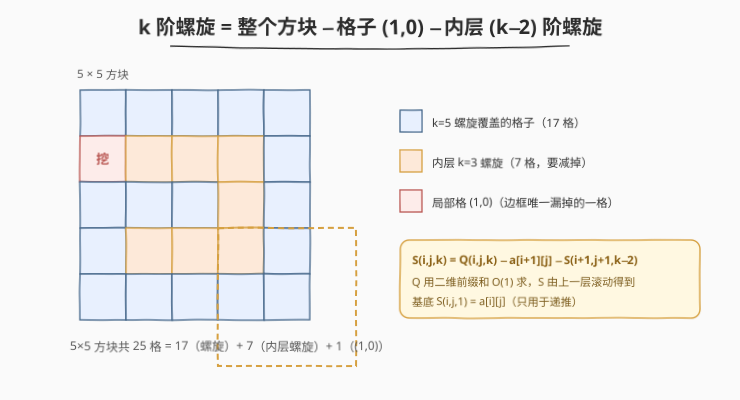
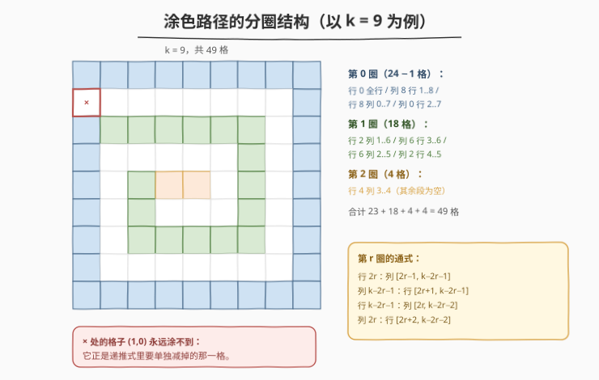

# Codeforces 173C 螺旋矩阵最大和 题解

## 1. 题目概述

- **题目链接**：https://codeforces.com/problemset/problem/173/C
- **比赛来源**：Croc Champ 2012 - Round 1 · Problem C（UTC 2012-04-06）
- **难度**：1900
- **标签**：暴力、动态规划、前缀和
- **评测类型**：普通
- **限制**：时间 3 s / 内存 256 MB

**题意**：在 $k\times k$ 的方格（$k\ge3$ 且为奇数）里，从左上方格出发按"右、下、左、上、右……"的螺旋方向逐格涂色，每条方向在两种情况下停止：**再走一步就会出界**，或**再走一步之后的下一格已经被涂过**。四个方向都走不动时涂色结束，涂出的格子集合称为一个 $k$ 阶螺旋。

给定 $n\times m$ 的数字表格，考虑**所有**不越界的螺旋（任意奇数阶 $k\ge3$、任意位置），求某个螺旋覆盖的格子数字之和的最大值。

**约束**：

- $3\le n,m\le 500$，$|a_{ij}|\le1000$。
- 螺旋的阶数 $k$ 是奇数且 $k\le\min(n,m)$，位置有 $(n-k+1)(m-k+1)$ 种。所有 $(k,\text{位置})$ 组合的数量是
  $$\sum_{k\ \text{odd}}(n-k+1)(m-k+1)\approx \frac{nm\min(n,m)}{6},$$
  $n=m=500$ 时约 $2.1\times10^7$。这个规模说明：**每个组合必须 $O(1)$ 求出螺旋和**，$O(k)$ 的"沿着螺旋走一遍"会变成 $10^{10}$。
- 数值范围：单个螺旋最多覆盖 $k^2\le 2.5\times10^5$ 格，每格 $\pm1000$，所以和不超过 $\pm2.5\times10^8$，`int` 勉强够用；但前缀和与中间量用 `long long` 更稳。
- 螺旋可能只覆盖少量格子（比如 $k=3$ 只有 7 格），但**负值格子会拖低答案**，所以不能只考虑最大的 $k$，必须把所有奇数阶都算一遍。

## 2. 示例与观察

官方样例 1（输入 / 输出原样）：

```text
输入：
6 5
0 0 0 0 0
1 1 1 1 1
0 0 0 0 1
1 1 1 0 1
1 0 0 0 1
1 1 1 1 1

输出：
17
```

最强的是 $5$ 阶螺旋放在 $(1,0)$（第 2 行第 1 列）。这个 $5\times5$ 方块的和是 $0+1+1+1+1+1+0+0+0+0+1+1+1+0+1+1+0+0+0+1+1+1+1+1+1=17$，而它的"洞"恰好全是 0，所以螺旋和也是 17。

官方样例 2（输入 / 输出原样）：

```text
输入：
3 3
1 1 1
1 0 0
1 1 1

输出：
6
```

只有 $3$ 阶一种可能（$k=3$）。$3\times3$ 方块总和是 7，但螺旋**不包含中心格**（值为 0），也不包含 $(1,0)$（值为 1，见 3.2 的递归式），所以答案是 $7-0-1=6$。这一个样例就把"螺旋 = 整个方块"的错误理解排除掉了。

官方样例 3（输入 / 输出原样）：

```text
输入：
6 6
-3 2 0 1 5 -1
4 -1 2 -3 0 1
-5 1 2 4 1 -2
0 -2 1 3 -1 2
3 1 4 -3 -2 0
-1 2 -1 3 1 2

输出：
13
```

正负混排时"大 $k$ 不一定最好"，最优解是一个较小的螺旋——这正是要枚举所有阶数的原因。

**观察 1**：$3$ 阶螺旋是"外圈 8 格去掉 $(1,0)$"，共 7 格；它不是整个 $3\times3$ 方块，也不是完整外圈。简单样例 2 已经证明。

**观察 2**：$k$ 阶螺旋的形状有严格的自相似结构（下一节），可以写成一个只依赖"$(k-2)$ 阶螺旋"的递推式，这就是 $O(1)$ 转移的来源。

## 3. 解题思路

### 3.1 朴素做法与瓶颈

最直接的做法是：对每个 $k$ 用模拟法把螺旋涂一遍得到格子集合，再对每个位置求一次和。模拟单个螺旋是 $O(k^2)$（它涂的格子数就是这么多），总复杂度

$$\sum_{k}(n-k+1)(m-k+1)\cdot k^2=O(nm\min^3)\approx 10^{10},$$

3 s 内绝无可能。即使把"涂色"预处理好，对每个位置求和仍是 $O(k^2)$。

真正的浪费在于：$k$ 阶螺旋与 $(k-2)$ 阶螺旋的形状几乎完全一样——只差最外面一圈和"一个洞"。抓住这一点就能把每次转移降到 $O(1)$。

### 3.2 核心观察：$k$ 阶螺旋 = $k$ 阶方块 − 一个洞 − $(k-2)$ 阶螺旋



把螺旋放在以 $(i,j)$ 为左上角、边长 $k$ 的方块里，局部坐标 $(r,c)$ 满足 $0\le r,c<k$。记 $S(i,j,k)$ 为这个螺旋覆盖的格子权值和，$Q(i,j,k)$ 为整个 $k\times k$ 方块的权值和，则

$$S(i,j,k)=Q(i,j,k)-a_{i+1,j}-S(i+1,j+1,k-2),\qquad S(i,j,1)=a_{i,j}.$$

也就是说：**$k$ 阶螺旋覆盖的格子，恰好是 $k\times k$ 方块去掉局部格 $(1,0)$、再去掉以 $(1,1)$ 为左上角的 $(k-2)$ 阶螺旋**。

为什么？先看涂色路径。$k$ 阶螺旋的路径可以按"圈"分成若干段（局部坐标，$r\ge1$）：

- 第 0 圈：上边整行 `[0, k-1]`、右边 `[1, k-1]`、下边整行 `[0, k-2]`、左边从下往上 `[2, k-2]`——只差 $(1,0)$ 就把整个边框涂满了，而路径正是在 $(1,0)$ 前停下（再走一步之后是已涂的 $(0,0)$）。
- 第 $r$ 圈（$r\ge1$）：上边第 $2r$ 行、列区间 $[2r-1,\ k-2r-1]$；右边第 $k-2r-1$ 列、行区间 $[2r+1,\ k-2r-1]$；下边第 $k-2r-1$ 行、列区间 $[2r,\ k-2r-2]$；左边第 $2r$ 列、行区间 $[2r+2,\ k-2r-2]$。区间为空就结束。

把这些区间和内层 $(k-2)$ 阶螺旋（左上角 $(1,1)$）的同类区间逐行对照，会发现两层用的行列奇偶性正好错开：$k$ 阶螺旋在内层方块里占的是偶数行/偶数列，而 $(k-2)$ 阶螺旋占的是奇数行/奇数列，二者的区间在每一行上恰好互补。于是内层方块里"没被 $k$ 阶螺旋涂到"的格子，恰好就是 $(k-2)$ 阶螺旋涂到的格子——再加上边框上唯一漏掉的 $(1,0)$，就得到上面的递归式。



递归式的直接好处：$Q(i,j,k)$ 用二维前缀和 $O(1)$ 求出，$a_{i+1,j}$ 是单点，$S(i+1,j+1,k-2)$ 正是上一层 DP 已经算好的值。于是每个 $(i,j,k)$ 只要常数时间。

### 3.3 算法流程

1. 读入表格，做二维前缀和 $P$，于是任意方块和 $Q(i,j,k)=P_{i+k,j+k}-P_{i,j+k}-P_{i+k,j}+P_{i,j}$。
2. 令 `prev[i][j] ← a[i][j]`，表示 $k=1$ 的 $S$（递归的基底；$k=1$ 不是合法答案，只用于递推）。
3. 对 $k=3,5,7,\dots\le\min(n,m)$：
   - 对所有 $i\le n-k$、$j\le m-k$：`cur[i][j] ← Q(i,j,k) - a[i+1][j] - prev[i+1][j+1]`，并用它更新答案。
   - `prev ← cur`（滚动数组，只保留相邻两层）。
4. 输出答案。

因为 $k$ 每次加 2，`prev` 恰好是 $(k-2)$ 阶的结果；又因为 $(i+1)+(k-2)\le n$ 与 $i+k\le n$ 等价，下标不会越界。

### 3.4 样例走查：样例 1 的最优解

取左上角 $(1,0)$、$k=5$（第 2–6 行、第 1–5 列）：

| 步骤 | 量 | 值 |
|------|----|----|
| $Q(1,0,5)$ | 整个 $5\times5$ 方块和 | $1+1+1+1+1\;+\;0+0+0+0+1\;+\;1+1+1+0+1\;+\;1+0+0+0+1\;+\;1+1+1+1+1=17$ |
| $a_{2,0}$ | 局部 $(1,0)$ 的权值 | $0$ |
| $S(2,1,3)$ | 内层 $3$ 阶螺旋 | 见下 |

内层 $3$ 阶螺旋的左上角是 $(2,1)$，覆盖的 3 行 3 列是

$$\begin{matrix}0&0&0\\1&1&0\\0&0&0\end{matrix}$$

外圈 8 格之和为 $1$，去掉局部 $(1,0)$ 那格（全局 $(3,1)$，值 $1$）后剩 $0$，即 $S(2,1,3)=0$。于是

$$S(1,0,5)=17-0-0=17,$$

与官方输出 17 一致。

再走样例 2 的 $3\times3$：$Q=7$，$a_{1,0}=1$，$S(1,1,1)=a_{1,1}=0$，得 $7-1-0=6$，与官方输出一致。

## 4. 正确性证明

以下都在 $k\times k$ 方块的局部坐标里讨论，$k$ 为奇数。

**引理 1（分圈结构）**：涂色路径按如下顺序涂格子（区间为空则跳过）：

- 第 0 圈：行 $0$ 的列 $[0,k-1]$；列 $k-1$ 的行 $[1,k-1]$；行 $k-1$ 的列 $[0,k-2]$；列 $0$ 的行 $[2,k-2]$。
- 第 $r$ 圈（$r\ge1$）：行 $2r$ 的列 $[2r-1,\,k-2r-1]$；列 $k-2r-1$ 的行 $[2r+1,\,k-2r-1]$；行 $k-2r-1$ 的列 $[2r,\,k-2r-2]$；列 $2r$ 的行 $[2r+2,\,k-2r-2]$。

**证明**：对"段"的编号归纳，逐段验证"停止条件"恰好把段截在上面给出的端点。

段 1（向右）：从 $(0,0)$ 起，能一直走到 $(0,k-1)$，因为再下一步出界；所以是列 $[0,k-1]$。

段 2（向下）：从 $(0,k-1)$ 起，只要"再下一格之后的一格"未被涂就继续。列 $k-1$ 上已涂的只有 $(0,k-1)$，所以一直走到 $(k-1,k-1)$（此时再下一步出界）。

段 3（向左）：行 $k-1$ 上已涂 $(k-1,k-1)$，走到列 $0$ 时"下一格出界"，停。

段 4（向上）：列 $0$ 上已涂 $(k-1,0)$ 与 $(0,0)$。从 $(k-1,0)$ 上行时，在 $(r,0)$ 处"下一格之后的一格"是 $(r-2,0)$；当 $r=2$ 时它是 $(0,0)$，已涂，故停在 $(2,0)$，涂了行 $[2,k-2]$。

段 5（向右）：行 $2$ 上已涂 $(2,0)$。在 $(2,c)$ 处"下一格之后"是 $(2,c+2)$；已涂的行 2 格子只有 $(2,0)$，故当 $c+2=k-1$ 即 $c=k-3$ 时停，涂了列 $[1,k-3]$。

段 6（向下）：列 $k-3$ 上已涂 $(2,k-3)$，往下的"下一格之后"会撞上行 $k-1$（已涂），故停在行 $k-3$，涂了行 $[3,k-3]$。

段 7（向左）：行 $k-3$ 上已涂 $(k-3,k-3)$，往左的"下一格之后"会撞上列 $0$（已涂），故停在列 $2$，涂了列 $[2,k-4]$。

段 8（向上）：列 $2$ 上已涂 $(k-3,2)$，往上的"下一格之后"会撞上行 $2$（已涂），故停在行 $4$，涂了行 $[4,k-4]$。

至此每一圈的四段形状都确定，且 $r\to r+1$ 时边界各内缩 2，归纳即得通式。∎

**引理 2（洞的结构）**：$k$ 阶螺旋覆盖的格子集合等于 $k\times k$ 方块减去 $\{(1,0)\}$ 再减去 $\{(r+1,c+1):(r,c)\ \text{被}(k-2)\text{阶螺旋覆盖}\}$。

**证明**：由引理 1，$k$ 阶螺旋不覆盖的任何格子必然落在内层方块 $[1,k-2]\times[1,k-2]$ 内（第 0 圈只漏了 $(1,0)$）。把引理 1 的公式限制到内层方块，并把 $(k-2)$ 阶螺旋（左上角 $(1,1)$）的公式也平移进同一坐标系比较：

- $k$ 阶螺旋在内层方块里的行列编号是偶数（$2r$ 与 $k-2r-1$ 都是偶数，因为 $k$ 是奇数）；
- $(k-2)$ 阶螺旋平移后的行列编号是奇数（$2r+1$ 与 $k-2-2r$）。

两者的行列奇偶性互斥，所以覆盖集合不相交。再看每一行上两者的列区间：$k$ 阶螺旋的行 $2r$ 覆盖列 $[2r-1,k-2r-1]$，而同一条行上 $(k-2)$ 阶螺旋覆盖的是（平移后）列 $[2r,k-2r-2]$ 之类的互补区间，端点恰好首尾相接、无缝无叠。逐行核对即知：内层方块里每一格要么被 $k$ 阶螺旋涂到，要么被平移后的 $(k-2)$ 阶螺旋涂到，恰居其一。加上漏掉的 $(1,0)$，即得结论。∎

**引理 3（递推正确）**：对 $k\ge3$ 奇数，$S(i,j,k)=Q(i,j,k)-a_{i+1,j}-S(i+1,j+1,k-2)$。

**证明**：由引理 2，$k$ 阶螺旋的格子集合与"$\{(i+1,j)\}$ ∪ 平移后的 $(k-2)$ 阶螺旋"互不相交，且并集是整个方块（格子数 $|P_k|+1+|P_{k-2}|=k^2$ 也吻合）。对权值求和即得。∎

**定理**：算法输出的最大值等于题目要求的最大螺旋和。

**证明**：算法枚举了全部合法的 $(i,j,k)$（$k$ 为奇数且 $3\le k\le\min(n,m)$，$i\le n-k$，$j\le m-k$），由引理 3 与归纳（基底 $k=1$ 时 $S=a_{i,j}$）知每个 $S(i,j,k)$ 都被正确计算，取最大值即为答案。∎

## 5. 复杂度分析

- **时间**：$O\!\left(\sum_{k\ \text{odd}}(n-k+1)(m-k+1)\right)=O(nm\min(n,m))$。$n=m=500$ 时约 $2.1\times10^7$ 次转移，每次 4 次前缀和取值、3 次加减。
- **空间**：$O(nm)$。一张 $500\times500$ 的 `long long` 前缀和表（2 MB）加两层滚动数组（各 2 MB），总计约 6 MB。
- **与时限的关系**：C++ 实测 $n=m=500$ 时 35 ms，3 s 的余量接近 90 倍。Python 版是同一递推的直译，CPython 3.9 实测约 5.2 s（每个 $(i,j,k)$ 都要走一次解释器循环，$2.1\times10^7$ 次），**超过 3 s 时限**：本题建议提交 C++，或把 Python 交给 PyPy3（纯整数循环在 PyPy 上通常快一个数量级）。
- **数值范围**：单个 $S$ 的绝对值不超过 $k^2\max|a|\le2.5\times10^8$，`int` 够用；但前缀和里 $P_{i,j}$ 可能累积到 $500\times500\times1000=2.5\times10^8$，仍安全。用 `long long` 是为了避免"和 - 和"时中间负值叠加的意外。

## 6. 参考代码

### C++17

```cpp
#include <bits/stdc++.h>
using namespace std;

int main() {
    int n, m;
    if (scanf("%d %d", &n, &m) != 2) return 0;
    vector<vector<long long>> a(n, vector<long long>(m));
    for (int i = 0; i < n; ++i)
        for (int j = 0; j < m; ++j) scanf("%lld", &a[i][j]);

    vector<vector<long long>> P(n + 1, vector<long long>(m + 1, 0));   // 二维前缀和
    for (int i = 0; i < n; ++i)
        for (int j = 0; j < m; ++j)
            P[i + 1][j + 1] = P[i][j + 1] + P[i + 1][j] - P[i][j] + a[i][j];

    int W = m;
    vector<long long> prev(n * W), cur(n * W);
    for (int i = 0; i < n; ++i)                    // 基底：k = 1
        for (int j = 0; j < m; ++j) prev[i * W + j] = a[i][j];

    long long best = LLONG_MIN;
    for (int k = 3; k <= min(n, m); k += 2) {
        for (int i = 0; i + k <= n; ++i) {
            for (int j = 0; j + k <= m; ++j) {
                long long sq = P[i + k][j + k] - P[i][j + k] - P[i + k][j] + P[i][j];
                long long v = sq - a[i + 1][j] - prev[(i + 1) * W + (j + 1)];
                cur[i * W + j] = v;
                if (v > best) best = v;
            }
        }
        swap(prev, cur);                           // 滚动：只保留相邻两层
    }
    printf("%lld\n", best);
    return 0;
}
```

### Python3

```python
import sys


def main() -> None:
    data = sys.stdin.buffer.read().split()
    n, m = int(data[0]), int(data[1])
    a = [[0] * m for _ in range(n)]
    p = 2
    for i in range(n):
        row = a[i]
        for j in range(m):
            row[j] = int(data[p]); p += 1

    P = [[0] * (m + 1) for _ in range(n + 1)]          # 二维前缀和
    for i in range(n):
        Pi, Pi1, ai = P[i], P[i + 1], a[i]
        for j in range(m):
            Pi1[j + 1] = Pi[j + 1] + Pi1[j] - Pi[j] + ai[j]

    W = m
    prev = [0] * (n * W)
    for i in range(n):
        prev[i * W:i * W + m] = a[i]                   # 基底：k = 1

    best = -10 ** 18
    k = 3
    while k <= min(n, m):
        cur = [0] * (n * W)
        for i in range(n - k + 1):
            base = i * W
            sq_top, sq_bot = P[i], P[i + k]
            arow = a[i + 1]
            prow = (i + 1) * W
            for j in range(m - k + 1):
                sq = sq_bot[j + k] - sq_top[j + k] - sq_bot[j] + sq_top[j]
                v = sq - arow[j] - prev[prow + j + 1]
                cur[base + j] = v
                if v > best:
                    best = v
        prev = cur
        k += 2
    sys.stdout.write(str(best) + "\n")


main()
```

## 7. 边界情况与易错点

1. **$k=3$ 的螺旋不是整个方块**：它漏掉局部 $(1,1)$（中心）和 $(1,0)$，共 7 格。写成"整个方块"会在样例 2 上输出 7（错），这是本题最容易踩的坑。
2. **递推里的 $a[i+1][j]$ 是 $(1,0)$ 而不是 $(0,1)$**：漏掉的是边框上"从下往上走时最后一步没能踏进的那一格"，位于左边界、第二行；写成 $(1,j)$ 或 $(0,1)$ 都会错。
3. **$k=1$ 必须作为基底且不能计入答案**：递推需要 $S(i,j,1)=a_{i,j}$；但题面要求 $k\ge3$，把 $k=1$ 的结果也算进最大值会让答案为"最大单格"（样例 2 会输出 1 而不是 6）。
4. **滚动数组的下标对齐**：`prev` 存的是 $(k-2)$ 阶结果，取的是 `prev[(i+1)*W + (j+1)]`；若图省事写成 `prev[i*W+j]` 就会把两层错位，样例 1 立刻给出错误答案。
5. **越界**：$i+k\le n$ 与 $(i+1)+(k-2)\le n$ 恰好等价，但 $a[i+1][j]$ 要求 $i+1<n$，而 $k\ge3$ 保证了 $i+1\le n-2<n$。Python 里负数下标不会报错，只会悄悄取到别的行，务必确认循环上界写的是 `n-k+1`。
6. **负权值**：`best` 要初始化为极小值（`LLONG_MIN` / `-10**18`），不能用 0；样例 3 全是负数与正数混排，用 0 初始化可能输出 0（虽然本题 $k=3$ 的螺旋至少有一格正数……但不保证）。
7. **$|a_{ij}|$ 与规模**：$k$ 最大 499 时螺旋约 12.5 万格，和可达 $1.25\times10^8$，`int` 刚好不溢出但余量小；统一用 `long long` 最省心。
8. **行列可以不等**：$n\ne m$ 时上界取 $\min(n,m)$，循环里 $i$ 与 $j$ 的上界分别是 $n-k$、$m-k$，不能都写成 $\min$（样例 1 是 $6\times5$）。

## 8. 验证记录

- **编译环境与命令**：`Apple clang 21.0.0` + `codeforces/tools/include/bits/stdc++.h` 兼容头（`clang++ -std=c++17 -O2`）；Python 3.9.6。`python3 codeforces/tools/verify_solution.py codeforces/contests/0101-0203/173/C_螺旋矩阵最大和.md` 输出 C++ 3/3、Python 3/3。
- **官方样例**：3 / 3 通过（$k=3$ 只有一种、$5$ 阶最优、正负混排）。
- **独立暴力对拍**：暴力程序**完全按题面模拟涂色**（四个方向、两种停止条件、逐格涂色），对每个 $k$ 生成格子集合后枚举所有位置求和取最大，绝不使用递推式。随机取 $n,m\in[3,9]$、权值 $\in[-9,9]$ 的 **240 组**数据，与正文 C++ 逐 token 比对全部一致；另外单独用 60 组随机网格核对"递归式 == 模拟涂色"的逐点集合关系（$k$ 从 3 到 $\min(n,m)$ 全部位置），也全部一致——这同时验证了 3.2 的洞结构。
- **最大约束性能**：$n=m=500$ 随机权值，C++ 端到端 35 ms（约 $2.1\times10^7$ 次转移），Python 版 5.2 s（超 3 s，已在正文注明建议 C++/PyPy3）；峰值内存 C++ 约 6 MB、Python 约 25 MB。
- **图片校验**：两张 SVG（`cf173c_recursion.svg`、`cf173c_arcs.svg`）通过 `xml.etree.ElementTree.parse`，文本包围盒均在 `viewBox` 内。
- **复核状态**：verified（样例、240 组模拟涂色对拍、60 组递归式逐点核对、性能、图片五项实跑通过）。

## 相关题目与扩展

- [Codeforces 173B Chamber of Secrets](https://codeforces.com/problemset/problem/173/B)：同场 B 题，"把网格转成行列二部图"的另一种 $O(nm)$ 建模。
- [Codeforces 172C 校园公交调度](https://codeforces.com/problemset/problem/172/C)：同系列上一场，同样是"先想清楚一次操作的结构，再 $\times$ 枚举次数"。
- [LeetCode 59. 螺旋矩阵 II](https://leetcode.cn/problems/spiral-matrix-ii/)：生成螺旋矩阵本身，可以和本题引理 1 的分圈公式对照着写。
- [Codeforces 6C Alice, Bob and Chocolate](https://codeforces.com/problemset/problem/6/C)：前缀和 + 枚举位置的基础题。

**延伸思考**：

1. **如果螺旋不是从左上角出发，而是从任意格子出发**：形状完全变了，分圈结构不再成立；但"$k$ 阶螺旋 = 某集合"的关系式仍然存在，需要用四套递推（按起点所在方向分类）。
2. **如果要求输出最优螺旋的位置和阶数**：只需在更新 `best` 时记录 $(i,j,k)$；滚动数组不影响记录，内存不变。
3. **如果 $n,m$ 涨到 $2000$**：$O(nm\min)$ 会变成 $1.3\times10^{10}$，不可行。注意递推式里的 $Q$ 可以 $O(1)$ 求，但 $S(i+1,j+1,k-2)$ 无法合并——这是"每个状态都要枚举"的本质。除非发现螺旋和可用更少的参数表示（例如只依赖少数几条对角前缀和），否则难以降维。
4. **如果把"下一格之后"的停止条件改成"下一格"就停**：洞会变成中心格，$3$ 阶螺旋就是完整外圈（8 格），递归式变为 $S=Q-S_{\text{inner}}-0$（挖掉中心）；可见"漏一格"这个细节完全由停止条件决定，改一个词就换一道题。
