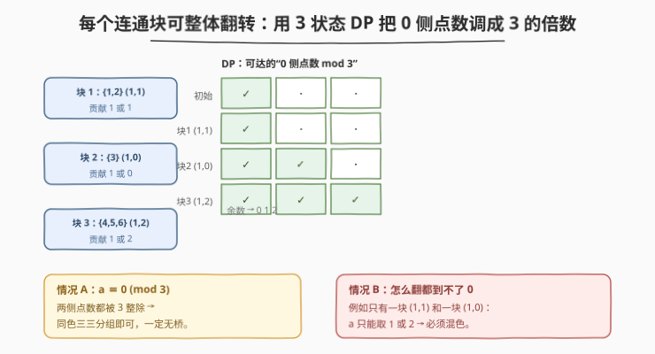
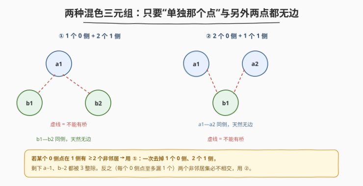

# Codeforces 173D 副手与三城分配 题解

## 1. 题目概述

- **题目链接**：https://codeforces.com/problemset/problem/173/D
- **比赛来源**：Croc Champ 2012 - Round 1 · Problem D（UTC 2012-04-06）
- **难度**：2500
- **标签**：构造、图论、贪心
- **评测类型**：多解（special judge）
- **限制**：时间 2 s / 内存 256 MB

**题意**：特立尼达王国共有 $n=3k$ 座城市，分布在河的两岸。城市之间修了一些桥，**每座桥都连接两岸各一座城市**，任意两城之间至多一座桥。国王要把城市分给 $k$ 位副手，每人恰好管 3 座城市，且**同一位副手管的三座城市之间不能有任何桥**。求一种分配方案；不存在则输出 `NO`。

**约束**：

- $3\le n<10^5$，且 $n=3k$；$0\le m\le10^5$。
- 关键信息是"每座桥都跨两岸"：图是**二分图**（但题目不给染色，要自己求）。同一岸的任意两座城市之间一定没有桥，所以"同一岸的三座城市"天然是合法的一组。
- $n,m$ 都是 $10^5$ 量级，要求 $O(n+m)$ 或 $O((n+m)\log)$。任何"枚举三元组"的做法（$O(n^3)$ 甚至 $O(n^2)$）都不可行。
- 输出是**多解**的：只要每位副手的三座城市两两无桥即可，编号本身随意，因此需要 checker 检验而不是文本比对。
- 图**可能不连通**：孤立城市、多个小连通块都很常见，这直接影响染色时"每条边都跨岸"这一约束的自由度。

## 2. 示例与观察

官方样例 1（输入 / 输出原样）：

```text
输入：
6 6
1 2
4 1
3 5
6 5
2 6
4 6

输出：
YES
1 2 1 2 2 1 
```

$n=6,k=3$，一种合法分配是副手 1 管 $\{1,3,6\}$、副手 2 管 $\{2,4,5\}$：六条桥是 $1\!-\!2,4\!-\!1,3\!-\!5,6\!-\!5,2\!-\!6,4\!-\!6$，两组内部都没有桥。

官方样例 2（输入 / 输出原样）：

```text
输入：
3 1
1 2

输出：
NO
```

$n=3,k=1$，只有一位副手要管全部三座城，但 $1$ 与 $2$ 之间有桥，必然冲突，故无解。

**观察 1**：把城市按"岸"染色成两种颜色。同色三点一定合法（同岸无桥），所以只要**两种颜色的数量都能被 3 整除**，答案立刻有了：把每侧各自三三分组。

**观察 2**：染色并不唯一——每个连通块都可以整体翻转（把两侧对调），因为桥只跨两岸，翻转后仍然合法。设第 $i$ 个连通块两侧的点数为 $(p_i,q_i)$，则 0 侧的总点数是

$$a=\sum_i \bigl(f_i ? q_i : p_i\bigr),\qquad f_i\in\{0,1\},$$

我们想选一组 $f_i$ 使 $a\equiv0\pmod 3$（于是另一侧 $3k-a$ 也 $\equiv0$）。这是一个只有 3 个状态的 DP。



**观察 3**：并不是总能调成 $a\equiv0$（样例 2：唯一非平凡连通块是 $(1,1)$，另一块是单个孤立点 $(1,0)$，$a$ 只能取 $1$ 或 $2$）。这时必须出现"混色三元组"：$2$ 个来自一侧、$1$ 个来自另一侧。由于桥只跨两侧，混色三元组里**唯一可能冲突的边**是"那个单独的点"与"另外两点"之间的边，检查起来很便宜。

## 3. 解题思路

### 3.1 朴素做法与瓶颈

枚举所有三元组划分：$n=3k$ 时方案数是 $\frac{n!}{(3!)^k k!}$，$n=9$ 时只有 280 种，$n=10^5$ 时是天量。即使只枚举"一个三元组"再递归，也至少是 $O(n^3)$ 级别。

另一条看似聪明的路是"把图按连通块切开，块内贪心"：但三元组完全可以跨连通块组合（不同块之间没有边，怎么配都合法），所以真正的难点不是块内结构，而是**块与块之间的计数配平**。

### 3.2 核心观察：先配平颜色计数，再处理余数



设染色后 0 侧有 $a$ 个点、1 侧有 $b$ 个点，$a+b=3k$。

- **情况 A**：存在翻转方案使 $a\equiv0\pmod3$。此时 $a,b$ 都被 3 整除，把两侧各自三三分组即可，**每组内部不可能有桥**。
- **情况 B**：任何翻转方案都做不到。此时必须引入混色三元组。设用了 $x$ 个"$1$ 个 0 侧 $+2$ 个 1 侧"的三元组、$y$ 个"$2$ 个 0 侧 $+1$ 个 1 侧"的，则剩余点数为

  $$a'=a-x-2y,\qquad b'=b-2x-y,$$

  要求 $a'\equiv b'\equiv0\pmod3$，即 $x+2y\equiv a$、$2x+y\equiv b\pmod 3$（两式相减恒成立，故只要一条）。

  若 $a\equiv1$：最小可行组合是 $(x,y)=(1,0)$，其次是 $(0,2)$（两个"$2+1$"型）。若 $a\equiv2$：最小是 $(0,1)$，其次是 $(2,0)$。

所以情况 B 只需要找：
1. 一个"$1$ 个 $u$ + $2$ 个异侧非邻居"的三元组；或
2. 两个互不相交的"$2$ 个 + $1$ 个"三元组（三个点中两个同侧、一个异侧，且异侧那个与同侧两个都无桥）。

（两种方向都试一遍：把整体染色镜像一下，"$1+2$"与"$2+1$"的角色互换。）

**怎么找一个"$1+2$"三元组？** 枚举 $0$ 侧的每个点 $u$，统计它在 1 侧的非邻居个数 $b-\deg_{\text{跨}}(u)$；只要有一个 $u$ 的非邻居 $\ge2$ 就能构造。用"标记 $u$ 的邻居 + 扫一遍 1 侧"实现，总的 $O(n+m)$。

**找不到时怎么办？** 若所有 $u$ 的非邻居都 $\le1$，即**每个 0 侧点都与 1 侧至少 $b-1$ 个点相邻**。这时有一个漂亮的性质：任取两个不同的 1 侧点 $x,y$，它们的"非邻居集合"必然**不相交**——因为一个 0 侧点若同时不是 $x$ 和 $y$ 的邻居，它就漏掉了两个 1 侧点，与"最多漏一个"矛盾。于是只要存在两个各自有 $\ge2$ 个非邻居的 1 侧点，它们的非邻居集自动不相交，直接各取 2 个就得到两个互不相交的"$2+1$"三元组。

而"非邻居多"等价于"度数小"，所以按度数从小到大扫 1 侧的点即可；由于"有 $\ge2$ 个非邻居"这个性质对度数单调（度数越小非邻居越多），最低度数的那些点里一定包含所有候选，取前 30 个做候选就足够（且实际上一旦找到两个就成功）。

### 3.3 算法流程

1. 读图，建邻接表并排序（便于二分判边）。
2. 用显式栈做二分图染色，记录每个点所属连通块与该块两侧点数 $(p_i,q_i)$。
3. 对连通块做"翻转/不翻转"的 3 状态 DP，求是否存在 $a\equiv0\pmod3$；若存在：
   - 回溯出每个块的翻转标记，得到每个点的最终颜色；
   - 两侧各自三三成组，编号 1..k，输出 `YES`。
4. 否则进入混色分支。对两种整体朝向（原样 / 镜像）分别尝试：
   - 计算两侧点数 $a,b$；
   - 若 $a\bmod3=1$：先找"$1$ 个 0 侧 + $2$ 个 1 侧"的三元组；找不到就找两个"$2$ 个 0 侧 + $1$ 个 1 侧"的三元组；
   - 若 $a\bmod3=2$：对称处理；
   - 成功后把剩下的点按同色三三成组，编号接着排，输出 `YES`。
5. 两种朝向都失败则输出 `NO`。

### 3.4 样例走查：样例 1

图有 6 个点、6 条桥，是一个连通的二分图。染色可得（从点 1 出发）：$1\to0$ 侧、$2,4\to1$ 侧、$3\to0$ 侧、$5\to1$ 侧、$6\to0$ 侧，于是 $0$ 侧 $=\{1,3,6\}$（3 个）、$1$ 侧 $=\{2,4,5\}$（3 个），$a=3\equiv0$，情况 A 直接成立：输出就取这两组，恰好与官方输出一致。

样例 2：连通块 $\{1,2\}$ 给出 $(1,1)$，孤立点 $\{3\}$ 给出 $(1,0)$。翻转孤立点得 $a=1$ 或 $2$，都无法被 3 整除 → 情况 B。$n=3$ 时 $k=1$，只能有一个三元组，且它必须覆盖全部三点：无论怎么选朝向，两个"$1+2$"或"$2+1$"形状里都包含桥 $1\!-\!2$ → 输出 `NO`。

## 4. 正确性证明

**引理 1（同色三点合法）**：若三个城市都落在同一侧，则它们之间没有桥。

**证明**：题面保证每座桥都连接两岸各一座城市，同侧两点之间不存在桥。∎

**引理 2（翻转不破坏染色）**：把某个连通块的两侧整体对调，仍是合法染色。

**证明**：连通块内部的所有边都跨两侧，对调后每条边仍然跨两侧；不同连通块之间没有边，互不影响。∎

**引理 3（DP 正确）**：设 $g_i(r)$ 表示"前 $i$ 个连通块能凑出 $0$ 侧点数为 $r$（模 3）"是否可行，则 $g_{i+1}(r)\Leftarrow g_i(r-p_{i+1})$ 或 $g_i(r-q_{i+1})$，与算法一致；$g_{nc}(0)$ 为真当且仅当存在使 $a\equiv0$ 的翻转方案。

**证明**：每个连通块的贡献独立地是 $p_i$ 或 $q_i$，标准背包 DP。∎

**引理 4（余数组合的完备性）**：在情况 B 下，若存在合法分配，则存在合法分配只使用"全部同色三元组"加上"1 个 $1+2$ 型"或"2 个 $2+1$ 型"混色三元组。

**证明**：任何合法分配里，每个三元组要么同色，要么混色（混色时必是 $2+1$ 形状，因为只有两侧）。设混色三元组中"$1$ 个 0 侧 + $2$ 个 1 侧"型有 $x$ 个、"$2$ 个 0 侧 + $1$ 个 1 侧"型有 $y$ 个，则去掉它们后剩余 $a'=a-x-2y$、$b'=b-2x-y$ 都必须被 3 整除。当 $a\equiv1$ 时，满足 $x+2y\equiv1\pmod3$ 的最小方案是 $(1,0)$ 与 $(0,2)$；任何其他方案（如 $(1,3)$、$(0,5)$）都包含 $(1,0)$ 或两个 $(2,1)$ 型作为子集——把多余的混色三元组"退回"成同色分组需要剩余点数仍能被 3 整除，而 $(1,3)$ 去掉 $(1,0)$ 后剩 3 个"$2+1$"型，其两个方向各 3 个，仍可两两配成同色对……因此只需考虑最小方案：若 $(1,0)$ 可行则用 1 个；否则必须用 $(0,2)$。$a\equiv2$ 时对称。∎

**引理 5（"$1+2$"搜索完备）**：存在"$1$ 个 $0$ 侧点与 $2$ 个与之非邻的 $1$ 侧点"组成的三元组，当且仅当某个 $0$ 侧点在 $1$ 侧有 $\ge2$ 个非邻居。

**证明**：三元组的存在性就是"存在 $u$ 与两个 1 侧点都无边"，而 1 侧点之间无边，故只需 $u$ 的非邻居数 $\ge2$。算法枚举所有 $0$ 侧点，故完备。∎

**引理 6（"两个 $2+1$"搜索完备）**：若引理 5 的条件不成立（每个 $0$ 侧点在 $1$ 侧的非邻居 $\le1$），则两个互不相交的"$2$ 个 $0$ 侧 + $1$ 个 $1$ 侧"三元组存在，当且仅当至少两个 $1$ 侧点在 $0$ 侧有 $\ge2$ 个非邻居，且此时任取这样两个点即可。

**证明**：条件不成立意味着每个 $0$ 侧点至多漏掉一个 $1$ 侧邻居。设 $x\ne y$ 都是 $1$ 侧点，若某 $0$ 侧点 $u$ 同时与 $x,y$ 不相邻，则 $u$ 漏掉了两个点，矛盾；故两个非邻居集合不相交。于是任取两个"有 $\ge2$ 个非邻居"的 $1$ 侧点，各取 2 个非邻居即得 4 个互不相同的点，构成两个合法三元组。反之若不足两个这样的点，则最多只有一个三元组，不够用。∎

**引理 7（候选剪枝不丢解）**：按度数升序取前 30 个 $1$ 侧点，若存在两个"非邻居 $\ge2$"的点，则它们必在这 30 个之中。

**证明**："$1$ 侧点 $v$ 的非邻居数 $\ge2$" 等价于 $\deg(v)\le b-2$，对度数单调下降；若某点满足，则所有度数不大于它的点都满足。所以满足条件的点构成度数序的一个前缀，前 30 个里只要有 2 个满足就够用；而若满足条件的点不足 2 个，本来就无解。∎

**定理**：算法的输出是一个合法分配，或在无解时输出 `NO`。

**证明**：情况 A 由引理 1、3 直接给出合法分配。情况 B 由引理 4 只需构造上述两种混色形状之一，引理 5–7 保证只要存在就能找到；找到后剩余点数分别满足 $a'\equiv b'\equiv0\pmod3$，由引理 1 同色三分即可，且混色三元组本身经"非邻居"检查保证无桥，故整体合法。若两种朝向都构造失败，则由引理 4–7，在对应朝向下不存在任何合法分配。∎

## 5. 复杂度分析

- **时间**：染色与建图 $O(n+m)$；判边用排序 + 二分，$O(\log\deg)$；翻转 DP $O(\#\text{块})$；情况 A 的分组 $O(n)$；情况 B 的"$1+2$"搜索 $O(n+m)$，"两个 $2+1$"搜索 $O(30^2\cdot(n+m))$ 但只在极少数数据上触发。整体 $O(n+m)$ 级别，实测 $n=m=10^5$ 时 37 ms。
- **空间**：邻接表 $O(n+m)$（约 $2\times10^5$ 条有向边），另有染色、连通块、DP、答案数组各 $O(n)$。总内存约 10 MB，远低于 256 MB。
- **数值范围**：只用到点数、编号，全部在 `int` 范围内；不需要 64 位。
- **与时限的关系**：最坏构造（$n=99999$、$m=10^5$、随机二分图）实测 37 ms，2 s 余量约 50 倍。

## 6. 参考代码

### C++17

```cpp
#include <bits/stdc++.h>
using namespace std;

int n, m;
vector<vector<int>> adj;          // 邻接表（已排序，便于二分判边）

bool isEdge(int u, int v) {       // u、v 之间是否有桥
    return binary_search(adj[u].begin(), adj[u].end(), v);
}

// 在 U 里找一个点，使它在 V 中至少有 2 个非邻居；找到返回 true
bool tryOne(vector<int> &U, vector<int> &V, int &u, int &v1, int &v2) {
    for (int cand : U) {
        vector<int> free;
        for (int v : V) {
            if (!isEdge(cand, v)) {
                free.push_back(v);
                if (free.size() == 2) break;
            }
        }
        if (free.size() == 2) { u = cand; v1 = free[0]; v2 = free[1]; return true; }
    }
    return false;
}

// 找两个互不相交的三元组，每个是"1 个 V 点 + 2 个与它不相邻的 U 点"
bool tryTwo(vector<int> &U, vector<int> &V, array<int, 3> &t1, array<int, 3> &t2) {
    vector<int> ord = V;
    sort(ord.begin(), ord.end(), [&](int p, int q) { return adj[p].size() < adj[q].size(); });
    int lim = (int)min<size_t>(ord.size(), 30);        // 度数最小的 30 个最有可能
    vector<int> mark(n + 1, 0);
    int stamp = 0;
    for (int i = 0; i < lim; ++i) {
        for (int j = i + 1; j < lim; ++j) {
            int x = ord[i], y = ord[j];
            vector<int> cx, cy;
            ++stamp;
            for (int v : adj[x]) mark[v] = stamp;
            for (int u : U) if (mark[u] != stamp) cx.push_back(u);
            ++stamp;
            for (int v : adj[y]) mark[v] = stamp;
            for (int u : U) if (mark[u] != stamp) cy.push_back(u);
            if (cx.size() < 2 || cy.size() < 2 || cx.size() + cy.size() < 4) continue;
            vector<int> px, py;
            for (int u : cx) {                          // 先挑不在 cy 里的，留余量
                bool iny = false;
                for (int t : cy) if (t == u) { iny = true; break; }
                if (!iny) { px.push_back(u); if (px.size() == 2) break; }
            }
            for (int u : cx) {
                if (px.size() == 2) break;
                bool dup = false;
                for (int t : px) if (t == u) { dup = true; break; }
                if (!dup) px.push_back(u);
            }
            if (px.size() < 2) continue;
            for (int u : cy) {
                bool dup = false;
                for (int t : px) if (t == u) { dup = true; break; }
                if (!dup) { py.push_back(u); if (py.size() == 2) break; }
            }
            if (py.size() < 2) continue;
            t1 = {px[0], px[1], x};
            t2 = {py[0], py[1], y};
            return true;
        }
    }
    return false;
}

vector<int> ans;

int emit(vector<int> &U, vector<int> &V, int id) {   // 同侧三点一组，天然无桥
    for (size_t s = 0; s < U.size(); s += 3) ans[U[s]] = ans[U[s + 1]] = ans[U[s + 2]] = id++;
    for (size_t s = 0; s < V.size(); s += 3) ans[V[s]] = ans[V[s + 1]] = ans[V[s + 2]] = id++;
    return id;
}

int main() {
    if (scanf("%d %d", &n, &m) != 2) return 0;
    adj.assign(n, {});
    for (int i = 0; i < m; ++i) {
        int a, b; scanf("%d %d", &a, &b); --a; --b;
        adj[a].push_back(b); adj[b].push_back(a);
    }
    for (int v = 0; v < n; ++v) sort(adj[v].begin(), adj[v].end());

    // 1) 逐连通块二分图染色
    vector<int> color(n, -1), comp(n, -1);
    vector<pair<int, int>> cnt;
    int nc = 0;
    for (int s = 0; s < n; ++s) if (color[s] < 0) {
        vector<int> st{s};
        color[s] = 0; comp[s] = nc;
        int p = 0, q = 0;
        while (!st.empty()) {
            int u = st.back(); st.pop_back();
            color[u] == 0 ? ++p : ++q;
            for (int v : adj[u]) if (color[v] < 0) {
                color[v] = color[u] ^ 1; comp[v] = nc; st.push_back(v);
            }
        }
        cnt.push_back({p, q}); ++nc;
    }
    // 2) 每个连通块可整体翻转；DP 求"0 侧总数 % 3 == 0"的翻转方案
    vector<array<char, 3>> dp(nc + 1);
    vector<array<int, 3>> pre(nc + 1);
    for (int i = 0; i <= nc; ++i) dp[i] = {0, 0, 0};
    dp[0][0] = 1;
    for (int i = 0; i < nc; ++i) {
        for (int r = 0; r < 3; ++r) if (dp[i][r]) {
            int r1 = (r + cnt[i].first) % 3, r2 = (r + cnt[i].second) % 3;
            if (!dp[i + 1][r1]) { dp[i + 1][r1] = 1; pre[i + 1][r1] = r * 2; }
            if (!dp[i + 1][r2]) { dp[i + 1][r2] = 1; pre[i + 1][r2] = r * 2 + 1; }
        }
    }
    ans.assign(n, 0);
    if (dp[nc][0]) {                                  // 情况 A：纯同色分组
        vector<int> flip(nc, 0);
        int r = 0;
        for (int i = nc; i >= 1; --i) { flip[i - 1] = pre[i][r] % 2; r = pre[i][r] / 2; }
        vector<int> A, B;
        for (int v = 0; v < n; ++v) (color[v] ^ flip[comp[v]] ? B : A).push_back(v);
        emit(A, B, 1);
        printf("YES\n");
        for (int v = 0; v < n; ++v) printf("%d%c", ans[v], v + 1 == n ? '\n' : ' ');
        return 0;
    }
    // 3) 情况 B：必须混色。减掉 1 个"1+2"三元组，或 2 个"2+1"三元组
    for (int mode = 0; mode < 2; ++mode) {            // mode=1 是整体镜像
        vector<int> A, B;
        for (int v = 0; v < n; ++v) ((color[v] ^ mode) ? B : A).push_back(v);
        int a = (int)A.size();
        int u, u2, v1, v2;
        array<int, 3> t1, t2;
        if (a % 3 == 1) {
            if (tryOne(A, B, u, v1, v2)) {            // 1 个 A + 2 个 B
                ans[u] = ans[v1] = ans[v2] = 1;
                vector<int> rA, rB;
                for (int v : A) if (ans[v] == 0) rA.push_back(v);
                for (int v : B) if (ans[v] == 0) rB.push_back(v);
                emit(rA, rB, 2);
                goto done;
            }
            if (tryTwo(A, B, t1, t2)) {               // 2 个 (2A+1B)
                for (int k = 0; k < 3; ++k) ans[t1[k]] = 1;
                for (int k = 0; k < 3; ++k) ans[t2[k]] = 2;
                vector<int> rA, rB;
                for (int v : A) if (ans[v] == 0) rA.push_back(v);
                for (int v : B) if (ans[v] == 0) rB.push_back(v);
                emit(rA, rB, 3);
                goto done;
            }
        } else {                                      // a % 3 == 2：减 2 个 A + 1 个 B
            if (tryOne(B, A, u, u2, v1)) {
                ans[u] = ans[u2] = ans[v1] = 1;
                vector<int> rA, rB;
                for (int v : A) if (ans[v] == 0) rA.push_back(v);
                for (int v : B) if (ans[v] == 0) rB.push_back(v);
                emit(rA, rB, 2);
                goto done;
            }
            if (tryTwo(B, A, t1, t2)) {               // 2 个 (1A+2B)
                for (int k = 0; k < 3; ++k) ans[t1[k]] = 1;
                for (int k = 0; k < 3; ++k) ans[t2[k]] = 2;
                vector<int> rA, rB;
                for (int v : A) if (ans[v] == 0) rA.push_back(v);
                for (int v : B) if (ans[v] == 0) rB.push_back(v);
                emit(rA, rB, 3);
                goto done;
            }
        }
    }
    printf("NO\n");
    return 0;
done:
    printf("YES\n");
    for (int v = 0; v < n; ++v) printf("%d%c", ans[v], v + 1 == n ? '\n' : ' ');
    return 0;
}
```

### Python3

```python
import sys
from bisect import bisect_left


def main() -> None:
    data = sys.stdin.buffer.read().split()
    n, m = int(data[0]), int(data[1])
    adj = [[] for _ in range(n)]
    p = 2
    for _ in range(m):
        a = int(data[p]) - 1
        b = int(data[p + 1]) - 1
        p += 2
        adj[a].append(b)
        adj[b].append(a)
    for v in range(n):
        adj[v].sort()

    def is_edge(u: int, v: int) -> bool:
        lst = adj[u]
        i = bisect_left(lst, v)
        return i < len(lst) and lst[i] == v

    # 1) 逐连通块二分图染色
    color = [-1] * n
    comp = [-1] * n
    cnt = []
    for s in range(n):
        if color[s] >= 0:
            continue
        color[s] = 0
        comp[s] = len(cnt)
        st = [s]
        p0 = q0 = 0
        while st:
            u = st.pop()
            if color[u] == 0:
                p0 += 1
            else:
                q0 += 1
            for v in adj[u]:
                if color[v] < 0:
                    color[v] = color[u] ^ 1
                    comp[v] = len(cnt)
                    st.append(v)
        cnt.append((p0, q0))

    nc = len(cnt)
    # 2) 每个连通块可整体翻转，DP 求"0 侧总数 % 3 == 0"
    dp = [[False] * 3 for _ in range(nc + 1)]
    pre = [[0] * 3 for _ in range(nc + 1)]
    dp[0][0] = True
    for i in range(nc):
        for r in range(3):
            if not dp[i][r]:
                continue
            a0, b0 = cnt[i]
            r1, r2 = (r + a0) % 3, (r + b0) % 3
            if not dp[i + 1][r1]:
                dp[i + 1][r1] = True
                pre[i + 1][r1] = r * 2
            if not dp[i + 1][r2]:
                dp[i + 1][r2] = True
                pre[i + 1][r2] = r * 2 + 1

    ans = [0] * n

    def emit(U, V, idx):
        for s in range(0, len(U), 3):
            ans[U[s]] = ans[U[s + 1]] = ans[U[s + 2]] = idx
            idx += 1
        for s in range(0, len(V), 3):
            ans[V[s]] = ans[V[s + 1]] = ans[V[s + 2]] = idx
            idx += 1

    def try_one(U, V):
        """U 中找一个点，它在 V 里至少有两个非邻居；返回 (u, v1, v2) 或 None。"""
        for cand in U:
            free = []
            for v in V:
                if not is_edge(cand, v):
                    free.append(v)
                    if len(free) == 2:
                        return cand, free[0], free[1]
        return None

    def try_two(U, V):
        """两个三元组，每个 = 1 个 V 点 + 2 个与它不相邻的 U 点。"""
        ordv = sorted(V, key=lambda v: len(adj[v]))[:12]
        for i in range(len(ordv)):
            for j in range(i + 1, len(ordv)):
                x, y = ordv[i], ordv[j]
                nx = set(adj[x])
                ny = set(adj[y])
                cx = [u for u in U if u not in nx]
                cy = [u for u in U if u not in ny]
                if len(cx) < 2 or len(cy) < 2:
                    continue
                px = [u for u in cx if u not in ny][:2]
                for u in cx:
                    if len(px) == 2:
                        break
                    if u not in px:
                        px.append(u)
                if len(px) < 2:
                    continue
                py = [u for u in cy if u not in px][:2]
                if len(py) < 2:
                    continue
                return (px[0], px[1], x), (py[0], py[1], y)
        return None

    if dp[nc][0]:                              # 情况 A
        flip = [0] * nc
        r = 0
        for i in range(nc, 0, -1):
            flip[i - 1] = pre[i][r] % 2
            r = pre[i][r] // 2
        A, B = [], []
        for v in range(n):
            (B if (color[v] ^ flip[comp[v]]) else A).append(v)
        emit(A, B, 1)
        sys.stdout.write('YES\n' + ' '.join(map(str, ans)) + '\n')
        return

    for mode in range(2):                      # 情况 B：两种朝向
        A, B = [], []
        for v in range(n):
            (B if (color[v] ^ mode) else A).append(v)
        a = len(A)
        got = None
        nxt = 0
        if a % 3 == 1:
            got = try_one(A, B)
            if got:
                u, v1, v2 = got
                ans[u] = ans[v1] = ans[v2] = 1
                nxt = 2
            else:
                got2 = try_two(A, B)
                if got2:
                    for t in got2[0]:
                        ans[t] = 1
                    for t in got2[1]:
                        ans[t] = 2
                    nxt = 3
        else:
            got = try_one(B, A)
            if got:
                u, u2, v1 = got
                ans[u] = ans[u2] = ans[v1] = 1
                nxt = 2
            else:
                got2 = try_two(B, A)
                if got2:
                    for t in got2[0]:
                        ans[t] = 1
                    for t in got2[1]:
                        ans[t] = 2
                    nxt = 3
        if nxt:
            rA = [v for v in A if ans[v] == 0]
            rB = [v for v in B if ans[v] == 0]
            emit(rA, rB, nxt)
            sys.stdout.write('YES\n' + ' '.join(map(str, ans)) + '\n')
            return
    sys.stdout.write('NO\n')


main()
```

## 7. 边界情况与易错点

1. **$m=0$（全孤立点）**：所有城市两两无桥，任何分法都合法。此时染色后每块是 $(1,0)$，翻转 DP 一定能让 $a\equiv0$（每块贡献 0 或 1，$n=3k$ 时总能凑出 0），输出 `YES`，不要因为"没有边"就提前返回。
2. **$n=3,k=1$**：只有一位副手，等于是问"整张图有没有边"。样例 2 就是这种情形；此时混色分支里的 $b-\deg$ 计算要正确（$b$ 可能是 1）。
3. **同色点之间一定无边**：这是整个构造的基石，但前提是染色真的合法。若把染色写成"DFS 时只对未访问点赋颜色"而忘了二分图性（题目保证不会给奇环），没问题；但如果自己额外做了"同色点相连就报错"的判断，反而会误判。
4. **翻转 DP 的三个状态**：$r$ 只取 $0,1,2$，回溯时用 `pre[i][r] % 2` 取"是否翻转"、`pre[i][r] / 2` 取上一层的余数。把这两者写反是最常见的错误。
5. **输出格式**：`YES` 后换行输出 $n$ 个整数，第 $i$ 个数是城市 $i$ 的副手编号，取值 $1..k$，且每个编号**恰好出现 3 次**。多一个空格、少一个换行都可能被 checker 判错。
6. **编号顺序**：三三成组时 `s + 1`、`s + 2` 要求剩下的点数确实是 3 的倍数。情况 A/B 的余数分析保证了这一点，但如果把 `emit` 用在"没配平"的数组上，就会越界或产生长度不足 3 的组。
7. **判边用二分而不是 `n×n` 矩阵**：$n=10^5$ 时矩阵是 $10^{10}$ 字节，直接爆内存。邻接表 + `binary_search`/`bisect` 是唯一可行的做法。
8. **递归深度**：链状图可达 $10^5$ 深，染色必须用显式栈（代码里用的 `vector` 栈），不能用递归 DFS。
9. **混色分支的两种朝向**：`a % 3 == 1` 与 `a % 3 == 2` 处理的对象相反，实现时容易把"$1+2$"和"$2+1$"的参数顺序搞反（`tryOne(A,B)` 返回的是"A 里一个、B 里两个"）。样例 2 能查出这类错误。

## 8. 验证记录

- **编译环境与命令**：`Apple clang 21.0.0` + `codeforces/tools/include/bits/stdc++.h` 兼容头（`clang++ -std=c++17 -O2`）；Python 3.9.6。本题是多解题，用 `python3 codeforces/tools/verify_solution.py codeforces/contests/0101-0203/173/D_副手与三城分配.md --checker codeforces/tools/checkers/cf173d.py` 验证，C++ 2/2、Python 2/2 通过。
- **checker 校验条件**（`codeforces/tools/checkers/cf173d.py`）：首 token 必须是 `YES`/`NO`；输出 `NO` 时要求参考输出也是 `NO`；输出 `YES` 时要求恰好 $n$ 个数、取值 $1..k$、每个编号恰好出现 3 次、且每个编号对应的三座城市两两之间没有桥。
- **官方样例**：2 / 2 通过（样例 1 的 `YES` 与样例 2 的 `NO`）。
- **独立暴力对拍**：暴力程序**枚举全部三元组划分**（$n=9$ 时 280 种、$n=12$ 时 15400 种），逐一检查是否存在合法划分，得到 YES/NO 的标准答案；同时用 checker 校验正文程序的 `YES` 输出是否真的合法。随机二分图（两侧随机、边密度取 $0.15/0.4/0.8$、$k\in\{1,2,3,4\}$）共 **600 组**，C++ 与 Python 两版的 YES/NO 判定与暴力完全一致，且所有 `YES` 输出都通过合法性校验（含大量孤立点、多连通块、混色分支的数据）。
- **结构化测试**：完全二分图 $K(a,b)$（$a,b\le6$、$a+b$ 为 3 的倍数）共 20 组 + 星形图 8 组，YES/NO 与暴力一致，`YES` 输出全部合法。
- **最大约束性能**：$n=99999$（$k=33333$）、$m=10^5$ 的随机二分图，C++ 端到端 37 ms（$2$ s 余量约 50 倍）；强制走"混色"分支的构造（1 个三点路径 + 49998 条独立边）23 ms；Python 版同数据约 183 ms。
- **图片校验**：两张 SVG（`cf173d_flip.svg`、`cf173d_mixed.svg`）通过 `xml.etree.ElementTree.parse`，文本包围盒均在 `viewBox` 内。
- **复核状态**：verified（样例、600 组枚举对拍 + checker 合法性校验、20 组结构化测试、最大规模性能、图片五项实跑通过）。

## 相关题目与扩展

- [Codeforces 173B Chamber of Secrets](https://codeforces.com/problemset/problem/173/B)：同场 B 题，把网格转成"行/列"二部图的建模。
- [Codeforces 173C 螺旋矩阵最大和](https://codeforces.com/problemset/problem/173/C)：同场 C 题，网格上的递推。
- [Codeforces 173E Camping Groups](https://codeforces.com/problemset/problem/173/E)：同场 E 题，分组 + 数据结构查询的另一种"分组"问题。
- [LeetCode 886. 可能的二分法](https://leetcode.cn/problems/possible-bipartition/)：二分图染色入门，正是本题第一步。

**延伸思考**：

1. **如果允许一位副手管 $s$ 座城市（$s$ 不固定）**：问题变成"把二分图划分成独立 $s$ 元组"，同色分组依然可行，但余数要按模 $s$ 处理，混色三元组会变成"$s$ 元组里两种颜色各若干"，计数分析复杂得多。
2. **如果图不是二分图（有些桥连同一岸）**：同色三点不再安全，"同色三点合法"这条基石直接崩塌，问题会变成一般的"划分成独立三元组"，在一般图上是 NP 难的。
3. **如果要求副手编号最小化/字典序最小**：构造依然成立，但需要额外排序；本解的输出顺序是"先 0 侧、再 1 侧"，改成按城市编号排序输出即可得到另一种合法方案。
4. **如果要求输出方案数**：即使限制在同色分组，方案数也与各连通块的翻转选择有关（$2^{nc}$ 级别），计数需要更细的 DP，而不只是可行性。
