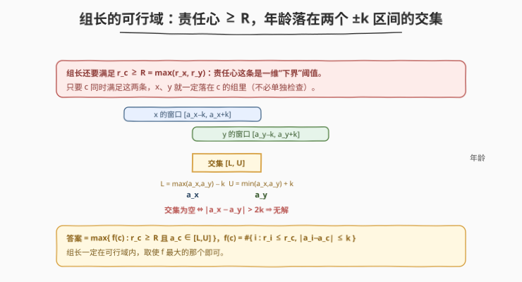

# Codeforces 173E 夏令营的分组方案 题解

## 1. 题目概述

- **题目链接**：https://codeforces.com/problemset/problem/173/E
- **比赛来源**：Croc Champ 2012 - Round 1 · Problem E（UTC 2012-04-06）
- **难度**：2600
- **标签**：数据结构、排序、离线处理
- **评测类型**：普通
- **限制**：时间 2 s / 内存 256 MB

**题意**：俱乐部有 $n$ 名成员，第 $i$ 人有"责任心"$r_i$ 与"年龄"$a_i$。一个**小组**是成员的非空子集，并且指定一名**组长**，要求：

- 组长是组内责任心**最大**的成员（可以并列）；
- 组长与组内**任何**成员的年龄差都不超过 $k$。

有 $q$ 个询问，每个询问给出 $x,y$（$x\ne y$），问"包含 $x$ 与 $y$ 的小组的最大可能人数"，无解输出 `-1`。

**约束**：

- $2\le n\le10^5$，$0\le k\le10^9$，$1\le r_i,a_i\le10^9$，$q\le10^5$。
- $n,q$ 都是 $10^5$，两个值域都是 $10^9$：这排除了任何 $O(nq)$ 的对拍式回答（$10^{10}$），也排除了开值域数组的做法（年龄要离散化）。
- $k$ 可以到 $10^9$，而 $a_i\pm k$ 会超出 `int`（$a_i=10^9$、$k=10^9$ 时上界 $2\times10^9$），所有"年龄上下界"必须用 64 位整数。
- 询问里的 $x,y$ 可能责任心、年龄都很接近，也可能差得很远；答案要么是 `-1`，要么至少是 2（组里至少有 $x,y$ 两人）。

## 2. 示例与观察

官方样例（输入 / 输出原样）：

```text
输入：
5 1
1 5 4 1 2
4 4 3 2 2
4
5 3
2 3
2 5
4 1

输出：
4
3
-1
4
```

| 成员 | 1 | 2 | 3 | 4 | 5 |
|------|---|---|---|---|---|
| $r_i$ | 1 | 5 | 4 | 1 | 2 |
| $a_i$ | 4 | 4 | 3 | 2 | 2 |

逐条询问：

- `5 3`：$x=5\,(r=2,a=2)$，$y=3\,(r=4,a=3)$。组长必须 $r\ge4$ 且年龄同时满足 $|a-2|\le1$、$|a-3|\le1$，即 $a\in[2,3]$。只有成员 3 合格（成员 2 的 $a=4$ 不合格）。以 3 为组长时，可选成员是所有 $r_i\le4$ 且 $|a_i-3|\le1$ 的人：成员 1、3、4、5，共 **4** 人。
- `2 3`：$x=2\,(r=5,a=4)$，$y=3\,(r=4,a=3)$。组长要 $r\ge5$，只有成员 2；年龄窗口 $[3,4]$ 也包含它。以 2 为组长：$r_i\le5$ 且 $a_i\in[3,5]$ 的成员是 1、2、3，共 **3** 人。
- `2 5`：$x=2\,(a=4)$，$y=5\,(a=2)$。组长要同时满足 $|a-4|\le1$ 与 $|a-2|\le1$，即 $a\in[3,3]\cap\ldots$ 交集为空 → `-1`。
- `4 1`：$x=4\,(r=1,a=2)$，$y=1\,(r=1,a=4)$。组长年龄必须同时落在 $[1,3]$ 与 $[3,5]$，只能是 $a=3$，即成员 3（$r=4\ge1$）。以 3 为组长可选 1、3、4、5，共 **4** 人。

**观察 1**：一旦**组长确定**，最优集合就唯一了——把所有"责任心不超过组长、且年龄在组长 $\pm k$ 内"的成员全放进来即可。记

$$f(c)=\#\{\,i:\ r_i\le r_c\ \text{且}\ |a_i-a_c|\le k\,\}.$$

（$c$ 自己一定被计入。）

**观察 2**：询问 $(x,y)$ 对组长的要求是"责任心 $\ge\max(r_x,r_y)$"且"年龄同时靠近 $x$ 与 $y$"，后者等价于

$$a_c\in\bigl[\max(a_x,a_y)-k,\ \min(a_x,a_y)+k\bigr].$$

这个区间非空 $\iff |a_x-a_y|\le 2k$。区间非空时，$x,y$ 必然都满足 $|a_i-a_c|\le k$ 且 $r_i\le r_c$，所以它们一定在 $c$ 的组里——**不需要额外检查"包含 $x,y$"**。

于是询问的答案就是

$$\text{ans}=\max\{\,f(c):\ r_c\ge\max(r_x,r_y),\ a_c\in[L,U]\,\},$$

其中 $L=\max(a_x,a_y)-k$、$U=\min(a_x,a_y)+k$；集合为空则 `-1`。



## 3. 解题思路

### 3.1 朴素做法与瓶颈

对每个询问枚举组长 $c$（$O(n)$），再枚举成员算 $f(c)$（$O(n)$），单次询问 $O(n^2)$，总计 $O(qn^2)=10^{15}$。

即使先把 $f(c)$ 预处理出来（对每个 $c$ 扫一遍全体成员，$O(n^2)=10^{10}$），询问仍然要在 $O(n)$ 个候选组长里取最大值，$q$ 次就是 $10^{10}$。两处都需要压到 $O(\log n)$。

### 3.2 核心观察：两个"二维偏序"

**第一处：$f(c)$ 是二维计数。** $f(c)$ 统计的是"责任心 $\le r_c$ 且年龄在 $[a_c-k,a_c+k]$"的点数。把成员按 $r$ 升序扫描，边扫边把当前成员的年龄插入树状数组；处理到 $r$ 相同的整组时（先把这一组**全部**插入），对组内每个 $c$ 查询年龄区间 $[a_c-k,a_c+k]$ 内的计数，就是 $f(c)$。这是经典的"排序 + 树状数组"，$O(n\log n)$。

**第二处：询问是二维范围最大值。** 把每个成员 $c$ 看成平面上的点 $(r_c,a_c)$、权值为 $f(c)$。询问是"$r_c\ge R$ 且 $a_c\in[L,U]$ 的最大权值"。把所有询问按 $R$ **降序**排序，同时把成员按 $r_c$ 降序依次插入一棵"以年龄为下标、维护区间最大值"的线段树；插入到 $r_c\ge R$ 为止，然后对年龄区间 $[L,U]$ 做一次区间最大值查询即可。$O((n+q)\log n)$。


### 3.3 算法流程

1. 读入 $r,a$；把年龄**离散化**（排序去重），得到下标 $0..M-1$。
2. **第一遍（求 $f$）**：把成员按 $r$ 升序排；用树状数组维护"已插入成员的年龄计数"。对每一组 $r$ 相同的成员：先把该组所有成员插入树状数组（注意 $r_i\le r_c$ 允许相等，所以同组要一起插入），再对该组每个 $c$ 用区间查询得到 $f(c)$。
3. 读入询问，预先算好每个询问的 $R=\max(r_x,r_y)$、$L=\max(a_x,a_y)-k$、$U=\min(a_x,a_y)+k$。
4. **第二遍（回答）**：询问按 $R$ 降序、成员按 $r$ 降序；用线段树（下标为离散化年龄，值为该年龄上的最大 $f$）。依次处理询问：把所有 $r_c\ge R$ 的成员插入线段树；若 $L>U$ 直接输出 `-1`，否则对 $[L,U]$ 做区间最大值，取不到（$-\infty$）则 `-1`。
5. 输出每条询问的答案（每行一个）。

### 3.4 样例走查：询问 `5 3`

$R=\max(2,4)=4$，$L=\max(2,3)-1=2$，$U=\min(2,3)+1=3$。

- 先插入所有 $r_c\ge4$ 的成员：成员 2（$r=5,a=4$）与成员 3（$r=4,a=3$）。
- 年龄窗口 $[2,3]$ 内的线段树最大值：成员 3 的 $f(3)=4$（成员 1、3、4、5），成员 2 的年龄 4 不在窗口内。
- 答案 4 ✓。

再走 `2 5`：$R=5$、$L=\max(4,2)-1=3$、$U=\min(4,2)+1=3$，窗口是单点 $[3,3]$；$r_c\ge5$ 的成员只有 2，其年龄 $4\notin[3,3]$ → 查询为空 → `-1` ✓。

## 4. 正确性证明

**引理 1（组长确定后的最优集合）**：固定组长 $c$，则以 $c$ 为组长的最大小组恰为 $S_c=\{i:r_i\le r_c,\ |a_i-a_c|\le k\}$，其大小是 $f(c)$。

**证明**：任何以 $c$ 为组长的小组都必须满足：每个成员 $r_i\le r_c$（组长责任心最大）且 $|a_i-a_c|\le k$（年龄约束），故成员集合 $\subseteq S_c$。反过来 $S_c$ 本身满足两条约束（$c\in S_c$，且 $c$ 的责任心不小于 $S_c$ 中任何人），是一个合法小组。因此最大者就是 $S_c$。∎

**引理 2（询问的等价刻画）**：询问 $(x,y)$ 的答案是 $\max\{f(c):r_c\ge R,\ a_c\in[L,U]\}$（集合为空时无解），其中 $R=\max(r_x,r_y)$、$L=\max(a_x,a_y)-k$、$U=\min(a_x,a_y)+k$。

**证明**：设存在包含 $x,y$ 的合法小组，组长为 $c$，则 $r_c\ge r_x,r_y$ 得 $r_c\ge R$；又 $|a_x-a_c|\le k$ 且 $|a_y-a_c|\le k$，即 $a_c\in[a_x-k,a_x+k]\cap[a_y-k,a_y+k]=[L,U]$（$L\le U$ 自动成立）。由引理 1，小组大小 $\le f(c)$，故答案 $\le\max f$。反之若存在 $c$ 满足 $r_c\ge R$、$a_c\in[L,U]$，则 $|a_x-a_c|\le k$（因为 $a_x$ 与 $a_c$ 都在长度 $2k$ 的区间 $[L,U]$ 的"中心"范围内：$a_c\ge L\ge a_x-k$ 且 $a_c\le U\le a_x+k$），同理对 $y$ 成立；且 $r_x,r_y\le R\le r_c$，于是 $x,y\in S_c$，$S_c$ 是以 $c$ 为组长、包含 $x,y$ 的合法小组，大小为 $f(c)$。取最大即得等式。∎

**引理 3（第一遍算出正确的 $f$）**：第一遍扫描中，处理 $r$ 值为 $\rho$ 的那一组时，树状数组里恰好是全体 $r_i\le\rho$ 的成员，因此对组内 $c$ 的区间查询给出 $f(c)$。

**证明**：按 $r$ 升序、同组一起插入，归纳可知插入集合恰为 $\{i:r_i\le\rho\}$；区间查询统计年龄落在 $[a_c-k,a_c+k]$ 内的人数，正是 $f(c)$ 的定义。∎

**引理 4（第二遍查询正确）**：处理询问 $(x,y)$ 时，线段树中恰好是所有 $r_c\ge R$ 的成员（每个年龄位置存该年龄上最大的 $f$），故区间最大值查询给出 $\max\{f(c):r_c\ge R,a_c\in[L,U]\}$。

**证明**：询问按 $R$ 降序处理，成员按 $r$ 降序插入且只增不减，归纳可知插入的正是 $r_c\ge R$ 的全部成员；线段树维护的是"每个年龄上的最大 $f$"，区间查询取 $\max$，故结果正确。∎

**定理**：算法对每个询问输出的数等于题目要求的最大小组人数（无解时 `-1`）。

**证明**：由引理 2，答案等于该范围最大值（或 `-1`）；由引理 3、4，算法算出的正是这个值；当 $L>U$ 或查询为空时输出 `-1`，与引理 2 的"集合为空"一致。∎

## 5. 复杂度分析

- **时间**：离散化 $O(n\log n)$；第一遍排序 + 树状数组 $O(n\log n)$；第二遍两次排序 $O((n+q)\log n)$ 加 $O((n+q)\log n)$ 的线段树操作。总计 $O((n+q)\log n)$，常数很小（每个元素约 2 次树状数组操作、每次询问 1 次线段树查询）。
- **空间**：年龄离散化数组 $O(n)$，$f$ 数组 $O(n)$，树状数组 $O(n)$，线段树 $O(4n)$，询问数组 $O(q)$。总内存约 $10$ MB 量级，远低于 256 MB。
- **数值范围**：$a_i\pm k$ 可达 $\pm2\times10^9$，超出 `int` 正半区，故 $L,U$ 用 `long long`；比较时再二分到离散化下标。$r_i$ 只需比较，`int` 足够。
- **与时限的关系**：$n=q=10^5$、$k=10^9$ 的随机数据实测 C++ 90 ms；年龄值域很小（大量重复，离散化后 $M$ 很小）时 62 ms，2 s 余量 20 倍以上。Python 版同数据 1.3 s / 0.5 s，也在 2 s 之内。

## 6. 参考代码

### C++17

```cpp
#include <bits/stdc++.h>
using namespace std;

struct BIT {                       // 计数用树状数组
    int n; vector<int> t;
    BIT(int n = 0) : n(n), t(n + 1, 0) {}
    void add(int i, int v) { for (++i; i <= n; i += i & -i) t[i] += v; }
    int sum(int i) { int s = 0; for (++i; i > 0; i -= i & -i) s += t[i]; return s; }
    int range(int l, int r) { return l > r ? 0 : sum(r) - (l ? sum(l - 1) : 0); }
};

struct SegMax {                    // 区间最大值线段树
    int n; vector<int> t;
    SegMax(int n = 0) : n(n), t(2 * n, INT_MIN) {}
    void upd(int i, int v) { for (i += n; i > 0; i >>= 1) { t[i] = max(t[i], v); if (i == 1) break; } }
    int qry(int l, int r) {        // [l, r]
        int res = INT_MIN;
        for (l += n, r += n + 1; l < r; l >>= 1, r >>= 1) {
            if (l & 1) res = max(res, t[l++]);
            if (r & 1) res = max(res, t[--r]);
        }
        return res;
    }
};

int main() {
    int n, k;
    if (scanf("%d %d", &n, &k) != 2) return 0;
    vector<int> r(n), a(n);
    for (int i = 0; i < n; ++i) scanf("%d", &r[i]);
    for (int i = 0; i < n; ++i) scanf("%d", &a[i]);

    vector<int> ages(a);
    sort(ages.begin(), ages.end());
    ages.erase(unique(ages.begin(), ages.end()), ages.end());
    int M = (int)ages.size();
    auto idxL = [&](long long x) {   // 第一个 >= x 的下标
        return (int)(lower_bound(ages.begin(), ages.end(), (int)max<long long>(x, LLONG_MIN / 4)) - ages.begin());
    };
    auto idxR = [&](long long x) {   // 最后一个 <= x 的下标
        return (int)(upper_bound(ages.begin(), ages.end(), (int)min<long long>(x, LLONG_MAX / 4)) - ages.begin()) - 1;
    };

    // ---- 1) 对每个可能的组长 c，算 f(c)：r_i <= r_c 且 |a_i - a_c| <= k 的人数
    vector<int> ord(n);
    for (int i = 0; i < n; ++i) ord[i] = i;
    sort(ord.begin(), ord.end(), [&](int x, int y) { return r[x] < r[y]; });
    vector<int> fval(n, 0);
    {
        BIT bit(M);
        int ptr = 0;
        for (int i = 0; i < n; ) {
            int j = i;
            while (j < n && r[ord[j]] == r[ord[i]]) ++j;          // 同一 r 的一组
            while (ptr < n && r[ord[ptr]] <= r[ord[i]]) {          // 把 r <= 当前 r 的全插进去
                int id = lower_bound(ages.begin(), ages.end(), a[ord[ptr]]) - ages.begin();
                bit.add(id, 1);
                ++ptr;
            }
            for (int t = i; t < j; ++t) {
                int c = ord[t];
                int lo = idxL((long long)a[c] - k), hi = idxR((long long)a[c] + k);
                fval[c] = bit.range(lo, hi);
            }
            i = j;
        }
    }

    // ---- 2) 离线回答：按 R 降序加入组长，线段树维护"每个年龄上的最大 f"
    int q; scanf("%d", &q);
    vector<int> qx(q), qy(q), R(q), ans(q, -1);
    vector<long long> L(q), U(q);
    for (int i = 0; i < q; ++i) {
        scanf("%d %d", &qx[i], &qy[i]);
        --qx[i]; --qy[i];
        R[i] = max(r[qx[i]], r[qy[i]]);
        L[i] = (long long)max(a[qx[i]], a[qy[i]]) - k;
        U[i] = (long long)min(a[qx[i]], a[qy[i]]) + k;
    }
    vector<int> qord(q);
    for (int i = 0; i < q; ++i) qord[i] = i;
    sort(qord.begin(), qord.end(), [&](int x, int y) { return R[x] > R[y]; });
    vector<int> lord(n);
    for (int i = 0; i < n; ++i) lord[i] = i;
    sort(lord.begin(), lord.end(), [&](int x, int y) { return r[x] > r[y]; });

    SegMax seg(M);
    int ptr = 0;
    for (int qi : qord) {
        if (L[qi] > U[qi]) { ans[qi] = -1; continue; }
        while (ptr < n && r[lord[ptr]] >= R[qi]) {
            int c = lord[ptr];
            int id = (int)(lower_bound(ages.begin(), ages.end(), a[c]) - ages.begin());
            seg.upd(id, fval[c]);
            ++ptr;
        }
        int lo = idxL(L[qi]), hi = idxR(U[qi]);
        int best = (lo <= hi) ? seg.qry(lo, hi) : INT_MIN;
        ans[qi] = (best == INT_MIN) ? -1 : best;
    }
    for (int i = 0; i < q; ++i) printf("%d\n", ans[i]);
    return 0;
}
```

### Python3

```python
import sys
from bisect import bisect_left, bisect_right


def main() -> None:
    data = sys.stdin.buffer.read().split()
    p = 0
    n, k = int(data[p]), int(data[p + 1]); p += 2
    r = [int(x) for x in data[p:p + n]]; p += n
    a = [int(x) for x in data[p:p + n]]; p += n

    ages = sorted(set(a))
    M = len(ages)

    def idx_l(x):                       # 第一个 >= x 的下标
        return bisect_left(ages, x)

    def idx_r(x):                       # 最后一个 <= x 的下标
        return bisect_right(ages, x) - 1

    # 1) f(c)：r_i <= r_c 且 |a_i - a_c| <= k 的人数
    order = sorted(range(n), key=lambda i: r[i])
    fval = [0] * n
    bit = [0] * (M + 1)

    def bit_add(i):
        i += 1
        while i <= M:
            bit[i] += 1
            i += i & -i

    def bit_sum(i):                     # [0, i]
        s = 0
        i += 1
        while i > 0:
            s += bit[i]
            i -= i & -i
        return s

    ptr = 0
    i = 0
    while i < n:
        j = i
        while j < n and r[order[j]] == r[order[i]]:
            j += 1
        while ptr < n and r[order[ptr]] <= r[order[i]]:
            bit_add(bisect_left(ages, a[order[ptr]]))
            ptr += 1
        for t in range(i, j):
            c = order[t]
            lo, hi = idx_l(a[c] - k), idx_r(a[c] + k)
            fval[c] = bit_sum(hi) - (bit_sum(lo - 1) if lo > 0 else 0)
        i = j

    # 2) 离线：按 R 降序加组长，线段树维护每个年龄上的最大 f
    q = int(data[p]); p += 1
    R = [0] * q
    L = [0] * q
    U = [0] * q
    for t in range(q):
        x = int(data[p]) - 1; y = int(data[p + 1]) - 1; p += 2
        R[t] = max(r[x], r[y])
        L[t] = max(a[x], a[y]) - k
        U[t] = min(a[x], a[y]) + k

    size = 1
    while size < M:
        size <<= 1
    seg = [-1] * (2 * size)

    def seg_upd(pos, val):
        i = pos + size
        if seg[i] >= val:
            return
        seg[i] = val
        i >>= 1
        while i:
            nv = seg[2 * i] if seg[2 * i] > seg[2 * i + 1] else seg[2 * i + 1]
            if seg[i] == nv:
                i >>= 1
            else:
                seg[i] = nv
                i >>= 1

    def seg_qry(l, r):
        res = -1
        l += size; r += size + 1
        while l < r:
            if l & 1:
                if seg[l] > res: res = seg[l]
                l += 1
            if r & 1:
                r -= 1
                if seg[r] > res: res = seg[r]
            l >>= 1; r >>= 1
        return res

    qorder = sorted(range(q), key=lambda t: -R[t])
    lorder = sorted(range(n), key=lambda i: -r[i])
    ans = [-1] * q
    ptr = 0
    for t in qorder:
        if L[t] > U[t]:
            ans[t] = -1
            continue
        while ptr < n and r[lorder[ptr]] >= R[t]:
            c = lorder[ptr]
            seg_upd(bisect_left(ages, a[c]), fval[c])
            ptr += 1
        lo, hi = idx_l(L[t]), idx_r(U[t])
        ans[t] = seg_qry(lo, hi) if lo <= hi else -1
    sys.stdout.write('\n'.join(map(str, ans)) + '\n')


main()
```

两版都是 $O((n+q)\log n)$；C++ 版用树状数组 + 线段树，Python 版同结构（手写 BIT 与迭代线段树），在 $n=q=10^5$ 上约 1.3 s。

## 7. 边界情况与易错点

1. **$a_i\pm k$ 溢出**：$a_i,k\le10^9$，$a_i+k$ 可达 $2\times10^9>2^{31}-1$，用 `int` 会变成负数，导致二分窗口完全错乱。$L,U$ 必须用 `long long`（Python 无此问题）。
2. **$L>U$ 要直接判 `-1`**：即 $|a_x-a_y|>2k$。注意条件是 $2k$ 而不是 $k$——组长只要"靠近两人各 $k$"，自己不必靠近另一个成员。样例里 `4 1`（年龄差 2、$k=1$）就有解。
3. **$k=0$**：此时组长年龄必须恰好等于 $a_x=a_y$，窗口退化成单点；若 $a_x\ne a_y$ 直接 `-1`。
4. **责任心相同的成员**：$r_i\le r_c$ 允许相等，第一遍扫描必须把"$r$ 相同的整组"先全部插入再查询，否则同 $r$ 的成员会互相漏算。
5. **年龄重复**：离散化时必须去重，线段树每个年龄位置存"该年龄上的最大 $f$"；若不去重，同一个年龄的多个成员会争抢同一个下标。
6. **查询窗口可能落在所有年龄之外**：例如 $L$ 大于最大年龄，此时 `lower_bound` 返回 $M$，区间为空。代码里用 `idxL/idxR` 统一处理，`lo > hi` 时要输出 `-1` 而不是访问越界。
7. **答案下界是 2**：合法答案至少包含 $x,y$，所以输出的数要么是 $-1$、要么 $\ge2$；如果程序输出了 1，说明"包含 $x,y$"的检查漏了（本解通过引理 2 保证自动包含）。
8. **多组询问的顺序**：离线处理打乱了询问顺序，必须按原始下标回填答案；不要边处理边输出。
9. **$x\ne y$ 但 $r,a$ 完全相同**：此时答案就是 $f$ 在该年龄、该责任心处的值，注意不要因为"两个点重合"而少算一个。

## 8. 验证记录

- **编译环境与命令**：`Apple clang 21.0.0` + `codeforces/tools/include/bits/stdc++.h` 兼容头（`clang++ -std=c++17 -O2`）；Python 3.9.6。`python3 codeforces/tools/verify_solution.py codeforces/contests/0101-0203/173/E_夏令营的分组方案.md` 输出 C++ 1/1、Python 1/1。
- **官方样例**：1 / 1 通过（四条询问覆盖"有解取最大""只有唯一组长""窗口为空""窗口为单点"四种形态）。
- **独立暴力对拍**：暴力程序对每个询问直接枚举组长、再枚举全体成员算人数（$O(n^2)$ 每次询问），完全不使用树状数组/线段树。随机数据分两组共 **600 组**：(a) $n\le18$、$k$ 取 $\{0,1,2,3,5,10^9\}$、责任心与年龄值域从 $\{1,3,10,10^9\}$ 中随机；(b) $n\le60$、大量重复值（值域 $\{1,2,3\}$、$\{1,2\}$、$\{5,5,7,9\}$ 等）且 $k\in[0,20]$。C++ 与 Python 两版全部与暴力一致。
- **最大约束性能**：$n=q=10^5$ 两组——(a) $k=10^9$、$r,a$ 在 $[1,10^9]$ 随机：C++ 90 ms、Python 1.28 s；(b) $k=50$、$r,a$ 在 $[1,1000]$ 随机（离散化后只有 1000 个年龄）：C++ 62 ms、Python 0.52 s。峰值内存 C++ < 12 MB。
- **图片校验**：两张 SVG（`cf173e_window.svg`、`cf173e_sweep.svg`）通过 `xml.etree.ElementTree.parse`，文本包围盒均在 `viewBox` 内。
- **复核状态**：verified（样例、600 组暴力对拍、两组最大规模性能、图片四项实跑通过）。

## 相关题目与扩展

- [Codeforces 173D 副手与三城分配](https://codeforces.com/problemset/problem/173/D)：同场 D 题，构造 + 二分图染色，"分组"的另一种口味。
- [Codeforces 173B Chamber of Secrets](https://codeforces.com/problemset/problem/173/B)：同场 B 题，行列建图 + BFS。
- [LeetCode 493. 翻转对](https://leetcode.cn/problems/reverse-pairs/)：排序 + 树状数组的经典二维偏序题，与本题第一遍同型。
- [Luogu P1908 逆序对](https://www.luogu.com.cn/problem/P1908)：树状数组入门。

**延伸思考**：

1. **如果要求输出具体的小组名单**：第二遍查询除了最大值还要记录"取到最大值的组长编号"，再按 $S_c$ 的定义扫一遍成员即可，$O(n)$ 复原。
2. **如果组长不必责任心最大，只要"不低于某个阈值"**：约束从"$r_c\ge R$"变成"每个成员 $r_i\le$ 阈值"，$f$ 的定义随之改变，但两遍离线的框架完全不变。
3. **如果 $k$ 随成员不同（每人有自己的 $k_i$）**：窗口不再是固定长度，树状数组/线段树的做法失效，需要换成"带权区间计数"的数据结构（如按 $k$ 排序后分块），复杂度升到 $O(n\sqrt n)$。
4. **如果询问要求"小组人数至少为 $t$"的可行性**：等价于问"$\max f(c)\ge t$"，仍然可以在第二遍的线段树上做，但也可以把询问离线到"阈值"维度上做二分。
