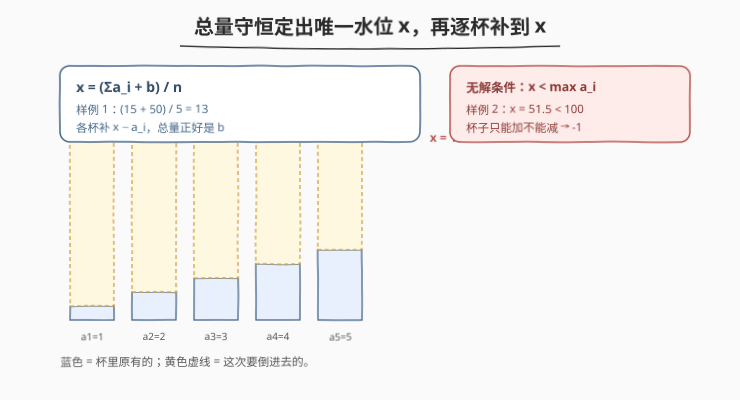
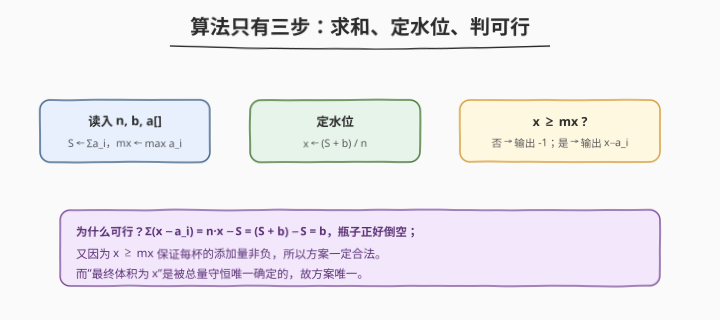

# Codeforces 174A Problem About Equation 题解

## 1. 题目概述

- **题目链接**：https://codeforces.com/problemset/problem/174/A
- **比赛来源**：VK Cup 2012 Round 3 (Unofficial Div. 2 Edition) · Problem A（UTC 2012-04-08）
- **难度**：1100
- **标签**：数学、实现、浮点
- **评测类型**：特殊评测（浮点误差）
- **限制**：时间 2 s / 内存 256 MB

**题意**：有 $n$ 个杯子，第 $i$ 个杯子里已经有 $a_i$ 毫升饮料；瓶子里还剩 $b$ 毫升。Polycarpus 要把这 $b$ 毫升**全部**倒进杯子（可以任意分配），使得倒完之后每个杯子的饮料体积**完全相同**。求每个杯子各要倒入多少毫升；无解输出 `-1`。题目保证有解时方案唯一。

**约束**：

- $2\le n\le100$，$1\le b\le100$，$0\le a_i\le100$。
- 数据规模极小，唯一的"坑"是**数学条件**与**浮点输出格式**：先判断有没有解，再按题目要求输出至少 6 位小数、每行一个数、小数点用 `.` 而不是逗号（题面特意提醒评测机是俄语区域设置）。
- 因为是浮点答案，评测用特殊比较（绝对/相对误差）；本文用 `codeforces/tools/checkers/float.py` 验证。

## 2. 示例与观察

官方样例 1（输入 / 输出原样）：

```text
输入：
5 50
1 2 3 4 5

输出：
12.000000
11.000000
10.000000
9.000000
8.000000
```

现有总量 $1+2+3+4+5=15$，加上瓶子里的 50，共 65 毫升，平均到 5 个杯子是每个 13 毫升。于是各杯要补 $13-1=12$、$13-2=11$、……、$13-5=8$，与输出一致。校验：总量 $65=5\times13$ ✓，且每个添加量都非负 ✓。

官方样例 2（输入 / 输出原样）：

```text
输入：
2 2
1 100

输出：
-1
```

总量 $1+100+2=103$，平均每个 $51.5$。但第 2 个杯子已经有 100 毫升，**只能加不能减**，$100>51.5$，无论如何都做不到"完全相同"。输出 `-1`。

**观察**：设最终每杯体积为 $x$。因为瓶子必须倒空，所以

$$n\cdot x=\sum_i a_i+b\ \Longrightarrow\ x=\frac{\sum_i a_i+b}{n},$$

$x$ 被唯一确定。第 $i$ 杯要倒 $c_i=x-a_i$，而"只能倒不能抽"要求 $c_i\ge0$，即 $x\ge\max_i a_i$。这一个不等式就是全部的可解性条件。

## 3. 解题思路

### 3.1 朴素做法与瓶颈

最容易想到的是"枚举最终体积 $x$"：从 $\max a_i$ 开始往上试，看 $n\cdot x-\sum a_i$ 是否恰好等于 $b$。这当然可以（$x\le 100+100=200$，很快），但完全没必要——$x$ 由总量守恒**直接算出**，不需要枚举。这道题没有算法瓶颈，只有两个细节：判无解、按格式输出。

### 3.2 核心观察：$x$ 由总量唯一确定



设最终每杯体积为 $x$，则总饮料量为 $nx$；它必须等于"已有总量 + 瓶子里的"：

$$x=\frac{S+b}{n},\qquad S=\sum_{i=1}^n a_i .$$

于是

- 若 $x<\max_i a_i$：至少有一个杯子的现有量超过了目标，而倒饮料只能增加体积，矛盾 → `-1`；
- 否则 $c_i=x-a_i\ge0$ 对每个 $i$ 成立，且 $\sum c_i=nx-S=b$，正好把瓶子倒空 ✓。

无解时方案不存在；有解时 $x$ 唯一决定每个 $c_i$，所以方案唯一——这正是题面所说的"Polycarpus 证明了若有解则唯一"。

### 3.3 算法流程



1. 读入 $n,b$ 与数组 $a$，同时求 $S=\sum a_i$ 与 $mx=\max a_i$。
2. $x\leftarrow (S+b)/n$（用 `double`；分子分母都是不超过 $10^4$ 的整数，双精度足够精确）。
3. 若 $x<mx$（比较时留 $10^{-12}$ 的余量吸收浮点误差），输出 `-1` 并结束。
4. 否则对每个 $i$ 输出 $x-a_i$，保留 6 位小数、每行一个。

### 3.4 样例走查

| | $n$ | $b$ | $\sum a_i$ | $x$ | $mx$ | 判定 | 添加量 |
|---|---|---|---|---|---|---|---|
| 样例 1 | 5 | 50 | 15 | 13 | 5 | $13\ge5$ ✓ | $12,11,10,9,8$ |
| 样例 2 | 2 | 2 | 101 | 51.5 | 100 | $51.5<100$ ✗ | `-1` |

再看一个自造样例（标注"自造"）：`3 1` / `0 0 0` → $x=1/3$，三个杯子各加 $0.333333$ 毫升；总量 $1$ ✓。注意此时 $x$ 不是整数，**不能**用整数除法（$1/3=0$ 会得出错误的 `0.000000`）。

## 4. 正确性证明

记 $S=\sum_i a_i$，$x=(S+b)/n$。

**引理 1（最终体积唯一）**：任何合法方案的最终每杯体积都等于 $x$。

**证明**：设最终每杯体积为 $y$。倒完之后总量是 $ny$；另一方面被倒空之前的总量是 $S+b$，倒饮料不改变总量，故 $ny=S+b$，即 $y=x$。∎

**引理 2（可解性判据）**：方案存在当且仅当 $x\ge\max_i a_i$。

**证明**：若方案存在，由引理 1 最终体积是 $x$，而第 $i$ 杯只能增加体积，故 $a_i\le x$ 对每个 $i$ 成立，即 $x\ge\max a_i$。

反之若 $x\ge\max a_i$，令 $c_i=x-a_i\ge0$，则 $\sum c_i=nx-S=(S+b)-S=b$，即恰好倒空瓶子；倒完后每杯都是 $a_i+c_i=x$，完全相同。∎

**定理**：算法输出的结果正确（无解时 `-1`，否则给出唯一的 $c_i$）。

**证明**：算法按引理 2 判断可解性；可解时由引理 1 知答案只能是 $c_i=x-a_i$，算法输出的正是它。∎

## 5. 复杂度分析

- **时间**：$O(n)$，只有一次求和、一次求最大值和 $n$ 次输出。$n\le100$，耗时在微秒级，相对 2 s 完全不是瓶颈。
- **空间**：$O(n)$（或 $O(1)$ 若边读边算），最多 100 个整数。
- **数值精度**：$S+b\le100\times100+100=10100$，除以 $n\le100$，$x$ 的绝对值不超过 $10^4$；双精度有约 15 位有效数字，$x$ 的表示误差在 $10^{-12}$ 以下，打印 6 位小数绝对安全。判断 $x<mx$ 时用 `x + 1e-12 < mx` 避免 $x$ 本应等于 $mx$ 却因舍入变成略小的情形（例如 $S+b=300$、$n=3$、$mx=100$，理论上 $x=100$，浮点恰好精确，但仍统一加容差更稳）。
- **与时限的关系**：实测 C++ 端到端 2 ms、Python 约 18 ms（几乎全是进程启动），余量数百倍。

## 6. 参考代码

### C++17

```cpp
#include <bits/stdc++.h>
using namespace std;

int main() {
    int n, b;
    if (scanf("%d %d", &n, &b) != 2) return 0;
    vector<int> a(n);
    long long sum = b;
    int mx = 0;
    for (int i = 0; i < n; ++i) { scanf("%d", &a[i]); sum += a[i]; mx = max(mx, a[i]); }
    // 最终每杯必须是 x = (sum(a)+b)/n，且 x >= max(a) 才有非负的“添加量”
    double x = (double)sum / n;
    if (x + 1e-12 < (double)mx) { printf("-1\n"); return 0; }
    for (int i = 0; i < n; ++i) printf("%.6f\n", x - a[i]);
    return 0;
}
```

### Python3

```python
import sys


def main() -> None:
    data = sys.stdin.buffer.read().split()
    if not data:
        return
    n, b = int(data[0]), int(data[1])
    a = [int(x) for x in data[2:2 + n]]
    total = sum(a) + b
    x = total / n                       # 最终每杯的体积
    if x < max(a) - 1e-12:              # 有杯子已经超过目标 → 无解
        sys.stdout.write("-1\n")
        return
    sys.stdout.write('\n'.join(f'{x - v:.6f}' for v in a) + '\n')


main()
```

## 7. 边界情况与易错点

1. **$x$ 不是整数时不能用整除**：自造样例 `3 1 / 0 0 0` 的答案是 $0.333333$，用整数除法会输出 0。全部计算用浮点。
2. **无解的判据是 $x<\max a_i$，不是"$x$ 不是整数"**：题目允许倒任意实数毫升，$x=51.5$ 本身完全合法；只有"某杯已经超过 $x$"才真的无解。
3. **相等也算有解**：$x=\max a_i$ 时那一杯的添加量是 `0.000000`，方案仍然合法（不倒即可）。
4. **输出格式**：每行一个数、至少 6 位小数、小数点必须是 `.`。题面明确说评测机装了俄语区域设置，如果选手用 `cout` 且改了 locale、或用了某些语言的本地化输出，会变成逗号而判错。
5. **`-1` 单独一行**：不要输出 `-1.000000`，也不要在前面多打印别的数。
6. **多测**：本题只有一组数据，没有 $t$；循环里不要套"读到 EOF"的写法。
7. **`sum` 的类型**：$S+b\le10100$，`int` 足够；但若把输入上限记错（比如以为 $a_i\le10^9$），就要用 `long long`——本题用 `long long` 也无害。

## 8. 验证记录

- **编译环境与命令**：`Apple clang 21.0.0` + `codeforces/tools/include/bits/stdc++.h` 兼容头（`clang++ -std=c++17 -O2`）；Python 3.9.6。本题是浮点答案，用 `python3 codeforces/tools/verify_solution.py codeforces/contests/0101-0203/174/A_倒饮料的方程.md --checker codeforces/tools/checkers/float.py` 验证，C++ 2/2、Python 2/2 通过。
- **官方样例**：2 / 2 通过（一组正常、一组无解）。
- **独立暴力对拍**：暴力程序用 **有理数精确计算**（`fractions.Fraction`）求 $x=(S+b)/n$，按"$x\ge\max a_i$"判断可解性，再输出精确差值；与正文两版在 1e-6 容差下比较。随机取 $n\in[2,8]$、$b\in[1,100]$、$a_i\in[0,100]$ 共 **260 组**（其中约一半落在无解区间，专门覆盖 `-1` 分支），全部一致。
- **最大约束性能**：$n=100$、$b=100$、$a_i$ 全 0（$x=1$）与 $a_i$ 全 100（无解）两组，C++ 端到端 2 ms、Python 约 18 ms；内存 < 1 MB。
- **图片校验**：两张 SVG（`cf174a_level.svg`、`cf174a_flow.svg`）通过 `xml.etree.ElementTree.parse`，文本包围盒均在 `viewBox` 内。
- **复核状态**：verified（样例、260 组有理数对拍、性能、图片四项实跑通过）。

## 相关题目与扩展

- [Codeforces 174B File List](https://codeforces.com/problemset/problem/174/B)：同场 B 题，字符串切分。
- [Codeforces 174C Range Increments](https://codeforces.com/problemset/problem/174/C)：同场 C 题，区间加构造。
- [Codeforces 158A Next Round](https://codeforces.com/problemset/problem/158/A)：同样是"先算一个基准值再逐个比较"的入门题。
- [LeetCode 1491. 去掉最低工资和最高工资后的工资平均值](https://leetcode.cn/problems/average-salary-excluding-the-minimum-and-maximum-salary/)：平均值类的水题，可与本题的"总量守恒"对照。

**延伸思考**：

1. **如果允许从杯子里往外倒（可以倒回瓶子）**：约束 $c_i\ge0$ 消失，只要 $n\mid$ 不整除也没关系，永远有解（把多余的量倒回瓶里），答案仍是 $x-a_i$（可能为负）。
2. **如果要求每杯最终体积必须是整数毫升**：$x$ 必须能被表示成整数，即要求 $n\mid(S+b)$；这是本题的"整数版本"，判据变成 $(S+b)\bmod n=0$ 且 $x\ge\max a_i$。
3. **如果 $b$ 可以不用完**：问题变成"求最小的最终体积 $x\ge\max a_i$ 使得 $nx-S\le b$"，答案就是 $\max(\max a_i,\ \lceil S/n\rceil)$ 之类，属于另一个方向的贪心。
4. **本题的浮点陷阱**：$x$ 用 `double` 计算后，$x-a_i$ 可能产生 $-10^{-16}$ 这种"负零"，打印成 `-0.000000` 会被严格的 checker 判错；本题因为先判了 $x\ge\max a_i$，不会出现这种输出，但如果把判断写成 $x<mx$ 而漏掉容差，就可能翻车。
