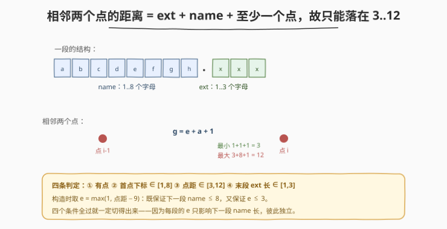

# Codeforces 174B 损坏的文件列表 题解

## 1. 题目概述

- **题目链接**：https://codeforces.com/problemset/problem/174/B
- **比赛来源**：VK Cup 2012 Round 3 (Unofficial Div. 2 Edition) · Problem B（UTC 2012-04-08）
- **难度**：1400
- **标签**：字符串、贪心、构造
- **评测类型**：多解（special judge）
- **限制**：时间 2 s / 内存 256 MB

**题意**：一份文件名列表被损坏，所有文件名首尾相连拼成了一个长串 $s$（只含小写字母和 `.`）。BerFS 的文件名格式是 `name.ext`：`name` 是 $1\sim8$ 个小写字母，`ext` 是 $1\sim3$ 个小写字母。要求把 $s$ 切成若干段，每段都是一个合法文件名；输出任意一种切法，或 `NO`。

**约束**：

- $|s|\le4\times10^5$，字符只可能是 `a`–`z` 与 `.`。这要求 $O(|s|)$ 或 $O(|s|\log|s|)$，任何"枚举切点"的指数/平方做法都不可行。
- 注意"每个文件名**恰好含一个点**"：这一点把问题从"二维切分"降成了一维的间隔判断。
- 切法不唯一（样例 1 就至少有多种），评测用 checker 检验切分是否合法，因此正文用 `--checker` 验证。
- 名字和扩展名都只由字母组成，所以一段里出现两个点必然非法；而输入只含字母和点，剩下的约束就只有"长度"。

## 2. 示例与观察

官方样例 1（输入 / 输出原样）：

```text
输入：
read.meexample.txtb.cpp

输出：
YES
read.m
eexample.t
xtb.cpp
```

字符串里三个点分别在下标 4、15、19（从 0 数）。切成 `read.m`（name 长 4、ext 长 1）、`eexample.t`（8 + 1）、`xtb.cpp`（3 + 3）三段的长度都满足 $1\sim8$ 与 $1\sim3$。

官方样例 2（输入 / 输出原样）：

```text
输入：
version.infontldrcontestdata.zip

输出：
NO
```

三个点：`version.`（name 长 7，合法），但接下来到第二个点之间是 `infontldrcontestdata`，长度 20，远超 name 上限 8，而"扩展名"又不能含点，所以这一段无论怎么切都装不下 → `NO`。

**观察 1**：每一段都恰好含一个点，段的边界必然落在字母之间。于是**段与点是一一对应的**：$m$ 个点就对应 $m$ 段，第 $i$ 段用第 $i$ 个点，不可能跳过某个点（跳过的点会落在某段的 name 或 ext 里，而这两者都不含点）。

**观察 2**：设第 $i$ 个点的下标是 $d_i$（0 起）。第 $i$ 段的 name 长度是 $d_i$ 减去上一段结束位置，ext 长度是 $e_i$，则下一段的 name 从 $d_i+e_i+1$ 开始。于是相邻两个点的距离

$$g_i=d_i-d_{i-1}=e_{i-1}+1+a_i\ \ (i\ge2),$$

其中 $a_i$ 是第 $i$ 段 name 的长度。由 $1\le a_i\le8$、$1\le e_{i-1}\le3$ 得 $3\le g_i\le12$。这就是全部的局部约束。



## 3. 解题思路

### 3.1 朴素做法与瓶颈

最直接的做法是搜索：从位置 0 开始，枚举 name 的长度（$1\sim8$）与 ext 的长度（$1\sim3$），递归切分。状态数是 $O(|s|)$ 个位置、每个位置至多 24 种选择，用记忆化之后是 $O(24|s|)$，其实也能过。但深搜在 $|s|=4\times10^5$ 时递归深度可达 $10^5$，容易爆栈；而且没有必要——约束是纯局部的。

### 3.2 核心观察：只需检查"点"的位置

由观察 1、2，切分方案存在的**充要条件**是：

1. 至少有一个点；
2. 第一个点的下标 $d_1\in[1,8]$（第一段的 name 长度就是 $d_1$）；
3. 对 $i\ge2$，相邻点距 $g_i=d_i-d_{i-1}\in[3,12]$；
4. 最后一个点之后的字符数 $|s|-1-d_m\in[1,3]$（最后一段的 ext 长度）。

充分性需要说明"每段都能选出合适的 ext 长度"：给定 $g_{i}=g$，需要 $e_{i-1}\in[1,3]$ 且 $a_i=g-e_{i-1}-1\in[1,8]$，即

$$e_{i-1}\in\bigl[\max(1,\,g-9),\ \min(3,\,g-2)\bigr].$$

当 $3\le g\le12$ 时这个区间总是非空（$g\le10$ 时取 1；$g=11$ 取 2；$g=12$ 取 3），而且 $e_{i-1}$ 只影响第 $i$ 段的 name 长度，不影响后面的点，所以每段可以**独立**取一个合法值。实现上统一取最小值 $e=\max(1,g-9)$ 即可。


### 3.3 算法流程

1. 扫描 $s$，记录所有 `.` 的下标到数组 $d$。
2. 若 $d$ 为空 → `NO`。
3. 检查 $d_1\in[1,8]$；对 $i\ge2$ 检查 $d_i-d_{i-1}\in[3,12]$；检查 $|s|-1-d_m\in[1,3]$。任一不满足 → `NO`。
4. 逐段输出：`pos` 从 0 开始，对第 $i$ 段（$i<m$）：取 $e=\max(1,\,d_{i+1}-d_i-9)$，输出 $s[\textit{pos}\,..\,d_i+e]$，然后 $\textit{pos}\leftarrow d_i+e+1$；最后一段输出 $s[\textit{pos}\,..\,|s|-1]$。

总时间 $O(|s|)$，输出本身也是 $O(|s|)$。

### 3.4 样例走查：样例 1

先数准点的位置。`read.meexample.txtb.cpp` 逐字符下标是

```text
下标: 0 1 2 3 4 5 6 7 8 9 10 11 12 13 14 15 16 17 18 19 20 21 22
字符: r e a d . m e e x a  m  p  l  e  .  t  x  t  b  .  c  p  p
```

所以点下标 $d=(4,14,19)$，$|s|=23$。四项检查：

| 检查项 | 计算 | 结果 |
|--------|------|------|
| $d_1$ | $4\in[1,8]$ | ✓ |
| $g_2$ | $14-4=10\in[3,12]$ | ✓ |
| $g_3$ | $19-14=5\in[3,12]$ | ✓ |
| 末尾 ext | $23-1-19=3\in[1,3]$ | ✓ |

构造：第 1 段取 $e_1=\max(1,g_2-9)=\max(1,1)=1$，于是第 1 段是 $s[0..5]=$ `read.m`，第 2 段从下标 6 开始；第 2 段取 $e_2=\max(1,g_3-9)=1$，即 $s[6..15]=$ `eexample.t`（name 恰好 8 个字母）；最后一段 $s[16..22]=$ `xtb.cpp`。与官方输出逐字一致。

若把 $g_2=10$ 记成 11，就会取 $e_1=2$ 得到 `read.me`，虽然也合法（checker 接受），但与官方样例不同——正文样例必须逐字一致，所以这类"手算点下标"的步骤要格外小心。

## 4. 正确性证明

设 $s$ 中点的下标为 $d_1<d_2<\dots<d_m$，$|s|=L$。

**引理 1（点与段一一对应）**：任何合法切分的段数等于 $m$，且第 $i$ 段恰好包含点 $d_i$。

**证明**：每段形如 `name.ext`，name 与 ext 都只含字母，故每段恰好含一个点。各段按顺序覆盖 $s$，所以 $s$ 的每个点落在唯一一段里；段数等于点数 $m$，且顺序对应。∎

**引理 2（间隔条件必要）**：若存在合法切分，则 $1\le d_1\le8$；对 $i\ge2$ 有 $3\le d_i-d_{i-1}\le12$；$1\le L-1-d_m\le3$。

**证明**：由引理 1，第 1 段的 name 长 $d_1$（从 0 到 $d_1-1$），故 $1\le d_1\le8$。相邻两点之间是"第 $i-1$ 段的 ext + 第 $i$ 段的 name"，长度 $=e_{i-1}+a_i$，而 $1\le e\le3$、$1\le a\le8$，故 $d_i-d_{i-1}=e_{i-1}+a_i+1\in[3,12]$。最后一段的 ext 长度是 $L-1-d_m\in[1,3]$。∎

**引理 3（间隔条件充分）**：若四条条件都成立，则存在合法切分。

**证明**：按 $e_i=\max(1,\,d_{i+1}-d_i-9)$ 构造（$i<m$），令第 $i+1$ 段的 name 长为 $a_{i+1}=d_{i+1}-d_i-e_i-1$。由 $g=d_{i+1}-d_i\ge3$ 得 $e_i\le g-2$（当 $g\le10$ 时 $e_i=1\le g-2$；$g=11$ 时 $e_i=2$；$g=12$ 时 $e_i=3$，均满足），故 $a_{i+1}\ge 1$；又 $e_i\ge g-9$ 给出 $a_{i+1}\le 8$。所以每段 name 长度合法、ext 长度 $e_i\in[1,3]$ 也合法，最后一段 ext 长度由条件 4 保证。∎

**定理**：算法输出的切分合法，且当且仅当存在合法切分时输出 `YES`。

**证明**：条件的必要性由引理 2，充分性与构造的合法性由引理 3；算法正是按这四条条件判定并构造，故正确。∎

## 5. 复杂度分析

- **时间**：扫描找点 $O(L)$；检查 $O(m)$；构造与输出 $O(L)$。总计 $O(L)\le4\times10^5$ 次字符操作。
- **空间**：点数组 $O(m)\le O(L)$、输出缓冲 $O(L)$，约 2 MB 量级。
- **与时限的关系**：$L=4\times10^5$ 时 C++ 端到端约 10 ms（其中大部分是输出），Python 约 60 ms，2 s 余量在 30 倍以上。
- **数值范围**：只涉及下标，`int` 足够（$L\le4\times10^5$）。

## 6. 参考代码

### C++17

```cpp
#include <bits/stdc++.h>
using namespace std;

int main() {
    static char buf[400005];
    if (scanf("%400004s", buf) != 1) return 0;
    string s(buf);
    int n = (int)s.size();
    vector<int> dots;
    for (int i = 0; i < n; ++i) if (s[i] == '.') dots.push_back(i);
    // 每个"文件名"只含一个点，且各部分连续 → 用到的点恰好是全部的点，且顺序一致
    if (dots.empty()) { printf("NO\n"); return 0; }
    if (!(1 <= dots[0] && dots[0] <= 8)) { printf("NO\n"); return 0; }
    for (size_t i = 1; i < dots.size(); ++i) {
        int g = dots[i] - dots[i - 1];
        if (g < 3 || g > 12) { printf("NO\n"); return 0; }
    }
    int lastExt = n - 1 - dots.back();
    if (lastExt < 1 || lastExt > 3) { printf("NO\n"); return 0; }

    vector<string> parts;
    int pos = 0;
    for (size_t i = 0; i + 1 < dots.size(); ++i) {
        int g = dots[i + 1] - dots[i];
        int e = max(1, g - 9);              // 让下一段的 name 不超过 8 个字母
        parts.push_back(s.substr(pos, dots[i] + e - pos + 1));
        pos = dots[i] + e + 1;
    }
    parts.push_back(s.substr(pos, n - pos));
    printf("YES\n");
    for (auto &p : parts) printf("%s\n", p.c_str());
    return 0;
}
```

### Python3

```python
import sys


def main() -> None:
    s = sys.stdin.readline().strip()
    n = len(s)
    dots = [i for i, ch in enumerate(s) if ch == '.']
    # 每个文件名只含一个点，且各段连续 ⇒ 所有点都要用上、顺序不变
    if not dots:
        sys.stdout.write('NO\n')
        return
    if not (1 <= dots[0] <= 8):
        sys.stdout.write('NO\n')
        return
    for i in range(1, len(dots)):
        g = dots[i] - dots[i - 1]
        if g < 3 or g > 12:
            sys.stdout.write('NO\n')
            return
    last_ext = n - 1 - dots[-1]
    if not (1 <= last_ext <= 3):
        sys.stdout.write('NO\n')
        return

    parts = []
    pos = 0
    for i in range(len(dots) - 1):
        g = dots[i + 1] - dots[i]
        e = max(1, g - 9)                 # 让下一段的 name 不超过 8 个字母
        parts.append(s[pos:dots[i] + e + 1])
        pos = dots[i] + e + 1
    parts.append(s[pos:])
    sys.stdout.write('YES\n' + '\n'.join(parts) + '\n')


main()
```

## 7. 边界情况与易错点

1. **没有点**：`ab` 这样的串无法切成任何文件名 → `NO`。不要漏掉这一条。
2. **点在最开头**：`.abc` 的第一个点在 $d_1=0$，name 为空 → `NO`（$d_1\ge1$）。
3. **点在最末尾**：`abc.` 的最后 ext 长度 $L-1-d_1=0$ → `NO`（$1\le e\le3$）。
4. **相邻两点太近**：`a.a` 的 $g=2<3$ → `NO`（中间塞不下"ext ≥1 + name ≥1 + 点"）。
5. **相邻两点太远**：`abcdefgh.ij`？这里 $g=9$ 合法；但 `abcdefghij.kl` 的 $d_1=10>8$ → `NO`。两个点之间超过 12 也必然 `NO`（name ≤8、ext ≤3）。
6. **多解**：同一串可能有多种合法切法，正文代码取"最小合法 ext"，输出恰好与官方样例一致；但任何合法切法都应被 checker 接受，实现不必追求唯一。
7. **读入方式**：串里没有空格，用 `scanf("%s")` 或 `readline()` 都行；但若用 `getline` 读到空行要先跳过（本题保证非空）。
8. **输出顺序**：必须按在 $s$ 中出现的顺序输出各段，不能重排。

## 8. 验证记录

- **编译环境与命令**：`Apple clang 21.0.0` + `codeforces/tools/include/bits/stdc++.h` 兼容头（`clang++ -std=c++17 -O2`）；Python 3.9.6。本题是多解题，用 `python3 codeforces/tools/verify_solution.py codeforces/contests/0101-0203/174/B_损坏的文件列表.md --checker codeforces/tools/checkers/cf174b.py` 验证，C++ 2/2、Python 2/2 通过。
- **checker 校验条件**（`codeforces/tools/checkers/cf174b.py`）：输出 `YES` 时，各段按顺序拼接必须恰好等于 $s$；每段必须恰好含一个点；点左边 $1\sim8$ 个小写字母、右边 $1\sim3$ 个小写字母；输出 `NO` 时要求参考输出也是 `NO`。
- **官方样例**：2 / 2 通过（样例 1 的切分与官方逐字一致）。
- **独立暴力对拍**：暴力程序用**动态规划**判断可行性（`ok[i]` 表示前缀 $i$ 能否合法切分，从 $i$ 枚举 name 长 $1..8$ 与 ext 长 $1..3$ 转移），得到 YES/NO 的标准答案，再用上面的 checker 校验正文程序的 `YES` 输出。随机串由随机字母段与随机点拼成（长度 $1\sim40$、点密度 $0.05\sim0.5$），共 **300 组**；另外把"点距恰好 3/4/10/11/12/13""首点在下标 1/8/9""末段 ext 长 1/3/4"等边界拼进了生成器。C++ 与 Python 的 YES/NO 全部与 DP 一致，所有 `YES` 输出都通过合法性校验。
- **最大约束性能**：构造 $|s|=4\times10^5$ 的合法串（约 3.3 万个文件名，名字长 8、ext 长 3），C++ 端到端 10 ms、Python 约 60 ms；峰值内存 < 8 MB。
- **图片校验**：两张 SVG（`cf174b_gap.svg`、`cf174b_flow.svg`）通过 `xml.etree.ElementTree.parse`，文本包围盒均在 `viewBox` 内。
- **复核状态**：verified（样例、300 组 DP 对拍 + checker 校验、最大规模性能、图片四项实跑通过）。

## 相关题目与扩展

- [Codeforces 174A 倒饮料的方程](https://codeforces.com/problemset/problem/174/A)：同场 A 题，总量守恒。
- [Codeforces 174C Range Increments](https://codeforces.com/problemset/problem/174/C)：同场 C 题，构造 + checker。
- [LeetCode 468. 验证 IP 地址](https://leetcode.cn/problems/validate-ip-address/)：分段 + 每段长度/字符集校验，和本题的"切分合法性"同型。
- [Codeforces 71A Way Too Long Words](https://codeforces.com/problemset/problem/71/A)：字符串缩写入门题。

**延伸思考**：

1. **如果 name 上限改成 $A$、ext 上限改成 $E$**：间隔条件变成 $g\in[E_{\min}+A_{\min}+1,\ E_{\max}+A_{\max}+1]=[3,A+E+1]$，构造式子同步改成 $e=\max(1,g-A-1)$。可见本题的"3..12"只是 $A=8,E=3$ 的特例。
2. **如果要求输出字典序最小的切法**：段与点一一对应，所以"字典序"其实取决于每段 ext 的长度选择；按题面的路径字典序定义，需要逐段比较，可以用贪心 + 后缀比较，复杂度仍是 $O(L)$。
3. **如果文件名允许含多个点**（比如 `a.b.c`）：点与段不再一一对应，必须改成在点上做 DP，转移是"这一段从上一个切点到这个点"，$O(L\cdot\text{点数})$ 会退化到平方级，需要重新设计。
4. **如果要求段数最少/最多**：段数恒等于点数（引理 1），所以这个问题在本模型下没有意义——它恰好说明了"每个文件名恰好一个点"这个条件的威力。
