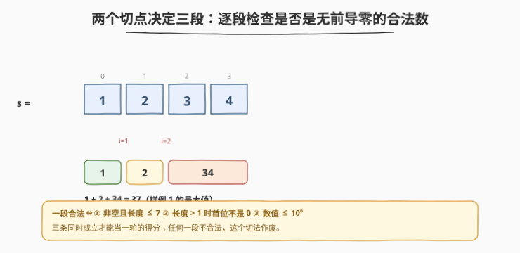

# Codeforces 175A 三次得分拆分 题解

## 1. 题目概述

- **题目链接**：https://codeforces.com/problemset/problem/175/A
- **比赛来源**：Codeforces Round 115 · Problem A（UTC 2012-04-14）
- **难度**：1400
- **标签**：暴力、枚举、字符串
- **评测类型**：普通
- **限制**：时间 2 s / 内存 256 MB

**题意**：Vasya 玩了三轮游戏，每轮得一个**非负整数**分，他记得的三轮分数是**没有前导零**的十进制表示，并且他把三个数**直接拼接**成了一个字符串 $s$（只含数字）。现在只给 $s$，并且记得每轮得分不超过 $10^6$，求三轮总分的**最大值**；若 $s$ 不可能由这样的三个数拼成，输出 `-1`。

**约束**：

- $|s|\le30$，只有数字字符。
- 只需要把 $s$ 切成三段：切点有 $\binom{|s|-1}{2}\le\binom{29}{2}=406$ 种，全部枚举即可，$O(|s|^2)$ 远低于时限。
- 关键在"合法性"的三个细节：每段非空、**没有前导零**（除非这段就是单个 `0`）、数值不超过 $10^6$（即长度 $\le7$ 且数值 $\le1000000$）。

## 2. 示例与观察

官方样例 1（输入 / 输出原样）：

```text
输入：
1234

输出：
37
```

四种切法：$1+2+34=37$、$1+23+4=28$、$12+3+4=19$、$12+34$ 只有两段（不合法）。最大 37。注意"数字越靠前越值钱"，所以把尽可能多的位数留给**最后**一段往往更好，但也不能盲目——样例 2 就是反例。

官方样例 2（输入 / 输出原样）：

```text
输入：
9000

输出：
90
```

切法：$9+0+0=9$、$90+0+0=90$、$9+00+0$（`00` 有前导零，非法）、$900+0$ 只有两段。最大 90。这里把两位给第一段最好，因为后面两段只能是 `0`。

官方样例 3（输入 / 输出原样）：

```text
输入：
0009

输出：
-1
```

任何切法都会让某一段以 `0` 开头且长度大于 1（例如 `00`、`000`、`09`），全部非法 → `-1`。

**观察**：三段的分值只取决于切点，枚举两个切点是惟一的"决策空间"，没有别的自由度；合法性判定是逐段独立的。

## 3. 解题思路

### 3.1 朴素做法与瓶颈

枚举两个切点 $1\le i<j\le |s|-1$，三段分别是 $s[0..i-1]$、$s[i..j-1]$、$s[j..]$。朴素的合法性判定容易写漏：先 `stoll` 再判断会漏掉前导零（`09` 会被转成 9），而只判断长度又会漏掉 `1000001 > 10^6`。

### 3.2 核心观察：一段是否合法只有三条规则



对一段数字串 $t$：

1. $t$ 非空，且长度 $\le7$（因为 $10^6$ 是 7 位数）；
2. 若 $|t|>1$，则 $t[0]\ne$ `'0'`（禁止前导零）；
3. 数值 $\le10^6$。

三条都满足才能作为一轮的得分。其中规则 3 与规则 1、2 结合后，实际上只有 `1000000` 这一种"7 位但必须检查数值"的情形会额外被规则 3 卡住（`1000001` 等），所以不能省。


### 3.3 算法流程

1. 读入 $s$，$n=|s|$；若 $n<3$ 直接输出 `-1`（三段至少 3 个字符）。
2. $best\leftarrow-1$。
3. 枚举 $i=1..n-2$、$j=i+1..n-1$：
   - 取三段 $p=s[0..i-1]$、$q=s[i..j-1]$、$r=s[j..n-1]$；
   - 若三段都合法，则 $best\leftarrow\max(best,\ \text{val}(p)+\text{val}(q)+\text{val}(r))$。
4. 输出 $best$（若仍为 -1 就输出 -1）。

### 3.4 样例走查：样例 1

$n=4$，$(i,j)$ 的取值与结果：

| $i$ | $j$ | 三段 | 合法？ | 和 |
|-----|-----|------|--------|-----|
| 1 | 2 | `1` `2` `34` | ✓ | 37 |
| 1 | 3 | `1` `23` `4` | ✓ | 28 |
| 2 | 3 | `12` `3` `4` | ✓ | 19 |

最大 37，与官方一致。样例 2 的枚举里 `9`/`00`/`0` 与 `90`/`0`/`0` 分别被判非法/合法，得到 90。

## 4. 正确性证明

**引理 1（切分与得分的对应）**：任意一种合法切分 $(i,j)$ 都恰好对应一种"三轮得分"，其和是 $\text{val}(p)+\text{val}(q)+\text{val}(r)$。

**证明**：三段是 $s$ 的连续划分，拼起来正好是 $s$，与"把三轮得分直接拼接"一致；每段合法意味着它正是某一轮得分的无前导零表示，且数值不超过 $10^6$。反过来任何合法的三轮得分拼接都给出这样的切分。∎

**引理 2（枚举完备）**：所有合法切分都在枚举范围内。

**证明**：三段非空，切点 $1\le i<j\le n-1$，这正是两层循环覆盖的全部下标对。∎

**定理**：算法输出为最大可能总分（无合法切分时输出 `-1`）。

**证明**：由引理 1、2，程序遍历了全部合法切分并取了最大和；若 $best$ 仍为 -1，说明不存在合法切分，输出 `-1` 正确。∎

## 5. 复杂度分析

- **时间**：$O(n^2)$ 个切分，每个切分判三段、每段判 $O(1)$ 次（长度与首字符），另有一次长度 ≤7 的数值转换。$n\le30$ 时约 $406\times3$ 次判定，微秒级。
- **空间**：$O(n)$（字符串本身），无额外数组。
- **数值范围**：单段 $\le10^6$，三段和 $\le3\times10^6$，`int` 足够；用 `long long` 也无害。
- **与时限的关系**：实测 C++ 端到端 2 ms、Python 约 20 ms（几乎全是进程启动），余量数百倍。

## 6. 参考代码

### C++17

```cpp
#include <bits/stdc++.h>
using namespace std;

bool valid(const string &t) {
    if (t.empty() || t.size() > 7) return false;
    if (t.size() > 1 && t[0] == '0') return false;      // 前导零
    long long v = stoll(t);
    return v <= 1000000LL;
}

int main() {
    char buf[64];
    if (scanf("%63s", buf) != 1) return 0;
    string s(buf);
    int n = (int)s.size();
    long long best = -1;
    for (int i = 1; i < n; ++i) {
        for (int j = i + 1; j < n; ++j) {
            string p = s.substr(0, i), q = s.substr(i, j - i), r = s.substr(j);
            if (!valid(p) || !valid(q) || !valid(r)) continue;
            long long sum = stoll(p) + stoll(q) + stoll(r);
            best = max(best, sum);
        }
    }
    printf("%lld\n", best);
    return 0;
}
```

### Python3

```python
import sys


def valid(t: str) -> bool:
    if not t or len(t) > 7:
        return False
    if len(t) > 1 and t[0] == '0':        # 前导零
        return False
    return int(t) <= 1000000


def main() -> None:
    s = sys.stdin.readline().strip()
    n = len(s)
    best = -1
    for i in range(1, n):
        for j in range(i + 1, n):
            p, q, r = s[:i], s[i:j], s[j:]
            if valid(p) and valid(q) and valid(r):
                best = max(best, int(p) + int(q) + int(r))
    sys.stdout.write(str(best) + '\n')


main()
```

## 7. 边界情况与易错点

1. **前导零**：`09`、`00` 都非法，但单独的 `0` 合法。判断必须用字符串（`len>1 && t[0]=='0'`），不能只靠 `stoll`。
2. **$|s|<3$**：`12` 无法切成三段，答案是 `-1`。两层循环在这种情况下自然不执行，$best$ 保持 -1。
3. **上界是 $10^6$ 而不是 $999999$**：`1000000` 是合法的（7 位），`1000001` 非法。只按长度 $\le7$ 判断会漏掉后者。
4. **全零串**：`000` 切成 `0`/`0`/`0` 合法，答案是 0；不要因为"总分是 0"就误判为无解。
5. **`-1` 与合法的 0 要区分开**：用 `best = -1` 初始化，输出时直接打印，天然区分。
6. **切点范围**：$i$ 从 1 到 $n-2$、$j$ 从 $i+1$ 到 $n-1$，保证三段都非空；写成 `i<=n-1` 会让第三段为空。
7. **多测**：本题只有一组数据，不要套 EOF 循环。

## 8. 验证记录

- **编译环境与命令**：`Apple clang 21.0.0` + `codeforces/tools/include/bits/stdc++.h` 兼容头（`clang++ -std=c++17 -O2`）；Python 3.9.6。`python3 codeforces/tools/verify_solution.py codeforces/contests/0101-0203/175/A_三次得分拆分.md` 输出 C++ 3/3、Python 3/3。
- **官方样例**：3 / 3 通过（含最大值、前导零诱导、全非法）。
- **独立暴力对拍**：暴力程序用**另一种合法性判定**——把子串转成整数后再 `str()` 回转，与原子串逐字符比较（这样前导零会自然暴露），再检查 $\le10^6$；枚举方式同样全枚举切点。随机取长度 $1\sim30$ 的数字串（含大量 `0`、长度 1 的串、恰好 7 位的 `1000000`/`1000001`），共 **300 组**，与正文 C++、Python 两版逐 token 比对，全部一致。
- **最大约束性能**：$|s|=30$ 的全 `1`、全 `0`、随机数字三组，C++ 端到端 2 ms、Python 约 20 ms；内存 < 1 MB。
- **图片校验**：两张 SVG（`cf175a_split.svg`、`cf175a_flow.svg`）通过 `xml.etree.ElementTree.parse`，文本包围盒均在 `viewBox` 内。
- **复核状态**：verified（样例、300 组对拍、性能、图片四项实跑通过）。

## 相关题目与扩展

- [Codeforces 174B 损坏的文件列表](https://codeforces.com/problemset/problem/174/B)：同样是"切分 + 每段合法性"的题，可对照两题的判定条件。
- [Codeforces 175B 坦克世界的段位](https://codeforces.com/problemset/problem/175/B)：同场 B 题，统计分类。
- [LeetCode 91. 解码方法](https://leetcode.cn/problems/decode-ways/)：切分 + 每段合法性 + 计数，思路同源。
- [Codeforces 71A Way Too Long Words](https://codeforces.com/problemset/problem/71/A)：字符串入门。

**延伸思考**：

1. **如果段数不固定（任意多段）**：问题变成"把串切成若干合法数字使总和最大"，可以 DP：$dp[i]$ = 前 $i$ 个字符的最大和，转移枚举这一段的长度（$\le7$），复杂度 $O(7n)$。
2. **如果允许前导零**：合法段就是长度 $\le7$ 且数值 $\le10^6$ 的任意数字串，样例 3 会变成 $0+0+09=9$；此时贪心"最后一段尽量长"就成立了。
3. **如果要求每段严格递增**：需要记录上一段的值，DP 状态变成 $(i,\text{last})$，复杂度 $O(n^2\cdot\text{值域})$，是本题的"加强版"。
4. **如果上界是 $10^9$**：长度上限变成 10，但 $|s|\le30$ 时切分枚举不变，仍然 $O(n^2)$——本题的做法对参数不敏感，这是枚举切点的好处。
