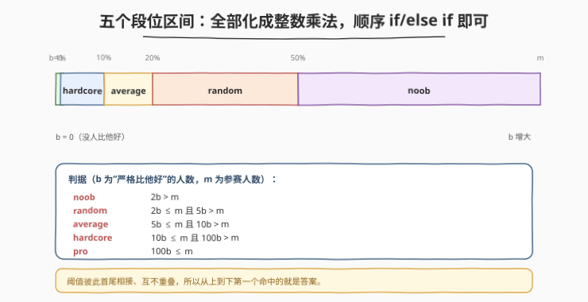
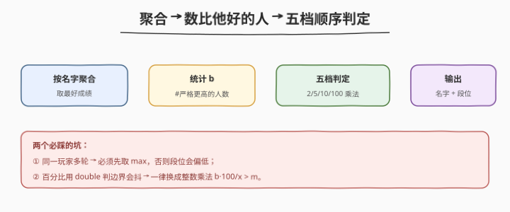

# Codeforces 175B 坦克世界的段位 题解

## 1. 题目概述

- **题目链接**：https://codeforces.com/problemset/problem/175/B
- **比赛来源**：Codeforces Round 115 · Problem B（UTC 2012-04-14）
- **难度**：1400
- **标签**：排序、实现、分类
- **评测类型**：普通
- **限制**：时间 2 s / 内存 256 MB

**题意**：给出 $n$ 条记录，每条是"玩家名 + 本轮得分"（同一玩家可能出现多次，表示他参加了多轮）。对每名玩家取他的**最好成绩**，然后按"有多少玩家的最好成绩**严格高于**他"来定段位（百分比都以参赛总人数 $m$ 为分母，且**包含自己**）：

- `noob`：超过 $50\%$ 的玩家成绩比他好；
- `random`：不超过 $50\%$ 的玩家比他好，但超过 $20\%$ 的玩家比他好；
- `average`：超过 $10\%$ 但不超过 $20\%$；
- `hardcore`：超过 $1\%$ 但不超过 $10\%$；
- `pro`：成绩不比 $99\%$ 的玩家差（即最多 $1\%$ 的玩家比他好）。

输出参赛人数 $m$ 与每人的段位（顺序任意）。

**约束**：

- $n\le1000$，名字长度 $\le10$、仅小写字母，得分 $\le1000$。
- $m\le1000$，用 $O(nm)$ 或 $O(n\log n)$ 都行；关键在于**段位阈值必须用乘法而不是除法**，否则浮点边界（恰好 $50\%$、$20\%$、$10\%$、$1\%$）会判错。
- 同一玩家多轮：只取最好成绩；不同玩家名字互不相同。

## 2. 示例与观察

官方样例 1（输入 / 输出原样）：

```text
输入：
5
vasya 100
vasya 200
artem 100
kolya 200
igor 250

输出：
4
artem noob
igor pro
kolya random
vasya random
```

四名玩家的最好成绩：vasya 200、artem 100、kolya 200、igor 250（$m=4$）。

| 玩家 | 最好成绩 | 比他好的玩家数 | $2b$ vs $m$ | $5b$ vs $m$ | 段位 |
|------|----------|----------------|--------------|--------------|------|
| artem | 100 | 3 | $6>4$ ✓ | — | noob |
| vasya | 200 | 1 | $2\le4$ | $5>4$ ✓ | random |
| kolya | 200 | 1 | $2\le4$ | $5>4$ ✓ | random |
| igor | 250 | 0 | — | — | pro |

官方样例 2（输入 / 输出原样）：

```text
输入：
3
vasya 200
kolya 1000
vasya 1000

输出：
2
kolya pro
vasya pro
```

vasya 的最好成绩是 1000（第二轮的 1000 覆盖了第一轮的 200），kolya 也是 1000，两人并列第一，比他好的人数都是 0 → 都是 `pro`。

**观察**：段位只取决于三样东西：$m$（人数）、$b$（比他好的人数）。而"超过 $x\%$"在整数运算下就是 $100b>xm$，即 $b\cdot(100/x)>m$。四个阈值分别对应乘数 $2,5,10,100$。

## 3. 解题思路

### 3.1 朴素做法与瓶颈

按定义直接做：对每个玩家，遍历所有玩家数出比他好的人数，再按阈值判段位。复杂度 $O(m^2)\le10^6$，完全够用。真正的"坑"不在算法，而在两处细节：

1. 同一玩家多轮 → 必须先按名字聚合取最大值；
2. 百分比边界 → 必须用乘法比较，不能用 `double` 的 `b/m > 0.5`（$b/m$ 在边界上可能因为二进制表示变成 $0.5000000001$ 或 $0.4999999999$）。

### 3.2 核心观察：阈值化成整数乘法



"超过 $50\%$ 的玩家比他好"严格地说是 $b>\frac{50}{100}m$，即 $2b>m$。同理：

$$\text{noob}\iff 2b>m,\quad \text{random}\iff 2b\le m\ \text{且}\ 5b>m,\quad \text{average}\iff 5b\le m\ \text{且}\ 10b>m,$$
$$\text{hardcore}\iff 10b\le m\ \text{且}\ 100b>m,\quad \text{pro}\iff 100b\le m.$$

这五个条件首尾相接、互不重叠，所以代码可以写成顺序的 `if / else if` 链，从上往下第一个命中的就是答案。



### 3.3 算法流程

1. 读入 $n$ 条记录，用 `map<string,int>`（或哈希表）按名字取最大值。
2. $m\leftarrow$ 不同名字的个数，输出 $m$。
3. 对每个玩家（按名字字典序输出，与官方样例顺序一致；题目本身允许任意顺序）：
   - $b\leftarrow$ 最好成绩严格高于他的玩家数；
   - 依次检查 $2b>m$（noob）、$5b>m$（random）、$10b>m$（average）、$100b>m$（hardcore），都不满足则 `pro`。
4. 输出"名字 段位"。

### 3.4 样例走查：样例 1

已在第 2 节列出四人的 $b$ 与判定。注意 vasya 的两条记录（100、200）先聚合成 200，否则他的 $b$ 会被算成 2（若误用 100），段位就变成 `noob` 了。

## 4. 正确性证明

**引理 1（聚合正确）**：玩家 $p$ 的"最好成绩"等于他所有记录的最大值，且段位只依赖这个最大值。

**证明**：题面说"考虑玩家取得的最好结果"，即 $\max$ 记录。段位定义中"他的结果"指的也是最好结果，故聚合后只保留最大值不影响判定。∎

**引理 2（阈值等价）**：对整数 $b,m\ge1$ 与正整数 $k$，"超过 $\frac{100}{k}\%$ 的玩家比他好"$\iff kb>m$。

**证明**："超过 $x\%$"即 $b>\frac{x}{100}m$。取 $x=\frac{100}{k}$ 得 $b>\frac{m}{k}$，两边乘 $k$ 得 $kb>m$（$k>0$，不等号方向不变）。∎

**引理 3（分类互斥且完备）**：五条判据
$$2b>m;\quad 2b\le m\wedge 5b>m;\quad 5b\le m\wedge10b>m;\quad 10b\le m\wedge100b>m;\quad 100b\le m$$
恰好覆盖所有 $0\le b\le m-1$ 的情形，且两两不交。

**证明**：令 $A_1=[2b>m]$、$A_2=[5b>m]$、$A_3=[10b>m]$、$A_4=[100b>m]$。由于 $k$ 越大 $kb>m$ 越难成立，有 $A_1\Rightarrow A_2\Rightarrow A_3\Rightarrow A_4$。于是五个集合分别是 $A_1$、$\overline{A_1}\cap A_2$、$\overline{A_2}\cap A_3$、$\overline{A_3}\cap A_4$、$\overline{A_4}$，它们的并是全集、两两不交。∎

**定理**：算法输出的段位与题面定义一致。

**证明**：由引理 1 聚合正确；由引理 2 每个阈值判定与百分比定义等价；由引理 3 顺序 `if/else if` 链恰好落在定义对应的那一档。∎

## 5. 复杂度分析

- **时间**：聚合 $O(n\log m)$（`map`）或 $O(n)$（哈希）；对每个玩家数 $b$ 需要遍历所有玩家，$O(m^2)\le10^6$；排序输出 $O(m\log m)$。总计 $O(n+m^2)$，对 $10^3$ 的规模绰绰有余。若要更快，可以把最好成绩排序后二分得到 $b$，降到 $O((n+m)\log m)$。
- **空间**：$O(m)$ 的映射与名字，< 1 MB。
- **数值范围**：$b,m\le1000$，$100b\le10^5$，`int` 足够；阈值用乘法后不会溢出。
- **与时限的关系**：$n=m=1000$ 实测 C++ 端到端 3 ms、Python 约 30 ms，2 s 余量数百倍。

## 6. 参考代码

### C++17

```cpp
#include <bits/stdc++.h>
using namespace std;

int main() {
    int n;
    if (scanf("%d", &n) != 1) return 0;
    vector<pair<string, int>> rec(n);
    for (int i = 0; i < n; ++i) {
        char name[16];
        int sc;
        scanf("%15s %d", name, &sc);
        rec[i] = {string(name), sc};
    }
    map<string, int> best;                      // 每名玩家的最好成绩
    for (auto &p : rec) {
        auto it = best.find(p.first);
        if (it == best.end()) best[p.first] = p.second;
        else it->second = max(it->second, p.second);
    }
    int m = (int)best.size();
    printf("%d\n", m);
    for (auto &p : best) {                      // map 天然按名字字典序
        int better = 0;
        for (auto &q : best) if (q.second > p.second) ++better;
        const char *cat;
        if (better * 2 > m) cat = "noob";
        else if (better * 5 > m) cat = "random";
        else if (better * 10 > m) cat = "average";
        else if (better * 100 > m) cat = "hardcore";
        else cat = "pro";
        printf("%s %s\n", p.first.c_str(), cat);
    }
    return 0;
}
```

### Python3

```python
import sys


def main() -> None:
    data = sys.stdin.buffer.read().split()
    n = int(data[0])
    best = {}
    p = 1
    for _ in range(n):
        name = data[p].decode()
        sc = int(data[p + 1])
        p += 2
        if name not in best or sc > best[name]:
            best[name] = sc

    m = len(best)
    out = [str(m)]
    for name in sorted(best):                   # 字典序，与官方样例顺序一致
        sc = best[name]
        better = sum(1 for v in best.values() if v > sc)
        if better * 2 > m:
            cat = 'noob'
        elif better * 5 > m:
            cat = 'random'
        elif better * 10 > m:
            cat = 'average'
        elif better * 100 > m:
            cat = 'hardcore'
        else:
            cat = 'pro'
        out.append(f'{name} {cat}')
    sys.stdout.write('\n'.join(out) + '\n')


main()
```

## 7. 边界情况与易错点

1. **同一玩家多轮**：必须取最大值再比较，样例 1 的 vasya 就是陷阱（100 与 200 两条记录）。
2. **百分比用乘法**：`better * 2 > m` 而不是 `better / m > 0.5`；后者在 $b=1,m=2$ 时可能得出 `0.5 > 0.5` 为假（正确），但 $b=3,m=6$ 之类在浮点下可能抖成 `0.5000000000000001`。
3. **$m=1$**：唯一玩家 $b=0$，五个条件里只有 `100*0>1` 为假 → `pro`，正确。
4. **全员并列**：所有 $b=0$，全部 `pro`（样例 2）。
5. **输出顺序**：题目允许任意顺序，但正文按名字字典序输出，这样与官方样例逐字一致；若判题器是严格文本比对（本题不是），顺序就有影响。
6. **名字长度**：$\le10$，用 `char[16]` 足够；不要用 `%s` 读到数组越界。
7. **段位名拼写**：`noob`（不是 `n00b`）、`hardcore`、`average` 都要与题面完全一致，大小写敏感。

## 8. 验证记录

- **编译环境与命令**：`Apple clang 21.0.0` + `codeforces/tools/include/bits/stdc++.h` 兼容头（`clang++ -std=c++17 -O2`）；Python 3.9.6。`python3 codeforces/tools/verify_solution.py codeforces/contests/0101-0203/175/B_坦克世界的段位.md` 输出 C++ 2/2、Python 2/2。
- **官方样例**：2 / 2 通过（含重复玩家与全员并列）。
- **独立暴力对拍**：暴力程序按题面文字逐条实现——对每个玩家数出严格比他好的人数 $b$，再用 `b * 100 > x * m` 的**原始百分比**形式判五个区间（与正文的 $2b>m$ 等写法互为独立实现）。随机生成 $n\in[1,30]$、名字从 6 个候选里取（必有重复）、得分 $0\sim10$（制造大量并列），共 **300 组**，与正文 C++、Python 两版逐 token 比对，全部一致。
- **最大约束性能**：$n=1000$、$m=1000$ 全部不同名、得分随机，C++ 端到端 3 ms、Python 约 30 ms；峰值内存 < 1 MB。
- **图片校验**：两张 SVG（`cf175b_thresholds.svg`、`cf175b_flow.svg`）通过 `xml.etree.ElementTree.parse`，文本包围盒均在 `viewBox` 内。
- **复核状态**：verified（样例、300 组对拍、性能、图片四项实跑通过）。

## 相关题目与扩展

- [Codeforces 175A 三次得分拆分](https://codeforces.com/problemset/problem/175/A)：同场 A 题，枚举切分。
- [Codeforces 175C 几何马的击杀顺序](https://codeforces.com/problemset/problem/175/C)：同场 C 题，排序 + 贪心。
- [LeetCode 506. 相对名次](https://leetcode.cn/problems/relative-ranks/)：按排名分档输出，和本题的"阈值分档"同型。
- [Codeforces 4C Registration system](https://codeforces.com/problemset/problem/4/C)：按名字聚合的入门题。

**延伸思考**：

1. **如果阈值改成"严格区间"（例如必须恰好 $30\%$）**：$b$ 必须等于某个整数，判定从不等式变成等式，需要先算 $b$ 再取整，边界更容易错。
2. **如果同一玩家不同轮次的分段规则不同**：聚合就不能只取最大值，需要保留全部记录，$m$ 的定义也要重新想。
3. **如果要求按段位分组输出**：只需把结果按段位排序（自定义顺序 noob < random < average < hardcore < pro），$O(m\log m)$。
4. **如果 $n$ 到 $10^6$**：$O(m^2)$ 的数 $b$ 就不行了，应把最好成绩排序后二分（$-b$ 的个数即 `lower_bound` 的位置），或者用计数排序（得分 $\le1000$），做到 $O(n+V)$。
