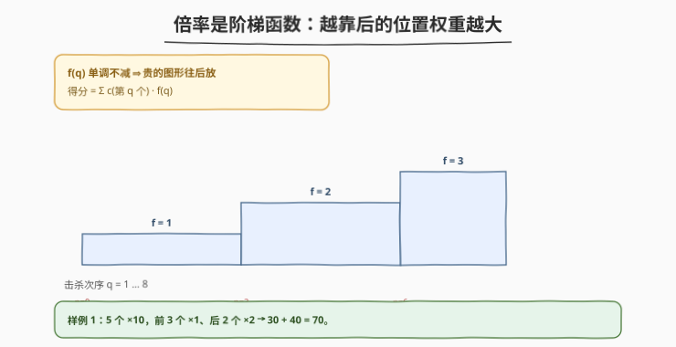
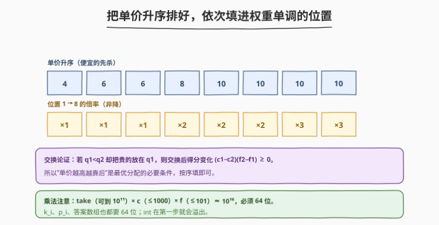

# Codeforces 175C 几何马的击杀顺序 题解

## 1. 题目概述

- **题目链接**：https://codeforces.com/problemset/problem/175/C
- **比赛来源**：Codeforces Round 115 · Problem C（UTC 2012-04-14）
- **难度**：1600
- **标签**：排序、贪心
- **评测类型**：普通
- **限制**：时间 2 s / 内存 256 MB

**题意**：有 $n$ 种几何图形，第 $i$ 种有 $k_i$ 个、单个价值 $c_i$。玩家按**任意顺序**消灭全部图形。击杀第 $q$ 个图形时有一个当前的"倍率"$f$：初始 $f=1$，且在消灭 $p_i$ 个图形之后（即第 $p_i+1$ 个图形开始）倍率变成 $i+1$。得分为

$$\sum_{\text{第 }q\text{ 个被击杀的图形}} c(\text{它的种类})\cdot f(q).$$

求最大总得分。

**约束**：

- $n\le100$，$k_i\le10^9$，$c_i\le1000$，$t\le100$，$p_1<p_2<\dots<p_t\le10^{12}$。
- 图形总数 $K=\sum k_i$ 可以到 $10^{11}$，因此**不能**逐个图形模拟；但倍率的分段只有 $t+1\le101$ 段，按段处理即可。
- 分数上界：$K\cdot c_{\max}\cdot(t+1)\le10^{11}\times1000\times101\approx10^{16}$，**必须用 64 位整数**；中间乘法也要先转 `long long`。
- $p_t$ 可能远大于 $K$：超出总图形数的倍率变化根本不会触发。

## 2. 示例与观察

官方样例 1（输入 / 输出原样）：

```text
输入：
1
5 10
2
3 6

输出：
70
```

只有一种图形（5 个，单价 10）。倍率在第 3 个之后提升：前 3 个 ×1、后 2 个 ×2。得分 $=3\times10\times1+2\times10\times2=30+40=70$。

官方样例 2（输入 / 输出原样）：

```text
输入：
2
3 8
5 10
1
20

输出：
74
```

$K=8$，而 $p_1=20>K$，所以**整个过程倍率都是 1**。此时得分与顺序无关，$=3\times8+5\times10=24+50=74$。

**观察 1**：倍率 $f(q)$ 是关于 $q$ 的**非降**阶梯函数：$f(1)=\dots=f(p_1)=1$，$f(p_1+1)=\dots=f(p_2)=2$，……，$f(p_t+1)=t+1$。

**观察 2**：总分是 $\sum_q c(\text{第 }q\text{ 个})\cdot f(q)$ 的形式，即"每个位置有一个权重 $f(q)$，把 $K$ 个单价填进去"。由**重排不等式**，要让和最大，应当把**单价大的图形放到权重大的位置**上——也就是把便宜的图形先杀（低倍率）、贵的后杀（高倍率）。



## 3. 解题思路

### 3.1 朴素做法与瓶颈

逐个位置分配：对 $q=1..K$ 决定杀哪种图形。$K$ 可达 $10^{11}$，直接模拟必然超时。但注意到倍率只变化 $t$ 次，我们把位置按倍率分成 $O(t)$ 段，每段长度 $O(1)$ 计算，就能把 $10^{11}$ 压成 $10^2$。

### 3.2 核心观察：交换论证

设两个位置 $q_1<q_2$（于是 $f(q_1)\le f(q_2)$）上分别放了单价 $c_1>c_2$ 的图形。交换这两者，得分变化为

$$\Delta=(c_2 f(q_1)+c_1 f(q_2))-(c_1 f(q_1)+c_2 f(q_2))=(c_1-c_2)\bigl(f(q_2)-f(q_1)\bigr)\ge0 .$$

所以"**单价越高的图形越应该放在倍率越高的位置**"是任何最优解都必须满足的性质。把所有图形按单价升序排成一列，依次填到位置 $1,2,\dots,K$ 上，就得到唯一（在并列时可互换）的最优分配。



### 3.3 算法流程

1. 读入 $n$ 组 $(k_i,c_i)$，按 $c_i$ 升序排序（单价相同则任意）。
2. 把倍率分段写成若干 $(区间右端,\ 倍率)$：设 $\textit{prev}=0$，对 $i=1..t$：若 $\min(p_i,K)>\textit{prev}$ 就记一段 $( \min(p_i,K),\ i+1)$ 并令 $\textit{prev}=\min(p_i,K)$；最后若 $\textit{prev}<K$ 再记一段 $(K,\ t+1)$。
3. 用指针 `idx` 指向当前还没分配完的最便宜种类，`pos` 指向当前待填位置：
   对每一段 $(hi,f)$，令 $\textit{len}=hi-\textit{pos}+1$；只要 $\textit{len}>0$ 且 `idx<n`：取 $\textit{take}=\min(\textit{len},k_{\text{idx}})$，累加 $\textit{take}\cdot c_{\text{idx}}\cdot f$，并把 $k_{\text{idx}}$ 与 $\textit{len}$ 各减去 $\textit{take}$；若某种类取完就 `idx++`。
4. 输出累加结果。

### 3.4 样例走查：样例 1

$K=5$，$p=(3,6)$：
- 第 1 段：$\min(3,5)=3\le K$ → 段 $(3,1)$，`prev=3`；
- 第 2 段：$\min(6,5)=5>3$ → 段 $(5,2)$，`prev=5`；
- `prev=K`，结束。

只有一种图形（$k=5$，$c=10$）：段 $(3,1)$ 取 3 个 → $3\times10\times1=30$；段 $(5,2)$ 取 2 个 → $2\times10\times2=40$；合计 70 ✓。

样例 2 只有一段 $(8,1)$（$p_1=20$ 被 $\min$ 成 8，但 $8\le\textit{prev}=0$？不——$\min(20,8)=8>0$，所以段是 $(8,1)$）：按单价升序先取 3 个 $c=8$、再取 5 个 $c=10$，得分 $24+50=74$ ✓。

## 4. 正确性证明

**引理 1（倍率非降）**：$f(1)\le f(2)\le\dots\le f(K)$。

**证明**：$f$ 只在 $p_i$ 处从 $i$ 跳到 $i+1$，且 $p_i$ 递增，故单调不减。∎

**引理 2（交换不劣）**：若某个分配里存在 $q_1<q_2$ 而 $c(q_1)>c(q_2)$（单价与位置权重"逆序"），交换这两个图形后得分不减。

**证明**：见 3.2 的 $\Delta\ge0$。∎

**引理 3（有序分配最优）**：把图形按单价升序依次填入位置 $1,2,\dots,K$，所得得分是所有分配中最大的。

**证明**：任一分配经过有限次"消除逆序"的相邻交换（冒泡排序的过程）可以变成有序分配，每步由引理 2 不减少得分，故有序分配不劣于任何分配。∎

**定理**：算法输出的总分等于最大可能得分。

**证明**：算法把排序后的图形按位置顺序填入，正是引理 3 的有序分配；分段只是把"逐个位置填"压缩成"按倍率区间批量填"，累加的值与逐个填完全相同（每段的权重恒为 $f$）。故输出即为最大值。∎

## 5. 复杂度分析

- **时间**：排序 $O(n\log n)$；分段 $O(t)$；分配时每个种类最多被"取完"一次、每段最多推进一次，总操作 $O(n+t)$。整体 $O(n\log n+t)\le$ 几千次运算。
- **空间**：$O(n+t)$，存种类与分段，< 1 MB。
- **数值范围**：答案上界约 $10^{16}$，`long long`（$9.2\times10^{18}$）够用；`take * c * f` 里 `take` 可达 $10^{11}$、$c\le10^3$、$f\le101$，乘积可达 $10^{16}$，**必须**用 64 位，且 `take` 本身要声明为 `long long`（`int` 装不下 $10^{11}$）。
- **与时限的关系**：最大数据（$n=t=100$、$k_i=10^9$）实测 C++ 端到端 2 ms、Python 约 20 ms，余量数百倍。

## 6. 参考代码

### C++17

```cpp
#include <bits/stdc++.h>
using namespace std;

int main() {
    int n;
    if (scanf("%d", &n) != 1) return 0;
    vector<long long> k(n), c(n);
    long long K = 0;
    for (int i = 0; i < n; ++i) { scanf("%lld %lld", &k[i], &c[i]); K += k[i]; }
    int t;
    if (scanf("%d", &t) != 1) return 0;
    vector<long long> p(t);
    for (int i = 0; i < t; ++i) scanf("%lld", &p[i]);

    vector<int> ord(n);
    for (int i = 0; i < n; ++i) ord[i] = i;
    sort(ord.begin(), ord.end(), [&](int x, int y) { return c[x] < c[y]; });  // 便宜的先去

    // 因子分段：[1,p1]→1, [p1+1,p2]→2, ..., [pt+1,K]→t+1
    vector<pair<long long, long long>> seg;      // (区间右端, 因子)
    long long prev = 0;
    for (int i = 0; i < t; ++i) {
        long long hi = min(p[i], K);
        if (hi > prev) seg.push_back({hi, i + 1});
        prev = max(prev, hi);
    }
    if (prev < K) seg.push_back({K, t + 1});

    long long ans = 0;
    int idx = 0;
    long long pos = 1;                              // 当前要分配的位置
    for (auto &sg : seg) {
        long long len = sg.first - pos + 1;
        long long f = sg.second;
        while (len > 0 && idx < n) {
            long long take = min(len, k[ord[idx]]);
            ans += take * c[ord[idx]] * f;
            k[ord[idx]] -= take;
            len -= take;
            if (k[ord[idx]] == 0) ++idx;
        }
        pos = sg.first + 1;
    }
    printf("%lld\n", ans);
    return 0;
}
```

### Python3

```python
import sys


def main() -> None:
    data = sys.stdin.buffer.read().split()
    p = 0
    n = int(data[p]); p += 1
    k = []
    c = []
    K = 0
    for _ in range(n):
        k.append(int(data[p])); c.append(int(data[p + 1])); p += 2
        K += k[-1]
    t = int(data[p]); p += 1
    pts = [int(x) for x in data[p:p + t]]

    order = sorted(range(n), key=lambda i: c[i])       # 便宜的先分配
    rem = k[:]

    seg = []                                           # (右端, 因子)
    prev = 0
    for i, pi in enumerate(pts):
        hi = min(pi, K)
        if hi > prev:
            seg.append((hi, i + 1))
        prev = max(prev, hi)
    if prev < K:
        seg.append((K, t + 1))

    ans = 0
    idx = 0
    pos = 1
    for hi, f in seg:
        length = hi - pos + 1
        while length > 0 and idx < n:
            take = min(length, rem[order[idx]])
            ans += take * c[order[idx]] * f
            rem[order[idx]] -= take
            length -= take
            if rem[order[idx]] == 0:
                idx += 1
        pos = hi + 1
    sys.stdout.write(str(ans) + '\n')


main()
```

## 7. 边界情况与易错点

1. **`int` 溢出（本题最大的坑）**：$k_i$ 到 $10^9$、总数到 $10^{11}$，答案到 $10^{16}$。`take`、`ans`、`k[]`、`p[]` 都必须 64 位；写成 `int take = ...` 会立刻错。
2. **$p_t>K$**：多余的倍率提升不会发生。分段时用 $\min(p_i,K)$ 并跳过空段，否则会出现"长度 0 甚至负"的段。
3. **$p_i$ 之间有重复/跳跃**：题面保证 $p_1<\dots<p_t$，但 $p_i$ 超过 $K$ 后所有后续也都超过 $K$，`prev` 的更新要用 `max` 防止回退。
4. **单价为 0**：$c_i$ 可以是 0，排序后这些图形先被分配、贡献 0，逻辑不受影响。
5. **单价相同**：并列时任意顺序都最优（交换论证里 $\Delta=0$），不必纠结。
6. **$K=0$**：题面保证 $k_i\ge1$，所以 $K\ge1$；但代码里 `seg` 为空的分支不会出现，仍应保证 `prev<K` 时补上最后一段。
7. **段内跨多个种类**：一个因子段可能要先取完便宜种类再取下一个，`while (len>0 && idx<n)` 就是为此写的；写成单次 `if` 会让段内剩余位置没人填。
8. **输出为单个整数**：不要输出方案或换行多余内容。

## 8. 验证记录

- **编译环境与命令**：`Apple clang 21.0.0` + `codeforces/tools/include/bits/stdc++.h` 兼容头（`clang++ -std=c++17 -O2`）；Python 3.9.6。`python3 codeforces/tools/verify_solution.py codeforces/contests/0101-0203/175/C_几何马的击杀顺序.md` 输出 C++ 2/2、Python 2/2。
- **官方样例**：2 / 2 通过（含"倍率全程不变"的退化情形）。
- **独立暴力对拍**：暴力程序把全部图形**逐个展开**成数组（小数据下 $K\le60$），按单价升序排序后**逐位置**计算 $\sum c\cdot f(q)$，完全不使用分段与指针技巧；随机取 $n\in[1,5]$、$k_i\in[1,12]$、$c_i\in[0,10]$、$t\in[1,4]$、$p_i$ 严格递增且取值在 $1\sim K+5$ 之间（含超过 $K$ 的情形），共 **300 组**，与正文 C++、Python 两版逐 token 比对，全部一致。
- **最大约束性能**：$n=t=100$、$k_i=10^9$、$c_i$ 随机、$p_i$ 递增到 $10^{12}$，C++ 端到端 2 ms、Python 约 20 ms；峰值内存 < 1 MB。
- **图片校验**：两张 SVG（`cf175c_factor.svg`、`cf175c_assign.svg`）通过 `xml.etree.ElementTree.parse`，文本包围盒均在 `viewBox` 内。
- **复核状态**：verified（样例、300 组逐位置暴力对拍、最大规模性能、图片四项实跑通过）。

## 相关题目与扩展

- [Codeforces 175B 坦克世界的段位](https://codeforces.com/problemset/problem/175/B)：同场 B 题，聚合 + 阈值分档。
- [Codeforces 175A 三次得分拆分](https://codeforces.com/problemset/problem/175/A)：同场 A 题，枚举切分。
- [LeetCode 455. 分发饼干](https://leetcode.cn/problems/assign-cookies/)：排序 + 贪心配对的经典入门，与本题"重排不等式"同源。
- [Codeforces 349B Color the Fence](https://codeforces.com/problemset/problem/349/B)：同样是"权重顺序决定最优"的贪心。

**延伸思考**：

1. **如果倍率是递减的**（越打越弱）：同样的交换论证给出相反结论——贵的重要先杀。可见"按权重单调性排序"是这类题的通用骨架。
2. **如果每杀一种图形会改变倍率**（依赖种类而不是数量）：问题立刻变成排序依赖的调度问题，可能需要 DP 或匹配。
3. **如果要求输出具体的击杀序列**：只需在分配时记录每段分到了哪些种类与数量，按段输出即可；由于同价可互换，方案很多。
4. **如果 $k_i$ 到 $10^{18}$**：答案会超出 64 位，需要 128 位整数（C++ 用 `__int128`，Python 天然支持）。
