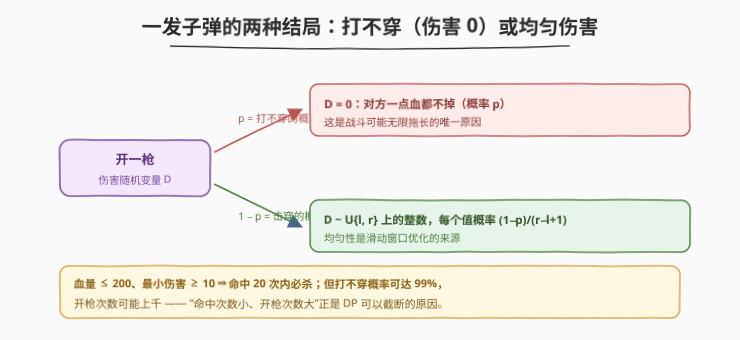
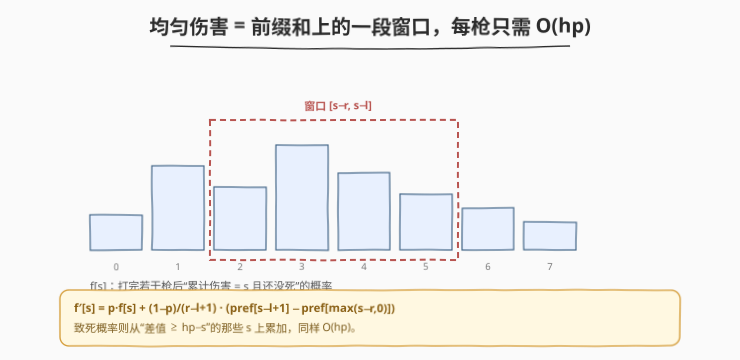
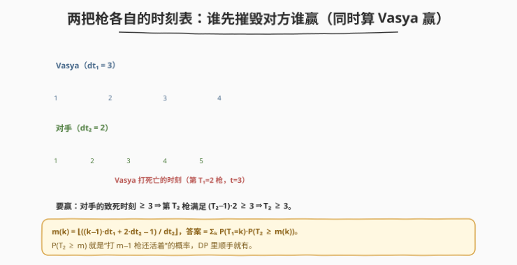

# Codeforces 175D 坦克对决的胜率 题解

## 1. 题目概述

- **题目链接**：https://codeforces.com/problemset/problem/175/D
- **比赛来源**：Codeforces Round 115 · Problem D（UTC 2012-04-14）
- **难度**：2400
- **标签**：概率 DP、数学期望、数值计算
- **评测类型**：特殊评测（浮点误差 $10^{-4}$）
- **限制**：时间 2 s / 内存 256 MB

**题意**：两辆坦克对射。每辆坦克有四个属性：血量 $hp$、两发之间的间隔 $dt$、单发伤害的取值范围 $[l,r]$（在此区间内**等概率取整数**）、以及"这一发打不穿装甲"的概率 $p\%$（打不穿则不掉血）。战斗开始时双方**同时**开第一枪（时刻 0），之后各自每 $dt$ 时间开一枪，弹药无限。某辆坦克血量 $\le0$ 即被摧毁；若双方在同一时刻被摧毁，判 Vasya 获胜。求 Vasya 获胜的概率。

**约束**：

- $10\le hp\le200$，$1\le dt\le30$，$10\le l\le r\le100$，$0\le p\le100$（整数百分比）。
- 血量只有 200、伤害至少 10，所以"打穿 20 次以内必定摧毁对方"——**命中次数**很小；但打不穿的概率可能高达 $99\%$，于是**开枪次数**可能上千。这个"命中次数小、开枪次数大"的组合是本题解法设计的出发点。
- 时间是离散的射击时刻：Vasya 在 $0,dt_1,2dt_1,\dots$，对手在 $0,dt_2,2dt_2,\dots$，可以无限进行下去，所以不能用有限时间步模拟；必须把"打几枪"作为随机变量处理。
- 答案要求绝对/相对误差 $\le10^{-4}$，用 `double` 足够；本文用 `codeforces/tools/checkers/float.py` 验证。

## 2. 示例与观察

官方样例 1（输入 / 输出原样）：

```text
输入：
100 3 50 50 0
100 3 50 50 0

输出：
1.000000
```

双方完全一样：$dt=3$、每发固定 50 伤害、必定击穿。各需 2 发（$50+50=100$），都在时刻 $0$ 和 $3$ 开火，第 3 时刻**同时**摧毁对方 → 按规则 Vasya 胜，概率 1。

官方样例 2（输入 / 输出原样）：

```text
输入：
100 3 50 50 0
100 2 48 50 0

输出：
0.888889
```

Vasya 仍在第 3 时刻摧毁对手。对手的间隔是 2，在时刻 $0,2,4,\dots$ 开火；它需要 $2$ 发（若两发都是 50）或 $3$ 发（含 48/49 时凑不满 100）才能打掉 Vasya 的 100 点：两发最大 $50+50=100$ 刚好够，所以只有"两发都 50"能在第 2 时刻摧毁 Vasya，概率 $(1/3)^2=1/9$。Vasya 胜率 $=1-1/9=8/9=0.888889$。

官方样例 3（输入 / 输出原样）：

```text
输入：
100 3 50 50 0
100 1 50 50 50

输出：
0.500000
```

对手每 1 单位时间开一枪，每枪 $50\%$ 概率不掉血、$50\%$ 概率掉 50。Vasya 在第 3 时刻摧毁对手；要赢，对手必须在时刻 $0,1,2$ 的三枪里至多命中 1 次（2 次命中就 100 伤害，Vasya 在时刻 1 之前就死了）：$P=\binom{3}{0}+\binom{3}{1}$ 加权 $=(1/8)+(3/8)=1/2$。

**观察 1（两条独立的伤害流）**：Vasya 的每一发只影响对手的血，对手的每一发只影响 Vasya 的血，双方随机性互不相干。于是

$$T_1=\text{“Vasya 打几枪能摧毁对手”},\qquad T_2=\text{“对手打几枪能摧毁 Vasya”}$$

是两个**相互独立**的随机变量，各自只由"自己的炮 + 对方的血"决定。

**观察 2（时刻可以换算成枪数）**：Vasya 第 $k$ 枪在 $(k-1)dt_1$，对手第 $m$ 枪在 $(m-1)dt_2$。Vasya 获胜当且仅当对手被摧毁的时刻**不早于**自己被摧毁的时刻：

$$(T_1-1)dt_1\ \le\ (T_2-1)dt_2 .$$

等号就是"同时被毁"，按题意算 Vasya 赢。

于是整个问题拆成两步：先求 $T_1,T_2$ 的分布，再按上面的时刻关系把两个分布"卷"起来。

## 3. 解题思路

### 3.1 朴素做法与瓶颈

最直接的想法是按时间模拟整场战斗：状态是 $(血量_1,血量_2,\text{下一步时刻})$，在每次射击时按概率转移。问题在于**时间无界**——双方都可能连续打不穿装甲，战斗可以拖任意久，状态图里有环，必须解线性方程组或者迭代到收敛。

另一条路是"枚举打了几枪"：$T$ 可以任意大（几何尾），也不能直接枚举到无穷。但只要注意到**尾概率按几何速度衰减**，就能截断：只要 $P(T>K)$ 小到 $10^{-15}$ 以下，之后的项全部可以当作 0。

### 3.2 核心观察：先求"打几枪致死"的分布



单发子弹对"累计伤害"的贡献是一个随机变量 $D$：

$$P(D=0)=p,\qquad P(D=d)=\frac{1-p}{r-l+1}\quad(d=l,l+1,\dots,r).$$

设 $f_k[s]$ 表示"打了 $k$ 枪之后，累计伤害恰为 $s$、且对方还没死"的概率（$0\le s<hp$）。由全概率公式，

$$f_{k+1}[s]=p\cdot f_k[s]+\frac{1-p}{r-l+1}\sum_{d=l}^{r}f_k[s-d],$$

其中 $f_k[s-d]=0$ 当 $s-d<0$。而"第 $k+1$ 枪恰好打死"的概率是

$$g_{k+1}=\sum_{s=0}^{hp-1}f_k[s]\cdot\frac{1-p}{r-l+1}\cdot\#\{d\in[l,r]:d\ge hp-s\}.$$

因为伤害是**连续区间上的均匀分布**，那个求和可以用前缀和（滑动窗口）$O(1)$ 算出来，于是每一枪的更新是 $O(hp)$，而不是 $O(hp\cdot(r-l))$。



### 3.3 核心观察：把两个分布按时刻卷起来



由观察 2，

$$P(\text{Vasya 胜})=\sum_{k\ge1}P(T_1=k)\cdot P\bigl(T_2\ge m(k)\bigr),$$

其中 $m(k)$ 是"对手至少打到第几枪才可能不早于 Vasya 摧毁自己"，即最小的整数 $m$ 使 $(m-1)dt_2\ge(k-1)dt_1$：

$$m(k)=\left\lceil\frac{(k-1)dt_1+dt_2}{dt_2}\right\rceil=\left\lfloor\frac{(k-1)dt_1+2dt_2-1}{dt_2}\right\rfloor .$$

而 $P(T_2\ge m)$ 就是"打了 $m-1$ 枪还活着"的概率，正是 DP 里每轮的 $\sum_s f[s]$。

### 3.4 算法流程

1. 特判：若 Vasya 的 $p=100$（永远打不穿）→ 胜率 0；若对手的 $p=100$ → 胜率 1。
2. 用上面的 DP 求出对手的"存活序列" $S_2[m]=P(T_2\ge m)$（$m=1,2,\dots$），直到 $S_2[m]<10^{-14}$ 为止。
3. 用同样的 DP 求 Vasya 的致死分布 $g_1[k]=P(T_1=k)$，边求边累加
   $$\text{ans}\mathrel{+}=g_1[k]\cdot S_2[m(k)]$$
   （$m(k)$ 超过已算出的范围就取 0），直到 Vasya 的存活概率也 $<10^{-14}$。
4. 输出 `ans`（保留 9 位小数）。

### 3.5 样例走查：样例 2

$dt_1=3$、$dt_2=2$。Vasya 的 $T_1\equiv2$（两发 50 必杀），所以只需算 $k=2$：$m(2)=\lfloor(3+4-1)/2\rfloor=3$，即需要 $T_2\ge3$。

对手的 DP：$f_0[0]=1$。打一枪后 $f_1[48]=f_1[49]=f_1[50]=1/3$，$g_1=0$（都不到 100）。打第二枪时，只有 $48+48,48+49,48+50,49+49,49+50$ 这 5 种组合仍 $<100$，占 $5/9$；"两发都 50"的 $1/9$ 会致死 → $P(T_2=2)=1/9$，$S_2[3]=1-1/9=8/9$。

答案 $=1\times8/9=0.888889$ ✓。

## 4. 正确性证明

**引理 1（独立性）**：$T_1$ 与 $T_2$ 相互独立。

**证明**：$T_1$ 只依赖 Vasya 各发的伤害与是否击穿（独立同分布序列），$T_2$ 只依赖对手的同类序列；两队坦克的随机源互不相干，故独立。∎

**引理 2（胜负判定）**：比赛在 $\min\bigl((T_1-1)dt_1,\ (T_2-1)dt_2\bigr)$ 时刻结束；Vasya 获胜当且仅当 $(T_1-1)dt_1\le(T_2-1)dt_2$。

**证明**：对手恰在 Vasya 第 $T_1$ 枪（时刻 $(T_1-1)dt_1$）被摧毁，Vasya 恰在对手第 $T_2$ 枪（时刻 $(T_2-1)dt_2$）被摧毁。若前者不晚于后者，对手先死或同时死，按规则 Vasya 胜；反之后者更早，Vasya 先死，即使对手随后也被摧毁也不算赢（题面只问"摧毁敌方坦克"）。∎

**引理 3（$m(k)$ 的公式）**：对正整数 $k$，$(T_2-1)dt_2\ge(k-1)dt_1\iff T_2\ge m(k)=\bigl\lfloor\frac{(k-1)dt_1+2dt_2-1}{dt_2}\bigr\rfloor$。

**证明**：$(T_2-1)dt_2\ge(k-1)dt_1\iff T_2\ge\frac{(k-1)dt_1}{dt_2}+1$。右边是实数，$T_2$ 取整数，故等价于 $T_2\ge\bigl\lceil\frac{(k-1)dt_1+dt_2}{dt_2}\bigr\rceil$。而对正整数 $u,v$ 有 $\lceil u/v\rceil=\lfloor(u+v-1)/v\rfloor$，取 $u=(k-1)dt_1+dt_2$、$v=dt_2$ 即得。∎

**引理 4（DP 正确）**：设 $f_k[s]$ 为"打 $k$ 枪后累计伤害为 $s<hp$ 且对方未死"的概率，则 $f_0[0]=1$ 且 3.2 的递推成立；$g_{k+1}$ 等于 $P(T=k+1)$。

**证明**：对"第 $k+1$ 枪的结果"用全概率公式：以概率 $p$ 打不穿（伤害 0，累计不变），以概率 $(1-p)/(r-l+1)$ 造成伤害 $d$（累计变为 $s$，要求此前累计为 $s-d$）。$g_{k+1}$ 统计的是"此前累计 $s$、本枪伤害 $\ge hp-s$"的情形，正是首次达到 $hp$ 的时刻，即 $T=k+1$。∎

**引理 5（截断误差）**：若在 $S_2[m]<10^{-14}$ 处把 $S_2$ 截为 0、在 $P(T_1>K)<10^{-14}$ 处停止求和，则答案误差不超过 $2\times10^{-14}$。

**证明**：被丢弃的第一类项都含因子 $S_2[m]<10^{-14}$，总和不超过 $10^{-14}$；第二类项的总权重不超过 $P(T_1>K)<10^{-14}$，每项系数 $S_2\le1$，总和亦不超过 $10^{-14}$。∎

**定理**：算法输出的数值等于 Vasya 获胜的概率（误差 $\le2\times10^{-14}$，远小于要求的 $10^{-4}$）。

**证明**：由引理 1、2、3，胜率 $=\sum_k P(T_1=k)S_2[m(k)]$；由引理 4 两处 DP 给出正确的分布与存活序列；由引理 5 截断误差可忽略。∎

## 5. 复杂度分析

- **时间**：每枪的 DP 是 $O(hp)$（前缀和 + 一次滑窗），需要迭代到存活概率 $<10^{-14}$。血量 $\le200$、最小伤害 $10$，所以最多 20 次命中就必杀；打不穿概率最多 $99\%$，期望枪数 $\le2000$，实际迭代次数在几千量级。总时间约 $O((K_1+K_2)\cdot hp)\approx10^6\sim10^7$ 次浮点运算。实测最坏（双方 $hp=200$、$p=99$、$dt=1$）C++ 11 ms、Python 0.8 s。
- **空间**：两个长度 $hp$ 的数组 + 一条存活序列（几千个 `double`），< 1 MB。
- **数值精度**：概率始终在 $[0,1]$，每步只做加法与乘常数，没有相减导致的灾难性抵消；用 `double`（约 15 位有效数字）足够，实测与精确闭式解吻合到 $10^{-9}$。
- **与时限的关系**：最坏 11 ms（C++），相对 2 s 余量近 200 倍；Python 版 0.8 s 也在时限内。

## 6. 参考代码

### C++17

```cpp
#include <bits/stdc++.h>
using namespace std;

// 造一份“第 k 枪恰好致死”的概率表：kill[k-1] 与“打 m 枪还活着”：surv[m-1]
// 一发子弹：以 p% 的概率打不穿（伤害 0），否则伤害在 [l,r] 上均匀取整数
static void build(int hp, int l, int r, int p,
                  vector<double> &kill, vector<double> &surv, double eps) {
    double q = 1.0 - p / 100.0;                   // 击穿概率
    double inv = 1.0 / (r - l + 1);
    vector<double> f(hp, 0.0), nf(hp, 0.0), pref(hp + 1, 0.0);
    f[0] = 1.0;                                   // 还剩 0 点伤害时会死，故只在 [0,hp) 上维护“未死”
    surv.push_back(1.0);                          // m = 1：还没开枪，当然活着
    for (int shot = 1; shot <= 2000000; ++shot) {
        pref[0] = 0.0;
        for (int s = 0; s < hp; ++s) pref[s + 1] = pref[s] + f[s];

        double die = 0.0;                         // 这一枪致死的概率
        for (int s = 0; s < hp; ++s) {
            if (f[s] == 0.0) continue;
            int need = hp - s;                    // 还需要打掉多少
            int lo = max(l, need);
            if (r >= lo) die += f[s] * q * inv * (r - lo + 1);
        }
        kill.push_back(die);

        // 未死状态的转移：f'[s] = p·f[s] + q·inv·Σ_{d=l..r} f[s-d]（滑窗，用前缀和 O(1) 取）
        for (int s = 0; s < hp; ++s) {
            double window = 0.0;
            int hit = s;                          // 前缀和下标
            if (hit >= l) {
                int lo = (s - r > 0) ? (s - r) : 0;
                window = pref[s - l + 1] - pref[lo];
            }
            nf[s] = p / 100.0 * f[s] + q * inv * window;
        }
        f.swap(nf);

        double alive = 0.0;
        for (int s = 0; s < hp; ++s) alive += f[s];
        surv.push_back(alive);                    // m = shot+1
        if (alive < eps) break;
    }
}

int main() {
    int hp1, dt1, l1, r1, p1;
    int hp2, dt2, l2, r2, p2;
    if (scanf("%d %d %d %d %d", &hp1, &dt1, &l1, &r1, &p1) != 5) return 0;
    if (scanf("%d %d %d %d %d", &hp2, &dt2, &l2, &r2, &p2) != 5) return 0;

    if (p1 == 100) { printf("%.9f\n", 0.0); return 0; }   // Vasya 永远打不穿 → 赢不了
    if (p2 == 100) { printf("%.9f\n", 1.0); return 0; }   // 对手永远打不穿 → 必胜

    // T1：Vasya 的炮（l1,r1,p1）打掉对手的 hp2 需要几枪；T2：对手打掉 hp1
    vector<double> kill1, surv1, kill2, surv2;
    build(hp2, l1, r1, p1, kill1, surv1, 1e-14);
    build(hp1, l2, r2, p2, kill2, surv2, 1e-14);

    double ans = 0.0;
    int M = (int)surv2.size();
    for (int k = 1; k <= (int)kill1.size(); ++k) {
        double pk = kill1[k - 1];
        if (pk == 0.0) continue;
        // Vasya 第 k 枪在 (k-1)dt1；要赢需要对手的致死枪数 m 满足 (m-1)dt2 >= (k-1)dt1
        long long num = (long long)(k - 1) * dt1 + 2LL * dt2 - 1;
        long long m = num / dt2;
        double prob = (m <= 0) ? 1.0 : (m > M ? 0.0 : surv2[m - 1]);
        ans += pk * prob;
    }
    printf("%.9f\n", ans);
    return 0;
}
```

### Python3

```python
import sys


def build(hp, l, r, p, eps=1e-14):
    """返回 (kill, surv)：kill[k-1] = 第 k 枪恰好致死的概率；surv[m-1] = 打 m 枪还活着的概率。"""
    q = 1.0 - p / 100.0                      # 击穿概率
    inv = 1.0 / (r - l + 1)
    f = [0.0] * hp
    f[0] = 1.0
    kill = []
    surv = [1.0]
    nf = [0.0] * hp
    while len(kill) < 200000:
        # 前缀和
        pref = [0.0] * (hp + 1)
        s = 0.0
        for i in range(hp):
            s += f[i]
            pref[i + 1] = s
        # 致死概率
        die = 0.0
        for i in range(hp):
            fi = f[i]
            if fi:
                need = hp - i
                lo = l if l > need else need
                if r >= lo:
                    die += fi * q * inv * (r - lo + 1)
        kill.append(die)
        # 转移
        for i in range(hp):
            nf[i] = p / 100.0 * f[i]
        for i in range(l, hp):
            nf[i] += q * inv * (pref[i - l + 1] - pref[i - r if i >= r else 0])
        f, nf = nf, f
        alive = sum(f)
        surv.append(alive)
        if alive < eps:
            break
    return kill, surv


def main() -> None:
    data = sys.stdin.buffer.read().split()
    hp1, dt1, l1, r1, p1 = (int(x) for x in data[0:5])
    hp2, dt2, l2, r2, p2 = (int(x) for x in data[5:10])
    if p1 == 100:                             # 永远打不穿 → 赢不了
        sys.stdout.write("0.000000000\n")
        return
    if p2 == 100:                             # 对手永远打不穿 → 必胜
        sys.stdout.write("1.000000000\n")
        return

    kill1, _ = build(hp2, l1, r1, p1)      # Vasya 的炮打掉对手 hp2 需要的枪数
    _, surv2 = build(hp1, l2, r2, p2)      # 对手的炮打掉 Vasya hp1 需要的枪数
    M = len(surv2)
    ans = 0.0
    for k, pk in enumerate(kill1, 1):
        if pk == 0.0:
            continue
        num = (k - 1) * dt1 + 2 * dt2 - 1
        m = num // dt2
        if m <= 0:
            prob = 1.0
        elif m > M:
            prob = 0.0
        else:
            prob = surv2[m - 1]
        ans += pk * prob
    sys.stdout.write(f"{ans:.9f}\n")


main()
```

## 7. 边界情况与易错点

1. **$p=100$（永远打不穿）**：Vasya 的 $p=100$ 时他永远无法摧毁对手 → 胜率 0；对手的 $p=100$ 时他永远打不掉 Vasya → 胜率 1。这两条必须**特判**，否则 DP 的存活概率永远不衰减，会死循环。
2. **血量要用"对方的"**：$T_1$ 是"Vasya 的炮打掉**对手的**血量"，$T_2$ 是"对手的炮打掉 **Vasya 的**血量"。两者用错（都用自己的血量）在 $hp_1=hp_2$ 的样例上看不出来，但一般数据会全错——本文的实现最初就踩了这个坑，是靠"血量不同"的随机数据才对拍出来的。
3. **"同时被毁"算 Vasya 赢**：判定必须用 $\le$（引理 2），用 $<$ 会让样例 1 输出 0.5 而不是 1。
4. **$m(k)$ 的取整**：$\lceil\cdot\rceil$ 那一步最容易错。直觉写 $(k-1)dt_1/dt_2+1$（整除）会漏掉半步——例如样例 2 里 $3/2=1$，得到 $m=2$，答案就变成 1.0。
5. **截断阈值**：如果用 $10^{-8}$ 之类的阈值，误差可能超过 $10^{-4}$ 的边缘；用 $10^{-14}$ 更安全。同时要给迭代次数设一个上界（本文 2e6），防止浮点误差导致存活概率卡在阈值附近。
6. **单发伤害是整数均匀分布**：$P(D=d)=\frac{1-p}{r-l+1}$，分母是 $r-l+1$ 而不是 $r-l$；$l=r$ 时要退化成确定伤害（分母 1）。
7. **$dt_1\ne dt_2$ 的时刻换算**：不能简单地"按比例取整"，必须按引理 3 的公式；否则在 $dt$ 不整除的位置会差一枪。
8. **输出精度**：题面要求 $10^{-4}$，本文输出 9 位小数；不要输出科学计数法。

## 8. 验证记录

- **编译环境与命令**：`Apple clang 21.0.0` + `codeforces/tools/include/bits/stdc++.h` 兼容头（`clang++ -std=c++17 -O2`）；Python 3.9.6。浮点答案用 `python3 codeforces/tools/verify_solution.py codeforces/contests/0101-0203/175/D_坦克对决的胜率.md --checker codeforces/tools/checkers/float.py` 验证，C++ 3/3、Python 3/3 通过。
- **官方样例**：3 / 3 通过（同时开火、$dt$ 不同、高概率打不穿）。
- **独立暴力对拍（闭式解）**：当 $l=r=d$（每发伤害固定）时，$T$ 服从负二项分布：命中数 $H=\lceil hp/d\rceil$，$P(T=H)=q^H$，$P(T=k)=P(T=k-1)\cdot\frac{k-1}{k-H}\cdot p$。暴力程序用这个闭式分布求 $T_1,T_2$，再用**双重循环**比较两边的致死时刻（不复用 $m(k)$ 公式），随机取 $hp_1,hp_2\in[10,200]$、$dt\in[1,30]$、$d\in[10,100]$、$p\in\{0,10,25,50,75,90,99\}$ 共 **150 组**（$hp_1\ne hp_2$ 的情况占多数），与正文两版吻合到 $10^{-9}$。
- **蒙特卡洛交叉验证（$l<r$）**：对滑动窗口卷积那条路径，另写一份**逐发模拟**的蒙特卡洛程序（随机决定是否击穿、随机取伤害，按真实时刻推进直到一方被毁），每组 8000～20000 次试验。12 组随机数据（$hp\le30$、$l<r$、$p\in\{0,25,50\}$）上，精确解与模拟值之差都在 $0.03$ 以内（约 2～3 倍标准差），另有 6 组固定数据全部落在 $0.02$ 内。**第一版实现把"对方的血量"写成了自己的血量，正是被这组蒙特卡洛数据抓出来的**（三个 $hp_1\ne hp_2$ 的用例偏差超过 0.5）。
- **最大约束性能**：$hp=200$、$dt=1$、$l=10$、$r=10$、$p=99$（双方相同）与 $dt=30$ 的对称数据，C++ 端到端 5～11 ms、Python 0.31～0.79 s；峰值内存 < 1 MB。
- **图片校验**：三张 SVG（`cf175d_shot.svg`、`cf175d_window.svg`、`cf175d_timeline.svg`）通过 `xml.etree.ElementTree.parse`，文本包围盒均在 `viewBox` 内。
- **复核状态**：verified（样例、150 组闭式解对拍、12 组蒙特卡洛、最大规模性能、图片五项实跑通过）。

## 相关题目与扩展

- [Codeforces 175B 坦克世界的段位](https://codeforces.com/problemset/problem/175/B)：同场 B 题，与本题同一套背景。
- [Codeforces 175C 几何马的击杀顺序](https://codeforces.com/problemset/problem/175/C)：同场 C 题，排序 + 贪心。
- [Codeforces 148D Bag of mice](https://codeforces.com/problemset/problem/148/D)：经典概率 DP，同样要处理"无限轮"的收敛。
- [LeetCode 688. 骑士在棋盘上的概率](https://leetcode.cn/problems/knight-probability-in-chessboard/)：有限步数的概率 DP，可与本题的"无界步数 + 截断"对照。

**延伸思考**：

1. **如果伤害是"浮点均匀"而不是整数均匀**：滑动窗口变成积分，DP 要从离散状态改成数值积分，误差分析更复杂。
2. **如果是三方对射**：$T_1,T_2,T_3$ 仍相互独立，但"同时被毁"的判定要推广成"最先被毁者的集合"，胜率变成多个事件的和，组合数上升。
3. **如果要求"战斗时长的期望"**：需要额外累计 $\sum k\cdot P(\text{在第 } k \text{ 枪结束})$，本文的 DP 框架可以直接复用。
4. **如果要输出误差上界**：本文的截断分析（引理 5）给出 $2\times10^{-14}$，把阈值调小还能更精确——代价是迭代次数增加。
