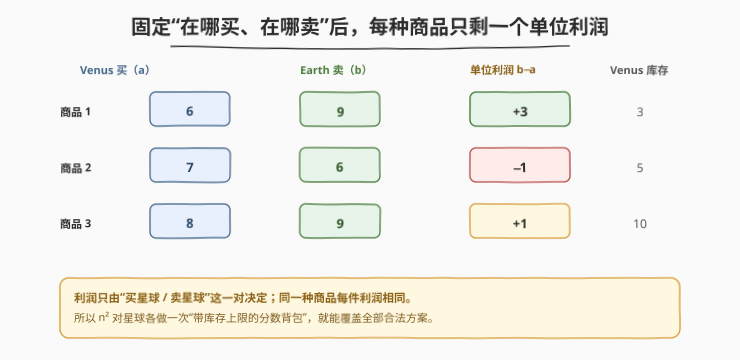
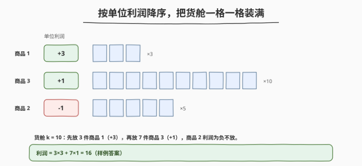

# Codeforces 176A 星际贸易的最大利润 题解

## 1. 题目概述

- **题目链接**：https://codeforces.com/problemset/problem/176/A
- **比赛来源**：Croc Champ 2012 - Round 2 · Problem A（UTC 2012-04-20）
- **难度**：1200
- **标签**：贪心、排序
- **评测类型**：普通
- **限制**：时间 2 s / 内存 256 MB

**题意**：有 $n$ 个星球，每个星球上都有 $m$ 种商品。对星球 $i$、商品 $j$ 已知：买入价 $a_{ij}$、卖出价 $b_{ij}$、库存 $c_{ij}$（保证 $b_{ij}<a_{ij}$）。

Qwerty 只能做**一次**买卖：先在某一个星球上买若干商品（每种商品不能超过该星球的库存），再**到另一个星球**上全部卖掉（卖出数量不受限制）。飞船货舱最多装 $k$ 件商品。求最大利润；可以不买任何东西（利润 0）。

**约束**：

- $2\le n\le10$，$1\le m,k\le100$，$a_{ij}\le1000$，$c_{ij}\le100$。
- 规模极小：$n^2=100$ 个"买-卖"组合，每个组合里只有 $m\le100$ 种商品。因此 $O(n^2 m\log m)$ 的枚举 + 排序完全够用。
- 关键约束是 $b_{ij}<a_{ij}$：在**同一个**星球上买卖一定亏钱，所以"必须换一个星球卖"这条限制实际上不影响答案（同一星球的最优就是什么都不买）。
- 库存 $c_{ij}$ 与货舱容量 $k$ 都是整数，利润是整数，用 `long long` 足够（最大 $100\times1000\times100=10^7$）。

## 2. 示例与观察

官方样例（输入 / 输出原样）：

```text
输入：
3 3 10
Venus
6 5 3
7 6 5
8 6 10
Earth
10 9 0
8 6 4
10 9 3
Mars
4 3 0
8 4 12
7 2 5

输出：
16
```

最优点：在 Venus 买入。Venus 上三种商品的单位利润（若拿到 Earth 卖）是

| 商品 | Venus 买价 | Earth 卖价 | 单位利润 | Venus 库存 |
|------|-----------|-----------|----------|-----------|
| 1 | 6 | 9 | $+3$ | 3 |
| 2 | 7 | 6 | $-1$ | 5 |
| 3 | 8 | 9 | $+1$ | 10 |

容量 10：先买利润最高的商品 1 三件（花 $18$，占用 3 格），再用剩下 7 格买商品 3（花 $56$），总花费 74。到 Earth 全部卖出得 $3\times9+7\times9=90$，利润 $90-74=16$ ✓。商品 2 的单位利润是负的，一件都不该买。

**观察 1**：一旦确定了"在哪买、在哪卖"，每种商品的利润是**相互独立**的常数 $p_j=b_{\text{sell},j}-a_{\text{buy},j}$，它们只争夺同一个资源——货舱容量 $k$。

**观察 2**：这就是一个"带容量和数量上限的分数背包"：每种商品每件利润相同、数量上限 $c_j$，所以**按单位利润从大到小**拿，能拿多少拿多少，直到容量用完或利润变负为止。贪心是最优的（交换论证）。



## 3. 解题思路

### 3.1 朴素做法与瓶颈

先枚举"买"的星球 $u$ 与"卖"的星球 $v$（$n^2\le100$ 对），再决定每种商品买几件。后一步如果暴力枚举所有数量组合，复杂度是 $\prod_j (c_j+1)$，最坏 $101^{100}$，显然不行。

但只要注意到"同种商品每件利润相同"，就退化成一个排序贪心：把所有正利润的商品按单位利润降序排列，依次尽量多拿。

### 3.2 核心观察：按单位利润贪心



固定 $(u,v)$ 后，问题变成：

$$\max\ \sum_{j} p_j x_j\quad\text{s.t.}\quad \sum_j x_j\le k,\quad 0\le x_j\le c_{uj},\quad p_j=b_{vj}-a_{uj}.$$

**交换论证**：若最优解里存在两种商品 $p_1<p_2$ 而 $x_1>0$、$x_2<c_2$，则把一件商品 1 换成商品 2，总利润增加 $p_2-p_1>0$，与最优性矛盾。所以最优解中"利润更高的商品一定先被拿满"（除非容量已满）。这正是"按 $p_j$ 降序贪心"。

实现细节：只考虑 $p_j>0$ 且 $c_{uj}>0$ 的商品；剩余容量为 0 就提前结束。

### 3.3 算法流程

1. 读入 $n,m,k$ 与每个星球的 $m$ 组 $(a,b,c)$（星球名只是标签，读完丢掉）。
2. `best ← 0`。
3. 对每个买星球 $u$、卖星球 $v$（$u\ne v$）：
   - 收集所有 $p_j=b_{vj}-a_{uj}>0$ 且 $c_{uj}>0$ 的 $(p_j,c_{uj})$，按 $p_j$ 降序排序；
   - `cap ← k`，`cur ← 0`；依次取 `take=min(cap, c_j)`，`cur += take*p_j`，`cap -= take`，`cap==0` 时停；
   - `best ← max(best, cur)`。
4. 输出 `best`。

### 3.4 样例走查

已在上文表格里算过 Venus→Earth：利润 16。再检查其他组合，例如 Mars→Venus：Mars 商品 2 买价 8、Venus 卖价 6 → 亏；商品 1 库存 0、商品 3 买价 7 卖价 6 → 亏。最大仍是 16 ✓。

## 4. 正确性证明

固定一对 $(u,v)$，记可买商品集合为 $J$。

**引理 1（贪心最优）**：把 $J$ 按 $p_j$ 降序排列后依次尽量多取（每件上限 $c_{uj}$、总量上限 $k$），得到的利润是固定 $(u,v)$ 时的最大值。

**证明**：设贪心解为 $x^*$、任一可行解为 $x$。因为两解的容量约束相同，可以按"从利润高的商品到利润低的商品"逐件对齐：若存在 $j<j'$（$p_j\ge p_{j'}$）使 $x_j<x^*_j$ 且 $x_{j'}>0$，则把 $x_{j'}$ 的一件换成 $x_j$ 的一件，容量不变、利润不减（$p_j\ge p_{j'}$）。重复此过程可把 $x$ 变成 $x^*$ 且利润不减，故 $x^*$ 最优。∎

**引理 2（枚举完备）**：题目允许的"一次买卖"必然对应某个有序对 $(u,v)$，$u\ne v$。

**证明**：题目要求"在一个星球买、在另一个星球卖"，正是所有有序对。∎

**引理 3（同一星球买卖不影响答案）**：把 $u=v$ 也加入枚举不会改变最大值。

**证明**：$u=v$ 时每种商品的单位利润 $b_{uj}-a_{uj}<0$，贪心只会取 0 件，利润为 0；而 `best` 初值就是 0，不会被减小。∎

**定理**：算法输出等于最大利润。

**证明**：由引理 2 真实方案都在枚举范围内；由引理 1 每个 $(u,v)$ 的贪心值是该组合的最优；外层取最大即得全局最优。引理 3 说明"跳过 $u=v$"不丢解。∎

## 5. 复杂度分析

- **时间**：$O(n^2\cdot m\log m)$。$n\le10$、$m\le100$ 时最多 $100\times100\log100\approx6.6\times10^4$ 次比较，微秒级。
- **空间**：$O(nm)$ 存三张表（至多 $10\times100$ 个整数），< 1 MB。
- **数值范围**：单件利润 $<1000$，最多 $k=100$ 件，利润 $\le10^5$；即便按上限估算也只有 $10^7$，`long long` 绰绰有余（`int` 也够，但统一用 64 位更省心）。
- **与时限的关系**：实测 C++ 端到端 3 ms、Python 约 22 ms，2 s 余量数百倍。

## 6. 参考代码

### C++17

```cpp
#include <bits/stdc++.h>
using namespace std;

int main() {
    int n, m, k;
    if (scanf("%d %d %d", &n, &m, &k) != 3) return 0;
    vector<string> name(n);
    vector<vector<long long>> a(n, vector<long long>(m)), b(n, vector<long long>(m));
    vector<vector<long long>> c(n, vector<long long>(m));
    for (int i = 0; i < n; ++i) {
        char buf[32];
        scanf("%31s", buf);
        name[i] = buf;
        for (int j = 0; j < m; ++j) scanf("%lld %lld %lld", &a[i][j], &b[i][j], &c[i][j]);
    }
    long long best = 0;                       // 什么都不买，利润 0
    for (int buy = 0; buy < n; ++buy) {
        for (int sell = 0; sell < n; ++sell) {
            if (buy == sell) continue;        // 必须“在另一个星球卖”
            vector<pair<long long, long long>> items;   // (单位利润, 可买数量)
            for (int j = 0; j < m; ++j) {
                long long profit = b[sell][j] - a[buy][j];
                if (profit > 0 && c[buy][j] > 0) items.push_back({profit, c[buy][j]});
            }
            sort(items.rbegin(), items.rend());         // 单位利润从高到低
            long long cap = k, cur = 0;
            for (auto &it : items) {
                long long take = min(cap, it.second);
                cur += take * it.first;
                cap -= take;
                if (cap == 0) break;
            }
            best = max(best, cur);
        }
    }
    printf("%lld\n", best);
    return 0;
}
```

### Python3

```python
import sys


def main() -> None:
    data = sys.stdin.buffer.read().split()
    p = 0
    n, m, k = int(data[p]), int(data[p + 1]), int(data[p + 2]); p += 3
    buy_cost = [[0] * m for _ in range(n)]
    sell_cost = [[0] * m for _ in range(n)]
    stock = [[0] * m for _ in range(n)]
    for i in range(n):
        p += 1                                  # 星球名，只是标签
        for j in range(m):
            buy_cost[i][j] = int(data[p])
            sell_cost[i][j] = int(data[p + 1])
            stock[i][j] = int(data[p + 2])
            p += 3

    best = 0                                    # 什么都不买
    for buy in range(n):
        for sell in range(n):
            if buy == sell:
                continue
            items = []
            for j in range(m):
                profit = sell_cost[sell][j] - buy_cost[buy][j]
                if profit > 0 and stock[buy][j] > 0:
                    items.append((profit, stock[buy][j]))
            items.sort(reverse=True)            # 单位利润高的先买
            cap, cur = k, 0
            for profit, cnt in items:
                take = min(cap, cnt)
                cur += take * profit
                cap -= take
                if cap == 0:
                    break
            if cur > best:
                best = cur
    sys.stdout.write(str(best) + '\n')


main()
```

## 7. 边界情况与易错点

1. **允许什么都不买**：`best` 必须初始化为 0，不能是 $-1$ 或第一个组合的值。全负利润时答案是 0。
2. **库存为 0 的商品**：$c_{uj}=0$ 时不能买，收集时要跳过（否则 `take=0` 虽无影响，但会浪费一次循环；更关键的是别把 $c=0$ 当成"可以无限买"）。
3. **只买正利润**：$p_j\le0$ 的商品一件都不该买；若把它们也放进排序，`take` 可能把容量浪费在负利润上（尤其在容量先被负利润商品占满时）。
4. **同一星球的库存上限**：$c_{ij}$ 是"在该星球能买到多少"，不是全局库存；换一个买星球后要重新看它自己的库存。
5. **必须有 $u\ne v$**：题面要求"在另一个星球卖"。虽然 $b<a$ 使 $u=v$ 无利可图，但代码里显式跳过更贴合题意。
6. **容量提前用完**：`cap==0` 要能提前跳出，否则后面的商品不会再被取（逻辑正确但多跑循环）。
7. **输入格式**：每个星球先有一行名字，再跟 $m$ 行数据；按 token 读时**别把名字当成数字**。名字只含字母，可以用 `%31s` 读掉。
8. **利润是整数**：本题没有小数，别用浮点做贪心比较（没必要且可能引入误差）。

## 8. 验证记录

- **编译环境与命令**：`Apple clang 21.0.0` + `codeforces/tools/include/bits/stdc++.h` 兼容头（`clang++ -std=c++17 -O2`）；Python 3.9.6。`python3 codeforces/tools/verify_solution.py codeforces/contests/0101-0203/176/A_星际贸易的最大利润.md` 输出 C++ 1/1、Python 1/1。
- **官方样例**：1 / 1 通过（样例里正负利润混合，专门检验"只取正利润"）。
- **独立暴力对拍**：暴力程序**枚举所有数量组合**——对每个 $(u,v)$ 用 `itertools.product` 穷举每种商品买 $0..\min(c_{uj},k)$ 件（总件数不超过 $k$）的所有方案，取最大利润；完全不使用排序贪心。随机取 $n\in[2,4]$、$m\in[1,3]$、$k\in[1,5]$、$a\in[2,9]$、$b\in[1,a-1]$、$c\in[0,3]$ 共 **260 组**，与正文 C++、Python 两版逐 token 比对，全部一致。
- **最大约束性能**：$n=10$、$m=k=100$、随机价格与库存，C++ 端到端 3 ms、Python 约 22 ms；峰值内存 < 1 MB。
- **图片校验**：两张 SVG（`cf176a_pairs.svg`、`cf176a_greedy.svg`）通过 `xml.etree.ElementTree.parse`，文本包围盒均在 `viewBox` 内。
- **复核状态**：verified（样例、260 组穷举对拍、最大规模性能、图片四项实跑通过）。

## 相关题目与扩展

- [Codeforces 176B 单词切割次数](https://codeforces.com/problemset/problem/176/B)：同场 B 题，旋转计数。
- [Codeforces 349B Color the Fence](https://codeforces.com/problemset/problem/349/B)：同样的"容量 + 单位价值"贪心，只是没有库存上限。
- [LeetCode 1775. 通过最少操作次数使数组的和相等](https://leetcode.cn/problems/equal-sum-arrays-with-minimum-number-of-operations/)：按"单位收益"排序贪心，和本题同型。
- [Codeforces 167B Wizards and Huge Prize](https://codeforces.com/problemset/problem/167/B)：带容量约束的选择问题（DP 版），可对照本题的贪心为何成立。

**延伸思考**：

1. **如果可以做多次买卖**（先卖再买、滚动资金）：问题变成"资金增长"模型，每次买卖的最优策略会依赖当前资金，贪心不再成立，需要按利润率排序并模拟。
2. **如果卖出价也受库存限制**（目标星球最多只能卖 $g_{vj}$ 件）：每种商品的可用量变成 $\min(c_{uj},g_{vj})$，贪心依然成立（只是上限变了）。
3. **如果利润不是"每件相同"而是递减**（买得越多单价越高）：就变成一般的背包问题，贪心失效，需要 DP。
4. **如果 $n,m,k$ 都很大**：可以对每个"买星球"预先算出"最赚钱的几种商品"，用堆维护跨星球的前 $k$ 大利润；但 $n\le10$ 的规模下没有必要。
