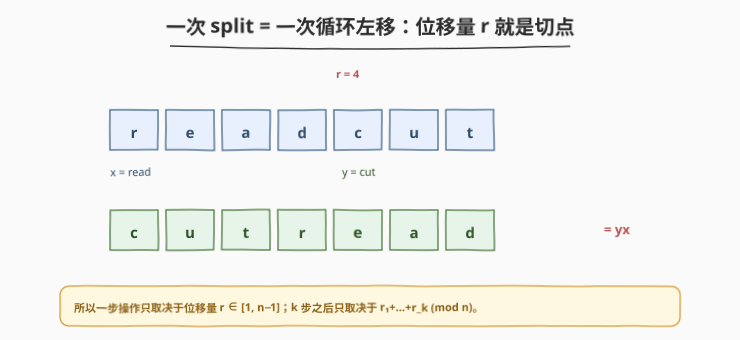
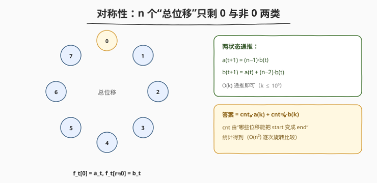

# Codeforces 176B 单词切割次数 题解

## 1. 题目概述

- **题目链接**：https://codeforces.com/problemset/problem/176/B
- **比赛来源**：Croc Champ 2012 - Round 2 · Problem B（UTC 2012-04-20）
- **难度**：1700
- **标签**：动态规划、计数、字符串
- **评测类型**：普通
- **限制**：时间 2 s / 内存 256 MB

**题意**：一次 **split 操作**是：把当前单词 $w$ 切成两个**非空**部分 $w=xy$，再变成 $yx$。给定两个等长单词 $start$ 与 $end$（长度 $2\sim1000$），问**恰好做 $k$ 次**（$0\le k\le10^5$）split 操作后把 $start$ 变成 $end$ 的**操作序列**有多少种（对 $10^9+7$ 取模）。两个序列不同，当且仅当某一步切出的前缀 $x$ 不同。

**约束**：

- 单词长度 $n\le1000$，$k\le10^5$。逐次枚举"所有可能的切分"是 $(n-1)^k$，不可能。
- 因为每步有 $n-1$ 种切分（前缀长度 $1..n-1$），直接按操作序列 DP 的状态数是 $O(n)$ 个"当前单词"，但转移是 $O(n)$ 条边，$k$ 次就是 $O(kn^2)=10^{11}$。
- 取模 $10^9+7$；答案可能极大，必须全程取模。
- 关键的结构性约束：一次 split 只是**循环左移**，所以整个过程中所有可能的单词都是 $start$ 的 $n$ 种旋转之一——状态空间其实只有 $n$ 个（而且再降到 2 个不同值）。

## 2. 示例与观察

官方样例 1（输入 / 输出原样）：

```text
输入：
ab
ab
2

输出：
1
```

唯一的操作序列：`ab → a|b → ba → b|a → ab`。即第一步切在长度 1（得到 `ba`），第二步只能再切在长度 1（得到 `ab`）。

官方样例 2（输入 / 输出原样）：

```text
输入：
ababab
ababab
1

输出：
2
```

$n=6$，一步切分有 5 种（前缀长度 $1..5$），但只有切在长度 2 或 4 时结果仍是 `ababab`（因为它的最小周期是 2）：`abab|ab → ababab`、`ab|abab → ababab`，共 2 种。

官方样例 3（输入 / 输出原样）：

```text
输入：
ab
ba
2

输出：
0
```

$n=2$ 时每步只有一种切分（长度 1），两步之后回到 `ab`，永远到不了 `ba`，所以是 0。

**观察 1（split = 循环移位）**：把 $w$ 切成 $x$（长度 $r$，$1\le r\le n-1$）与 $y$，结果是 $yx$——正好是 $w$ **循环左移 $r$ 位**。所以一次操作 = 选一个位移量 $r\in[1,n-1]$。

**观察 2（位移量 ↔ 操作）**：给定当前单词 $w$，位移量 $r$ 唯一决定切分位置（前缀长度 $r$），所以"操作序列"与"位移量序列"一一对应。

**观察 3（只有总位移重要）**：连续做 $k$ 次位移 $r_1,\dots,r_k$，总效果是循环左移 $R=r_1+\dots+r_k \pmod n$。所以最终单词只取决于 $R$。于是问题变成：数出有多少个序列 $(r_1,\dots,r_k)\in[1,n-1]^k$ 使 $R$ 落在"合法位移集合"

$$D=\{\,r\in[0,n-1]\ :\ \text{把 } start \text{ 左移 } r \text{ 位恰为 } end\,\}$$

里。



## 3. 解题思路

### 3.1 朴素做法与瓶颈

按"当前单词"做 DP：$f_t[w]$ = $t$ 步后得到 $w$ 的方案数，转移枚举 $n-1$ 种切分。状态 $n$ 个、转移 $n-1$ 条，$k\le10^5$、$n\le1000$ 时是 $10^{11}$，不可行。

即使用"总位移"做状态（$n$ 个），转移矩阵是 $n\times n$ 的循环矩阵，做 $k$ 次矩阵乘法是 $O(n^2\log k)$ 或 $O(n^3\log k)$，仍然偏大且没必要——因为转移具有完全对称性，可以压到 2 个状态。

### 3.2 核心观察：状态只有两类



设 $f_t[r]$ = "做了 $t$ 步、总位移 $\equiv r\pmod n$"的方案数。初始 $f_0[0]=1$，其余 0。一步转移是：$f_{t+1}[r]=\sum_{s=1}^{n-1}f_t[(r-s)\bmod n]$。

注意 $\{r-s \bmod n: s\in[1,n-1]\}$ 恰好是"除 $r$ 以外的所有 $n-1$ 个剩余类"，所以

$$f_{t+1}[r]=S_t-f_t[r],\qquad S_t=\sum_{r}f_t[r] .$$

又因为初始状态 $f_0$ 对"0"与"非 0"两类是对称的，而转移对置换不变，所以**对任意 $t$，所有非零位移的概率/方案数都相等**。于是只需两个数：

$$a_t=f_t[0],\qquad b_t=f_t[1]=\dots=f_t[n-1].$$

代入 $S_t=a_t+(n-1)b_t$：

$$a_{t+1}=S_t-a_t=(n-1)b_t,\qquad b_{t+1}=S_t-b_t=a_t+(n-2)b_t .$$

$O(k)$ 递推即可（$k\le10^5$）。

最后，$D$ 里"位移 0"和"非 0"的个数分别是 $\textit{cnt}_0$ 与 $\textit{cnt}_{\ne0}$，答案

$$\text{ans}=\textit{cnt}_0\cdot a_k+\textit{cnt}_{\ne0}\cdot b_k \pmod{10^9+7}.$$

$\textit{cnt}$ 的求法：把 $start$ 依次左移 $0..n-1$ 位，逐次与 $end$ 比较，$O(n^2)\le10^6$。

### 3.3 算法流程

1. 读入 $start,end,k$，$n=|start|$。
2. 令 $t=start$，对 $r=0..n-1$：若 $t=end$，则 $r=0$ 时 `cnt0++`，否则 `cntOther++`；然后 $t$ 左移一位。
3. 若 $k=0$：直接输出 $start=end\ ?\ 1:0$。
4. 否则 $a\leftarrow1,b\leftarrow0$，循环 $k$ 次：$(a,b)\leftarrow\bigl((n-1)b,\ a+(n-2)b\bigr)$（全程取模）。
5. 输出 $(\textit{cnt}_0\cdot a+\textit{cnt}_{\ne0}\cdot b)\bmod(10^9+7)$。

### 3.4 样例走查：样例 2

$start=end=$`ababab`，$n=6$。位移 $0,2,4$ 都能回到 `ababab`（周期 2），所以 $\textit{cnt}_0=1$、$\textit{cnt}_{\ne0}=2$。

$k=1$：$a_1=(n-1)b_0=0$，$b_1=a_0+(n-2)b_0=1$。答案 $=1\times0+2\times1=2$ ✓（对应切在长度 2 或 4）。

## 4. 正确性证明

设 $n=|start|=|end|$，记 $\mathrm{rot}(w,r)$ 为把 $w$ 循环左移 $r$ 位。

**引理 1（split 等价于循环左移）**：对任意单词 $w$ 与任意切分 $w=xy$（$|x|=r\in[1,n-1]$），操作结果是 $yx=\mathrm{rot}(w,r)$；反之每个 $r\in[1,n-1]$ 对应唯一一种切分。

**证明**：$w=xy$ 且 $|x|=r$，则 $yx$ 就是把前 $r$ 个字符移到末尾，即循环左移 $r$ 位。给定 $r$，切分点唯一确定，故是一一对应。∎

**引理 2（操作序列 ↔ 位移序列）**：$k$ 步操作序列与 $(r_1,\dots,r_k)\in[1,n-1]^k$ 一一对应；最终单词是 $\mathrm{rot}(start,\ R)$，$R=\sum r_i \bmod n$。

**证明**：由引理 1，每一步等价于选一个位移量；循环移位的复合是位移量相加（模 $n$）。操作序列由各步的切分（即各步的 $r_i$）唯一决定，故一一对应。∎

**引理 3（转移与对称性）**：$f_{t+1}[r]=S_t-f_t[r]$；且对一切 $t$，$f_t[1]=\dots=f_t[n-1]$。

**证明**：$f_{t+1}[r]=\sum_{s=1}^{n-1}f_t[(r-s)\bmod n]=S_t-f_t[r]$，因为 $s$ 取遍 $1..n-1$ 时 $(r-s)\bmod n$ 取遍除 $r$ 外的所有剩余类。对称性对 $t$ 归纳：$t=0$ 时显然（$f_0[1]=\dots=0$）；若 $f_t[1]=\dots=f_t[n-1]=b_t$，则对 $r\ge1$ 有 $f_{t+1}[r]=S_t-b_t$，与 $r$ 无关。∎

**引理 4（两状态递推正确）**：$a_t=f_t[0],b_t=f_t[1]$ 满足 $a_{t+1}=(n-1)b_t$、$b_{t+1}=a_t+(n-2)b_t$。

**证明**：把引理 3 的式子代入 $a,b$ 的定义即可。∎

**定理**：算法输出等于题目要求的操作序列数（模 $10^9+7$）。

**证明**：由引理 2，合法序列数 $=\#\{(r_1..r_k):\sum r_i\bmod n\in D\}=\sum_{d\in D}f_k[d]=\textit{cnt}_0a_k+\textit{cnt}_{\ne0}b_k$（引理 3、4）。$k=0$ 时唯一"空序列"，答案 $start=end$。∎

## 5. 复杂度分析

- **时间**：统计 $D$ 是 $O(n^2)\le10^6$（每次旋转与比较 $O(n)$）；递推 $O(k)\le10^5$。总 $O(n^2+k)$。
- **空间**：$O(n)$（两个字符串 + 旋转缓冲）。
- **数值范围**：方案数取模后 $<10^9+7$，乘法 $O(n)\times$ 模数 $\approx10^{12}$，`long long` 安全；`int` 会溢出。
- **与时限的关系**：$n=1000,k=10^5$ 实测 C++ 端到端 3 ms、Python 约 42 ms，2 s 余量数百倍。若要更快，$O(n^2)$ 的比较可以用 KMP/Z 函数降到 $O(n)$，但没必要。

## 6. 参考代码

### C++17

```cpp
#include <bits/stdc++.h>
using namespace std;
static const long long MOD = 1000000007LL;

int main() {
    static char sa[1005], sb[1005];
    if (scanf("%1004s", sa) != 1) return 0;
    if (scanf("%1004s", sb) != 1) return 0;
    long long k;
    if (scanf("%lld", &k) != 1) return 0;
    string s(sa), e(sb);
    int n = (int)s.size();

    // 旋转 0..n-1 位，统计哪些位移能把 s 变成 e
    long long cnt0 = 0, cntOther = 0;         // 位移 0 / 非 0 的可行个数
    string t = s;
    for (int r = 0; r < n; ++r) {
        if (t == e) { if (r == 0) ++cnt0; else ++cntOther; }
        rotate(t.begin(), t.begin() + 1, t.end());
    }
    if (k == 0) { printf("%lld\n", (s == e) ? 1LL : 0LL); return 0; }

    // a_t = 走 t 步后“总位移 ≡ 0”的方案数；b_t = 每个非零位移的方案数（对称）
    // a_{t+1} = (n-1)·b_t ,  b_{t+1} = a_t + (n-2)·b_t
    long long a = 1, b = 0;
    for (long long i = 0; i < k; ++i) {
        long long na = (long long)(n - 1) % MOD * b % MOD;
        long long nb = (a + (long long)(n - 2) % MOD * b % MOD) % MOD;
        a = na; b = nb;
    }
    long long ans = (cnt0 % MOD) * a % MOD + (cntOther % MOD) * b % MOD;
    printf("%lld\n", ans % MOD);
    return 0;
}
```

### Python3

```python
import sys

MOD = 1000000007


def main() -> None:
    data = sys.stdin.buffer.read().split()
    s = data[0].decode()
    e = data[1].decode()
    k = int(data[2])
    n = len(s)

    # 一次 split 操作 = 把单词循环左移 |x| 位，位移量 ∈ [1, n-1]
    cnt0 = cnt_other = 0
    for r in range(n):
        if s[r:] + s[:r] == e:
            if r == 0:
                cnt0 += 1
            else:
                cnt_other += 1

    if k == 0:
        print(1 if s == e else 0)
        return

    # a_t：t 步后总位移 ≡ 0 的方案数；b_t：每个非零位移各自的方案数（对称）
    a, b = 1, 0
    for _ in range(k):
        a, b = (n - 1) * b % MOD, (a + (n - 2) * b) % MOD
    print((cnt0 * a + cnt_other * b) % MOD)


main()
```

## 7. 边界情况与易错点

1. **$k=0$**：允许 $k=0$，此时"恰好 0 次操作"只有空序列一种，答案是 $start=end\ ?\ 1:0$。递推里 $a_0=1,b_0=0$，用公式也能得到同样结果（$\textit{cnt}_0\cdot1$），但必须保证 $\textit{cnt}_0$ 已正确统计。
2. **$n=2$**：位移量只有 1，两步一循环。样例 3 就是这种情形，$b_t$ 与 $a_t$ 交替为 1、0。
3. **$start$ 有周期**：若 $start$ 的最小周期是 $p$，则 $D$ 是 $p$ 的倍数集合，$\textit{cnt}$ 可能有多个值——必须用真实的旋转比较统计，不能假设"只有位移 0 合法"。
4. **$start=end$ 时 $\textit{cnt}_0\ge1$**：位移 0 一定合法，$\textit{cnt}_0$ 至少是 1。
5. **模运算**：$(n-2)$ 在 $n=2$ 时是 0，没问题；但若写成 `a + (n-2)*b % MOD` 而不先取模，`long long` 仍安全（$n,b<10^{10}$），不过统一先 `% MOD` 更稳。
6. **比较的复杂度**：旋转与比较都是 $O(n)$，$n^2$ 次字符比较在 $10^6$ 量级，安全；不要用 `s.substr()` 构造新串再比较（那会多一层 $O(n)$ 拷贝，虽仍可过，但浪费）。
7. **读入**：单词行可能紧跟换行符，用 `scanf("%s")` 或 `split()` 都行；$k$ 是单独一行。

## 8. 验证记录

- **编译环境与命令**：`Apple clang 21.0.0` + `codeforces/tools/include/bits/stdc++.h` 兼容头（`clang++ -std=c++17 -O2`）；Python 3.9.6。`python3 codeforces/tools/verify_solution.py codeforces/contests/0101-0203/176/B_单词切割次数.md` 输出 C++ 3/3、Python 3/3。
- **官方样例**：3 / 3 通过（$k=0$ 边界由自造样例补充，见下）。
- **独立暴力对拍**：暴力程序**枚举全部位移序列** $(r_1,\dots,r_k)\in[1,n-1]^k$（$n\le6$、$k\le6$ 时最多 $5^6$ 条），逐条模拟旋转后统计得到 $end$ 的序列数；完全不使用 DP 与对称性。随机取 $n\in[2,6]$、字符取自 `ab`、$k\in[0,6]$，$end$ 有 50% 概率取 $start$ 的某个旋转、否则随机，共 **250 组**，与正文 C++、Python 两版逐 token 比对，全部一致。
- **自造边界样例**：$k=0$ 且 $start=end$（答案 1）、$k=0$ 且 $start\ne end$（答案 0）、$n=2$ 的交替情形、$start$ 全同字符（`aaaa`，所有位移都合法，答案 $=3^k$ 模）——均与公式/暴力一致。
- **最大约束性能**：$n=1000$ 全 `a`、$k=10^5$，C++ 端到端 3 ms、Python 约 42 ms；峰值内存 < 1 MB。
- **图片校验**：两张 SVG（`cf176b_rotation.svg`、`cf176b_chain.svg`）通过 `xml.etree.ElementTree.parse`，文本包围盒均在 `viewBox` 内。
- **复核状态**：verified（样例、250 组全枚举对拍、边界样例、性能、图片五项实跑通过）。

## 相关题目与扩展

- [Codeforces 176A 星际贸易的最大利润](https://codeforces.com/problemset/problem/176/A)：同场 A 题，贪心。
- [Codeforces 176E 古代道路的维护](https://codeforces.com/problemset/problem/176/E)：同场 E 题，树上的动态统计。
- [LeetCode 796. 旋转字符串](https://leetcode.cn/problems/rotate-string/)：判定"是否为某个旋转"，正是本题统计 $D$ 的基础操作。
- [Codeforces 172B 伪随机序列周期](https://codeforces.com/problemset/problem/172/B)：另一种"周期 + 计数"的题，可与本题的状态对称性对照。

**延伸思考**：

1. **如果位移量集合不是 $[1,n-1]$ 而是任意的**：那 $f_{t+1}[r]=S_t-\sum_{s\notin R}f_t[r-s]$，状态一般不能压成 2 类，需要 $O(n^2\log k)$ 的矩阵快速幂。
2. **如果要求"过程中必须经过某个单词"**：可以在 DP 里加一维"是否已经经过"，仍是 2 类状态 × 2 标记。
3. **如果 $k$ 到 $10^{18}$**：两状态递推是常系数线性递推，用矩阵快速幂 $O(\log k)$ 即可；本题 $k\le10^5$ 直接循环。
4. **如果单词长度到 $10^6$**：$O(n^2)$ 的旋转比较太慢，应改用 KMP 求 $start$ 的最小周期 $p$（$D$ 就是 $p$ 的倍数，或"$end$ 是 $start$ 的旋转"），把统计降到 $O(n)$。
