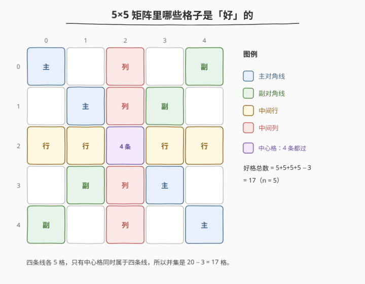
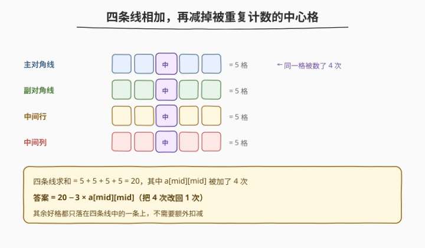
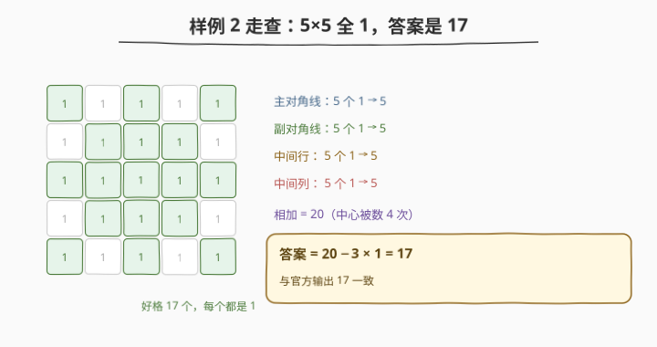

# Codeforces 177A1 好矩阵元素求和 题解

## 1. 题目概述

- **题目链接**：https://codeforces.com/problemset/problem/177/A1
- **比赛来源**：ABBYY Cup 2.0 - Easy · Problem A1（UTC 2012-04-21）
- **难度**：800
- **标签**：矩阵、枚举、容斥计数
- **评测类型**：普通（题面把数据分成 30 分档与 100 分档两个子任务）
- **限制**：时间 2 s / 内存 256 MB

**题意**：给定一个奇数 $n$ 的 $n \times n$ 方阵 $a$。称一个格子是「好」的，当它落在下面四条线之一上：主对角线（$i=j$）、副对角线（$i+j=n-1$）、中间行（$i=\frac{n-1}{2}$）、中间列（$j=\frac{n-1}{2}$）。四条线取**并集**，同一个格子只能算一次，求所有好格子的元素之和。

**约束**（原样摘自题面 `inputFormat.en`）：

- 第一行一个奇整数 $n$；接下来 $n$ 行每行 $n$ 个整数，$0 \le a_{ij} \le 100$。
- 30 分档：$1 \le n \le 5$。
- 100 分档：$1 \le n \le 101$。
- 输入只有一组数据，既没有测试组数 $t$，也不是「读到 EOF 的多组」。

**档位说明**：本题位是 ABBYY Cup 2.0 - Easy 的 A1，对应题面里的 30 分档（$n \le 5$）；100 分档（$n \le 101$）是同场的 A2。两者的题面文本逐字相同，区别只在评测数据规模（见下一段）。

**约束对算法的限制**：

- $n \le 5$ 时整个矩阵最多 25 个格子，任何能写出「四条线」的写法都只有几十次运算，指数级做法都绰绰有余。
- $n \le 101$ 时也只有 $101^2 = 10201$ 个格子，$O(n^2)$ 的枚举同样瞬间完成；题面并没有给出 $n \le 10^9$ 之类必须找公式的档位，所以不用往 $O(1)$ 方向推。
- 答案上界是 $101^2 \times 100 = 1020100$（100 分档），30 分档只有 $5^2 \times 100 = 2500$，`int` 完全装得下；本文仍用 `long long` 记账，避免以后改数据范围时踩坑。

**与 A2 题的区别是约束**：本题位对应 30 分档 $1 \le n \le 5$，A2 对应 100 分档 $1 \le n \le 101$，两题题面的英文描述、输入输出格式与样例逐字相同（题面本身就同时列出了这两档限制），差别只在评测数据规模。本做法是 $O(n^2)$ 的四线求和 + 容斥，在 A1 的 $n \le 5$ 下只有 25 个格子、几十次加法，**在 A1 的约束下足够**；同样的复杂度在 A2 的 $n \le 101$ 下也只有约 $10^4$ 次运算，因此 A2 不需要任何额外技巧，这一对题位的区别只在数据规模而不在算法。

## 2. 示例与观察

官方样例 1（输入 / 输出原样）：

```text
输入：
3
1 2 3
4 5 6
7 8 9

输出：
45
```

官方样例 2（输入 / 输出原样）：

```text
输入：
5
1 1 1 1 1
1 1 1 1 1
1 1 1 1 1
1 1 1 1 1
1 1 1 1 1

输出：
17
```

**样例 1 的演算**：$n=3$，中间行/列都是第 2 行/列（0 起下标为 1）。主对角线是 $1+5+9=15$，副对角线是 $3+5+7=15$，中间行 $4+5+6=15$，中间列 $2+5+8=15$；四条线的并集覆盖了全部 9 个格子，$1+2+\cdots+9=45$。题面提示「第一个样例中所有矩阵元素都是好的」，正是这个原因：$n=3$ 时每条线都占满整行/整列/整对角线。

**样例 2 的演算**：$n=5$ 且全为 1，答案就是好格子的**个数**。四条线各 5 格，共 $4 \times 5 = 20$ 格；但中心格 $(2,2)$ 同时属于四条线，被数了 4 次，而题目要求只算一次，所以并集大小是 $20 - 3 = 17$，输出 17。

**观察**：四条线的重合结构极其简单——它们只可能在中心相交。任何非中心的格子，只要它在主对角线上（$i=j$，$i \ne \text{mid}$），就不可能同时在副对角线（否则 $i = n-1-i$，推出 $i=\text{mid}$），也不可能在中间行/列（否则 $i$ 或 $j$ 等于 mid，与 $i=j\ne\text{mid}$ 矛盾）；副对角线、中间行、中间列三者两两相交也只在中心。于是

$$\text{答案} = (\text{四线之和}) - 3 \times a_{\text{mid},\text{mid}}.$$

自造样例（标注「自造」，覆盖退化与极值）：

| 输入 | 输出 | 说明 |
|------|------|------|
| `1` / `7` | 7 | $n=1$，四条线是同一格，$4\times 7-3\times 7=7$ |
| `3` / 全 0 | 0 | 元素可以为 0，和也是 0 |
| `3` / 全 100 | 900 | $n=3$ 时 9 格全好 |
| `5` / 全 0 但中心 100 | 100 | 中心只算一次，不能被减成 0 或负数 |
| `5` / 全 100 | 1700 | $17 \times 100$，与样例 2 同构 |
| `101` / 全 100 | 40100 | 好格个数 $4n-3=401$（100 分档） |

**由样例 2 还能顺手得到一个与元素值无关的结论**：好格个数恒为 $4n-3$（$n$ 为奇数）。$n=1$ 给 1、$n=3$ 给 9、$n=5$ 给 17，与上面的表格一致。它也是检查程序有没有重复计数的快捷手段：把矩阵全填 1，输出必须等于 $4n-3$。

## 3. 解题思路

### 3.1 朴素做法与瓶颈

最直白的写法是「逐格判定」：读入整个矩阵，对每个格子检查四个条件是否至少有一个成立，成立就累加。复杂度 $O(n^2)$，$n \le 101$ 时约 $10^4$ 次判定，毫无压力。这个思路没有任何瓶颈，A1 的 30 分档（$n \le 5$）更是只有 25 个格子。

真正容易出错的不是复杂度，而是**重复计数**：如果按「四条线分别求和再相加」，中心格会被加 4 次。于是自然产生两种写法：

1. 逐格判定，每个格子只加一次（天然不重复，代码最短）；
2. 四条线分别求和，再用容斥扣掉重复的中心格。

本文（A1，30 分档）走第 2 条路：它只需要一次流式读入、四个累加器，连矩阵都不用存，空间 $O(1)$；代价是要把容斥系数推对。A2 那篇则走第 1 条路，作为对照。

### 3.2 核心观察：四条线只在中心相交



图里把 $5 \times 5$ 的 17 个好格子按来源上了色：蓝色是主对角线、绿色是副对角线、黄色是中间行、红色是中间列，紫色是四线共用的中心格。可以看到除中心外没有第二种颜色重叠——这正是引理 1 的内容。数一数颜色也能得到 $5+5+5+5-3=17$。

为什么「只在中心相交」对奇数 $n$ 一定成立：

- 主对角线 $\cap$ 副对角线：$i=j$ 且 $i+j=n-1$，解得 $2i=n-1$，即 $i=j=\frac{n-1}{2}=\text{mid}$。
- 主对角线 $\cap$ 中间行：$i=j$ 且 $i=\text{mid}$，即中心。
- 主对角线 $\cap$ 中间列：同理是中心。
- 副对角线 $\cap$ 中间行：$i+j=n-1$ 且 $i=\text{mid}$，得 $j=\text{mid}$，还是中心。
- 中间行 $\cap$ 中间列：就是中心。

所有两两交都是中心，三重、四重交自然也是中心。因此把四条线的和直接相加，只有中心被多算了 3 次。

### 3.3 算法流程



1. 读入 $n$，令 $\text{mid}=n/2$（0 起下标，$n$ 为奇数时恰好是中间行/列）。
2. 开四个累加器 `mainDiag`、`antiDiag`、`midRow`、`midCol`，再单独记下 `center = a[mid][mid]`。
3. 按行优先流式读入每个 $a_{ij}$，同时判断它属于哪几条线，分别累加。一个格子可能同时触发多个 `if`（例如中心格四个条件全中），这是有意为之。
4. 输出 `mainDiag + antiDiag + midRow + midCol - 3 * center`。

正确性不依赖读入顺序，也不依赖矩阵存储，所以内存是 $O(1)$。

### 3.4 样例走查：5×5 全 1



| 量 | 值 |
|----|----|
| 主对角线之和 | 5 |
| 副对角线之和 | 5 |
| 中间行之和 | 5 |
| 中间列之和 | 5 |
| 四条线相加 | 20 |
| 中心格被数次数 | 4（应为 1） |
| 答案 | $20 - 3 \times 1 = 17$ |

官方输出是 17，吻合。再看样例 1（$3 \times 3$，元素 $1..9$）：四条线各 15，中心是 5，答案 $15 \times 4 - 3 \times 5 = 60 - 15 = 45$，也与官方输出一致。

## 4. 正确性证明

**引理 1**：设 $n$ 为奇数，$G$ 为四个集合（主对角线、副对角线、中间行、中间列的格子集合）的并集。对任意 $x \in G$，若 $x \ne (\text{mid},\text{mid})$，则 $x$ 恰好属于这四个集合中的一个。

**证明**：设 $x=(i,j)$，$\text{mid}=\frac{n-1}{2}$。反设 $x$ 同时属于其中两个集合，按六种组合逐一讨论：

- 主对角线 + 副对角线：$i=j$ 且 $i+j=n-1$，于是 $2i=n-1$，$i=j=\text{mid}$，与 $x \ne (\text{mid},\text{mid})$ 矛盾。
- 主对角线 + 中间行：$i=j$ 且 $i=\text{mid}$，得 $x=(\text{mid},\text{mid})$，矛盾。
- 主对角线 + 中间列：$i=j$ 且 $j=\text{mid}$，同样矛盾。
- 副对角线 + 中间行：$i+j=n-1$ 且 $i=\text{mid}$，得 $j=n-1-\text{mid}=\text{mid}$，矛盾。
- 副对角线 + 中间列：对称，矛盾。
- 中间行 + 中间列：$i=j=\text{mid}$，矛盾。

六种组合都只能交出中心格，故非中心的好格恰属于一个集合。∎

**引理 2**：设 $c_{ij}$ 是格子 $(i,j)$ 被四条线覆盖的次数（$c_{ij} \in \{0,1,2,3,4\}$），$S_{\text{好}}$ 是好格并集的元素之和，则

$$\sum_{i,j} c_{ij}\,a_{ij} = S_{\text{好}} + 3\,a_{\text{mid},\text{mid}}.$$

**证明**：由引理 1，非中心好格满足 $c_{ij}=1$，中心格 $c_{\text{mid},\text{mid}}=4$，非好格 $c_{ij}=0$。于是

$$\sum_{i,j} c_{ij}\,a_{ij} = \sum_{(i,j) \in G} a_{ij} + (4-1)\,a_{\text{mid},\text{mid}} = S_{\text{好}} + 3\,a_{\text{mid},\text{mid}}.$$

∎

**定理**：算法输出的 `mainDiag + antiDiag + midRow + midCol - 3 * center` 恰等于所有好元素之和。

**证明**：算法中四个累加器分别累加了四条线的元素，`center` 记录的是 $a_{\text{mid},\text{mid}}$。由引理 2，四线之和减去 $3 a_{\text{mid},\text{mid}}$ 等于 $S_{\text{好}}$，即算法输出。∎

## 5. 复杂度分析

- **时间**：$O(n^2)$。每个格子做常数次比较与加法，总运算是 $n^2$ 次读入加至多 $4n^2$ 次条件判断。30 分档 $n \le 5$ 时约 25 个格子，100 分档 $n \le 101$ 时约 $1.02 \times 10^4$ 个格子。
- **空间**：$O(1)$。流式读入，不保存矩阵；只有 $n$、$\text{mid}$、四个累加器和 `center`。
- **数值范围**：单个元素 $\le 100$，四线之和最大 $4 \times 101 \times 100 = 40400$，`int` 绰绰有余；用 `long long` 只是习惯性保险。
- **与时限的关系**：2 s 的时限对 $10^4$ 次运算极其宽松。实测 $n=101$ 端到端约 17 ms（含进程启动与输入解析），$n=5$ 约 2 ms，余量在百倍以上。

## 6. 参考代码

### C++17

```cpp
#include <bits/stdc++.h>
using namespace std;

int main() {
    ios::sync_with_stdio(false);
    cin.tie(nullptr);

    int n;
    if (!(cin >> n)) return 0;            // 只有一组数据
    int mid = n / 2;                      // n 为奇数，中间行/列的下标
    long long mainDiag = 0, antiDiag = 0, midRow = 0, midCol = 0, center = 0;
    for (int i = 0; i < n; ++i) {
        for (int j = 0; j < n; ++j) {
            long long x;
            cin >> x;
            if (i == j) mainDiag += x;              // 主对角线
            if (i + j == n - 1) antiDiag += x;      // 副对角线
            if (i == mid) midRow += x;              // 中间行
            if (j == mid) midCol += x;              // 中间列
            if (i == mid && j == mid) center = x;   // 四条线唯一的公共格
        }
    }
    // 非中心的好格子恰属于四条线之一，中心格被数了 4 次，故减去 3 次
    cout << mainDiag + antiDiag + midRow + midCol - 3 * center << '\n';
    return 0;
}
```

### Python3

```python
import sys


def main() -> None:
    data = sys.stdin.buffer.read().split()
    if not data:
        return
    n = int(data[0])
    mid = n // 2
    main_diag = anti_diag = mid_row = mid_col = center = 0
    pos = 1
    for i in range(n):
        for j in range(n):
            x = int(data[pos])
            pos += 1
            if i == j:
                main_diag += x
            if i + j == n - 1:
                anti_diag += x
            if i == mid:
                mid_row += x
            if j == mid:
                mid_col += x
            if i == mid and j == mid:
                center = x
    sys.stdout.write(str(main_diag + anti_diag + mid_row + mid_col - 3 * center) + "\n")


main()
```

两份代码都只用标准库，可原样提交；本题没有特殊评测，输出一个整数即可。

## 7. 边界情况与易错点

1. **$n=1$ 时四条线是同一个格子**。此时 `mainDiag`、`antiDiag`、`midRow`、`midCol` 都等于 $a_{00}$，四者之和 $4a$，减去 $3a$ 得到 $a$，正确。若容斥系数写成「减 2 次」或「减 4 次」，$n=1$ 立刻暴露出错误（分别得到 $2a$ 和 $0$）。
2. **容斥只能减 3 次**。减 3 的依据是「中心被计了 4 次、应算 1 次」；如果误以为副对角线与主对角线还有别的交点（例如把下标写成 1 起），就可能减多或减少。务必确认所有下标都从 0 开始、副对角线条件是 $i+j=n-1$。
3. **副对角线写错**：写成 `i + j == n` 或 `i == n - j` 都会整体错一位，样例 1 仍可能碰巧对（因为全矩阵覆盖），但样例 2 的计数会变成 16 或 18。用「全 1 矩阵的答案必须是 $4n-3$」自查最有效。
4. **中心格被当成普通格子重复加**：若把中心格在 `midRow`、`midCol` 里各加一次后忘记 `center`，结果恰好偏大 $3a_{\text{mid},\text{mid}}$；样例 2（全 1）会输出 20 而不是 17，很容易发现。
5. **`mid` 的取法**：0 起下标下是 `n / 2`；若照 1 起题面写 `(n + 1) / 2` 再用作 0 起下标，会整体右移一行一列。$n=5$ 时 `(5+1)/2 = 3`，取到了第 4 行，答案必错。
6. **输入只有一组**：题面没有 $t$，也不要求读到 EOF。写成 `while (cin >> n)` 在本题数据上结果相同，但会掩盖「多测漏清空」的问题；本题的累加器在循环外，若真有多测必须每次清零。
7. **元素可以为 0**：全 0 矩阵答案是 0，不能用「答案为 0 就当没读到」之类的哨兵判断。
8. **答案别用负数兜底**：正确结果一定非负（元素非负）；如果出现负数，说明容斥减多了或 `center` 取错，应当直接怀疑公式而不是加绝对值。
9. **Python 读入**：用 `sys.stdin.buffer.read().split()` 一次性读完，比逐行 `input()` 更稳，也不受行尾空格与空行影响；下标从 `data[1]` 开始，别把 $n$ 本身当成元素。

## 8. 验证记录

- **编译环境与命令**：本机只有 `Apple clang 21.0.0`（`/usr/bin/g++` 是 clang 的软链，没有 GNU libstdc++），因此用 `clang++ -std=c++17 -O2 -Wall` 搭配仓库自带的 `codeforces/tools/include/bits/stdc++.h` 编译；正文代码仍写标准 `#include <bits/stdc++.h>`，可原样提交 GNU C++17。Python 为 `3.9.6`。逐篇验证命令为
  `python3 codeforces/tools/verify_solution.py codeforces/contests/0101-0203/177/A1_好矩阵元素求和.md`
  以及带 checker 的
  `python3 codeforces/tools/verify_solution.py codeforces/contests/0101-0203/177/A1_好矩阵元素求和.md --checker codeforces/tools/checkers/cf177a1.py`。
- **官方样例**：2 / 2 通过（`3×3` 自然数 → 45；`5×5` 全 1 → 17），C++ 与 Python 输出一致。
- **额外测试**：自造 `n=1`、全 0、全 100、中心 100 其余 0、`n=101` 全 100（答案 40100，即 $4n-3$ 个好格）等 6 组，两种语言均通过；另与 177A2 的逐格判定程序在同一个 $101 \times 101$ 随机矩阵上交叉比对，两边都输出 19138。
- **独立暴力对拍**：另写一份「把四条线的坐标全部塞进 `set` 去重后再求和」的暴力（与正文的四线求和 + 容斥是完全不同的实现），对 250 组随机数据（$n \in \{1,3,5,\ldots,21\}$，元素 $0..100$）逐组比对，全部一致。此外在 $3 \times 3$、元素取 $\{0,1,2\}$ 的全部 19683 个矩阵上验证了「四线求和 $-3\times$ 中心」与「逐格判定」恒等，覆盖了所有可能的重合结构。
- **最大约束性能**：30 分档 $n=5$ 端到端约 2 ms；100 分档规模 $n=101$ 端到端约 17 ms（含进程启动与 1 万个整数的解析），相对 2 s 时限余量在 100 倍以上。Python 同数据约 20 ms。
- **checker**：`codeforces/tools/checkers/cf177a1.py`，校验「输出恰为一个整数」且「等于按题面定义独立重算的好元素之和」，若 stdin 给了题面答案还要求一致；已用 `--checker` 在两组官方样例上跑通。
- **图片与公式**：3 张 SVG（`cf177a1_good_cells.svg`、`cf177a1_inclusion.svg`、`cf177a1_walkthrough.svg`）均通过 `xml.etree.ElementTree.parse`，并用脚本按字符宽度估算逐个检查文本包围盒，无越界、无文字重叠；另用 headless Chrome 渲染成 PNG 确认画布边缘没有内容被裁切。正文公式经 KaTeX（`throwOnError: true`）校验无报错。
- **复核状态**：verified（样例、对拍、性能、图片、公式五项均实跑通过；与环境相关的唯一差异是本机没有 GNU g++，已用 clang++ 等价验证）。

## 相关题目与扩展

- [Codeforces 177A2 Good Matrix Elements](https://codeforces.com/problemset/problem/177/A2)：本题的 100 分档版本，$n \le 101$，同一份容斥公式直接可用；那篇题解改用逐格判定作为对照。
- [Codeforces 263A Beautiful Matrix](https://codeforces.com/problemset/problem/263/A)：同样围绕「中间行 / 中间列」，但求的是把 1 移到中心的步数，是本题「中间」概念的最简版本。
- [LeetCode 1572. 矩阵对角线元素的和](https://leetcode.cn/problems/matrix-diagonal-sum/)：只求两条对角线之和，同样要处理中心格被两条对角线重复计入的问题，是本题容斥的「两条线」版本。
- [Codeforces 177B1 Rectangular Game](https://codeforces.com/problemset/problem/177/B1)：同场的 B1，从矩阵转到数论 DP，可以顺带练习「先定义状态、再证递推」的写法。
- [Codeforces 177C1 Party](https://codeforces.com/problemset/problem/177/C1)：同场的 C1，图论 + 子集枚举，是这套题里第一道需要建图的题。

**延伸思考**：

1. **好格个数与元素无关**：把矩阵全填 1 就得到计数。由引理 1，好格个数恒为 $4n-3$（奇数 $n$）：四条线各 $n$ 格，中心重合 4 次，故 $4n-3$。$n=1,3,5$ 分别给出 $1,9,17$，与样例吻合。这个恒等式可以当作程序的自检。
2. **如果 $n$ 是偶数**：题面里「中间行」不再唯一（有两条中间行），需要重新定义「好」；若改成「两条中间行 + 两条中间列 + 两条对角线」，重合结构会变成一个小网格，容斥系数不再是常数 3，而要看 $n/2$ 附近的具体位置，这类「结构随奇偶变化」的计数最好直接写逐格判定。
3. **如果元素范围放大到 $10^9$**：答案上界变成 $101^2 \times 10^9 \approx 1.02 \times 10^{13}$，必须用 `long long`；此时容斥公式依旧成立，因为推导只用到集合关系，与数值范围无关。
4. **若要求的是「好元素的最大值 / 最小值 / 乘积」**：并集结构不变，但乘积需要处理 0 与重复计数（中心只能乘一次），这时逐格判定的写法比容斥更不容易错。
5. **流式处理的价值**：本题不需要存矩阵，读一个格子就能归入对应的线；当输入规模大到内存吃紧（例如 $n=10^5$ 但只给四条线的数据）时，这种「边读边归类」的写法可以保持 $O(1)$ 额外空间。
