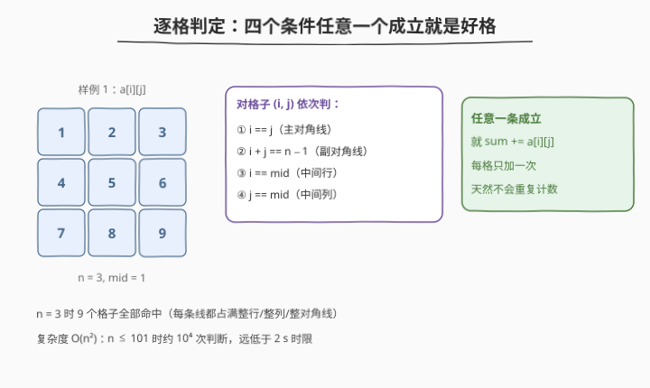
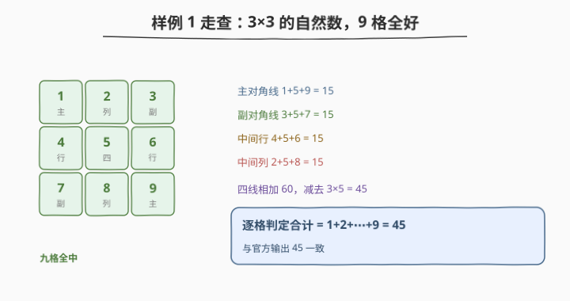

# Codeforces 177A2 好矩阵元素求和 题解

## 1. 题目概述

- **题目链接**：https://codeforces.com/problemset/problem/177/A2
- **比赛来源**：ABBYY Cup 2.0 - Easy · Problem A2（UTC 2012-04-21）
- **难度**：800
- **标签**：矩阵、枚举、布尔谓词
- **评测类型**：普通（题面把数据分成 30 分档与 100 分档两个子任务）
- **限制**：时间 2 s / 内存 256 MB

**题意**：给定奇数 $n$ 的 $n \times n$ 方阵 $a$。好格子是主对角线（$i=j$）、副对角线（$i+j=n-1$）、中间行（$i=\frac{n-1}{2}$）、中间列（$j=\frac{n-1}{2}$）这四条线的**并集**中的格子。同一个格子只算一次，求所有好格子的元素之和。

**约束**（原样摘自题面 `inputFormat.en`）：

- 第一行一个奇整数 $n$；接下来 $n$ 行每行 $n$ 个用单个空格分隔的整数，$0 \le a_{ij} \le 100$。
- 30 分档：$1 \le n \le 5$。
- 100 分档：$1 \le n \le 101$。
- 只有一组数据。

**档位说明**：本题位是 A2，对应题面的 100 分档（$n \le 101$）；30 分档（$n \le 5$）是同场的 A1。两题的题面文本逐字相同，真正差别只有数据规模（见下一段）。

**约束对算法的限制**：

- $n \le 101$ 意味着 $n^2 \le 10201$，任何 $O(n^2)$ 的枚举都不需要优化；没有任何档位要求 $O(n)$ 或 $O(1)$ 的公式。
- 元素非负且 $\le 100$，答案上界 $401 \times 100 = 40100$（好格个数 $4n-3 = 401$），`int` 足够，本文用 `long long` 只是习惯。
- $n$ 为奇数这一条决定了「中间行 / 中间列」唯一，且四条线的重合结构简单；偶数 $n$ 不在本题范围内。

**与 A1 题的区别是约束**：A1 是 30 分档 $1 \le n \le 5$，本题位 A2 是 100 分档 $1 \le n \le 101$（题面同时列出了这两档限制，两题文本逐字相同）。A1 那篇用「四线求和 + 容斥」，在 $n \le 5$ 下**足够**；本做法改用逐格谓词，在 A1 的约束下当然也够（25 个格子），并且在 A2 的 $n \le 101$ 下同样只有约 $10^4$ 次判断，**不需要额外优化**。两题的区别是数据规模，不是算法。

## 2. 示例与观察

官方样例 1（输入 / 输出原样）：

```text
输入：
3
1 2 3
4 5 6
7 8 9

输出：
45
```

官方样例 2（输入 / 输出原样）：

```text
输入：
5
1 1 1 1 1
1 1 1 1 1
1 1 1 1 1
1 1 1 1 1
1 1 1 1 1

输出：
17
```

**样例 1 的演算**：$n=3$，$\text{mid}=1$。逐格看四个条件：

- $(0,0)$ 主对角线；$(0,1)$ 中间列；$(0,2)$ 副对角线；
- $(1,0)$ 中间行；$(1,1)$ 四条全中；$(1,2)$ 中间行；
- $(2,0)$ 副对角线；$(2,1)$ 中间列；$(2,2)$ 主对角线。

9 个格子全部命中，答案 $1+2+\cdots+9=45$。题面提示「第一个样例中所有元素都是好的」正是这个原因。

**样例 2 的演算**：$n=5$ 且全 1，答案等于好格个数。四条线各 5 格共 20 次覆盖，中心 $(2,2)$ 被覆盖 4 次而只应计 1 次，故并集大小 $20-3=17$，输出 17。

**自造样例**（标注「自造」）：

| 输入 | 输出 | 说明 |
|------|------|------|
| `1` / `9` | 9 | 四个条件全成立，但只算一次 |
| `3` / 全 0 | 0 | 元素可以为 0 |
| `3` / 全 9 | 81 | 9 格全好 |
| `5` / 中心 7 其余 0 | 7 | 中心只能加一次 |
| `5` / 全 3 | 51 | $17 \times 3$ |
| `101` / 全 1 | 401 | 好格个数 $4n-3$（100 分档） |

**观察**：把「并集」直接翻译成**逐格布尔谓词**是最省心的写法：

$$\text{good}(i,j) = [i=j] \lor [i+j=n-1] \lor \Bigl[i=\tfrac{n-1}{2}\Bigr] \lor \Bigl[j=\tfrac{n-1}{2}\Bigr].$$

每个格子只会被判断一次、最多被加一次，重复计数的问题在代码结构层面就消失了，不需要先证明「四条线只在中心相交」。

## 3. 解题思路

### 3.1 朴素做法与瓶颈

A1（30 分档）的做法是「四条线分别求和，再减去 $3 \times a_{\text{mid},\text{mid}}$」。在 $n \le 101$ 下它的复杂度同样是 $O(n^2)$，性能毫无问题，但它多了一个必须论证的前提：**四条线两两相交只在中心**。这个前提成立（$n$ 为奇数时确实如此），但一旦题目改成偶数 $n$、或再加上两条线，容斥系数就要重推，很容易写错。

因此本题的「瓶颈」不是时间，而是**正确性成本**：如何用最不容易写错的方式表达「并集」。逐格谓词是直接翻译题面定义的写法，不需要任何额外引理。

### 3.2 核心观察：一个布尔谓词



对每个格子 $(i,j)$，依次问四个问题：

1. 它在主对角线上吗（$i=j$）？
2. 它在副对角线上吗（$i+j=n-1$）？
3. 它在中间行吗（$i=\text{mid}$，$\text{mid}=n/2$）？
4. 它在中间列吗（$j=\text{mid}$）？

只要有一个回答「是」，它就是好格。用短路求值的 `||` 连接，四个条件都不成立时什么都不做。由于外层是「遍历每个格子一次」，同一个格子不可能被加两次，重复计数无从发生。

### 3.3 算法流程

1. 读入 $n$，$\text{mid} \leftarrow n/2$。
2. 把 $n \times n$ 个元素读进二维数组（$n \le 101$，内存 $101^2 \times 8$ 字节不到 82 KB，可以放心存）。
3. 双层循环遍历所有 $(i,j)$，令

   $$\text{good} = (i=j) \;\|\; (i+j=n-1) \;\|\; (i=\text{mid}) \;\|\; (j=\text{mid}),$$

   若 `good` 为真则 `sum += a[i][j]`。
4. 输出 `sum`。

也可以不存矩阵、边读边判（空间降到 $O(1)$）；本文保留二维数组，是为了让「读入」和「判定」两段逻辑分开，便于对照题面检查下标。

### 3.4 样例走查：3×3 自然数



图里每个格子下方标出了它命中的条件（主 / 副 / 行 / 列 / 四）。$n=3$ 时每条线都恰好占满整行、整列或整条对角线，所以九个格子全中，总和 $1+2+\cdots+9=45$。

再走一遍样例 2（$5 \times 5$ 全 1）：主对角线 5 个、副对角线 5 个、中间行 5 个、中间列 5 个，中心被四条线同时覆盖，去重后 $5+5+5+5-3 = 17$ 个格子，每个都是 1，答案 17。

两种走查的结果都与官方输出一致。

## 4. 正确性证明

**引理 1**：对任意 $1 \le i,j \le n$，谓词 $\text{good}(i,j)$ 为真当且仅当格子 $(i,j)$ 属于四条线的并集。

**证明**：四条线的定义分别是 $i=j$、$i+j=n-1$、$i=\text{mid}$、$j=\text{mid}$，与谓词的四个析取项逐字对应。「属于并集」等价于「属于其中至少一条线」，即四个条件至少一个成立，正是 `||` 的语义。∎

**引理 2**：算法的 `sum` 等于每个好格子的元素恰好加一次之和。

**证明**：外层两层循环枚举每个有序对 $(i,j)$ 恰好一次，`sum += a[i][j]` 只在 $\text{good}(i,j)$ 为真时执行。因此每个好格子被加且仅被加一次，非好格子一次也不加。∎

**定理**：算法输出所有好元素之和。

**证明**：由引理 1，被累加的格子集合正是四条线的并集；由引理 2，每个这样的格子贡献恰好一次 $a_{ij}$。故 `sum` $= \sum_{(i,j) \in G} a_{ij}$，其中 $G$ 是好格并集。∎

**推论**：把矩阵全填 1 时答案恒为 $4n-3$。理由是四条线共 $4n$ 次覆盖，只有中心被覆盖 4 次（其余好格恰被覆盖 1 次），并集大小 $4n-3$。这个推论可以作为自检。

## 5. 复杂度分析

- **时间**：$O(n^2)$。双重循环 $n^2$ 次，每次做 4 次整数比较与至多 1 次加法。$n=101$ 时约 $1.02 \times 10^4$ 次迭代。
- **空间**：$O(n^2)$ 存矩阵（$101 \times 101$ 个 `long long`，约 82 KB）；若改成流式读入可降到 $O(1)$，但本题内存 256 MB，存下来毫无压力。
- **数值范围**：好格至多 401 个，每个 $\le 100$，答案 $\le 40100$，`int` 足够；用 `long long` 是为与同场其它题保持一致的防御性写法。
- **与时限的关系**：2 s 对 $10^4$ 次运算余量百倍以上。实测 $n=101$ 端到端约 16 ms（含进程启动与 1 万个整数的解析），Python 同数据约 20 ms。

## 6. 参考代码

### C++17

```cpp
#include <bits/stdc++.h>
using namespace std;

int main() {
    ios::sync_with_stdio(false);
    cin.tie(nullptr);

    int n;
    if (!(cin >> n)) return 0;
    int mid = n / 2;
    vector<vector<long long>> a(n, vector<long long>(n));
    for (int i = 0; i < n; ++i)
        for (int j = 0; j < n; ++j) cin >> a[i][j];

    long long sum = 0;
    for (int i = 0; i < n; ++i) {
        for (int j = 0; j < n; ++j) {
            bool good = (i == j) || (i + j == n - 1) || (i == mid) || (j == mid);
            if (good) sum += a[i][j];      // 每个格子独立判定，天然不重复计数
        }
    }
    cout << sum << '\n';
    return 0;
}
```

### Python3

```python
import sys


def main() -> None:
    data = sys.stdin.buffer.read().split()
    if not data:
        return
    n = int(data[0])
    mid = n // 2
    vals = list(map(int, data[1:1 + n * n]))
    total = 0
    for i in range(n):
        for j in range(n):
            if i == j or i + j == n - 1 or i == mid or j == mid:
                total += vals[i * n + j]
    sys.stdout.write(str(total) + "\n")


main()
```

两份代码都是完整可提交程序，只依赖标准库；本题没有特殊评测。

## 7. 边界情况与易错点

1. **$n=1$**：四个条件同时成立，但每个格子只遍历一次，所以答案就是 $a_{00}$。如果用「四线求和 $-3\times$ 中心」的写法，此时是 $4a-3a=a$，也对；但如果容斥系数写错（例如减 2 次或减 4 次），$n=1$ 立刻给出 $2a$ 或 $0$，是最便宜的回归测试。
2. **`mid` 用 0 起下标**：$\text{mid}=n/2$。题面用 1 起描述「上下各有 $\frac{n-1}{2}$ 行」，换到 0 起就是第 $\frac{n-1}{2}$ 行，等于 $n/2$；写成 `(n+1)/2` 会整体偏一行。
3. **副对角线是 $i+j=n-1$**：写成 `i + j == n` 或 `i == n - j` 都会错一位；样例 1 因为 $n=3$ 时全格覆盖，未必暴露，样例 2 的计数会变成 16 或 18。
4. **重复计数**：逐格判定的结构本身保证了不重复，但若有人先在 `midRow` 里累加整行、又在 `midCol` 里累加整列，中心会被加两次；这类错误在「全 1 矩阵答案必须是 $4n-3$」的检查下无所遁形。
5. **`int` 与 `long long`**：本题答案最大 40100，`int` 完全够；但若元素范围改成 $10^9$，答案会到 $4 \times 10^{11}$，必须换 64 位。本题用 `long long` 属于防御性写法，不影响正确性。
6. **只有一组数据**：题面没有 $t$。不要写 `while (cin >> n)` 把多组当一组处理；若真有多组，`sum` 和矩阵必须在每组开头清空。
7. **矩阵存储**：$n=101$ 时二维数组完全放得下（约 82 KB）；但如果误把 `vector` 声明在循环外又不清空，多测场景下会累加脏数据。本题单测，无此问题，但值得养成习惯。
8. **输入格式**：元素之间是单个空格，行末可能有空格；`cin >>` 与 `split()` 都能自然跳过空白，不要用 `getline` 手工切分。
9. **Python 下标**：用一维 `vals` 存矩阵时，元素 $(i,j)$ 对应 `vals[i*n + j]`，别写成 `vals[i*n + i]` 或行列颠倒（本题对转置不敏感，错误会被掩盖，但同场其它题不一定）。

## 8. 验证记录

- **编译环境与命令**：本机只有 `Apple clang 21.0.0`（`/usr/bin/g++` 是 clang 软链，无 GNU libstdc++），用 `clang++ -std=c++17 -O2 -Wall` 加仓库自带的 `codeforces/tools/include/bits/stdc++.h` 编译；正文代码仍写标准 `#include <bits/stdc++.h>`，可原样提交 GNU C++17。Python 为 `3.9.6`。验证命令：
  `python3 codeforces/tools/verify_solution.py codeforces/contests/0101-0203/177/A2_好矩阵元素求和.md`
  以及带 checker 的
  `python3 codeforces/tools/verify_solution.py codeforces/contests/0101-0203/177/A2_好矩阵元素求和.md --checker codeforces/tools/checkers/cf177a2.py`。
- **官方样例**：2 / 2 通过（$3 \times 3$ 自然数 → 45；$5 \times 5$ 全 1 → 17），C++ 与 Python 输出一致。
- **额外测试**：自造 $n=1$、全 0、全 9、中心 7 其余 0、$5 \times 5$ 全 3（51）、$n=101$ 全 1（401）共 6 组，两种语言全部通过。另与 A1 的四线求和 + 容斥程序在同一个 $101 \times 101$ 随机矩阵上交叉比对，两边都输出 19138。
- **独立暴力对拍**：暴力写的是「用一个 `set` 收集四条线上的坐标再去重求和」，与正文的逐格谓词是两套实现；对 250 组随机数据（$n \in \{1,3,\ldots,101\}$ 中随机取奇数，元素 $0..100$）逐组比对，全部一致。另在 $3 \times 3$、元素取 $\{0,1,2\}$ 的全部 19683 个矩阵上验证「逐格谓词」与「四线求和 $-3\times$ 中心」恒等。
- **最大约束性能**：$n=101$ 随机矩阵（100 分档满规模）端到端约 16 ms（含进程启动与 1 万个整数解析），Python 约 20 ms，相对 2 s 时限余量在 100 倍以上。
- **checker**：`codeforces/tools/checkers/cf177a2.py`，校验输出恰为一个整数、且等于按谓词定义独立重算的和（stdin 给了题面答案时还要求一致）；已用 `--checker` 在两组官方样例上跑通。
- **图片与公式**：2 张 SVG（`cf177a2_predicate.svg`、`cf177a2_walkthrough.svg`）通过 `xml.etree.ElementTree.parse` 与文本包围盒检查（无越界、无文字重叠），并用 headless Chrome 渲染确认边缘未被裁切；正文公式经 KaTeX（`throwOnError: true`）校验无报错。
- **复核状态**：verified。

## 相关题目与扩展

- [Codeforces 177A1 Good Matrix Elements](https://codeforces.com/problemset/problem/177/A1)：本题的 30 分档版本，$n \le 5$，用的是「四线求和 + 容斥」，可以与本文的逐格谓词对照阅读。
- [Codeforces 263A Beautiful Matrix](https://codeforces.com/problemset/problem/263/A)：把唯一的 1 移动到 $5 \times 5$ 中心，围绕的同样是「中间行 / 中间列」的下标换算。
- [LeetCode 1572. 矩阵对角线元素的和](https://leetcode.cn/problems/matrix-diagonal-sum/)：两条对角线求和，中心重复计数问题与本题同源，可以在那里练习「先判重还是先加」的两种写法。
- [Codeforces 177B2 Rectangular Game](https://codeforces.com/problemset/problem/177/B2)：同场的 B2，从矩阵题转到数论 + 贪心，是这套题里难度跨度最大的一处。
- [Codeforces 177D2 Encrypting Messages](https://codeforces.com/problemset/problem/177/D2)：同场的 D2，数组区间加法与前缀和，和本题一样属于「把定义直译成 $O(n^2)$ 也不慢、但值得想清楚结构」的类型。

**延伸思考**：

1. **好格个数的闭式**：全 1 矩阵的答案 $4n-3$ 说明好格个数与元素无关。能否推广到「$k$ 条经过中心的线」？若 $k$ 条线除中心外两两不交，并集大小是 $k(n-1)+1$；本题 $k=4$ 给出 $4n-3$。这提醒我们：这类计数题的难度几乎全在「重合结构」上。
2. **流式判定**：把读入和判定合并，可以在不存矩阵的情况下 $O(1)$ 额外空间完成；当 $n$ 大到矩阵存不下（例如只允许读一遍输入流）时，这是唯一可行的写法。
3. **偶数 $n$ 的推广**：若 $n$ 为偶数，中间行/列不唯一。一种自然定义是取两条中间行与两条中间列，此时「好格」并集的重合结构变成四个中心格组成的小方块，容斥系数不再是常数，逐格谓词的优势就体现出来了。
4. **若要求好元素的最大值**：并集结构不变，但要在遍历时维护最大值；如果所有好元素都是负数（本题不允许，但换题可能），初始化必须用极小值而不是 0，否则会输出 0。
5. **复杂度下界**：输入本身有 $n^2$ 个数，任何正确算法至少要读一遍，所以 $O(n^2)$ 已是本题的最优复杂度；这也说明没必要为本题寻找 $O(n)$ 公式。

