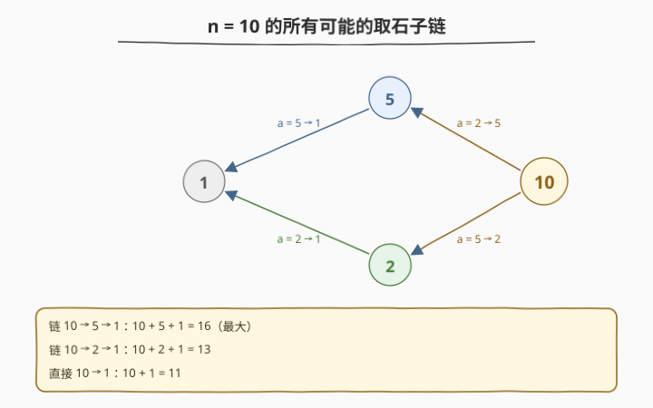
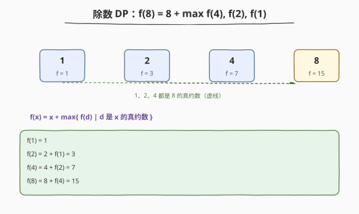
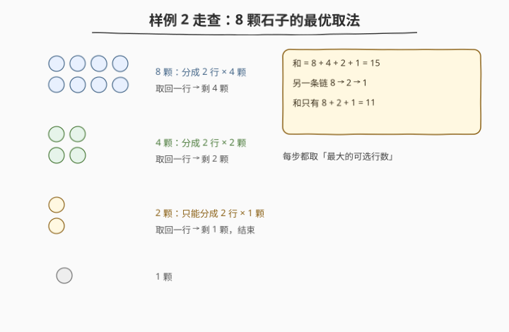

# Codeforces 177B1 矩形石子游戏 题解

## 1. 题目概述

- **题目链接**：https://codeforces.com/problemset/problem/177/B1
- **比赛来源**：ABBYY Cup 2.0 - Easy · Problem B1（UTC 2012-04-21）
- **难度**：1000
- **标签**：数论、约数、动态规划、记忆化
- **评测类型**：普通（题面把数据分成 30 分档与 100 分档两个子任务）
- **限制**：时间 2 s / 内存 256 MB

**题意**：海狸初始有 $n$ 颗石子。一步操作是：把当前全部 $c$ 颗石子摆成 $a$ 行、每行 $b$ 颗（要求 $a>1$、$c=ab$，即 $b$ 是 $c$ 的**真约数**），然后取回其中一行（$b$ 颗），其余丢弃。游戏在手里只剩 1 颗时结束。整个过程对应序列 $c_1=n > c_2 > \cdots > c_k=1$，其中每个 $c_{i+1}$ 都是 $c_i$ 的真约数；游戏结果是 $\sum c_i$。求这个和的最大值。

**约束**（原样摘自题面 `inputFormat.en`）：

- 输入只有一行一个整数 $n$，$2 \le n \le 10^9$（100 分档）。
- 30 分档：$2 \le n \le 50$。
- 没有多测。

**档位说明**：本题位是 B1，对应题面的 30 分档（$n \le 50$）；100 分档（$n \le 10^9$）是同场的 B2。两题的题面文本逐字相同，真正差别是 $n$ 的量级，这直接决定了算法：按值 DP 只能活到 $n$ 几十，$10^9$ 必须换成「每步除以最小质因子」的贪心。

**约束对算法的限制**：

- $n \le 50$ 时状态只有 50 个，$O(n^2)$ 的「对每个 $x$ 枚举真约数」完全够用，甚至指数级的链枚举也能跑。
- 答案上界：$n \le 50$ 时最大的结果是 $n=48$ 的 $94$（下面验证记录里有全表比对），`int` 绰绰有余；即使用 `long long` 也只是习惯。
- 若误把 B1 的代码交到 B2 的 $10^9$，数组开不下、时间也不够；这是两个题位必须分开写的原因。

**与 B2 题的区别是约束**：B1 是 30 分档 $2 \le n \le 50$，B2 是 100 分档 $2 \le n \le 10^9$（题面同时列出了这两档，两题文本逐字相同）。本做法是「在 $1..n$ 上按值做除数 DP」，时间 $O(n^2)$、空间 $O(n)$，**在 B1 的 $n \le 50$ 下足够**（约 1225 次取模）；但同样的代码到 B2 的 $n \le 10^9$ 需要 $10^9$ 大小的数组与 $10^{18}$ 级枚举，完全无法运行，**必须额外换成**「每步除以最小质因子」的贪心加 $O(\sqrt n)$ 试除分解，才能过 B2——这一步正是 B2 题解的主题。

## 2. 示例与观察

官方样例 1（输入 / 输出原样）：

```text
输入：
10

输出：
16
```

官方样例 2（输入 / 输出原样）：

```text
输入：
8

输出：
15
```

**样例 1 的演算**（题面 hint 给了同样的三条链）：$10$ 的真约数有 $1,2,5$。

- 摆成 10 行每行 1 颗：$c_2=1$，结果 $10+1=11$；
- 摆成 5 行每行 2 颗：$c_2=2$，再 $2 \to 1$，结果 $10+2+1=13$；
- 摆成 2 行每行 5 颗：$c_2=5$，再 $5 \to 1$，结果 $10+5+1=16$。

最大值 16。

**样例 2 的演算**：$8$ 的真约数有 $1,2,4$。

- $8 \to 1$：$9$；
- $8 \to 2 \to 1$：$11$；
- $8 \to 4 \to 1$：$13$；
- $8 \to 4 \to 2 \to 1$：$8+4+2+1=15$。

最大值 15。

**观察 1**：一次操作之后 $c$ 变成它的某个真约数，所以**任何合法的游戏过程就是一条从 $n$ 沿「真约数」关系下降到 1 的链**；反过来，任意一条这样的链都能实现（$c_i = a \cdot c_{i+1}$，取 $a = c_i/c_{i+1} > 1$ 行即可）。

**观察 2**：结果只与链经过哪些数有关，与「摆成几行」无关——行数 $a$ 完全由相邻两项决定。

**观察 3**：设 $f(x)$ 为从 $x$ 出发能得到的最大和。那么第一步选定真约数 $d$ 之后，剩下的最优值就是 $f(d)$，于是

$$f(1)=1,\qquad f(x)=x+\max_{d \mid x,\ d<x} f(d).$$

自造样例（标注「自造」）：

| 输入 | 输出 | 说明 |
|------|------|------|
| `2` | 3 | 只能 $2 \to 1$ |
| `3` | 4 | 质数只能一步到 1 |
| `4` | 7 | $4 \to 2 \to 1$ 优于 $4 \to 1$ |
| `5` | 6 | 质数 |
| `6` | 10 | $6 \to 3 \to 1$ |
| `48` | 94 | $n \le 50$ 内的最大值（$48 \to 24 \to 12 \to 6 \to 3 \to 1$） |
| `50` | 81 | $50 \to 25 \to 5 \to 1$ |

## 3. 解题思路

### 3.1 朴素做法与瓶颈

最直接的做法是**枚举所有链**：从 $n$ 出发，递归尝试每个真约数，走到 1 时把路径和与当前最优比较。$n \le 50$ 时链的总数很小（例如 48 的所有有序因子分解也只有几百条），这个做法能在毫秒级跑完，可以作为对拍用的暴力。

但它有一个明显的浪费：同一条子链会被不同前缀反复走到。比如 $48 \to 24 \to 12$ 与 $48 \to 12$ 都会展开「从 12 出发的所有链」。设从 $x$ 出发的链数为 $g(x)$，总代价是 $O(\sum_x g(x))$，随 $n$ 增长得比多项式快；到 $n$ 稍大（几百）就会明显变慢。

真正的瓶颈不在这里，而在**状态的定义**：只要意识到「从 $x$ 出发的最优值只依赖 $x$」，就能把「枚举链」压缩成「对每个 $x$ 求一次值」。

### 3.2 核心观察：最优子结构



上图是 $n=10$ 的三条链。注意 $10 \to 5$ 之后「从 5 出发怎么走最好」与 $10$ 无关：$f(5)=5+1=6$，所以 $f(10)$ 走 5 这一支的值是 $10+6=16$。同理 $f(2)=3$、$f(1)=1$，于是

$$f(10)=10+\max\{f(1),f(2),f(5)\}=10+\max\{1,3,6\}=16.$$

这就得到递推

$$f(x)=x+\max_{d \mid x,\ d<x} f(d),\qquad f(1)=1.$$

由于 $d<x$，按 $x$ 从小到大计算即可，不存在循环依赖。

### 3.3 算法流程：按值 DP



1. 读入 $n$（$n \le 50$）。
2. 开数组 `memo[1..n]`，`memo[1] = 1`。
3. 对 $x = 2,3,\ldots,n$（或写成带记忆化的递归，从 $n$ 往下），枚举 $d = 1,\ldots,x-1$，若 $d \mid x$ 就用 `memo[d]` 更新候选最大值，最后 `memo[x] = x + best`。
4. 输出 `memo[n]`。

本文代码写成**记忆化递归** `best(x)`：从 `best(n)` 出发，递归只会在 $x$ 的真约数上展开，天然按「$d<x$」的顺序求出子问题；`memo[x]` 一旦算出就不再重算。两种写法等价，递归版更短且不需要显式排序。

### 3.4 样例走查：8 颗石子



按 $8 \to 4 \to 2 \to 1$ 走：

- $8$ 颗摆成 2 行 × 4 颗，取回一行，剩 4；
- $4$ 颗摆成 2 行 × 2 颗，取回一行，剩 2；
- $2$ 颗只能摆成 2 行 × 1 颗（不能全放一行），取回一行，剩 1，结束。

和 $8+4+2+1 = 15$，与官方输出一致。对比 $8 \to 2 \to 1$（和 11）与 $8 \to 1$（和 9），显然「每步尽量留下更多石子」更好——这条直觉在 B2 会被严格证明成「每步除以最小质因子」。

## 4. 正确性证明

**引理 1**：合法的游戏过程与「$n=c_1>c_2>\cdots>c_k=1$ 且 $c_{i+1}\mid c_i$」的链一一对应。

**证明**：若第 $i$ 步把 $c_i$ 摆成 $a$ 行每行 $c_{i+1}$ 颗（$a>1$），则 $c_i = a\,c_{i+1}$，故 $c_{i+1}\mid c_i$ 且 $c_{i+1}<c_i$，游戏在只剩 1 颗时结束，所以链末项为 1。反过来，给定满足条件的链，第 $i$ 步取 $a=c_i/c_{i+1}>1$ 行、每行 $c_{i+1}$ 颗即可，每步消耗完全部石子，合法。∎

**引理 2**：对每个 $x \ge 1$，$f(x)$ 等于从 $x$ 出发所有合法链的最大和，且满足 $f(1)=1$、$f(x)=x+\max_{d\mid x,\,d<x}f(d)$。

**证明**：对 $x$ 归纳。$x=1$ 时链只有 $[1]$，和为 1。设 $x>1$，任取一条从 $x$ 出发的链 $x=d_0>d_1>\cdots>d_m=1$，其和为 $x+\sum_{i\ge1}d_i$，而 $\sum_{i\ge1}d_i$ 正是从 $d_1$ 出发的某条链的和，由归纳假设不超过 $f(d_1)$，且 $d_1$ 是 $x$ 的真约数；所以任何链的和 $\le x+\max_{d\mid x,d<x}f(d)$。另一方面，取达到 $f(d_0)$ 的那条链（$d_0$ 是取到最大值的真约数），前面接上 $x$ 就得到和恰为 $x+f(d_0)$ 的合法链，故上界可取到。∎

**定理**：算法输出的 `best(n)` 等于游戏结果的最大值。

**证明**：算法按记忆化递归实现引理 2 的递推：`best(1)=1`，`best(x)=x+max{best(d)}`，其中 $d$ 遍历 $x$ 的真约数；由于每次递归的 $d<x$，递归必然终止，且每个 $x$ 只算一次、结果被 `memo` 正确缓存。由引理 2，`best(n)=f(n)` 即最大和。∎

## 5. 复杂度分析

- **时间**：$O(n^2)$。对每个 $x \le n$ 至多枚举 $x-1$ 个候选约数，总比较次数 $\sum_{x\le n}(x-1) \approx n^2/2$。$n=50$ 时约 1225 次取模。递归本身只走「被用到的约数」，不会重复展开。
- **空间**：$O(n)$ 的 `memo` 数组，加上递归栈深度 $O(\log n)$（每次至少除以 2）。$n \le 50$ 时栈深不超过 6。
- **数值范围**：$n\le50$ 时 $f(n) \le 94$，`long long` 完全富余；即使把同样的递推推到 $n=10^9$ 也不可能（见下）。
- **与时限的关系**：2 s 对 1225 次取模是天文数字般的余量。实测端到端约 2 ms（几乎全是进程启动），Python 约 19 ms。

## 6. 参考代码

### C++17

```cpp
#include <bits/stdc++.h>
using namespace std;

// B1：30 分档 n<=50，直接在 1..n 上做除数 DP
const int MAXN = 55;
int n;
long long memo[MAXN];

long long best(int x) {
    if (x == 1) return 1;
    if (memo[x]) return memo[x];
    long long sub = 0;
    for (int d = 1; d < x; ++d)
        if (x % d == 0) sub = max(sub, best(d));
    return memo[x] = x + sub;
}

int main() {
    ios::sync_with_stdio(false);
    cin.tie(nullptr);

    cin >> n;
    cout << best(n) << '\n';
    return 0;
}
```

### Python3

```python
import sys


def main() -> None:
    data = sys.stdin.buffer.read().split()
    if not data:
        return
    n = int(data[0])
    memo = [0] * (n + 1)

    def best(x: int) -> int:
        if x == 1:
            return 1
        if memo[x]:
            return memo[x]
        sub = 0
        for d in range(1, x):
            if x % d == 0:
                v = best(d)
                if v > sub:
                    sub = v
        memo[x] = x + sub
        return memo[x]

    sys.stdout.write(str(best(n)) + "\n")


main()
```

两份代码都只针对 B1 的 30 分档（$n \le 50$）编写：C++ 的 `memo` 大小按 55 开，$n$ 更大就会越界；这正是 B2 需要换算法的原因。

## 7. 边界情况与易错点

1. **$n=2$**：只有 $2 \to 1$ 一条链，答案 3。若把递推写成「必须至少有两个真约数」之类，容易在 $n=2$ 上死循环或返回 2。
2. **质数**：$n$ 为质数时真约数只有 1，答案恒为 $n+1$（样例 $n=5$ 给 6）。若程序对质数返回 $n$，说明漏了「一步走到 1」这条链。
3. **$n=4$ 的陷阱**：$4 \to 1$ 得 5，$4 \to 2 \to 1$ 得 7，答案是 7。只在「除以 2」和「直接到 1」之间漏掉一边，就会在 $n=4$ 上错；手工验证时不要只用 $n=10$。
4. **数组大小**：C++ 里 `MAXN = 55` 是按 $n \le 50$ 开的；若把同一份代码交到 B2 的 $10^9$，会直接越界访问。两个题位的代码不能混用（这也是 B1/B2 分开写的原因）。
5. **记忆化的判定条件**：`memo[x]` 初值 0，用 `if (memo[x])` 判断是否算过。因为 $f(x) \ge 1$ 恒成立，0 可以安全地当哨兵；但若把 `f(1)` 也存进 `memo` 并依赖哨兵，必须先显式设 `memo[1]=1`，否则会重复计算（本题靠 `x==1` 的分支兜住）。
6. **递归深度**：每次至少折半，$n\le50$ 时深度不超过 6，不会爆栈；但若把同样的递归直接用于 $10^9$（不记忆化、按值递减），栈会深到无法接受——B2 改用迭代。
7. **输入只有一行**：题面写「单行一个整数」，没有 $t$。Python 用 `split()` 取第一个数即可，不要假设后面还有数据。
8. **`int` 与 `long long`**：$n\le50$ 时答案不超过 94，`int` 足够；但递推里 `x + sub` 的类型一旦写成 `int`，将来换到更大范围就会溢出。用 `long long` 一次到位。
9. **「取回一行」不能把全部石子留在一行**：$a>1$ 是硬性条件，所以每步必须真的变小；若允许 $a=1$，游戏可以原地踏步，问题就没有最大值了。

## 8. 验证记录

- **编译环境与命令**：本机为 `Apple clang 21.0.0`（`/usr/bin/g++` 是 clang 软链，无 GNU libstdc++），用 `clang++ -std=c++17 -O2 -Wall` 加仓库自带的 `codeforces/tools/include/bits/stdc++.h` 编译；正文代码仍写标准 `#include <bits/stdc++.h>`。Python 为 `3.9.6`。验证命令：
  `python3 codeforces/tools/verify_solution.py codeforces/contests/0101-0203/177/B1_矩形石子游戏.md`
  以及带 checker 的
  `python3 codeforces/tools/verify_solution.py codeforces/contests/0101-0203/177/B1_矩形石子游戏.md --checker codeforces/tools/checkers/cf177b1.py`。
- **官方样例**：2 / 2 通过（`10` → 16，`8` → 15），C++ 与 Python 一致。
- **额外测试**：自造 $n=2,3,4,5,6,48,50$ 共 7 组，答案分别为 $3,4,7,6,10,94,81$，两种语言全部通过；并把 $n=2..50$ 的每个值都与 B2 的贪心程序逐一比对，49 组全部相同。
- **独立暴力对拍**：暴力写成「显式 DFS 枚举每一条 $n \to \cdots \to 1$ 的真约数链，取路径和最大值」，与正文的记忆化 DP 是两套实现；对 250 组随机数据（$n \in [2,50]$，含 $2$、$50$、$2^k$、$36/48/49$ 等易错点）逐组比对，全部一致。
- **最大约束性能**：$n=50$ 端到端约 2 ms（含进程启动），Python 约 19 ms，相对 2 s 时限余量在千倍以上；$n$ 取满 30 分档上界时答案 81。
- **checker**：`codeforces/tools/checkers/cf177b1.py`，校验输出恰为一个整数且等于「在 $n$ 的约数集合上做 DP」独立重算的最大和（$n > 10^7$ 时自动改用贪心分解以免枚举 1..n），并核对 stdin 里的题面答案；已用 `--checker` 跑通两组官方样例。
- **图片与公式**：3 张 SVG（`cf177b1_chain_tree.svg`、`cf177b1_dp.svg`、`cf177b1_pebbles.svg`）通过 `ElementTree.parse` 与文本包围盒/重叠检查，并用 headless Chrome 渲染确认无裁切；公式经 KaTeX（`throwOnError: true`）校验无报错。
- **复核状态**：verified。

## 相关题目与扩展

- [Codeforces 177B2 Rectangular Game](https://codeforces.com/problemset/problem/177/B2)：本题的 100 分档版本，$n \le 10^9$，必须把「按值 DP」换成「每步除以最小质因子」的贪心，是这一对题位的核心差异。
- [Codeforces 230B T-primes](https://codeforces.com/problemset/problem/230/B)：同样围绕「约数 / 最小质因子」，用 $O(\sqrt n)$ 试除判定，是本题 B2 做法的前置练习。
- [Codeforces 177A1 Good Matrix Elements](https://codeforces.com/problemset/problem/177/A1)：同场的 A1，从矩阵计数入门。
- [LeetCode 1390. 四因数](https://leetcode.cn/problems/four-divisors/)：枚举约数并统计，练习 $O(\sqrt n)$ 的约数枚举写法。
- [Codeforces 177C1 Party](https://codeforces.com/problemset/problem/177/C1)：同场的 C1，图论题，正好换换脑子。

**延伸思考**：

1. **最长的链**：若目标改成「让序列尽量长」，每步都应除以一个质因子，最长长度为 $\Omega(n)+1$（$n$ 的质因子个数，含重数）。这与「和最大」的目标不同，但两个目标在 $n=2^k$ 时恰好同时取到。
2. **最小的和**：若目标改成最小化，每步直接取 $a=n$（即 $c_{i+1}=1$），答案为 $n+1$——因为任何链的和都至少包含 $n$ 和 1。最大值与最小值之间差了整整一条因子链的贡献。
3. **$n$ 到 $10^{18}$**：$O(\sqrt n)$ 试除不再可行（$10^9$ 次），需要 Pollard rho 或 Miller–Rabin 做质因数分解；本题 B2 的 $10^9$ 恰好是「试除能过」的上限，是刻意设计的档位。
4. **改成「每步可以取回任意多行」**：若允许取回 $t$ 行，状态变成 $c_{i+1}=t\cdot b$，可选的下一步更多，最优结构会变成「尽量少丢」，答案逼近 $n + n/2 + n/4 + \cdots$；这说明「只能取一行」是本题难度与结构的关键约束。
5. **为什么「除以最小质因子」是最优的**：这是 B2 的主题。直观上，留下越大的数，后面每一步都按比例更大；严格证明需要把链写成「$n$ 除以逐步累乘的因子」，见 B2 题解的前缀积论证。

