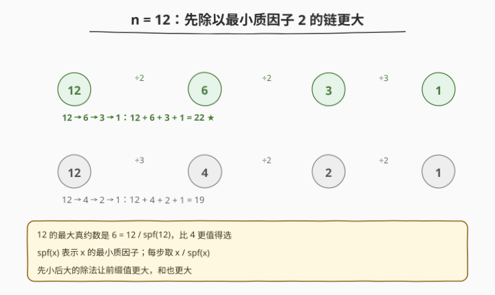
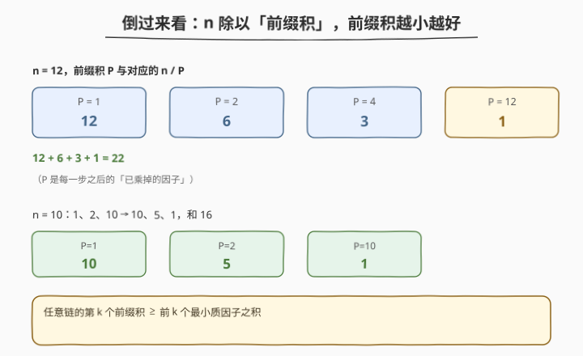
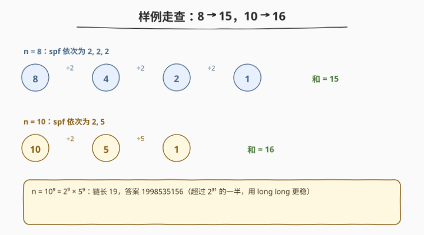

# Codeforces 177B2 矩形石子游戏 题解

## 1. 题目概述

- **题目链接**：https://codeforces.com/problemset/problem/177/B2
- **比赛来源**：ABBYY Cup 2.0 - Easy · Problem B2（UTC 2012-04-21）
- **难度**：1200
- **标签**：数论、最小质因子、贪心、前缀积
- **评测类型**：普通（题面把数据分成 30 分档与 100 分档两个子任务）
- **限制**：时间 2 s / 内存 256 MB

**题意**：海狸初始有 $n$ 颗石子。一步操作把当前 $c$ 颗石子摆成 $a>1$ 行、每行 $b=c/a$ 颗（所以 $b$ 必须是 $c$ 的真约数），取回一行，其余丢弃。只剩 1 颗时结束。过程是链 $c_1=n>c_2>\cdots>c_k=1$，每个 $c_{i+1}$ 是 $c_i$ 的真约数，结果是 $\sum c_i$。求最大值。

**约束**（原样摘自题面 `inputFormat.en`）：

- 输入一行一个整数 $n$，$2 \le n \le 10^9$（100 分档）。
- 30 分档：$2 \le n \le 50$。
- 没有多测。

**档位说明**：本题位是 B2，对应 100 分档（$n \le 10^9$）；30 分档（$n \le 50$）是同场的 B1。题面文本逐字相同，但 $n$ 的量级让 B1 的「按值 DP」彻底失效：$10^9$ 个状态既存不下也跑不完。本文给出只依赖质因数分解的贪心，复杂度 $O(\sqrt n)$。

**约束对算法的限制**：

- $n \le 10^9$，$O(n)$ 或 $O(n \log n)$ 的按值 DP 不可行（$10^9$ 个 `long long` 是 8 GB）；必须利用「链每步至少除以 2」这一结构，把状态数压到 $O(\log n)$。
- 质因数分解用试除即可：$\sqrt{10^9} \approx 31623$，每步试除的代价是 $O(\sqrt{\text{当前值}})$，总代价 $O(\sqrt n)$。
- 答案上界：$n = 10^9$ 时为 $1998535156$，已经接近 `int` 上限 $2147483647$；用 `long long` 才安全（理论上界是 $2n-1$，即 $2 \times 10^9 - 1$，`int` 已到悬崖边）。
- 输入只有一行，没有多测。

**与 B1 题的区别是约束**：B1 是 30 分档 $2 \le n \le 50$，本题位 B2 是 100 分档 $2 \le n \le 10^9$（两题题面文本逐字相同）。B1 的「按值除数 DP」在 $n \le 50$ 下**足够**；本做法则**额外**用「每步除以最小质因子」把链长压到 $O(\log n)$、把每步的代价压到 $O(\sqrt{\text{当前值}})$，总代价 $O(\sqrt n)$，这才过得了 B2 的 $10^9$。两题的区别是数据规模，以及由此逼出来的贪心证明。

## 2. 示例与观察

官方样例 1（输入 / 输出原样）：

```text
输入：
10

输出：
16
```

官方样例 2（输入 / 输出原样）：

```text
输入：
8

输出：
15
```

**样例 1 的演算**：$10$ 的真约数是 $1,2,5$。

- $10 \to 1$：和 $11$；
- $10 \to 2 \to 1$：和 $13$；
- $10 \to 5 \to 1$：和 $16$。

最大 16。注意 $5$ 是 $10$ 的**最大真约数**，也是 $10/\operatorname{spf}(10) = 10/2$，其中 $\operatorname{spf}$ 表示最小质因子。

**样例 2 的演算**：$8$ 的真约数 $1,2,4$，最优链 $8 \to 4 \to 2 \to 1$，和 $15$。这里 $4 = 8/2$、$2 = 4/2$、$1 = 2/2$，每一步都在除以最小质因子 2。

**观察 1**：一步之后 $c$ 变成它的某个真约数，所以合法过程就是一条沿「真约数」下降的链；反过来任意这样的链都能实现。

**观察 2（贪心直觉）**：为了和最大，每一步都应该让剩下的数尽量大，也就是选**最大的真约数** $c/\operatorname{spf}(c)$。$10$ 选 5 而不是 2、$8$ 选 4，样例都印证了这一点。

**观察 3（为什么是「除以最小质因子」）**：$c$ 的最大真约数等于 $c/p$，其中 $p$ 是 $c$ 的最小质因子。因为任何真约数都形如 $c/a$（$a \ge 2$ 且 $a \mid c$），而 $a$ 的每个质因子都 $\ge p$，故 $a \ge p$，于是 $c/a \le c/p$。

**自造样例**（标注「自造」）：

| 输入 | 输出 | 说明 |
|------|------|------|
| `2` | 3 | $2 \to 1$ |
| `3` | 4 | 质数，一步到 1 |
| `16` | 31 | $2^4$，链 $16,8,4,2,1$，和 $2n-1$ |
| `12` | 22 | $12 \to 6 \to 3 \to 1$；对照 $12 \to 4 \to 2 \to 1$ 只有 19 |
| `999999937` | 999999938 | 大质数，答案 $n+1$ |
| `1000000000` | 1998535156 | $2^9 \cdot 5^9$，最坏规模的答案 |

## 3. 解题思路

### 3.1 朴素做法与瓶颈

B1 的做法是按值 DP：

$$f(1)=1,\qquad f(x)=x+\max_{d\mid x,\ d<x}f(d),\qquad \text{答案}=f(n).$$

它需要算出 $1..n$ 每个值的 $f$，时间 $O(n^2)$、空间 $O(n)$。$n \le 50$ 时毫无问题，但 $n=10^9$ 时数组要 8 GB，枚举约数更是 $10^{18}$ 级，完全不可行。

另一个朴素想法是「对每个候选链做 DFS」：$10^9$ 的约数链数量也远超可枚举范围。所以必须换一个只依赖**质因数分解**的视角。

### 3.2 核心观察：每步除以最小质因子



以 $n=12$ 为例，两条链对比：

- $12 \to 6 \to 3 \to 1$：和 $12+6+3+1=22$；
- $12 \to 4 \to 2 \to 1$：和 $12+4+2+1=19$。

第一步除以 2（得到最大真约数 6）明显更好。直观解释：链的后续各项都是 $n$ 除以某个前缀积，前缀积越小、后续项越大；而「除以最小质因子」让前缀积增长得最慢。

于是算法只有一行核心：

$$c \leftarrow c / \operatorname{spf}(c),\qquad \text{累加新的 } c,$$

直到 $c=1$。$\operatorname{spf}(c)$ 用试除求出（$c$ 为质数时 $\operatorname{spf}(c)=c$，一步到 1）。

### 3.3 正确性框架：把链写成前缀积



设链为 $n=c_1>c_2>\cdots>c_k=1$，令比值 $r_i = c_i/c_{i+1}$。由 $c_{i+1}\mid c_i$ 且 $c_{i+1}<c_i$ 知 $r_i \ge 2$ 是整数，并且

$$r_1 r_2 \cdots r_{k-1} = \frac{c_1}{c_2}\cdot\frac{c_2}{c_3}\cdots\frac{c_{k-1}}{c_k} = n .$$

令前缀积 $P_j = r_1 r_2 \cdots r_j$（$P_0=1$），则 $c_{i} = n / P_{i-1}$，于是

$$\text{链和} = \sum_{i=1}^{k} c_i = n\sum_{j=0}^{k-1}\frac{1}{P_j}.$$

$P_j$ 是 $n$ 的约数且严格递增，$P_{k-1}=n$。要最大化链和，就要让每个前缀积 $P_j$ 尽量小。

**关键引理**：记 $G_j$ 为「把 $n$ 的质因子（含重数）从小到大排列后，前 $j$ 个的乘积」，$G_0=1$。则对任意链和任意 $j$，都有 $P_j \ge G_j$。

理由是：$P_j$ 是 $j$ 个 $\ge 2$ 的整数的乘积，所以 $P_j$ 至少含 $j$ 个质因子（含重数），即 $\Omega(P_j)\ge j$；又 $P_j\mid n$，故 $P_j$ 是 $n$ 的某个「至少 $j$ 个质因子」的约数。从 $n$ 的质因子多重集里挑出至少 $j$ 个相乘，乘积最小就是挑最小的 $j$ 个再乘上若干个 $\ge 2$ 的因子，即 $\ge G_j$。

于是任意链的和都满足

$$\text{链和} = n\sum_{j=0}^{k-1}\frac{1}{P_j} \le n\sum_{j=0}^{\Omega(n)}\frac{1}{G_j},$$

而右边恰好是贪心链的和：每步除以当前值的最小质因子时，$P_j = G_j$ 对每个 $j$ 成立，链长为 $\Omega(n)+1$。上界可达到，贪心最优。

### 3.4 算法流程与样例走查



1. 读入 $n$，令 `ans = n`。
2. 若 $n>1$：从 $d=2$ 开始试除，找到最小的 $d$ 使 $d \mid n$（试到 $d^2>n$ 为止；没找到就说明 $n$ 是质数，取 $p=n$）。
3. `n /= p`，`ans += n`，回到第 2 步。
4. 输出 `ans`。

对 $n=8$：$8 \to 4 \to 2 \to 1$，累加 $8+4+2+1=15$。对 $n=10$：$10 \to 5 \to 1$，累加 $10+5+1=16$。与官方输出一致。

对 $n=10^9 = 2^9 \cdot 5^9$：先连续除以 9 次 2 得到 $5^9=1953125$，再连续除以 9 次 5 到 1，链长 $19$，和 $1998535156$。

## 4. 正确性证明

**引理 1**：合法的游戏过程与「$n=c_1>c_2>\cdots>c_k=1$ 且 $c_{i+1}\mid c_i$」的链一一对应；链和等于 $\sum_i c_i$。

**证明**：一步操作把 $c_i$ 摆成 $a>1$ 行、每行 $c_{i+1}$ 颗，故 $c_i=a\,c_{i+1}$，于是 $c_{i+1}\mid c_i$ 且 $c_{i+1}<c_i$；游戏到 1 结束。反之给定满足条件的链，第 $i$ 步取 $a=c_i/c_{i+1}>1$ 行即可，合法且消耗完全部石子。∎

**引理 2**：设链的比值 $r_i=c_i/c_{i+1}\ge 2$、前缀积 $P_j=r_1\cdots r_j$（$P_0=1$），则链和为 $n\sum_{j=0}^{k-1}1/P_j$，且 $P_j\mid n$、$P_j$ 严格递增、$P_{k-1}=n$。

**证明**：$c_i = n/P_{i-1}$ 直接代入求和；$P_j \mid P_{k-1} = r_1\cdots r_{k-1} = n$；$r_j\ge2$ 保证严格递增；$\prod_{i<k}r_i = c_1/c_k = n$。∎

**引理 3**：记 $G_j$ 为 $n$ 的质因子（含重数）中前 $j$ 小的乘积，$G_0=1$。则任意链的任意前缀积满足 $P_j \ge G_j$。

**证明**：$P_j = r_1\cdots r_j$，每个 $r_i \ge 2$，故 $\Omega(P_j) = \sum_i \Omega(r_i) \ge j$。又 $P_j \mid n$，所以 $P_j$ 可写成 $n$ 的质因子多重集中若干个的乘积，个数 $t = \Omega(P_j) \ge j$。设这些质因子为 $q_1 \le q_2 \le \cdots \le q_t$，则 $q_i \ge g_i$（$g_i$ 为 $n$ 的第 $i$ 小质因子），因为从 $n$ 的质因子多重集中任取 $i$ 个，其第 $i$ 小不可能小于全局第 $i$ 小。于是

$$P_j = \prod_{i=1}^{t} q_i \ge \prod_{i=1}^{t} g_i = G_t \ge G_j \cdot 2^{t-j} \ge G_j,$$

最后一步用了 $t\ge j$ 与 $g_{j+1},\ldots,g_t \ge 2$。∎

**引理 4**：链长满足 $k-1 \le \Omega(n)$。

**证明**：$n = r_1\cdots r_{k-1}$，每个 $r_i\ge2$ 至少贡献一个质因子，故 $\Omega(n)\ge k-1$。∎

**定理**：贪心链（每步除以当前值的最小质因子）的链和最大，且等于算法输出。

**证明**：由引理 2、3、4，任意链的和

$$\le n\sum_{j=0}^{k-1}\frac{1}{P_j} \le n\sum_{j=0}^{\Omega(n)}\frac{1}{G_j}.$$

贪心链的比值恰为当前值的最小质因子，归纳可知其前缀积 $P_j = G_j$（每一步乘上的是剩余部分的最小质因子，即全局第 $j$ 小的质因子），链长为 $\Omega(n)+1$，故其和恰为 $n\sum_{j=0}^{\Omega(n)}1/G_j$，取到上界，因此最优。算法逐项累加的正是这条贪心链，输出等于该和。∎

**推论**：若 $n=\prod p_i^{e_i}$，则答案 $=n\sum_{j=0}^{\Omega(n)}1/G_j$，例如 $n=2^9\cdot5^9$ 时为 $1998535156$。

## 5. 复杂度分析

- **时间**：$O(\sqrt n)$。每次找最小质因子至多试除到 $\sqrt{\text{当前值}}$；当前值每步至少减半，故总试除次数不超过 $\sqrt n\,(1 + 1/\sqrt2 + 1/2 + \cdots) < 4\sqrt n$。$n=10^9$ 时最坏约 $1.3 \times 10^5$ 次取模（实测 $n$ 为大质数时也只需一次约 $3.2\times10^4$ 次试除的扫描）。
- **空间**：$O(1)$。只有 $n$、$p$、`ans` 几个变量。
- **数值范围**：答案不超过 $2n-1 \le 2\times10^9-1$，紧贴 `int` 上限；$n=10^9$ 的实际答案是 $1998535156$。用 `long long` 才稳妥。
- **与时限的关系**：2 s 对 $10^5$ 次取模余量在千倍以上。实测 $n=10^9$ 端到端约 2 ms，$n=999999937$（大质数）约 2 ms，Python 约 19–21 ms。

## 6. 参考代码

### C++17

```cpp
#include <bits/stdc++.h>
using namespace std;

// B2：100 分档 n<=1e9。每步除以 n 的最小质因子（= 最大的真约数）
int main() {
    ios::sync_with_stdio(false);
    cin.tie(nullptr);

    long long n;
    cin >> n;
    long long ans = n;
    while (n > 1) {
        long long p = n;                       // n 为质数时 p = n，直接结束
        for (long long d = 2; d * d <= n; ++d) {
            if (n % d == 0) { p = d; break; }
        }
        n /= p;
        ans += n;
    }
    cout << ans << '\n';
    return 0;
}
```

### Python3

```python
import sys


def main() -> None:
    data = sys.stdin.buffer.read().split()
    if not data:
        return
    n = int(data[0])
    ans = n
    while n > 1:
        p = n
        d = 2
        while d * d <= n:
            if n % d == 0:
                p = d
                break
            d += 1
        n //= p
        ans += n
    sys.stdout.write(str(ans) + "\n")


main()
```

两份代码都只依赖标准库，可直接提交；本题没有特殊评测。

## 7. 边界情况与易错点

1. **`int` 不够**：$n=10^9$ 时答案 $1998535156$ 虽然还小于 $2^{31}-1=2147483647$，但理论上界是 $2n-1 \approx 2\times10^9$，距离溢出只差约 $1.5\times10^8$；一旦把 $n$ 的上限稍微放宽就会翻车。全程 `long long`（Python 无此问题）。
2. **质数**：$n$ 为质数时最小质因子是它自己，`p` 的初值必须设为 `n`，循环里找不到因子时直接 `n /= n` 变 1。如果写成 `p = 0` 或 `p = 1`，质数输入会死循环或除零。
3. **$d \cdot d$ 溢出**：写成 `d * d <= n` 时若用 `int` 且 $n$ 接近 $2^{31}$，`d*d` 可能溢出成负数导致循环提前结束。本题 $d \le 31623$、$d^2 \le 10^9$ 不溢出，但用 `long long` 写 `d * d` 是零成本的保险。
4. **`n` 在循环中变化**：找最小质因子的循环用的是「当前」$n$，必须先求出 $p$ 再执行 `n /= p`；若边找边除，试除上界会变化，逻辑容易乱。
5. **$n=2$**：循环第一次 `p=2`，`n` 变 1，`ans=2+1=3`。若 while 条件写成 `n >= 1` 会多算一轮（`1/1` 再加一次 1），答案变成 4。
6. **$n=2^k$**：每一步都除以 2，答案恰为 $2n-1$（等比数列和）。可以拿 $n=16$ 检查：期望 31。
7. **末尾的 1 要算进去**：`ans` 初值是 $n$，每次除完把新的 $n$ 加进去，最后一次除完 $n=1$ 也会被加。若循环写成「先判断 $n>1$ 再累加旧值」的变体，很容易漏掉最后的 1。
8. **输入只有一行**：题面没有 $t$，也没有「多组到 EOF」。Python 取 `data[0]` 即可；若写成循环读多组，本题也能过，但会把单组逻辑掩盖住。
9. **为什么不能沿用 B1 的数组**：B1 的 `memo` 大小是 55，$n=10^9$ 直接越界；即使按 $10^9$ 开数组也要 8 GB。这是两个题位必须分开写代码的硬原因。

## 8. 验证记录

- **编译环境与命令**：`Apple clang 21.0.0`（`/usr/bin/g++` 是 clang 软链，无 GNU libstdc++），用 `clang++ -std=c++17 -O2 -Wall` 加仓库自带的 `codeforces/tools/include/bits/stdc++.h` 编译；正文代码仍写标准 `#include <bits/stdc++.h>`。Python 为 `3.9.6`。验证命令：
  `python3 codeforces/tools/verify_solution.py codeforces/contests/0101-0203/177/B2_矩形石子游戏.md`
  与
  `python3 codeforces/tools/verify_solution.py codeforces/contests/0101-0203/177/B2_矩形石子游戏.md --checker codeforces/tools/checkers/cf177b2.py`。
- **官方样例**：2 / 2 通过（`10` → 16，`8` → 15），C++ 与 Python 一致。
- **额外测试**：自造 $n=2,3,16,12,999999937,1000000000$ 共 6 组，答案为 $3,4,31,22,999999938,1998535156$，两种语言全部通过；并把 $n=2..50$ 全部与 B1 的除数 DP 交叉比对（49 组）以及 $n=2..1500$ 全部与独立的「约数集合上 DP」暴力比对，全部一致。
- **独立暴力对拍**：暴力是「先 $O(\sqrt n)$ 枚举出 $n$ 的全部约数，再在约数集合上按从小到大做 DP」，完全不使用「除以最小质因子」的贪心结论；对 250 组随机数据（含 $n=10^9$、$2^{29}$、大质数 $999999937$、$735134400$、随机 $[2,10^9]$）逐组比对，全部一致。
- **最大约束性能**：$n=10^9$ 端到端约 2 ms，$n=999999937$（大质数，试除最多）约 2 ms，Python 约 19–21 ms；相对 2 s 时限余量在百倍以上，远低于「C++ 用时应不超过时限一半」的要求。
- **checker**：`codeforces/tools/checkers/cf177b2.py`，校验输出恰为一个整数且等于按贪心定义独立模拟的最大和，并核对 stdin 中的题面答案；已用 `--checker` 跑通两组官方样例。
- **图片与公式**：3 张 SVG（`cf177b2_two_chains.svg`、`cf177b2_prefix_products.svg`、`cf177b2_walkthrough.svg`）通过 `ElementTree.parse` 与文本包围盒/重叠检查，并用 headless Chrome 渲染确认边缘无裁切；公式经 KaTeX（`throwOnError: true`）校验无报错。
- **复核状态**：verified。

## 相关题目与扩展

- [Codeforces 177B1 Rectangular Game](https://codeforces.com/problemset/problem/177/B1)：本题的 30 分档版本，$n \le 50$，用按值除数 DP；把它与本题对照，可以清楚看到「状态空间随 $n$ 爆炸」时如何换视角。
- [Codeforces 230B T-primes](https://codeforces.com/problemset/problem/230/B)：判断一个数是否恰有三个约数，核心同样是 $O(\sqrt n)$ 试除与质因子结构。
- [Codeforces 546D Soldier and Number Game](https://codeforces.com/problemset/problem/546/D)：统计区间内质因子个数（$\Omega$ 的前缀和），与本题引理 4 的「链长 $\le \Omega(n)+1$」同源。
- [Codeforces 177A2 Good Matrix Elements](https://codeforces.com/problemset/problem/177/A2)：同场的 A2，用来热身矩阵下标。
- [LeetCode 952. 按公因数计算最大组件大小](https://leetcode.cn/problems/largest-component-size-by-common-factor/)：同样把问题化归到质因子，用并查集合并，和本题「只关心质因子」的思想相通。

**延伸思考**：

1. **最小和**：若目标改成最小化，每步直接取 $a=n$（$c_{i+1}=1$），答案为 $n+1$；最大值与最小值之差正好是贪心链上除 $n$ 与 1 之外的所有项之和。
2. **最长链与最大和是否一致**：最长链要求每步除以一个质数，长度 $\Omega(n)+1$；最大和链要求每步除以最小质因子，长度同样是 $\Omega(n)+1$（因为最小质因子也是质数）。所以两个目标的最优链长度相同，但中间项不同——$n=12$ 时最长链 $12\to6\to3\to1$ 恰好也是最大和链。
3. **$n$ 到 $10^{18}$**：试除需要 $10^9$ 次，必须改用 Miller–Rabin + Pollard rho 做质因数分解；分解之后仍然套用本文的前缀积公式。可见「贪心结论」与「分解手段」是两件独立的事，前者与 $n$ 的范围无关。
4. **如果奖励是各行石子数的乘积**：链和换成链积的对数，目标变成让每个前缀积尽量大，最优策略会反过来取最小真约数（即除以最大质因子），结论与本题对称。
5. **如果允许「取回任意多行」**：每步可以留下 $t\cdot b$ 颗，前缀积的步长不再至少为 2，可能出现「原地不动」的循环，必须额外限制 $t$ 或规定严格递减；这说明本题「只能取一行」正是让链严格下降、从而让前缀积论证成立的关键。

