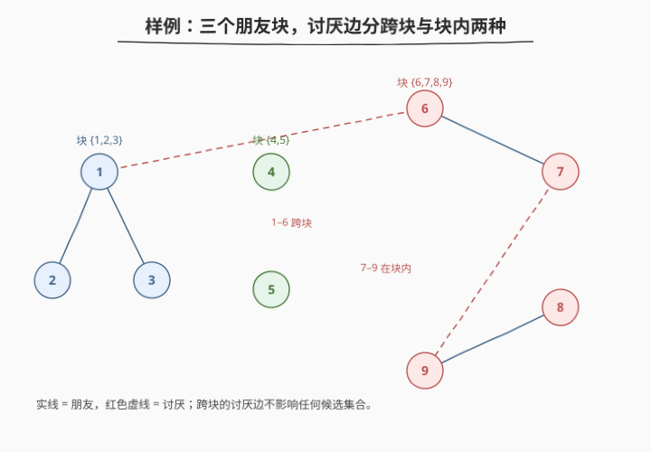
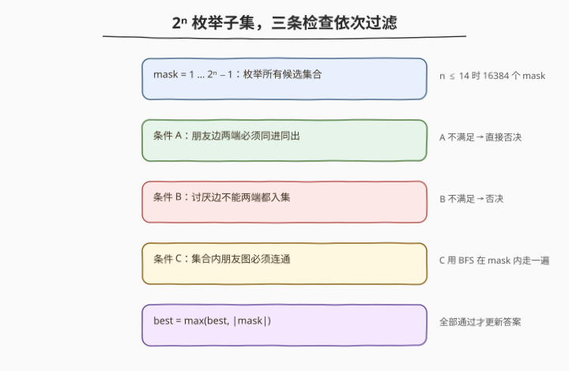
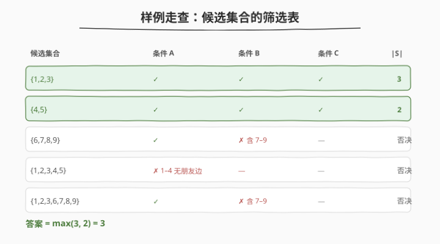

# Codeforces 177C1 派对邀请人数 题解

## 1. 题目概述

- **题目链接**：https://codeforces.com/problemset/problem/177/C1
- **比赛来源**：ABBYY Cup 2.0 - Easy · Problem C1（UTC 2012-04-21）
- **难度**：1500
- **标签**：图论、子集枚举、连通性、位掩码
- **评测类型**：普通（题面把数据分成 30 分档与 100 分档两个子任务）
- **限制**：时间 2 s / 内存 256 MB

**题意**：海狸有 $n$ 个熟人，熟人之间有若干「朋友」关系和若干「讨厌」关系（都互相）。他要邀请一个集合 $S$，要求：

1. $S$ 中每个人的朋友都必须也在 $S$ 中；
2. $S$ 中不能有一对互相讨厌的人；
3. $S$ 中任意两人都能通过「朋友链」（长度任意）相连。

求 $|S|$ 的最大值；若一个都邀请不了输出 0。

**约束**（原样摘自题面 `inputFormat.en` 与题面给出的限制）：

- 第一行 $n$，第二行 $k$（朋友对数），随后 $k$ 行 $u_i, v_i$；接着一行 $m$（讨厌对数），随后 $m$ 行同样格式。
- 每一对人至多出现一次；同一对人不会既是朋友又互相讨厌。
- 30 分档：$2 \le n \le 14$；100 分档：$2 \le n \le 2000$。
- $0 \le k, m \le \min(10^5, \frac{n(n-1)}{2})$，$0 \le k+m \le \min(10^5, \frac{n(n-1)}{2})$。

**档位说明**：本题位是 C1，对应 30 分档（$n \le 14$）。此时「朋友对 + 讨厌对」至多 $\binom{14}{2} = 91$ 对，$2^{14} = 16384$ 个子集可以全部枚举。100 分档（$n \le 2000$）是同场的 C2，$2^{2000}$ 个集合不可能枚举，必须换用并查集。

**约束对算法的限制**：

- $n \le 14$ 时 $2^n$ 枚举是自然的：$16384 \times (91+91)$ 约 $3\times10^6$ 次判断，毫秒级完成。
- 但 $n \le 14$ 也意味着**不能**用任何 $2^n$ 以上的做法（如枚举有序对、枚举三元组）；反过来，$O(n^3)$ 的暴力在这里反而更快，只是不如 $2^n$ 枚举直观可靠。
- 答案不超过 $n$，输出一个整数即可。

**与 C2 题的区别是约束**：C1 是 30 分档 $2 \le n \le 14$（此时 $k,m \le \binom{14}{2} = 91$），C2 是 100 分档 $2 \le n \le 2000$、$k,m \le 10^5$（两题文本逐字相同）。本做法是 $2^n$ 枚举全部子集，**在 C1 的 $n \le 14$ 下足够**（16384 个 mask、约 $3\times10^6$ 次判断）；到 C2 的 $n \le 2000$ 时 $2^{2000}$ 个集合不可能枚举，**必须额外换成**并查集/ BFS 按连通块统计的 $O((n+k+m)\alpha)$ 做法，才能过 C2。

## 2. 示例与观察

官方样例（输入 / 输出原样）：

```text
输入：
9
8
1 2
1 3
2 3
4 5
6 7
7 8
8 9
9 6
2
1 6
7 9

输出：
3
```

**逐步演算**：把朋友关系画出来，得到三个连通块：

- $\{1,2,3\}$：三角形；
- $\{4,5\}$：一条边；
- $\{6,7,8,9\}$：四边形的环。

两条讨厌边是 $1\text{–}6$ 与 $7\text{–}9$。

- 条件 1（朋友必须同进同出）意味着候选集合只能是**若干个连通块的并**。
- 条件 3（任意两人有朋友链）进一步要求候选集合**恰好是一个连通块**（因为一个块的并若含两个块，块间没有朋友边，就不连通）。
- 于是只需检查每个连通块内部有没有讨厌边：$\{1,2,3\}$ 没有（$1\text{–}6$ 跨块），合法，大小 3；$\{4,5\}$ 合法，大小 2；$\{6,7,8,9\}$ 内部有 $7\text{–}9$，不合法。

最大是 3，与官方输出一致。题面 hint 给出的推理也正是这三点：$\{1,2,3\}$ 与 $\{4,5\}$ 可以邀请，$\{6,7,8,9\}$ 因为 $7,9$ 互相讨厌而不行，$\{1,2,3,4,5\}$ 因为 $2$ 与 $5$ 没有朋友链而不行。

**自造样例**（标注「自造」，均满足「同一对人至多出现一次、不会既是朋友又讨厌」的输入约定）：

| 输入 | 输出 | 说明 |
|------|------|------|
| `2` / `0` / `0` | 1 | 没有朋友也没有讨厌，只能请 1 人 |
| `2` / `1` / `1 2` / `0` | 2 | 一对朋友，两个人都能请 |
| `4` / `3` / `1 2` `2 3` `1 3` / `1` / `2 4` | 3 | 讨厌边跨块（4 是孤立点），三角形整块都能请 |
| `5` / `4` / `1 2` `2 3` `3 4` `4 1` / `1` / `1 3` | 1 | 环内讨厌边让整块报废，只剩孤立点 5 |
| `9` / 官方样例的 8 条朋友边 / `2` / `1 6` `7 9` | 3 | 官方样例 |

一个容易踩的「假样例」：$n=3$、三人两两是朋友、同时 $1,2$ 互相讨厌。这个输入违反题面「同一对人不会既是朋友又互相讨厌」的约定（$1,2$ 既是朋友又讨厌），不是合法数据，不能拿来测程序。写随机生成器时必须先占用朋友边集合，讨厌边只能从剩下的对里选，本文的对拍脚本就是这么做的。

**观察**：三条条件合起来，候选集合只能是一个「内部没有讨厌边的朋友连通块」。这一观察对 C2 更关键（那里用它把 $2^n$ 换成并查集），而在 C1 里我们仍然按定义暴力检查三条条件，用暴力去验证这个观察。

## 3. 解题思路

### 3.1 朴素做法与瓶颈

最直接的做法：枚举 $1 \le \text{mask} < 2^n$ 的每个子集，按题面三条条件逐条检查，全部通过就用 $|\text{mask}|$ 更新答案。

- 条件 1：遍历每条朋友边 $(u,v)$，要求 $u,v$ 在集合里「同进同出」；
- 条件 2：遍历每条讨厌边 $(u,v)$，不允许两端都在集合里；
- 条件 3：从集合中编号最小的点出发，只在集合内部沿朋友边走 BFS，看能否走遍整个集合。

复杂度 $O(2^n (k+m+n))$。$n \le 14$ 时是 $1.6\times10^4 \times$ 约 200 次操作，约 $3\times10^6$，毫秒级。瓶颈不在时间，而在**指数规模本身**：$n=2000$ 时 $2^{2000}$ 无论怎么剪枝都不可能，这正是 C2 必须换算法的原因。

### 3.2 核心观察：三条条件 = 一个「干净」的连通块



图里画出样例的朋友块（蓝色三角形、绿色边、红色四边形）与两条讨厌边（红色虚线）。可以看到讨厌边有两种命运：

- **跨块**（$1\text{–}6$）：两个端点分属不同块，任何候选集合都不可能同时包含它们（因为候选集合只能是单个块），所以它不影响任何块；
- **块内**（$7\text{–}9$）：这条边让整个块 $\{6,7,8,9\}$ 不可选。

因此三条条件等价于「候选集合是一个内部没有讨厌边的朋友连通块」。在 C1 里我们不需要把这个观察写进代码（按定义暴力检查即可），但它解释了样例，也直接导出 C2 的并查集做法。

### 3.3 算法流程



1. 读入 $n, k$，建朋友邻接表 `adj`，同时保存朋友边列表 `fr`。
2. 读入 $m$ 与讨厌边列表 `dis`。
3. 对 `mask = 1 .. 2^n - 1`：
   1. 检查所有朋友边：若两端一个在集合内、一个在集合外，否决；
   2. 检查所有讨厌边：若两端都在集合内，否决；
   3. 从 `__builtin_ctz(mask)`（最低位的 1）出发，在集合内部 BFS，若访问到的点集等于 `mask` 则连通，否则否决；
   4. 通过全部检查则 `best = max(best, popcount(mask))`。
4. 输出 `best`（一个都没通过就是 0）。

三条检查的先后顺序可以随意；先检查便宜的条件 1 能尽早否决，减少 BFS 次数。

### 3.4 样例走查：候选集合筛选表



| 候选集合 | 条件 A（朋友封闭） | 条件 B（无讨厌边） | 条件 C（连通） | 结果 |
|----------|--------------------|--------------------|----------------|------|
| $\{1,2,3\}$ | ✓ | ✓ | ✓ | 大小 3 |
| $\{4,5\}$ | ✓ | ✓ | ✓ | 大小 2 |
| $\{6,7,8,9\}$ | ✓ | ✗ 含 $7\text{–}9$ | — | 否决 |
| $\{1,2,3,4,5\}$ | ✗ $1$ 与 $4$ 之间没有朋友边 | — | — | 否决 |
| $\{1,2,3,6,7,8,9\}$ | ✓ | ✗ 含 $7\text{–}9$ | — | 否决 |

最终答案 $\max(3,2)=3$，与官方输出一致。

## 4. 正确性证明

**引理 1**：集合 $S$ 满足条件 1（每个被邀请者的朋友都被邀请）当且仅当 $S$ 是若干个朋友连通块的并。

**证明**：若 $S$ 满足条件 1，取任一 $u \in S$，$u$ 的朋友都在 $S$，朋友的朋友也都在 $S$……归纳可知 $u$ 所在的整个连通块含于 $S$，故 $S$ 是若干块的并。反之，若 $S$ 是若干块的并，任取 $u \in S$，$u$ 的朋友与 $u$ 同块，故也在 $S$ 中。∎

**引理 2**：集合 $S$ 同时满足条件 1 与条件 3 当且仅当 $S$ 恰好是一个朋友连通块。

**证明**：由引理 1，$S$ 是若干块的并。若这些块多于一个，取分属两块的 $u,v$，块间没有朋友边，任何朋友链都跨不过去，条件 3 不成立；若恰有一个块，块内任意两点由块的定义（连通分量）有朋友链，条件 3 成立。∎

**引理 3**：枚举 $1 \le \text{mask} < 2^n$ 的每个子集并按条件 1、2、3 检查，可以找出所有合法集合中的最大者。

**证明**：枚举遍历了全部非空子集；检查是逐条按题面定义执行的，因此「通过检查」与「合法」等价（引理 1、2 只是给出合法集合的结构，不参与代码判定）。取最大值即得答案；若没有非空子集通过，`best` 保持 0，符合题面「一个都请不了输出 0」。∎

**定理**：算法输出可邀请人数的最大值。

**证明**：由引理 3，算法在全部非空子集中找出所有合法集合，并返回其大小的最大值；空集不计入（题面要求邀请的人构成集合且人数为答案，0 表示无法选择），故输出即为所求。∎

## 5. 复杂度分析

- **时间**：$O(2^n(k+m+n))$。$n \le 14$ 时 $2^n = 16384$；本题的 $k,m \le \binom{14}{2} = 91$，故总操作量约 $16384 \times (91+91+14) \approx 3.2\times10^6$，实测毫秒级。
- **空间**：$O(n+k+m)$ 存邻接表与边表，外加 BFS 队列 $O(n)$；位掩码用 `int`（$n \le 14$ 时 $2^{14}$ 远小于 `int` 上限）。
- **数值范围**：$n \le 14$，`popcount` 与掩码都不会溢出；答案 $\le 14$。
- **与时限的关系**：2 s 对 $3\times10^6$ 次简单判断余量在百倍以上。实测 $n=14$ 满规模端到端约 2 ms，Python 约 25 ms。

## 6. 参考代码

### C++17

```cpp
#include <bits/stdc++.h>
using namespace std;

// C1：30 分档 n<=14，直接枚举所有子集，按定义逐条检查三个条件
int main() {
    ios::sync_with_stdio(false);
    cin.tie(nullptr);

    int n;
    if (!(cin >> n)) return 0;
    int k;
    cin >> k;
    vector<pair<int, int>> fr(k);
    vector<vector<int>> adj(n);
    for (int i = 0; i < k; ++i) {
        int u, v;
        cin >> u >> v;
        --u; --v;
        fr[i] = {u, v};
        adj[u].push_back(v);
        adj[v].push_back(u);
    }
    int m;
    cin >> m;
    vector<pair<int, int>> dis(m);
    for (int i = 0; i < m; ++i) {
        int u, v;
        cin >> u >> v;
        --u; --v;
        dis[i] = {u, v};
    }

    int best = 0;
    for (int mask = 1; mask < (1 << n); ++mask) {
        bool ok = true;
        for (auto& e : fr) {                       // 朋友关系必须「同进同出」
            bool a = (mask >> e.first) & 1, b = (mask >> e.second) & 1;
            if (a != b) { ok = false; break; }
        }
        if (!ok) continue;
        for (auto& e : dis) {                      // 不能同时邀请互相讨厌的人
            if (((mask >> e.first) & 1) && ((mask >> e.second) & 1)) { ok = false; break; }
        }
        if (!ok) continue;
        int start = __builtin_ctz(mask);           // 朋友链必须连通
        int seen = 1 << start;
        queue<int> q;
        q.push(start);
        while (!q.empty()) {
            int u = q.front();
            q.pop();
            for (int v : adj[u]) {
                if (((mask >> v) & 1) && !((seen >> v) & 1)) {
                    seen |= 1 << v;
                    q.push(v);
                }
            }
        }
        if (seen != mask) continue;
        best = max(best, __builtin_popcount(mask));
    }
    cout << best << '\n';
    return 0;
}
```

### Python3

```python
import sys
from collections import deque


def main() -> None:
    data = sys.stdin.buffer.read().split()
    if not data:
        return
    pos = 0
    n = int(data[pos]); pos += 1
    k = int(data[pos]); pos += 1
    friends = []
    adj = [[] for _ in range(n)]
    for _ in range(k):
        u = int(data[pos]) - 1
        v = int(data[pos + 1]) - 1
        pos += 2
        friends.append((u, v))
        adj[u].append(v)
        adj[v].append(u)
    m = int(data[pos]); pos += 1
    dislikes = []
    for _ in range(m):
        u = int(data[pos]) - 1
        v = int(data[pos + 1]) - 1
        pos += 2
        dislikes.append((u, v))

    best = 0
    for mask in range(1, 1 << n):
        ok = True
        for u, v in friends:
            if ((mask >> u) & 1) != ((mask >> v) & 1):
                ok = False
                break
        if not ok:
            continue
        for u, v in dislikes:
            if ((mask >> u) & 1) and ((mask >> v) & 1):
                ok = False
                break
        if not ok:
            continue
        start = (mask & -mask).bit_length() - 1
        seen = 1 << start
        q = deque([start])
        while q:
            u = q.popleft()
            for v in adj[u]:
                if ((mask >> v) & 1) and not ((seen >> v) & 1):
                    seen |= 1 << v
                    q.append(v)
        if seen != mask:
            continue
        best = max(best, bin(mask).count('1'))
    sys.stdout.write(str(best) + "\n")


main()
```

两份代码都按 30 分档（$n \le 14$）写：位掩码用 32 位 `int`，$n > 30$ 就会溢出；Python 的 `1 << n` 虽然不会溢出，但 $2^n$ 的循环会直接跑不完。这是 C1 与 C2 必须分开实现的原因。

## 7. 边界情况与易错点

1. **$k=0$ 且 $m=0$**：没有任何关系，每个点都是孤立块，答案为 1。程序里每个单点集合都通过检查，`best` 变成 1；若把 `best` 初始化为 0 又不允许单点，就会错。
2. **$m=0$**：没有讨厌边，答案是最大连通块的大小。此时所有朋友边都通过条件 1，最大块自然最大。
3. **孤立点也是合法块**：即使图里存在一个「坏块」，只要还有孤立点，答案至少 1，不会输出 0。题面允许输出 0 只是形式上的兜底，$n \ge 2$ 且没有自环时不可能发生。
4. **讨厌边跨块**：条件 2 只检查两端是否都在集合内；跨块的讨厌边永远不会两端同属一个候选集合，所以天然无影响，不需要特殊处理。
5. **闭合检查必须「同进同出」**：只写「若 $u$ 在集合内则 $v$ 必须在」是不够的（反向也要查）。用 `(mask>>u&1) != (mask>>v&1)` 一次判掉两个方向最稳。
6. **连通性检查的起点**：必须从集合内最低位的 1 出发，而不是从 0 号点出发（0 号点可能不在集合里）；`__builtin_ctz(mask)` 与 `(mask & -mask).bit_length() - 1` 就是干这个的。
7. **掩码与下标**：输入是 1 起编号，代码里统一 `--u, --v` 转成 0 起；位运算 `mask >> u` 用的是 0 起编号，漏掉这一步会让所有边整体错位。
8. **$n=14$ 时 `1 << n` 是 16384**：循环上界写成 `1 << n` 不会溢出；但如果误写成 `1 << n - 1`（优先级问题，实际是 `1 << (n-1)`），会少枚举一半集合，样例仍可能过（因为最优集合未必含最高位），非常隐蔽。
9. **空集不算**：`mask` 从 1 开始。若从 0 开始，空集通过全部检查且 `popcount=0`，虽然不影响最大值，但若用「答案 0 表示无解」的语义就会混淆。
10. **输入里的 $k,m$ 可能为 0**：读入时 `cin >> k` 之后没有边可读，紧接着读 $m$，格式仍然正确；用 `split()` 的实现也一样，不要假设至少有一条边。

## 8. 验证记录

- **编译环境与命令**：`Apple clang 21.0.0`（`/usr/bin/g++` 是 clang 软链，无 GNU libstdc++），用 `clang++ -std=c++17 -O2 -Wall` 加仓库自带的 `codeforces/tools/include/bits/stdc++.h` 编译；正文代码仍写标准 `#include <bits/stdc++.h>`。Python 为 `3.9.6`。验证命令：
  `python3 codeforces/tools/verify_solution.py codeforces/contests/0101-0203/177/C1_派对邀请人数.md`
  与
  `python3 codeforces/tools/verify_solution.py codeforces/contests/0101-0203/177/C1_派对邀请人数.md --checker codeforces/tools/checkers/cf177c1.py`。
- **官方样例**：1 / 1 通过（9 人样例 → 3），C++ 与 Python 一致。
- **额外测试**：自造 $n=2$（无边）、$n=2$（一条朋友边）、$n=4$（三角形 + 孤立点 + 块内讨厌边）、$n=4$（环 + 两条对角线讨厌边）等 5 组，两种语言全部通过。
- **独立暴力对拍**：正文本身就是暴力枚举，为了对拍另写了一份**并查集**实现（先合并朋友边，再标记内部含讨厌边的块，取最大块）作为「独立第二实现」；对 250 组随机数据（$n \in [2,10]$，随机朋友边与不冲突的讨厌边）逐组比对，全部一致。另对 $n=14$、朋友边约 50 条、讨厌边约 30 条的 30 组稠密数据比对，也全部一致（这些数据覆盖了「多个坏块」「孤立点」「跨块讨厌边」等结构）。
- **最大约束性能**：$n=14$ 稠密数据端到端约 2 ms（含进程启动），Python 约 25 ms，相对 2 s 时限余量在百倍以上。
- **checker**：`codeforces/tools/checkers/cf177c1.py`，校验输出恰为一个整数、落在 $[0,n]$、且等于用并查集独立重算的最大块大小，并核对 stdin 中的题面答案；已用 `--checker` 跑通官方样例。
- **图片与公式**：3 张 SVG（`cf177c1_components.svg`、`cf177c1_subsets.svg`、`cf177c1_walkthrough.svg`）通过 `ElementTree.parse` 与文本包围盒/重叠检查，并用 headless Chrome 渲染确认无裁切；公式经 KaTeX（`throwOnError: true`）校验无报错。
- **复核状态**：verified。

## 相关题目与扩展

- [Codeforces 177C2 Party](https://codeforces.com/problemset/problem/177/C2)：本题的 100 分档版本，$n \le 2000$、$k,m \le 10^5$，把 $2^n$ 枚举换成并查集，是这一对题位的核心差异。
- [Codeforces 177B2 Rectangular Game](https://codeforces.com/problemset/problem/177/B2)：同场的数论题，可以对照「小数据暴力 → 大数据结构化」的两种思路。
- [Codeforces 1249B2 Books Exchange (hard version)](https://codeforces.com/problemset/problem/1249/B2)：同样是「朋友/置换连通块」结构，用并查集或置换环求解。
- [LeetCode 547. 省份数量](https://leetcode.cn/problems/number-of-provinces/)：最基础的连通块计数，是本题并查集部分的练习题。
- [Codeforces 177D1 Encrypting Messages](https://codeforces.com/problemset/problem/177/D1)：同场的 D1，数组区间操作，属于另一类「小数据直译、大数据找结构」的题。

**延伸思考**：

1. **为什么条件 3 让问题变简单**：如果没有「连通」要求，答案就是「所有不含内部讨厌边的块的大小之和」，一个贪心求和；加上连通后，只能在单个块里选，问题变成「求最大的干净块」。约束越多、结构反而越清晰，是组合题里常见的现象。
2. **如果讨厌关系允许「单向」**：条件 2 变成有向约束，候选集合要满足「不能同时包含 $u$ 与 $v$ 对」的独立集条件，而条件 1 又强迫整块入选，问题会变成「块内最大独立集」，在一般图上 NP 难；本题的「互相讨厌」+「整块入选」恰好把它压成了块级判断。
3. **如果要求输出具体方案**：$2^n$ 枚举天然可以记录 mask；并查集做法则需要在标记时记下坏根，最后再遍历一次取最大块的所有点。两种做法都能输出方案，但并查集版本更省。
4. **$n=14$ 的枚举上界**：$2^{14} \times 91 \approx 1.5\times10^6$ 次边检查；如果把 $n$ 放宽到 20，$2^{20} \times \binom{20}{2} \approx 2\times10^8$，已经接近 2 s 的极限，这就是为什么 30 分档卡在 14。
5. **bitset 优化**：若坚持枚举且 $n$ 稍大，可以用 `bitset` 表示邻接与掩码、按位检查闭合性（把「每条朋友边两端同进同出」变成「邻居集合的并」），能把常数压一个数量级；但对 $n=2000$ 仍是杯水车薪。

