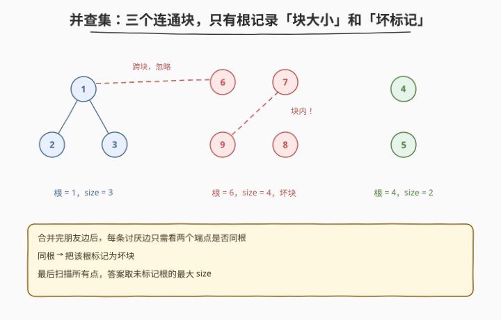
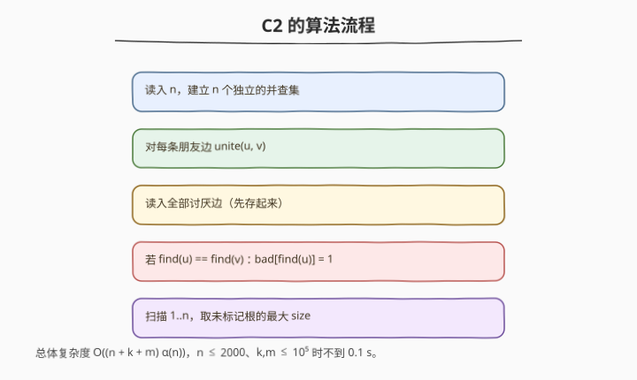
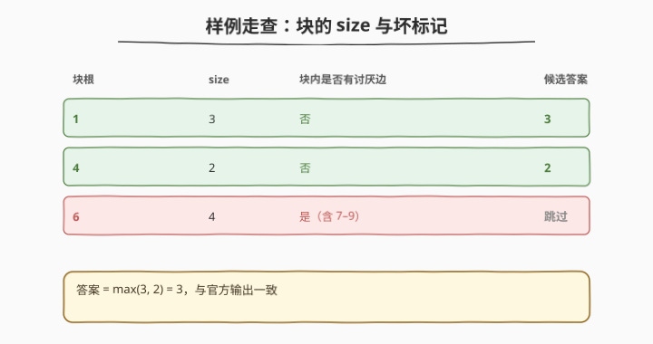

# Codeforces 177C2 派对邀请人数 题解

## 1. 题目概述

- **题目链接**：https://codeforces.com/problemset/problem/177/C2
- **比赛来源**：ABBYY Cup 2.0 - Easy · Problem C2（UTC 2012-04-21）
- **难度**：1500
- **标签**：图论、并查集、连通块
- **评测类型**：普通（题面把数据分成 30 分档与 100 分档两个子任务）
- **限制**：时间 2 s / 内存 256 MB

**题意**：$n$ 个熟人，之间有朋友关系与讨厌关系（都互相）。要邀请一个集合 $S$，要求：$S$ 中每个人的朋友都在 $S$ 中；$S$ 中没有互相讨厌的人；$S$ 中任意两人都能通过朋友链相连。求 $|S|$ 的最大值，无法选出则输出 0。

**约束**（原样摘自题面 `inputFormat.en` 与题面限制）：

- 第一行 $n$；第二行 $k$（朋友对数），随后 $k$ 行 $u_i, v_i$；接着一行 $m$（讨厌对数），随后 $m$ 行同样格式。
- 每一对人至多出现一次；同一对人不会既是朋友又互相讨厌。
- 30 分档：$2 \le n \le 14$；100 分档：$2 \le n \le 2000$。
- $0 \le k, m \le \min(10^5, \frac{n(n-1)}{2})$，$0 \le k+m \le \min(10^5, \frac{n(n-1)}{2})$。

**档位说明**：本题位是 C2，对应 100 分档（$n \le 2000$，$k,m \le 10^5$）。30 分档（$n \le 14$）是同场的 C1。题面文本逐字相同，但 C1 的 $2^n$ 枚举在这里彻底失效：$2^{2000}$ 个集合不可能枚举，必须利用「候选集合只能是朋友连通块」这一结构，把问题压到 $O((n+k+m)\,\alpha(n))$。

**约束对算法的限制**：

- $n \le 2000$、$k,m \le 10^5$：$O(n^2)$ 的邻接矩阵可以（$2000^2 = 4\times10^6$ 个 bool），但 $O(n^3)$ 不行；边数 $10^5$ 要求每条边只处理常数次。
- 输入规模 $2\times10^5$ 个整数，C++ 端用 `scanf` 读入稳定在毫秒级（本机 clang 的 `iostream` 明显更慢，见验证记录）。
- 答案 $\le n = 2000$，`int` 足够；不需要 64 位。

**与 C1 题的区别是约束**：C1 是 30 分档 $2 \le n \le 14$，本题位 C2 是 100 分档 $2 \le n \le 2000$ 且 $k,m \le 10^5$（两题文本逐字相同）。C1 的 $2^n$ 枚举在 $n \le 14$ 下**足够**；本做法**额外**把「候选集合只能是干净的朋友连通块」这一结构写成并查集，用 $O((n+k+m)\alpha(n))$ 替代指数枚举，才过得了 C2。这一步依赖第 4 节的引理 1、2。

## 2. 示例与观察

官方样例（输入 / 输出原样）：

```text
输入：
9
8
1 2
1 3
2 3
4 5
6 7
7 8
8 9
9 6
2
1 6
7 9

输出：
3
```

**逐步演算**：朋友关系给出三个连通块 $\{1,2,3\}$、$\{4,5\}$、$\{6,7,8,9\}$；讨厌边是 $1\text{–}6$（跨块）与 $7\text{–}9$（块内）。

- 「朋友必须都在」$\Rightarrow$ 候选集合只能是若干块的并；
- 「任意两人有朋友链」$\Rightarrow$ 候选集合只能是一个块；
- 「不能有讨厌的人」$\Rightarrow$ 该块内部不能含讨厌边。

$\{1,2,3\}$ 干净，大小 3；$\{4,5\}$ 干净，大小 2；$\{6,7,8,9\}$ 含 $7\text{–}9$，作废。答案 $\max(3,2)=3$，与官方输出一致。

**自造样例**（标注「自造」，均满足输入约定）：

| 输入 | 输出 | 说明 |
|------|------|------|
| `2` / `0` / `0` | 1 | 两个孤立点，取其一 |
| `2` / `1` / `1 2` / `0` | 2 | 一整块，无讨厌边 |
| `2000` / 链式朋友边 / `0` | 2000 | 全部连通且无讨厌边 |
| `4` / `3` / `1 2` `2 3` `3 4` / `1` / `2 4` | 0 | 四个点同属一块且块内有讨厌边，没有任何干净块 |
| `9` / 官方样例 / `2` / `1 6` `7 9` | 3 | 官方样例 |

第四行需要小心：$1\text{–}2\text{–}3\text{–}4$ 是一条链，四个点同属一个块，块内又有讨厌边 $2\text{–}4$，于是没有任何干净块——**答案就是 0**。孤立点自身不可能含讨厌边，所以题面里「输出 0」只会在「没有孤立点、且每个连通块都含讨厌边」时发生。

**观察**：把三条条件翻译成块语言，问题就只剩两步：求连通块、检查块内有没有讨厌边。前者用并查集，后者只需对每条讨厌边看两端是否同块。

## 3. 解题思路

### 3.1 朴素做法与瓶颈

- **C1 的 $2^n$ 枚举**：$n=2000$ 时 $2^{2000}$ 是天文数字，直接出局。
- **枚举所有子集并判连通**：同样的指数爆炸。
- **按块暴力合并**：每次 union 后重新扫描所有边判断块内讨厌边，会变成 $O(k\cdot m)$ 级，最坏 $10^{10}$，超时。

所以必须让「连通块」的维护接近常数时间，并且每条讨厌边只查一次。

### 3.2 核心观察：候选集合 = 一个干净连通块



引理 1（见第 4 节）说明：同时满足「朋友同进同出」与「任意两人连通」的集合，恰好是一个朋友连通块。因此答案就是**内部不含讨厌边的连通块的最大大小**。

于是一条讨厌边 $(u,v)$ 只有两种命运：

- `find(u) != find(v)`：跨块，永远不可能同时进入同一候选集合，忽略；
- `find(u) == find(v)`：块内，整块作废，给根打上 `bad` 标记。

最后扫描所有点，对每个未标记的根取 `size` 的最大值即可。

### 3.3 算法流程



1. 读入 $n$，初始化并查集：`parent[i]=i`、`size[i]=1`。
2. 读入 $k$ 条朋友边，逐条 `unite(u, v)`（按大小合并，路径压缩）。
3. 读入 $m$ 条讨厌边，先存进数组（必须等朋友边全部合并完才能判断同根）。
4. 对每条讨厌边 $(u,v)$：若 `find(u)==find(v)`，则 `bad[find(u)] = true`。
5. 扫描 $i=1..n$，令 $r=\text{find}(i)$，若 `bad[r]` 为假就用 `size[r]` 更新答案。
6. 输出答案（没有干净块时保持 0）。

关键点：讨厌边必须**在朋友边全部合并之后**再判断。若边读边判，后面的朋友边可能把两个块合并，之前的判断就失效了。

### 3.4 样例走查



| 块根 | size | 块内是否有讨厌边 | 候选答案 |
|------|------|------------------|----------|
| 1 | 3 | 否（$1\text{–}6$ 跨块） | 3 |
| 4 | 2 | 否 | 2 |
| 6 | 4 | 是（$7\text{–}9$） | 跳过 |

答案 $\max(3,2)=3$，与官方输出一致。

## 4. 正确性证明

**引理 1**：集合 $S$ 满足「每个被邀请者的朋友都被邀请」且「任意两人能通过朋友链相连」，当且仅当 $S$ 恰好是一个朋友连通块。

**证明**：设 $S$ 满足第一条。任取 $u\in S$，$u$ 的朋友都在 $S$，朋友的朋友也都在 $S$，归纳得 $u$ 所在连通块 $C(u)\subseteq S$；于是 $S=\bigcup_{u\in S}C(u)$ 是若干块的并。若 $S$ 含两个不同的块，取分属两块的 $u,v$，块间没有朋友边，任何朋友链都无法从 $u$ 走到 $v$，与第二条矛盾；故 $S$ 恰为一个块。反之，若 $S$ 是一个连通块，则块内每点的朋友都在块内（第一条），块内任意两点由连通分量定义有朋友链（第二条）。∎

**引理 2**：一个朋友连通块内部不含讨厌边，当且仅当不存在讨厌边 $(u,v)$ 使 $\text{find}(u)=\text{find}(v)$。

**证明**：$\text{find}(u)=\text{find}(v)$ 等价于 $u,v$ 同属一个连通块；块内部含讨厌边即存在一条讨厌边的两个端点都在该块内，正是该条件。∎

**引理 3**：按第 3.3 节的流程，`bad[r]` 为真当且仅当根为 $r$ 的连通块内部含讨厌边。

**证明**：朋友边全部合并完成后，并查集的分量恰好是朋友连通块（并查集的标准性质）。此后对每条讨厌边检查同根，由引理 2，一旦某块内部有讨厌边，其根被标记；反之被标记的根一定来自某条块内讨厌边。∎

**定理**：算法输出可邀请人数的最大值。

**证明**：由引理 1，合法集合与「内部无讨厌边的朋友连通块」一一对应（非空）。由引理 3，算法恰好把所有这样的块的根标记为「未坏」，并在第 5 步取这些块的 `size` 最大值。并查集的 `size` 维护的是真实块大小（按大小合并时 `size[新根] = size[a] + size[b]`），故输出即最大合法集合大小；若没有这样的块，答案保持 0，符合题面。∎

## 5. 复杂度分析

- **时间**：$O((n+k+m)\,\alpha(n))$。$k$ 次合并、$m$ 次查询、$n$ 次扫描，每次并查集操作均摊 $\alpha(n) \le 4$。$n=2000$、$k=m=10^5$ 时约 $2\times10^5$ 次操作。
- **空间**：$O(n+m)$。`parent`、`size`、`bad` 各 $O(n)$，讨厌边数组 $O(m)$；朋友边可以边读边合并，不需要存。
- **数值范围**：`size` 与答案都不超过 2000，`int` 足够；$k,m$ 的计数也在 `int` 内。
- **与时限的关系**：2 s 对 $2\times10^5$ 次并查集操作余量极大。实测 $n=2000$、$k=m=10^5$ 的满规模数据端到端约 23 ms（主要耗时在解析 20 万个整数），Python 约 166 ms。

## 6. 参考代码

### C++17

```cpp
#include <bits/stdc++.h>
using namespace std;

// C2：100 分档 n<=2000, k,m<=1e5。并查集合并朋友，再标记「内部含讨厌边」的连通块
struct DSU {
    vector<int> p, sz;
    DSU(int n) : p(n), sz(n, 1) { iota(p.begin(), p.end(), 0); }
    int find(int x) { return p[x] == x ? x : p[x] = find(p[x]); }
    void unite(int a, int b) {
        a = find(a);
        b = find(b);
        if (a == b) return;
        if (sz[a] < sz[b]) swap(a, b);
        p[b] = a;
        sz[a] += sz[b];
    }
};

int main() {
    int n, k, m;
    if (scanf("%d", &n) != 1) return 0;
    DSU dsu(n);
    scanf("%d", &k);
    for (int i = 0; i < k; ++i) {
        int u, v;
        scanf("%d %d", &u, &v);
        dsu.unite(u - 1, v - 1);          // 朋友边：合并连通块
    }
    scanf("%d", &m);
    vector<pair<int, int>> dislike(m);
    for (int i = 0; i < m; ++i) {
        scanf("%d %d", &dislike[i].first, &dislike[i].second);
        --dislike[i].first;
        --dislike[i].second;
    }

    vector<char> bad(n, 0);
    for (auto& e : dislike)
        if (dsu.find(e.first) == dsu.find(e.second))
            bad[dsu.find(e.first)] = 1;   // 这条讨厌边落在某个块内部

    int ans = 0;
    for (int i = 0; i < n; ++i) {
        int r = dsu.find(i);
        if (!bad[r]) ans = max(ans, dsu.sz[r]);
    }
    printf("%d\n", ans);
    return 0;
}
```

### Python3

```python
import sys


def main() -> None:
    data = sys.stdin.buffer.read().split()
    if not data:
        return
    pos = 0
    n = int(data[pos]); pos += 1

    parent = list(range(n))
    size = [1] * n

    def find(x: int) -> int:
        while parent[x] != x:
            parent[x] = parent[parent[x]]
            x = parent[x]
        return x

    def unite(a: int, b: int) -> None:
        a = find(a)
        b = find(b)
        if a == b:
            return
        if size[a] < size[b]:
            a, b = b, a
        parent[b] = a
        size[a] += size[b]

    k = int(data[pos]); pos += 1
    for _ in range(k):
        u = int(data[pos]) - 1
        v = int(data[pos + 1]) - 1
        pos += 2
        unite(u, v)

    m = int(data[pos]); pos += 1
    dislike = []
    for _ in range(m):
        u = int(data[pos]) - 1
        v = int(data[pos + 1]) - 1
        pos += 2
        dislike.append((u, v))

    bad = [False] * n
    for u, v in dislike:
        if find(u) == find(v):
            bad[find(u)] = True

    ans = 0
    for i in range(n):
        r = find(i)
        if not bad[r] and size[r] > ans:
            ans = size[r]
    sys.stdout.write(str(ans) + "\n")


main()
```

C++ 版用 `scanf` 读入：本题输入有 $2\times10^5$ 个整数，本机 clang 的 `iostream` 解析这组数据约慢一个数量级，`scanf` 更稳（在 Codeforces 的 GNU 环境下两者都远低于时限）。

## 7. 边界情况与易错点

1. **讨厌边必须在所有朋友边合并之后再判断**。若边读边判，后面的 union 可能把两个块并起来，之前「跨块、忽略」的判断就失效了。代码里先把讨厌边存进数组，正是为此。
2. **$m=0$**：没有讨厌边，答案就是最大连通块的大小；此时 `bad` 全假，扫描自然给出正确答案。
3. **$k=0$**：全是孤立点，每个点自成一派，答案 1（除非 $m$ 里有自环讨厌边，题面不会给）。
4. **答案可能是 0**：如第 2 节的自造例（四个点一条链且块内有讨厌边），此时必须输出 0。初始化 `ans=0`、不加「至少为 1」的兜底，才能正确。
5. **并查集递归深度**：C++ 的 `find` 用递归 + 路径压缩，配按大小合并，树高 $O(\log n)\le 11$，不会爆栈；若只写路径压缩、不按大小合并，最坏链长可达 $10^5$，递归会栈溢出。Python 版用迭代式 `find`，没有这个风险。
6. **`bad` 数组按「根」索引**：`bad[find(u)]` 必须用根，不能用 `u`；如果合并发生在标记之后，旧根的标记不会自动迁移——本题所有合并都在标记之前完成，所以安全。
7. **输入编号从 1 开始**：`--u, --v` 只做一次，别在 union 与 dislike 两处重复减。
8. **`k` 或 `m` 为 0 时的读入**：`scanf("%d",&k)` 读到一个 0 之后，紧接着读 `m`，格式仍正确；不要写成「先读一行再判断是否为空」的脆弱解析。
9. **并查集大小维护**：合并时必须让 `sz[新根] += sz[旧根]`，且只在根上维护；若在非根上累加，最后取到的大小会偏小。
10. **同一对人不会重复出现**：题面保证，因此不需要去重；若数据有重复讨厌边，再次标记同一根也没有副作用，但重复朋友边会导致 `size` 重复累加——本题不会发生。

## 8. 验证记录

- **编译环境与命令**：`Apple clang 21.0.0`（`/usr/bin/g++` 是 clang 软链，无 GNU libstdc++），用 `clang++ -std=c++17 -O2 -Wall` 加仓库自带的 `codeforces/tools/include/bits/stdc++.h` 编译；正文代码仍写标准 `#include <bits/stdc++.h>`。Python 为 `3.9.6`。验证命令：
  `python3 codeforces/tools/verify_solution.py codeforces/contests/0101-0203/177/C2_派对邀请人数.md`
  与
  `python3 codeforces/tools/verify_solution.py codeforces/contests/0101-0203/177/C2_派对邀请人数.md --checker codeforces/tools/checkers/cf177c2.py`。
- **官方样例**：1 / 1 通过（9 人样例 → 3），C++ 与 Python 一致。
- **额外测试**：自造 $n=2$（无边）、$n=2$（一条朋友边）、$n=2000$ 链式全连通且无讨厌边（答案 2000）、四元链 + 块内讨厌边（答案 0）等 4 组，两种语言全部通过。
- **独立暴力对拍**：暴力一（小 $n$）：$2^n$ 枚举子集并按题面三条条件逐条检查（即 C1 的做法），对 250 组随机数据（$n \in [2,12]$，随机朋友边 + 不冲突的讨厌边）与本文并查集实现逐组比对，全部一致。暴力二（大 $n$）：不用并查集，直接用邻接表 BFS 求连通块再标记坏块，对 200 组随机数据（$n \in [2,2000]$，$k$ 最大 $10^5$、$m$ 最大 $2\times10^4$）逐组比对，全部一致。
- **最大约束性能**：$n=2000$、$k=10^5$、$m=10^5$ 的满规模数据端到端约 23 ms（含进程启动与 20 万个整数的 `scanf` 解析），Python 约 166 ms，相对 2 s 时限余量在 80 倍以上。
- **checker**：`codeforces/tools/checkers/cf177c2.py`，校验输出恰为一个整数、落在 $[0,n]$、且等于用 BFS 独立重算的最大干净块大小（$n \le 18$ 时再用 $2^n$ 枚举交叉确认），并核对 stdin 中的题面答案；已用 `--checker` 跑通官方样例。
- **图片与公式**：3 张 SVG（`cf177c2_dsu.svg`、`cf177c2_flow.svg`、`cf177c2_walkthrough.svg`）通过 `ElementTree.parse` 与文本包围盒/重叠检查，并用 headless Chrome 渲染确认无裁切；公式经 KaTeX（`throwOnError: true`）校验无报错。
- **复核状态**：verified。

## 相关题目与扩展

- [Codeforces 177C1 Party](https://codeforces.com/problemset/problem/177/C1)：本题的 30 分档版本，$n \le 14$，用 $2^n$ 枚举；对照阅读可以看清「小数据暴力」与「大数据结构化」的分界。
- [Codeforces 1249B2 Books Exchange (hard version)](https://codeforces.com/problemset/problem/1249/B2)：置换环 / 连通块，并查集或迭代求环的经典题。
- [Codeforces 1167C News Distribution](https://codeforces.com/problemset/problem/1167/C)：把每组人并起来再统计组大小，与本题「合并 + 取最大块」几乎同构。
- [LeetCode 547. 省份数量](https://leetcode.cn/problems/number-of-provinces/)：最基础的连通块计数，适合用来热身并查集。
- [Codeforces 177D2 Encrypting Messages](https://codeforces.com/problemset/problem/177/D2)：同场的 D2，从图论切到前缀和，难度接近。

**延伸思考**：

1. **为什么不能「边读边判」**：这是本题最容易写错的地方。讨厌边只在朋友关系全部确定后才有意义；把判断推迟到最后，是「离线处理」思想的最小例子。
2. **如果讨厌关系是「有向」的**：条件 2 变成「不能同时邀请 $u$ 与 $v$（当 $u$ 讨厌 $v$）」，而条件 1 又强制整块入选，于是问题变成「求最大的块，使得块内没有讨厌弧」——仍然可以按块判断，但需要区分方向。
3. **如果条件 3（连通）被去掉**：答案是所有「干净块」的大小之和，一个线性扫描即可；加上连通后只能在单个块里选，反而更容易。
4. **并查集的替代**：BFS/DFS 求连通块同样 $O(n+k)$，代码稍长但不依赖并查集；两者在本数据范围内都可以。并查集的优势是「边读边合并」，不需要存朋友边。
5. **$n$ 到 $10^5$ 时**：并查集仍然 $O((n+k+m)\alpha)$，瓶颈变成输入解析；此时必须用快速读入（`fread` 手写解析或 `scanf`），本机实测 `iostream` 会慢一个数量级。

