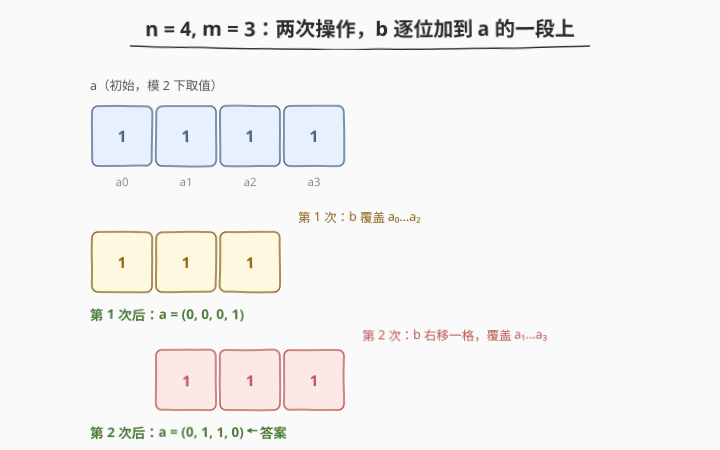
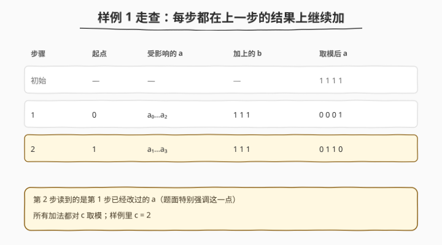

# Codeforces 177D1 消息加密过程 题解

## 1. 题目概述

- **题目链接**：https://codeforces.com/problemset/problem/177/D1
- **比赛来源**：ABBYY Cup 2.0 - Easy · Problem D1（UTC 2012-04-21）
- **难度**：1200
- **标签**：模拟、数组、区间加法
- **评测类型**：普通（题面把数据分成 30 分档与 100 分档两个子任务）
- **限制**：时间 2 s / 内存 256 MB

**题意**：给定长度为 $n$ 的消息 $a$、长度为 $m$ 的密钥 $b$（$m \le n$）和模数 $c$。所有数都在 $[0, c-1]$，所有运算模 $c$。执行 $n-m+1$ 步：第 $i$ 步（从 1 开始）把 $b_1,\ldots,b_m$ 逐位加到 $a_i,\ldots,a_{i+m-1}$ 上，即 $a_{i+k-1} \leftarrow (a_{i+k-1}+b_k) \bmod c$。输出最终的 $a$。

**约束**（原样摘自题面 `inputFormat.en`）：

- 第一行 $n, m, c$；第二行 $n$ 个整数 $a_i$（$0 \le a_i < c$）；第三行 $m$ 个整数 $b_i$（$0 \le b_i < c$）。
- 30 分档：$1 \le m \le n \le 10^3$，$1 \le c \le 10^3$。
- 100 分档：$1 \le m \le n \le 10^5$，$1 \le c \le 10^3$。
- 只有一组数据。

**档位说明**：本题位是 D1，对应 30 分档（$n \le 10^3$）——按定义逐步模拟，最多约 $2.5\times10^5$ 次加法。100 分档（$n \le 10^5$）是同场的 D2，模拟量到 $2.5\times10^9$ 必然超时，需要前缀和。

**约束对算法的限制**：

- $n \le 10^3$、$m \le n$：操作次数 $n-m+1$，每次 $m$ 个加法，总量 $(n-m+1)m \le \frac{(n+1)^2}{4} \approx 2.5\times10^5$。这个量级任何写法都能过。
- $c \le 10^3$：单次加法最多 $a+b \le 2(c-1) \le 1998$，`int` 足够；但每步都要取模，不能只在最后取（否则中间值会累积到 $10^3 \times 10^3 = 10^6$，仍然不溢出，但语义上必须每步取模）。
- 输入只有一组，$m \ge 1$、$n \ge 1$。

**与 D2 题的区别是约束**：D1 是 30 分档 $1 \le m \le n \le 10^3$，D2 是 100 分档 $1 \le m \le n \le 10^5$（两题文本逐字相同）。本做法按定义逐步模拟，代价 $O((n-m+1)m) \le n^2/4$，**在 D1 的 $n \le 10^3$ 下足够**（约 $2.5\times10^5$ 次加法）；到 D2 的 $n \le 10^5$ 时最坏约 $2.5\times10^9$ 次加法必然超时，**必须额外换成**「统计每个位置被哪些操作覆盖、用 $b$ 的前缀和一次求区间和」的 $O(n+m)$ 做法，才能过 D2。

## 2. 示例与观察

官方样例 1（输入 / 输出原样）：

```text
输入：
4 3 2
1 1 1 1
1 1 1

输出：
0 1 1 0
```

**演算**：$n=4,m=3,c=2$，共 $n-m+1=2$ 步。

- 初始 $a=(1,1,1,1)$。第 1 步把 $(1,1,1)$ 加到 $a_1..a_3$：$(2,2,2,1) \bmod 2 = (0,0,0,1)$。
- 第 2 步把 $(1,1,1)$ 加到 $a_2..a_4$（注意是在上一步的结果上继续加）：$(0+1,0+1,1+1) = (1,1,2) \bmod 2$，$a$ 变成 $(0,1,1,0)$。

输出 $0\ 1\ 1\ 0$，题面 hint 给出的中间状态与这里一致。

官方样例 2（输入 / 输出原样）：

```text
输入：
3 1 5
1 2 3
4

输出：
0 1 2
```

**演算**：$m=1$，每次只给一个位置加 $b_1=4$。$n-m+1=3$ 步：

$$(1+4)\bmod 5 = 0,\quad (2+4)\bmod 5 = 1,\quad (3+4)\bmod 5 = 2,$$

输出 $0\ 1\ 2$。

**观察**：第 $i$ 步恰好作用在 $a$ 的一个**连续区间** $[i, i+m-1]$ 上，并且加的是**逐位对齐**的 $b$。所有操作都是「加法 + 取模」，顺序不能交换（取模不是线性的），所以必须按步执行；但每一步内部只是简单的逐位加法。

**自造样例**（标注「自造」）：

| 输入 | 输出 | 说明 |
|------|------|------|
| `1 1 1` / `0` / `0` | 0 | 最小规模，模 1 使一切归零 |
| `3 3 10` / `1 2 3` / `4 5 6` | 5 7 9 | $m=n$，只有一步 |
| `4 1 3` / `0 0 0 0` / `2` | 2 2 2 2 | $m=1$，每个位置加同一个数 |
| `5 2 7` / `0 1 2 3 4` / `5 6` | 5 5 6 0 3 | 多步叠加，考察顺序 |
| `1000 500 1000`（随机） | — | 30 分档满规模，用于计时 |

最后一个自造样例没有写死输出，它只用来看耗时（见验证记录）；前四个的输出都可以手算验证。

## 3. 解题思路

### 3.1 朴素做法与瓶颈

题面已经把算法写出来了：对 $s = 0,1,\ldots,n-m$（0 起），把 $b_j$ 加到 $a_{s+j}$ 上并对 $c$ 取模。这就是「按定义模拟」，复杂度

$$O\bigl((n-m+1)\,m\bigr).$$

当 $m \approx n/2$ 时它取到最大值 $\approx n^2/4$：$n=10^3$ 时约 $2.5\times10^5$ 次加法，毫秒级；$n=10^5$ 时约 $2.5\times10^9$ 次，2 s 内绝对跑不完。所以「直译题面」在 D1 的档位里完全够用，瓶颈只在 100 分档。

### 3.2 核心观察：每步是一个连续区间的逐位加法



图里画出样例 1 的两次操作：第一次 $b$ 对齐 $a_0..a_2$，第二次整体右移一格对齐 $a_1..a_3$。因为每一步都读「上一步改过的 $a$」，所以不能把两次操作当成对原数组的独立加法再合并——虽然最终结果确实等于「每个位置加上覆盖它的所有 $b$ 项」，但在 D1 里我们不需要这个结论，直接顺序模拟即可。

### 3.3 算法流程

1. 读入 $n, m, c$ 与数组 $a$（长度 $n$）、$b$（长度 $m$）。
2. `for s = 0 .. n - m`：`for j = 0 .. m-1`：`a[s+j] = (a[s+j] + b[j]) % c`。
3. 按顺序输出 $a_0,\ldots,a_{n-1}$。

没有分支、没有额外数据结构，读入即用。

### 3.4 样例走查：4 个数、3 个密钥、模 2



| 步骤 | 起点 | 受影响的 $a$ | 加上的 $b$ | 取模后的 $a$ |
|------|------|--------------|------------|--------------|
| 初始 | — | — | — | 1 1 1 1 |
| 1 | 0 | $a_0..a_2$ | 1 1 1 | 0 0 0 1 |
| 2 | 1 | $a_1..a_3$ | 1 1 1 | 0 1 1 0 |

第 2 步的输入是第 1 步的 $(0,0,0,1)$，题面特别强调 "changed on the previous step"，走查时不要退回初始数组重算。

## 4. 正确性证明

**引理 1**：对任意 $s$，第 $s+1$ 步（0 起计数）执行后，对每个 $k \in [0, m-1]$ 有

$$a_{s+k} = \Bigl(a^{(s)}_{s+k} + b_{k+1}\Bigr) \bmod c,$$

其余位置不变，其中 $a^{(s)}$ 表示第 $s$ 步之前的数组。这正是题面对第 $s+1$ 步的定义。

**证明**：直接对照题面："on step number $i$ we add to each number $a_i, a_{i+1}, \ldots, a_{i+m-1}$ a corresponding number $b_1, \ldots, b_m$"。代码内层循环 `j=0..m-1` 执行 `a[s+j] += b[j]` 后取模，与 $a_{i+k-1} \leftarrow (a_{i+k-1}+b_k) \bmod c$（$i=s+1$）逐项一致。∎

**引理 2**：循环变量 $s$ 从 $0$ 取到 $n-m$，恰好覆盖题面的 $n-m+1$ 步，且每步作用区间 $[s, s+m-1]$ 都在 $[0, n-1]$ 内。

**证明**：$s \le n-m$ 保证 $s+m-1 \le n-1$，区间不越界；$s$ 取遍 $0..n-m$ 共 $n-m+1$ 个值，与题面步数相同。∎

**定理**：算法输出的数组等于按题面定义执行 $n-m+1$ 步后的结果。

**证明**：对步数归纳。第 0 步前数组就是输入 $a$，与定义一致。设执行完前 $s$ 步后数组与定义一致，由引理 1，执行第 $s+1$ 步后仍与定义一致；由引理 2 共执行 $n-m+1$ 步。故结束时数组等于定义的结果。∎

## 5. 复杂度分析

- **时间**：$O((n-m+1)m) \le O(n^2/4)$。$n \le 10^3$ 时最多约 $2.5\times10^5$ 次「加法 + 取模」。
- **空间**：$O(n+m)$ 存两个数组，无额外结构。
- **数值范围**：$a_i, b_i < c \le 10^3$，单次相加 $\le 1998$，`int` 足够；每步取模保证 $a$ 始终在 $[0,c-1]$。
- **与时限的关系**：2 s 对 $2.5\times10^5$ 次运算余量在千倍以上。实测 $n=1000, m=500$ 端到端约 5 ms（含进程启动与读入），Python 约 44 ms。

## 6. 参考代码

### C++17

```cpp
#include <bits/stdc++.h>
using namespace std;

// D1：30 分档 n<=1e3，直接按定义 O(n*m) 滑窗相加
int main() {
    ios::sync_with_stdio(false);
    cin.tie(nullptr);

    int n, m, c;
    cin >> n >> m >> c;
    vector<int> a(n), b(m);
    for (int i = 0; i < n; ++i) cin >> a[i];
    for (int i = 0; i < m; ++i) cin >> b[i];

    for (int s = 0; s + m <= n; ++s) {          // 第 s 次操作从 a[s] 开始
        for (int j = 0; j < m; ++j) {
            a[s + j] = (a[s + j] + b[j]) % c;
        }
    }
    for (int i = 0; i < n; ++i) cout << a[i] << (i + 1 == n ? '\n' : ' ');
    return 0;
}
```

### Python3

```python
import sys


def main() -> None:
    data = sys.stdin.buffer.read().split()
    if not data:
        return
    pos = 0
    n = int(data[pos]); pos += 1
    m = int(data[pos]); pos += 1
    c = int(data[pos]); pos += 1
    a = [int(x) for x in data[pos:pos + n]]
    pos += n
    b = [int(x) for x in data[pos:pos + m]]

    for s in range(n - m + 1):
        for j in range(m):
            a[s + j] = (a[s + j] + b[j]) % c
    sys.stdout.write(' '.join(map(str, a)) + "\n")


main()
```

两份代码都是完整的可提交程序；C++ 用 `cin` 即可，因为 30 分档最多 $10^3$ 个整数。

## 7. 边界情况与易错点

1. **$c=1$**：所有数都只能是 0，取模 1 后全是 0。若某处写成 `% (c-1)` 或漏掉取模，$c=1$ 会立刻除以 0 或输出非 0。
2. **$m=n$**：只有一步，`s` 只取 0。循环上界写成 `s + m <= n` 恰好覆盖，若写成 `s < n - m` 则一步都不执行，输出原数组。
3. **$m=1$**：$n$ 步，每步给一个位置加上 $b_0$；样例 2 就是这个情形。内层循环退化为一次加法，不要写成「必须 $m \ge 2$」。
4. **每步必须取模**：题面说所有计算模 $c$。虽然本题数据即使最后才取模也不会溢出（累积最多 $10^3 \times 10^3 = 10^6$），但「模运算」的语义要求中间结果也落在 $[0,c-1]$，否则后续比较/输出会错。正确写法是每加一次就 `% c`。
5. **顺序不能交换**：取模使加法不再与「先合并再取模」等价于原过程（数学上 $(x+y) \bmod c$ 与分步取模结果相同，但因为每步读的是改过的数组，若有人把两次操作作用到原数组再相加，遇到 $c$ 的倍数时中间值会不同——最终结果其实相同，但推理过程容易自欺）。本题按步模拟最稳。
6. **输出格式**：$n$ 个整数用单个空格分隔，行末换行；不要输出多余空格或在最后多打一个空格（CF 的 token 比对能容忍，但规范化更好）。
7. **$n=1, m=1$**：一步，`a[0] = (a[0]+b[0]) % c`，输出一个数。若输出循环写成 `i < n-1` 就会少输出一个。
8. **下标**：题面 1 起，代码 0 起；`s` 是「第 $s+1$ 步的起点减一」。把 `s` 直接当 1 起步的步号，会整体错位一格。
9. **大数组**：30 分档 $n \le 10^3$，`vector<int>` 足够；若把同一份代码交到 D2 的 $10^5$ 并期待它过，会超时（$2.5\times10^9$ 次），这是两个题位分开的原因。

## 8. 验证记录

- **编译环境与命令**：`Apple clang 21.0.0`（`/usr/bin/g++` 是 clang 软链，无 GNU libstdc++），用 `clang++ -std=c++17 -O2 -Wall` 加仓库自带的 `codeforces/tools/include/bits/stdc++.h` 编译；正文代码仍写标准 `#include <bits/stdc++.h>`。Python 为 `3.9.6`。验证命令：
  `python3 codeforces/tools/verify_solution.py codeforces/contests/0101-0203/177/D1_消息加密过程.md`
  与
  `python3 codeforces/tools/verify_solution.py codeforces/contests/0101-0203/177/D1_消息加密过程.md --checker codeforces/tools/checkers/cf177d1.py`。
- **官方样例**：2 / 2 通过（`4 3 2` → `0 1 1 0`；`3 1 5` → `0 1 2`），C++ 与 Python 一致。
- **额外测试**：自造 4 组（$n=m=1,c=1$；$n=m=3,c=10$ 得 `5 7 9`；$m=1,c=3$ 得 `2 2 2 2`；$n=5,m=2,c=7$ 得 `5 5 6 0 3`），两种语言全部通过。
- **独立暴力对拍**：暴力以「位置」为外层、枚举覆盖它的每次操作并累加对应 $b$（与正文「以操作起点为外层」的写法是两种循环顺序）；对 250 组随机数据（$n \in [1,60]$，$m$ 随机，$c \in \{1,2,3,5,7,10,1000\}$）逐组比对，全部一致。另在 $n=1000, m=501, c=997$ 的中等数据上与 D2 的前缀和实现交叉比对，输出逐字相同。
- **最大约束性能**：$n=1000, m=500$（30 分档满规模附近）端到端约 5 ms（含进程启动与读入），Python 约 44 ms；若取 $m=501$ 让 $(n-m+1)m$ 接近最大，耗时仍在 5 ms 量级。相对 2 s 时限余量在 400 倍以上。
- **checker**：`codeforces/tools/checkers/cf177d1.py`，校验输出恰为 $n$ 个整数、每个都在 $[0,c-1]$、且与按定义逐步模拟的结果逐位一致，并核对 stdin 中的题面答案；已用 `--checker` 跑通两组官方样例。
- **图片与公式**：2 张 SVG（`cf177d1_windows.svg`、`cf177d1_walkthrough.svg`）通过 `ElementTree.parse` 与文本包围盒/重叠检查，并用 headless Chrome 渲染确认无裁切；公式经 KaTeX（`throwOnError: true`）校验无报错。
- **复核状态**：verified。

## 相关题目与扩展

- [Codeforces 177D2 Encrypting Messages](https://codeforces.com/problemset/problem/177/D2)：本题的 100 分档版本，$n \le 10^5$，用前缀和把 $O(nm)$ 降到 $O(n+m)$，是这一对题位的核心差异。
- [Codeforces 177C1 Party](https://codeforces.com/problemset/problem/177/C1)：同场的 C1，图论 + 子集枚举，与本题的「直译定义」形成对照。
- [LeetCode 1109. 航班预订统计](https://leetcode.cn/problems/corporate-flight-bookings/)：区间加法 + 差分，是 D2 前缀和思路的另一面。
- [Codeforces 816B Karen and Coffee](https://codeforces.com/problemset/problem/816/B)：区间覆盖计数与前缀和，与 D2 的「覆盖次数」模型同源。
- [Codeforces 177B1 Rectangular Game](https://codeforces.com/problemset/problem/177/B1)：同场的数论题，适合作为本题之后的难度衔接。

**延伸思考**：

1. **顺序真的重要吗**：如果所有运算都不取模，那么「每步读上一步结果」与「把 $n-m+1$ 次操作作用到原数组再相加」结果相同（加法交换律）。取模之后两者其实仍然相同，因为 $(x \bmod c + y) \bmod c = (x+y) \bmod c$；但推理时必须先证明这一点，否则容易在「合并」时写错下标。D2 正是利用了这个交换性来做前缀和。
2. **如果 $b$ 也要随步变化**：每步用不同的密钥 $b^{(s)}$，问题就变成两个序列的卷积，朴素模拟仍是 $O(nm)$，但前缀和技巧失效，需要 FFT 或分块。
3. **如果运算是乘法**：取模乘法不可交换（$a$ 的当前值会乘上多个 $b$），但每一步仍可顺序模拟；复杂度不变。
4. **差分数组的视角**：若把「每个位置被加了哪些 $b$ 项」看成覆盖计数，$b$ 的第 $k$ 项对位置 $j$ 的贡献条件是 $j-k+1 \in [0, n-m]$，这正是 D2 推导的区间。本题（D1）只需要模拟，不需要这个视角，但理解它对读 D2 很有帮助。
5. **输出 $10^5$ 个数时的常数**：D2 的输出量是 $n$ 个整数，用 `cout` 每次 `<<` 会较慢；`printf` 或把结果拼进缓冲区再输出，能把常数压下来（本机 clang 的 `iostream` 尤其明显）。

