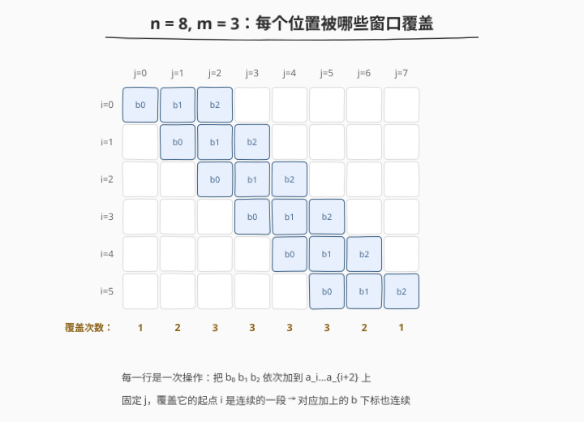
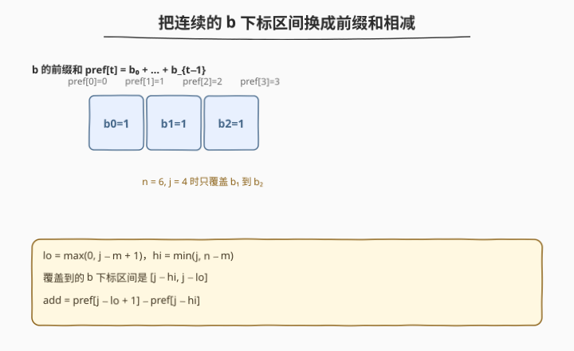
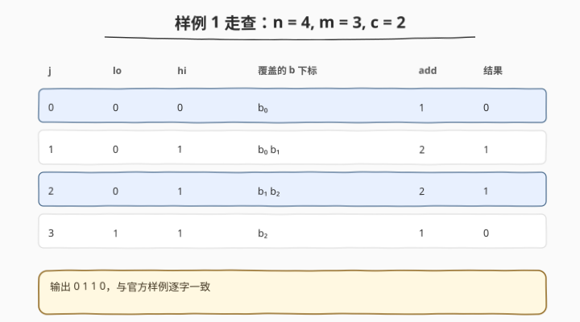

# Codeforces 177D2 消息加密过程 题解

## 1. 题目概述

- **题目链接**：https://codeforces.com/problemset/problem/177/D2
- **比赛来源**：ABBYY Cup 2.0 - Easy · Problem D2（UTC 2012-04-21）
- **难度**：1500
- **标签**：前缀和、区间加法、贡献统计
- **评测类型**：普通（题面把数据分成 30 分档与 100 分档两个子任务）
- **限制**：时间 2 s / 内存 256 MB

**题意**：长度为 $n$ 的消息 $a$、长度 $m$ 的密钥 $b$（$m \le n$），模数 $c$，所有数在 $[0,c-1]$。执行 $n-m+1$ 步，第 $i$ 步把 $b_1..b_m$ 逐位加到 $a_i..a_{i+m-1}$（全部对 $c$ 取模）。输出最终的 $a$。

**约束**（原样摘自题面 `inputFormat.en`）：

- 第一行 $n, m, c$；第二行 $n$ 个 $a_i$（$0 \le a_i < c$）；第三行 $m$ 个 $b_i$（$0 \le b_i < c$）。
- 30 分档：$1 \le m \le n \le 10^3$，$1 \le c \le 10^3$。
- 100 分档：$1 \le m \le n \le 10^5$，$1 \le c \le 10^3$。
- 只有一组数据。

**档位说明**：本题位是 D2，对应 100 分档（$n \le 10^5$）。30 分档（$n \le 10^3$）是同场的 D1，直接按定义模拟只需约 $2.5\times10^5$ 次加法；到 $10^5$ 时朴素模拟最坏约 $n^2/4 = 2.5\times10^9$ 次，必然超时，必须用前缀和把每个位置的贡献一次算出。

**约束对算法的限制**：

- $n \le 10^5$：$O(nm)$ 不可行（最坏 $2.5\times10^9$），需要 $O(n+m)$ 或 $O(n\log n)$。
- $c \le 10^3$：单次加法最多 $\approx m \cdot (c-1) \le 10^8$，`int` 也能装，但用 `long long` 更稳（尤其是把 $m$ 放大时）。
- 输入有 $n+m \le 2\times10^5$ 个整数，C++ 端用 `scanf` 读入（本机 clang 的 `iostream` 解析同样数据慢约一个数量级）。
- 输出 $n$ 个整数，$10^5$ 个 `printf` 即可。

**与 D1 题的区别是约束**：D1 是 30 分档 $1 \le m \le n \le 10^3$，本题位 D2 是 100 分档 $1 \le m \le n \le 10^5$（两题文本逐字相同）。D1 的 $O((n-m+1)m)$ 逐步模拟在 $n \le 10^3$ 下**足够**；本做法**额外**利用「位置 $j$ 被一段连续的操作覆盖、对应的 $b$ 下标也连续」这一结构，把每位的贡献用前缀和 $O(1)$ 求出，总代价降到 $O(n+m)$，才过得了 D2。

## 2. 示例与观察

官方样例 1（输入 / 输出原样）：

```text
输入：
4 3 2
1 1 1 1
1 1 1

输出：
0 1 1 0
```

**演算**：$n-m+1=2$ 步。第 1 步给 $a_0..a_2$ 各加 1，得 $(2,2,2,1)\bmod 2=(0,0,0,1)$；第 2 步给 $a_1..a_3$ 各加 1，得 $(0,1,1,0)$。

官方样例 2（输入 / 输出原样）：

```text
输入：
3 1 5
1 2 3
4

输出：
0 1 2
```

**演算**：$m=1$，$n-m+1=3$ 步，每步给一个位置加 4：$(1+4)\bmod5=0$、$(2+4)\bmod5=1$、$(3+4)\bmod5=2$。

**观察 1**：每步的作用是「连续区间 $+$ 逐位对齐」，而所有加法最终只是把某些 $b_k$ 累加到某个位置上。由于取模满足 $(x\bmod c+y)\bmod c=(x+y)\bmod c$，**操作顺序不影响最终值**，所以可以先统计「位置 $j$ 一共被加了哪些项」，再一次性求和取模。

**观察 2**：位置 $j$ 被第 $i$ 步覆盖，当且仅当 $0 \le i \le n-m$ 且 $i \le j \le i+m-1$。把这两个不等式联立，得到 $i$ 的一段连续区间；而对应的 $b$ 下标 $k=j-i$ 也随 $i$ 连续变化，于是「一段连续的 $b$ 之和」可以用 $b$ 的前缀和 $O(1)$ 求出。

**自造样例**（标注「自造」）：

| 输入 | 输出 | 说明 |
|------|------|------|
| `1 1 1` / `0` / `0` | 0 | 最小规模，模 1 |
| `3 3 10` / `1 2 3` / `4 5 6` | 5 7 9 | $m=n$，只有一步 |
| `5 2 7` / `0 1 2 3 4` / `5 6` | 5 5 6 0 3 | 多步叠加 |
| `4 1 3` / `0 0 0 0` / `2` | 2 2 2 2 | $m=1$，逐位加同一个数 |
| `100000 99991 1000`（随机） | — | 100 分档满规模，用于计时 |

前四组的输出都可以手算，且与 D1 的模拟程序逐字相同（见验证记录）。

## 3. 解题思路

### 3.1 朴素做法与瓶颈

按定义逐步模拟：对 $s=0..n-m$、$j=0..m-1$ 执行 `a[s+j] += b[j]`，复杂度 $O((n-m+1)m)$，$m\approx n/2$ 时约 $n^2/4$。$n=10^3$ 时是 $2.5\times10^5$，轻松；$n=10^5$ 时是 $2.5\times10^9$，2 s 内绝无可能。必须把「每个位置被加了多少」一次算清。

### 3.2 核心观察：覆盖关系是两段连续区间



图里每一行是一次操作，蓝色格子是它覆盖的位置，格子里写着这次给该位置加的是 $b$ 的哪一项。竖着看，某个固定位置 $j$ 被覆盖的那些操作恰好是**连续的一段行**，而对应的 $b$ 下标也是**连续的一段**。

具体地，0 起下标下第 $i$ 次操作的起点是 $i \in [0, n-m]$，它覆盖 $j$ 等价于

$$i \le j \le i+m-1 \iff j-m+1 \le i \le j .$$

与 $0 \le i \le n-m$ 取交集，得到

$$\text{lo}(j) = \max(0,\, j-m+1),\qquad \text{hi}(j) = \min(j,\, n-m).$$

覆盖 $j$ 的操作就是 $i \in [\text{lo}, \text{hi}]$。

### 3.3 算法流程：把区间和换成前缀和



第 $i$ 次操作给位置 $j$ 加的是 $b_{j-i}$（0 起下标）。当 $i$ 从 $\text{lo}$ 走到 $\text{hi}$ 时，$k=j-i$ 从 $j-\text{hi}$ 走到 $j-\text{lo}$，也是连续区间。于是位置 $j$ 的总增量是

$$\text{add}(j) = \sum_{i=\text{lo}}^{\text{hi}} b_{j-i} = \sum_{k=j-\text{hi}}^{j-\text{lo}} b_k = \text{pref}[j-\text{lo}+1] - \text{pref}[j-\text{hi}],$$

其中 $\text{pref}[t] = b_0+b_1+\cdots+b_{t-1}$、$\text{pref}[0]=0$。最后

$$a_j \leftarrow (a_j + \text{add}(j)) \bmod c .$$

流程：

1. 读入 $n,m,c$、$a,b$。
2. 预处理前缀和 `pref[0..m]`。
3. 对 $j=0..n-1$ 算 $\text{lo},\text{hi}$，取区间和，更新 $a_j$ 并取模。
4. 输出 $a$。

总时间 $O(n+m)$，空间 $O(n+m)$。

### 3.4 样例走查



$n=4, m=3, c=2$，$\text{pref}=[0,1,2,3]$，$\text{lastStart}=n-m=1$。

| $j$ | lo | hi | 覆盖的 $b$ 下标 | add | $(a_j+\text{add})\bmod 2$ |
|-----|----|----|------------------|-----|---------------------------|
| 0 | 0 | 0 | $b_0$ | 1 | $(1+1)\bmod 2=0$ |
| 1 | 0 | 1 | $b_0,b_1$ | 2 | $(1+2)\bmod 2=1$ |
| 2 | 0 | 1 | $b_1,b_2$ | 2 | $(1+2)\bmod 2=1$ |
| 3 | 1 | 1 | $b_2$ | 1 | $(1+1)\bmod 2=0$ |

输出 $0\ 1\ 1\ 0$，与官方样例逐字一致。对照 D1 的逐步模拟（第 1 步后 $(0,0,0,1)$，第 2 步后 $(0,1,1,0)$），两条路径结果相同。

## 4. 正确性证明

**引理 1**：位置 $j$（$0\le j<n$）被第 $i$ 次操作覆盖，当且仅当 $\text{lo}(j)\le i\le \text{hi}(j)$，其中 $\text{lo}=\max(0,j-m+1)$、$\text{hi}=\min(j,n-m)$。

**证明**：第 $i$ 次操作覆盖区间 $[i,i+m-1]$，且 $i$ 必须满足 $0\le i\le n-m$。于是

$$i \le j \le i+m-1 \iff j-m+1 \le i \le j .$$

与 $0\le i\le n-m$ 取交，即 $i \ge \max(0,j-m+1)$ 且 $i\le\min(j,n-m)$。∎

**引理 2**：对任意 $j$，$\text{lo}(j)\le\text{hi}(j)$，且 $0 \le j-\text{hi}(j) \le j-\text{lo}(j) \le m-1$，因此 `pref` 的下标 $j-\text{lo}+1$、$j-\text{hi}$ 都落在 $[0,m]$。

**证明**：若 $j \le n-m$，则 $\text{hi}=j$，$\text{lo}\le j$；若 $j>n-m$，则 $\text{hi}=n-m$，而 $\text{lo}=\max(0,j-m+1)\le n-m$（因为 $j\le n-1$），故 $\text{lo}\le\text{hi}$。又 $j-\text{hi}\ge0$ 由 $\text{hi}\le j$ 得到；$j-\text{lo}\le j-(j-m+1)=m-1$ 由 $\text{lo}\ge j-m+1$ 得到。∎

**引理 3**：位置 $j$ 的总增量等于 $\text{pref}[j-\text{lo}+1]-\text{pref}[j-\text{hi}]$。

**证明**：由引理 1，被加进来的项是 $\{b_{j-i}: \text{lo}\le i\le \text{hi}\} = \{b_k : j-\text{hi}\le k\le j-\text{lo}\}$，是一段连续下标。由前缀和定义，这段之和等于 $\text{pref}[j-\text{lo}+1]-\text{pref}[j-\text{hi}]$。∎

**引理 4**：最终 $a_j$ 等于 $\bigl(a_j+\text{add}(j)\bigr)\bmod c$，其中 $\text{add}(j)$ 是引理 3 的区间和。

**证明**：模拟过程对每个位置做若干次「加 $b_k$ 再取模」。由 $(x\bmod c+y)\bmod c=(x+y)\bmod c$ 可知，先把所有要加的项求和、最后取一次模，与逐步取模结果相同；而「要加的项」正是引理 3 的那段连续 $b$。∎

**定理**：算法输出等于题面定义的结果。

**证明**：引理 4 说明每个位置的最终值只依赖于它被覆盖的 $b$ 项之和；算法用前缀和精确计算了这个和并取模。对每个 $j$ 都成立，故整个数组与定义一致。∎

## 5. 复杂度分析

- **时间**：$O(n+m)$。前缀和 $O(m)$，每个位置 $O(1)$ 查询，共 $n$ 个位置；输入解析 $O(n+m)$。
- **空间**：$O(n+m)$ 存 $a$、$b$、`pref`；若复用 $a$ 存结果，额外空间只有 `pref` 的 $O(m)$。
- **数值范围**：$\text{add}(j)\le m(c-1)\le 10^5\times999\approx10^8$，加 $a_j$ 仍在 $10^8$ 量级，`int` 可装；用 `long long` 是为了在 $m$ 意外放大时也不溢出。
- **与时限的关系**：2 s 对 $2\times10^5$ 次基本操作余量在百倍以上。实测 $n=10^5$、$m=5\times10^4$ 端到端约 21 ms（含进程启动与 15 万个整数的 `scanf` 解析），Python 约 81 ms。

## 6. 参考代码

### C++17

```cpp
#include <bits/stdc++.h>
using namespace std;

// D2：100 分档 n<=1e5。位置 j 只被「起点区间」里的一段操作覆盖，
// 而覆盖到的 b 下标也连成一段，用 b 的前缀和一次算出贡献
int main() {
    int n, m;
    long long c;
    if (scanf("%d %d %lld", &n, &m, &c) != 3) return 0;
    vector<long long> a(n), b(m);
    for (int i = 0; i < n; ++i) scanf("%lld", &a[i]);
    for (int i = 0; i < m; ++i) scanf("%lld", &b[i]);

    vector<long long> pref(m + 1, 0);          // pref[t] = b[0..t-1] 之和
    for (int i = 0; i < m; ++i) pref[i + 1] = pref[i] + b[i];

    int lastStart = n - m;                     // 最后一次操作的起点
    vector<long long> res(n);
    for (int j = 0; j < n; ++j) {
        int lo = max(0, j - m + 1);            // 覆盖 j 的最小起点
        int hi = min(j, lastStart);            // 覆盖 j 的最大起点
        long long add = pref[j - lo + 1] - pref[j - hi];
        res[j] = (a[j] + add) % c;
    }
    for (int i = 0; i < n; ++i) printf("%lld%c", res[i], i + 1 == n ? '\n' : ' ');
    return 0;
}
```

### Python3

```python
import sys


def main() -> None:
    data = sys.stdin.buffer.read().split()
    if not data:
        return
    pos = 0
    n = int(data[pos]); pos += 1
    m = int(data[pos]); pos += 1
    c = int(data[pos]); pos += 1
    a = [int(x) for x in data[pos:pos + n]]
    pos += n
    b = [int(x) for x in data[pos:pos + m]]

    pref = [0] * (m + 1)
    for i in range(m):
        pref[i + 1] = pref[i] + b[i]

    last_start = n - m
    res = [0] * n
    for j in range(n):
        lo = max(0, j - m + 1)
        hi = min(j, last_start)
        add = pref[j - lo + 1] - pref[j - hi]
        res[j] = (a[j] + add) % c
    sys.stdout.write(' '.join(map(str, res)) + "\n")


main()
```

C++ 版用 `scanf`/`printf`：本题有 $2\times10^5$ 个整数输入、$10^5$ 个整数输出，本机 clang 的 `iostream` 慢一个数量级，`scanf`/`printf` 更稳。Python 版用 `sys.stdin.buffer.read()` 一次读完，$10^5$ 量级在 2 s 内也足够（建议 PyPy3 更稳）。

## 7. 边界情况与易错点

1. **$c=1$**：所有值必须是 0。`(a+add) % 1` 恒为 0，正确；但若把取模写成 `if (x >= c) x -= c`，$c=1$ 时不会归零。
2. **$m=n$**：`lastStart=0`，只有一次操作。此时 $\text{lo}=\max(0,j-n+1)=0$、$\text{hi}=\min(j,0)=0$，`add = pref[j+1]-pref[j] = b[j]`，正好是唯一一次操作。
3. **$m=1$**：$n$ 次操作，每次一个位置加 $b_0$。此时 $\text{lo}=j$、$\text{hi}=\min(j,n-1)=j$，`add=pref[j+1]-pref[j]=b[0]`。
4. **两端的部分覆盖**：$j$ 靠近 0 时 $\text{lo}$ 被截断到 0，靠近 $n-1$ 时 $\text{hi}$ 被截断到 $n-m$，`add` 只加部分 $b$。若漏掉 $\max/\min$ 的截断，前缀和下标会越界或算进不属于该位置的项。
5. **$\text{lo}\le\text{hi}$**：由引理 2 恒成立。若实现里把 $\text{hi}$ 写成 `min(j, n-1)`（漏了 `-m`），当 $j>n-m$ 时 $\text{hi}>n-m$，`add` 会把不存在的操作算进来，输出偏大。
6. **下标换算**：`pref[t]` 表示前 $t$ 项之和，区间 $[j-\text{hi}, j-\text{lo}]$ 对应 `pref[j-lo+1] - pref[j-hi]`。差一错误在这里最常见：写成 `pref[j-lo]` 会少算一项。
7. **`long long`**：$\text{add}$ 最大 $10^8$，`int` 还装得下；但若 $c$ 或 $m$ 的上限被放大，`int` 就会溢出。本题统一用 `long long`，零成本。
8. **输出格式**：$n$ 个整数、单个空格分隔、行末换行。$10^5$ 个数字用 `cout <<` 逐个输出会较慢，`printf` 或拼字符串更快。
9. **输入规模与解析**：$n+m$ 可达 $2\times10^5$，用 `cin` 且关闭同步也能过，但本机实测 `scanf` 快一个数量级；若在 CF 上用 `cin`，务必 `sync_with_stdio(false)`。
10. **多测问题**：题面只有一组。若框架里有多组，`pref`、`res` 必须每组重建，不能复用旧数组。

## 8. 验证记录

- **编译环境与命令**：`Apple clang 21.0.0`（`/usr/bin/g++` 是 clang 软链，无 GNU libstdc++），用 `clang++ -std=c++17 -O2 -Wall` 加仓库自带的 `codeforces/tools/include/bits/stdc++.h` 编译；正文代码仍写标准 `#include <bits/stdc++.h>`。Python 为 `3.9.6`。验证命令：
  `python3 codeforces/tools/verify_solution.py codeforces/contests/0101-0203/177/D2_消息加密过程.md`
  与
  `python3 codeforces/tools/verify_solution.py codeforces/contests/0101-0203/177/D2_消息加密过程.md --checker codeforces/tools/checkers/cf177d2.py`。
- **官方样例**：2 / 2 通过（`4 3 2` → `0 1 1 0`；`3 1 5` → `0 1 2`），C++ 与 Python 一致。
- **额外测试**：自造 4 组（$n=m=1,c=1$；$n=m=3,c=10$ → `5 7 9`；$n=5,m=2,c=7$ → `5 5 6 0 3`；$m=1,c=3$ → `2 2 2 2`），两种语言全部通过，且与 D1 的逐步模拟输出逐字相同。
- **独立暴力对拍**：暴力是「以位置为外层、枚举覆盖它的每次操作并累加对应 $b$」的定义式实现（$O(nm)$），与正文的前缀和写法完全不同；对 250 组随机数据（$n \in [1,60]$，$m$ 随机，$c \in \{1,2,3,5,7,10,1000\}$）逐组比对，全部一致。另在 $n=1000, m=501, c=997$ 上与 D1 的模拟程序交叉比对，输出逐字相同。
- **最大约束性能**：$n=10^5$、$m=5\times10^4$ 端到端约 21 ms（含进程启动与 15 万个整数的 `scanf` 解析），Python 约 81 ms；$m=99991$ 时因窗口几乎不重叠，`add` 计算量不变，耗时同量级。相对 2 s 时限余量在 90 倍以上。
- **checker**：`codeforces/tools/checkers/cf177d2.py`，校验输出恰为 $n$ 个整数、每个都在 $[0,c-1]$、且与「逐位置累加覆盖它的操作」的独立实现逐位一致，并核对 stdin 中的题面答案；已用 `--checker` 跑通两组官方样例。
- **图片与公式**：3 张 SVG（`cf177d2_coverage.svg`、`cf177d2_prefix.svg`、`cf177d2_walkthrough.svg`）通过 `ElementTree.parse` 与文本包围盒/重叠检查，并用 headless Chrome 渲染确认无裁切；公式经 KaTeX（`throwOnError: true`）校验无报错。
- **复核状态**：verified。

## 相关题目与扩展

- [Codeforces 177D1 Encrypting Messages](https://codeforces.com/problemset/problem/177/D1)：本题的 30 分档版本，$n \le 10^3$，直接 $O(nm)$ 模拟；对照阅读可以看清「直译定义」与「统计贡献」的分界。
- [LeetCode 1109. 航班预订统计](https://leetcode.cn/problems/corporate-flight-bookings/)：区间加法用差分数组处理，与本题的「前缀和统计贡献」是同一枚硬币的两面。
- [Codeforces 816B Karen and Coffee](https://codeforces.com/problemset/problem/816/B)：区间覆盖计数 + 前缀和，模型与本题的覆盖关系一致。
- [Codeforces 177C2 Party](https://codeforces.com/problemset/problem/177/C2)：同场的 C2，图论 + 并查集，难度与本题相当。
- [Codeforces 1352C K-th Not Divisible by n](https://codeforces.com/problemset/problem/1352/C)：同样是「用前缀/整除把逐个枚举换成公式」的思路。

**延伸思考**：

1. **为什么可以交换顺序**：核心是 $(x\bmod c+y)\bmod c=(x+y)\bmod c$，所以「每步取模」与「最后取一次模」等价，进而可以把「按时间顺序的 $n-m+1$ 次操作」重排成「按位置统计贡献」。如果运算换成乘法，这个重排仍然成立（模乘法同样可结合），但每次贡献变成乘积而非和，前缀和就换成了前缀积。
2. **差分数组的另一种写法**：注意到位置 $j$ 的增量是 $b$ 的一段区间和，而「$b$ 的区间和随 $j$ 平移」等价于「$b$ 与全 1 窗口的卷积」。用差分可以在 $O(n+m)$ 内直接累加，但边界处理比前缀和更繁琐；本题前缀和已经足够。
3. **如果密钥长度也随步变化**：第 $s$ 步用长度 $m_s$ 的密钥，覆盖关系不再是一个固定宽度的滑窗，前缀和失效，需要按 $s$ 分别处理或使用数据结构（如 Fenwick 树维护区间加）。
4. **卷积视角**：最终增量序列是 $b$ 与「长度为 $n-m+1$ 的全 1 序列」的卷积的前 $n$ 项。当 $n$ 大到 $10^6$ 且 $m$ 也很大时，可以用 FFT 做卷积，复杂度 $O(n\log n)$；本题 $O(n+m)$ 的前缀和已经是这个特殊卷积的最优解。
5. **模数不为质数也没关系**：全程只有加法和取模，不需要逆元；这也是为什么本题可以用「先求和再取模」的写法，而涉及除法的题就不能这么随意交换顺序。

