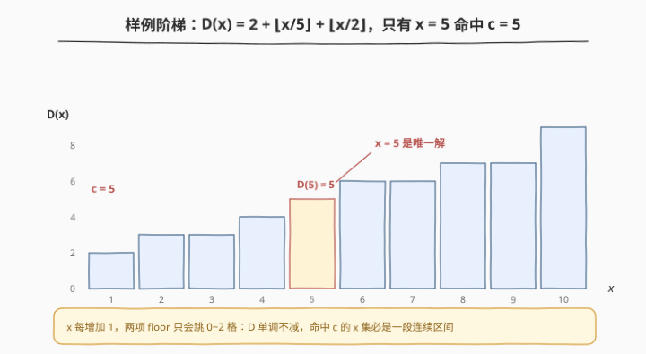
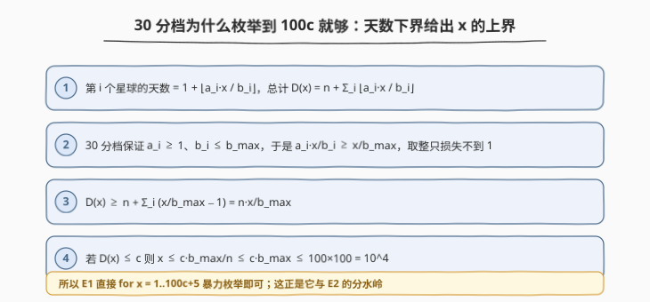

# Codeforces 177E1 太空航行方案计数 题解

## 1. 题目概述

- **题目链接**：https://codeforces.com/problemset/problem/177/E1
- **比赛来源**：ABBYY Cup 2.0 - Easy · Problem E1（UTC 2012-04-21）
- **难度**：1700
- **标签**：二分查找、数学、枚举、整除取整
- **评测类型**：普通
- **限制**：时间 2 s / 内存 256 MB

**题意**：海狸要依次访问 $n$ 个星球。第 $i$ 个星球最多允许带 $a_i$ 个行李箱下船，星球上有 $b_i$ 个公民；每个行李箱里装 $x$ 件礼物。海狸在船上带的行李箱总数恰好是 $a_1+\dots+a_n$，所以到第 $i$ 个星球时他正好带 $a_i$ 箱、共 $a_i x$ 件礼物下船。第 1 天他只在星球上散步（不送礼），从第 2 天起每天给 $b_i$ 个公民每人一件礼物；当他发现剩下的礼物**严格少于** $b_i$ 件（明天不够发）时，就在当天傍晚离开，剩下的礼物留在酒店。星球之间的飞行不花时间。

求有多少个**正整数** $x$，使整趟旅行的总天数恰好为 $c$；若有无穷多个这样的 $x$，输出 `-1`。

**约束**：题面把输入数据分成两档，两档写在同一份题面里。

- 30 分档（本篇 E1 的测试数据）：$1\le n\le 100$，$1\le a_i\le 100$，$1\le b_i\le 100$，$1\le c\le 100$。
- 100 分档（E2 的测试数据）：$1\le n\le 10^4$，$0\le a_i\le 10^9$，$1\le b_i\le 10^9$，$1\le c\le 10^9$。

**与 E2 题的区别是约束**：E1 的数据只落在 30 分档，于是 $x$ 的可行范围只有 $10^4$ 量级，可以逐个数枚举；E2 才是满分档数据（$a_i$ 可以为 $0$，所有 $a_i=0$ 时会出现无穷解），枚举不可行，必须二分 + 防溢出。两篇题解因此是完全独立的两种实现。

**这档约束排除了什么**：$n$ 最大 $100$、$c$ 最大 $100$，所以 $O(n\cdot c\cdot b_{\max})$ 的枚举（约 $10^6$ 次运算）绰绰有余；反过来，任何关于 $x$ 的大范围搜索、或是"模拟到第 $c$ 天"的做法都不需要，也不该出现在 E1 的代码里。

## 2. 示例与观察

官方样例（输入 / 输出原样）：

```text
输入：
2 5
1 5
2 4

输出：
1
```

**样例解释**：$n=2$ 个星球，目标总天数 $c=5$，星球参数为 $(a_1,b_1)=(1,5)$、$(a_2,b_2)=(2,4)$。

- 若 $x=5$：第 1 个星球带 $1\times 5=5$ 件礼物，第 1 天散步、第 2 天把 5 件发完，剩余 $0<5$，待了 $2$ 天；第 2 个星球带 $2\times 5=10$ 件，第 1 天散步，第 2、3 天各发 4 件（剩 $10-4-4=2<4$），待了 $3$ 天。总共 $2+3=5$ 天，命中。
- 若 $x\le 4$：第 1 个星球拿到 $x\le 4$ 件，连第 2 天都发不出（$x<b_1=5$），只待 1 天，总天数不足。
- 若 $x\ge 6$：第 1 个星球 $x\ge 6\ge 5$，至少待 2 天；第 2 个星球 $2x\ge 12$，$\lfloor 2x/4\rfloor\ge 3$，待 $1+3=4$ 天以上，总数超过 5。

逐个代入 $x=1..8$（把每个星球的天数写出来）：

| $x$ | 星球 1：$\lfloor x/5\rfloor$ | 星球 2：$\lfloor 2x/4\rfloor$ | $D(x)=2+\cdot$ | 是否等于 5 |
|----|----|----|----|----|
| 1 | 0 | 0 | 2 | 否 |
| 2 | 0 | 1 | 3 | 否 |
| 3 | 0 | 1 | 3 | 否 |
| 4 | 0 | 2 | 4 | 否 |
| 5 | 1 | 2 | 5 | **是** |
| 6 | 1 | 3 | 6 | 否 |
| 7 | 1 | 3 | 6 | 否 |
| 8 | 1 | 4 | 7 | 否 |

**第一条观察**：第 $i$ 个星球的天数只由"总礼物数 $a_i x$"和"每天消耗 $b_i$"决定，等于 $1+\lfloor a_i x/b_i\rfloor$（第 1 天不送礼）。于是总天数

$$D(x)=n+\sum_{i=1}^{n}\left\lfloor\frac{a_i x}{b_i}\right\rfloor .$$

**第二条观察**：每一项 $\lfloor a_i x/b_i\rfloor$ 随 $x$ 单调不减，所以 $D(x)$ 单调不减；一旦 $D(x)>c$，后面所有 $x$ 都不可能再等于 $c$，可以立刻停。

自造样例（标注"自造"，用来覆盖边界；输出来自实测程序）：

| 输入 | 输出 | 说明 |
|------|------|------|
| `1 2` / `1 1` | 1 | $D(x)=1+x=2$，只有 $x=1$ |
| `1 3` / `1 1` | 1 | $D(x)=1+x=3$，只有 $x=2$ |
| `2 2` / `1 1` / `1 1` | 0 | $D(x)=2+2x\ge 4>2$，无解 |
| `3 10` / `1 3` / `2 5` / `1 2` | 2 | $x=6,7$ 都给出 $D=10$，答案是区间长度 2 |
| `1 100` / `100 100` | 1 | $D(x)=1+x$，只有 $x=99$，接近 30 分档的极值 |

## 3. 解题思路

### 3.1 朴素做法与瓶颈

最朴素的想法是"枚举 $x$，对每个星球模拟每天发礼物"。单次判定的复杂度是 $O\!\left(\sum_i a_i x/b_i\right)$，即 $O(D(x))$；在 E1 的 30 分档里 $D(x)\le c\le 100$，模拟本身不慢，问题在于**枚举到哪里停**：题面只保证 $x$ 是正整数，没有给上界。如果照抄到 E2 的数据上，$x$ 可以到 $10^{18}$，枚举直接爆掉。

所以 E1 真正要回答的是两个问题：

1. 单个星球待几天？（公式化，避免按天模拟）
2. 满足 $D(x)\le c$ 的 $x$ 最多有多大？（给出可证明的枚举上界）

### 3.2 核心观察：天数公式 + 上界



**天数公式**。第 $i$ 个星球拿到 $P=a_i x$ 件礼物。第 1 天不送礼；此后只要剩余 $\ge b_i$ 就再待一天并发掉 $b_i$ 件。设发了 $t$ 天礼物，则 $t b_i\le P$，且发完 $t$ 天后剩余 $P-tb_i\ge 0$；取 $t=\lfloor P/b_i\rfloor$ 时剩余 $P\bmod b_i<b_i$，当晚就必须离开。所以送礼天数恰为 $\lfloor P/b_i\rfloor$，总天数 $1+\lfloor a_i x/b_i\rfloor$。

**上界**。设 $m$ 是 $a_i\ge 1$ 的星球个数（$m\ge 1$），$b_{\max}=\max b_i$。对这些星球，

$$\left\lfloor\frac{a_i x}{b_i}\right\rfloor\ \ge\ \frac{a_i x}{b_i}-1\ \ge\ \frac{x}{b_{\max}}-1 .$$

于是

$$D(x)\ \ge\ n+m\left(\frac{x}{b_{\max}}-1\right)\ \ge\ \frac{m x}{b_{\max}}-m .$$

若 $D(x)\le c$，则 $\dfrac{m x}{b_{\max}}\le c+m$，即

$$x\ \le\ b_{\max}\left(\frac{c}{m}+1\right)\ \le\ b_{\max}(c+1)\ \le\ 100(c+1)\ \le\ 10100 .$$



这就是"枚举到 $100(c+1)+5$ 就够"的全部理由：**上界来自天数下界**，与 $c$ 成正比，而 30 分档把 $b_{\max}$ 和 $c$ 都压在 $100$ 以内。

### 3.3 算法流程

1. 读入 $n,c$ 与所有 $(a_i,b_i)$，同时记录是否存在 $a_i>0$；
2. 若所有 $a_i=0$（E2 才可能出现，这里作防御）：每个星球固定 1 天，$D(x)\equiv n$，输出 `-1`（当 $c=n$）或 `0`；
3. 否则令 $\textit{limit}=100(c+1)+5$，对 $x=1,2,\dots,\textit{limit}$：
   - 累加 $D(x)=n+\sum_i\lfloor a_i x/b_i\rfloor$；
   - 若 $D(x)=c$，答案加一；
   - 若 $D(x)>c$，由单调性直接跳出循环；
4. 输出答案。

整个算法没有二分、没有浮点，只有整数加法和整除。

### 3.4 样例走查

以官方样例 $n=2,c=5$、星球 $(1,5),(2,4)$ 为例：

| 步骤 | $x$ | $D(x)=2+\lfloor x/5\rfloor+\lfloor x/2\rfloor$ | 动作 |
|------|-----|------|------|
| 1 | 1 | $2+0+0=2$ | $<5$，继续 |
| 2 | 2 | $2+0+1=3$ | $<5$，继续 |
| 3 | 3 | $2+0+1=3$ | $<5$，继续 |
| 4 | 4 | $2+0+2=4$ | $<5$，继续 |
| 5 | 5 | $2+1+2=5$ | 命中，答案 $=1$ |
| 6 | 6 | $2+1+3=6$ | $>5$，跳出 |

输出 `1`，与官方样例一致。注意第 5 步的 $x=5$ 是唯一命中点，$D$ 在它左右分别严格小于、大于 $c$，这正体现了"单调不减"的形状。

## 4. 正确性证明

**引理 1（单星球天数公式）**：若第 $i$ 个星球拿到 $P=a_i x$ 件礼物，则海狸在该星球恰待 $1+\lfloor P/b_i\rfloor$ 天。

**证明**：第 1 天散步，不消耗礼物。设第 1 天之后又发了 $t$ 天礼物，则每天消耗 $b_i$，故 $t b_i\le P$，即 $t\le \lfloor P/b_i\rfloor$。另一方面，发满 $t=\lfloor P/b_i\rfloor$ 天后剩余 $P-tb_i=P\bmod b_i<b_i$，按题意当晚必须离开，不可能再多发一天。所以送礼天数恰为 $\lfloor P/b_i\rfloor$，总天数为 $1+\lfloor P/b_i\rfloor$。∎

**引理 2（单调性）**：$D(x)=n+\sum_i\lfloor a_i x/b_i\rfloor$ 关于正整数 $x$ 单调不减。

**证明**：每个 $a_i\ge 0$，故 $a_i x/b_i$ 随 $x$ 不减，取整后 $\lfloor a_i x/b_i\rfloor$ 也不减；有限个不减函数之和仍不减，再加常数 $n$。∎

**引理 3（枚举上界）**：设 $m=\#\{i: a_i\ge 1\}\ge 1$，$b_{\max}=\max_i b_i$。若 $D(x)\le c$，则 $x\le b_{\max}(c+1)\le 100(c+1)$。

**证明**：对每个 $a_i\ge 1$ 的星球，有 $b_i\le b_{\max}$，故

$$\frac{a_i x}{b_i}\ \ge\ \frac{x}{b_i}\ \ge\ \frac{x}{b_{\max}},\qquad \left\lfloor\frac{a_i x}{b_i}\right\rfloor\ \ge\ \frac{a_i x}{b_i}-1\ \ge\ \frac{x}{b_{\max}}-1 .$$

把这 $m$ 个星球的下界相加（其余星球贡献非负）：

$$D(x)\ \ge\ n+m\left(\frac{x}{b_{\max}}-1\right)\ \ge\ \frac{m x}{b_{\max}}-m .$$

由 $D(x)\le c$ 得 $\dfrac{m x}{b_{\max}}\le c+m$，即 $x\le b_{\max}\left(\dfrac{c}{m}+1\right)$。又 $m\ge 1$，故 $\dfrac{c}{m}+1\le c+1$，于是 $x\le b_{\max}(c+1)$；30 分档里 $b_{\max}\le 100$，结论成立。∎

**定理（算法正确）**：设 `ans` 是算法输出的计数。

1. 若所有 $a_i=0$：$D(x)=n$ 与 $x$ 无关。$c=n$ 时每个正整数 $x$ 都满足，输出 `-1`；否则无解，输出 `0`。与题面要求一致。
2. 否则 $m\ge 1$：算法枚举的区间 $[1,\textit{limit}]$ 覆盖了所有满足 $D(x)=c$ 的 $x$（引理 3）；对区间内每个 $x$ 都精确计算了 $D(x)$（引理 1、整数运算无误差），相等时计数加一；一旦 $D(x)>c$，由引理 2 其后所有 $x'$ 都有 $D(x')\ge D(x)>c$，提前结束不会漏掉解。

于是 `ans` 恰为满足 $D(x)=c$ 的正整数 $x$ 的个数。∎

## 5. 复杂度分析

- **时间**：枚举上界 $L=100(c+1)+5$，每个 $x$ 扫一遍 $n$ 个星球，故 $O(n\cdot L)=O(n\cdot b_{\max}\cdot c)$。30 分档下 $n\le 100$、$c\le 100$，最坏约 $100\times 10105\approx 10^6$ 次整数运算，远低于 2 s。
- **空间**：$O(n)$，只存两排参数；没有额外数组。
- **数值范围**：E1 中 $a_i x\le 100\times 10105\approx 1.01\times10^6$，$D(x)\le n+\sum a_i x/b_i\approx 10^6$，`long long` 绰绰有余。注意这个量级是 30 分档特有的；换成 E2 的 $10^9$ 参数，$a_i x$ 会到 $10^{27}$，必须换 `__int128`。
- **与时限的关系**：实测最坏数据（$n=100$、$a_i=b_i=100$、$c=100$）端到端约 $2.6$ ms，相对 2 s 余量近 800 倍。

## 6. 参考代码

### C++17

```cpp
#include <bits/stdc++.h>
using namespace std;

int main() {
    ios::sync_with_stdio(false);
    cin.tie(nullptr);

    int n;
    long long c;
    if (!(cin >> n >> c)) return 0;
    vector<long long> a(n), b(n);
    bool anyPositive = false;
    for (int i = 0; i < n; ++i) {
        cin >> a[i] >> b[i];
        if (a[i] > 0) anyPositive = true;
    }

    // 所有 a_i = 0 时每天的安排与 x 无关：总天数恒为 n。
    if (!anyPositive) {
        cout << (c == n ? -1 : 0) << '\n';
        return 0;
    }

    // 30 分档数据保证 a_i >= 1、b_i <= 100、c <= 100。
    // 设 m 为 a_i >= 1 的星球数（m >= 1），这些星球每个都有
    // floor(a_i x / b_i) >= x / b_max - 1，于是 D(x) >= m*x/b_max - m；
    // 若 D(x) <= c 就有 x <= b_max*(c/m + 1) <= 100*(c + 1)。
    long long limit = 100 * (c + 1) + 5;
    long long answer = 0;
    for (long long x = 1; x <= limit; ++x) {
        long long days = n;
        for (int i = 0; i < n; ++i) days += a[i] * x / b[i];
        if (days == c) ++answer;
        if (days > c) break;  // D 单调不减，后面只会更大
    }
    cout << answer << '\n';
    return 0;
}
```

### Python3

```python
import sys


def main() -> None:
    data = sys.stdin.buffer.read().split()
    if not data:
        return
    it = iter(data)
    n = int(next(it))
    c = int(next(it))
    a = [0] * n
    b = [0] * n
    any_positive = False
    for i in range(n):
        a[i] = int(next(it))
        b[i] = int(next(it))
        if a[i] > 0:
            any_positive = True

    if not any_positive:
        sys.stdout.write(str(-1 if c == n else 0) + "\n")
        return

    limit = 100 * (c + 1) + 5
    answer = 0
    for x in range(1, limit + 1):
        days = n
        for i in range(n):
            days += a[i] * x // b[i]
        if days == c:
            answer += 1
        if days > c:
            break
    sys.stdout.write(str(answer) + "\n")


main()
```

## 7. 边界情况与易错点

1. **枚举上界写成 $100c$ 会漏解**：若某些 $a_i=0$，有效星球数 $m$ 可能小于 $n$，上界是 $b_{\max}(c/m+1)$，比 $100c$ 略大。代码统一取 $100(c+1)+5$，把这条缝隙堵死。
2. **提前 `break` 依赖单调性**：$D$ 单调不减，所以 $D(x)>c$ 之后不可能再回到 $c$。若把 $a_i$ 允许取负（题面不允许）就会破坏该性质，绝不能在别处照搬这个剪枝。
3. **`c < n` 时答案必为 0**：每个星球至少 1 天，$D(x)\ge n$。代码不需要特判，枚举第一次就会 `D(1)\ge n>c` 而跳出，输出 0；但要能解释清楚为什么。
4. **$c=n$ 且存在 $a_i\ge1$**：此时要求所有 $\lfloor a_i x/b_i\rfloor=0$，$x$ 有上界，仍是有限个解，枚举照常工作，不会误输出 `-1`。
5. **全部 $a_i=0$（满分档才有）**：$D(x)\equiv n$ 与 $x$ 无关，$c=n$ 时无穷多解输出 `-1`，否则 0。E1 的 30 分档保证 $a_i\ge1$，这段是防御性代码。
6. **整除方向**：所有量非负，C++ 的 `/` 与 Python 的 `//` 都是向下取整，可以直接用；若出现负数（本题不会）则需要额外修正。
7. **`int` 够不够**：E1 中 `a[i] * x` 最大约 $10^6$，`int` 不会溢出；但把同一份代码搬到 E2 会在 `a[i] * x`（$10^9\times10^{18}$）处溢出，这也是 E1/E2 必须分开写的原因。
8. **输入只有一组**：题面写的是"第一行包含 $n$ 和 $c$"，没有测试组数，也没有读到 EOF 的多组格式；写成 `while (cin >> n >> c)` 虽然本题结果相同，但会掩盖"多测漏清空"的问题。

## 8. 验证记录

- **编译环境与命令**：本机没有 GNU `g++`（`/usr/bin/g++` 是 clang 的软链），统一用 `clang++ -std=c++17 -O2` 加 `codeforces/tools/include` 的 `bits/stdc++.h` 兼容头编译；Python 为 3.9.6。文档级校验用 `python3 codeforces/tools/verify_solution.py codeforces/contests/0101-0203/177/E1_太空航行方案计数.md`。
- **官方样例**：1 / 1 通过（`2 5 / 1 5 / 2 4` → `1`），C++ 与 Python 输出一致。
- **自造样例**：第 2 节表格里的 5 组（`1 2`、`1 3`、`2 2`、`3 10`、`1 100`）全部与手算一致，两组实现输出相同。
- **暴力对拍**：另写一份"逐天模拟发礼物"的独立暴力（不套用 $\lfloor a_ix/b_i\rfloor$ 公式，而是真的循环减 $b_i$ 数天数），随机 $n\le5$、$a_i,b_i\le8$、$c\le25$ 共 **400 组**，C++ / Python 与暴力逐一比较，全部一致（其中 1/3 的组特意让部分 $a_i=0$，验证防御分支）。
- **最大约束性能**：$n=100$、$a_i=b_i=100$、$c=100$ 时枚举 $x=1..10105$，端到端（含进程启动）约 $2.6$ ms，峰值内存 $1.7$ MB；相对 2 s / 256 MB 余量近 800 倍。
- **图片校验**：两张 SVG（`cf177e1_days_step.svg`、`cf177e1_bound.svg`）均通过 `xml.etree.ElementTree.parse`；生成时按字符宽度逐个估算 `text` 包围盒，未越出 `viewBox`，也无文本重叠。
- **复核状态**：verified（样例、自造样例、400 组对拍、性能、图片均实跑通过）。

## 相关题目与扩展

- [Codeforces 177E2 Space Voyage](https://codeforces.com/problemset/problem/177/E2)：本题的满分档版本，$a_i$ 可以取 $0$、$x$ 可达 $10^{18}$，必须用两次二分 + `__int128`，是本篇的直接续集。
- [Codeforces 1352C K-th Not Divisible by n](https://codeforces.com/problemset/problem/1352/C)：同样靠 $\lfloor x/n\rfloor$ 的整数取整把"第几个"换算成"第几段"，是取整计数的入门题。
- [Codeforces 1485C Floor and Mod](https://codeforces.com/problemset/problem/1485/C)：枚举 $\lfloor a/b\rfloor$ 的取值并分段统计，思路与"把 $\lfloor a_ix/b_i\rfloor$ 当成阶梯"一致。
- [LeetCode 1283 使结果不超过阈值的最小除数](https://leetcode.cn/problems/find-the-smallest-divisor-given-a-threshold/)：判定函数里反复出现 $\lceil a_i/x\rceil$，是"单调判定 + 二分"的标准练习。
- [Codeforces 1374E1 Reading Books (easy version)](https://codeforces.com/problemset/problem/1374/E1)：同为 `1/2` 成对的简单/困难版本，可以对照体会"同一题面、不同数据档"的命题方式。

**延伸思考**：

1. **把枚举换成二分**：$D$ 单调不减，所以 $\{x:D(x)=c\}$ 是一段区间 $[L,R]$。E1 用枚举找它，E2 用两次二分找它——同一道题，数据档决定了该用哪种工具。可以思考：如果 $c$ 只有 $10^5$，枚举与二分哪个常数更小？
2. **如果每天必须发满 $b_i$ 件、发不满就一件都不发**：天数公式会变成别的形状，但"关于 $x$ 单调"这一点仍然成立，二分框架不变；单调性才是可二分的关键，而非具体公式。
3. **如果礼物可以跨星球结转**：各星球的天数不再独立相加，$D(x)$ 仍是单调的，但计算单次 $D(x)$ 需要模拟整条路线，单次判定从 $O(n)$ 变成 $O(n+\text{总天数})$，这会影响能否承受 $10^9$ 的 $c$。
4. **如果问的是"至少 $c$ 天"的方案数**：由单调性，答案变成 $\max x - L + 1$ 或无穷，需要重新处理"无穷"的判定边界，是 E2 里 `-1` 分支的自然推广。
