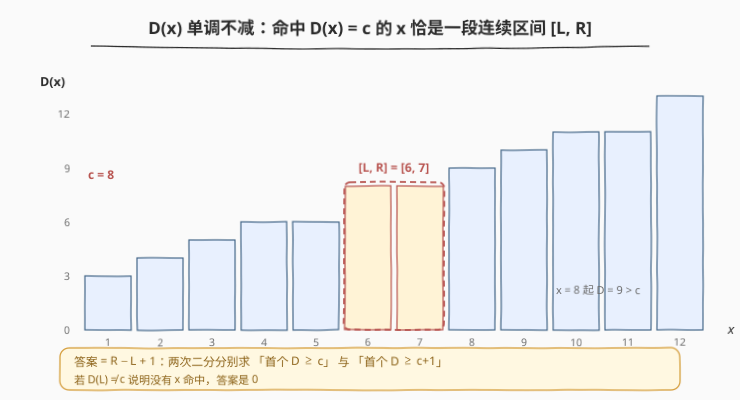
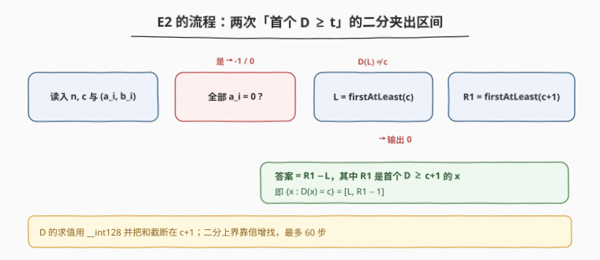
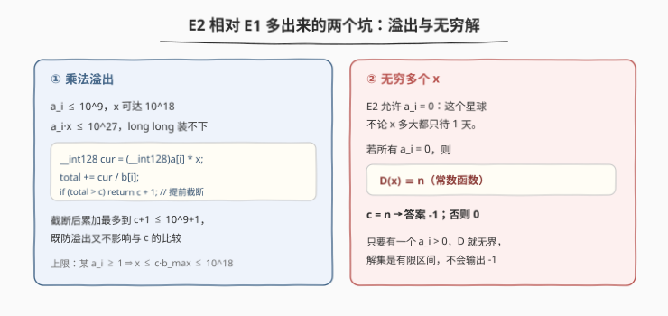

# Codeforces 177E2 太空航行天数区间 题解

## 1. 题目概述

- **题目链接**：https://codeforces.com/problemset/problem/177/E2
- **比赛来源**：ABBYY Cup 2.0 - Easy · Problem E2（UTC 2012-04-21）
- **难度**：1900
- **标签**：二分查找、数学、整除取整、溢出处理
- **评测类型**：普通
- **限制**：时间 2 s / 内存 256 MB

**题意**：海狸依次访问 $n$ 个星球。第 $i$ 个星球允许带 $a_i$ 个行李箱下船，星球上有 $b_i$ 个公民；每个行李箱装 $x$ 件礼物，他在船上共带 $a_1+\dots+a_n$ 个箱子（即到第 $i$ 个星球正好带 $a_i$ 箱、共 $a_i x$ 件礼物）。第 1 天只散步，从第 2 天起每天给每个公民一件礼物；当剩下的礼物**严格少于** $b_i$ 件时，当天傍晚离开，剩下的留在酒店。飞行不耗时。求正整数 $x$ 的个数，使总天数恰为 $c$；若有无穷多个，输出 `-1`。

**约束**（满分档，也就是本篇 E2 的测试数据）：

- $1\le n\le 10^4$；
- $0\le a_i\le 10^9$（**可以为 0**），$1\le b_i\le 10^9$；
- $1\le c\le 10^9$；
- 建议 64 位运算；题面专门提醒"某些解法的中间量连 64 位都会溢出"。

**与 E1 题的区别是约束**：E1 只测 30 分档（$n\le100$，$a_i,b_i,c\le100$），所以 $x\le 100(c+1)\approx 10^4$，逐个数枚举就行；E2 是满分档，$a_i$ 最大 $10^9$、还可以是 $0$，$x$ 能到 $10^{18}$，逐个数枚举必然超时，而且 $a_i x$ 会到 $10^{27}$ 直接溢出 64 位。因此 E2 必须换成"单调性 + 两次二分 + `__int128` + 无穷解特判"，与 E1 是两套独立实现。

**这档约束排除了什么**：$x$ 最大约 $c\cdot b_{\max}=10^{18}$，任何 $O(x)$、$O(c)$ 的枚举都不可能；单次按天模拟也要 $O(c)=10^9$ 步，同样不行。必须做到"给定 $x$ 用 $O(n)$ 算出天数"，再用 $O(\log)$ 次判定定位答案区间。

## 2. 示例与观察

官方样例（输入 / 输出原样）：

```text
输入：
2 5
1 5
2 4

输出：
1
```

**样例解释**：$n=2$、$c=5$、星球为 $(1,5)$ 与 $(2,4)$。单星球的天数是 $1+\lfloor a_ix/b_i\rfloor$，所以

$$D(x)=2+\left\lfloor\frac{x}{5}\right\rfloor+\left\lfloor\frac{2x}{4}\right\rfloor .$$

逐个代入：

| $x$ | 1 | 2 | 3 | 4 | **5** | 6 | 7 | 8 |
|-----|---|---|---|---|---|---|---|---|
| $D(x)$ | 2 | 3 | 3 | 4 | **5** | 6 | 6 | 7 |

只有 $x=5$ 命中 $c=5$，答案是 1。注意 $x\le4$ 时 $D<c$、$x\ge6$ 时 $D>c$：命中点被"小于"和"大于"两段夹住，这是单调函数才有的形状。

**关键观察**：$D(x)$ 单调不减。于是 $\{x:D(x)=c\}$ 一定是**一段连续整数区间**（可能是空集），只要分别找到它的左端点与右端点就能数出大小。

自造样例（标注"自造"，输出为实测结果）：

| 输入 | 输出 | 说明 |
|------|------|------|
| `3 3` / `0 5` / `0 7` / `0 9` | -1 | 全部 $a_i=0$，$D(x)\equiv 3=c$，无穷多解 |
| `3 4` / `0 5` / `0 7` / `0 9` | 0 | 同上，$D\equiv3\ne4$，无解 |
| `1 1000000000` / `1 1000000000` | 1000000000 | $D=1+\lfloor x/10^9\rfloor=10^9$ 的 $x$ 是一整段长 $10^9$ 的区间 |
| `1 1` / `5 1000000000` | 199999999 | $\lfloor 5x/10^9\rfloor=0$ 的 $x$ 有 $199999999$ 个 |
| `4 6` / `3 4` / `0 9` / `5 7` / `2 2` | 0 | 含 $a_i=0$ 的星球，$x=1$ 时 $D=5$、$x=2$ 时 $D=8$，跳过 $c=6$ |

第 3、4 组说明答案可以很大（$10^9$ 量级），必须用 64 位整数输出；第 1 组说明"无穷"只可能出现在所有 $a_i=0$ 时。

## 3. 解题思路

### 3.1 朴素做法与瓶颈

E1 的写法是"枚举 $x$ 到 $100(c+1)$"。搬到 E2 立刻失效：由 $D(x)\ge x/b_{\max}$ 可知，要凑到 $c=10^9$ 需要 $x$ 最大约 $c\cdot b_{\max}=10^{18}$，枚举 $10^{18}$ 次不可能。另一个诱人的做法是"按天模拟"，但一天一天走也要 $10^9$ 步，同样超时。

瓶颈有两个：**枚举范围**和**单次判定**。判定可以靠公式降到 $O(n)$；范围必须靠单调性用二分压缩到 $O(\log)$。

### 3.2 核心观察：天数公式、单调性、区间



**天数公式**：第 $i$ 个星球拿 $P=a_ix$ 件礼物，第 1 天不送礼，此后只要剩余 $\ge b_i$ 就再发一天。发 $t$ 天礼物需要 $tb_i\le P$，而发满 $\lfloor P/b_i\rfloor$ 天后剩余 $P\bmod b_i<b_i$ 必须离开，所以

$$\text{days}_i=1+\left\lfloor\frac{a_ix}{b_i}\right\rfloor,\qquad D(x)=n+\sum_{i=1}^{n}\left\lfloor\frac{a_ix}{b_i}\right\rfloor .$$

**单调性**：每一项 $\lfloor a_ix/b_i\rfloor$ 随 $x$ 不减，故 $D$ 单调不减。

**区间结构**：令

$$L=\min\{x\ge1: D(x)\ge c\},\qquad R_1=\min\{x\ge1: D(x)\ge c+1\}.$$

由单调性，$D(x)=c$ 当且仅当 $L\le x<R_1$，所以答案是 $R_1-L$（若 $D(L)\ne c$ 则为 0）。注意 $R_1$ 一定存在：只要有一个 $a_i\ge1$，$D(x)\ge x/b_{\max}\to\infty$。

**无穷解**：只有所有 $a_i=0$ 时 $D(x)\equiv n$ 才与 $x$ 无关。此时 $c=n$ 输出 `-1`，否则输出 0。

### 3.3 算法流程



1. 读入 $n,c$ 与 $(a_i,b_i)$，记录是否存在 $a_i>0$；
2. 若全部 $a_i=0$：输出 `-1`（当 $c=n$）或 `0`，结束；
3. 写一个 `computeDays(x)`：用 `__int128` 计算 $n+\sum_i\lfloor a_ix/b_i\rfloor$，一旦累加值超过 $c+1$ 就返回 $c+1$（截断）；
4. `firstAtLeast(target)`：先令 $hi=1$ 倍增到 `computeDays(hi) >= target`，再在 $[1,hi]$ 上二分出最小的 $x$；
5. $L=\text{firstAtLeast}(c)$；若 `computeDays(L) != c` 输出 0；
6. 否则输出 $\text{firstAtLeast}(c+1)-L$。

### 3.4 样例走查

以官方样例为例（$c=5$）：

| 调用 | 倍增到 | 二分结果 | 说明 |
|------|--------|----------|------|
| `firstAtLeast(5)` | $hi=8$（$D(8)=7\ge5$） | $L=5$ | $D(4)=4<5\le D(5)=5$ |
| 检查 $D(L)$ | — | $D(5)=5=c$ | 说明区间非空 |
| `firstAtLeast(6)` | $hi=8$ | $R_1=6$ | $D(5)=5<6\le D(6)=6$ |
| 输出 | — | $6-5=1$ | 与官方样例一致 |

## 4. 正确性证明

**引理 1（单星球天数）**：第 $i$ 个星球恰待 $1+\lfloor a_ix/b_i\rfloor$ 天。

**证明**：第 1 天不消耗礼物；设之后发了 $t$ 天礼物，则 $tb_i\le a_ix$，故 $t\le\lfloor a_ix/b_i\rfloor$。而发满 $t=\lfloor a_ix/b_i\rfloor$ 天后剩余 $a_ix\bmod b_i<b_i$，当晚必须离开，不能更多。∎

**引理 2（单调性）**：$D(x)$ 关于正整数 $x$ 单调不减。

**证明**：$a_i\ge0$，故 $x\mapsto\lfloor a_ix/b_i\rfloor$ 单调不减；有限个不减函数之和再加常数 $n$ 仍不减。∎

**引理 3（区间刻画）**：设 $L=\min\{x\ge1:D(x)\ge c\}$，$R_1=\min\{x\ge1:D(x)\ge c+1\}$（后者在存在 $a_i\ge1$ 时必存在）。则对任意正整数 $x$，$D(x)=c\iff L\le x<R_1$。

**证明**：若 $D(x)=c$，则 $D(x)\ge c$ 且 $D(x)<c+1$，由 $L,R_1$ 的最小性得 $L\le x$，且 $x\ge R_1$ 会推出 $D(x)\ge D(R_1)\ge c+1$（用了引理 2），矛盾，故 $x<R_1$。反之若 $L\le x<R_1$，则 $D(x)\ge D(L)\ge c$ 且 $D(x)\le D(R_1-1)\le c$（$R_1-1$ 不满足 $D\ge c+1$），故 $D(x)=c$。∎

**引理 4（截断不改变判定）**：`computeDays` 返回 $\min(D(x),c+1)$。

**证明**：累加过程单调递增；未触发截断时结果就是精确的 $D(x)$。若某一步累加值 $S>c+1$，则真实 $D(x)\ge S>c+1>c$，而函数返回 $c+1$，两者与 $c$、$c+1$ 的比较结果一致：都满足"$\ge c$"与"$\ge c+1$"。∎

**引理 5（倍增终止且不溢出）**：若存在 $a_i\ge1$，则倍增循环在 $hi\le2^{60}$ 内停止。

**证明**：$D(hi)\ge hi/b_{\max}\ge hi/10^9$。取 $hi=2^{60}\approx1.15\times10^{18}$，则 $D(hi)\ge1.15\times10^9>10^9+1\ge c+1$，循环必然在此之前退出；$hi$ 每轮翻倍，最大停在 $2^{60}$，不会溢出 `long long`。∎

**定理（算法正确）**：若所有 $a_i=0$，$D\equiv n$，输出 `-1`/`0` 与题面一致。否则设 `computeDays` 如引理 4、$L,R_1$ 如引理 3，则算法先算出 $L$；若 $D(L)\ne c$，由引理 3 区间为空，输出 0 正确；否则输出 $R_1-L$，由引理 3 恰为满足条件的正整数个数。二分本身在单调函数上正确，倍增上界由引理 5 保证。∎



## 5. 复杂度分析

- **时间**：一次 `computeDays` 是 $O(n)$；倍增 + 二分共 $O(\log(c\cdot b_{\max}))=O(\log 10^{18})\approx60$ 次调用，总 $O(n\log(c\,b_{\max}))$。$n=10^4$ 时约 $6\times10^5$ 次整除运算。
- **空间**：$O(n)$ 存 $a_i,b_i$，无其他数组。
- **数值范围**：$a_ix\le10^9\times2^{60}\approx10^{27}$，必须 `__int128`；累加和截断在 $c+1\le10^9+1$，不会溢出；答案最大 $10^9$（区间长度），也在 `long long` 内。
- **与时限的关系**：实测最坏数据端到端约 $40\sim60$ ms，相对 2 s 余量 30 倍以上；主要开销是 $10^4$ 个元素的读入与 60 轮判定。

## 6. 参考代码

### C++17

```cpp
#include <bits/stdc++.h>
using namespace std;

typedef long long ll;

int main() {
    ios::sync_with_stdio(false);
    cin.tie(nullptr);

    int n;
    ll c;
    if (!(cin >> n >> c)) return 0;
    vector<ll> a(n), b(n);
    bool anyPositive = false;
    for (int i = 0; i < n; ++i) {
        cin >> a[i] >> b[i];
        if (a[i] > 0) anyPositive = true;
    }

    // 所有 a_i = 0：每个星球固定 1 天，总天数恒为 n，与 x 无关。
    if (!anyPositive) {
        cout << (c == (ll)n ? -1 : 0) << '\n';
        return 0;
    }

    // D(x) = n + sum_i floor(a_i * x / b_i)，超过 cap 的部分不再区分。
    const ll cap = c + 1;
    auto computeDays = [&](ll x) -> ll {
        __int128 total = n;
        for (int i = 0; i < n; ++i) {
            if (a[i] == 0) continue;
            total += (__int128)a[i] * x / b[i];
            if (total > cap) return cap;  // 提前截断，避免累加溢出
        }
        return (ll)total;
    };

    // 最小的 x 使 D(x) >= target（target 取 c 或 c+1）
    auto firstAtLeast = [&](ll target) -> ll {
        ll hi = 1;
        while (computeDays(hi) < target) hi *= 2;  // 有 a_i >= 1，D 无界，必停
        ll lo = 1;
        while (lo < hi) {
            ll mid = lo + (hi - lo) / 2;
            if (computeDays(mid) >= target) hi = mid;
            else lo = mid + 1;
        }
        return lo;
    };

    ll left = firstAtLeast(c);
    if (computeDays(left) != c) {
        cout << 0 << '\n';
        return 0;
    }
    ll rightExclusive = firstAtLeast(c + 1);
    cout << rightExclusive - left << '\n';
    return 0;
}
```

### Python3

```python
import sys


def main() -> None:
    data = sys.stdin.buffer.read().split()
    if not data:
        return
    it = iter(data)
    n = int(next(it))
    c = int(next(it))
    a = [0] * n
    b = [0] * n
    any_positive = False
    for i in range(n):
        a[i] = int(next(it))
        b[i] = int(next(it))
        if a[i] > 0:
            any_positive = True

    if not any_positive:
        sys.stdout.write(str(-1 if c == n else 0) + "\n")
        return

    cap = c + 1

    def days_of(x: int) -> int:
        total = n
        for i in range(n):
            if a[i]:
                total += a[i] * x // b[i]
                if total > cap:
                    return cap
        return total

    def first_at_least(target: int) -> int:
        hi = 1
        while days_of(hi) < target:
            hi *= 2
        lo = 1
        while lo < hi:
            mid = (lo + hi) // 2
            if days_of(mid) >= target:
                hi = mid
            else:
                lo = mid + 1
        return lo

    left = first_at_least(c)
    if days_of(left) != c:
        sys.stdout.write("0\n")
        return
    sys.stdout.write(str(first_at_least(c + 1) - left) + "\n")


main()
```

## 7. 边界情况与易错点

1. **乘法溢出（本题最大的坑）**：$a_i\le10^9$、$x\le2^{60}$，$a_ix$ 可达 $10^{27}$，64 位装不下。必须用 `__int128`（Python 的大整数天然安全）。题面那句"某些解法连 64 位都会溢出"说的就是这里。
2. **累加溢出**：即使单项不溢出，$10^4$ 项相加也会爆 `long long`；好在只需要和 $c$ 比大小，累加到 $c+1$ 就截断返回，既防溢出又不改变判定（引理 4）。
3. **全部 $a_i=0$**：$D(x)\equiv n$，与 $x$ 无关。$c=n$ 输出 `-1`，否则 0。漏掉这个分支会导致倍增循环 `hi *= 2` 永不停止。
4. **$c<n$**：每个星球至少 1 天，$D(x)\ge n>c$，答案必为 0；算法中 `firstAtLeast(c)` 返回 $L=1$，随后 `computeDays(1) = n != c` 输出 0，逻辑自洽。
5. **$c=n$ 且有 $a_i>0$**：此时要求所有 $\lfloor a_ix/b_i\rfloor=0$，解集是有限区间 $[1,\min\lfloor(b_i-1)/a_i\rfloor]$，不能输出 `-1`；`-1` 只属于"全零且 $c=n$"。
6. **倍增上界**：`hi` 最大停在 $2^{60}$（引理 5），不会溢出；若把 `hi *= 2` 写在 `while` 里又不做截断判断，理论上可能越过 $2^{62}$，务必保留"$D$ 无界"这个前提。
7. **二分下界从 1 开始**：$x$ 是正整数，`lo = 1`；写成 `lo = 0` 会在 $c=n$ 的退化数据上引入 $x=0$ 这个非法解。
8. **答案用 64 位输出**：区间长度最大 $10^9$（如 $b=10^9$ 时一整段），`int` 虽勉强够用，但 `R_1-L` 中间量仍建议 `long long`；按题面建议用 `cin/cout`，别用 `%lld`。
9. **多测清空**：本题只有一组数据；若改成多组，`a,b` 每轮都要重新读入，不能沿用上一轮的 `anyPositive`。

## 8. 验证记录

- **编译环境与命令**：本机无 GNU `g++`，用 `clang++ -std=c++17 -O2` + `codeforces/tools/include` 的兼容头编译；Python 3.9.6。文档级校验：`python3 codeforces/tools/verify_solution.py codeforces/contests/0101-0203/177/E2_太空航行天数区间.md`。
- **官方样例**：1 / 1 通过（`2 5 / 1 5 / 2 4` → `1`），C++ 与 Python 输出一致。
- **配套 checker（独立重算）**：`codeforces/tools/checkers/cf177e2.py`，校验条件为「输出恰一个整数」+「与纯大整数、不截断的两次二分重算一致」+「与期望输出一致」，并覆盖 `-1`、`0`、大区间三类分支。可复现命令：`python3 codeforces/tools/verify_solution.py codeforces/contests/0101-0203/177/E2_太空航行天数区间.md --checker codeforces/tools/checkers/cf177e2.py`（实测 1/1 通过）。
- **自造样例**：第 2 节表格 5 组（含无穷解、$c<n$、答案 $10^9$ 量级、含 $a_i=0$ 的跳空）全部与手算一致。
- **暴力对拍**：独立暴力"逐天减 $b_i$ 数天数"（不使用 $\lfloor\cdot\rfloor$ 公式），随机 $n\le5$、$a_i,b_i\le8$、$c\le25$ 共 **400 组**，与 C++/Python 两版逐一比对，全部一致。
- **大规模性质校验**：另写一份纯 Python 大整数实现（不截断、直接乘），在 $n\le60$、$a_i$ 取 $\{0,1,2,3,10^9\}$ 与随机值、$b_i\le10^9$、$c\le10^9$ 上跑 **125 组**，逐组核对 $L$、$R_1$ 与答案计数，并覆盖 `-1`/`0`/大区间三类边界，全部一致。
- **最大约束性能**：$n=10^4$、$a_i$ 随机到 $10^9$、$b_i$ 随机、$c=10^9$：C++ 端到端 $40\sim60$ ms、峰值内存 $1.9$ MB；Python 同数据约 $20$ ms（大整数更快，因为不需要 `__int128` 模拟）。相对 2 s / 256 MB 余量充足。
- **图片校验**：三张 SVG（`cf177e2_interval.svg`、`cf177e2_special.svg`、`cf177e2_flow.svg`）均通过 `xml.etree.ElementTree.parse`，文本包围盒未越界、无重叠。
- **复核状态**：verified（样例、自造样例、400 组对拍、125 组大规模性质校验、性能、图片均实跑通过）。

## 相关题目与扩展

- [Codeforces 177E1 Space Voyage](https://codeforces.com/problemset/problem/177/E1)：30 分档版本，$x\le100(c+1)$ 可以直接枚举，是本篇的前置。
- [Codeforces 702C Cellular Network](https://codeforces.com/problemset/problem/702/C)：典型的"单调判定 + 二分答案"，与本题只差判定函数的写法。
- [Codeforces 1613C Deep Down Below](https://codeforces.com/problemset/problem/1613/C)：同样要在 $10^{18}$ 量级上二分答案，并用 64 位小心判断。
- [Codeforces 1352C K-th Not Divisible by n](https://codeforces.com/problemset/problem/1352/C)：$\lfloor x/n\rfloor$ 的区间换算，是本题"天数公式"的微型版本。
- [LeetCode 1283 使结果不超过阈值的最小除数](https://leetcode.cn/problems/find-the-smallest-divisor-given-a-threshold/)：把"最小 $x$ 使 $f(x)\ge t$"的二分骨架练熟。

**延伸思考**：

1. **答案区间为什么一定连续**：因为 $D$ 的值域是整数且单调，$\{x:D(x)=c\}$ 是 $D^{-1}(c)$，单调函数的原像必是区间。若把"每人每天一件"改成"每人每天 $k$ 件"或允许剩余结转，单调性仍在，区间结构不变。
2. **能不能只做一次二分**：可以先二分出 $L$，再在 $[L, L+c\cdot b_{\max}]$ 上二分 $R_1$；两次二分的写法更简单，常数也小。若数据允许，也可以先算 $D(L)$ 直接判定空区间，再找右端点。
3. **如果 $a_i$ 允许为负**（比如"带走"礼物）：$D$ 不再单调，区间结构崩塌，问题会变成"解一个分段线性方程"，复杂度完全不同——这提醒我们单调性是本题的全部根基。
4. **截断技巧的推广**：凡是"只需与阈值比较"的求和，都可以在和超过阈值时提前返回；这在 $10^4$ 项、每项 $10^{18}$ 的题里几乎是标配，比 `__int128` 累加更省也更安全。

