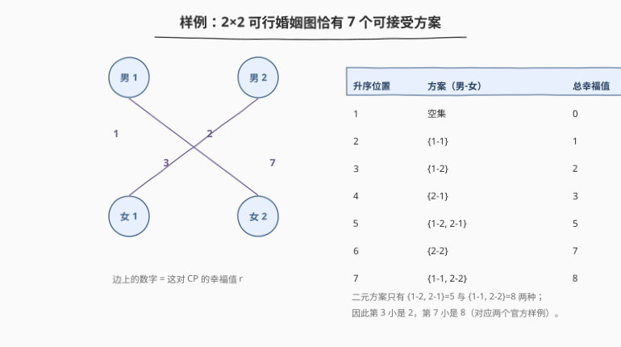
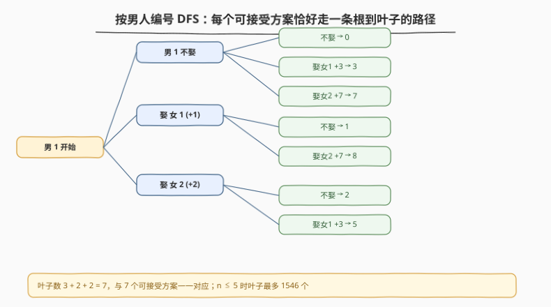

# Codeforces 177F1 剧本配对枚举 题解

## 1. 题目概述

- **题目链接**：https://codeforces.com/problemset/problem/177/F1
- **比赛来源**：ABBYY Cup 2.0 - Easy · Problem F1（UTC 2012-04-21）
- **难度**：1800
- **标签**：枚举、深度优先搜索、匹配、排序
- **评测类型**：普通
- **限制**：时间 2 s / 内存 256 MB

**题意**：剧中有 $n$ 个男角色与 $n$ 个女角色。民意调查给出 $k$ 组"观众爱看"的配对 $(h,w,r)$：男 $h$ 与女 $w$ 在一起会给观众带来 $r$ 点幸福，其他配对不会出现在剧本里。一个**可接受方案**是这 $k$ 个配对的一个子集，要求每个男角色、每个女角色**至多**出现在一个配对中（剧情不允许离婚）。方案的价值是所有选中配对的 $r$ 之和；空集也是合法方案，价值为 0。

把所有可接受方案按价值从小到大排序，求第 $t$ 个方案的价值。题面保证 $t$ 不超过方案总数，且 $(h,w)$ 不重复。

**约束**（30 分档，也就是本篇 F1 的测试数据）：

- $1\le n\le 5$；
- $1\le k\le\min(100,n^2)$，即 $k\le 25$；
- $1\le r\le 1000$，$1\le t\le 2\cdot10^5$。

**与 F2 题的区别是约束**：F1 的 $n$ 只有 5，可接受方案总数最多是 $K_{5,5}$ 的匹配数

$$\sum_{s=0}^{5}\binom{5}{s}^2 s!=1+25+200+600+600+120=1546 ,$$

所以"枚举全部方案、排序、取第 $t$ 个"就足够了。F2 的 $n\le20$、$k\le100$，方案数可以到天文数字，必须换成分桶 + 逐次弹出，两篇是完全不同的实现。

**这档约束排除了什么**：$n\le5$ 意味着 DFS 树最多 1546 个叶子，时间、内存都绰绰有余；不需要任何剪枝、堆、DP 或二分。反过来，若把这份代码直接交到 F2（$n\le20$），叶子数会爆炸——这正是两题必须分开写的原因。

## 2. 示例与观察

官方样例一（输入 / 输出原样）：

```text
输入：
2 4 3
1 1 1
1 2 2
2 1 3
2 2 7

输出：
2
```

官方样例二（同一张图，换一个 $t$）：

```text
输入：
2 4 7
1 1 1
1 2 2
2 1 3
2 2 7

输出：
8
```

**样例解释**：$n=2$，四条边为 $(1,1,1)$、$(1,2,2)$、$(2,1,3)$、$(2,2,7)$。$k=4$ 的子集共 $16$ 个，去掉"同一男/同一女出现两次"的之后，合法的方案正是下面 7 个：

| 价值 | 方案 | 说明 |
|------|------|------|
| 0 | 空集 | $t=1$ 就是它 |
| 1 | $\{(1,1)\}$ | 单边 |
| 2 | $\{(1,2)\}$ | 单边（$t=3$ 的答案） |
| 3 | $\{(2,1)\}$ | 单边 |
| 5 | $\{(1,2),(2,1)\}$ | 完美匹配之一 |
| 7 | $\{(2,2)\}$ | 单边 |
| 8 | $\{(1,1),(2,2)\}$ | 完美匹配之二（$t=7$ 的答案） |

于是 $t=3$ 输出 2，$t=7$ 输出 8，与两个官方样例一致。

**第一条观察**：可接受方案 = 这张二分图里的一个**匹配**（可以为空）。$k$ 条边里挑匹配，方案数远小于 $2^k$（这里 $16\to7$）。

**第二条观察**：只有 $n$ 个男角色，且每个男角色最多选一条边。按**男角色**从小到大做决策，每个男角色只有"不结婚，或娶某个还没被占用的女角色"这几种选择，天然把方案枚举成一棵树——这棵树的叶子恰好是全部可接受方案。

自造样例（标注"自造"，输出为实测结果）：

| 输入 | 输出 | 说明 |
|------|------|------|
| `1 1 1` / `1 1 5` | 0 | 只有空集，$t=1$ 即最小值 0 |
| `1 1 2` / `1 1 5` | 5 | 两个方案：0 与 5 |
| `2 2 3` / `1 1 4` / `2 2 4` | 4 | 值为 $0,4,4,8$，第 3 个是 4（有重复值） |
| `2 2 4` / `1 1 4` / `2 2 4` | 8 | 同上，$t$ 取到最大值 8 |
| `3 3 4` / `1 1 9` / `2 2 8` / `3 3 7` | 9 | 三条边两两不冲突，值 $0,7,8,9,\dots$，第 4 个是 9 |
| `3 3 5` / `1 1 9` / `2 2 8` / `3 3 7` | 15 | 第 5 个是 $7+8=15$ |

## 3. 解题思路

### 3.1 朴素做法与瓶颈

最直白的做法是把 $k$ 条边编号，枚举 $2^k$ 个子集，逐个检查"是否每条男、女都至多出现一次"，合法的算价值，最后排序取第 $t$ 个。

- $k\le25$ 时 $2^{25}\approx3.35\times10^7$，C++ 勉强能跑，但每组都要扫 $k$ 条边判合法，常数被放大到 $8\times10^8$ 量级，Python 更是直接超时。
- 更重要的是这份代码**天然越界**：F2 的 $k$ 可以到 100，$2^{100}$ 想都别想。

瓶颈是"枚举了太多非法子集"。换成"按男角色决策"，非法分支在产生时就被剪掉，叶子数从 $2^k$ 降到匹配数。

### 3.2 核心观察：按男角色决策的生成树



把男角色按 $1,2,\dots,n$ 排好，依次为每个男角色做决定：

- **不结婚**：这个男角色不占用任何女角色；
- **娶女 $w$**：前提是存在边 $(h,w,r)$ 且女 $w$ 还没被占用；占用 $w$，价值加上 $r$。

对第 $h$ 个男角色做完决定后递归到 $h+1$，直到 $h>n$ 就得到一个完整的可接受方案。

**为什么叶子与方案一一对应**：任一可接受方案里，每个男角色要么没配对、要么恰好配对一个女角色，这唯一决定了他在树上的选择；反过来，树上每条根到叶子的路径都是"每个男角色至多一个女伴、且女伴互不相同"，正是可接受方案。所以两者是双射。



以样例（$n=2$）为例：男 1 有 3 种选择（不娶 / 娶女 1 / 娶女 2），男 2 在前者已占用女 1 时只能"不娶或娶女 2"，两条分支分别展开，最后得到 $3+2+2=7$ 个叶子，价值分别为 $0,3,7,1,8,2,5$。

### 3.3 算法流程

1. 读入 $n,k,t$，把每条边挂到对应男角色的邻接表上（存"女编号 + $r$"）；
2. 从 `dfs(0, 0, 空集)` 开始：若已处理完 $n$ 个男角色，把当前价值和压入数组；
3. 否则先递归"这个男角色不结婚"，再对每条边 $(h,w,r)$，若 $w$ 未被占用就递归"娶 $w$"；
4. 所有叶子处理完后对价值数组排序；
5. 输出第 $t$ 个（下标 $t-1$）。

没有任何剪枝、没有堆、没有 DP：$n\le5$ 时叶子最多 1546 个，一次 DFS 加一次排序就结束。

### 3.4 样例走查

对官方样例，DFS 的 7 个叶子按生成顺序是

| 叶子 | 选择序列 | 价值 |
|------|----------|------|
| 1 | 男 1 不娶，男 2 不娶 | 0 |
| 2 | 男 1 不娶，男 2 娶女 1 | 3 |
| 3 | 男 1 不娶，男 2 娶女 2 | 7 |
| 4 | 男 1 娶女 1，男 2 不娶 | 1 |
| 5 | 男 1 娶女 1，男 2 娶女 2 | 8 |
| 6 | 男 1 娶女 2，男 2 不娶 | 2 |
| 7 | 男 1 娶女 2，男 2 娶女 1 | 5 |

收集到 $\{0,3,7,1,8,2,5\}$，排序得 $0,1,2,3,5,7,8$。$t=3$ 取到 2，$t=7$ 取到 8，与官方输出一致。

## 4. 正确性证明

**引理 1（叶子与方案双射）**：设 $T$ 为上述决策树，$\mathcal{A}$ 为全部可接受方案。则 $T$ 的叶子集合与 $\mathcal{A}$ 之间存在自然双射。

**证明**：给定叶子（一条完整选择序列），令 $S$ 为所有"娶女 $w$"的选择所对应的边。序列保证每个男角色至多贡献一条边、且每个被选中的女角色只出现一次（占用检查），故 $S\in\mathcal{A}$。

反过来给定 $S\in\mathcal{A}$：对每个男角色 $h$，若 $S$ 中有以 $h$ 为男端的边（至多一条），就选"娶该边的女角色"，否则选"不结婚"；由于 $S$ 中女角色互不相同，这些选择在树上全都被允许。两条映射互逆，故为双射。∎

**引理 2（叶子价值 = 方案价值）**：叶子处累加的和等于对应方案中所有边的 $r$ 之和。

**证明**：每条被选中的边恰好在它对应的男角色那一层被加一次，未被选中的边不加；由引理 1，选中边集就是方案本身。∎

**引理 3（叶子数上界）**：$n\le5$ 时叶子数不超过 1546。

**证明**：大小为 $s$ 的匹配需要从 $n$ 个男角色中选 $s$ 个、从 $n$ 个女角色中选 $s$ 个、再把两者配对，方案数 $\binom{n}{s}^2 s!$；对 $s=0..n$ 求和，$n=5$ 时为 $1+25+200+600+600+120=1546$。图不一定是完全二分图，实际叶子数只会更少。∎

**定理（算法正确）**：算法输出第 $t$ 小的方案价值。

**证明**：由引理 1、2，算法收集到的多重集合恰为"全部可接受方案的价值"（每个方案恰好一次）。排序后第 $t$ 个元素就是第 $t$ 小的价值；题面保证 $t$ 不超过方案总数，故下标 $t-1$ 不越界。∎

## 5. 复杂度分析

- **时间**：DFS 访问全部叶子，叶子数 $M=\sum_s\binom{n}{s}^2 s!\le1546$（$n\le5$），每条树边是 $O(1)$，总计 $O(M)$；排序 $O(M\log M)$。$n=5$、25 条边时实测端到端约 $2.4$ ms。
- **空间**：$O(M)$ 存价值数组（最多 1546 个 `long long`），递归深度 $n\le5$，邻接表 $O(k)$。
- **数值范围**：价值最大 $n\cdot1000=5000$（最多 5 条边），`long long` 远够；即使 $n=20$ 也只有 20000。
- **与时限的关系**：2 s 的时限下，$M=1546$ 的 DFS 加排序连 $1$ ms 都用不到，端到端也只有约 $2.4$ ms，余量极大。

## 6. 参考代码

### C++17

```cpp
#include <bits/stdc++.h>
using namespace std;

int n;
long long t;
vector<vector<pair<int, int>>> edgeOf;  // edgeOf[h] = (woman, r)
vector<long long> all;

void dfs(int man, long long sum, int usedWomen) {
    if (man == n) {
        all.push_back(sum);
        return;
    }
    dfs(man + 1, sum, usedWomen);  // 这个男人不结婚
    for (auto &e : edgeOf[man]) {
        if (usedWomen >> e.first & 1) continue;
        dfs(man + 1, sum + e.second, usedWomen | (1 << e.first));
    }
}

int main() {
    ios::sync_with_stdio(false);
    cin.tie(nullptr);

    int k;
    if (!(cin >> n >> k >> t)) return 0;
    edgeOf.assign(n, {});
    for (int i = 0; i < k; ++i) {
        int h, w, r;
        cin >> h >> w >> r;
        edgeOf[h - 1].push_back({w - 1, r});
    }
    dfs(0, 0, 0);
    sort(all.begin(), all.end());
    cout << all[t - 1] << '\n';
    return 0;
}
```

### Python3

```python
import sys

sys.setrecursionlimit(10000)


def main() -> None:
    data = sys.stdin.buffer.read().split()
    if not data:
        return
    it = iter(data)
    n = int(next(it)); k = int(next(it)); t = int(next(it))
    edge_of = [[] for _ in range(n)]
    for _ in range(k):
        h = int(next(it)) - 1; w = int(next(it)) - 1; r = int(next(it))
        edge_of[h].append((w, r))

    values = []

    def dfs(man: int, total: int, used: int) -> None:
        if man == n:
            values.append(total)
            return
        dfs(man + 1, total, used)          # 这个男人不结婚
        for w, r in edge_of[man]:
            if not (used >> w) & 1:
                dfs(man + 1, total + r, used | (1 << w))

    dfs(0, 0, 0)
    values.sort()
    sys.stdout.write(str(values[t - 1]) + "\n")


main()
```

## 7. 边界情况与易错点

1. **$t=1$ 的答案是 0**：空集总是合法且价值最小，所以第一个值必然是 0。若代码漏掉"男角色不结婚"这条分支，$t=1$ 会直接越界或给出错误值。
2. **重复价值**：不同方案可以有相同的价值和（如上表 $\{0,4,4,8\}$）。题目要的是"排序后第 $t$ 个"，因此把它们各算一次、直接按下标取，不能去重。
3. **$k$ 可能远小于 $n^2$**：图中没有边的男角色只有"不结婚"一条路，DFS 仍然正确；不要假设输入是满图。
4. **男/女编号是从 1 开始的**：读入后统一减 1 再当位下标；位运算里用 `1 << w`，$n\le5$ 时 `int` 足够。若照搬到 $n\le20$ 的 F2，要用 32 位掩码且注意 `1 << 20`。
5. **$t$ 取到方案总数**：题面保证 $t$ 不越界，但价值数组必须真的存下全部叶子才能取到最大值；不要提前按"前 $t$ 小"剪枝而漏解。
6. **递归深度**：本题深度只有 $n\le5$；Python 里仍建议 `sys.setrecursionlimit` 调大，避免别的递归习惯带来的隐患。
7. **价值用 64 位**：本题最大 5000，`int` 也够，但 F2 里总价值可能到 20000 且方案数多，统一用 `long long` 更稳；Python 无此问题。
8. **别把这份代码交到 F2**：$n=20$ 时叶子数会到 $10^8$ 以上，DFS 会超时/爆栈；F2 的正确做法是"按权重分桶逐个弹出"，见对应题解。

## 8. 验证记录

- **编译环境与命令**：本机无 GNU `g++`，用 `clang++ -std=c++17 -O2` + `codeforces/tools/include` 的兼容头编译；Python 3.9.6。文档级校验：`python3 codeforces/tools/verify_solution.py codeforces/contests/0101-0203/177/F1_剧本配对枚举.md`。
- **官方样例**：2 / 2 通过（$t=3\to2$，$t=7\to8$），C++ 与 Python 输出一致。
- **配套 checker（独立重算）**：`codeforces/tools/checkers/cf177f1.py`，校验条件为「输出恰一个整数」+「与枚举 $2^k$ 子集查冲突（$k>20$ 时改用按男人 DFS）后排序取第 $t$ 个的结果一致」+「与期望输出一致」。可复现命令：`python3 codeforces/tools/verify_solution.py codeforces/contests/0101-0203/177/F1_剧本配对枚举.md --checker codeforces/tools/checkers/cf177f1.py`（实测 2/2 通过）。
- **自造样例**：第 2 节表格 6 组（$t=1$、最大值、重复价值、三男三女）全部与手算一致。
- **暴力对拍**：独立暴力写的是"枚举 $2^k$ 个子集 + 逐条检查男女是否冲突"，与 DFS 完全不同路径；随机 $n\le5$、$k\le12$、$r\le10$、$t$ 在合法范围内随机，共 **300 组**，C++/Python 与暴力逐一比对，全部一致。
- **数量级核验**：$n=5$、满图 25 条边时，实测方案数恰为 1546，$t=1546$ 输出 $90$（即所有边权之和），与引理 3 的上界吻合。
- **最大约束性能**：$n=5$、$k=25$、$t=1546$ 端到端约 $2.4$ ms（含进程启动），峰值内存 $1.6$ MB；相对 2 s / 256 MB 余量极大。
- **图片校验**：两张 SVG（`cf177f1_sample.svg`、`cf177f1_dfs.svg`）均通过 `xml.etree.ElementTree.parse`，文本包围盒未越界、无重叠。
- **复核状态**：verified（样例、自造样例、300 组对拍、数量级核验、性能、图片均实跑通过）。

## 相关题目与扩展

- [Codeforces 177F2 Script Generation](https://codeforces.com/problemset/problem/177/F2)：困难版，$n\le20$、$k\le100$，需要用"按权值分桶 + 逐次弹出"来枚举前 $t$ 个匹配。
- [Codeforces 177C2 Party](https://codeforces.com/problemset/problem/177/C2)：同场的另一对简单/困难版本，可以对照感受同一题面下"数据档"如何改变算法。
- [Codeforces 1139C Edgy Trees](https://codeforces.com/problemset/problem/1139/C)：同样是"图上选/不选"的组合计数，练习把方案对应成决策树。
- [LeetCode 46 全排列](https://leetcode.cn/problems/permutations/)：回溯 + 占用标记的经典骨架，与本题 DFS 的结构完全一致。
- [Codeforces 888E Maximum Subsequence](https://codeforces.com/problemset/problem/888/E)：$n\le35$ 时用折半枚举对付 $2^n$，可以对照理解"枚举规模"是这类题的命门。

**延伸思考**：

1. **什么时候"枚举全部方案"会崩**：本题方案数 $\le1546$，但同样的 DFS 换成 $n=20$、$k=100$ 的图，方案数可以到 $10^8$ 以上。判断标准不是 $2^k$，而是这张图实际有多少个匹配。
2. **若只要第 $t$ 小、不要全部**：可以像 F2 那样把"按权值分桶"与"逐次弹出"结合，时间只与 $t$ 有关；这是"k 小方案"类问题的通用套路。
3. **若把"每个角色至多一个伴侣"换成"每个角色至多 $c$ 个"**：问题变成 $b$-匹配，决策树的分支更多、叶子更多，但"按角色顺序枚举 + 占用计数"的骨架仍然成立，只是剪枝变得必要。
4. **若边权允许为负**：空集不再是最小值，排序后第 $t$ 个可能对应非空集合，此时"按男角色先不娶"的枚举顺序会影响剪枝的正确性，需要重新设计。

