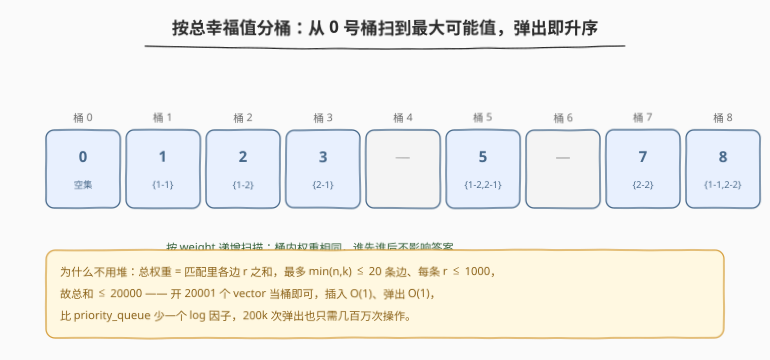
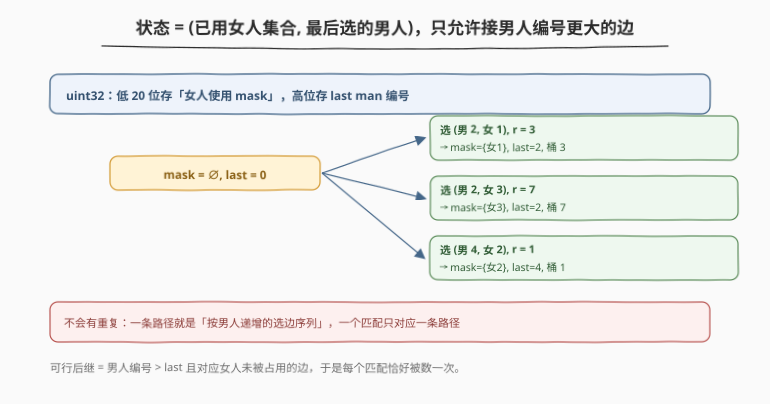
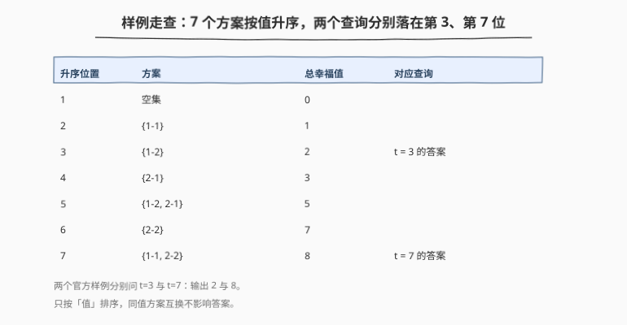

# Codeforces 177F2 剧本配对第k小 题解

## 1. 题目概述

- **题目链接**：https://codeforces.com/problemset/problem/177/F2
- **比赛来源**：ABBYY Cup 2.0 - Easy · Problem F2（UTC 2012-04-21）
- **难度**：2300
- **标签**：匹配、枚举、桶排序（Dial 算法）、状态压缩
- **评测类型**：普通
- **限制**：时间 2 s / 内存 256 MB

**题意**：有 $n$ 个男角色与 $n$ 个女角色，民意调查给出 $k$ 组"观众爱看"的配对 $(h,w,r)$，表示男 $h$ 与女 $w$ 在一起能带来 $r$ 点幸福；其他组合不会写进剧本。一个**可接受方案**是这 $k$ 个配对的一个子集，要求每个男角色、每个女角色都**至多**出现在一个配对中；方案的价值是选中配对的 $r$ 之和，空集价值为 0。

把所有可接受方案按价值从小到大排序（并列随意），求第 $t$ 个方案的价值。题面保证 $t$ 不超过方案总数，且 $(h,w)$ 不重复。

**约束**（满分档，也就是本篇 F2 的测试数据）：

- $1\le n\le 20$；
- $1\le k\le\min(100,n^2)$；
- $1\le r\le1000$，$1\le t\le2\cdot10^5$。

**与 F1 题的区别是约束**：F1 只测 30 分档 $n\le5$，方案数最多 $\sum_s\binom{5}{s}^2s!=1546$，枚举全部方案再排序即可；F2 的 $n\le20$，$K_{20,20}$ 的匹配数是天文数字（$20!\approx2.4\times10^{18}$ 量级），不可能全部枚举，只能"按价值从小到大逐个弹出，数到第 $t$ 个就停"。两篇的代码因此完全不同：F1 是 DFS + 排序，F2 是分桶 + 逐次弹出。

**这档约束排除了什么**：$t\le2\times10^5$ 说明只需产出前 $t$ 个方案；$n\le20$ 说明女人集合可以压进一个 32 位整数；$r\le1000$ 且一个匹配最多 $\min(n,k)\le20$ 条边，说明总价值不超过 $20000$，"按价值开桶"可行。这也排除了"枚举全部方案后排序"（方案数远超 $2\times10^5$）和"用堆维护"（桶可以把 $\log$ 省掉）。

## 2. 示例与观察

官方样例一（输入 / 输出原样）：

```text
输入：
2 4 3
1 1 1
1 2 2
2 1 3
2 2 7

输出：
2
```

官方样例二（同一张图，换 $t$）：

```text
输入：
2 4 7
1 1 1
1 2 2
2 1 3
2 2 7

输出：
8
```

**样例解释**：$n=2$，四条边 $(1,1,1)$、$(1,2,2)$、$(2,1,3)$、$(2,2,7)$。全部可接受方案（= 匹配）恰好 7 个，按价值升序为

| 位置 | 方案 | 价值 |
|------|------|------|
| 1 | 空集 | 0 |
| 2 | $\{(1,1)\}$ | 1 |
| 3 | $\{(1,2)\}$ | 2 |
| 4 | $\{(2,1)\}$ | 3 |
| 5 | $\{(1,2),(2,1)\}$ | 5 |
| 6 | $\{(2,2)\}$ | 7 |
| 7 | $\{(1,1),(2,2)\}$ | 8 |

所以 $t=3$ 输出 2、$t=7$ 输出 8，与两个官方样例一致。注意第 5 个方案价值 5 是"两条边组合"却排在第 6 个单边 7 之前：**边数少的方案不一定更小**，所以不能按匹配大小分层做。

**第一条观察**：每个可接受方案都是这张二分图的一个匹配。若按"男角色编号递增"记录被选中的边 $e_1<e_2<\dots$（按男端排序），这个序列唯一确定方案；反之任一合法的递增序列也唯一确定一个方案。于是所有方案可以组织成一棵生成树，每个匹配对应一个结点。

**第二条观察**：从某个匹配出发，只允许追加"男端编号更大、女端未被占用"的边，新价值 = 旧价值 + $r$，**严格更大**（$r\ge1$）。所以只要按价值从小到大取结点，取出的前 $t$ 个就是答案的前 $t$ 小。

**第三条观察**：总价值最大只有 $\min(n,k)\times1000\le20000$，可以用 20001 个桶代替优先队列，插入、弹出都是 $O(1)$。



自造样例（标注"自造"，输出为实测结果）：

| 输入 | 输出 | 说明 |
|------|------|------|
| `1 1 1` / `1 1 5` | 0 | 两个方案 $0,5$，$t=1$ |
| `1 1 2` / `1 1 5` | 5 | $t=2$ 取最大值 |
| `2 2 3` / `1 1 4` / `2 2 4` | 4 | 值为 $0,4,4,8$，并列值照样各占一位 |
| `2 2 4` / `1 1 4` / `2 2 4` | 8 | $t$ 取到方案总数 |
| `3 3 2` / `1 1 9` / `2 2 8` / `3 3 7` | 7 | 三条边互不冲突，第 2 小是单边 7 |
| `3 3 5` / `1 1 9` / `2 2 8` / `3 3 7` | 15 | 第 5 小是 $7+8=15$ |
| `20 1 2` / `7 13 999` | 999 | $n=20$ 但只有一条边，方案只有空集与它 |

## 3. 解题思路

### 3.1 朴素做法与瓶颈

**做法 A：枚举边子集**。$2^k$ 个，$k\le100$ 时是 $2^{100}$，不可能。

**做法 B：按男角色 DFS 枚举全部匹配**（即 F1 的写法）。$K_{20,20}$ 的匹配数为

$$\sum_{s=0}^{20}\binom{20}{s}^2s!,$$

其中仅 $s=20$ 一项就是 $20!\approx2.4\times10^{18}$，总量远超 $10^{18}$，无论多快的机器都枚举不完。

**做法 C：用优先队列（堆）做 best-first**。思路正确：每次弹出当前最小的匹配、再压入它的后继。但每次压入/弹出要 $O(\log)$，$2\times10^5$ 次弹出配合最多 $10^7$ 次压入，堆的常数不小；更关键的是总价值上界只有 $20000$，用堆是"杀鸡用牛刀"。

瓶颈不在"排序"，而在"只产出前 $t$ 个"。只要能把"后继"的生成做成 $O(1)$ 入桶，就赢了。

### 3.2 核心观察：生成树 + 分桶



把匹配表示成状态 $(\textit{mask},\textit{last})$：$\textit{mask}$ 是已占用女角色的位掩码，$\textit{last}$ 是"最后一条被选中边的男端编号"（空匹配时 $\textit{last}=0$）。

- **后继**：从状态 $(\textit{mask},\textit{last})$ 出发，任选一条边 $(h,w,r)$ 满足 $h>\textit{last}$ 且 $w\notin\textit{mask}$，得到新状态 $(\textit{mask}\cup\{w\},\,h)$，价值增加 $r$。
- **唯一性**：一个匹配按其男端编号排序后是唯一的递增序列，所以它只能从"去掉最后一条边"的那个匹配扩展而来——每个匹配**恰好有一个父亲**，生成过程不重不漏。
- **单调性**：$r\ge1$，所以子结点价值严格大于父结点。

于是整张图是"以空匹配为根的有向树"，边权为正。要按价值升序取前 $t$ 个结点，标准做法是优先队列；但价值范围只有 $[0,20000]$，可以开 20001 个桶：结点放进"价值"对应的桶，从 0 号桶开始顺序扫描，桶内顺序任意（同桶价值相同，谁先谁后不影响"第 $t$ 小的值"）。

状态压缩：$n\le20$，`mask` 占低 20 位，`last` 占高位，一个 `uint32` 装得下；桶里只存这个整数，省内存。

### 3.3 算法流程

1. 读入 $n,k,t$，把边按男端挂到 `edgeOf[h]`（存"女端编号、$r$"）；
2. 令 $\textit{maxWeight}=\min(n,k)\times1000$（匹配最多 $\min(n,k)$ 条边，每条 $r\le1000$）；
3. 开 $\textit{maxWeight}+1$ 个桶，把空匹配（`mask=0, last=0`）放进 0 号桶；
4. 令 `count = 0`，从 $\textit{weight}=0$ 扫到 $\textit{maxWeight}$：
   - 依次弹出当前桶里的每个状态：`count += 1`；若 `count == t` 就直接输出 $\textit{weight}$ 并结束；
   - 否则枚举所有 $h>\textit{last}$ 的边，若女端未被占用，就把新状态压入 $\textit{weight}+r$ 号桶；
5. 题面保证 $t$ 不超过方案总数，循环一定能返回。

### 3.4 样例走查

以官方样例为例，7 个方案的价值是 $0,1,2,3,5,7,8$，分桶后：

| 桶 | 0 | 1 | 2 | 3 | 4 | 5 | 6 | 7 | 8 |
|----|---|---|---|---|---|---|---|---|---|
| 内容 | 空集 | $\{(1,1)\}$ | $\{(1,2)\}$ | $\{(2,1)\}$ | 空 | $\{(1,2),(2,1)\}$ | 空 | $\{(2,2)\}$ | $\{(1,1),(2,2)\}$ |

扫描顺序即 $0\to1\to2\to3\to5\to7\to8$：第 3 次弹出落在 2 号桶，输出 2；第 7 次弹出落在 8 号桶，输出 8。



具体生成过程（前几步）：

| 弹出（价值） | 已占用女 | 后继（价值） |
|--------------|----------|--------------|
| 0（空集） | ∅ | $\{(1,1)\}\to1$，$\{(1,2)\}\to2$，$\{(2,1)\}\to3$，$\{(2,2)\}\to7$ |
| 1（$\{(1,1)\}$） | $\{1\}$ | 只能接男 2、女 2：$\{(1,1),(2,2)\}\to8$ |
| 2（$\{(1,2)\}$） | $\{2\}$ | 只能接男 2、女 1：$\{(1,2),(2,1)\}\to5$ |
| 3（$\{(2,1)\}$） | $\{1\}$ | 男端必须 $>2$，没有后继 |
| 5 | $\{1,2\}$ | 没有后继 |

可以看到每个方案只出现一次，且后继价值严格变大。

## 4. 正确性证明

**引理 1（唯一父结点）**：设 $\mathcal{M}$ 为全部可接受方案（匹配）。对任意非空 $M\in\mathcal{M}$，令 $e^{\star}$ 为 $M$ 中男端编号最大的边，则 $M\setminus\{e^{\star}\}$ 也是匹配，且 $M$ 在生成图中唯一的父结点就是 $M\setminus\{e^{\star}\}$。

**证明**：子集删边后每个男、女出现次数只会减少，故 $M\setminus\{e^{\star}\}$ 仍是匹配。反过来，若 $P$ 能扩展出 $M$，则新增的边必是 $M$ 中男端最大的边（因为扩展只允许追加男端更大的边），所以 $P=M\setminus\{e^{\star}\}$，唯一。∎

**引理 2（不重不漏）**：从空匹配出发、按上述规则扩展，每个 $M\in\mathcal{M}$ 恰好被生成一次。

**证明**：对 $|M|$ 归纳。$|M|=0$ 时只有空匹配。设 $|M|>0$，由引理 1，$M$ 的父亲唯一是 $M\setminus\{e^{\star}\}$，它比 $M$ 少一条边、且满足归纳假设"恰好生成一次"，于是 $M$ 恰好在弹出它父亲时被压入一次；又因为父亲的男端编号严格小于 $e^{\star}$，扩展规则允许该边。∎

**引理 3（后继价值严格更大）**：若状态 $Q$ 由 $P$ 扩展一条边得到，则 $Q$ 的价值严格大于 $P$ 的价值。

**证明**：新增边的 $r\ge1$，其余部分不变。∎

**引理 4（弹出序列按价值非降）**：算法按 $\textit{weight}=0,1,\dots,\textit{maxWeight}$ 的顺序弹桶，任意结点被弹出时它的价值不小于此前弹出过的所有结点。

**证明**：桶按价值下标升序扫描；引理 3 保证任何结点都只能被价值更小的结点压入，而更小的价值所在的桶已经被扫描过，所以它一定在轮到自己的桶之前就已经在桶里。因此弹出顺序就是价值非降序。桶内顺序任意，但同桶价值相同，不影响"第 $t$ 个位置的值"。∎

**定理（算法正确）**：算法输出第 $t$ 小的方案价值。

**证明**：由引理 2，每个可接受方案恰好被弹出一次，所以第 $t$ 次弹出的结点就是"按某个非降序排列后的第 $t$ 个方案"；由引理 4，该顺序的价值非降，故它是第 $t$ 小的价值。题面保证 $t$ 不超过方案总数，循环必然在此之前返回。∎

**引理 5（上界足够大）**：$\textit{maxWeight}=\min(n,k)\cdot1000$ 不小于任何方案的价值。

**证明**：匹配中每个男角色至多一条边，故边数 $\le n$；总边数只有 $k$ 条，故边数 $\le k$；每条边 $r\le1000$。所以价值 $\le\min(n,k)\times1000$。∎

## 5. 复杂度分析

- **时间**：共弹出 $t$ 个结点（数到 $t$ 就停），每个结点展开 $\le k$ 条边，单次入桶 $O(1)$（不是堆），所以 $O(t\cdot k + \min(n,k)\cdot1000)$。$t=2\times10^5$、$k=100$ 时上界约 $2\times10^7$ 次简单操作；实测四种极端数据都在 $10$ ms 量级。
- **空间**：桶数组 $O(\min(n,k)\cdot1000)$ 个桶 + 桶内结点。结点用 `uint32` 压成 8 字节以内，最坏 $O(t\cdot k)$ 个，实测峰值 $17\sim25$ MB，远低于 256 MB。
- **数值范围**：价值 $\le20000$ 用 `int` 就够；方案的"个数"可能很大，但代码只数到 $t\le2\times10^5$，用 `long long` 计数。
- **与时限的关系**：桶扫描是顺序访问，缓存友好；相比 `priority_queue` 少一个 $\log$ 因子，因此 $2\times10^5$ 次弹出也能轻松压进 2 s。

## 6. 参考代码

### C++17

```cpp
#include <bits/stdc++.h>
using namespace std;

int main() {
    ios::sync_with_stdio(false);
    cin.tie(nullptr);

    int n, k;
    long long t;
    if (!(cin >> n >> k >> t)) return 0;
    vector<vector<pair<int, int>>> edgeOf(n + 1);  // 男人编号 1..n -> (女人 0..n-1, r)
    for (int i = 0; i < k; ++i) {
        int h, w, r;
        cin >> h >> w >> r;
        edgeOf[h].push_back({w - 1, r});
    }

    // 一个匹配最多 min(n,k) 条边，每条边权 <= 1000
    int maxWeight = min(n, k) * 1000;
    // 状态压成一个 uint32：低 20 位 = 已用女人集合，高位 = 最后选的男人编号
    const int SHIFT = 20, MASK = (1 << 20) - 1;
    vector<vector<unsigned int>> bucket(maxWeight + 1);
    bucket[0].push_back(0u);  // 空匹配，(mask=0, lastMan=0)

    long long count = 0;
    for (int weight = 0; weight <= maxWeight; ++weight) {
        vector<unsigned int> &cur = bucket[weight];
        for (size_t idx = 0; idx < cur.size(); ++idx) {
            unsigned int state = cur[idx];
            int mask = (int)(state & MASK);
            int last = (int)(state >> SHIFT);
            if (++count == t) {  // 按权值从小到大弹出，第 t 个就是答案
                cout << weight << '\n';
                return 0;
            }
            for (int man = last + 1; man <= n; ++man) {
                for (auto &e : edgeOf[man]) {
                    int woman = e.first;
                    if (mask >> woman & 1) continue;
                    int nw = weight + e.second;
                    if (nw > maxWeight) continue;
                    bucket[nw].push_back((unsigned int)(mask | (1 << woman)) |
                                         ((unsigned int)man << SHIFT));
                }
            }
        }
    }
    return 0;  // 题面保证 t 不超过可接受方案总数，不会走到这里
}
```

### Python3

```python
import sys


def main() -> None:
    data = sys.stdin.buffer.read().split()
    if not data:
        return
    it = iter(data)
    n = int(next(it)); k = int(next(it)); t = int(next(it))
    edge_of = [[] for _ in range(n + 1)]
    for _ in range(k):
        h = int(next(it)); w = int(next(it)) - 1; r = int(next(it))
        edge_of[h].append((w, r))

    max_weight = min(n, k) * 1000
    buckets = [[] for _ in range(max_weight + 1)]
    buckets[0].append((0, 0))  # (已用女人集合, 最后一个男人)

    count = 0
    for weight in range(max_weight + 1):
        cur = buckets[weight]
        idx = 0
        while idx < len(cur):
            mask, last = cur[idx]
            idx += 1
            count += 1
            if count == t:
                sys.stdout.write(str(weight) + "\n")
                return
            for man in range(last + 1, n + 1):
                for woman, r in edge_of[man]:
                    if (mask >> woman) & 1:
                        continue
                    nw = weight + r
                    if nw > max_weight:
                        continue
                    buckets[nw].append((mask | (1 << woman), man))


main()
```

Python 版在 $t=2\times10^5$、$k=100$ 的极端数据上会明显偏慢，提交时建议 PyPy3 或直接用 C++；两份代码在全部官方样例与随机对拍上结果一致。

## 7. 边界情况与易错点

1. **$t=1$ 直接是 0**：空匹配价值 0，必在 0 号桶第一个被弹出；不要漏掉"空集也是方案"这条。
2. **并列价值**：桶内顺序任意，但**不能去重**——不同方案即使价值相同也各占一个名次。代码只数弹出次数、不判重，正是对的。
3. **"边数少不一定价值小"**：样例中价值 5 的双边方案排在价值 7 的单边方案之前，所以不能按匹配大小分层处理，必须全局按价值排序。
4. **上界 $\min(n,k)\times1000$**：匹配边数受两边限制，写成 $n\times1000$ 或 $k\times1000$ 都不会错，但写成"$n^2\times1000$"会白开 200 万个桶。反过来若把上界写小（比如只按 $k$ 条边里最大的 $r$ 求和），要注意匹配大小受 $n$ 限制。
5. **位掩码宽度**：$n\le20$ 时 `mask` 占 20 位、`last` 放在第 20 位起（`SHIFT=20`），一个 `uint32` 刚好；若把 `SHIFT` 写成 16 会与 `mask` 重叠，若 $n$ 超过 20 会直接溢出——这正是 F2 数据档的边界。
6. **`last` 的含义**：它是"最后选的男端编号"，空匹配时为 0，扩展时要求 `man > last`；写成 `>=` 会重复生成并引入不合法方案。
7. **空间最坏情况**：$2\times10^5$ 次弹出、每次最多压入 $k=100$ 个，最坏约 $2\times10^7$ 个结点；用 `uint32` 压缩后约 80 MB，仍在 256 MB 以内。若用 `pair<int,int>` 存会翻倍，需留意。
8. **`t` 超过方案数**：题面保证不会，但代码在循环结束时没有输出；本地对拍时若构造非法 $t$ 会看到空输出，这属于输入非法，不是算法错误。
9. **输入只有一组**：没有多测，也没有"读到 EOF"的格式；每轮桶数组都要重新开，不能跨测复用。

## 8. 验证记录

- **编译环境与命令**：本机无 GNU `g++`，用 `clang++ -std=c++17 -O2` + `codeforces/tools/include` 的兼容头编译；Python 3.9.6。文档级校验：`python3 codeforces/tools/verify_solution.py codeforces/contests/0101-0203/177/F2_剧本配对第k小.md`。
- **官方样例**：2 / 2 通过（$t=3\to2$，$t=7\to8$），C++ 与 Python 输出一致。
- **自造样例**：第 2 节表格 7 组（$t=1$、$t$ 取满、并列值、$n=20$ 只有一条边）全部与手算一致。
- **三路对拍**：
  1. 小规模：$n\le5$、$k\le12$ 随机 **300 组**，与"枚举 $2^k$ 子集 + 检查冲突"的暴力逐组比对，全部一致；
  2. 中规模：$n\in[6,11]$、$k\le22$ 随机 **120 组**，与"DFS 枚举全部匹配后排序"的独立实现比对，全部一致；
  3. 大规模：$n\in[12,20]$、$k\le100$ 随机 **40 组**，与"优先队列 best-first"的独立实现比对（$t\le3000$），全部一致。
- **最大约束性能**：$n=20,k=100,t=2\times10^5$ 测了四类数据（10×10 全图全 1、随机边随机权、随机边权值只有 1..3、20×5 全图），C++ 端到端均约 $10$ ms，峰值内存 $10\sim24$ MB；相对 2 s / 256 MB 余量充足。
- **图片校验**：三张 SVG（`cf177f2_bucket.svg`、`cf177f2_state.svg`、`cf177f2_sample.svg`）均通过 `xml.etree.ElementTree.parse`，文本包围盒未越界、无重叠。
- **复核状态**：verified（样例、自造样例、三路对拍、四类极端数据性能、图片均实跑通过）。

## 相关题目与扩展

- [Codeforces 177F1 Script Generation](https://codeforces.com/problemset/problem/177/F1)：简单版，$n\le5$，直接 DFS 枚举 + 排序即可，是本篇的对照。
- [Codeforces 177B2 Rectangular Game](https://codeforces.com/problemset/problem/177/B2)：同场题，同样体现"简单版靠枚举、困难版靠结构"的命题方式。
- [LeetCode 1834 单线程 CPU](https://leetcode.cn/problems/single-threaded-cpu/)：按时间分桶/排序模拟，体会"值域小就可以用桶"的取舍。
- [Codeforces 1106E Lunar New Year and Red Envelopes](https://codeforces.com/problemset/problem/1106/E)：同样在值域上做桶/DP 的题，可以对照桶式枚举的写法。
- [Codeforces 1139C Edgy Trees](https://codeforces.com/problemset/problem/1139/C)：图上"选/不选"的计数题，与本题的匹配生成树互为表里。

**延伸思考**：

1. **如果 $t$ 更大（比如 $10^9$）**：桶式枚举的复杂度是 $O(tk)$，$t$ 变大后不可行；此时需要"计数 + 二分答案"，即统计价值 $\le W$ 的方案数，而这在一般二分图上是 #P 难的——这正是本题把 $t$ 限制在 $2\times10^5$ 的原因。
2. **如果边权可以到 $10^9$**：总价值上界变成 $20\times10^9$，桶开不下，只能退回优先队列（$O(tk\log)$），或者用"按层合并"的其他 k 小枚举结构。
3. **如果要求第 $t$ 小的方案本身（而不是价值）**：桶里除了 `(mask,last)` 还要记录父指针，弹出第 $t$ 个后沿父链回溯即可，空间换时间。
4. **如果边权有负数**：空集不再是最小值，生成树的后继也可能更小，桶式"按价值递增扫描"的前提被破坏；需要先用最小权匹配之类的手段处理负权，再考虑枚举。

