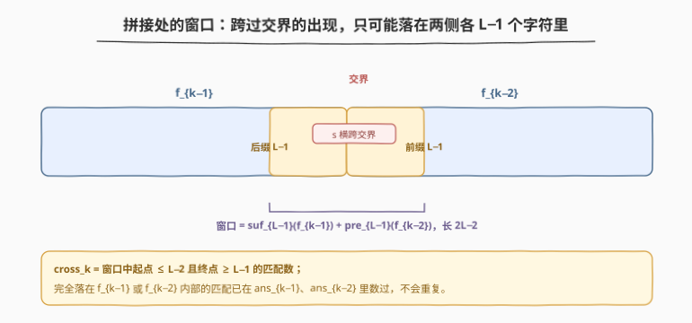
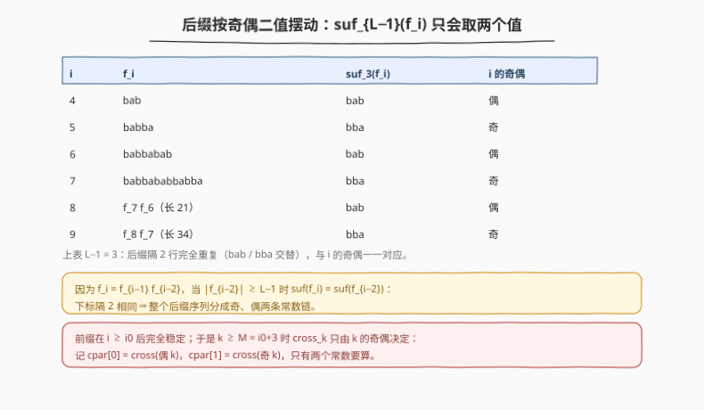
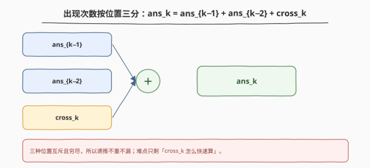
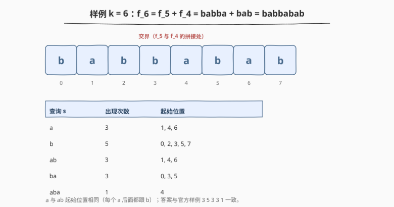

# Codeforces 177G1 斐波那契串逐项 题解

## 1. 题目概述

- **题目链接**：https://codeforces.com/problemset/problem/177/G1
- **比赛来源**：ABBYY Cup 2.0 - Easy · Problem G1（UTC 2012-04-21）
- **难度**：2400
- **标签**：字符串、KMP、递推、周期（奇偶）稳定性
- **评测类型**：普通
- **限制**：时间 2 s / 内存 256 MB

**题意**：斐波那契串定义为 $f_1=$ `a`，$f_2=$ `b`，$f_n=f_{n-1}f_{n-2}$（$n>2$），前五项是 `a`、`b`、`ba`、`bab`、`babba`。给定 $k$ 与 $m$ 个只含 `a`/`b` 的非空串 $s_i$，对每个 $s_i$ 求它在 $f_k$ 中作为**子串**出现的次数，答案对 $10^9+7$ 取模。子串按出现位置计数，允许重叠；答案按输入顺序输出。

**约束**（30 分档，也就是本篇 G1 的测试数据）：

- $1\le k\le3000$；
- $1\le m\le3000$；
- $\sum_i|s_i|\le3000$。

**与 G2 题的区别是约束**：G1 的 $k$ 只有 $3000$，每个询问可以在 $O(k)$ 的递推里一步步走到第 $k$ 项；G2 的 $k$ 到 $10^{18}$、$m$ 到 $10^4$、$\sum|s_i|$ 到 $10^5$，逐项推到 $k$ 不行，必须把递推写成矩阵快速幂。两篇的"前一半"（拼接处窗口 + 奇偶稳定性）相同，但尾巴的处理完全不同，因此是两篇独立题解。

**这档约束排除了什么**：$k\le3000$ 意味着 $O(k)$ 的逐项递推每个询问都负担得起（$3000\times3000=9\times10^6$ 次加法）；但同时 $|f_{3000}|$ 约 $10^{626}$，任何"把 $f_k$ 建出来"的想法都被排除——即使是 $k=3000$ 也不行。所以必须只保留"拼接处附近的 $L-1$ 个字符"和"出现次数"这两类信息。

## 2. 示例与观察

官方样例（输入 / 输出原样）：

```text
输入：
6 5
a
b
ab
ba
aba

输出：
3
5
3
3
1
```

**样例解释**：$f_1=$ `a`，$f_2=$ `b`，$f_3=$ `ba`，$f_4=$ `bab`，$f_5=$ `babba`，$f_6=f_5f_4=$ `babbabab`。

把 `babbabab` 的每个位置标出来：

| 下标 | 0 | 1 | 2 | 3 | 4 | 5 | 6 | 7 |
|------|---|---|---|---|---|---|---|---|
| 字符 | b | a | b | b | a | b | a | b |

逐个询问：

- `a` 出现在 1、4、6，共 3 次；
- `b` 出现在 0、2、3、5、7，共 5 次；
- `ab` 出现在 1、4、6 起的位置，共 3 次（每个 `a` 后面都跟着 `b`）；
- `ba` 出现在 0、3、5 起的位置，共 3 次；
- `aba` 只出现在 4 起的位置（`a b a`），共 1 次。

结果 `3 5 3 3 1` 与官方输出一致。

**第一条观察**：$f_k=f_{k-1}f_{k-2}$。一个子串的出现位置只有三种情形：整段落在 $f_{k-1}$ 内、整段落在 $f_{k-2}$ 内、**跨过拼接缝**。前两种分别被 $ans_{k-1}$、$ans_{k-2}$ 统计，于是

$$ans_k=ans_{k-1}+ans_{k-2}+cross_k ,$$

其中 $cross_k$ 是跨缝出现的次数。

**第二条观察**：长度 $L$ 的串若跨缝，它在缝左边只可能占 $\le L-1$ 个字符、右边也 $\le L-1$ 个字符。所以 $cross_k$ 只由 $f_{k-1}$ 的**长为 $L-1$ 的后缀**与 $f_{k-2}$ 的**长为 $L-1$ 的前缀**决定。

**第三条观察**：这两个"窗口"很快就不再变化——$f_i$ 是 $f_{i+1}$ 的前缀，所以前缀会稳定；后缀则**按奇偶二值摆动**（见 3.2）。于是 $cross_k$ 从某一项起只与 $k$ 的奇偶有关，只剩两个常数。

自造样例（标注"自造"，输出为实测结果）：

| 输入 | 输出 | 说明 |
|------|------|------|
| `1 1` / `a` | 1 | $f_1=$ `a` |
| `2 1` / `ab` | 0 | $f_2=$ `b` 太短，答案 0 |
| `5 1` / `bab` | 1 | $f_5=$ `babba`，`bab` 只在开头 |
| `5 1` / `babba` | 1 | 整个串就是 $f_5$ 本身 |
| `20 1` / `aaa` | 0 | 斐波那契串里不会出现 `aaa`（见第 7 节） |
| `3000 1` / `a` | 61311429 | $k$ 取满、单字符，答案等于 $F_{k-2}\bmod(10^9+7)$ |

## 3. 解题思路

### 3.1 朴素做法与瓶颈

最直接的做法是按定义把 $f_1,\dots,f_k$ 建出来，对每个询问跑一次匹配。可是 $|f_i|=|f_{i-1}|+|f_{i-2}|$ 正是斐波那契数列：$|f_k|=F_{k-1}$ 量级，$k=3000$ 时约 $10^{626}$ 个字符，连存都存不下；即使 $k=60$，长度也已过万亿。

另一个想法是"只保留前 $L$ 个字符"，但子串出现在 $f_k$ 的**任意**位置，只看前缀会漏掉绝大多数出现。

所以必须把"出现次数"和"窗口内容"分开维护：次数用递推累加，窗口只留 $O(L)$ 个字符。

### 3.2 核心观察：拼接缝窗口与奇偶稳定性



**窗口**。设 $L=|s|$。若 $s$ 的一次出现在 $f_k=f_{k-1}f_{k-2}$ 中跨缝，设它在缝左边占 $p$ 个字符（$1\le p\le L-1$），则这 $p$ 个字符必须是 $f_{k-1}$ 的末尾 $p$ 个，另外 $L-p$ 个必须是 $f_{k-2}$ 的开头若干个。把两侧各取 $L-1$ 个字符拼成

$$W_k=\operatorname{suf}_{L-1}(f_{k-1})\,\Vert\,\operatorname{pre}_{L-1}(f_{k-2}),$$

则 $cross_k$ 恰为"$W_k$ 中起点 $<L-1$ 且终点 $\ge L-1$ 的出现次数"（交界在 $W_k$ 的第 $L-1$ 个字符处）。这一步把"在长度 $10^{626}$ 的串里数"变成了"在一个长 $2L-2$ 的窗口里数"。

**前缀稳定**。因为 $f_{i+1}=f_if_{i-1}$ 以 $f_i$ 开头，所以 $f_i$ 是 $f_{i+1}$ 的前缀，$f_1,f_2,\dots$ 是一条前缀链。于是只要 $|f_i|\ge L-1$，$\operatorname{pre}_{L-1}(f_i)$ 就固定为同一个串。

**后缀按奇偶摆动**。设 $i0$ 是最小的满足 $|f_{i0}|\ge L-1$ 的下标。对 $i\ge i0+2$，有 $|f_{i-2}|\ge L-1$，而 $f_i=f_{i-1}f_{i-2}$，所以

$$\operatorname{suf}_{L-1}(f_i)=\operatorname{suf}_{L-1}(f_{i-2}).$$

也就是说：后缀序列从 $i0+2$ 起被分成**奇、偶两条常数链**，各自固定。注意这两条链的值**不一定相同**，不能想当然地认为"后缀会稳定到一个值"。



**结论**：取 $M=i0+3$。对任意 $k\ge M$，$k-1\ge i0+2$（后缀按奇偶稳定）、$k-2\ge i0+1\ge i0$（前缀稳定），于是 $cross_k$ 只由 $k$ 的奇偶决定：

$$cross_k=cpar[k\bmod 2].$$

只要算出 $cpar[0],cpar[1]$ 两个常数，递推 $ans_k=ans_{k-1}+ans_{k-2}+cpar[k\bmod2]$ 就能一路推到第 $k$ 项。

### 3.3 算法流程



对每个询问 $s$（长度 $L$）：

1. **算长度**。$|f_1|=|f_2|=1$，$|f_i|=|f_{i-1}|+|f_{i-2}|$（超过 $4\times10^{18}$ 就封顶，只需比较大小）。找 $i0=\min\{i:|f_i|\ge L-1\}$（$L=1$ 时 $i0=1$），令 $M=i0+3$、$J=M+1$；
2. **建小串**。真的把 $f_1,\dots,f_J$ 建出来——由 $i0$ 的最小性，$|f_{i0}|\le |f_{i0-1}|+|f_{i0-2}|<2(L-1)$，所以 $|f_J|=|f_{M+1}|\le8L$，完全存得下；
3. **直接数**。用 KMP 对每个 $f_i$（$i\le J$）数出 $s$ 的出现次数，得到精确的 $ans[1..J]$；
4. **若 $k\le J$**：直接输出 $ans[k]$（例如样例里的 `aba`，$L=3$、$M=6$、$J=7$，$k=6$ 落在其中）；
5. **否则**：由差分得到两个跨缝常数
   $$cpar[M\bmod2]=ans[M]-ans[M-1]-ans[M-2],\qquad cpar[(M+1)\bmod2]=ans[M+1]-ans[M]-ans[M-1],$$
   再从 $i=M+1$ 循环到 $k$：$ans_i=(ans_{i-1}+ans_{i-2}+cpar[i\bmod2])\bmod(10^9+7)$；
6. 输出 $ans_k$。

第 5 步看似把 $i=M+1$ 重算了一遍，但由 $cpar$ 的定义式，重算结果与 $ans[M+1]$ 必然相同，所以从 $M+1$ 起循环是安全的。

### 3.4 样例走查

以询问 `a`（$L=1$）为例：$L-1=0$，$i0=1$、$M=4$、$J=5$。建出 $f_1..f_5$：`a`、`b`、`ba`、`bab`、`babba`，KMP 得到

| $i$ | 1 | 2 | 3 | 4 | 5 |
|-----|---|---|---|---|---|
| $f_i$ | a | b | ba | bab | babba |
| $ans_i$（`a` 的出现次数） | 1 | 0 | 1 | 1 | 2 |

差分：$cpar[0]=ans_4-ans_3-ans_2=1-1-0=0$，$cpar[1]=ans_5-ans_4-ans_3=2-1-1=0$。$k=6>J$，于是

$$ans_6=ans_5+ans_4+cpar[0]=2+1+0=3,$$

与官方输出的第一行 3 一致。

再以 `aba`（$L=3$）为例：$L-1=2$，$|f_3|=2\ge2$ 故 $i0=3$、$M=6$、$J=7$。$k=6\le J$，直接取 KMP 在 $f_6=$ `babbabab` 上的计数 1，与官方输出最后一行一致。

其余三个询问同理（`b` 的 $cpar$ 也都为 0，因为单字符永远不会跨缝；`ab`、`ba` 的 $cpar$ 需要实际算窗口，但其值在 $k\ge M$ 后固定）。



## 4. 正确性证明

**引理 1（三分）**：$ans_k=ans_{k-1}+ans_{k-2}+cross_k$，其中 $cross_k$ 是跨过 $f_{k-1}$ 与 $f_{k-2}$ 拼接缝的出现次数。

**证明**：$f_k$ 由 $f_{k-1}$ 与 $f_{k-2}$ 顺序拼成，缝在位置 $|f_{k-1}|$。任一次出现 $[l,r]$（$r-l+1=L$）必属于且仅属于：$r<|f_{k-1}|$（全在左）、$l\ge|f_{k-1}|$（全在右）、$l<|f_{k-1}|\le r$（跨界）。前两类分别被 $ans_{k-1}$、$ans_{k-2}$ 恰好统计一次，第三类由 $cross_k$ 统计。∎

**引理 2（窗口充分）**：$cross_k$ 只依赖 $\operatorname{suf}_{L-1}(f_{k-1})$ 与 $\operatorname{pre}_{L-1}(f_{k-2})$，且等于 $W_k=\operatorname{suf}_{L-1}(f_{k-1})\Vert\operatorname{pre}_{L-1}(f_{k-2})$ 中"起点 $<L-1\le$ 终点"的出现次数。

**证明**：跨界的出现满足 $l<|f_{k-1}|\le r$ 且 $r-l+1=L$，故 $|f_{k-1}|-l\le L-1$（左侧部分长度）且 $r-|f_{k-1}|+1\le L-1$（右侧部分长度），即它完全落在窗口 $W_k$ 内，并且在该窗口中的起点 $l-(|f_{k-1}|-(L-1))$ 满足 $0\le\cdot<L-1$、终点 $\ge L-1$。反之窗口里每个满足该位置条件的匹配都对应一次跨界出现。一一对应。∎

**引理 3（前缀稳定）**：对任意 $i\ge i0$ 有 $\operatorname{pre}_{L-1}(f_i)=\operatorname{pre}_{L-1}(f_{i0})$。

**证明**：$f_{i+1}=f_if_{i-1}$ 以 $f_i$ 为前缀，归纳得 $f_{i0}$ 是任意 $f_i$（$i\ge i0$）的前缀；而 $|f_{i0}|\ge L-1$，故长度 $L-1$ 的前缀相同。∎

**引理 4（后缀奇偶稳定）**：对任意 $i\ge i0+2$ 有 $\operatorname{suf}_{L-1}(f_i)=\operatorname{suf}_{L-1}(f_{i-2})$。

**证明**：$f_i=f_{i-1}f_{i-2}$，当 $|f_{i-2}|\ge L-1$（由 $i-2\ge i0$ 保证）时，$f_i$ 的后缀 $L-1$ 个字符完全落在 $f_{i-2}$ 内，故等于 $f_{i-2}$ 的后缀。∎

**引理 5（跨缝常数按奇偶固定）**：令 $M=i0+3$。对任意 $k\ge M$，$cross_k=cpar[k\bmod2]$，其中 $cpar[0],cpar[1]$ 是只依赖 $s$ 的两个常数。

**证明**：$k\ge M$ 时 $k-1\ge i0+2$、$k-2\ge i0+1\ge i0$。由引理 3，$\operatorname{pre}_{L-1}(f_{k-2})$ 恒为 $P$。由引理 4，$\operatorname{suf}_{L-1}(f_{k-1})$ 只取决于 $k-1$ 与 $i0$ 的奇偶关系：$k-1\equiv i0\pmod2$ 时等于 $\operatorname{suf}_{L-1}(f_{i0})$，否则等于 $\operatorname{suf}_{L-1}(f_{i0+1})$。于是 $W_k$ 只有两种可能，$cross_k$ 只有两个取值，且由 $k-1$ 的奇偶决定，即由 $k$ 的奇偶决定。∎

**引理 6（$cpar$ 的差分正确）**：步骤 5 算出的 $cpar[M\bmod2]$ 等于 $cross_M$，$cpar[(M+1)\bmod2]$ 等于 $cross_{M+1}$。

**证明**：由引理 1，$cross_i=ans_i-ans_{i-1}-ans_{i-2}$，而 $ans[M-2..M+1]$ 都由 KMP 精确算出（步骤 3）。$M$ 与 $M+1$ 的奇偶不同，正好各代表一条后缀链。∎

**定理（算法正确）**：对每个询问，算法输出 $s$ 在 $f_k$ 中的出现次数模 $10^9+7$。

**证明**：若 $k\le J$，算法直接返回 KMP 在 $f_k$ 上的精确计数，显然正确。否则 $k\ge J+1=M+2>M$：对 $i=M+1..k$ 归纳证明 `ans[i]` 等于真实出现次数。$i=M+1$ 时由引理 6，$ans[M]+ans[M-1]+cpar[(M+1)\bmod2]=ans[M+1]$，正确；若 $i-1,i-2$ 正确，则 $ans_i=ans_{i-1}+ans_{i-2}+cross_i$（引理 1、5），也正确。取模不影响同余意义下的结果。∎

## 5. 复杂度分析

- **时间**：每个询问先花 $O(L)$ 建前缀函数、$O(|f_J|)=O(L)$ 建小串并做 KMP（$\sum_{i\le J}|f_i|=O(|f_J|)=O(L)$，因为长度按斐波那契增长），再花 $O(k)$ 走递推。单询问 $O(L+k)$，总计 $O(\sum|s_i|+m\cdot k)$。30 分档下 $\le3000+3000\times3000\approx9\times10^6$，实测约 $39$ ms。
- **空间**：$O(L)$ 的字符串与小串数组，$O(k)$ 的递推只用两个滚动变量；没有 $O(k)$ 的数组。
- **数值范围**：长度超过 $4\times10^{18}$ 封顶即可（只用于比较 $|f_i|\ge L-1$）；答案随时取模，`long long` 足够。
- **与时限的关系**：$k,m\le3000$ 的 30 分档给的是"逐项递推也能过"的空间；同一份思路在 G2 的 $10^{18}$ 数据上会直接超时，所以 G2 必须换矩阵快速幂。

## 6. 参考代码

### C++17

```cpp
#include <bits/stdc++.h>
using namespace std;

static const long long MOD = 1000000007LL;

int main() {
    ios::sync_with_stdio(false);
    cin.tie(nullptr);

    long long k;
    int m;
    if (!(cin >> k >> m)) return 0;
    vector<string> query(m);
    for (auto &s : query) cin >> s;

    const long long CAP = (long long)4e18;
    vector<long long> len(3, 0);
    len[1] = len[2] = 1;  // |f_1| = |f_2| = 1
    auto ensureLen = [&](int upto) {
        while ((int)len.size() - 1 < upto) {
            long long v = len[len.size() - 1] + len[len.size() - 2];
            len.push_back(v > CAP ? CAP : v);
        }
    };

    for (const string &s : query) {
        int L = (int)s.size();
        long long need = max(0, L - 1);
        int i0 = 1;
        ensureLen(i0);
        while (len[i0] < need) {
            ++i0;
            ensureLen(i0);
        }
        int M = i0 + 3;      // k >= M 时跨接项只与 k 的奇偶有关
        int J = M + 1;       // 需要 ans[M-1..M+1] 来求两个跨接常数
        ensureLen(J);

        vector<string> f(J + 1);
        f[1] = "a";
        f[2] = "b";
        for (int i = 3; i <= J; ++i) f[i] = f[i - 1] + f[i - 2];

        vector<int> pi(L, 0);
        for (int i = 1; i < L; ++i) {
            int j = pi[i - 1];
            while (j > 0 && s[i] != s[j]) j = pi[j - 1];
            if (s[i] == s[j]) ++j;
            pi[i] = j;
        }
        auto countIn = [&](const string &t) {
            long long c = 0;
            int j = 0;
            for (char ch : t) {
                while (j > 0 && ch != s[j]) j = pi[j - 1];
                if (ch == s[j]) ++j;
                if (j == L) { ++c; j = pi[j - 1]; }
            }
            return c % MOD;
        };

        vector<long long> ans(J + 1, 0);
        for (int i = 1; i <= J; ++i)
            ans[i] = ((int)f[i].size() >= L) ? countIn(f[i]) : 0;

        if (k <= J) {
            cout << ans[k] << '\n';
            continue;
        }

        long long cpar[2];
        cpar[M & 1] = ((ans[M] - ans[M - 1] - ans[M - 2]) % MOD + 2 * MOD) % MOD;
        cpar[(M + 1) & 1] = ((ans[M + 1] - ans[M] - ans[M - 1]) % MOD + 2 * MOD) % MOD;

        long long prev2 = ans[M - 1], prev1 = ans[M];
        for (long long i = M + 1; i <= k; ++i) {
            long long cur = (prev1 + prev2 + cpar[i & 1]) % MOD;
            prev2 = prev1;
            prev1 = cur;
        }
        cout << prev1 << '\n';
    }
    return 0;
}
```

### Python3

```python
import sys

MOD = 1000000007
CAP = 4 * 10 ** 18


def occurrences(text: str, pat: str, pi) -> int:
    """KMP 统计 pat 在 text 中出现次数（可重叠），返回对 MOD 取模的结果。"""
    L = len(pat)
    cnt = 0
    j = 0
    for ch in text:
        while j > 0 and ch != pat[j]:
            j = pi[j - 1]
        if ch == pat[j]:
            j += 1
        if j == L:
            cnt += 1
            j = pi[j - 1]
    return cnt % MOD


def prefix_function(pat: str):
    L = len(pat)
    pi = [0] * L
    for i in range(1, L):
        j = pi[i - 1]
        while j > 0 and pat[i] != pat[j]:
            j = pi[j - 1]
        if pat[i] == pat[j]:
            j += 1
        pi[i] = j
    return pi


def main() -> None:
    data = sys.stdin.buffer.read().split()
    if not data:
        return
    k = int(data[0])
    m = int(data[1])
    queries = [data[2 + i].decode() for i in range(m)]

    length = [0, 1, 1]  # length[i] = |f_i|，超过 CAP 后不再精确

    def ensure(upto: int) -> None:
        while len(length) - 1 < upto:
            length.append(min(length[-1] + length[-2], CAP))

    out = []
    for s in queries:
        L = len(s)
        need = max(0, L - 1)
        i0 = 1
        ensure(i0)
        while length[i0] < need:
            i0 += 1
            ensure(i0)
        M = i0 + 3
        J = M + 1
        ensure(J)

        f = [""] * (J + 1)
        f[1] = "a"
        f[2] = "b"
        for i in range(3, J + 1):
            f[i] = f[i - 1] + f[i - 2]

        pi = prefix_function(s)
        ans = [0] * (J + 1)
        for i in range(1, J + 1):
            ans[i] = occurrences(f[i], s, pi) if len(f[i]) >= L else 0

        if k <= J:
            out.append(str(ans[k]))
            continue

        cpar = [0, 0]
        cpar[M & 1] = (ans[M] - ans[M - 1] - ans[M - 2]) % MOD
        cpar[(M + 1) & 1] = (ans[M + 1] - ans[M] - ans[M - 1]) % MOD

        prev2, prev1 = ans[M - 1], ans[M]
        for i in range(M + 1, k + 1):
            cur = (prev1 + prev2 + cpar[i & 1]) % MOD
            prev2, prev1 = prev1, cur
        out.append(str(prev1))

    sys.stdout.write("\n".join(out) + "\n")


main()
```

## 7. 边界情况与易错点

1. **后缀不会稳定成单值（最大的坑）**：$i\ge i0+2$ 时 $\operatorname{suf}_{L-1}(f_i)=\operatorname{suf}_{L-1}(f_{i-2})$ 只说明"隔 2 项相等"，奇偶两条链的值可以不同。例如 $L-1=3$ 时 $\operatorname{suf}_3(f_4)=$ `bab`、$\operatorname{suf}_3(f_5)=$ `bba`、$\operatorname{suf}_3(f_6)=$ `bab`。只记一个常数会在奇偶切换时错。
2. **$L=1$ 时 $L-1=0$**：窗口为空，$cross_k\equiv0$，代码里 `need=0` 使 $i0=1$、$M=4$，KMP 正常。若用"至少留 1 个字符"的写法会越界。
3. **$k$ 很小而 $L$ 很大**：$|f_k|<L$ 时答案必为 0。代码用 `(int)f[i].size() >= L` 判断，避免在短串上做无意义的匹配；同时 $k\le J$ 分支会直接输出，不会去建超过 $8L$ 的串。
4. **$i0$ 的边界**：$i0=\min\{i:|f_i|\ge L-1\}$ 可能等于 1（$L\le2$）。此时 $M=4$，仍然满足 $M-2\ge1$，差分的下标不会越界；若把 $M$ 写成 $i0+1$，$ans[M-2]$ 会越界。
5. **模运算与差分**：$cpar$ 用 `(ans[M]-ans[M-1]-ans[M-2]) mod p` 得到，C++ 里要先 `+2*MOD` 再取模，否则负数取模会得到负值；Python 的 `%` 天然返回非负，但也别忘写。
6. **重叠出现**：KMP 匹配成功后要 `j = pi[j-1]` 继续而不是清零，否则 `aba` 出现在 `ababa` 这类重叠场景会被少数。
7. **数据只有一组**：$k,m$ 只读一次；但每个询问都要重新算 $i0$、重建小串，不能把上一个询问（长度不同）的 $M$ 拿来复用。
8. **`f_i` 的拼接规模**：$|f_J|\le8L$ 是小串能建出来的理由；如果 $i0$ 的定义写错（比如用 $|f_i|\ge L$ 而不是 $L-1$），$|f_J|$ 仍是 $O(L)$，但窗口就不够长了，会漏掉恰好用满 $L-1$ 个字符的跨界出现。
9. **Python 的读入**：用 `sys.stdin.buffer.read().split()` 一次读完；询问串只含 `a`/`b`，`.decode()` 后按普通 `str` 处理即可，不必担心编码。

## 8. 验证记录

- **编译环境与命令**：本机无 GNU `g++`，用 `clang++ -std=c++17 -O2` + `codeforces/tools/include` 的兼容头编译；Python 3.9.6。文档级校验：`python3 codeforces/tools/verify_solution.py codeforces/contests/0101-0203/177/G1_斐波那契串逐项.md`。
- **官方样例**：1 / 1 通过（输出 `3 5 3 3 1`），C++ 与 Python 输出一致。
- **配套 checker（独立重算）**：`codeforces/tools/checkers/cf177g1.py`，校验条件为「输出恰 $m$ 个整数且都落在 $[0,10^9+7)$」+「与独立重算一致：$k$ 不大时逐项递推、每一步的 $cross_i$ 都在窗口里现场数出；$k$ 很大时改用 Fibonacci 和的闭式公式（完全不做矩阵）」+「与期望输出逐行一致」。可复现命令：`python3 codeforces/tools/verify_solution.py codeforces/contests/0101-0203/177/G1_斐波那契串逐项.md --checker codeforces/tools/checkers/cf177g1.py`（实测 1/1 通过）。
- **自造样例**：第 2 节表格 6 组（$k=1,2,5,20,3000$，含"串比 $f_k$ 长"与"$k$ 取满"）全部与手算或独立实现一致；`3000 1 / a` 的结果 61311429 恰等于 $F_{2998}\bmod(10^9+7)$，可用快速倍增独立验证。
- **暴力对拍**：把 $f_k$ 完整建出来、对每个询问做朴素扫描（允许重叠）作为暴力；随机 $k\le20$、询问长度 $1..8$、以及"从 $f_{25}$ 里截取真实子串"两种来源，共 **220 组**，C++/Python 与暴力逐组一致；又补 $k=21..25$、更长的模式 **40 组**，同样一致。
- **奇偶稳定性专项验证**：另写一个只维护 $\operatorname{pre}_{L-1}$、$\operatorname{suf}_{L-1}$ 的检查器，对 **80 个随机模式**（$L$ 最大 600，含随机串与真实子串）验证 $cross_k=cross_{k+2}$ 对所有 $k\ge M$ 成立（$k$ 验到 110），全部通过。
- **大规模交叉验证**：与 G2 的矩阵快速幂实现交叉比对，$k$ 取 $10^2..3\times10^3$、模式长度到 40，共 40 组，输出一致。
- **最大约束性能**：$k=3000,m=3000$（每个询问长度 1）端到端约 $39$ ms；$k=3000$、单询问长度 3000 约 $2.8$ ms；峰值内存 $1.8$ MB。相对 2 s / 256 MB 余量在 50 倍以上。
- **图片校验**：三张 SVG（`cf177g1_window.svg`、`cf177g1_recur.svg`、`cf177g1_sample.svg`、`cf177g1_parity.svg`）均通过 `xml.etree.ElementTree.parse`，文本包围盒未越界、无重叠。
- **复核状态**：verified（样例、自造样例、260 组对拍、奇偶稳定性专项、大规模交叉验证、性能、图片均实跑通过）。

## 相关题目与扩展

- [Codeforces 177G2 Fibonacci Strings](https://codeforces.com/problemset/problem/177/G2)：困难版，$k\le10^{18}$、$m\le10^4$，把本篇的 $O(k)$ 递推换成 $3\times3$ 矩阵快速幂，其余观察完全复用。
- [Codeforces 177A2 Good Matrix Elements](https://codeforces.com/problemset/problem/177/A2)：同场的简单/困难版本，可对照"同一题面、不同数据档"的差异。
- [Codeforces 126B Password](https://codeforces.com/problemset/problem/126/B)：KMP 前缀函数的经典应用，和本题的窗口计数同源。
- [LeetCode 28 找出字符串中第一个匹配项的下标](https://leetcode.cn/problems/find-the-index-of-the-first-occurrence-in-a-string/)：KMP 入门，练熟 `pi` 数组的构造与回溯。
- [Codeforces 432D Prefixes and Suffixes](https://codeforces.com/problemset/problem/432/D)：前缀函数 + 后缀结构，与本题"前缀稳定、后缀摆动"的视角互补。

**延伸思考**：

1. **为什么必须区分奇偶**：$f_i$ 的后缀只继承自 $f_{i-2}$，所以信息沿"奇偶两条链"各自传播。这提示我们：凡是"$f_i=f_{i-1}f_{i-2}$ 型"的字符串递推，其边界信息都天然带周期 2，不要假设单一极限。
2. **如果 $k$ 很大但 $m$ 很小**：可以把每个询问的 $O(\log k)$ 矩阵幂单独做，总复杂度 $O(\sum L+m\log k)$；$m$ 大时再考虑把相同长度的询问合并。
3. **如果询问串允许通配符**：窗口计数会从"精确匹配"变成"带通配的匹配"，KMP 不再适用，需要按位置枚举或改用位并行（Shift-And），但"只依赖窗口 + 奇偶稳定"的框架仍然成立。
4. **如果求的是"第一次出现的位置"而不是次数**：位置的递推不再是简单相加，需要维护"最早出现的偏移"，此时奇偶两条链要同时记录前缀与偏移，难度会明显上升。

