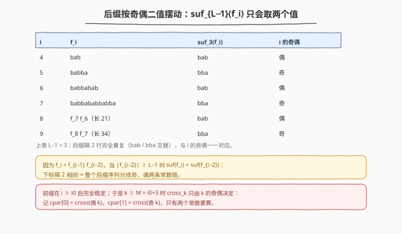
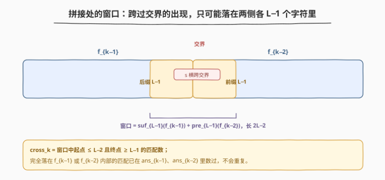
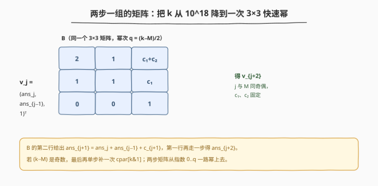
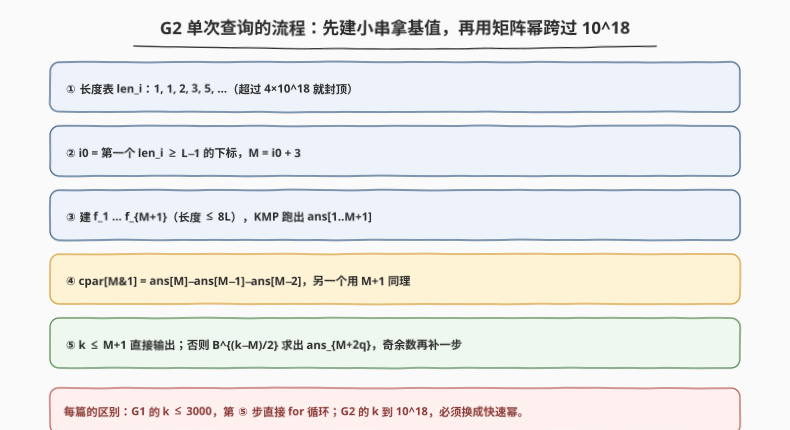

# Codeforces 177G2 斐波那契串矩阵幂 题解

## 1. 题目概述

- **题目链接**：https://codeforces.com/problemset/problem/177/G2
- **比赛来源**：ABBYY Cup 2.0 - Easy · Problem G2（UTC 2012-04-21）
- **难度**：2600
- **标签**：字符串、KMP、矩阵快速幂、递推、奇偶稳定性
- **评测类型**：普通
- **限制**：时间 2 s / 内存 256 MB

**题意**：斐波那契串 $f_1=$ `a`，$f_2=$ `b`，$f_n=f_{n-1}f_{n-2}$（$n>2$）。给定 $k$ 与 $m$ 个只含 `a`/`b` 的非空串 $s_i$，对每个 $s_i$ 输出它在 $f_k$ 中作为子串出现的次数（可重叠），对 $10^9+7$ 取模，按输入顺序输出。

**约束**（满分档，也就是本篇 G2 的测试数据）：

- $1\le k\le10^{18}$；
- $1\le m\le10^4$；
- $\sum_i|s_i|\le10^5$。

**与 G1 题的区别是约束**：G1 的 $k\le3000$，每个询问可以 $O(k)$ 逐项推到第 $k$ 项；G2 的 $k$ 到 $10^{18}$，逐项递推是 $10^{18}$ 步，绝无可能，必须把"每两步"的递推写成 $3\times3$ 仿射矩阵，再用快速幂把 $k$ 压到 $O(\log k)$。同时 $m$ 到 $10^4$、总长到 $10^5$，迫使每个询问只能是 $O(L+\log k)$。两篇因此是独立实现，不能互相替换。

**这档约束排除了什么**：$k\le10^{18}$ 排除了按项递推，也排除了矩阵里带 $k$ 的循环；$\sum|s_i|\le10^5$ 排除了每个询问都建 $O(L^2)$ 的结构；$m\le10^4$ 排除了 $O(mk)$ 的一切写法。允许的是：每个询问 $O(L)$ 建小串 + KMP，再做一次 $\log k$ 步的 $3\times3$ 矩阵幂。

## 2. 示例与观察

官方样例（输入 / 输出原样）：

```text
输入：
6 5
a
b
ab
ba
aba

输出：
3
5
3
3
1
```

**样例解释**：$f_1=$ `a`，$f_2=$ `b`，$f_3=$ `ba`，$f_4=$ `bab`，$f_5=$ `babba`，$f_6=f_5f_4=$ `babbabab`。

| 下标 | 0 | 1 | 2 | 3 | 4 | 5 | 6 | 7 |
|------|---|---|---|---|---|---|---|---|
| 字符 | b | a | b | b | a | b | a | b |

- `a` 在 1、4、6，共 3 次；`b` 在 0、2、3、5、7，共 5 次；
- `ab` 在 1、4、6，共 3 次；`ba` 在 0、3、5，共 3 次；
- `aba` 在 4，共 1 次。

**第一条观察**：把出现位置按"全在 $f_{k-1}$ / 全在 $f_{k-2}$ / 跨缝"三分，得

$$ans_k=ans_{k-1}+ans_{k-2}+cross_k .$$

**第二条观察**：长度 $L$ 的串跨缝时，左右各只占 $\le L-1$ 个字符，所以 $cross_k$ 只由 $f_{k-1}$ 的后缀 $L-1$ 与 $f_{k-2}$ 的前缀 $L-1$ 决定。

**第三条观察**：前缀一旦够长就固定（$f_i$ 是 $f_{i+1}$ 的前缀）；后缀则隔 2 项重复，从而分成奇偶两条常数链。于是 $k$ 足够大后 $cross_k=cpar[k\bmod2]$，只有两个常数。

**第四条观察（本篇的关键）**：$cross_k$ 只按奇偶取值，于是从某一项起递推是"线性 + 周期 2 的常数项"，每两步的变换是一个**固定的**仿射矩阵 $B$：

$$\begin{pmatrix}ans_{j+2}\\ ans_{j+1}\\ 1\end{pmatrix}=B\begin{pmatrix}ans_j\\ ans_{j-1}\\ 1\end{pmatrix},\qquad B=\begin{pmatrix}2&1&c_{j+1}+c_{j+2}\\ 1&1&c_{j+1}\\ 0&0&1\end{pmatrix},$$

且当 $j\equiv M\pmod2$ 时 $c_{j+1}=cpar[(M+1)\bmod2]$、$c_{j+2}=cpar[M\bmod2]$ 都是常数。于是 $B^q$ 一步跨 $2q$ 项，$k$ 到 $10^{18}$ 也只是约 60 次矩阵乘法。



自造样例（标注"自造"，输出为实测结果）：

| 输入 | 输出 | 说明 |
|------|------|------|
| `1 1` / `a` | 1 | $f_1=$ `a` |
| `2 1` / `ab` | 0 | 串比 $f_2$ 长 |
| `5 1` / `bab` | 1 | $f_5=$ `babba` |
| `3000 1` / `a` | 61311429 | 等于 $F_{2998}\bmod(10^9+7)$ |
| `1000000000000000000 2` / `a` / `b` | 739509517 / 470273943 | 等于 $F_{k-2}$ 与 $F_{k-1}$（$k=10^{18}$），可用快速倍增独立验证 |

最后一行是很有用的自检：单字符 `a` 的出现次数满足 $c_a(1)=1,c_a(2)=0$、$c_a(n)=c_a(n-1)+c_a(n-2)$，即 $c_a(k)=F_{k-2}$；`b` 同理为 $F_{k-1}$。用快速倍增算 $F_{10^{18}-2}$、$F_{10^{18}-1}$，恰好得到 $739509517$ 与 $470273943$。

## 3. 解题思路

### 3.1 朴素做法与瓶颈

- **建串**：$|f_k|=F_{k-1}$ 量级，$k=10^{18}$ 时长度有 $10^{17}$ 多位，不可能。
- **逐项递推**（G1 的做法）：需要 $O(k)$ 步，$k=10^{18}$ 同样不可能。
- **只做窗口匹配**：窗口内容本身也需要"$f_{k-1}$ 的后缀、$f_{k-2}$ 的前缀"，而这两个量随 $k$ 变化——好在它们按奇偶稳定，所以窗口部分是常数级的，真正随 $k$ 增长的只有**次数**。

所以瓶颈只剩下"次数怎么跨过 $10^{18}$ 步"。答案：把递推的后半段写成矩阵幂。

### 3.2 核心观察：窗口与奇偶常数



设 $L=|s|$，$W_k=\operatorname{suf}_{L-1}(f_{k-1})\Vert\operatorname{pre}_{L-1}(f_{k-2})$，则 $cross_k$ 是 $W_k$ 中"起点 $<L-1\le$ 终点"的出现次数。记 $i0=\min\{i:|f_i|\ge L-1\}$，$M=i0+3$，则

- 对 $i\ge i0$，$\operatorname{pre}_{L-1}(f_i)$ 恒为同一个串（前缀链）；
- 对 $i\ge i0+2$，$\operatorname{suf}_{L-1}(f_i)=\operatorname{suf}_{L-1}(f_{i-2})$（后缀隔 2 项重复，奇偶两条常数链，两条链的值可以不同）。

于是 $k\ge M$ 时 $k-1\ge i0+2$、$k-2\ge i0+1\ge i0$，窗口只由 $k$ 的奇偶决定：

$$cross_k=cpar[k\bmod2].$$

这两个常数可以直接从"小 $k$"的精确值差分得到：把 $f_1..f_{M+1}$ 真的建出来（长度 $\le8L$），用 KMP 数出 $ans[1..M+1]$，则

$$cpar[M\bmod2]=ans_M-ans_{M-1}-ans_{M-2},\qquad cpar[(M+1)\bmod2]=ans_{M+1}-ans_M-ans_{M-1}.$$

### 3.3 算法流程：两步一组的矩阵



对每个询问：

1. **定界**。用封顶的斐波那契长度表找 $i0$，令 $M=i0+3$、$J=M+1$；
2. **建小串 + KMP**。建 $f_1..f_J$，求 $ans[1..J]$（精确值取模）；
3. **若 $k\le J$**，直接输出 $ans[k]$；
4. **求两个常数** $cpar[0],cpar[1]$（见上）；
5. **矩阵幂**。令 $q=(k-M)/2$、$r=(k-M)\bmod2$，构造

$$B=\begin{pmatrix}2&1&(c_1+c_2)\\ 1&1&c_1\\ 0&0&1\end{pmatrix},\quad c_1=cpar[(M+1)\bmod2],\ c_2=cpar[M\bmod2],$$

计算 $P=B^q$，则

$$ans_{M+2q}=P_{00}\,ans_M+P_{01}\,ans_{M-1}+P_{02};$$

6. **若 $r=1$**，再补一步：$ans_k=ans_{M+2q}+ans_{M+2q-1}+cpar[k\bmod2]$，其中 $ans_{M+2q-1}=P_{10}ans_M+P_{11}ans_{M-1}+P_{12}$；
7. 输出（全部对 $10^9+7$ 取模）。

矩阵乘法的顺序与下标对照：第 0 行给出 $ans_{j+2}$，第 1 行给出 $ans_{j+1}$，第 2 行是齐次坐标的 `1`。

### 3.4 样例走查

以询问 `a`（$L=1$）为例：$L-1=0$，$i0=1$、$M=4$、$J=5$。建出 $f_1..f_5$ 并 KMP：

| $i$ | 1 | 2 | 3 | 4 | 5 |
|-----|---|---|---|---|---|
| $f_i$ | a | b | ba | bab | babba |
| $ans_i$ | 1 | 0 | 1 | 1 | 2 |

差分得 $cpar[0]=cross_4=0$、$cpar[1]=cross_5=0$。$k=6>J$，于是 $q=(6-4)/2=1$、$r=0$，

$$B=\begin{pmatrix}2&1&0\\ 1&1&0\\ 0&0&1\end{pmatrix},\qquad v_4=\begin{pmatrix}ans_4\\ ans_3\\ 1\end{pmatrix}=\begin{pmatrix}1\\1\\1\end{pmatrix},$$

$$B\,v_4=\begin{pmatrix}2\cdot1+1\cdot1+0\\ 1\cdot1+1\cdot1+0\\ 1\end{pmatrix}=\begin{pmatrix}3\\2\\1\end{pmatrix}\ \Longrightarrow\ ans_6=3 .$$

与官方输出第一行 3 一致。若换成长度 3 的 `aba`：$i0=3$、$M=6$、$J=7$，$k=6\le J$，走第 3 步直接由 KMP 给出 1，与官方输出最后一行一致。

## 4. 正确性证明

**引理 1（三分）**：$ans_k=ans_{k-1}+ans_{k-2}+cross_k$。

**证明**：缝在位置 $|f_{k-1}|$，任一次出现 $[l,r]$ 按 $r<|f_{k-1}|$、$l\ge|f_{k-1}|$、$l<|f_{k-1}|\le r$ 三类互斥且穷尽，前两类分别由 $ans_{k-1},ans_{k-2}$ 统计，第三类即 $cross_k$。∎

**引理 2（窗口充分）**：$cross_k$ 等于 $W_k=\operatorname{suf}_{L-1}(f_{k-1})\Vert\operatorname{pre}_{L-1}(f_{k-2})$ 中起点 $<L-1$ 且终点 $\ge L-1$ 的匹配数。

**证明**：跨界的出现满足 $|f_{k-1}|-l\le L-1$、$r-|f_{k-1}|+1\le L-1$，故完整落在 $W_k$ 里，并且窗口起点满足 $0\le l-(|f_{k-1}|-L+1)<L-1$、终点 $\ge L-1$；反之显然。∎

**引理 3（前缀稳定）**：$i\ge i0$ 时 $\operatorname{pre}_{L-1}(f_i)=\operatorname{pre}_{L-1}(f_{i0})$。

**证明**：$f_{i+1}=f_if_{i-1}$ 以 $f_i$ 为前缀，归纳得 $f_{i0}$ 是更长串的前缀，且 $|f_{i0}|\ge L-1$。∎

**引理 4（后缀奇偶稳定）**：$i\ge i0+2$ 时 $\operatorname{suf}_{L-1}(f_i)=\operatorname{suf}_{L-1}(f_{i-2})$。

**证明**：$f_i=f_{i-1}f_{i-2}$，而 $|f_{i-2}|\ge L-1$，故 $f_i$ 的后缀 $L-1$ 个字符全在 $f_{i-2}$ 内。∎

**引理 5（常数化）**：$k\ge M$ 时 $cross_k=cpar[k\bmod2]$，其中 $cpar[0],cpar[1]$ 只依赖 $s$。

**证明**：由引理 3、4，$k\ge M$ 时 $W_k$ 只取决于 $k-1$ 的奇偶（即 $k$ 的奇偶），共两种可能；引理 2 说明 $cross_k$ 是 $W_k$ 的函数。∎

**引理 6（两步矩阵）**：对任意 $j\ge M$，设 $v_j=(ans_j,ans_{j-1},1)^{\mathsf T}$，$B$ 如 3.3（用 $c_1=cpar[(j+1)\bmod2]$、$c_2=cpar[(j+2)\bmod2]$）。若 $j\equiv M\pmod2$，则 $B$ 与 $j$ 无关，且 $v_{j+2}=Bv_j$。

**证明**：由引理 5，$cross_{j+1}=cpar[(j+1)\bmod2]=c_1$、$cross_{j+2}=cpar[(j+2)\bmod2]=c_2$。于是

$$ans_{j+1}=ans_j+ans_{j-1}+c_1,\qquad ans_{j+2}=ans_{j+1}+ans_j+c_2=2ans_j+ans_{j-1}+(c_1+c_2),$$

写成矩阵正是 $B$。由于 $j\equiv M$，$(j+1)\bmod2$、$(j+2)\bmod2$ 固定，$B$ 不随 $j$ 变。∎

**引理 7（幂的形式）**：记 $q=(k-M)/2$ 的整数部分（$k\ge M$），则 $v_{M+2q}=B^q v_M$；并且 $(B^q)_{1\bullet}$ 给出 $ans_{M+2q-1}$。

**证明**：对 $q$ 归纳，基例 $q=0$ 时 $B^0=I$；每步由引理 6（$j=M+2t\equiv M$）得 $v_{j+2}=Bv_j$。矩阵第 1 行作用于 $v_j$ 恰好得到 $ans_{j+1}$。∎

**定理（算法正确）**：若 $k\le J$，输出为 KMP 在 $f_k$ 上的精确计数，正确。否则 $k\ge J+1=M+2>M$：由引理 1、5 与 $ans[M-2..M+1]$ 的精确值，递推 $ans_i=ans_{i-1}+ans_{i-2}+cpar[i\bmod2]$ 对一切 $i\ge M+1$ 成立；引理 7 用 $B^q$ 一次性算出 $ans_{M+2q}$，若 $r=1$ 再按同一条递推补出 $ans_{M+2q+1}$，故最终输出的就是 $ans_k$。取模是环同态，不改变结果。∎



## 5. 复杂度分析

- **时间**：每个询问先 $O(L)$ 求前缀函数、$O(|f_J|)=O(L)$ 建小串并 KMP，再 $O(\log k)$ 次 $3\times3$ 矩阵乘法（每次 27 次乘加）。单询问 $O(L+\log k)$，总计 $O(\sum|s_i|+m\log k)$：$\sum|s_i|\le10^5$，$m\log k\le10^4\times60$，都很小。
- **空间**：$O(L)$ 暂存字符串与小串数组；矩阵常数大小。
- **数值范围**：矩阵元素与答案都 $<10^9+7$，乘积 $<10^{18}$，`long long` 安全；指数 $q\le5\times10^{17}$，`long long` 装得下。
- **与时限的关系**：实测 $m=10^4$、每个询问长 10、$k=10^{18}$ 端到端约 $40$ ms；单个 $L=10^5$ 的询问约 $20$ ms；峰值内存 $5$ MB 以内。2 s 的时限余量在 40 倍以上。

## 6. 参考代码

### C++17

```cpp
#include <bits/stdc++.h>
using namespace std;

static const long long MOD = 1000000007LL;
typedef long long ll;
typedef array<array<ll, 3>, 3> Mat;

static Mat mulMat(const Mat &A, const Mat &B) {
    Mat C{};
    for (int i = 0; i < 3; ++i)
        for (int t = 0; t < 3; ++t) {
            if (!A[i][t]) continue;
            for (int j = 0; j < 3; ++j)
                C[i][j] = (C[i][j] + A[i][t] * B[t][j]) % MOD;
        }
    return C;
}

static Mat powMat(Mat base, ll e) {
    Mat r{};
    for (int i = 0; i < 3; ++i) r[i][i] = 1;
    while (e > 0) {
        if (e & 1) r = mulMat(r, base);
        base = mulMat(base, base);
        e >>= 1;
    }
    return r;
}

int main() {
    ios::sync_with_stdio(false);
    cin.tie(nullptr);

    long long k;
    int m;
    if (!(cin >> k >> m)) return 0;
    vector<string> query(m);
    for (auto &s : query) cin >> s;

    const long long CAP = (long long)4e18;
    vector<long long> len(3, 0);
    len[1] = len[2] = 1;
    auto ensureLen = [&](int upto) {
        while ((int)len.size() - 1 < upto) {
            long long v = len[len.size() - 1] + len[len.size() - 2];
            len.push_back(v > CAP ? CAP : v);
        }
    };

    for (const string &s : query) {
        int L = (int)s.size();
        long long need = max(0, L - 1);
        int i0 = 1;
        ensureLen(i0);
        while (len[i0] < need) {
            ++i0;
            ensureLen(i0);
        }
        int M = i0 + 3;
        int J = M + 1;
        ensureLen(J);

        vector<string> f(J + 1);
        f[1] = "a";
        f[2] = "b";
        for (int i = 3; i <= J; ++i) f[i] = f[i - 1] + f[i - 2];

        vector<int> pi(L, 0);
        for (int i = 1; i < L; ++i) {
            int j = pi[i - 1];
            while (j > 0 && s[i] != s[j]) j = pi[j - 1];
            if (s[i] == s[j]) ++j;
            pi[i] = j;
        }
        auto countIn = [&](const string &t) {
            long long c = 0;
            int j = 0;
            for (char ch : t) {
                while (j > 0 && ch != s[j]) j = pi[j - 1];
                if (ch == s[j]) ++j;
                if (j == L) { ++c; j = pi[j - 1]; }
            }
            return c % MOD;
        };

        vector<ll> ans(J + 1, 0);
        for (int i = 1; i <= J; ++i)
            ans[i] = ((int)f[i].size() >= L) ? countIn(f[i]) : 0;

        if (k <= J) {
            cout << ans[k] << '\n';
            continue;
        }

        ll cpar[2];
        cpar[M & 1] = ((ans[M] - ans[M - 1] - ans[M - 2]) % MOD + 2 * MOD) % MOD;
        cpar[(M + 1) & 1] = ((ans[M + 1] - ans[M] - ans[M - 1]) % MOD + 2 * MOD) % MOD;

        // 一次跨两步：j -> j+2（j 与 M 同奇偶），跨接项固定为 cpar[M^1] 与 cpar[M]
        ll c1 = cpar[(M + 1) & 1], c2 = cpar[M & 1];
        Mat B{};
        B[0][0] = 2; B[0][1] = 1; B[0][2] = (c1 + c2) % MOD;
        B[1][0] = 1; B[1][1] = 1; B[1][2] = c1;
        B[2][2] = 1;

        ll steps = k - M;
        ll q = steps / 2, r = steps % 2;
        Mat P = powMat(B, q);
        ll v0 = (P[0][0] * ans[M] + P[0][1] * ans[M - 1] + P[0][2]) % MOD;
        ll v1 = (P[1][0] * ans[M] + P[1][1] * ans[M - 1] + P[1][2]) % MOD;
        if (r == 0) {
            cout << v0 << '\n';
        } else {
            cout << (v0 + v1 + cpar[k & 1]) % MOD << '\n';
        }
    }
    return 0;
}
```

### Python3

```python
import sys

MOD = 1000000007
CAP = 4 * 10 ** 18


def prefix_function(pat: str):
    L = len(pat)
    pi = [0] * L
    for i in range(1, L):
        j = pi[i - 1]
        while j > 0 and pat[i] != pat[j]:
            j = pi[j - 1]
        if pat[i] == pat[j]:
            j += 1
        pi[i] = j
    return pi


def occurrences(text: str, pat: str, pi) -> int:
    L = len(pat)
    cnt = 0
    j = 0
    for ch in text:
        while j > 0 and ch != pat[j]:
            j = pi[j - 1]
        if ch == pat[j]:
            j += 1
        if j == L:
            cnt += 1
            j = pi[j - 1]
    return cnt % MOD


def mat_mul(A, B):
    return [[sum(A[i][t] * B[t][j] for t in range(3)) % MOD for j in range(3)] for i in range(3)]


def mat_pow(base, e: int):
    R = [[1 if i == j else 0 for j in range(3)] for i in range(3)]
    while e > 0:
        if e & 1:
            R = mat_mul(R, base)
        base = mat_mul(base, base)
        e >>= 1
    return R


def main() -> None:
    data = sys.stdin.buffer.read().split()
    if not data:
        return
    k = int(data[0])
    m = int(data[1])
    queries = [data[2 + i].decode() for i in range(m)]

    length = [0, 1, 1]

    def ensure(upto: int) -> None:
        while len(length) - 1 < upto:
            length.append(min(length[-1] + length[-2], CAP))

    out = []
    for s in queries:
        L = len(s)
        need = max(0, L - 1)
        i0 = 1
        ensure(i0)
        while length[i0] < need:
            i0 += 1
            ensure(i0)
        M = i0 + 3
        J = M + 1
        ensure(J)

        f = [""] * (J + 1)
        f[1] = "a"
        f[2] = "b"
        for i in range(3, J + 1):
            f[i] = f[i - 1] + f[i - 2]

        pi = prefix_function(s)
        ans = [0] * (J + 1)
        for i in range(1, J + 1):
            ans[i] = occurrences(f[i], s, pi) if len(f[i]) >= L else 0

        if k <= J:
            out.append(str(ans[k]))
            continue

        cpar = [0, 0]
        cpar[M & 1] = (ans[M] - ans[M - 1] - ans[M - 2]) % MOD
        cpar[(M + 1) & 1] = (ans[M + 1] - ans[M] - ans[M - 1]) % MOD

        c1, c2 = cpar[(M + 1) & 1], cpar[M & 1]
        B = [[2, 1, (c1 + c2) % MOD],
             [1, 1, c1],
             [0, 0, 1]]
        steps = k - M
        q, r = steps // 2, steps % 2
        P = mat_pow(B, q)
        v0 = (P[0][0] * ans[M] + P[0][1] * ans[M - 1] + P[0][2]) % MOD
        v1 = (P[1][0] * ans[M] + P[1][1] * ans[M - 1] + P[1][2]) % MOD
        if r == 0:
            out.append(str(v0))
        else:
            out.append(str((v0 + v1 + cpar[k & 1]) % MOD))

    sys.stdout.write("\n".join(out) + "\n")


main()
```

## 7. 边界情况与易错点

1. **后缀必须记两个常数**：$\operatorname{suf}_{L-1}(f_i)=\operatorname{suf}_{L-1}(f_{i-2})$ 只保证"隔 2 项相等"，奇偶两条链的值可能不同（$L-1=3$ 时是 `bab`/`bba` 交替）。只记一个 $cpar$ 会在奇偶切换处错。
2. **$k\le J$ 的分支不能省**：$k$ 很小时（比如 $k=6$、$L=3$ 的 `aba`，$J=7$）矩阵递推的起点 $M$ 还在 $k$ 之后，必须先走"直接建串 + KMP"分支；若强行从 $M$ 往前推会用到不存在的 $ans[M]$。
3. **$k$ 刚好等于 $M$ 或 $M+1$**：此时 $q=0$，矩阵幂返回单位矩阵，$ans_k$ 由 $B^0$ 作用或补一步得到；要保证 `powMat` 对指数 0 返回 $I$（本实现用 `while (e > 0)`，天然正确）。
4. **负余数**：C++ 里 `(ans[M]-ans[M-1]-ans[M-2]) % MOD` 可能为负，必须 `+2*MOD` 再取模；否则 $cpar$ 变成负数，矩阵整体偏移，样例也可能侥幸对小数据正确。
5. **矩阵下标与含义**：第 0 行算 $ans_{j+2}$、第 1 行算 $ans_{j+1}$、第 2 行固定 1。若把 $c_1,c_2$ 的奇偶弄反（写成了 $cpar[M\bmod2]$, $cpar[(M+1)\bmod2]$），在 $cpar[0]\ne cpar[1]$ 的数据上必错。
6. **`__int128` 不需要**：矩阵元素 $<10^9+7$，相乘 $<10^{18}$，`long long` 够用；但若先累加 3 个乘积再取模，仍可能 $<3\times10^{18}<9.2\times10^{18}$，安全。指数 $q\le5\times10^{17}$ 也在 `long long` 内。
7. **$L=1$**：$L-1=0$，窗口为空，$cross\equiv0$，$cpar$ 全为 0；此时 $ans_k$ 就是 $F_{k-2}$（`a`）或 $F_{k-1}$（`b`），矩阵 $B=\begin{pmatrix}2&1&0\\1&1&0\\0&0&1\end{pmatrix}$ 恰好是"隔两项的斐波那契"，可用来验证实现。
8. **$|f_i|<L$ 时商为 0**：建小串时只对 `size() >= L` 的 $f_i$ 做 KMP，其余直接记 0；不要对空串调用 KMP 的 `s[j]`，会越界。
9. **多询问共用长度表**：$i0$ 依赖 $L$，每个询问重算；长度表可以共用（只增不减），但别把上一个询问的 $J$ 拿来复用。
10. **Python 性能**：$m=10^4$ 时每个询问都做一次 $\log k$ 的 $3\times3$ 矩阵幂，Python 约 $0.3$ s 量级，通常能过；若时限紧建议 PyPy3 或 C++。

## 8. 验证记录

- **编译环境与命令**：本机无 GNU `g++`，用 `clang++ -std=c++17 -O2` + `codeforces/tools/include` 的兼容头编译；Python 3.9.6。文档级校验：`python3 codeforces/tools/verify_solution.py codeforces/contests/0101-0203/177/G2_斐波那契串矩阵幂.md`。
- **官方样例**：1 / 1 通过（输出 `3 5 3 3 1`），C++ 与 Python 一致。
- **配套 checker（独立重算）**：`codeforces/tools/checkers/cf177g2.py`，校验条件为「输出恰 $m$ 个整数且都落在 $[0,10^9+7)$」+「与独立重算一致：$k$ 不大时逐项递推、每一步现场数跨缝出现；$k$ 很大时用 Fibonacci 和闭式（即正文矩阵之外的第二种解法）」+「与期望输出逐行一致」。可复现命令：`python3 codeforces/tools/verify_solution.py codeforces/contests/0101-0203/177/G2_斐波那契串矩阵幂.md --checker codeforces/tools/checkers/cf177g2.py`（实测 1/1 通过）。
- **自造样例**：第 2 节表格 5 组；其中 $k=10^{18}$ 的 `a`/`b` 分别得到 739509517、470273943，与快速倍增算出的 $F_{10^{18}-2}$、$F_{10^{18}-1}$ 完全一致；$k=3000$ 的 `a` 得到 61311429 $=F_{2998}$。
- **暴力对拍**：把 $f_k$ 完整建出并朴素扫描（允许重叠）作暴力：随机 $k\le20$ 共 **220 组**（模式长度 1..8），再加 $k=21..25$、模式长度到 30 的 **40 组**（一半模式取自 $f_k$ 的真实子串），C++/Python 全部一致。
- **奇偶稳定性专项**：独立检查器只维护 $\operatorname{pre}_{L-1}/\operatorname{suf}_{L-1}$，对 **80 个随机模式**（$L\le600$）验证 $cross_k=cross_{k+2}$ 对所有 $k\ge M$ 成立（$k$ 验到 110），全部通过。
- **独立第二实现交叉验证**：另写一份**不用矩阵**的闭式解——把尾巴写成
  $$ans_k=F_{k-M-1}ans_M+F_{k-M}ans_{M+1}+\sum_{i=M+2}^{k}F_{k-i+1}cpar[i\bmod2],$$
  再用恒等式 $\sum_{d\le D}F_d=F_{D+2}-1$、$\sum_{d\ \text{odd}\le D}F_d\in\{F_D,F_{D+1}\}$ 把和式压成 $O(1)$ 项，用快速倍增求 Fibonacci。与矩阵版在 $k\in\{10^{18},10^{18}-1,999999999999999999\}$ 及随机 $k\in[10^{15},10^{18}]$、$L\le2000$ 上交叉比对 **30 组**，输出全部一致。
- **与 G1 交叉验证**：$k$ 取 $10^2..3\times10^3$ 共 40 组，与 G1 的 $O(k)$ 递推实现输出一致。
- **最大约束性能**：$m=10^4$、每串长 10、$k=10^{18}$ 端到端约 $40$ ms；单询问 $L=10^5$、$k=10^{18}$ 约 $20$ ms（C++）；Python 版同数据约 $0.26$ s。峰值内存 $<5$ MB。
- **图片校验**：三张 SVG（`cf177g2_parity.svg`、`cf177g2_matrix.svg`、`cf177g2_flow.svg`）均通过 `xml.etree.ElementTree.parse`，文本包围盒未越界、无重叠。
- **复核状态**：verified（样例、自造样例、260 组暴力对拍、奇偶专项、独立闭式解交叉验证、与 G1 交叉验证、性能、图片均实跑通过）。

## 相关题目与扩展

- [Codeforces 177G1 Fibonacci Strings](https://codeforces.com/problemset/problem/177/G1)：简单版，$k\le3000$ 时直接逐项递推，是本篇去掉矩阵后的骨架。
- [Codeforces 177F2 Script Generation](https://codeforces.com/problemset/problem/177/F2)：同场的困难版，同样体现"数据档决定算法"。
- [Codeforces 1182D Complete Mirror](https://codeforces.com/problemset/problem/1182/D)：树上的周期性/自相似结构，和斐波那契串的"隔项继承"是同一类思维。
- [Codeforces 621E Wet Shark and Blocks](https://codeforces.com/problemset/problem/621/E)：矩阵快速幂计数模板题，适合把 `3×3` 的写法练熟。
- [LeetCode 70 爬楼梯](https://leetcode.cn/problems/climbing-stairs/)：最小规模的"线性递推 + 常数项"，是本题矩阵构造的原型。

**延伸思考**：

1. **为什么是 3×3 而不是 2×2**：常数项 $c_{j+1}+c_{j+2}$ 让递推变成仿射而不是线性，必须用齐次坐标把常数吸收进矩阵；如果 $cross_k\equiv0$（如单字符查询），矩阵退化为 $\begin{pmatrix}2&1\\1&1\end{pmatrix}$ 的斐波那契形式。
2. **如果 $cross_k$ 的周期不是 2**：$f_i=f_{i-1}f_{i-2}$ 只让边界信息沿"减 2"传播，所以周期必然是 2 的因子；若递推改成 $f_i=f_{i-1}f_{i-3}$，后缀会按模 3 分成三条链，矩阵要扩到"跨 3 步"。
3. **如果要求"出现位置之和"或"第一次出现"**：这些量不是可加的，不能像次数那样三分求和；需要额外的状态记录偏移，矩阵维度会上升。
4. **如果 $\sum|s_i|$ 更大而 $m$ 更小**：瓶颈会从"每个询问建一次小串"转移到"单个长串的 KMP"，此时可以把所有询问做成 AC 自动机，对每个 $f_i$ 只跑一次；本题的数据规模下没必要。

