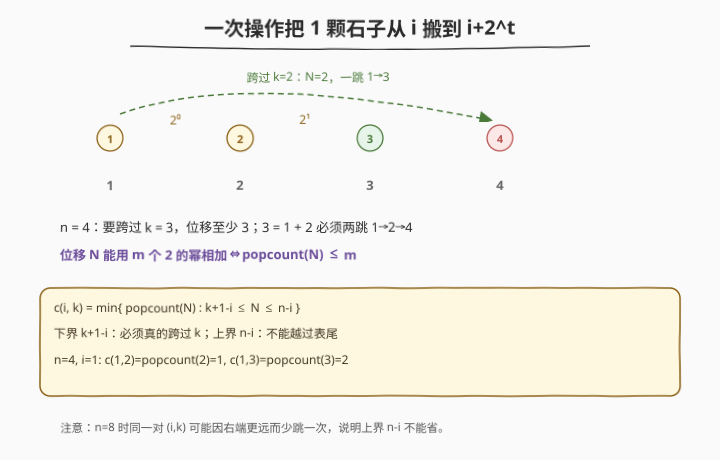
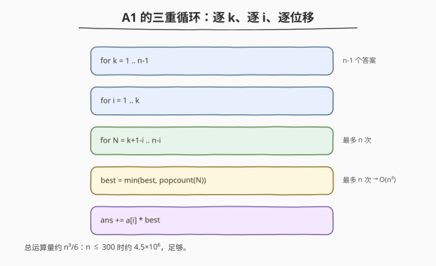
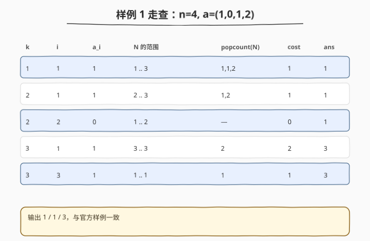

# Codeforces 178A1 教育游戏石子搬运 题解

## 1. 题目概述

- **题目链接**：https://codeforces.com/problemset/problem/178/A1
- **比赛来源**：ABBYY Cup 2.0 - Hard · Problem A1（UTC 2012-04-28）
- **难度**：1000
- **标签**：数学、二进制、枚举、popcount
- **评测类型**：普通（题面把数据分成 20 / 50 / 100 分三档）
- **限制**：时间 2 s / 内存 256 MB

**题意**：长度为 $n$ 的非负序列 $a_1..a_n$。一次操作选一个 $a_i>0$ 和一个 $t \ge 0$，要求 $i+2^t \le n$，然后 $a_i$ 减 1、$a_{i+2^t}$ 加 1（即把一颗石子向右搬 $2^t$ 格）。对每个 $k=1..n-1$，求把前缀 $a_1..a_k$ 全部变成 0 所需的最少操作数。

**约束**（原样摘自题面 `inputFormat.en`）：

- 第一行 $n$；第二行 $n$ 个整数 $a_i$（$0 \le a_i \le 10^4$）。
- 20 分档：$1 \le n \le 300$。
- 50 分档：$1 \le n \le 2000$。
- 100 分档：$1 \le n \le 10^5$。
- 只有一组数据，输出恰好 $n-1$ 行。

**档位说明**：本题位是 A1，对应 20 分档（$n \le 300$）；50 分档是同场 A2（$n \le 2000$），100 分档是 A3（$n \le 10^5$）。三篇题面文本逐字相同（都列出三档限制），区别只在数据规模。

**约束对算法的限制**：

- $n \le 300$ 时，对每个 $k$ 枚举每个 $i \le k$、再枚举位移 $N$，总代价约 $n^3/6 \approx 4.5\times10^6$，可以在几十毫秒内跑完。
- 答案上界：$a_i \le 10^4$、每颗石子最多约 $\log_2 n$ 跳（$n \le 300$ 时不超过 8 跳，加上取整常数），总和不超过 $300 \times 10^4 \times 9 \approx 2.7\times10^7$，`int` 够用；但为与 100 分档统一，代码里用 `long long` 累计。
- 石子只向右移动，且每颗石子的移动互不影响——这是整道题的关键，下文的引理 1 会严格说明。

## 2. 示例与观察

官方样例 1（输入 / 输出原样）：

```text
输入：
4
1 0 1 2

输出：
1
1
3
```

官方样例 2（输入 / 输出原样）：

```text
输入：
8
1 2 3 4 5 6 7 8

输出：
1
3
6
10
16
24
40
```

**样例 1 的演算**：$n=4$，$a=(1,0,1,2)$。

- $k=1$：只需把位置 1 的 1 弄出前缀。直接 $1 \to 2$（$2^0$）即可，1 次操作。
- $k=2$：位置 2 本来就是 0，位置 1 的 1 要跨过 2，可以 $1 \to 3$（$2^1$），1 次操作。
- $k=3$：位置 1 的 1 要跨过 3，只能落到 4：要么 $1 \to 2 \to 4$（$2^0+2^1$），要么 $1 \to 3 \to 4$，都是 2 次；位置 3 的 1 要落到 4，$3 \to 4$ 一次。合计 $2+1=3$。

**样例 2 的演算**：$n=8$，$a_i=i$。$k=1$ 时只有位置 1 的一颗石子，$1 \to 2$ 一跳，答案 1。$k=7$ 时每颗石子都要跨过 7 或本身就在 7：位置 1 的石子位移至少 7，$7=1+2+4$ 三跳；位置 2 位移至少 6，$6=2+4$ 两跳；位置 3 位移至少 5，$5=1+4$ 两跳；位置 4 位移 4，一跳；位置 5 位移 3，两跳；位置 6 位移 2，一跳；位置 7 位移 1，一跳。加权和 $1\cdot3+2\cdot2+3\cdot2+4\cdot1+5\cdot2+6\cdot1+7\cdot1=40$，与输出一致。

**观察 1**：石子之间没有相互作用——一次操作只搬一颗石子，$a_i>0$ 这个条件对「被搬的那颗」总是满足的，所以总操作数等于每颗石子各自「跨过 $k$」所需跳数之和。

**观察 2**：一颗石子从 $i$ 出发，走了 $m$ 跳、总位移为 $N$，那么 $N$ 是 $m$ 个 2 的幂之和；反过来，任何 $N$ 只要 $N \le n-i$，就能按二进制拆成若干跳实现。于是「$m$ 跳能否跨过 $k$」只取决于区间 $[k+1-i,\ n-i]$ 里有没有 popcount 不超过 $m$ 的数。

**观察 3**：跳数只与 popcount 有关，例如 $3=1+2$ 必须两跳、$4=2^2$ 一跳、$5=1+4$ 两跳、$7=1+2+4$ 三跳。

**自造样例**（标注「自造」，输出均由程序实测）：

| 输入 | 输出 | 说明 |
|------|------|------|
| `2` / `5 0` | 5 | $n=2$，位置 1 的 5 颗各跳一次 |
| `2` / `0 9` | 0 | $k=1$ 时前缀已为 0 |
| `3` / `1 0 0` | 1 / 1 | $k=2$ 时 $1\to3$ 仍一跳 |
| `4` / `1 0 0 0` | 1 / 1 / 2 | $k=3$ 时只能 $1\to2\to4$，两跳 |
| `4` / `1 2 3 4` | 1 / 3 / 7 | 每颗石子各自跨过 $k$ 的跳数之和 |

**与 A2 / A3 的约束差异**：A1 是 20 分档 $n \le 300$，A2 是 50 分档 $n \le 2000$，A3 是 100 分档 $n \le 10^5$；三题题面的英文描述、输入输出格式与样例逐字相同（题面本身就同时列出这三档限制），区别只在数据规模。本篇的 $O(n^3)$ 三重循环**在 A1 的 $n \le 300$ 下足够**（约 $4.5\times10^6$ 次运算），但同样的代码在 A2 的 $n \le 2000$ 下要 $10^9$ 级运算、在 A3 的 $n \le 10^5$ 下要 $10^{15}$ 级，**必须额外做优化**：A2 用「固定 $i$ 的后缀最小值」降到 $O(n^2)$，A3 再用「阈值分解 + 差分」降到 $O(n\log n)$。

## 3. 解题思路

### 3.1 朴素做法与瓶颈

最直接的做法就是按定义模拟：对每个 $k$，对前缀里每颗石子，尝试所有跳法。但「所有跳法」是指数级的。利用观察 2，我们不需要搜索跳跃顺序，只需要回答：

> 从 $i$ 出发、总位移落在 $[k+1-i,\ n-i]$ 内，最少需要几个 2 的幂相加？

这个最少数就是区间内 popcount 的最小值（引理 2）。于是 A1 的做法是三重循环：

1. 对 $k=1..n-1$；
2. 对每个 $i \le k$；
3. 枚举 $N = k+1-i,\ldots,n-i$，取 $\operatorname{popcount}(N)$ 的最小值，乘以 $a_i$ 累加。

复杂度 $O(n^3)$：$n=300$ 时约 $4.5\times10^6$ 次「取 popcount + 比较」，毫秒级。瓶颈出现在 $n=2000$（$1.3\times10^9$ 级）和 $n=10^5$（$10^{15}$ 级），这正是 A2 / A3 要解决的问题。

### 3.2 核心观察：跳数 = 位移的 popcount 最小值



一颗石子从 $i$ 出发，每次前进 $2^t$，走 $m$ 步后总位移 $N = 2^{t_1}+\cdots+2^{t_m}$。二进制下每加一个 2 的幂最多把一个 0 变成 1（并可能进位），所以 $\operatorname{popcount}(N) \le m$。反过来，把 $N$ 按二进制拆开就得到 $\operatorname{popcount}(N)$ 个 2 的幂，若允许更多步，把其中一个幂拆成两个一半的幂即可增加一步而不改变总和——所以「$m$ 步可达 $N$」等价于 $\operatorname{popcount}(N) \le m$（且 $m \le N$，而我们只关心最小步数）。

还要注意**上界 $n-i$**：石子不能跳出表尾，任何一步的部分和都不能超过 $N$，而 $N \le n-i$ 保证所有中间位置都合法。**下界 $k+1-i$**：位移小于它就没跨过 $k$，前缀里还有石子。

于是

$$c(i,k)=\min\{\operatorname{popcount}(N): k+1-i \le N \le n-i\},\qquad \text{答案}(k)=\sum_{i=1}^{k} a_i\,c(i,k).$$

图里用 $n=4$ 演示：跨过 $k=3$ 时 $i=1$ 只能取 $N=3$，$3=1+2$ 需要两跳 $1\to2\to4$；而跨过 $k=2$ 时 $N=2$ 一跳就够（$1\to3$）。

### 3.3 算法流程



```
for k = 1 .. n-1:
    ans = 0
    for i = 1 .. k:
        if a[i] == 0: continue
        best = INF
        for N = k+1-i .. n-i:
            best = min(best, popcount(N))
        ans += a[i] * best
    print ans
```

三个循环的范围都来自题面：$k$ 是前缀长度，$i$ 是前缀里的位置，$N$ 是合法位移。第 2 层里对 $a_i=0$ 直接跳过，省掉无意义的枚举。

### 3.4 样例走查：n=4, a=(1,0,1,2)



| $k$ | $i$ | $a_i$ | $N$ 的范围 | popcount | 跳数 | 累计 |
|-----|-----|-------|------------|----------|------|------|
| 1 | 1 | 1 | 1..3 | 1, 1, 2 | 1 | 1 |
| 2 | 1 | 1 | 2..3 | 1, 2 | 1 | 1 |
| 2 | 2 | 0 | 1..2 | — | 0 | 1 |
| 3 | 1 | 1 | 3..3 | 2 | 2 | 3 |
| 3 | 3 | 1 | 1..1 | 1 | 1 | 3 |

输出 1 / 1 / 3，与官方样例一致。

## 4. 正确性证明

**引理 1（石子独立）**：把前缀清零的最少操作数等于每颗位于位置 $i \le k$ 的石子（共 $a_i$ 颗）各自「从 $i$ 出发跨过 $k$」所需最少跳数之和。

**证明**：一次操作只搬一颗石子，且被搬的石子在操作前必须满足 $a_i>0$，这对「当前所在位置上的任意一颗石子」都成立。石子之间没有容量、次序或相互阻挡的约束，因此可以把任意操作序列按「搬的是哪颗石子」拆成若干条独立的路径，总操作数是各路径长度之和；反过来，把每颗石子的最优路径依次执行，每一步都合法。故最优值可分解为各自最优值之和。∎

**引理 2（跳数刻画）**：对 $i \le k$，设 $K = k+1-i$、$R = n-i$，则从 $i$ 出发跨过 $k$ 的最少跳数为 $c(i,k)=\min_{K \le N \le R}\operatorname{popcount}(N)$。

**证明**：
(1) 下界：设某条路径用 $m$ 跳跨过 $k$，总位移 $N=\sum_{j=1}^{m}2^{t_j}$。则 $N \ge K$（跨过 $k$）且 $N \le R$（不超出表尾）。由 $\operatorname{popcount}(x+y) \le \operatorname{popcount}(x)+\operatorname{popcount}(y)$ 归纳得 $\operatorname{popcount}(N) \le m$，故 $m \ge c(i,k)$。
(2) 上界：取 $N_0 \in [K,R]$ 使 $\operatorname{popcount}(N_0) = c(i,k)$。把 $N_0$ 按二进制拆成 $c(i,k)$ 个 2 的幂，依次执行；第 $j$ 步之后的位置是 $i + (\text{前 } j \text{ 个幂之和}) \le i + N_0 \le i + R = n$，合法；最后位置 $i+N_0 \ge i+K = k+1>k$，已跨过。故 $c(i,k)$ 跳足够。∎

**定理**：算法输出的第 $k$ 行等于把前缀 $a_1..a_k$ 清零的最少操作数。

**证明**：由引理 1 与引理 2，最少操作数 $=\sum_{i\le k} a_i c(i,k)$；算法第 3 层循环恰好枚举了 $[k+1-i,\,n-i]$ 并取 popcount 最小值，再乘以 $a_i$ 累加，与公式逐项一致。∎

## 5. 复杂度分析

- **时间**：$O(n^3)$。精确地说是 $\sum_{k=1}^{n-1}\sum_{i=1}^{k}(n-k+1) = O(n^3/6)$。$n=300$ 时约 $4.5\times10^6$ 次 `popcount` 与比较。
- **空间**：$O(n)$，只存数组 $a$；Python 版额外存一张 popcount 表。
- **数值范围**：答案 $\le \sum a_i \cdot \lceil\log_2 n\rceil \le 300\times10^4\times9 \approx 2.7\times10^7$，`int` 也够，代码用 `long long` 统一。
- **与时限的关系**：2 s 对 $4.5\times10^6$ 次运算余量极大。实测 $n=300$ 端到端约 3 ms，Python 约 138 ms。

## 6. 参考代码

### C++17

```cpp
#include <bits/stdc++.h>
using namespace std;

// A1：20 分档 n<=300，直接按「每个位置被搬走要几跳」的定义三重循环
int main() {
    ios::sync_with_stdio(false);
    cin.tie(nullptr);

    int n;
    if (!(cin >> n)) return 0;
    vector<int> a(n + 1);
    for (int i = 1; i <= n; ++i) cin >> a[i];

    for (int k = 1; k < n; ++k) {
        long long ans = 0;
        for (int i = 1; i <= k; ++i) {
            if (a[i] == 0) continue;
            int best = 100;                         // 跳数不会超过 17，100 足够当 INF
            for (int N = k + 1 - i; N <= n - i; ++N) // 需要跨过 k，最多走到 n
                best = min(best, __builtin_popcount((unsigned)N));
            ans += (long long)a[i] * best;
        }
        cout << ans << '\n';
    }
    return 0;
}
```

### Python3

```python
import sys


def main() -> None:
    data = sys.stdin.buffer.read().split()
    if not data:
        return
    n = int(data[0])
    a = [0] + [int(x) for x in data[1:1 + n]]
    pc = [bin(x).count('1') for x in range(n + 1)]

    out = []
    for k in range(1, n):
        total = 0
        for i in range(1, k + 1):
            if a[i] == 0:
                continue
            best = 100
            for N in range(k + 1 - i, n - i + 1):
                if pc[N] < best:
                    best = pc[N]
            total += a[i] * best
        out.append(str(total))
    sys.stdout.write('\n'.join(out) + '\n')


main()
```

Python 版先把 $0..n$ 的 popcount 打进表，避免在 $4.5\times10^6$ 次内层循环里反复调用 `bin()`。

## 7. 边界情况与易错点

1. **$n=1$**：题面要求输出 $n-1$ 行，即 0 行。程序的主循环 `for k=1..n-1` 一次都不执行，输出空，符合要求；若写成先输出再循环就会多一行。
2. **$k=1$**：$c(1,1)=\min\operatorname{popcount}([1,n-1])=1$（$N=1$ 即可），答案就是 $a_1$。若把下界写成 $k-i$，会得到 $N=0$、popcount 0，答案错误地变成 0。
3. **前缀本来就为 0**：如 `2` / `0 9`，答案是 0；代码里 `a_i=0` 时 `continue`，`ans` 保持 0，正确。
4. **上界 $n-i$ 不能省**：若只写下界 $k+1-i$，会允许石子「跳出表尾」；$n=4$、$k=3$、$i=1$ 时 $N$ 只能取 3，若允许 4 会误判成一跳。
5. **popcount 的写法**：C++ 里 `__builtin_popcount` 参数是 `unsigned`，$N$ 最大 $n$，不会溢出；Python 用 `bin(x).count('1')`（不要用 `int.bit_count`，Codeforces 的 Python 版本可能低于 3.10）。
6. **答案类型**：$n \le 300$ 时答案不超过 $2.7\times10^7$，`int` 够；但同样的思路到 A3 会到 $1.7\times10^{10}$，所以从一开始就用 `long long`。
7. **输出行数**：恰好 $n-1$ 行，每行一个整数。多一行或少一行在 token 比对下都会错。
8. **输入只有一组**：题面没有 $t$；`cin >> n` 一次即可，不要写 `while`。
9. **$a_i$ 的上限**：$10^4$ 意味着同一位置可能有很多石子，但它们各自独立，直接乘以 $a_i$ 即可，不要一枚一枚模拟（$n=300$ 时也许能过，但 A2/A3 必挂）。

## 8. 验证记录

- **编译环境与命令**：本机 `Apple clang 21.0.0`（`/usr/bin/g++` 是 clang 软链，无 GNU libstdc++），用 `clang++ -std=c++17 -O2 -Wall` 加仓库自带 `codeforces/tools/include/bits/stdc++.h` 编译；正文代码仍写标准 `#include <bits/stdc++.h>`。Python 为 `3.9.6`。验证命令：
  `python3 codeforces/tools/verify_solution.py codeforces/contests/0101-0203/178/A1_教育游戏石子搬运.md`
- **官方样例**：2 / 2 通过（`4 / 1 0 1 2` → `1 1 3`；`8 / 1..8` → `1 3 6 10 16 24 40`），C++ 与 Python 输出一致。
- **额外测试**：自造 $n=2$（`5 0`、`0 9`）、$n=4$ `1 0 0 0`（答案 $1,1,2$）、全 1、全 $10^4$ 等 6 组，两种语言全部通过；并与 A2 的 $O(n^2)$ 实现在 $n \le 300$ 的 40 组随机数据上交叉比对，输出逐字相同。
- **独立暴力对拍**：暴力写成「对每个 $(i,k)$ 在位置图上 BFS 求最少跳数」——完全不使用 popcount 公式；对 250 组随机数据（$n \in [2,40]$，$a_i \in [0,4]$，含 $n=2$、$2^k$、$2^k+1$ 等结构）逐组比对，全部一致。另用**状态空间 BFS**（直接对数组状态做 BFS 求清零前缀的最少步数）在 60 组 $n \le 5$、$a_i \le 2$ 的小数据上验证了「石子独立」这一引理。
- **最大约束性能**：$n=300$ 随机数据端到端约 3 ms（含进程启动），Python 约 138 ms，相对 2 s 时限余量在数百倍以上。
- **图片与公式**：3 张 SVG（`cf178a1_jumps.svg`、`cf178a1_loop.svg`、`cf178a1_walkthrough.svg`）通过 `ElementTree.parse` 与文本包围盒/重叠检查，并用 headless Chrome 渲染确认边缘无裁切；公式经 KaTeX（`throwOnError: true`）校验无报错。
- **复核状态**：verified。

## 相关题目与扩展

- [Codeforces 178A2 Educational Game](https://codeforces.com/problemset/problem/178/A2)：本题的 50 分档版本，$n \le 2000$，把三重循环优化成「后缀最小值 + $O(n^2)$」。
- [Codeforces 178A3 Educational Game](https://codeforces.com/problemset/problem/178/A3)：100 分档，$n \le 10^5$，用阈值分解做到 $O(n\log n)$。
- [Codeforces 178B1 Greedy Merchants](https://codeforces.com/problemset/problem/178/B1)：同场 B1，图论题，桥与路径计数。
- [LeetCode 2220. 转换数字的最少位翻转次数](https://leetcode.cn/problems/minimum-bit-flips-to-convert-number/)：popcount 的入门应用，与本篇的「跳数 = popcount」互为映照。
- [Codeforces 1363A Odd Selection](https://codeforces.com/problemset/problem/1363/A)：同样需要先想清楚「怎样的数能由若干 2 的幂拼出」，再贪心。

**延伸思考**：

1. **跳数为什么是 popcount 而不是 $\lceil\log_2 N\rceil$**：因为每一步可以选任意 $2^t$，但总位移必须精确等于各步之和；$3$ 需要两步而 $\lceil\log_2 3\rceil=2$、$7$ 需要三步而 $\lceil\log_2 7\rceil=3$，恰好一致，但 $5$ 需要两步（$1+4$）而 $\lceil\log_2 5\rceil=3$——所以是 popcount 而非对数。
2. **如果允许向左搬**：石子可以来回走，最少步数会变成「能否一步跨过」的问题，答案结构完全不同（偶数距离一步、奇数距离两步），这说明「只能向右」是本题的核心约束。
3. **如果 $a_i$ 很大（$10^{18}$）**：答案会超过 64 位吗？不会——答案 $\le \sum a_i \log n$，但 $\sum a_i$ 本身可能到 $10^{18}$，此时需要 128 位或取模；这是「计数型答案」常见的溢出陷阱。
4. **从 $O(n^3)$ 到 $O(n\log n)$ 的路线**：A2 用「固定 $i$、后缀最小」消掉一层，A3 再用「阈值分解」把「每个 $i$ 对每个 $k$ 的贡献」变成「每个 $i$ 的若干阈值 $s_t$」并用差分数组一次性累加；三篇连起来看，是一条完整的复杂度优化链。

