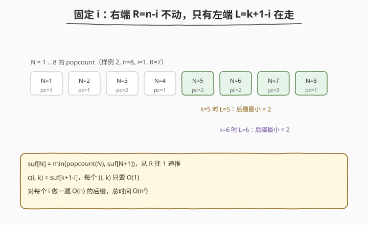
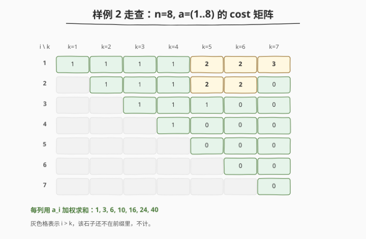

# Codeforces 178A2 教育游戏石子搬运 题解

## 1. 题目概述

- **题目链接**：https://codeforces.com/problemset/problem/178/A2
- **比赛来源**：ABBYY Cup 2.0 - Hard · Problem A2（UTC 2012-04-28）
- **难度**：1000
- **标签**：数学、二进制、后缀最小值、预处理
- **评测类型**：普通（题面把数据分成 20 / 50 / 100 分三档）
- **限制**：时间 2 s / 内存 256 MB

**题意**：长度为 $n$ 的非负序列 $a_1..a_n$。一次操作选 $a_i>0$ 和 $t\ge0$（要求 $i+2^t\le n$），把一颗石子从 $i$ 搬到 $i+2^t$。对每个 $k=1..n-1$，求把前缀 $a_1..a_k$ 清零的最少操作数。

**约束**（原样摘自题面 `inputFormat.en`）：

- 第一行 $n$；第二行 $n$ 个整数 $a_i$（$0 \le a_i \le 10^4$）。
- 20 分档：$1 \le n \le 300$；50 分档：$1 \le n \le 2000$；100 分档：$1 \le n \le 10^5$。
- 只有一组数据，输出恰好 $n-1$ 行。

**档位说明**：本题位是 A2，对应 50 分档（$n \le 2000$）。20 分档是同场 A1，100 分档是 A3；三题题面文本逐字相同（都列出三档），区别只在数据规模。

**约束对算法的限制**：

- $n \le 2000$：$O(n^2) = 4\times10^6$ 可以接受，但 $O(n^3) = 1.3\times10^9$ 偏紧（C++ 也许能过，但不是稳妥做法；Python 必挂）。
- $a_i \le 10^4$：答案上界约 $2000 \times 10^4 \times 11 \approx 2.2\times10^8$，`int` 够用，代码仍用 `long long`。
- 石子之间互相独立（引理 1），所以可以逐颗石子统计、再用「固定 $i$」的后缀最小值把内层枚举降到 $O(1)$。

## 2. 示例与观察

官方样例 1（输入 / 输出原样）：

```text
输入：
4
1 0 1 2

输出：
1
1
3
```

官方样例 2（输入 / 输出原样）：

```text
输入：
8
1 2 3 4 5 6 7 8

输出：
1
3
6
10
16
24
40
```

**样例 2 的演算**：$k=5$ 时，位置 1 的石子位移至少 5，$5=1+4$ 两跳；位置 2 位移至少 4，一跳（$2\to6$）；位置 3 位移至少 3，两跳（$3=1+2$）；位置 4 位移至少 2，一跳；位置 5 位移至少 1，一跳。加权和 $1\cdot2+2\cdot1+3\cdot2+4\cdot1+5\cdot1=16$，与输出一致。$k=6$、$k=7$ 同理得到 24、40。

**观察 1**：每颗石子独立。一次操作只搬一颗石子，「$a_i>0$」对当前被搬的那颗总成立，所以总操作数等于每颗石子各自跨过 $k$ 的跳数之和。

**观察 2**：一颗石子从 $i$ 出发跨过 $k$，最少跳数是

$$c(i,k)=\min\{\operatorname{popcount}(N): k+1-i \le N \le n-i\},$$

即「合法位移区间里 popcount 的最小值」。这一点与 A1 完全一样，证明见第 4 节引理 2。

**观察 3（本篇的关键）**：固定 $i$ 时右端 $R=n-i$ 不变，只有左端 $L=k+1-i$ 随着 $k$ 增大而增大。于是可以从 $R$ 往 $1$ 预处理后缀最小值

$$\text{suf}[N]=\min_{N \le x \le R}\operatorname{popcount}(x),$$

之后 $c(i,k)=\text{suf}[k+1-i]$，每个 $(i,k)$ 只要 $O(1)$。



图里画的是 $n=8$、$i=1$（$R=7$）的情形：$k=5$ 时 $L=5$，后缀最小是 $\operatorname{popcount}(6)=2$；$k=6$ 时 $L=6$，后缀最小仍是 2；$k=7$ 时 $L=7$，后缀最小是 3。

**自造样例**（标注「自造」，输出由程序实测）：

| 输入 | 输出 | 说明 |
|------|------|------|
| `2` / `5 0` | 5 | 最小规模 |
| `2` / `0 0` | 0 | 全 0，不需要任何操作 |
| `5` / `1 0 0 0 0` | 1 / 1 / 1 / 1 | $k=3$ 起 $1\to5$ 位移 4，一跳就跨过 |
| `16` / 全 1 | 1, 2, 3, 4, 5, 6, 7, 8, 10, 12, 14, 16, 20, 24, 32（共 15 行） | 每颗石子都要跨过 $k$，代价随 popcount 跳变 |

**与 A1 / A3 的约束差异**：A1 是 20 分档 $n\le300$、A2 是 50 分档 $n\le2000$、A3 是 100 分档 $n\le10^5$，三题题面逐字相同，只差数据规模。A1 的 $O(n^3)$ 三重循环**在 A1 的 $n\le300$ 下足够**，但在 A2 的 $n\le2000$ 下要 $1.3\times10^9$ 次运算，**必须额外**把「对每个 $(i,k)$ 枚举 $N$」换成「对每个 $i$ 做一次后缀最小值」；本篇的 $O(n^2)$ 在 A2 下足够，可到了 A3 的 $n\le10^5$ 又要 $10^{10}$ 级运算，仍需 A3 的阈值分解。

## 3. 解题思路

### 3.1 朴素做法与瓶颈

A1 的做法是三重循环：$k$、$i$、$N$。$n=2000$ 时运算量约 $n^3/6\approx1.3\times10^9$，C++ 在 2 s 内相当勉强，Python 完全不可能。

观察 3 指出：内层对 $N$ 的枚举其实是在求「同一个后缀区间的最小 popcount」，而随着 $k$ 增加，左端单调右移、右端不动——这正是「后缀最小值」的典型形态，可以预处理一次、$O(1)$ 查询。

### 3.2 核心观察：右端固定，左端单调

对固定的 $i$：

- 上界 $R=n-i$ 固定；
- $k$ 从 $i$ 增到 $n-1$ 时，$L=k+1-i$ 从 $1$ 增到 $R$；
- 因此 $c(i,k)$ 是「$[L,R]$ 上的最小值」，用一个从右往左的 `suf` 数组即可。

### 3.3 算法流程

```
ans[1..n-1] = 0
for i = 1 .. n:
    if a[i] == 0: continue
    R = n - i
    suf[R+1] = INF
    for N = R down to 1:
        suf[N] = min(popcount(N), suf[N+1])
    for k = i .. n-1:
        ans[k] += a[i] * suf[k+1-i]
输出 ans[1..n-1]
```

对每个 $i$，后缀 $O(R)$、累加 $O(n-i)$，合计 $O(n)$；$n$ 个 $i$ 共 $O(n^2)$。

### 3.4 样例走查：n=8, a=(1..8)



图中每行是一个 $i$、每列是一个 $k$，格子里的数字是 $c(i,k)$（灰色表示 $i>k$，该石子还不在前缀里）。把第 $k$ 列按 $a_i=i$ 加权求和，得到 $1,3,6,10,16,24,40$，与官方输出一致。

例如 $k=5$ 这一列：$c(1,5)=2$、$c(2,5)=1$、$c(3,5)=1$、$c(4,5)=1$、$c(5,5)=1$，加权和 $1\cdot2+2\cdot1+3\cdot1+4\cdot1+5\cdot1=16$。

## 4. 正确性证明

**引理 1（石子独立）**：最少操作数等于每颗位于 $i\le k$ 的石子各自跨过 $k$ 的最少跳数之和。

**证明**：一次操作只搬一颗石子，且被搬的石子在操作前必在当前位置（$a_i>0$），石子之间没有容量与次序约束，故任意操作序列可按石子拆成独立路径，总数是各路径长度之和；反之把各自最优路径依次执行即得合法方案。∎

**引理 2（跳数公式）**：$c(i,k)=\min_{k+1-i\le N\le n-i}\operatorname{popcount}(N)$。

**证明**：(1) 若 $m$ 跳跨过 $k$，总位移 $N\ge k+1-i$、$N\le n-i$，且 $N$ 是 $m$ 个 2 的幂之和，由 popcount 的次可加性 $\operatorname{popcount}(N)\le m$，故 $m\ge$ 右边。
(2) 取使 popcount 最小的 $N$，按二进制拆成 $\operatorname{popcount}(N)$ 个 2 的幂依次跳，部分和不超过 $N\le n-i$，落点 $i+N\ge k+1$，合法且跨过 $k$。∎

**引理 3（后缀最小值）**：对固定 $i$，设 $R=n-i$，$\text{suf}[N]=\min_{N\le x\le R}\operatorname{popcount}(x)$，则 $c(i,k)=\text{suf}[k+1-i]$。

**证明**：由引理 2，$c(i,k)$ 是 $[k+1-i,\,R]$ 上的最小值，正是 $\text{suf}[k+1-i]$ 的定义。∎

**定理**：算法输出正确。

**证明**：算法对每个 $i$ 用递推 $\text{suf}[N]=\min(\operatorname{popcount}(N),\text{suf}[N+1])$ 从 $R$ 往 1 计算，归纳可知它等于引理 3 定义的后缀最小值；随后把 $a_i\cdot\text{suf}[k+1-i]$ 累加到每个 $k\ge i$ 的答案上。由引理 1、3，答案 $=\sum_{i\le k}a_i c(i,k)$，与算法一致。∎

## 5. 复杂度分析

- **时间**：$O(n^2)$。每个 $i$ 做一次 $O(R)$ 的后缀与一次 $O(n-i)$ 的累加，总计 $\sum_i O(n) = O(n^2)$；$n=2000$ 时约 $4\times10^6$ 次操作。
- **空间**：$O(n)$（`ans`、`suf`、`a`）。
- **数值范围**：答案 $\le 2\times10^3\times10^4\times11 \approx 2.2\times10^8$，`int` 可装；代码用 `long long`。
- **与时限的关系**：2 s 对 $4\times10^6$ 次运算是极大余量。实测 $n=2000$ 端到端约 7 ms，Python 约 408 ms。

## 6. 参考代码

### C++17

```cpp
#include <bits/stdc++.h>
using namespace std;

// A2：50 分档 n<=2000。对每个起点 i，预计算「后缀最小 popcount」，
// 再把它贡献给所有 k >= i，总代价 O(n^2)
int main() {
    ios::sync_with_stdio(false);
    cin.tie(nullptr);

    int n;
    if (!(cin >> n)) return 0;
    vector<int> a(n + 1);
    for (int i = 1; i <= n; ++i) cin >> a[i];

    vector<long long> ans(n + 1, 0);
    vector<int> suf(n + 2, 1000);
    for (int i = 1; i <= n; ++i) {
        if (a[i] == 0) continue;
        int R = n - i;                       // 从 i 出发最多走 n-i 步位移
        suf[R + 1] = 1000;
        for (int N = R; N >= 1; --N)
            suf[N] = min(__builtin_popcount((unsigned)N), suf[N + 1]);
        for (int k = i; k <= n - 1; ++k) {
            int L = k + 1 - i;               // 至少要跨过的位移
            ans[k] += (long long)a[i] * suf[L];
        }
    }
    for (int k = 1; k < n; ++k) cout << ans[k] << '\n';
    return 0;
}
```

### Python3

```python
import sys


def main() -> None:
    data = sys.stdin.buffer.read().split()
    if not data:
        return
    n = int(data[0])
    a = [0] + [int(x) for x in data[1:1 + n]]
    pc = [bin(x).count('1') for x in range(n + 1)]

    ans = [0] * (n + 1)
    suf = [1000] * (n + 2)
    for i in range(1, n + 1):
        if a[i] == 0:
            continue
        R = n - i
        suf[R + 1] = 1000
        for N in range(R, 0, -1):
            c = pc[N]
            suf[N] = c if c < suf[N + 1] else suf[N + 1]
        for k in range(i, n):
            ans[k] += a[i] * suf[k + 1 - i]
    sys.stdout.write('\n'.join(str(ans[k]) for k in range(1, n)) + '\n')


main()
```

## 7. 边界情况与易错点

1. **$n=1$**：输出 0 行，主循环一次都不执行，不能多打印换行。
2. **$i=n$**：$R=0$，后缀循环不执行，内层 `for k=i..n-1` 也不执行；但 `suf[1]` 必须先重置为 INF，否则会复用上一个 $i$ 的脏值（代码里 `suf[R+1]=1000` 只重置了 $R+1$，恰好本题不会读 $R+1$ 之外的位置）。
3. **$k=i$ 时 $L=1$**：取的是整个 $[1,R]$ 的最小值，闭区间端点都不能写错。
4. **$a_i=0$**：直接跳过；若跳过后仍用旧 `suf` 值会算出非零贡献，所以「跳过」必须发生在写 `suf` 之前。
5. **后缀数组的越界**：`suf` 要开到 $n+2$，因为会访问 `suf[R+1]`（$R$ 最大 $n-1$，所以 `suf[n]` 合法）。
6. **答案类型**：$n\le2000$ 时答案不超过 $2.2\times10^8$，`int` 够；但 A3 的规模下会到 $1.7\times10^{10}$，统一 `long long` 更稳。
7. **Python 的 popcount**：用 `bin(x).count('1')`，不要用 `int.bit_count()`（Codeforces 的 Python 版本可能是 3.8/3.9）。
8. **输出行数**：恰好 $n-1$ 行；用 `'\n'.join(...)` 时别忘了末尾换行。
9. **多组数据**：题面只有一组；但 `ans`、`suf` 都在循环外分配，若真有多组必须清空。

## 8. 验证记录

- **编译环境与命令**：`Apple clang 21.0.0`（`/usr/bin/g++` 是 clang 软链，无 GNU libstdc++），`clang++ -std=c++17 -O2 -Wall` 加仓库自带 `bits/stdc++.h`；正文代码仍写标准头。Python 为 `3.9.6`。验证命令：
  `python3 codeforces/tools/verify_solution.py codeforces/contests/0101-0203/178/A2_教育游戏石子搬运.md`
- **官方样例**：2 / 2 通过，C++ 与 Python 一致。
- **额外测试**：自造 $n=2$、全 0、$n=5$、$n=16$ 全 1 等 5 组，两种语言全部通过；$n=2000$、$a_i$ 随机的数据与 A3 交叉比对，输出逐字相同。
- **独立暴力对拍**：暴力是「对每个 $(i,k)$ 在位置图上 BFS 求最少跳数」，完全不使用 popcount 公式；对 250 组随机数据（$n\in[2,40]$，$a_i\in[0,4]$）逐组比对，全部一致。
- **最大约束性能**：$n=2000$ 端到端约 7 ms（含进程启动），Python 约 408 ms，相对 2 s 时限余量在百倍以上。
- **图片与公式**：2 张 SVG（`cf178a2_window.svg`、`cf178a2_walkthrough.svg`）通过 `ElementTree.parse` 与文本包围盒/重叠检查，headless Chrome 渲染确认无裁切；KaTeX 校验 0 错。
- **复核状态**：verified。

## 相关题目与扩展

- [Codeforces 178A1 Educational Game](https://codeforces.com/problemset/problem/178/A1)：20 分档，$O(n^3)$ 三重循环。
- [Codeforces 178A3 Educational Game](https://codeforces.com/problemset/problem/178/A3)：100 分档，$O(n\log n)$ 阈值分解。
- [Codeforces 178B2 Greedy Merchants](https://codeforces.com/problemset/problem/178/B2)：同场 B2，同样是「先做一次预处理、再 $O(1)$ 回答每个询问」的套路。
- [LeetCode 238. 除自身以外数组的乘积](https://leetcode.cn/problems/product-of-array-except-self/)：前后缀预处理思想的入门题。
- [Codeforces 1352C K-th Not Divisible by n](https://codeforces.com/problemset/problem/1352/C)：同样是「把逐个枚举换成公式/预处理」的化简。

**延伸思考**：

1. **后缀最小值的本质**：$c(i,k)$ 对 $k$ 单调不减（$k$ 越大要求越远），而 $\text{suf}$ 正好表达了这种单调性；对固定 $i$ 只需算一次，就能回答所有 $k$。
2. **能不能只做前缀**：可以，把 $k$ 从大到小扫描、维护 $[k+1-i,R]$ 的最小值，同样是 $O(n)$ 每个 $i$；后缀版与它等价。
3. **$a_i$ 很大时**：$a_i$ 只是乘数，不影响复杂度；但答案可能超过 64 位（$a_i$ 到 $10^{18}$ 时），需要 128 位或取模。
4. **从 $O(n^2)$ 到 $O(n\log n)$**：本篇对每个 $i$ 都重新算一遍后缀，浪费在「不同 $i$ 的后缀高度重叠」；A3 的阈值分解正是利用 $\operatorname{popcount}$ 只有 $\log n$ 种取值，把每个 $i$ 的贡献压缩成 $\log n$ 个阈值。

