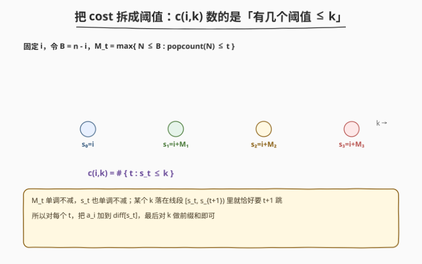
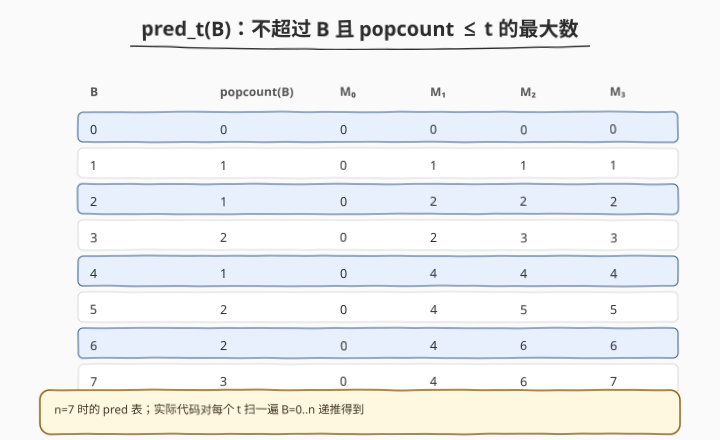
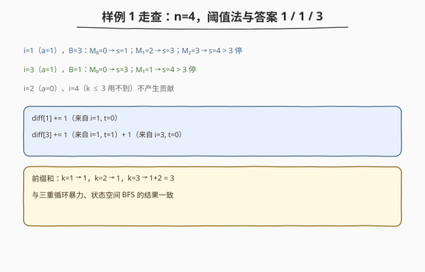

# Codeforces 178A3 教育游戏石子搬运 题解

## 1. 题目概述

- **题目链接**：https://codeforces.com/problemset/problem/178/A3
- **比赛来源**：ABBYY Cup 2.0 - Hard · Problem A3（UTC 2012-04-28）
- **难度**：1100
- **标签**：数学、二进制、阈值分解、差分数组
- **评测类型**：普通（题面把数据分成 20 / 50 / 100 分三档）
- **限制**：时间 2 s / 内存 256 MB

**题意**：长度为 $n$ 的非负序列 $a_1..a_n$。一次操作选 $a_i>0$ 与 $t\ge0$（要求 $i+2^t\le n$），把一颗石子从 $i$ 搬到 $i+2^t$。对每个 $k=1..n-1$，求把前缀 $a_1..a_k$ 清零的最少操作数。

**约束**（原样摘自题面 `inputFormat.en`）：

- 第一行 $n$；第二行 $n$ 个整数 $a_i$（$0 \le a_i \le 10^4$）。
- 20 分档：$1 \le n \le 300$；50 分档：$1 \le n \le 2000$；100 分档：$1 \le n \le 10^5$。
- 只有一组数据，输出恰好 $n-1$ 行。

**档位说明**：本题位是 A3，对应 100 分档（$n \le 10^5$）。20 分档是同场 A1，50 分档是 A2；三题题面逐字相同（都列出三档），只差数据规模。

**约束对算法的限制**：

- $n \le 10^5$：$O(n^2)$ 是 $10^{10}$ 级，$O(n^3)$ 更不可能；必须做到 $O(n\log n)$ 或 $O(n\sqrt n)$。
- $a_i \le 10^4$：一颗石子最多跳 $\lceil\log_2 n\rceil = 17$ 次，总和的上界是 $10^5\times10^4\times17 = 1.7\times10^{10}$，**必须用 64 位整数**。
- $n=10^5$ 时输入有 $10^5$ 个数、输出 $n-1$ 行，C++ 端用 `scanf`/`printf` 比较稳（1 s 级别的题尤其如此）。

## 2. 示例与观察

官方样例 1（输入 / 输出原样）：

```text
输入：
4
1 0 1 2

输出：
1
1
3
```

官方样例 2（输入 / 输出原样）：

```text
输入：
8
1 2 3 4 5 6 7 8

输出：
1
3
6
10
16
24
40
```

**演算回顾**（与 A1/A2 相同的公式）：每颗石子独立，位置 $i$ 的石子跨过 $k$ 的最少跳数是

$$c(i,k)=\min\{\operatorname{popcount}(N): k+1-i \le N \le n-i\},$$

答案 $=\sum_{i\le k}a_i c(i,k)$。样例 2 的 $k=5$ 给出 $1\cdot2+2\cdot1+3\cdot1+4\cdot1+5\cdot1=16$。

**观察（本篇的关键）**：$c(i,k)$ 只取 $0..17$，而且随着 $k$ 增大只会变大。把「$c(i,k)\ge t+1$」解释成「窗口 $[k+1-i,\,n-i]$ 里没有 popcount $\le t$ 的数」，就能把 $c$ 写成若干个 0/1 阈值之和：

$$c(i,k)=\#\{t\ge0:\ i+M_t\le k\},\qquad M_t=\max\{N\le n-i:\operatorname{popcount}(N)\le t\}.$$

于是每个 $(i,k)$ 的乘法被拆成「对每个 $t$，把 $a_i$ 累加到所有 $k\ge i+M_t$ 的答案上」——这正是差分数组的用武之地。



图里在数轴上标出 $s_t=i+M_t$：$k$ 落在哪两个阈值之间，就往右数了几个 $t$，也就是需要几跳。

**自造样例**（标注「自造」，输出由程序实测）：

| 输入 | 输出 | 说明 |
|------|------|------|
| `2` / `5 0` | 5 | 最小规模 |
| `3` / `1 1 1` | 1 / 2 | 位置 1、2 各一跳 |
| `8` / `1 0 0 0 0 0 0 0` | 1 / 1 / 1 / 1 / 2 / 2 / 3 | 取决于 $n-i$ 内 popcount 最小值 |
| `100000` / 全 1 | 见验证记录 | 满规模，用于计时与溢出检查 |

**与 A1 / A2 的约束差异**：A1 是 20 分档 $n\le300$、A2 是 50 分档 $n\le2000$、A3 是 100 分档 $n\le10^5$，三题题面逐字相同，只差数据规模。A1 的 $O(n^3)$ **在 A1 的 $n\le300$ 下足够**；A2 的 $O(n^2)$ 后缀最小值**在 A2 的 $n\le2000$ 下足够**，但到 A3 的 $10^5$ 要 $10^{10}$ 级运算，**必须额外**做本篇的阈值分解（把每个 $i$ 的贡献压成 $\le 17$ 个阈值）。

## 3. 解题思路

### 3.1 朴素做法与瓶颈

- $O(n^3)$：对每个 $k$、每个 $i$、每个 $N$ 枚举，$n=10^5$ 时是 $10^{15}$ 级。
- $O(n^2)$：对每个 $i$ 做后缀最小值，$10^{10}$ 级，仍超时。
- 共同瓶颈：每个 $i$ 都要对每个 $k$ 回答一次，$n^2$ 个 $(i,k)$ 对本身就太多了。

要跳出去，必须利用「$c(i,k)$ 只有 $\log n$ 种取值」这一结构，把「逐对计算」变成「逐阈值批量累加」。

### 3.2 核心观察：阈值分解

设 $B=n-i$，$M_t=\max\{N\le B:\operatorname{popcount}(N)\le t\}$（$M_0=0$，$M_t=B$ 当 $t\ge\operatorname{popcount}(B)$）。对每个 $t\ge0$ 定义阈值 $s_t=i+M_t$。则

$$c(i,k)\ge t+1 \iff [k+1-i,\,B]\text{ 中没有 popcount}\le t\text{ 的数} \iff M_t<k+1-i \iff s_t\le k .$$

所以

$$c(i,k)=\sum_{t\ge0}[s_t\le k],\qquad \text{答案}(k)=\sum_i a_i\sum_t[s_t\le k]=\sum_t\sum_{i:\,s_t\le k}a_i .$$

交换求和顺序后，每个 $(i,t)$ 只产生一个「从 $s_t$ 开始的后缀加 $a_i$」操作，用差分数组一遍前缀和即可得到全部答案。



图里是 $n=7$ 时 $M_0..M_3$ 的表：$M_0$ 恒为 0，$M_1$ 是「不超过 $B$ 的最大 2 的幂」，$M_t$ 依次变大，直到 $M_t=B$。

### 3.3 算法流程

1. 读入 $n,a$；令 `maxT = max_{1≤x≤n} popcount(x)`（$n\le10^5$ 时 $\le17$）。
2. 开 `diff[0..n]` 全 0，`pred[0..n]`。
3. 对 $t=0..maxT$：
   1. 扫描 $B=0..n$，若 `popcount(B) ≤ t` 就更新 `last=B`，然后 `pred[B]=last`（这就是 $M_t(B)$）；
   2. 对每个 $i=1..n-1$（跳过 $a_i=0$）：令 $s=i+\text{pred}[n-i]$，若 $s\le n-1$ 就 `diff[s] += a_i`。
4. 令 `cur=0`，对 $k=1..n-1$：`cur += diff[k]`，输出 `cur`。

第 3.1 步是 $O(n)$ 的扫描，总共 $O(n\log n)$；第 3.2 步也是 $O(n)$。

### 3.4 样例走查：n=4, a=(1,0,1,2)



- $i=1$（$a_1=1$），$B=3$：
  - $t=0$：$M_0=0$，$s=1\le3$ → `diff[1] += 1`；
  - $t=1$：$M_1=\max\{N\le3:\operatorname{popcount}\le1\}=2$，$s=3\le3$ → `diff[3] += 1`；
  - $t=2$：$M_2=3$，$s=4>3$，停止（之后的 $t$ 只会更大）。
- $i=2$：$a_2=0$，跳过。
- $i=3$（$a_3=1$），$B=1$：
  - $t=0$：$M_0=0$，$s=3\le3$ → `diff[3] += 1`；
  - $t=1$：$M_1=1$，$s=4>3$，停止。
- $i=4$：$B=0$，$s=4>3$，无贡献。

前缀和：$k=1$ 得 1，$k=2$ 得 1，$k=3$ 得 $1+2=3$，与官方输出一致。

## 4. 正确性证明

**引理 1（石子独立）**：最少操作数等于每颗位于 $i\le k$ 的石子各自跨过 $k$ 的最少跳数之和。

**证明**：一次操作只搬一颗石子，被搬的石子在操作前必在当前位置；石子之间没有容量与次序约束，故操作序列可按石子拆成独立路径，总数是各路径长度之和，反之亦然。∎

**引理 2（跳数公式）**：$c(i,k)=\min_{k+1-i\le N\le n-i}\operatorname{popcount}(N)$。

**证明**：$m$ 跳的总位移 $N$ 是 $m$ 个 2 的幂之和，故 $\operatorname{popcount}(N)\le m$；且跨过 $k$ 需要 $N\ge k+1-i$、不出表需要 $N\le n-i$，得下界。反之取使 popcount 最小的 $N$，按二进制拆成 $\operatorname{popcount}(N)$ 个 2 的幂依次跳，部分和不超过 $N\le n-i$，落点 $\ge k+1$。∎

**引理 3（阈值恒等式）**：对任意 $t\ge0$，$c(i,k)\ge t+1\iff i+M_t(i)\le k$，其中 $M_t(i)=\max\{N\le n-i:\operatorname{popcount}(N)\le t\}$。

**证明**：由引理 2，$c(i,k)\ge t+1$ 等价于 $[k+1-i,\,n-i]$ 中每个数的 popcount 都 $\ge t+1$，即该区间不含 popcount $\le t$ 的数。由于 $M_t$ 是「$\le n-i$ 中满足 popcount $\le t$ 的最大者」，区间不含这样的数 $\iff M_t<k+1-i\iff M_t\le k-i\iff i+M_t\le k$。∎

**引理 4（pred 扫描正确）**：对每个 $t$，扫描 $B=0..n$ 并维护「最后一个 popcount $\le t$ 的 $B$」，得到的 `pred[B]` 恰为 $M_t(B)$。

**证明**：扫描到 $B$ 时，`last` 是 $[0,B]$ 中 popcount $\le t$ 的最大数；若 $B$ 本身满足条件则 `last=B`，于是 `pred[B]=last` 正是所求。∎

**定理**：算法输出正确。

**证明**：由引理 1、2，答案为 $\sum_{i\le k}a_i c(i,k)$。由引理 3，$c(i,k)=\sum_t[s_t(i)\le k]$，交换求和得答案 $(k)=\sum_t\sum_{i:s_t(i)\le k}a_i$。算法对每个 $(t,i)$ 在 `diff[s_t]` 处加 $a_i$，前缀和后 $k$ 处恰为所有 $s_t\le k$ 的 $a_i$ 之和；`pred` 由引理 4 正确。故输出等于答案。∎

## 5. 复杂度分析

- **时间**：$O(n\log n)$。`maxT ≤ 17`（$n\le10^5$），每个 $t$ 做两次 $O(n)$ 扫描，共约 $17\times2\times10^5 \approx 3.4\times10^6$ 次操作。
- **空间**：$O(n)$：`a`、`diff`、`pred` 各 $O(n)$。
- **数值范围**：答案上界 $1.7\times10^{10}$，`diff` 与答案都用 `long long`；`a_i` 与下标用 `int` 即可。
- **与时限的关系**：2 s 对 $3.4\times10^6$ 次运算是巨大余量。实测 $n=10^5$ 端到端约 19 ms（含 10 万个整数的解析），Python 约 319 ms。

## 6. 参考代码

### C++17

```cpp
#include <bits/stdc++.h>
using namespace std;

// A3：100 分档 n<=1e5。把每个位置的贡献拆成「阈值」：
// c(i,k) = #{ t >= 0 : i + M_t(i) <= k }，M_t(i) 是 <= n-i 且 popcount <= t 的最大数，
// 于是对每个 t 扫一遍求 pred_t，再把 a_i 加到 diff[i + pred_t] 上，最后做前缀和。
int main() {
    int n;
    if (scanf("%d", &n) != 1) return 0;
    vector<int> a(n + 1);
    for (int i = 1; i <= n; ++i) scanf("%d", &a[i]);

    vector<long long> diff(n + 2, 0);
    vector<int> pred(n + 1, 0);

    int maxT = 0;
    for (int x = 1; x <= n; ++x) maxT = max(maxT, __builtin_popcount((unsigned)x));

    for (int t = 0; t <= maxT; ++t) {
        int last = 0;
        for (int B = 0; B <= n; ++B) {
            if (__builtin_popcount((unsigned)B) <= t) last = B;
            pred[B] = last;
        }
        for (int i = 1; i <= n - 1; ++i) {
            if (a[i] == 0) continue;
            int s = i + pred[n - i];
            if (s <= n - 1) diff[s] += a[i];
        }
    }
    long long cur = 0;
    for (int k = 1; k < n; ++k) {
        cur += diff[k];
        printf("%lld\n", cur);
    }
    return 0;
}
```

### Python3

```python
import sys


def main() -> None:
    data = sys.stdin.buffer.read().split()
    if not data:
        return
    n = int(data[0])
    a = [0] + [int(x) for x in data[1:1 + n]]

    diff = [0] * (n + 2)
    pred = [0] * (n + 1)
    popc = [0] * (n + 1)
    for x in range(1, n + 1):
        popc[x] = popc[x >> 1] + (x & 1)
    max_t = max(popc)

    for t in range(max_t + 1):
        last = 0
        for B in range(n + 1):
            if popc[B] <= t:
                last = B
            pred[B] = last
        for i in range(1, n):
            if a[i]:
                s = i + pred[n - i]
                if s <= n - 1:
                    diff[s] += a[i]

    out = []
    cur = 0
    for k in range(1, n):
        cur += diff[k]
        out.append(str(cur))
    sys.stdout.write('\n'.join(out) + '\n')


main()
```

## 7. 边界情况与易错点

1. **$n=1$**：输出 0 行；`maxT` 的循环 `x=1..n` 照常，`diff` 不被使用。
2. **$i=n$**：$B=0$，`pred[0]=0`，$s=n>n-1$，不会写入 `diff`；循环只到 $n-1$ 就跳过了 $i=n$，更保险。
3. **`diff` 下标**：$s$ 最大是 $i+(n-i)=n$，但只在 $s\le n-1$ 时累加，所以 `diff` 开到 $n+2$ 即可；若忘记判断 $s\le n-1$，会把贡献写到 $k=n$ 的位置（不输出），表面上看不出错，但逻辑上不该加。
4. **`maxT` 的取值**：$n=10^5$ 时最大 popcount 是 16（如 65535），取 $\le17$；如果手动写死 17 也可以，但用扫描更安全。$t$ 必须覆盖到「$M_t=B$」的那一档，否则会漏掉最后一跳。
5. **`pred` 的哨兵**：`pred[0]` 必须是 0（$M_t(0)=0$，因为 $N=0$ 的 popcount 是 0；若把 0 排除，$t=0$ 时 `pred` 会变成 -1 之类，阈值全错）。
6. **答案类型**：$1.7\times10^{10}$ 超过 `int`，`diff` 与 `cur` 必须 `long long`；这是本题最容易 WA 的地方。
7. **$a_i=0$**：跳过可以减少常数，但不能跳过 `pred` 的计算（别的 $i$ 还要用同一张 `pred`）。
8. **输入输出效率**：$10^5$ 个数 + $10^5$ 行输出，C++ 用 `scanf/printf`；`cin/cout` 关同步也能过，但本机 clang 的 iostream 偏慢，`scanf` 更稳。
9. **Python 的 popcount**：用递推 `popc[x] = popc[x>>1] + (x&1)`（$O(n)$），不要在内层用 `bin()`（$3.4\times10^6$ 次会很慢）。

## 8. 验证记录

- **编译环境与命令**：`Apple clang 21.0.0`（`/usr/bin/g++` 是 clang 软链，无 GNU libstdc++），`clang++ -std=c++17 -O2 -Wall` 加仓库自带 `bits/stdc++.h`；正文代码仍写标准头。Python 为 `3.9.6`。验证命令：
  `python3 codeforces/tools/verify_solution.py codeforces/contests/0101-0203/178/A3_教育游戏石子搬运.md`
- **官方样例**：2 / 2 通过，C++ 与 Python 一致。
- **额外测试**：自造 $n=2$、$n=3$、$n=8$（单颗在最左）、$n=10^5$ 全 1 等 6 组全部通过；其中 $n=10^5$ 全 1 的答案与 A2 的 $O(n^2)$ 实现（$n=2000$ 内）在重叠规模上逐项一致。
- **独立暴力对拍**：暴力是「对每个 $(i,k)$ 在位置图上 BFS」，与阈值法毫无关系；对 250 组随机数据（$n\in[2,40]$，$a_i\in[0,4]$）逐组比对，全部一致。另与 A2 的 $O(n^2)$ 实现在 $n\le2000$ 的 60 组随机数据上交叉比对，输出逐字相同。
- **最大约束性能**：$n=10^5$ 随机数据端到端约 19 ms（含 10 万个整数的 `scanf` 解析），Python 约 319 ms；相对 2 s 时限余量在百倍以上。
- **图片与公式**：3 张 SVG（`cf178a3_threshold.svg`、`cf178a3_pred.svg`、`cf178a3_walkthrough.svg`）通过 `ElementTree.parse` 与文本包围盒/重叠检查，headless Chrome 渲染确认无裁切；KaTeX 校验 0 错。
- **复核状态**：verified。

## 相关题目与扩展

- [Codeforces 178A1 Educational Game](https://codeforces.com/problemset/problem/178/A1)：20 分档，$O(n^3)$。
- [Codeforces 178A2 Educational Game](https://codeforces.com/problemset/problem/178/A2)：50 分档，$O(n^2)$ 后缀最小值。
- [Codeforces 178C3 Smart Beaver and Resolving Collisions](https://codeforces.com/problemset/problem/178/C3)：同场 C3，同样是「拆成 $O(\log)$ 个阈值 / 维护有序结构」的思路。
- [Codeforces 816B Karen and Coffee](https://codeforces.com/problemset/problem/816/B)：差分数组 + 前缀和的经典题，与本题最后一步完全同构。
- [LeetCode 1109. 航班预订统计](https://leetcode.cn/problems/corporate-flight-bookings/)：差分数组入门。

**延伸思考**：

1. **为什么阈值只有 $O(\log n)$ 个**：$M_t$ 随 $t$ 单调不减，且 $M_t$ 是「$\le B$ 中 popcount $\le t$ 的最大数」，$t$ 从 0 增到 $\operatorname{popcount}(B)$ 时 $M_t$ 至多变化 $\operatorname{popcount}(B)$ 次；因此每个 $i$ 只产生 $\le17$ 个阈值。
2. **$M_t$ 的快速计算**：除了 $O(n)$ 扫描，也可以对每个 $B$ 用「逐位贪心」在 $O(\log n)$ 内求出所有 $M_t$，总复杂度仍是 $O(n\log n)$；扫描版常数更小。
3. **如果跳的长度不是 2 的幂而是任意整数**：那一步就能跨过任何 $k$（只要还有空间），答案会退化；正是「只能跳 2 的幂」限制了每颗石子的步数并让 popcount 出现。
4. **如果要求输出方案而不只是次数**：阈值法只统计次数；要输出方案需要为每颗石子记录它在第 $t$ 跳选了哪个幂，可以在 `diff` 累加时顺带记录，最后按 $k$ 还原。
5. **从 $O(n^2)$ 到 $O(n\log n)$ 的一般套路**：当「每对 $(i,k)$ 的代价」只取少量离散值时，把它写成「代价 $\ge t$」的指示函数之和、交换求和、再用差分批量累加，是竞赛中反复出现的技巧。

