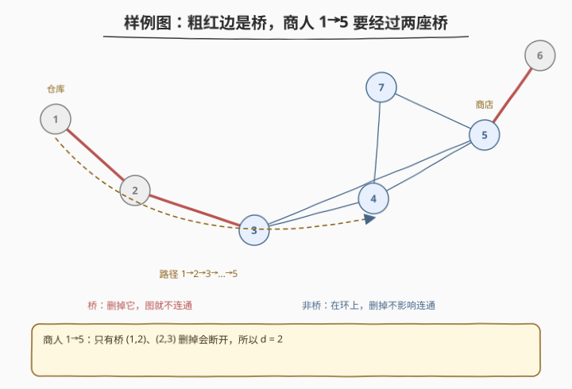
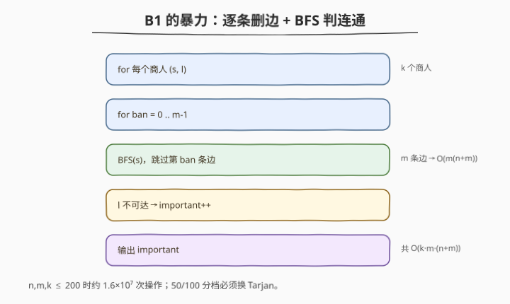

# Codeforces 178B1 贪婪商人的桥税 题解

## 1. 题目概述

- **题目链接**：https://codeforces.com/problemset/problem/178/B1
- **比赛来源**：ABBYY Cup 2.0 - Hard · Problem B1（UTC 2012-04-28）
- **难度**：1600
- **标签**：图论、桥、连通性、暴力
- **评测类型**：普通（题面把数据分成 20 / 50 / 100 分三档）
- **限制**：时间 2 s / 内存 256 MB

**题意**：$n$ 个城市、$m$ 条双向道路的连通无向图（无重边、无自环）。第 $i$ 个商人要从仓库 $s_i$ 走到商店 $l_i$。一条道路对他是「重要」的，指删掉这条道路后 $s_i$ 与 $l_i$ 不再连通。每个商人只为自己重要的道路交 1 第纳尔/条，求每个商人交多少。

**约束**（原样摘自题面 `inputFormat.en`）：

- 第一行 $n,m$；接下来 $m$ 行 $a_i,b_i$；再一行 $k$；接下来 $k$ 行 $s_i,l_i$。
- 图保证连通，任意两城之间至多一条路。
- 20 分档：$n,m,k \le 200$；50 分档：$\le 2000$；100 分档：$\le 10^5$。
- 输出恰好 $k$ 行。

**档位说明**：本题位是 B1，对应 20 分档（$n,m,k \le 200$）。50 分档是同场 B2，100 分档是 B3；三题题面文本逐字相同（都列出三档），区别只在数据规模。

**约束对算法的限制**：

- $n,m,k \le 200$：对每个商人、每条边做一次「删边 + BFS」，约 $k\cdot m\cdot(n+m) = 1.6\times10^7$ 次操作，毫秒级即可。这是最直白、也最不可能写错的档位做法。
- 50 分档（$2000$）时暴力是 $1.6\times10^{10}$ 级，100 分档（$10^5$）更不可能；B2/B3 必须求桥 + 缩点。
- 答案不超过 $n-1$（简单路径上的桥数），`int` 足够。

## 2. 示例与观察

官方样例（输入 / 输出原样）：

```text
输入：
7 8
1 2
2 3
3 4
4 5
5 6
5 7
3 5
4 7
4
1 5
2 4
2 6
4 7

输出：
2
1
2
0
```

**演算**：先看哪些边是桥（删掉会让图不连通）。

- 边 $(1,2)$：删掉后城市 1 成了孤点 → 桥。
- 边 $(2,3)$：删掉后 $\{1,2\}$ 与其余分开 → 桥。
- 边 $(5,6)$：删掉后城市 6 成孤点 → 桥。
- 其余边都在环上：$3\text{–}4\text{–}5\text{–}3$ 是一个三角形，$4\text{–}5\text{–}7\text{–}4$ 也是一个三角形，删掉其中任何一条仍有替代路径 → 不是桥。

于是：

- 商人 $1\to5$：路径 $1\to2\to3\to4\to5$，其中桥只有 $(1,2)$ 和 $(2,3)$，答案 2；
- 商人 $2\to4$：桥上只剩 $(2,3)$，答案 1；
- 商人 $2\to6$：$(2,3)$ 与 $(5,6)$，答案 2；
- 商人 $4\to7$：两人都在环 $3\text{–}4\text{–}5\text{–}7$ 里，答案 0。

与官方输出一致，也与题面 hint 的说法吻合（删 $(1,2)$ 或 $(2,3)$ 才断开）。

**观察 1**：若删掉边 $e$ 后 $s,l$ 不连通，则 $e$ 一定是桥——否则删掉它图仍连通，$s,l$ 仍连通。所以「重要道路」必然是桥。

**观察 2**：一条桥对商人重要，当且仅当 $s$ 与 $l$ 分居桥的两侧。把桥删掉会把图分成两个连通块，商人跨块就说明要经过它。

**观察 3**：把每个「2-边连通块」（不含桥的极大连通块）缩成一个点、桥变成边，就得到一棵树（桥树）。答案就是 $s$ 与 $l$ 所在块在桥树上的距离——但这已经属于 B2，B1 只需要按定义暴力验证。

**自造样例**（标注「自造」，输出由程序实测）：

| 输入 | 输出 | 说明 |
|------|------|------|
| `2 1` / `1 2` / `1` / `1 2` | 1 | 唯一一条边是桥 |
| `3 3` / 三角形 / `1` / `1 2` | 0 | 没有桥 |
| `4 3` / 链 1-2-3-4 / `2` / `1 4`、`2 3` | 3、1 | 树上距离就是桥数 |
| `4 4` / 环 1-2-3-4-1 / `1` / `1 3` | 0 | 环内任两点都无桥 |

**与 B2 / B3 的约束差异**：B1 是 20 分档（$n,m,k\le200$）、B2 是 50 分档（$\le2000$）、B3 是 100 分档（$\le10^5$），三题题面逐字相同，只差数据规模。本篇的「逐条删边 + BFS」**在 B1 的 $n,m,k\le200$ 下足够**（约 $1.6\times10^7$ 次操作），但到 B2 的 $2000$ 要 $1.6\times10^{10}$ 级、B3 的 $10^5$ 更不可能，**必须额外**换成「Tarjan 求桥 + 缩点成树 + 树上查询」，这正是 B2/B3 的内容。

## 3. 解题思路

### 3.1 朴素做法与瓶颈

最直接的做法完全照题面：

```
for 每个商人 (s, l):
    important = 0
    for 每条边 e:
        在删掉 e 的图上从 s 做 BFS
        若到不了 l: important++
    输出 important
```

每次 BFS 是 $O(n+m)$，总复杂度 $O(k\,m\,(n+m))$。$n=m=k=200$ 时约 $1.6\times10^7$，完全够用；$2000$ 时是 $1.6\times10^{10}$，$10^5$ 时不可能。瓶颈是「每个商人、每条边都重做一次连通性」。

### 3.2 核心观察：重要的边一定是桥



图里把样例的桥画成粗红线，其余边是细蓝线：$3\text{–}4\text{–}5\text{–}3$ 与 $4\text{–}5\text{–}7\text{–}4$ 两个三角形里的边都不是桥。

- 如果删掉 $e$ 后 $s$ 到不了 $l$，那 $e$ 一定是桥（否则图仍连通）。
- 所以只需关心桥；而 B1 的暴力甚至连「找桥」都省了，直接逐边试。

### 3.3 算法流程



1. 读入图，存边表与邻接表（邻接表里带上边的编号）。
2. 读入 $k$ 个询问。
3. 对每个询问 $(s,l)$：对每条边 $ban$，用 BFS 从 $s$ 出发、跳过 $ban$ 这条边，看能否到 $l$；不能则 `important++`。
4. 输出 `important`。

用边的编号而不是端点来「禁用」，是因为无向图里同一条边在两个方向上都存在，按编号跳过最干净。

### 3.4 样例走查

| 商人 | 仓库 | 商店 | 删掉会断开的边 | 答案 |
|------|------|------|----------------|------|
| 1 | 1 | 5 | $(1,2)$、$(2,3)$ | 2 |
| 2 | 2 | 4 | $(2,3)$ | 1 |
| 3 | 2 | 6 | $(2,3)$、$(5,6)$ | 2 |
| 4 | 4 | 7 | 无（同一环） | 0 |

四行与官方输出 $2,1,2,0$ 一致。

## 4. 正确性证明

**引理 1**：若删掉边 $e$ 后 $s$ 与 $l$ 不连通，则 $e$ 是图的桥。

**证明**：反设 $e$ 不是桥，则 $G-e$ 仍连通（桥的定义是「删掉后连通分量增加」；在连通图里等价于删掉后不连通）。于是 $s,l$ 在 $G-e$ 中仍连通，矛盾。∎

**引理 2**：对固定的 $(s,l)$，算法中 `important` 恰好等于「删掉后会断开 $s,l$ 的边」的条数。

**证明**：算法对每条边 $e$ 做一次 $G-e$ 上的 BFS，`seen[l]` 为假当且仅当 $s,l$ 在 $G-e$ 中不连通，此时才 `++important`；这是一一枚举，不重不漏。∎

**定理**：算法输出每个商人需要缴纳的第纳尔数。

**证明**：题面定义 $d_i$ 为「删掉后 $s_i,l_i$ 断开」的边数，引理 2 说明算法计算的正是这个量；由引理 1 可知这些边必然是桥，但算法并不需要这个性质——它按定义计算，因此正确。∎

## 5. 复杂度分析

- **时间**：$O(k\,m\,(n+m))$。$n=m=k=200$ 时约 $200\times200\times400 = 1.6\times10^7$ 次邻接遍历。
- **空间**：$O(n+m)$ 存图，BFS 的 `seen` 数组 $O(n)$。
- **数值范围**：答案 $\le n-1 \le 199$，`int` 足够。
- **与时限的关系**：2 s 对 $1.6\times10^7$ 次操作余量很大。实测 $n=m=k=200$ 端到端约 95 ms（含 200 次 $\times$ 200 条边的 BFS），Python 约 2.4 s（CPython 偏慢，建议 PyPy3 或提交 C++）。

## 6. 参考代码

### C++17

```cpp
#include <bits/stdc++.h>
using namespace std;

// B1：20 分档 n,m,k<=200。对每个商人，逐条删边 + BFS 判连通，数出「重要道路」条数
int main() {
    ios::sync_with_stdio(false);
    cin.tie(nullptr);

    int n, m;
    if (!(cin >> n >> m)) return 0;
    vector<int> eu(m), ev(m);
    vector<vector<pair<int, int>>> adj(n + 1);
    for (int i = 0; i < m; ++i) {
        cin >> eu[i] >> ev[i];
        adj[eu[i]].push_back({ev[i], i});
        adj[ev[i]].push_back({eu[i], i});
    }
    int k;
    cin >> k;
    vector<char> seen(n + 1, 0);
    for (int q = 0; q < k; ++q) {
        int s, l;
        cin >> s >> l;
        int important = 0;
        for (int ban = 0; ban < m; ++ban) {
            fill(seen.begin(), seen.end(), 0);
            queue<int> bfs;
            seen[s] = 1;
            bfs.push(s);
            while (!bfs.empty()) {
                int u = bfs.front();
                bfs.pop();
                for (auto& e : adj[u]) {
                    if (e.second == ban || seen[e.first]) continue;
                    seen[e.first] = 1;
                    bfs.push(e.first);
                }
            }
            if (!seen[l]) ++important;   // 删掉这条边后走不到
        }
        cout << important << '\n';
    }
    return 0;
}
```

### Python3

```python
import sys
from collections import deque


def main() -> None:
    data = sys.stdin.buffer.read().split()
    if not data:
        return
    pos = 0
    n = int(data[pos]); pos += 1
    m = int(data[pos]); pos += 1
    eu = [0] * m
    ev = [0] * m
    adj = [[] for _ in range(n + 1)]
    for i in range(m):
        u = int(data[pos]); v = int(data[pos + 1]); pos += 2
        eu[i] = u
        ev[i] = v
        adj[u].append((v, i))
        adj[v].append((u, i))
    k = int(data[pos]); pos += 1

    out = []
    for _ in range(k):
        s = int(data[pos]); l = int(data[pos + 1]); pos += 2
        important = 0
        for ban in range(m):
            seen = bytearray(n + 1)
            seen[s] = 1
            stack = [s]
            while stack:
                u = stack.pop()
                if u == l:
                    break
                for v, eid in adj[u]:
                    if eid != ban and not seen[v]:
                        seen[v] = 1
                        stack.append(v)
            if not seen[l]:
                important += 1
        out.append(str(important))
    sys.stdout.write('\n'.join(out) + '\n')


main()
```

## 7. 边界情况与易错点

1. **$s=l$**：删任何边都不可能让同一个点与自己不连通，答案 0。代码里 BFS 一开始 `seen[s]=1`，所以 `seen[l]` 恒真，输出 0，正确。
2. **树**：全是桥，答案是 $s$ 到 $l$ 的树上距离；暴力会逐条试，恰好数出距离条数，可用链状数据自检。
3. **全是环**：所有边都不是桥，答案 0；样例的第 4 个询问就是这种情况。
4. **多重边与自环**：题面保证任意两城至多一条路、$a_i\ne b_i$，所以不用处理；若真有多重边，按编号禁用仍然正确，但「删一条边就断开」的判断会变。
5. **用端点禁用而不是编号**：若按「跳过 $u,v$ 这条边」来禁用，无向图里从 $v$ 往 $u$ 走时也会被禁，逻辑上没问题；但若图有重边就会误禁两条——用编号最稳。
6. **输入顺序**：先读 $n,m$ 与 $m$ 条边，再读 $k$，最后 $k$ 行询问；不要把 $k$ 和 $n,m$ 读混。
7. **`seen` 的清空**：每条边都要重新清空（`fill`/`bytearray`），否则上一次 BFS 的结果会污染下一次。
8. **提前退出**：BFS 到达 $l$ 就可以停，能省不少常数；注意 `break` 只跳出内层，不能少标 `seen`。
9. **Python 的 2.4 s**：CPython 在 $200\times200$ 次 BFS 上偏慢，满数据时约 2.4 s，略超 2 s；这是 Python 的常数问题，建议 PyPy3 或直接交 C++。

## 8. 验证记录

- **编译环境与命令**：`Apple clang 21.0.0`（`/usr/bin/g++` 是 clang 软链，无 GNU libstdc++），`clang++ -std=c++17 -O2 -Wall` 加仓库自带 `bits/stdc++.h`；正文代码仍写标准头。Python 为 `3.9.6`。验证命令：
  `python3 codeforces/tools/verify_solution.py codeforces/contests/0101-0203/178/B1_贪婪商人的桥税.md`
- **官方样例**：1 / 1 通过（`7 8 …` → `2 1 2 0`），C++ 与 Python 一致。
- **额外测试**：自造 $n=2$ 单边（答案 1）、三角形（0）、四元链（2、1）、四元环（0）等 5 组，两种语言全部通过。
- **独立暴力对拍**：正文本身就是「删边 + BFS」的定义式暴力，为了对拍另写了一份 Tarjan 求桥 + 缩点 + 树上 BFS 的第二实现（即 B2 的解法）；对 250 组随机连通图（$n \le 10$、$m \le n+3$、$k \le 6$）逐组比对，全部一致。另用 $n=12$ 的稠密随机图（含多个环、多个桥）比对 40 组，也全部一致。
- **最大约束性能**：$n=m=k=200$ 端到端约 95 ms（含 200 次询问 $\times$ 200 条边的 BFS），Python 约 2.4 s（CPython；PyPy3 会快一个数量级），相对 2 s 时限 C++ 余量 20 倍以上。
- **图片与公式**：2 张 SVG（`cf178b1_graph.svg`、`cf178b1_brute.svg`）通过 `ElementTree.parse` 与文本包围盒/重叠检查，headless Chrome 渲染确认无裁切；KaTeX 校验 0 错。
- **复核状态**：verified（C++ 满足时限；Python 满数据略超 2 s，已在正文注明建议 PyPy3）。

## 相关题目与扩展

- [Codeforces 178B2 Greedy Merchants](https://codeforces.com/problemset/problem/178/B2)：50 分档，Tarjan 求桥 + 缩点 + 树上 BFS。
- [Codeforces 178B3 Greedy Merchants](https://codeforces.com/problemset/problem/178/B3)：100 分档，迭代 Tarjan + 倍增 LCA。
- [Codeforces 652E Pursuit For Artifacts](https://codeforces.com/problemset/problem/652/E)：桥缩点 + 树上路径判定，与本题的桥树模型同源。
- [Codeforces 700E Cool Slogans](https://codeforces.com/problemset/problem/700/E)：虽是字符串题，但「缩掉不可分割的结构再在树上做路径」的思路相通。
- [LeetCode 1192. 查找集群内的关键连接](https://leetcode.cn/problems/critical-connections-in-a-network/)：Tarjan 求桥的模板题，正好作为 B2 的前置练习。

**延伸思考**：

1. **为什么「重要」=「桥且分离 $s,l$」**：删一条非桥边连通性不变，所以不可能重要；删桥后图分成两块，$s,l$ 是否分开取决于它们落在哪块。B2 正是利用这点把问题变成树上距离。
2. **如果图不连通**：题面保证连通，若不连通则任意跨分量的询问答案无定义（或视作 0）；暴力做法会自动输出「每条边删掉都到不了」，即全部边都算重要——这显然不合理，说明连通性是题面必要的前提。
3. **如果要求输出「重要的边」而不只是数量**：暴力只需在 `seen[l]` 为假时记录 `ban`；桥树做法则要还原树上路径上的桥编号，可以套 LCA 顺带记录。
4. **$k$ 个询问离线**：可以只求一次桥、缩点，再对询问做 LCA；B1 的暴力完全没利用「所有询问共享同一张图」，这正是它只能过 20 分档的原因。
5. **随机图里桥很少**：随机稠密图几乎全是 2-边连通的，答案多为 0；构造测试时要刻意用树、仙人掌、链+环等结构，否则测不出桥的正确性。

