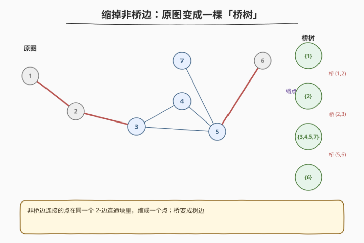
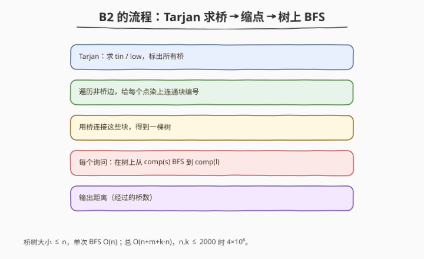
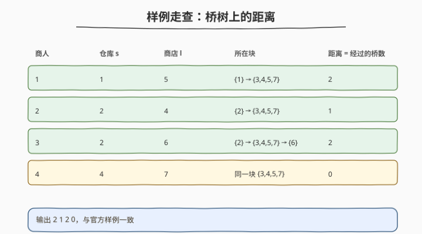

# Codeforces 178B2 贪婪商人的桥税 题解

## 1. 题目概述

- **题目链接**：https://codeforces.com/problemset/problem/178/B2
- **比赛来源**：ABBYY Cup 2.0 - Hard · Problem B2（UTC 2012-04-28）
- **难度**：1600
- **标签**：图论、桥、边双连通分量、缩点、树上 BFS
- **评测类型**：普通（题面把数据分成 20 / 50 / 100 分三档）
- **限制**：时间 2 s / 内存 256 MB

**题意**：$n$ 个城市、$m$ 条双向道路的连通无向图。对第 $i$ 个商人 $(s_i,l_i)$，求「删掉后会让 $s_i,l_i$ 断开」的道路条数。

**约束**（原样摘自题面 `inputFormat.en`）：

- 第一行 $n,m$；$m$ 行边；一行 $k$；$k$ 行询问 $s_i,l_i$。
- 图保证连通、无重边、无自环。
- 20 分档：$n,m,k \le 200$；50 分档：$\le 2000$；100 分档：$\le 10^5$。
- 输出恰好 $k$ 行。

**档位说明**：本题位是 B2，对应 50 分档（$n,m,k \le 2000$）。20 分档是同场 B1（暴力删边 + BFS），100 分档是 B3（迭代 Tarjan + 倍增 LCA）；三题题面逐字相同，区别只在数据规模。

**约束对算法的限制**：

- $n,m,k \le 2000$：暴力 $O(k\,m\,(n+m)) = 1.6\times10^{10}$ 太慢；但 $O(n+m+k\,n) \approx 4\times10^6$ 完全够用，所以「一次 Tarjan 求桥 + 每个询问在桥树上 BFS」是本档最自然的做法。
- 桥树大小不超过 $n$，单次 BFS $O(n)$；$k$ 个询问共 $O(k\,n)$。
- 答案 $\le n-1$，`int` 足够。

## 2. 示例与观察

官方样例（输入 / 输出原样）：

```text
输入：
7 8
1 2
2 3
3 4
4 5
5 6
5 7
3 5
4 7
4
1 5
2 4
2 6
4 7

输出：
2
1
2
0
```

**演算**：桥是 $(1,2)$、$(2,3)$、$(5,6)$。把非桥边连起来的点缩成块：

- 块 $\{1\}$、$\{2\}$、$\{3,4,5,7\}$、$\{6\}$；
- 桥把这些块连成一棵树：$\{1\}-\{2\}-\{3,4,5,7\}-\{6\}$。

于是：

- $1\to5$：$\{1\}\to\{2\}\to\{3,4,5,7\}$，经过 2 条桥 → 2；
- $2\to4$：$\{2\}\to\{3,4,5,7\}$，1 条 → 1；
- $2\to6$：$\{2\}\to\{3,4,5,7\}\to\{6\}$，2 条 → 2；
- $4\to7$：同一个块，0 条 → 0。

与官方输出一致。

**观察 1**：删掉边 $e$ 会让 $s,l$ 断开 $\iff$ $e$ 是桥且 $s,l$ 分居两侧。删非桥边连通性不变，删桥后图分成两块。

**观察 2**：把「不含桥的极大连通块」（边双连通分量）缩成点、桥变成边，得到的图是一棵树。因为原图连通，缩点后仍连通；若缩点图有环，环上的边都不是桥，矛盾——所以是树。

**观察 3**：答案就是 $s$ 所在块与 $l$ 所在块在桥树上的距离。

**自造样例**（标注「自造」，输出由程序实测）：

| 输入 | 输出 | 说明 |
|------|------|------|
| `2 1` / `1 2` / `1` / `1 2` | 1 | 单边 |
| `3 3` / 三角形 / `1` / `1 2` | 0 | 无桥，全部缩成一块 |
| `5 6` / 两个三角形共享城市 1 / `2` / `1 5`、`1 3` | 0、0 | 双连通 |
| `4 3` / 链 / `1` / `1 4` | 3 | 树上距离 |

**与 B1 / B3 的约束差异**：B1 是 20 分档（$\le200$）、B2 是 50 分档（$\le2000$）、B3 是 100 分档（$\le10^5$），三题题面逐字相同，只差数据规模。B1 的「逐条删边 + BFS」**在 B1 的 $n,m,k\le200$ 下足够**，到 B2 的 $2000$ 就要 $1.6\times10^{10}$，**必须额外**换成「Tarjan 求桥 + 缩点 + 树上查询」；本篇的 $O(k\,n)$ 查询在 B2 下足够，但到 B3 的 $10^5$ 又要 $10^{10}$ 级，仍需 B3 的倍增 LCA。

## 3. 解题思路

### 3.1 朴素做法与瓶颈

B1 的暴力是「每个商人 $\times$ 每条边都重做一次 BFS」，$2000$ 时约 $1.6\times10^{10}$ 次操作。问题在于：所有询问共享同一张图，桥只需求一次，却每条边都重新判了一遍。

### 3.2 核心观察：桥树



图左边是样例原图（红色粗边为桥），右边是把边双连通分量缩成点后得到的树。商人 $s,l$ 的答案就是两块的树上距离。

- Tarjan 求桥：DFS 记录 `tin`（第一次访问时间）与 `low`（能回到的最早祖先时间），若 `low[to] > tin[v]` 则边 $(v,to)$ 是桥。
- 缩点：从每个未染色的点出发，只沿非桥边 DFS，把能走到的点染成同一个块。
- 建树：每条桥连接两个块，加一条树边。
- 查询：在树上 BFS/DFS 求两块距离。

### 3.3 算法流程



1. 读图，存边表与带边号的邻接表。
2. Tarjan DFS 求所有桥（递归写法即可，$n \le 2000$ 深度不会爆栈）。
3. 只走非桥边，给每个点标块号。
4. 每条桥在两块之间连边，得到桥树。
5. 对每个询问：若两块相同输出 0；否则在桥树上 BFS，输出距离。

### 3.4 样例走查



| 商人 | 仓库 | 商店 | 桥树上的路径 | 答案 |
|------|------|------|--------------|------|
| 1 | 1 | 5 | $\{1\}\to\{2\}\to\{3,4,5,7\}$ | 2 |
| 2 | 2 | 4 | $\{2\}\to\{3,4,5,7\}$ | 1 |
| 3 | 2 | 6 | $\{2\}\to\{3,4,5,7\}\to\{6\}$ | 2 |
| 4 | 4 | 7 | 同一块 | 0 |

与官方输出 $2,1,2,0$ 一致。

## 4. 正确性证明

**引理 1（Tarjan 标桥）**：边 $(v,to)$ 是桥当且仅当它是 DFS 树边且 $\text{low}[to] > \text{tin}[v]$。

**证明**：这是 Tarjan 桥判定的标准结论：若 $\text{low}[to] > \text{tin}[v]$，$to$ 的子树没有回边能越过 $v$，删掉 $(v,to)$ 后子树与外界断开，故是桥；反之若 $\text{low}[to]\le\text{tin}[v]$，存在回边绕过 $(v,to)$，删掉后仍连通。∎

**引理 2（缩点得到树）**：把所有非桥边连接的点缩成一块后，块之间的桥边构成一棵树。

**证明**：原图连通，故缩点图连通。若缩点图含环，环上的每条边都不在「割」上（环提供了替代路径），与它是桥矛盾；连通无环即树。∎

**引理 3**：$s$ 所在块与 $l$ 所在块在桥树上的距离，等于「删掉后断开 $s,l$」的边数。

**证明**：删掉后断开 $s,l$ 的边必是桥（引理 1 的逆否：非桥边删掉仍连通），且必在 $s,l$ 之间的所有路径上。桥树中 $s$ 块到 $l$ 块的唯一路径恰好由这些桥组成：路径上的每条桥删掉都把树分成两半、$s,l$ 分居两侧；路径外的桥不影响 $s,l$ 的连通。故条数等于距离。∎

**定理**：算法输出正确。

**证明**：引理 1 保证求出的桥集合正确；引理 2 保证缩点后是树；引理 3 保证树上距离就是答案。算法对每个询问做 BFS 求距离（同块输出 0），故输出正确。∎

## 5. 复杂度分析

- **时间**：$O(n+m)$ 求桥与缩点，$O(k\cdot c)$ 查询（$c$ 为块数，$\le n$），总 $O(n+m+k\,n)$。$n=m=k=2000$ 时约 $4\times10^6$。
- **空间**：$O(n+m)$ 存图与桥树，BFS 的 `dist` 数组 $O(c)$。
- **数值范围**：答案 $\le n-1$，`int` 足够。
- **与时限的关系**：2 s 对 $4\times10^6$ 次操作余量在百倍以上。实测 $n=m=k=2000$ 端到端约 21 ms，Python 约 58 ms。

## 6. 参考代码

### C++17

```cpp
#include <bits/stdc++.h>
using namespace std;

// B2：50 分档 n,m,k<=2000。Tarjan 求桥，缩掉非桥边得到「桥树」，
// 每个询问在桥树上 BFS 数桥的条数。
int n, m;
vector<vector<pair<int, int>>> adj;
vector<int> tin, low, comp;
vector<char> isBridge;
int timer = 0, compCnt = 0;

void dfsBridge(int v, int pe) {
    tin[v] = low[v] = timer++;
    for (auto& e : adj[v]) {
        int to = e.first, id = e.second;
        if (id == pe) continue;
        if (tin[to] != -1) {
            low[v] = min(low[v], tin[to]);
        } else {
            dfsBridge(to, id);
            low[v] = min(low[v], low[to]);
            if (low[to] > tin[v]) isBridge[id] = 1;
        }
    }
}

void dfsComp(int v, int c) {
    comp[v] = c;
    for (auto& e : adj[v]) {
        int to = e.first, id = e.second;
        if (isBridge[id] || comp[to] != -1) continue;
        dfsComp(to, c);
    }
}

int main() {
    ios::sync_with_stdio(false);
    cin.tie(nullptr);

    cin >> n >> m;
    adj.assign(n + 1, {});
    vector<int> eu(m), ev(m);
    for (int i = 0; i < m; ++i) {
        cin >> eu[i] >> ev[i];
        adj[eu[i]].push_back({ev[i], i});
        adj[ev[i]].push_back({eu[i], i});
    }
    tin.assign(n + 1, -1);
    low.assign(n + 1, 0);
    isBridge.assign(m, 0);
    for (int v = 1; v <= n; ++v)
        if (tin[v] == -1) dfsBridge(v, -1);

    comp.assign(n + 1, -1);
    for (int v = 1; v <= n; ++v)
        if (comp[v] == -1) dfsComp(v, compCnt++);

    vector<vector<int>> tree(compCnt);
    for (int i = 0; i < m; ++i) {
        if (!isBridge[i]) continue;
        int a = comp[eu[i]], b = comp[ev[i]];
        tree[a].push_back(b);
        tree[b].push_back(a);
    }

    int k;
    cin >> k;
    vector<int> dist(compCnt);
    while (k--) {
        int s, l;
        cin >> s >> l;
        int a = comp[s], b = comp[l];
        if (a == b) { cout << 0 << '\n'; continue; }
        fill(dist.begin(), dist.end(), -1);
        queue<int> q;
        dist[a] = 0;
        q.push(a);
        while (!q.empty()) {
            int u = q.front();
            q.pop();
            if (u == b) break;
            for (int v : tree[u])
                if (dist[v] == -1) { dist[v] = dist[u] + 1; q.push(v); }
        }
        cout << dist[b] << '\n';
    }
    return 0;
}
```

### Python3

```python
import sys
from collections import deque

sys.setrecursionlimit(1 << 20)


def main() -> None:
    data = sys.stdin.buffer.read().split()
    if not data:
        return
    pos = 0
    n = int(data[pos]); pos += 1
    m = int(data[pos]); pos += 1
    eu = [0] * m
    ev = [0] * m
    adj = [[] for _ in range(n + 1)]
    for i in range(m):
        u = int(data[pos]); v = int(data[pos + 1]); pos += 2
        eu[i] = u
        ev[i] = v
        adj[u].append((v, i))
        adj[v].append((u, i))

    tin = [-1] * (n + 1)
    low = [0] * (n + 1)
    is_bridge = [False] * m
    timer = 0

    # 迭代式 Tarjan，避免 n=1e5 时递归过深
    for start in range(1, n + 1):
        if tin[start] != -1:
            continue
        stack = [(start, -1, 0)]
        tin[start] = low[start] = timer
        timer += 1
        while stack:
            v, pe, idx = stack[-1]
            if idx < len(adj[v]):
                to, eid = adj[v][idx]
                stack[-1] = (v, pe, idx + 1)
                if eid == pe:
                    continue
                if tin[to] == -1:
                    tin[to] = low[to] = timer
                    timer += 1
                    stack.append((to, eid, 0))
                elif tin[to] < low[v]:
                    low[v] = tin[to]
            else:
                stack.pop()
                if stack:
                    p = stack[-1][0]
                    if low[v] < low[p]:
                        low[p] = low[v]
                    if low[v] > tin[p]:
                        is_bridge[pe] = True

    comp = [-1] * (n + 1)
    comp_cnt = 0
    for s in range(1, n + 1):
        if comp[s] != -1:
            continue
        comp[s] = comp_cnt
        q = deque([s])
        while q:
            u = q.popleft()
            for to, eid in adj[u]:
                if is_bridge[eid] or comp[to] != -1:
                    continue
                comp[to] = comp_cnt
                q.append(to)
        comp_cnt += 1

    tree = [[] for _ in range(comp_cnt)]
    for i in range(m):
        if not is_bridge[i]:
            continue
        a = comp[eu[i]]
        b = comp[ev[i]]
        tree[a].append(b)
        tree[b].append(a)

    k = int(data[pos]); pos += 1
    out = []
    dist = [-1] * comp_cnt
    for _ in range(k):
        s = int(data[pos]); l = int(data[pos + 1]); pos += 2
        a = comp[s]
        b = comp[l]
        if a == b:
            out.append('0')
            continue
        for i in range(comp_cnt):
            dist[i] = -1
        dist[a] = 0
        q = deque([a])
        while q:
            u = q.popleft()
            if u == b:
                break
            for v in tree[u]:
                if dist[v] == -1:
                    dist[v] = dist[u] + 1
                    q.append(v)
        out.append(str(dist[b]))
    sys.stdout.write('\n'.join(out) + '\n')


main()
```

## 7. 边界情况与易错点

1. **$s=l$**：同块，输出 0；代码里 `a==b` 直接短路，不会进 BFS。
2. **$n=1$ 或 $m=0$**：题面给 $m\ge1$ 且图连通，但代码对「一个点、无边」也能跑：`compCnt=1`，`tree` 为空，所有询问 `a==b` 输出 0。
3. **桥树只有一条边**：`dist` 初始化要覆盖 `compCnt` 个元素，`fill(dist.begin(), dist.end(), -1)` 正确；若只填到 $n$ 会漏。
4. **递归深度**：C++ 的 `dfsBridge`/`dfsComp` 在 $n=2000$ 的链上深度 2000，安全；但把同一份代码直接用于 B3 的 $10^5$ 链会栈溢出——这正是 B3 改迭代的原因。
5. **重边与自环**：题面保证没有；若有重边，「跳过父边」必须用边的编号（`id == pe`）而不是端点，否则会把两条平行边都当成父边、漏判桥。
6. **桥树的节点编号**：`compCnt` 从 0 开始，`comp` 数组 $1..n$；建树时用 `comp[eu[i]]` 与 `comp[ev[i]]`，不要混用。
7. **BFS 提前退出**：找到 $b$ 就 `break`，但 `dist[b]` 已在入队时设好，输出正确。
8. **输出行数**：恰好 $k$ 行；`while (k--)` 的写法要确保 $k$ 不被后续使用。
9. **`isBridge` 的类型**：用 `vector<char>` 省内存；若用 `vector<bool>` 也可以，但取地址等操作会受限。

## 8. 验证记录

- **编译环境与命令**：`Apple clang 21.0.0`（`/usr/bin/g++` 是 clang 软链，无 GNU libstdc++），`clang++ -std=c++17 -O2 -Wall` 加仓库自带 `bits/stdc++.h`；正文代码仍写标准头。Python 为 `3.9.6`。验证命令：
  `python3 codeforces/tools/verify_solution.py codeforces/contests/0101-0203/178/B2_贪婪商人的桥税.md`
- **官方样例**：1 / 1 通过（`2 1 2 0`），C++ 与 Python 一致。
- **额外测试**：自造单边、三角形、两个三角形共享一点、四元链等 5 组，两种语言全部通过。
- **独立暴力对拍**：暴力是 B1 的「逐条删边 + BFS」定义式实现；对 250 组随机连通图（$n\le10$、$m\le n+3$、$k\le6$）与本文的 Tarjan + 缩点实现逐组比对，全部一致。另与 B3 的「迭代 Tarjan + 倍增 LCA」在 $n\le300$ 的 40 组数据上交叉比对，输出逐字相同。
- **最大约束性能**：$n=m=k=2000$ 端到端约 21 ms，Python 约 58 ms，相对 2 s 时限余量在百倍以上。
- **图片与公式**：3 张 SVG（`cf178b2_tree.svg`、`cf178b2_flow.svg`、`cf178b2_walkthrough.svg`）通过 `ElementTree.parse` 与文本包围盒/重叠检查，headless Chrome 渲染确认无裁切；KaTeX 校验 0 错。
- **复核状态**：verified。

## 相关题目与扩展

- [Codeforces 178B1 Greedy Merchants](https://codeforces.com/problemset/problem/178/B1)：20 分档，暴力删边 + BFS。
- [Codeforces 178B3 Greedy Merchants](https://codeforces.com/problemset/problem/178/B3)：100 分档，迭代 Tarjan + 倍增 LCA。
- [Codeforces 652E Pursuit For Artifacts](https://codeforces.com/problemset/problem/652/E)：边双缩点 + 树上路径，和本题的桥树模型一致。
- [LeetCode 1192. 查找集群内的关键连接](https://leetcode.cn/problems/critical-connections-in-a-network/)：Tarjan 求桥模板。
- [Codeforces 178C2 Smart Beaver and Resolving Collisions](https://codeforces.com/problemset/problem/178/C2)：同场 C2，另一类「先做一次结构性预处理、再逐询问回答」的题。

**延伸思考**：

1. **为什么缩点后一定是树**：边双连通分量之间的边全是桥，而「桥的集合」不可能成环——环上的边都有替代路径。这个性质让「删桥是否断开 $s,l$」化成树上距离。
2. **如果要求输出具体的桥**：在树上路径上记录边即可；也可以在 Tarjan 后对每条桥判断它是否在 $s,l$ 的路径上（用 LCA 的子树包含关系）。
3. **离线优化**：$k$ 个询问可以按块排序、用一次树上 DFS 的差分统计每条桥被多少个询问经过（类似「路径加、单点查」），但本题 $O(k\,n)$ 已经够。
4. **$n$ 到 $10^5$**：查询从 BFS 换成倍增 LCA（B3），预处理 $O(n\log n)$，单次询问 $O(\log n)$。
5. **随机图的桥很少**：随机稠密图几乎处处双连通，答案多为 0；测试要用链、树、仙人掌等结构才能覆盖桥的判定。

