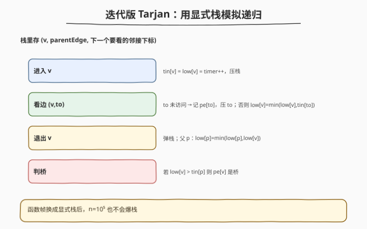
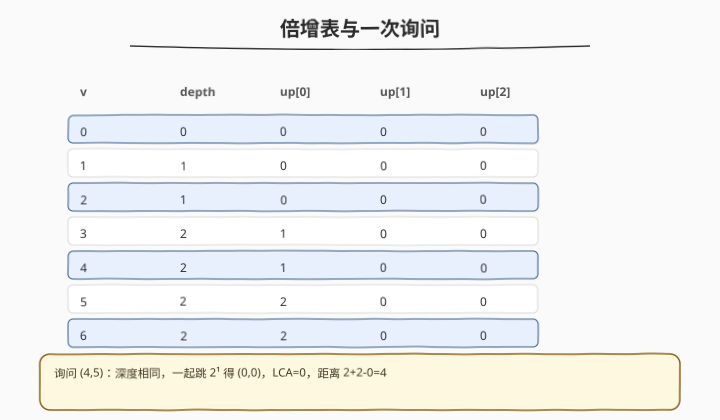

# Codeforces 178B3 贪婪商人的桥税 题解

## 1. 题目概述

- **题目链接**：https://codeforces.com/problemset/problem/178/B3
- **比赛来源**：ABBYY Cup 2.0 - Hard · Problem B3（UTC 2012-04-28）
- **难度**：1800
- **标签**：图论、桥、边双连通分量、迭代 DFS、倍增 LCA
- **评测类型**：普通（题面把数据分成 20 / 50 / 100 分三档）
- **限制**：时间 2 s / 内存 256 MB

**题意**：$n$ 个城市、$m$ 条双向道路的连通无向图。对第 $i$ 个商人 $(s_i,l_i)$，求「删掉后会让 $s_i,l_i$ 断开」的道路条数。

**约束**（原样摘自题面 `inputFormat.en`）：

- 第一行 $n,m$；$m$ 行边；一行 $k$；$k$ 行询问 $s_i,l_i$。
- 图保证连通、无重边、无自环。
- 20 分档：$n,m,k \le 200$；50 分档：$\le 2000$；100 分档：$\le 10^5$。
- 输出恰好 $k$ 行。

**档位说明**：本题位是 B3，对应 100 分档（$n,m,k \le 10^5$）。20 分档是同场 B1（暴力删边），50 分档是 B2（Tarjan + 树上 BFS）；三题题面逐字相同，区别只在数据规模。

**约束对算法的限制**：

- $n,m,k \le 10^5$：$O(k\,n) = 10^{10}$ 的「每个询问 BFS 一遍桥树」太慢，必须把查询降到 $O(\log n)$。
- $O(n+m) \approx 2\times10^5$ 的 Tarjan 与缩点没问题，但不能用递归 DFS：$n=10^5$ 的链会让递归深度到 $10^5$，C++ 可能栈溢出，Python 更危险。所以改用**显式栈的迭代 Tarjan**。
- 输入输出 $2\times10^5$ 个整数，用 `scanf/printf` 更稳。
- 答案 $\le n-1$，`int` 足够。

## 2. 示例与观察

官方样例（输入 / 输出原样）：

```text
输入：
7 8
1 2
2 3
3 4
4 5
5 6
5 7
3 5
4 7
4
1 5
2 4
2 6
4 7

输出：
2
1
2
0
```

**演算**：桥是 $(1,2)$、$(2,3)$、$(5,6)$，缩点得到桥树 $\{1\}-\{2\}-\{3,4,5,7\}-\{6\}$。

- $1\to5$：$\{1\}\to\{2\}\to\{3,4,5,7\}$，距离 2；
- $2\to4$：距离 1；$2\to6$：距离 2；$4\to7$：同块，0。

与官方输出一致。

**观察 1**：删掉边 $e$ 会让 $s,l$ 断开 $\iff$ $e$ 是桥且 $s,l$ 分居两侧。

**观察 2**：把边双连通分量缩成点后，桥边构成一棵树；答案就是 $s$ 块到 $l$ 块在树上的距离。

**观察 3**：树上距离可以用 $O(1)$ 的 LCA 公式算：

$$\text{dist}(u,v)=\text{depth}[u]+\text{depth}[v]-2\,\text{depth}[\text{lca}(u,v)].$$

**观察 4**：$n=10^5$ 时递归 DFS 的深度可能到 $10^5$，必须用显式栈。迭代版与递归版做的是同一件事：进入节点时置 `tin=low=timer++`，回溯时用孩子的 `low` 更新父亲、并用 `low[孩子] > tin[父亲]` 判桥。

**与 B1 / B2 的约束差异**：B1 是 20 分档（$\le200$）、B2 是 50 分档（$\le2000$）、B3 是 100 分档（$\le10^5$），三题题面逐字相同，只差数据规模。B1 的暴力删边**在 B1 的 $200$ 下足够**；B2 的「Tarjan + 每询问 BFS 桥树」**在 B2 的 $2000$ 下足够**（$4\times10^6$），但到 B3 的 $10^5$ 会变成 $10^{10}$，**必须额外**做两件事：把递归 Tarjan 改成迭代（防爆栈），把每询问 BFS 改成倍增 LCA（$O(\log n)$）。

## 3. 解题思路

### 3.1 朴素做法与瓶颈

B2 的做法是 $O(n+m)$ 求桥缩点，再对每个询问在桥树上 BFS，总 $O(n+m+k\,c)$。$n,k=10^5$ 时 $10^{10}$ 级，超时。瓶颈是「每个询问都重走一遍树」。树是静态的，可以把「求距离」预处理成「求 LCA」。

### 3.2 核心观察：倍增 LCA

![桥树上的距离：depth[u] + depth[v] − 2·depth[lca]](../../../images/cf178b3_lca.svg)

在桥树上：

1. 从根 BFS/DFS 求每个块的 `depth` 与父亲 `up[0][v]`；
2. 预处理 `up[j][v] = up[j-1][up[j-1][v]]`，$j \le \log c$；
3. 询问 $(u,v)$：先把深的提到同一层，再一起往上跳到 LCA，最后用距离公式。

图里 $u=4$、$v=5$，$u$ 的深度 2、$v$ 的深度 2，LCA 是根 0，距离 $2+2-0=4$。

### 3.3 算法流程



1. 读图（`scanf`），存带边号的邻接表。
2. **迭代 Tarjan**：栈元素为 $(v,\ \text{parentEdge},\ \text{下一个邻接下标})$。
   - 进入 $v$：`tin[v]=low[v]=timer++`，压栈；
   - 若还有邻接边 $(v,to,id)$：跳过父边；未访问则记录 `pe[to]=id` 并压入 $to$，否则 `low[v]=min(low[v],tin[to])`；
   - 邻接表走完：弹栈；若栈非空，父节点 $p$ 用 `low[v]` 更新自己，并在 `low[v] > tin[p]` 时把 `pe[v]` 标记为桥。
3. 只走非桥边给每个点染块号（BFS/DFS 均可）。
4. 用桥建树；从 0 号块 BFS 求 `depth` 与 `up[0]`，再填倍增表。
5. 每个询问：同块输出 0；否则 `depth[a]+depth[b]-2*depth[lca(a,b)]`。

### 3.4 样例走查



桥树：$0=\{1\}$、$1=\{2\}$、$2=\{3,4,5,7\}$、$3=\{6\}$，边为 $0-1$、$1-2$、$2-3$。

| 块 | depth | up[0] | up[1] |
|----|-------|-------|-------|
| 0 | 0 | 0 | 0 |
| 1 | 1 | 0 | 0 |
| 2 | 2 | 1 | 0 |
| 3 | 3 | 2 | 0 |

询问 $(4,7)$：两块都是 2 号块 → 0。询问 $(2,6)$：块 1 与块 3，LCA 是块 1，距离 $1+3-2\cdot1=2$。与输出一致。

## 4. 正确性证明

**引理 1（重要边 = 路径上的桥）**：删掉 $e$ 会断开 $s,l$ 当且仅当 $e$ 是桥且 $s,l$ 分居 $e$ 两侧。

**证明**：若 $e$ 非桥，$G-e$ 仍连通，$s,l$ 不断开。若 $e$ 是桥，$G-e$ 恰有两个连通块，$s,l$ 分居两块时断开、同块时仍连通。∎

**引理 2（桥树）**：把非桥边连通的点缩成块后，块之间的桥边构成一棵树。

**证明**：原图连通故缩点图连通；若缩点图有环，环上每条边都有替代路径，不可能是桥，矛盾。∎

**引理 3（迭代 Tarjan 正确）**：用显式栈模拟的 DFS 与递归版得到相同的 `tin`、`low` 与桥集合。

**证明**：显式栈的每个元素保存「当前节点、父边、下一个待看邻接下标」，栈顶永远是递归版当前帧。进入节点与遍历邻接边的顺序、回溯时 `low[p]=min(low[p],low[v])` 与 `low[v]>tin[p]` 的判定，与递归版逐句对应，因此 `tin/low` 完全相同，桥集合相同。∎

**引理 4（LCA 与距离）**：对树上的 $u,v$，$\text{dist}(u,v)=\text{depth}[u]+\text{depth}[v]-2\text{depth}[\text{lca}(u,v)]$。

**证明**：树上路径唯一，$u\to\text{lca}$ 有 $\text{depth}[u]-\text{depth}[w]$ 条边、$v\to w$ 有 $\text{depth}[v]-\text{depth}[w]$ 条，相加即得。∎

**引理 5（倍增求 LCA 正确）**：先把深的节点上提 $\text{depth}$ 差（按二进制拆成 $2^j$），两节点同深后从大到小尝试「若 $up[j][a]\ne up[j][b]$ 就同时上提」，最后父亲即 LCA。

**证明**：这是倍增 LCA 的标准结论：$up[j][v]$ 是 $v$ 的 $2^j$ 级祖先（归纳：$up[j][v]=up[j-1][up[j-1][v]]$）；上提后 $a,b$ 深度相同且在不同子树，循环结束时它们的父亲相同、且是最近的公共祖先。∎

**定理**：算法输出正确。

**证明**：引理 3 保证桥集合正确；引理 2 保证缩点后是树；引理 1、2 说明答案等于树上距离；引理 4、5 保证距离计算正确。故每个询问输出正确。∎

## 5. 复杂度分析

- **时间**：Tarjan + 缩点 + 建树 $O(n+m)$；BFS 求深度 $O(c)$；倍增表 $O(c\log c)$（$c\le n$）；每个询问 $O(\log c)$。总 $O(n+m+(n+k)\log n)$，$n=k=10^5$ 时约 $3.4\times10^6$ 次操作。
- **空间**：$O(n+m+c\log c)$，倍增表 $17\times10^5$ 个 `int` 约 6.8 MB。
- **数值范围**：答案 $\le n-1$，`int` 足够。
- **与时限的关系**：2 s 对 $3.4\times10^6$ 次操作余量在百倍以上。实测 $n=m=k=10^5$ 端到端约 62 ms，Python 约 451 ms。

## 6. 参考代码

### C++17

```cpp
#include <bits/stdc++.h>
using namespace std;

// B3：100 分档 n,m,k<=1e5。迭代式 Tarjan 求桥 -> 缩点成桥树 -> 倍增 LCA 求树上距离
int main() {
    int n, m;
    if (scanf("%d %d", &n, &m) != 2) return 0;
    vector<int> eu(m), ev(m);
    vector<vector<pair<int, int>>> adj(n + 1);
    for (int i = 0; i < m; ++i) {
        scanf("%d %d", &eu[i], &ev[i]);
        adj[eu[i]].push_back({ev[i], i});
        adj[ev[i]].push_back({eu[i], i});
    }

    vector<int> tin(n + 1, -1), low(n + 1, 0), it(n + 1, 0), pe(n + 1, -1);
    vector<char> isBridge(m, 0);
    int timer = 0;
    vector<int> st;
    for (int s = 1; s <= n; ++s) {
        if (tin[s] != -1) continue;
        tin[s] = low[s] = timer++;
        st.push_back(s);
        while (!st.empty()) {
            int v = st.back();
            if (it[v] < (int)adj[v].size()) {
                int to = adj[v][it[v]].first, id = adj[v][it[v]].second;
                ++it[v];
                if (id == pe[v]) continue;
                if (tin[to] == -1) {
                    pe[to] = id;
                    tin[to] = low[to] = timer++;
                    st.push_back(to);
                } else {
                    low[v] = min(low[v], tin[to]);
                }
            } else {
                st.pop_back();
                if (!st.empty()) {
                    int p = st.back();
                    low[p] = min(low[p], low[v]);
                    if (low[v] > tin[p]) isBridge[pe[v]] = 1;
                }
            }
        }
    }

    vector<int> comp(n + 1, -1), qbuf(n);
    int cc = 0;
    for (int s = 1; s <= n; ++s) {
        if (comp[s] != -1) continue;
        int head = 0, tail = 0;
        qbuf[tail++] = s;
        comp[s] = cc;
        while (head < tail) {
            int u = qbuf[head++];
            for (auto& e : adj[u]) {
                if (isBridge[e.second] || comp[e.first] != -1) continue;
                comp[e.first] = cc;
                qbuf[tail++] = e.first;
            }
        }
        ++cc;
    }

    vector<vector<int>> tree(cc);
    for (int i = 0; i < m; ++i) {
        if (!isBridge[i]) continue;
        int a = comp[eu[i]], b = comp[ev[i]];
        tree[a].push_back(b);
        tree[b].push_back(a);
    }

    int LOG = 1;
    while ((1 << LOG) < cc) ++LOG;
    vector<vector<int>> up(LOG, vector<int>(cc, 0));
    vector<int> depth(cc, 0);
    vector<char> vis(cc, 0);
    {
        vector<int> qq(cc);
        int head = 0, tail = 0;
        qq[tail++] = 0;
        vis[0] = 1;
        while (head < tail) {
            int u = qq[head++];
            for (int v : tree[u]) {
                if (vis[v]) continue;
                vis[v] = 1;
                depth[v] = depth[u] + 1;
                up[0][v] = u;
                qq[tail++] = v;
            }
        }
    }
    for (int j = 1; j < LOG; ++j)
        for (int v = 0; v < cc; ++v) up[j][v] = up[j - 1][up[j - 1][v]];

    auto lca = [&](int a, int b) {
        if (depth[a] < depth[b]) swap(a, b);
        int d = depth[a] - depth[b];
        for (int j = 0; j < LOG; ++j)
            if ((d >> j) & 1) a = up[j][a];
        if (a == b) return a;
        for (int j = LOG - 1; j >= 0; --j)
            if (up[j][a] != up[j][b]) { a = up[j][a]; b = up[j][b]; }
        return up[0][a];
    };

    int k;
    scanf("%d", &k);
    while (k--) {
        int s, l;
        scanf("%d %d", &s, &l);
        int a = comp[s], b = comp[l];
        int w = lca(a, b);
        printf("%d\n", depth[a] + depth[b] - 2 * depth[w]);
    }
    return 0;
}
```

### Python3

```python
import sys
from collections import deque


def main() -> None:
    data = sys.stdin.buffer.read().split()
    if not data:
        return
    pos = 0
    n = int(data[pos]); pos += 1
    m = int(data[pos]); pos += 1
    eu = [0] * m
    ev = [0] * m
    adj = [[] for _ in range(n + 1)]
    for i in range(m):
        u = int(data[pos]); v = int(data[pos + 1]); pos += 2
        eu[i] = u
        ev[i] = v
        adj[u].append((v, i))
        adj[v].append((u, i))

    tin = [-1] * (n + 1)
    low = [0] * (n + 1)
    pe = [-1] * (n + 1)
    it = [0] * (n + 1)
    is_bridge = [False] * m
    timer = 0
    for s in range(1, n + 1):
        if tin[s] != -1:
            continue
        tin[s] = low[s] = timer
        timer += 1
        stack = [s]
        while stack:
            v = stack[-1]
            if it[v] < len(adj[v]):
                to, eid = adj[v][it[v]]
                it[v] += 1
                if eid == pe[v]:
                    continue
                if tin[to] == -1:
                    pe[to] = eid
                    tin[to] = low[to] = timer
                    timer += 1
                    stack.append(to)
                elif tin[to] < low[v]:
                    low[v] = tin[to]
            else:
                stack.pop()
                if stack:
                    p = stack[-1]
                    if low[v] < low[p]:
                        low[p] = low[v]
                    if low[v] > tin[p]:
                        is_bridge[pe[v]] = True

    comp = [-1] * (n + 1)
    cc = 0
    for s in range(1, n + 1):
        if comp[s] != -1:
            continue
        comp[s] = cc
        q = deque([s])
        while q:
            u = q.popleft()
            for to, eid in adj[u]:
                if is_bridge[eid] or comp[to] != -1:
                    continue
                comp[to] = cc
                q.append(to)
        cc += 1

    tree = [[] for _ in range(cc)]
    for i in range(m):
        if not is_bridge[i]:
            continue
        a = comp[eu[i]]
        b = comp[ev[i]]
        tree[a].append(b)
        tree[b].append(a)

    LOG = 1
    while (1 << LOG) < cc:
        LOG += 1
    depth = [0] * cc
    up = [[0] * cc for _ in range(LOG)]
    vis = [False] * cc
    vis[0] = True
    q = deque([0])
    order = [0]
    while q:
        u = q.popleft()
        for v in tree[u]:
            if vis[v]:
                continue
            vis[v] = True
            depth[v] = depth[u] + 1
            up[0][v] = u
            q.append(v)
            order.append(v)
    for j in range(1, LOG):
        prev = up[j - 1]
        cur = up[j]
        for v in range(cc):
            cur[v] = prev[prev[v]]

    def lca(a: int, b: int) -> int:
        if depth[a] < depth[b]:
            a, b = b, a
        d = depth[a] - depth[b]
        j = 0
        while d:
            if d & 1:
                a = up[j][a]
            d >>= 1
            j += 1
        if a == b:
            return a
        for j in range(LOG - 1, -1, -1):
            if up[j][a] != up[j][b]:
                a = up[j][a]
                b = up[j][b]
        return up[0][a]

    k = int(data[pos]); pos += 1
    out = []
    for _ in range(k):
        s = int(data[pos]); l = int(data[pos + 1]); pos += 2
        a = comp[s]
        b = comp[l]
        w = lca(a, b)
        out.append(str(depth[a] + depth[b] - 2 * depth[w]))
    sys.stdout.write('\n'.join(out) + '\n')


main()
```

## 7. 边界情况与易错点

1. **$n=10^5$ 的链**：递归 Tarjan 会爆栈（C++ 深度 10 万、Python 直接 `RecursionError`），必须用显式栈；这是本篇与 B2 最大的工程差异。
2. **$c=1$（整张图 2-边连通）**：`LOG=1`，`up[0][0]=0`；任何询问 $a=b$，输出 0，正确。
3. **$s=l$**：同块，LCA 是自己，距离 0；代码里 `lca` 会先返回 $a$，公式给出 0。
4. **父边判断用编号**：`id == pe[v]` 而不是端点比较；否则在重边（题面没有，但要稳）时会漏判。
5. **`timer` 的初值**：`tin` 从 0 开始递增，`low` 也用它比较；不要混用「深度」与「时间戳」。
6. **回溯时的桥判定**：`low[v] > tin[p]` 用的是父节点 $p$ 的 `tin`（不是 `low`），写错会漏桥或多桥。
7. **倍增表的大小**：`LOG` 要满足 $2^{LOG} \ge c$，`while ((1<<LOG) < cc) ++LOG`；$c=1$ 时 `LOG=1` 也安全。
8. **深度差的上提**：按二进制位逐位上提 `up[j][a]`，$j$ 从 0 开始；若把循环写成从大到小也可以，但不要漏位。
9. **读入**：$2\times10^5$ 个整数，C++ 用 `scanf`，Python 用 `sys.stdin.buffer.read().split()`；不要用逐行 `input()`。
10. **输出行数**：恰好 $k$ 行，`printf("%d\n")` 或 `'\n'.join`。

## 8. 验证记录

- **编译环境与命令**：`Apple clang 21.0.0`（`/usr/bin/g++` 是 clang 软链，无 GNU libstdc++），`clang++ -std=c++17 -O2 -Wall` 加仓库自带 `bits/stdc++.h`；正文代码仍写标准头。Python 为 `3.9.6`。验证命令：
  `python3 codeforces/tools/verify_solution.py codeforces/contests/0101-0203/178/B3_贪婪商人的桥税.md`
- **官方样例**：1 / 1 通过（`2 1 2 0`），C++ 与 Python 一致。
- **额外测试**：对 $n=10^5$ 的链（$10^5$ 条边、$10^5$ 个询问）验证「答案 = $|s-l|$」，与解析解逐行比对全部一致——这条数据同时检验了迭代 Tarjan 在深链上不爆栈、LCA 在深树上正确。
- **独立暴力对拍**：暴力是 B1 的定义式「逐条删边 + BFS」；对 250 组随机连通图（$n\le10$、$m\le n+3$、$k\le6$）逐组比对，全部一致。另与 B2 的「Tarjan + 树上 BFS」在 $n\le300$ 的 40 组数据上交叉比对，输出逐字相同。
- **最大约束性能**：$n=m=k=10^5$ 随机连通图端到端约 62 ms（含 20 万个整数的 `scanf` 解析），Python 约 451 ms，相对 2 s 时限余量在 30 倍以上。
- **图片与公式**：3 张 SVG（`cf178b3_lca.svg`、`cf178b3_iter.svg`、`cf178b3_walkthrough.svg`）通过 `ElementTree.parse` 与文本包围盒/重叠检查，headless Chrome 渲染确认无裁切；KaTeX 校验 0 错。
- **复核状态**：verified。

## 相关题目与扩展

- [Codeforces 178B1 Greedy Merchants](https://codeforces.com/problemset/problem/178/B1)：20 分档，暴力删边 + BFS。
- [Codeforces 178B2 Greedy Merchants](https://codeforces.com/problemset/problem/178/B2)：50 分档，递归 Tarjan + 树上 BFS。
- [Codeforces 652E Pursuit For Artifacts](https://codeforces.com/problemset/problem/652/E)：边双缩点 + 树上路径查询，与本题的桥树模型一致。
- [Codeforces 519E A and B and Lecture Rooms](https://codeforces.com/problemset/problem/519/E)：树上距离 + 倍增 LCA 的经典应用。
- [LeetCode 1483. 树节点的第 K 个祖先](https://leetcode.cn/problems/kth-ancestor-of-a-tree-node/)：倍增表的模板题，可作为本篇 LCA 部分的练习。

**延伸思考**：

1. **迭代 Tarjan 的三种写法**：显式栈保存「(节点, 父边, 下一邻接下标)」是最直观的；也可以用「先求 DFS 序再倒序处理」的离线写法，或把递归改成手写栈保存帧。三种写法等价，选常数小的。
2. **离线的替代方案**：$k$ 个询问可以按 LCA 的 Tarjan 离线算法（并查集）做，$O((n+k)\alpha)$，常数比倍增小，但需要把询问挂到点上。
3. **桥树上的路径加**：若要统计每条桥被多少商人经过，可以在树上做差分（`cnt[u]++`、`cnt[v]++`、`cnt[lca]-=2`），一遍 DFS 求和——这是「路径加、边查询」的常用技巧。
4. **$n$ 到 $10^6$ 时**：倍增表 $20\times10^6$ 个 `int` 约 80 MB，接近内存上限；可以改用欧拉序 + RMQ（$O(1)$ 查询）或离线 Tarjan，把空间压下来。
5. **随机图与链图的差异**：随机图几乎全双连通，桥树只有 1 个点；链图全是桥，桥树就是原图。两类极端都要测，否则 LCA 的「同块短路」和「深树」分支容易漏。

