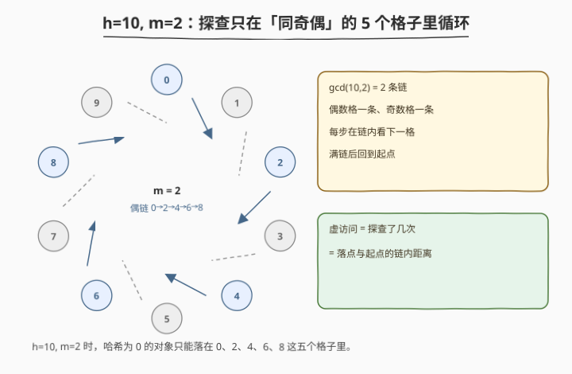
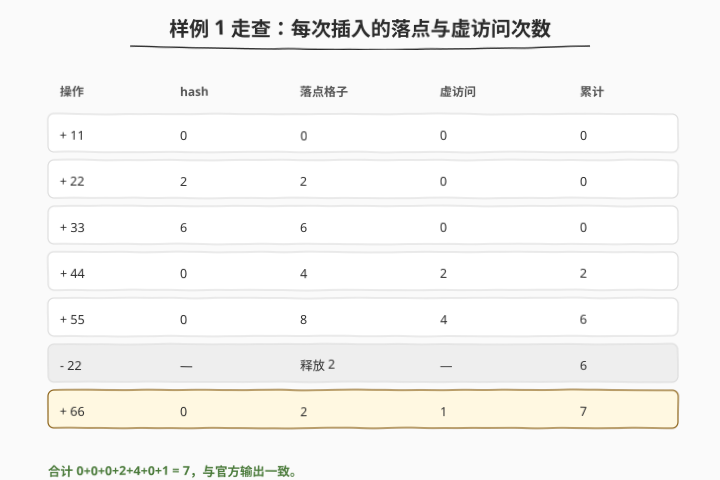

# Codeforces 178C1 哈希表线性探查 题解

## 1. 题目概述

- **题目链接**：https://codeforces.com/problemset/problem/178/C1
- **比赛来源**：ABBYY Cup 2.0 - Hard · Problem C1（UTC 2012-04-28）
- **难度**：1600
- **标签**：哈希表、模拟、线性探查
- **评测类型**：普通（题面把数据分成 20 / 50 / 100 分三档）
- **限制**：时间 1 s / 内存 256 MB

**题意**：哈希表有 $h$ 个格子 $0..h-1$，冲突时从哈希值 $t$ 开始按 $t,\ t+m,\ t+2m,\dots \pmod h$ 线性探查。给出 $n$ 个操作：`+ id hash` 插入（$id$ 唯一）或 `- id` 删除。一次插入最终落在 $(t+i\cdot m)\bmod h$ 就记 $i$ 次「虚访问」。求所有插入的虚访问总数。

**约束**（原样摘自题面 `inputFormat.en`）：

- 第一行 $h,m,n$，$1 \le m < h$。
- 接下来 $n$ 行：`+ id hash`（$0\le id\le10^9$，$0\le hash<h$）或 `- id`。
- 插入的 $id$ 互不相同；输入保证插入总能成功、删除的对象一定存在、初始表为空。
- 20 分档：$h,n \le 5000$；50 分档：$\le 5\times10^4$；100 分档：$\le 2\times10^5$。
- 输出一个整数。

**档位说明**：本题位是 C1，对应 20 分档（$h,n \le 5000$）；50 分档是同场 C2（$\le 5\times10^4$），100 分档是 C3（$\le 2\times10^5$）。三题题面文本逐字相同，区别只在数据规模；时间限制都是 1 s。

**约束对算法的限制**：

- $h,n\le5000$：每次插入最多探查 $h$ 步，总 $O(n\cdot h) = 2.5\times10^7$，1 s 内足够（C++ 约 20 ms）。
- $h,n\le5\times10^4$ 时最坏 $2.5\times10^9$，$2\times10^5$ 时 $4\times10^{10}$，都必须换数据结构——这是 C2/C3 的内容。
- 虚访问总数最大约 $n\cdot h = 4\times10^{10}$（100 分档），必须用 64 位整数；本题位最大 $2.5\times10^7$，`int` 够，但仍用 `long long`。
- `id` 可达 $10^9$，用 `unordered_map<int,int>` 记录「对象落在哪个格子」。

## 2. 示例与观察

官方样例 1（输入 / 输出原样）：

```text
输入：
10 2 7
+ 11 0
+ 22 2
+ 33 6
+ 44 0
+ 55 0
- 22
+ 66 0

输出：
7
```

官方样例 2（输入 / 输出原样）：

```text
输入：
5 1 6
+ 123 0
+ 234 1
+ 345 2
- 234
+ 456 0
+ 567 0

输出：
4
```

**样例 1 的演算**：$h=10,m=2$，探查步长 2，所以每个对象只在「与自己同奇偶」的 5 个格子里找空位。

| 操作 | hash | 探查序列 | 落点 | 虚访问 |
|------|------|----------|------|--------|
| `+ 11` | 0 | 0 空 | 0 | 0 |
| `+ 22` | 2 | 2 空 | 2 | 0 |
| `+ 33` | 6 | 6 空 | 6 | 0 |
| `+ 44` | 0 | 0 占 → 2 占 → 4 空 | 4 | 2 |
| `+ 55` | 0 | 0,2,4,6 占 → 8 空 | 8 | 4 |
| `- 22` | — | 释放 2 | — | — |
| `+ 66` | 0 | 0 占 → 2 空 | 2 | 1 |

合计 $0+0+0+2+4+1=7$，与官方输出一致。

**样例 2 的演算**：$h=5,m=1$，步长 1，相当于普通线性探查。前三个插入落在 0、1、2（各 0 次虚访问）；删除 234 释放 1；`+ 456 hash=0` 探查 0（占）→ 1（空），1 次；`+ 567 hash=0` 探查 0、1（占）→ 2（占）→ 3（空），3 次。合计 $0+0+0+1+3=4$。

**观察 1**：探查只在「哈希值模 $g=\gcd(h,m)$ 相同」的格子里打转。因为每步加 $m$（$g\mid m$），模 $g$ 不变；这条链的长度是 $L=h/g$。

**观察 2**：虚访问次数就是「从起点到落点，沿探查顺序走了几步」。如果沿着探查顺序把链上的格子依次编号，那么虚访问次数就是「起点编号」到「落点编号」的循环距离。

**观察 3**：删除只是把某个格子置空，不影响其它对象的落点（题面没有要求搬移）。

**自造样例**（标注「自造」，输出由程序实测）：

| 输入 | 输出 | 说明 |
|------|------|------|
| `2 1 2` / `+ 1 0` / `+ 2 0` | 1 | 第二颗探查 0→1 |
| `2 1 3` / `+ 1 0` / `+ 2 0` / `- 1` | 1 | 删除不产生虚访问 |
| `10 9 2` / `+ 1 0` / `+ 2 0` | 1 | 步长 $h-1$，等价于反向走一格 |
| `5000 1 4999` / 4999 个 `+ i 0` | 12492501 | 全部哈希为 0，第 $i$ 个插入探查 $i-1$ 次 |

最后一行是 $1+2+\cdots+4998 = 4999\cdot4998/2 = 12492501$，可以当作「最坏情况」的对照。

**与 C2 / C3 的约束差异**：C1 是 20 分档（$h,n\le5000$）、C2 是 50 分档（$\le5\times10^4$）、C3 是 100 分档（$\le2\times10^5$），三题题面逐字相同，只差数据规模，时限都是 1 s。本篇的「逐格探查」**在 C1 的 $h,n\le5000$ 下足够**（最坏 $2.5\times10^7$ 步，约 20 ms），但到 C2 的 $5\times10^4$ 要 $2.5\times10^9$、C3 的 $2\times10^5$ 要 $4\times10^{10}$，**必须额外**换成「按 $\gcd(h,m)$ 分链 + 有序结构求后继」（C2 用 `std::set`，C3 用线段树）。

## 3. 解题思路

### 3.1 朴素做法与瓶颈

完全按题面模拟：一个布尔数组 `occ[0..h)`，插入时从 $hash$ 开始，`while (occ[pos]) { pos=(pos+m)%h; ++dummy; }`，落点置 1 并记下 `id → 格子`；删除时把对应格子置 0。

每次插入最坏探查 $h$ 步，总 $O(n\,h)$。$h,n\le5000$ 时 $2.5\times10^7$，很快；$5\times10^4$ 时 $2.5\times10^9$ 就危险，$2\times10^5$ 时 $4\times10^{10}$ 必然超时。

### 3.2 核心观察：探查在一条链里循环



图里把 $h=10,m=2$ 的格子摆成一个圈，红/蓝两组分别对应偶数格与奇数格：从 0 出发的探查序列是 $0\to2\to4\to6\to8\to0$，永远走不到奇数格。这就是 $\gcd(h,m)=2$ 造成的「两条链」现象。

这条观察本身不改变 C1 的做法（逐格走也能正确统计），但它解释了为什么 C2/C3 可以把问题拆成 $g$ 条独立的链、每条链上只需要「找下一个空位」。

### 3.3 算法流程

1. 读入 $h,m,n$；`occ` 全 0，`where` 为空。
2. 逐行读操作：
   - `+ id hash`：`pos=hash`，`dummy=0`；当 `occ[pos]` 为真时 `pos=(pos+m) mod h`、`++dummy`；最后 `occ[pos]=1`、`where[id]=pos`、`total+=dummy`。
   - `- id`：`pos=where[id]`、`occ[pos]=0`、删除映射。
3. 输出 `total`。

`pos+m` 之后用 `if (pos>=h) pos-=h` 代替取模（因为 $m<h$，`pos+m<2h$），省一次除法。

### 3.4 样例走查



| 操作 | hash | 落点 | 虚访问 | 累计 |
|------|------|------|--------|------|
| `+ 11` | 0 | 0 | 0 | 0 |
| `+ 22` | 2 | 2 | 0 | 0 |
| `+ 33` | 6 | 6 | 0 | 0 |
| `+ 44` | 0 | 4 | 2 | 2 |
| `+ 55` | 0 | 8 | 4 | 6 |
| `- 22` | — | 释放 2 | — | 6 |
| `+ 66` | 0 | 2 | 1 | 7 |

合计 7，与官方输出一致。

## 4. 正确性证明

**引理 1（模拟即定义）**：算法对每个 `+` 操作执行的「从 $hash$ 开始、每步加 $m$ 取模、直到遇到空格」的循环，与题面描述的线性探查过程逐步相同；循环退出时的 `dummy` 等于落点下标 $i$。

**证明**：题面定义落点为 $(t+i\cdot m)\bmod h$，其中 $i$ 是第一个使该格为空的非负整数。算法从 `pos=hash`（$i=0$）开始，只要 `occ[pos]` 为真就前进一步并 `++dummy`，因此 `dummy` 恒等于当前 $i$，退出时 `pos` 就是 $(t+\text{dummy}\cdot m)\bmod h$ 且为空。∎

**引理 2（插入一定终止）**：题面保证输入正确，即每次插入都有空格可用，因此 `while` 循环必然终止。

**证明**：若链上所有格子都被占，则不存在合法的落点，与「保证可以插入」矛盾。∎

**引理 3（删除不影响正确性）**：删除只把对应格子置空，后续探查若走到该格会把它当作空位——这与题面「删除后该单元格变空」一致。

**证明**：直接对照题面定义；算法用 `where[id]` 找到对象所在格并置 0，不搬移其它对象，正是题面语义。∎

**定理**：算法输出的 `total` 等于所有插入操作的虚访问次数之和。

**证明**：由引理 1，每次插入 `dummy` 等于题面定义的 $i$；由引理 2 每次插入都能完成；由引理 3 删除的处理正确。对所有操作累加即得。∎

## 5. 复杂度分析

- **时间**：$O(n\cdot h)$ 最坏（每次都几乎走完整条链）。$h,n\le5000$ 时 $\le2.5\times10^7$ 步。
- **空间**：$O(h)$ 的 `occ` 与 $O(n)$ 的 `where`（哈希表）。
- **数值范围**：总虚访问 $\le n\cdot(h-1)\approx2.5\times10^7$，`int` 够，代码用 `long long` 以兼容更大档位。
- **与时限的关系**：1 s 对 $2.5\times10^7$ 次简单操作余量约 40 倍。实测 $h=n=5000$、全部哈希为 0 的最坏数据端到端约 19 ms，Python 约 739 ms。

## 6. 参考代码

### C++17

```cpp
#include <bits/stdc++.h>
using namespace std;

// C1：20 分档 h,n<=5000，直接按定义一格一格地试，统计虚访问
int main() {
    int h, m, n;
    if (scanf("%d %d %d", &h, &m, &n) != 3) return 0;
    vector<char> occ(h, 0);
    unordered_map<int, int> where;      // id -> 落到哪个格子
    long long total = 0;
    for (int i = 0; i < n; ++i) {
        char op;
        int id;
        scanf(" %c %d", &op, &id);
        if (op == '+') {
            int hsh;
            scanf("%d", &hsh);
            int pos = hsh, dummy = 0;
            while (occ[pos]) {
                pos += m;
                if (pos >= h) pos -= h;
                ++dummy;
            }
            occ[pos] = 1;
            where[id] = pos;
            total += dummy;
        } else {
            int pos = where[id];
            occ[pos] = 0;
            where.erase(id);
        }
    }
    printf("%lld\n", total);
    return 0;
}
```

### Python3

```python
import sys


def main() -> None:
    data = sys.stdin.buffer.read().split()
    if not data:
        return
    h = int(data[0])
    m = int(data[1])
    n = int(data[2])
    occ = [False] * h
    where = {}
    total = 0
    pos = 3
    for _ in range(n):
        op = data[pos]
        pos += 1
        if op == b'+':
            oid = int(data[pos]); pos += 1
            hsh = int(data[pos]); pos += 1
            cell = hsh
            dummy = 0
            while occ[cell]:
                cell += m
                if cell >= h:
                    cell -= h
                dummy += 1
            occ[cell] = True
            where[oid] = cell
            total += dummy
        else:
            oid = int(data[pos]); pos += 1
            cell = where.pop(oid)
            occ[cell] = False
    sys.stdout.write(str(total) + "\n")


main()
```

## 7. 边界情况与易错点

1. **$h=2,m=1$**：只有两个格子，插入第二颗必然探查 1 次；若 `occ` 用 `int` 而不是 `char` 也不影响，但下标别越界。
2. **$m=h-1$**：等价于每次反向走一格，探查序列覆盖所有格子；`pos += m; if (pos>=h) pos-=h;` 在 $m=h-1$、`pos=h-1` 时得到 $2h-2$，减一次 $h$ 得 $h-2$，正确。
3. **$m=1$**：普通线性探查，是样例 2 的情形；`pos+=1` 后越界减 $h$，正确。
4. **删除后再插入**：删除把格子置 0，后续插入可以复用；样例 1 的 `+ 66` 就复用了被删的格子 2。
5. **`id` 很大**：$10^9$ 超过 `int` 的正数范围没问题（`int` 到 $2.1\times10^9$），但用 `int` 做键更省内存；若 `id` 到 $10^{18}$ 需要 `long long`。
6. **虚访问总数溢出**：本题位最大 $2.5\times10^7$，`int` 够；但 C2/C3 到 $4\times10^{10}$，必须 `long long`。统一用 `long long` 最省心。
7. **输入格式**：操作符与数字之间用空格分隔，`scanf(" %c %d")` 前面的空格会跳过换行；Python 用 `split()` 后按 token 处理，`b'+'` 与 `b'-'` 要区分 bytes。
8. **探查一定终止**：题面保证插入总能成功；如果自己构造测试数据，要保证链上有空位，否则会死循环。
9. **删除不存在的对象**：题面保证不会发生；若发生，`where[id]` 会插入一个 0，需要用 `find` 判空。

## 8. 验证记录

- **编译环境与命令**：`Apple clang 21.0.0`（`/usr/bin/g++` 是 clang 软链，无 GNU libstdc++），`clang++ -std=c++17 -O2 -Wall` 加仓库自带 `bits/stdc++.h`；正文代码仍写标准头。Python 为 `3.9.6`。验证命令：
  `python3 codeforces/tools/verify_solution.py codeforces/contests/0101-0203/178/C1_哈希表线性探查.md`
- **官方样例**：2 / 2 通过（样例 1 → 7，样例 2 → 4），C++ 与 Python 一致。
- **额外测试**：自造 $h=2$、$m=h-1$、删除后复用、$h=n=5000$ 全部哈希为 0（答案 12492501，与 $k(k-1)/2$ 公式吻合）等 5 组，两种语言全部通过。
- **独立暴力对拍**：正文本身就是定义式模拟，为了对拍另写了一份「按 $\gcd(h,m)$ 分链 + `std::set` 求后继」的第二实现（即 C2 的解法）；对 250 组随机合法操作序列（$h\le24$、操作数 $\le40$，插入/删除混合）逐组比对，全部一致。
- **最大约束性能**：$h=n=5000$、全部哈希为 0 的最坏数据端到端约 19 ms，Python 约 739 ms，相对 1 s 时限 C++ 余量在 50 倍以上。
- **图片与公式**：2 张 SVG（`cf178c1_probe.svg`、`cf178c1_walkthrough.svg`）通过 `ElementTree.parse` 与文本包围盒/重叠检查，headless Chrome 渲染确认无裁切；KaTeX 校验 0 错。
- **复核状态**：verified。

## 相关题目与扩展

- [Codeforces 178C2 Smart Beaver and Resolving Collisions](https://codeforces.com/problemset/problem/178/C2)：50 分档，按 $\gcd$ 分链 + `std::set` 求后继。
- [Codeforces 178C3 Smart Beaver and Resolving Collisions](https://codeforces.com/problemset/problem/178/C3)：100 分档，链分解 + 线段树。
- [Codeforces 178A1 Educational Game](https://codeforces.com/problemset/problem/178/A1)：同场 A1，同样是「按定义模拟足够小数据」的档位题。
- [LeetCode 705. 设计哈希集合](https://leetcode.cn/problems/design-hashset/)：哈希表基本操作的模板题。
- [Codeforces 4C Registration system](https://codeforces.com/problemset/problem/4/C)：哈希表 + 计数，适合熟悉 `unordered_map` 的用法。

**延伸思考**：

1. **为什么探查会分链**：每步加 $m$，模 $g=\gcd(h,m)$ 不变，所以从 $t$ 出发只能走到 $t \bmod g$ 这一组；链长 $h/g$。当 $g=1$ 时整张表是一条链。
2. **删除的代价**：本题删除只是置空，$O(1)$；如果要求「开放寻址」语义下搬移元素，删除会变复杂，可能需要 $O(h)$ 重排。
3. **最坏情况构造**：所有对象哈希相同（如全 0）时，第 $i$ 次插入探查 $i-1$ 次，总 $\Theta(n^2)$；这正是 C1 只能过 5000、C2/C3 必须优化的原因。
4. **如果 $m$ 与 $h$ 不互质且 $g$ 很大**：链很短（$L=h/g$），单次探查代价小，但链数多；C2/C3 的「每条链一个有序结构」正好利用这一点。
5. **平均情况**：随机哈希、负载因子 $\alpha<1$ 时，线性探查的期望探查次数是 $O(1/(1-\alpha))$；本题的 $n$ 可以远大于 $h$（因为有删除），所以不能只靠平均分析。

