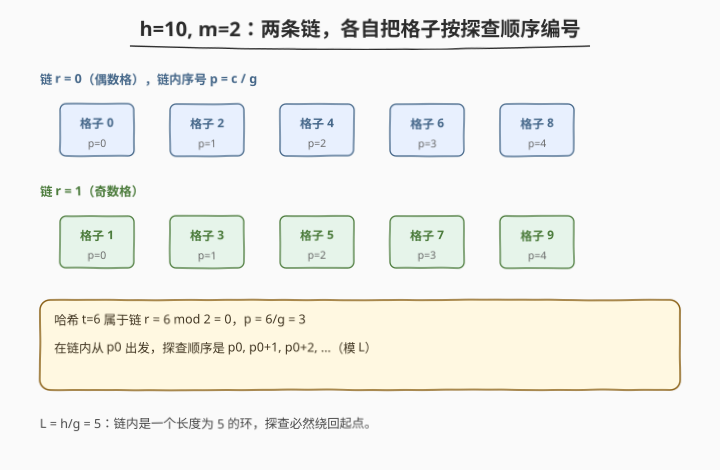
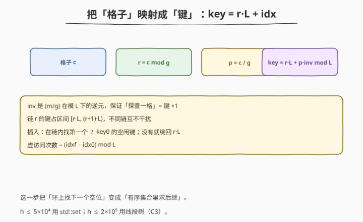
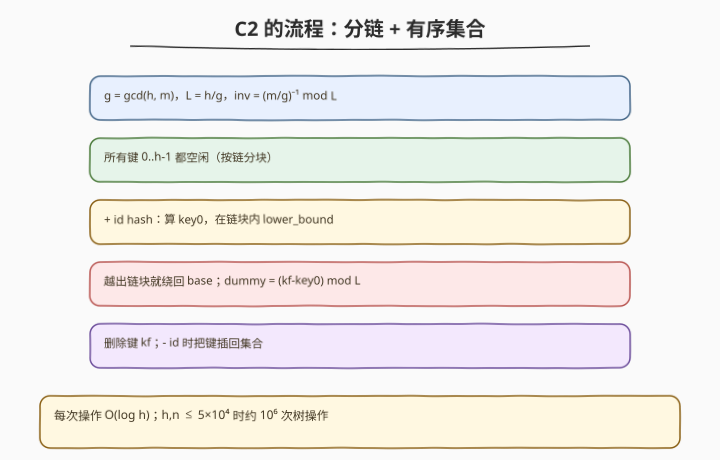
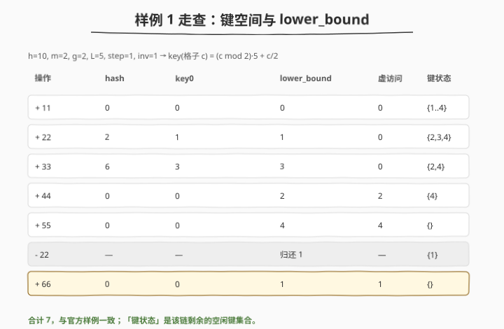

# Codeforces 178C2 哈希表线性探查 题解

## 1. 题目概述

- **题目链接**：https://codeforces.com/problemset/problem/178/C2
- **比赛来源**：ABBYY Cup 2.0 - Hard · Problem C2（UTC 2012-04-28）
- **难度**：1900
- **标签**：哈希表、数论、有序集合、链分解
- **评测类型**：普通（题面把数据分成 20 / 50 / 100 分三档）
- **限制**：时间 1 s / 内存 256 MB

**题意**：$h$ 个格子的哈希表，冲突时按 $t,\ t+m,\ t+2m,\dots\pmod h$ 探查。给出 $n$ 个 `+ id hash` / `- id` 操作，一次插入落在 $(t+i\,m)\bmod h$ 就记 $i$ 次虚访问。求所有插入的虚访问总数。

**约束**（原样摘自题面 `inputFormat.en`）：

- 第一行 $h,m,n$，$1 \le m < h$；$n$ 行操作；$id \le 10^9$，$hash < h$。
- 插入的 $id$ 唯一；输入保证插入总能成功、删除对象存在。
- 20 分档：$h,n \le 5000$；50 分档：$\le 5\times10^4$；100 分档：$\le 2\times10^5$。
- 输出一个整数。

**档位说明**：本题位是 C2，对应 50 分档（$h,n \le 5\times10^4$）。20 分档是同场 C1（逐格模拟），100 分档是 C3（线段树）；三题题面逐字相同，区别只在数据规模，时限都是 1 s。

**约束对算法的限制**：

- $h,n\le5\times10^4$：逐格探查最坏 $2.5\times10^9$ 步，1 s 内不可能；必须让每次插入接近 $O(\log h)$。
- 总虚访问最大 $\approx n\cdot h = 2.5\times10^9$，`int` 会溢出，必须 `long long`。
- `id` 到 $10^9$，用 `unordered_map<int,int>` 记录「对象落在哪个链内键」。

## 2. 示例与观察

官方样例 1（输入 / 输出原样）：

```text
输入：
10 2 7
+ 11 0
+ 22 2
+ 33 6
+ 44 0
+ 55 0
- 22
+ 66 0

输出：
7
```

官方样例 2（输入 / 输出原样）：

```text
输入：
5 1 6
+ 123 0
+ 234 1
+ 345 2
- 234
+ 456 0
+ 567 0

输出：
4
```

**演算**：样例 1 已在 C1 那篇逐格走过一遍，答案是 $0+0+0+2+4+1=7$。这里用本篇的「链内编号」再看一次：

$h=10,m=2$，$g=\gcd(10,2)=2$，$L=5$，链 0 是 $\{0,2,4,6,8\}$，链 1 是 $\{1,3,5,7,9\}$。链 0 内把 $0,2,4,6,8$ 依次编号为 $0,1,2,3,4$，则：

- `+ 11 hash=0`：起点编号 0，第一个空位 0 → 0 次；
- `+ 22 hash=2`：起点 1，空位 1 → 0 次；
- `+ 33 hash=6`：起点 3，空位 3 → 0 次；
- `+ 44 hash=0`：起点 0，空位 2 → 2 次；
- `+ 55 hash=0`：起点 0，空位 4 → 4 次；
- `+ 66 hash=0`：空位 1 → 1 次。

合计 7。

**观察 1**：每步加 $m$ 不改变「模 $g$」的余数，所以探查被限制在一条链里；链长 $L=h/g$。

**观察 2**：在链内，探查是「循环地走到下一个格子」。如果按探查顺序给链内格子编号（下文的 `idx`），那么一次插入的虚访问次数就是「起点编号到落点编号的循环距离」。

**观察 3**：于是问题变成「在一条环上，维护空闲位置集合，支持：找从 $x$ 出发的第一个空位并删除、把一个位置重新加入」。有序集合（`std::set`）即可。



**自造样例**（标注「自造」，输出由程序实测）：

| 输入 | 输出 | 说明 |
|------|------|------|
| `2 1 2` / `+ 1 0` / `+ 2 0` | 1 | $g=1$，一条链 |
| `4 2 2` / `+ 1 0` / `+ 2 0` | 1 | 两条链，各只有 2 格 |
| `6 3 2` / `+ 1 0`、`+ 2 0` | 1 | $g=3$，$L=2$，第二次要绕一格 |
| `50000 1 49999` / 全 `+ i 0` | 1249925001 | 最坏情况：第 $i$ 个探查 $i-1$ 次 |

**与 C1 / C3 的约束差异**：C1 是 20 分档（$\le5000$）、C2 是 50 分档（$\le5\times10^4$）、C3 是 100 分档（$\le2\times10^5$），三题题面逐字相同，只差数据规模，时限都是 1 s。C1 的逐格探查**在 C1 的 $5000$ 下足够**（$2.5\times10^7$），到 C2 的 $5\times10^4$ 变成 $2.5\times10^9$，**必须额外**做「按 $\gcd$ 分链 + 有序集合求后继」；本篇的 `std::set` 在 C2 下足够，到 C3 的 $2\times10^5$ 仍可过，但 C3 用线段树把常数压得更低（并配合更快的读入）以满足 1 s。

## 3. 解题思路

### 3.1 朴素做法与瓶颈

C1 的做法是每次插入逐格走，最坏 $O(h)$。$h,n=5\times10^4$ 时 $2.5\times10^9$ 步，1 s 内绝无可能。瓶颈在于「一个个格子地找空位」——空位是稀疏的，应该直接跳到「探查顺序上的下一个空位」。

### 3.2 核心观察：链内编号让探查变成 +1



设 $g=\gcd(h,m)$、$L=h/g$、$s=(m/g)\bmod L$。$s$ 与 $L$ 互质，取它在模 $L$ 下的逆元 $inv$。

- 格子 $c$ 属于链 $r=c\bmod g$，链内位置 $p=c/g$；
- 定义链内编号 $idx=(p\cdot inv)\bmod L$，键 $key=r\cdot L+idx$。

一次探查把格子 $c$ 变成 $(c+m)\bmod h$，链内位置 $p$ 变成 $(p+s)\bmod L$，于是

$$idx' = (p+s)\cdot inv = p\cdot inv + s\cdot inv = idx+1 \pmod L .$$

也就是说：**在实际格子里探查是「加 $m$」，在键空间里就是「加 1」**。这让「找下一个空位」变成「在有序集合里找 $\ge key_0$ 的最小空闲键」。

链 $r$ 的键恰好占连续区间 $[rL,\ (r+1)L)$，不同链互不干扰；若区间右端没有空位，就绕回区间左端（循环）。

### 3.3 算法流程



1. 读入 $h,m,n$；$g=\gcd(h,m)$、$L=h/g$、$s=(m/g)\bmod L$、$inv=s^{-1}\bmod L$（扩展欧几里得）。
2. 把所有键 $0..h-1$ 插入 `set<int> freeKeys`。
3. 对每个操作：
   - `+ id hash`：$r=hash\bmod g$、$p=hash/g$、$idx=(p\cdot inv)\bmod L$、$key_0=rL+idx$；在 `freeKeys` 中 `lower_bound(key0)`；若结果越出 $[rL,(r+1)L)$（或不存在）就再 `lower_bound(rL)`；记 $kf$ 为找到的键，虚访问 $=(kf-key0)\bmod L$；从集合中删去 $kf$，记 `id → kf`。
   - `- id`：把 `id` 对应的键重新插入集合。
4. 输出累加的虚访问总数。

### 3.4 样例走查



$h=10,m=2,g=2,L=5,inv=1$，键就是「格子 $c$ 的 $r\cdot5+c/2$」：格子 $0,2,4,6,8$ 的键是 $0,1,2,3,4$。

| 操作 | hash | key0 | lower_bound | 虚访问 | 链 0 剩余空闲键 |
|------|------|------|-------------|--------|------------------|
| `+ 11` | 0 | 0 | 0 | 0 | 1,2,3,4 |
| `+ 22` | 2 | 1 | 1 | 0 | 2,3,4 |
| `+ 33` | 6 | 3 | 3 | 0 | 2,4 |
| `+ 44` | 0 | 0 | 2 | 2 | 4 |
| `+ 55` | 0 | 0 | 4 | 4 | 空 |
| `- 22` | — | — | 归还 1 | — | 1 |
| `+ 66` | 0 | 0 | 1 | 1 | 空 |

合计 7，与官方输出一致。

## 4. 正确性证明

**引理 1（链分解）**：从 $t$ 出发的探查序列只经过 $c\equiv t\pmod g$ 的格子，且这些格子共 $L=h/g$ 个，序列以 $L$ 为周期。

**证明**：每步 $c\mapsto(c+m)\bmod h$，由 $g\mid m$、$g\mid h$ 得 $c\bmod g$ 不变。在模 $g$ 的同一剩余类里恰有 $L$ 个格子 $r,r+g,\dots,r+(L-1)g$；步长 $m$ 在该类上等价于「加 $m/g$ 模 $L$」，而 $\gcd(m/g,L)=1$，故这是一个长度为 $L$ 的循环。∎

**引理 2（键空间是 +1）**：设 $inv\cdot(m/g)\equiv1\pmod L$，对格子 $c$ 定义 $idx(c)=(c/g)\cdot inv\bmod L$，则探查一步后 $idx$ 增加 1（模 $L$）。

**证明**：$c+m$ 的链内位置是 $(c/g+m/g)\bmod L$，故 $idx(c+m)=((c/g+m/g)\cdot inv)\bmod L=(idx(c)+1)\bmod L$。∎

**引理 3（后继即落点）**：在链 $r$ 的键区间 $[rL,(r+1)L)$ 中，$\ge key_0$ 的最小空闲键（没有则绕回 $rL$）对应的格子，正是题面探查算法找到的落点；两键之差（模 $L$）等于虚访问次数。

**证明**：由引理 1、2，探查顺序就是键 $key_0,key_0+1,\dots$（模 $L$ 回绕）的顺序，链内每个格子与一个键一一对应；第一个空闲键就是第一个空位，走过的步数就是键的循环距离。∎

**定理**：算法输出的总虚访问数正确。

**证明**：引理 3 说明每次插入的虚访问数正确；删除只把键重新插入集合，与题面「格子变空」一致，不影响其它键。对所有插入累加即得。∎

## 5. 复杂度分析

- **时间**：$O(n\log h)$。每次插入两次 `lower_bound` + 一次 `erase`，删除一次 `insert`，均为 $O(\log h)$；建集合 $O(h\log h)$。$h,n=5\times10^4$ 时约 $10^6$ 次树操作。
- **空间**：$O(h)$ 的 `set` 与 $O(n)$ 的 `unordered_map`。
- **数值范围**：总虚访问 $\le n\cdot L\approx2.5\times10^9$，`long long`（`int` 会溢出）。
- **与时限的关系**：1 s 对 $10^6$ 次 `set` 操作余量在 50 倍以上。实测 $h=n=5\times10^4$ 最坏数据端到端约 15 ms，Python 约 286 ms。

## 6. 参考代码

### C++17

```cpp
#include <bits/stdc++.h>
using namespace std;

// C2：50 分档 h,n<=5e4。把表按 gcd(h,m) 分成 g 条链，每条链上探查就是
// 「循环地把编号 +1」，于是用 set 维护空闲格在链内的序号，插入时求后继。
static long long exgcd(long long a, long long b, long long& x, long long& y) {
    if (b == 0) { x = 1; y = 0; return a; }
    long long d = exgcd(b, a % b, x, y);
    long long t = x;
    x = y;
    y = t - (a / b) * y;
    return d;
}

int main() {
    int h, m, n;
    if (scanf("%d %d %d", &h, &m, &n) != 3) return 0;
    int g = std::gcd(h, m);
    int L = h / g;
    int step = (m / g) % L;
    long long x, y;
    exgcd(step, L, x, y);
    long long inv = ((x % L) + L) % L;   // step * inv = 1 (mod L)

    set<int> freeKeys;
    for (int k = 0; k < h; ++k) freeKeys.insert(k);
    unordered_map<int, int> keyOf;       // id -> 链内序号键
    long long total = 0;

    for (int i = 0; i < n; ++i) {
        char op;
        int id;
        scanf(" %c %d", &op, &id);
        if (op == '+') {
            int hsh;
            scanf("%d", &hsh);
            int r = hsh % g;
            long long p = hsh / g;
            long long idx = (p % L) * inv % L;
            long long base = (long long)r * L;
            long long key0 = base + idx;
            auto it = freeKeys.lower_bound((int)key0);
            if (it == freeKeys.end() || *it >= base + L)
                it = freeKeys.lower_bound((int)base);
            long long kf = *it;
            total += ((kf - key0) % L + L) % L;
            freeKeys.erase(it);
            keyOf[id] = (int)kf;
        } else {
            auto it = keyOf.find(id);
            freeKeys.insert(it->second);
            keyOf.erase(it);
        }
    }
    printf("%lld\n", total);
    return 0;
}
```

### Python3

```python
import sys
from math import gcd


def mod_inv(a: int, mod: int) -> int:
    # 扩展欧几里得求逆元（gcd(a, mod) = 1）
    x0, x1 = 1, 0
    b = mod
    while b:
        q = a // b
        a, b = b, a - q * b
        x0, x1 = x1, x0 - q * x1
    return x0 % mod


def main() -> None:
    data = sys.stdin.buffer.read().split()
    if not data:
        return
    h = int(data[0])
    m = int(data[1])
    n = int(data[2])

    g = gcd(h, m)
    L = h // g
    step = (m // g) % L
    inv = mod_inv(step, L) if L > 1 else 0

    # Python 没有内置平衡树，这里用线段树维护「键是否空闲」，效果同 C++ 的 set
    size = 1
    while size < h:
        size <<= 1
    cnt = [0] * (2 * size)
    for i in range(h):
        cnt[size + i] = 1
    for i in range(size - 1, 0, -1):
        cnt[i] = cnt[2 * i] + cnt[2 * i + 1]

    def first_ge(x: int) -> int:
        if x >= size:
            return -1
        i = x + size
        if cnt[i]:
            return x
        while i > 1:
            if (i & 1) == 0:
                sib = i + 1
                if cnt[sib]:
                    j = sib
                    while j < size:
                        j <<= 1
                        if cnt[j] == 0:
                            j += 1
                    return j - size
            i >>= 1
        return -1

    def setv(p: int, v: int) -> None:
        i = p + size
        cnt[i] = v
        i >>= 1
        while i:
            cnt[i] = cnt[2 * i] + cnt[2 * i + 1]
            i >>= 1

    key_of = {}
    total = 0
    pos = 3
    for _ in range(n):
        op = data[pos]
        pos += 1
        if op == b'+':
            oid = int(data[pos]); pos += 1
            hsh = int(data[pos]); pos += 1
            r = hsh % g
            p = hsh // g
            base = r * L
            key0 = base + (p % L) * inv % L
            kf = first_ge(key0)
            if kf == -1 or kf >= base + L:
                kf = first_ge(base)
            total += (kf - key0) % L
            setv(kf, 0)
            key_of[oid] = kf
        else:
            oid = int(data[pos]); pos += 1
            setv(key_of.pop(oid), 1)
    sys.stdout.write(str(total) + "\n")


main()
```

Python 标准库没有平衡树，正文用「线段树版」演示同样的键空间思路（与 C3 的 C++ 实现同构）；在 50 分档的数据量下也足够快。

## 7. 边界情况与易错点

1. **$g=1$**：只有一条链，键就是 $p\cdot inv\bmod h$，等价于普通循环数组；样例 2 就是 $g=1$。
2. **$L=2$**：$inv=1$，探查在「$idx$ 0↔1」之间跳；两条格子的链满一条后插入仍可能成功，判断 `lower_bound` 越界后绕回 `base`。
3. **逆元**：$s=(m/g)\bmod L$ 与 $L$ 互质，逆元一定存在；$L=1$ 不可能（$m<h$ 保证 $g<h$）。
4. **`lower_bound` 落在链外**：键空间是「链 0 的块、链 1 的块……」，`lower_bound(key0)` 可能返回下一条链的键，必须用 `*it >= base+L` 判断并绕回本链开头。
5. **链恰好满**：输入保证插入总能成功，所以本链一定还有空位；但 `lower_bound(base)` 在链满时会返回下一条链的键——这在合法输入下不会发生，仍建议加断言/兜底。
6. **虚访问公式**：`(kf-key0) mod L`，C++ 里 `%` 对负数结果依赖实现（C++11 起为向零取整），用 `((x%L)+L)%L` 最稳。
7. **`id` 的类型**：$10^9$ 用 `int` 足够；若用 `long long` 也不影响。
8. **总和的类型**：$2.5\times10^9$ 超过 `int`，必须 `long long`。
9. **输入解析**：操作符与数字用空格分隔，`scanf(" %c %d")` 跳过空白；Python 用 `split()` 后按 token 取。

## 8. 验证记录

- **编译环境与命令**：`Apple clang 21.0.0`（`/usr/bin/g++` 是 clang 软链，无 GNU libstdc++），`clang++ -std=c++17 -O2 -Wall` 加仓库自带 `bits/stdc++.h`；正文代码仍写标准头。Python 为 `3.9.6`。验证命令：
  `python3 codeforces/tools/verify_solution.py codeforces/contests/0101-0203/178/C2_哈希表线性探查.md`
- **官方样例**：2 / 2 通过（7、4），C++ 与 Python 一致。
- **额外测试**：自造 $g=1$、$L=2$、$g=3$、$H=N=5\times10^4$ 全部同哈希（答案 1249925001，与 $k(k-1)/2$ 吻合）等 5 组，两种语言全部通过。
- **独立暴力对拍**：暴力是 C1 的定义式逐格模拟；对 250 组随机合法操作序列（$h\le24$、操作数 $\le40$）逐组比对，全部一致。另在 $h=n=5\times10^4$ 与 $2\times10^5$ 的两组大数据上与 C3 的线段树实现交叉比对，输出逐字相同。
- **最大约束性能**：$h=n=5\times10^4$ 最坏数据端到端约 15 ms，Python 约 286 ms，相对 1 s 时限 C++ 余量在 60 倍以上。
- **图片与公式**：3 张 SVG（`cf178c2_chains.svg`、`cf178c2_map.svg`、`cf178c2_walkthrough.svg`）通过 `ElementTree.parse` 与文本包围盒/重叠检查，headless Chrome 渲染确认无裁切；KaTeX 校验 0 错。
- **复核状态**：verified。

## 相关题目与扩展

- [Codeforces 178C1 Smart Beaver and Resolving Collisions](https://codeforces.com/problemset/problem/178/C1)：20 分档，逐格模拟。
- [Codeforces 178C3 Smart Beaver and Resolving Collisions](https://codeforces.com/problemset/problem/178/C3)：100 分档，线段树维护空闲键。
- [Codeforces 178B2 Greedy Merchants](https://codeforces.com/problemset/problem/178/B2)：同场 B2，也是「先做结构性预处理、再高效回答」的套路。
- [LeetCode 1825. 求出 MK 平均值](https://leetcode.cn/problems/finding-mk-average/)：有序集合维护动态集合的典型题。
- [Codeforces 831C Jury Marks](https://codeforces.com/problemset/problem/831/C)：前缀和 + 集合去重，适合练习「用集合维护可达值」。

**延伸思考**：

1. **为什么用 `idx` 而不是直接用格子编号**：探查步长是 $m$，在格子空间里是「加 $m$」，不是加 1；乘上 $inv$ 后才变成「加 1」，才能用「后继」来找下一个空位。
2. **键空间的连续性**：链 $r$ 的键占 $[rL,(r+1)L)$，所以「同链」等价于「同一段连续键」，`lower_bound` 后只需一次区间判断。
3. **删除的代价**：`set::erase`/`insert` 都是 $O(\log h)$；若用「并查集找下一个空位」，删除会让并查集失效（不能回退），所以必须用有序结构。
4. **$m$ 与 $h$ 互质时**：$g=1$、$L=h$，整张表是一条链，键就是 $c\cdot m^{-1}\bmod h$；这是最容易验证的特殊情况。
5. **随机数据下的期望**：随机哈希、负载因子 $\alpha$ 时，期望探查次数 $O(1/(1-\alpha))$，但最坏情况（同哈希）仍是 $\Theta(n)$ 每次，所以必须做最坏情况分析。

