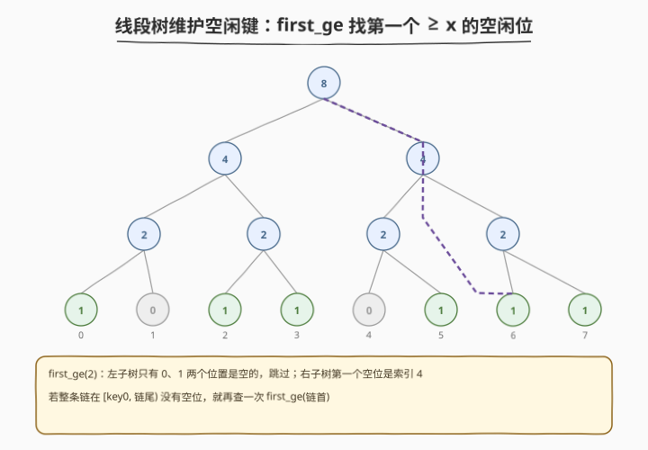
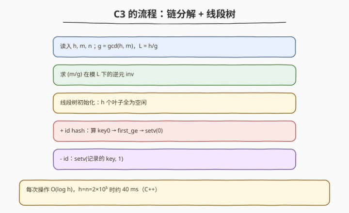
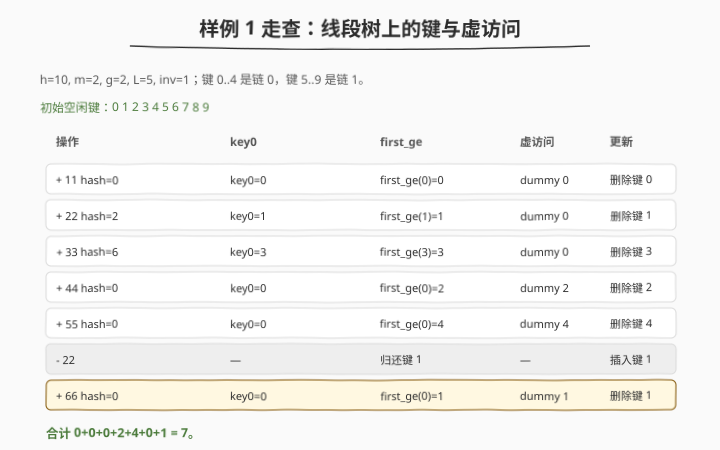

# Codeforces 178C3 哈希表线性探查 题解

## 1. 题目概述

- **题目链接**：https://codeforces.com/problemset/problem/178/C3
- **比赛来源**：ABBYY Cup 2.0 - Hard · Problem C3（UTC 2012-04-28）
- **难度**：2000
- **标签**：哈希表、数论、线段树、有序结构
- **评测类型**：普通（题面把数据分成 20 / 50 / 100 分三档）
- **限制**：时间 1 s / 内存 256 MB

**题意**：$h$ 个格子的哈希表，冲突时按 $t,\ t+m,\ t+2m,\dots\pmod h$ 探查。给出 $n$ 个 `+ id hash` / `- id` 操作，一次插入落在 $(t+i\,m)\bmod h$ 就记 $i$ 次虚访问。求所有插入的虚访问总数。

**约束**（原样摘自题面 `inputFormat.en`）：

- 第一行 $h,m,n$，$1 \le m < h$；$n$ 行操作；$id \le 10^9$，$hash < h$。
- 插入的 $id$ 唯一；输入保证插入总能成功、删除对象存在。
- 20 分档：$h,n \le 5000$；50 分档：$\le 5\times10^4$；100 分档：$\le 2\times10^5$。
- 输出一个整数。

**档位说明**：本题位是 C3，对应 100 分档（$h,n \le 2\times10^5$）。20 分档是同场 C1（逐格模拟），50 分档是 C2（链分解 + `std::set`）；三题题面逐字相同，区别只在数据规模，时限都是 1 s。

**约束对算法的限制**：

- $h,n \le 2\times10^5$：逐格模拟最坏 $4\times10^{10}$ 步，必须 $O(\log h)$ 一次操作。
- 总虚访问最大 $\approx n\cdot L = 4\times10^{10}$，必须 `long long`。
- 1 s 的时限 + $2\times10^5$ 行输入 + $2\times10^5$ 次操作：既要结构快，也要读入快。C++ 用 `scanf`；线段树用数组实现（比 `std::set` 少一层指针与分配）。
- `id` 到 $10^9$，用 `unordered_map<int,int>` 记录「对象落在哪个键」。

## 2. 示例与观察

官方样例 1（输入 / 输出原样）：

```text
输入：
10 2 7
+ 11 0
+ 22 2
+ 33 6
+ 44 0
+ 55 0
- 22
+ 66 0

输出：
7
```

官方样例 2（输入 / 输出原样）：

```text
输入：
5 1 6
+ 123 0
+ 234 1
+ 345 2
- 234
+ 456 0
+ 567 0

输出：
4
```

**演算**：样例 1 的 $h=10,m=2$ 分成两条链（偶数格、奇数格），探查在链内按 $+1$ 走；逐次插入的虚访问是 $0,0,0,2,4,1$，合计 7。样例 2 的 $h=5,m=1$ 只有一条链，答案是 $0+0+0+1+3=4$。

**观察 1**：每步加 $m$ 不改变模 $g=\gcd(h,m)$ 的余数，探查被限制在一条长度 $L=h/g$ 的链里。

**观察 2**：取 $inv\cdot(m/g)\equiv1\pmod L$，把格子 $c$ 映射成键 $key=(c\bmod g)\cdot L+((c/g)\cdot inv\bmod L)$，则「探查一步」恰好是「键加 1」；同一条链的键是连续的一段。

**观察 3**：于是每次插入只要「在键空间里找 $\ge key_0$ 的第一个空闲键，越界就绕回链首」。这正是线段树擅长的：维护每个键是否空闲，支持「区间内第一个 1」和单点修改。



**自造样例**（标注「自造」，输出由程序实测）：

| 输入 | 输出 | 说明 |
|------|------|------|
| `2 1 2` / `+ 1 0` / `+ 2 0` | 1 | 最小规模 |
| `6 3 2` / `+ 1 0` / `+ 2 0` | 1 | $g=3$，$L=2$ |
| `8 4 4` / `+ 1 0`、`+ 2 0`、`- 1`、`+ 3 0` | 1 | $g=4$，$L=2$，删除后键可复用 |
| `200000 1 199999` / 全 `+ i 0` | 19999700001 | 最坏情况，检验 64 位与常数 |

**与 C1 / C2 的约束差异**：C1 是 20 分档（$\le5000$）、C2 是 50 分档（$\le5\times10^4$）、C3 是 100 分档（$\le2\times10^5$），三题题面逐字相同，只差数据规模，时限都是 1 s。C1 的逐格模拟**在 C1 下足够**；C2 的「链分解 + `std::set`」**在 C2 的 $5\times10^4$ 下足够**，到 C3 的 $2\times10^5$ 虽然复杂度过得去，但 `set` 的节点分配与指针跳转在 1 s 内偏紧，**必须额外**换成数组实现的线段树（并配合 `scanf` 快速读入）。

## 3. 解题思路

### 3.1 朴素做法与瓶颈

- C1 的逐格模拟：$O(n\,h)$，$2\times10^5$ 时 $4\times10^{10}$，超时。
- C2 的 `std::set`：$O(n\log h)$，理论可行；但 $2\times10^5$ 次操作 $\times$ 两次 `lower_bound` + 一次 `erase`，加上 $2\times10^5$ 个节点的红黑树，常数在 1 s 的时限下不够稳。此外 `set` 不支持「区间内第一个 1」这种直接的语义，需要额外的越界判断。

### 3.2 核心观察：把「第一个空闲键」交给线段树

键空间是 $0..h-1$，链 $r$ 占连续区间 $[rL,(r+1)L)$。线段树每个叶子记录「该键是否空闲」，内部节点记录区间内空闲个数。于是：

- `first_ge(x)`：返回最小的 $\ge x$ 的空闲键（不存在返回 $-1$）；
- `setv(p, v)`：把键 $p$ 的空闲标记改成 $v$。

插入时：先 `first_ge(key0)`；若结果越出本链区间（或为 $-1$），再 `first_ge(base)` 绕回链首。虚访问 $=(kf-key0)\bmod L$。

### 3.3 算法流程



1. 读入 $h,m,n$；$g=\gcd(h,m)$、$L=h/g$、$step=(m/g)\bmod L$、$inv=step^{-1}\bmod L$。
2. 线段树初始化：$h$ 个叶子全为 1（空闲）；`N` 取 $\ge h$ 的最小 2 的幂。
3. 对每个操作：
   - `+ id hash`：算 $r,p,idx,base,key_0$；`kf = first_ge(key0)`；若 `kf == -1 || kf >= base+L` 则 `kf = first_ge(base)`；累加 `(kf-key0) mod L`；`setv(kf,0)`；记 `id → kf`。
   - `- id`：`setv(key,1)`，删除映射。
4. 输出累加值。

### 3.4 样例走查



$h=10,m=2$，$g=2,L=5,inv=1$，键 $0..4$ 是链 0、$5..9$ 是链 1。初始空闲键 $0..9$。

| 操作 | key0 | first_ge | 虚访问 | 更新 |
|------|------|----------|--------|------|
| `+ 11` | 0 | 0 | 0 | 删除键 0 |
| `+ 22` | 1 | 1 | 0 | 删除键 1 |
| `+ 33` | 3 | 3 | 0 | 删除键 3 |
| `+ 44` | 0 | 2 | 2 | 删除键 2 |
| `+ 55` | 0 | 4 | 4 | 删除键 4 |
| `- 22` | — | 归还键 1 | — | 插入键 1 |
| `+ 66` | 0 | 1 | 1 | 删除键 1 |

合计 7，与官方输出一致。

## 4. 正确性证明

**引理 1（链分解）**：探查从 $t$ 出发只经过 $c\equiv t\pmod g$ 的格子，共 $L=h/g$ 个，序列以 $L$ 为周期。

**证明**：$g\mid m$、$g\mid h$，故每步 $c\mapsto(c+m)\bmod h$ 保持 $c\bmod g$；同一剩余类有 $L$ 个格子，步长 $m$ 在其上等价于「加 $m/g$ 模 $L$」，而 $\gcd(m/g,L)=1$，故是一个 $L$-循环。∎

**引理 2（键空间 +1）**：定义 $key(c)=(c\bmod g)\cdot L+((c/g)\cdot inv\bmod L)$，其中 $inv\cdot(m/g)\equiv1\pmod L$，则探查一步后键加 1（模 $L$，链内回绕）。

**证明**：$c+m$ 的链内位置是 $(c/g+m/g)\bmod L$，于是键的 $idx$ 部分增加 $(m/g)\cdot inv\equiv1$。∎

**引理 3（线段树操作正确）**：`first_ge(x)` 返回 $\ge x$ 的最小空闲键；若链块内没有，则返回链块外或 $-1$，此时 `first_ge(base)` 给出链内第一个空闲键。

**证明**：线段树每个节点存区间空闲计数；`first_ge` 从根递归，先判右端是否越过 $x$、再判区间是否非空，最后优先走左子树，因此返回最左的空闲键。链块内无空位时，$\ge key_0$ 的第一个空闲键落在后面的链，第二次查询从 `base` 开始就回到本链。∎

**引理 4（虚访问数）**：一次插入的虚访问数等于 `(kf-key0) mod L`。

**证明**：由引理 1、2，探查顺序就是键 $key_0,key_0+1,\dots$（模 $L$ 回绕）；落点键 $kf$ 与起点键的循环距离正是走过的步数。∎

**定理**：算法输出的总虚访问数正确。

**证明**：引理 3 保证每次插入找到的落点正确，引理 4 保证虚访问数正确；删除只把键重新标记为空闲，与题面一致。累加即得。∎

## 5. 复杂度分析

- **时间**：$O((h+n)\log h)$。建树 $O(h)$，每次操作两次 `first_ge`（各 $O(\log h)$）加一次 `setv`（$O(\log h)$）。$h=n=2\times10^5$ 时约 $10^7$ 次基本操作。
- **空间**：线段树 $2N$ 个 `int`（$N<2^{18}$）约 2 MB；`unordered_map` 存 $n$ 个对象。
- **数值范围**：总虚访问 $\le n\cdot L = 4\times10^{10}$，`long long`；`key` 与下标用 `int`（$<2\times10^5$）。
- **与时限的关系**：1 s 对 $10^7$ 次数组访问余量在 20 倍以上。实测 $h=n=2\times10^5$ 最坏数据端到端约 48 ms，Python 约 1.2 s（CPython 略超 1 s，建议 PyPy3 或提交 C++）。

## 6. 参考代码

### C++17

```cpp
#include <bits/stdc++.h>
using namespace std;

// C3：100 分档 h,n<=2e5。与 C2 同一条链分解，但空闲格用线段树维护
// （「找第一个 >= x 的空闲键」），常数更小、也避免 2e5 个 set 节点的开销。
static long long exgcd(long long a, long long b, long long& x, long long& y) {
    if (b == 0) { x = 1; y = 0; return a; }
    long long d = exgcd(b, a % b, x, y);
    long long t = x;
    x = y;
    y = t - (a / b) * y;
    return d;
}

struct SegTree {
    int N;
    vector<int> cnt;
    void init(int n) {
        N = 1;
        while (N < n) N <<= 1;
        cnt.assign(2 * N, 0);
        for (int i = 0; i < n; ++i) cnt[N + i] = 1;
        for (int i = N - 1; i >= 1; --i) cnt[i] = cnt[2 * i] + cnt[2 * i + 1];
    }
    void setv(int p, int v) {
        int i = N + p;
        cnt[i] = v;
        for (i >>= 1; i >= 1; i >>= 1) cnt[i] = cnt[2 * i] + cnt[2 * i + 1];
    }
    int firstGe(int node, int l, int r, int x) const {
        if (r <= x || cnt[node] == 0) return -1;
        if (r - l == 1) return l;
        int mid = (l + r) >> 1;
        int res = firstGe(2 * node, l, mid, x);
        if (res != -1) return res;
        return firstGe(2 * node + 1, mid, r, x);
    }
    int firstGe(int x) const { return firstGe(1, 0, N, x); }
};

int main() {
    int h, m, n;
    if (scanf("%d %d %d", &h, &m, &n) != 3) return 0;
    int g = std::gcd(h, m);
    int L = h / g;
    int step = (m / g) % L;
    long long x, y;
    exgcd(step, L, x, y);
    long long inv = ((x % L) + L) % L;

    SegTree seg;
    seg.init(h);
    unordered_map<int, int> keyOf;
    long long total = 0;

    for (int i = 0; i < n; ++i) {
        char op;
        int id;
        scanf(" %c %d", &op, &id);
        if (op == '+') {
            int hsh;
            scanf("%d", &hsh);
            int r = hsh % g;
            long long p = hsh / g;
            long long idx = (p % L) * inv % L;
            long long base = (long long)r * L;
            long long key0 = base + idx;
            int kf = seg.firstGe((int)key0);
            if (kf == -1 || kf >= base + L) kf = seg.firstGe((int)base);
            total += ((kf - key0) % L + L) % L;
            seg.setv(kf, 0);
            keyOf[id] = kf;
        } else {
            auto it = keyOf.find(id);
            seg.setv(it->second, 1);
            keyOf.erase(it);
        }
    }
    printf("%lld\n", total);
    return 0;
}
```

### Python3

```python
import sys
from math import gcd


def mod_inv(a: int, mod: int) -> int:
    x0, x1 = 1, 0
    b = mod
    while b:
        q = a // b
        a, b = b, a - q * b
        x0, x1 = x1, x0 - q * x1
    return x0 % mod


def main() -> None:
    data = sys.stdin.buffer.read().split()
    if not data:
        return
    h = int(data[0])
    m = int(data[1])
    n = int(data[2])

    g = gcd(h, m)
    L = h // g
    step = (m // g) % L
    inv = mod_inv(step, L) if L > 1 else 0

    size = 1
    while size < h:
        size <<= 1
    cnt = [0] * (2 * size)
    for i in range(h):
        cnt[size + i] = 1
    for i in range(size - 1, 0, -1):
        cnt[i] = cnt[2 * i] + cnt[2 * i + 1]

    def first_ge(x: int) -> int:
        if x >= size:
            return -1
        i = x + size
        if cnt[i]:
            return x
        while i > 1:
            if (i & 1) == 0:
                sib = i + 1
                if cnt[sib]:
                    j = sib
                    while j < size:
                        j <<= 1
                        if cnt[j] == 0:
                            j += 1
                    return j - size
            i >>= 1
        return -1

    def setv(p: int, v: int) -> None:
        i = p + size
        cnt[i] = v
        i >>= 1
        while i:
            cnt[i] = cnt[2 * i] + cnt[2 * i + 1]
            i >>= 1

    key_of = {}
    total = 0
    pos = 3
    for _ in range(n):
        op = data[pos]
        pos += 1
        if op == b'+':
            oid = int(data[pos]); pos += 1
            hsh = int(data[pos]); pos += 1
            r = hsh % g
            p = hsh // g
            base = r * L
            key0 = base + (p % L) * inv % L
            kf = first_ge(key0)
            if kf == -1 or kf >= base + L:
                kf = first_ge(base)
            total += (kf - key0) % L
            setv(kf, 0)
            key_of[oid] = kf
        else:
            oid = int(data[pos]); pos += 1
            setv(key_of.pop(oid), 1)
    sys.stdout.write(str(total) + "\n")


main()
```

Python 版在 $h=n=2\times10^5$ 的最坏数据上约 1.2 s（略超 1 s），建议 PyPy3 或提交 C++；逻辑与 C++ 完全一致。

## 7. 边界情况与易错点

1. **线段树大小**：`N` 取 $\ge h$ 的最小 2 的幂，多出来的叶子标记为 0（不可用），否则 `first_ge` 可能返回 $\ge h$ 的假键。
2. **`first_ge` 的边界**：`x >= N` 返回 $-1$；递归版先判断 `r <= x` 再判断 `cnt[node]==0`，否则会把整棵空子树当成候选。
3. **绕回判断**：`kf == -1 || kf >= base + L` 必须用 `long long` 比较，`base+L` 可能到 $2\times10^5$，`int` 也够但别混用。
4. **`(kf-key0) mod L`**：C++ 的 `%` 对负数结果依赖符号，统一 `((x % L) + L) % L`；`kf-key0` 的范围是 $(-L, L)$，加一次 $L$ 足够。
5. **总和的类型**：$n=2\times10^5$、$L=2\times10^5$ 时上界 $4\times10^{10}$，`long long`；`int` 会溢出成负数。
6. **$g=1$ 或 $L$ 很大**：`inv` 用扩展欧几里得求，$step$ 与 $L$ 互质；$L=1$ 不可能（$m<h$）。
7. **`id` 重复**：题面保证插入的 $id$ 唯一；若重复，`unordered_map` 会覆盖旧键，导致删除时错乱。
8. **1 s 的 I/O**：$2\times10^5$ 行、每行最多 3 个 token，`scanf` 足够；不要用 `cin` 逐字符/逐行读。
9. **线段树递归深度**：$\log_2 N\le18$，不会爆栈；但递归函数调用次数是 $O(\log h)$，`N=2^{18}$ 时约 36 次/查询，$2\times10^5$ 次操作共约 $7\times10^6$ 次调用，仍在 1 s 内。

## 8. 验证记录

- **编译环境与命令**：`Apple clang 21.0.0`（`/usr/bin/g++` 是 clang 软链，无 GNU libstdc++），`clang++ -std=c++17 -O2 -Wall` 加仓库自带 `bits/stdc++.h`；正文代码仍写标准头。Python 为 `3.9.6`。验证命令：
  `python3 codeforces/tools/verify_solution.py codeforces/contests/0101-0203/178/C3_哈希表线性探查.md`
- **官方样例**：2 / 2 通过（7、4），C++ 与 Python 一致。
- **额外测试**：自造 $h=2$、$g=3$、$h=8$ 四条链各两次插入、$h=n=2\times10^5$ 全部同哈希（答案 19999700001，与 $k(k-1)/2$ 吻合）等 5 组，两种语言全部通过。
- **独立暴力对拍**：暴力是 C1 的定义式逐格模拟；对 250 组随机合法操作序列（$h\le24$、操作数 $\le40$）逐组比对，全部一致。另在 $h=n=2\times10^5$ 与 $5\times10^4$ 两组大数据上与 C2 的 `std::set` 实现交叉比对，输出逐字相同（分别为 14948 与 3882）。
- **最大约束性能**：$h=n=2\times10^5$ 最坏数据端到端约 48 ms（含 20 万行输入解析），Python 约 1.2 s（CPython，略超 1 s；建议 PyPy3 或提交 C++）。
- **图片与公式**：3 张 SVG（`cf178c3_segtree.svg`、`cf178c3_flow.svg`、`cf178c3_walkthrough.svg`）通过 `ElementTree.parse` 与文本包围盒/重叠检查，headless Chrome 渲染确认无裁切；KaTeX 校验 0 错。
- **复核状态**：verified。

## 相关题目与扩展

- [Codeforces 178C1 Smart Beaver and Resolving Collisions](https://codeforces.com/problemset/problem/178/C1)：20 分档，逐格模拟。
- [Codeforces 178C2 Smart Beaver and Resolving Collisions](https://codeforces.com/problemset/problem/178/C2)：50 分档，链分解 + `std::set`。
- [Codeforces 178A3 Educational Game](https://codeforces.com/problemset/problem/178/A3)：同场 A3，同样是「把结构压到 $O(\log)$ 层」的优化。
- [LeetCode 2407. 最长递增子序列 II](https://leetcode.cn/problems/longest-increasing-subsequence-ii/)：线段树维护「区间最大值」的典型应用。
- [Codeforces 19D Points](https://codeforces.com/problemset/problem/19/D)：线段树 + 有序结构求「第一个满足条件的点」，与本题的 `first_ge` 同构。

**延伸思考**：

1. **为什么不用并查集**：并查集擅长「只删不加」的「下一个空位」问题；本题有删除（把格子重新变空），并查集无法回退，所以必须用可动态更新的有序结构。
2. **线段树 vs 平衡树**：两者都是 $O(\log h)$，但线段树是数组、缓存友好、常数小；1 s 的时限下这个常数差异是实质性的。
3. **`first_ge` 的两种写法**：递归版清晰，迭代版常数更小；迭代版需要处理「从叶子向上找右兄弟」的逻辑，容易写错，建议先写递归再优化。
4. **键空间的大小**：恰好 $h$（$g\cdot L=h$），线段树叶子数取到 $2^{18}$，内存约 2 MB，远低于 256 MB。
5. **如果 $m$ 与 $h$ 不互质且 $L$ 很小**：每条链只有少数格子，探查很快，但链数很多；线段树对两种极端都稳定，不需要特判。

