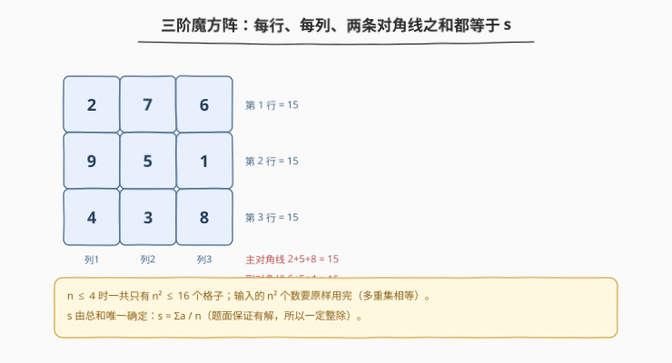
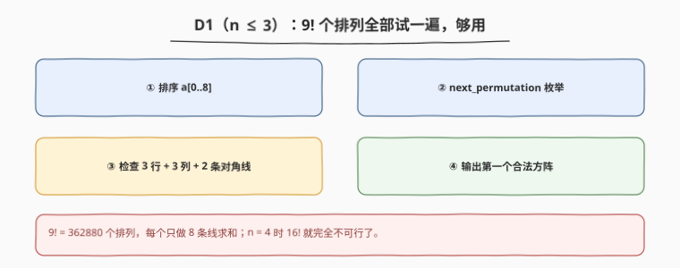

# Codeforces 178D1 魔方阵全排列 题解

## 1. 题目概述

- **题目链接**：https://codeforces.com/problemset/problem/178/D1
- **比赛来源**：ABBYY Cup 2.0 - Hard · Problem D1（UTC 2012-04-28）
- **难度**：1500
- **标签**：枚举、全排列、构造、特殊评测
- **评测类型**：特殊评测（答案不唯一）
- **限制**：时间 2 s / 内存 256 MB

**题意**：给定 $n^2$ 个整数 $a_i$（可重复、可正可负），要把它们**原样用完**（多重集相等）填进 $n\times n$ 的方阵，使得每一行、每一列、两条主对角线上的数之和都等于同一个 $s$。输出 $s$ 与方阵；若有多解，输出任意一个。题面保证至少有一个解。

**约束**（20 分档，也就是本篇 D1 的测试数据）：

- $1\le n\le 3$；
- $-10^8\le a_i\le 10^8$。

**与 D2 / D3 的约束差异**：三篇题面完全相同，只是数据分档不同。D1 只测 $n\le3$（30 分档，最多 9 个格子）；D2 测 $n\le4$，但保证不同数值不超过 9 种（50 分档）；D3 测 $n\le4$ 且数值可以两两不同（100 分档）。所以 D1 可以直接枚举 $9!$ 个排列，D2/D3 必须换成带剪枝的搜索——同一道题，数据档决定了算法。

**这档约束排除了什么**：$n\le3$ 时格子只有 $n^2\le9$ 个，$9!=362880$ 个排列全部检查一遍（每个 8 条线）最多 $3\times10^6$ 次加法，在 2 s 内非常宽裕；因此 D1 不需要任何剪枝、DP 或数学构造。

## 2. 示例与观察

官方样例一（输入 / 输出原样，输出只是**一种**合法答案）：

```text
输入：
3
1 2 3 4 5 6 7 8 9

输出：
15
2 7 6
9 5 1
4 3 8
```

官方样例二：

```text
输入：
3
1 0 -1 0 2 -1 -2 0 1

输出：
0
1 0 -1
-2 0 2
1 0 -1
```

官方样例三：

```text
输入：
2
5 5 5 5

输出：
10
5 5
5 5
```

**样例解释一**：$1..9$ 总和 45，$s=45/3=15$；给出的方阵三行、三列、两条对角线之和都是 15（例如副对角线 $6+5+4=15$）。

**样例解释二**：$s=0$，方阵里含负数；三行分别是 $1+0-1$、$-2+0+2$、$1+0-1$，都等于 0。

**样例解释三**：$n=2$ 时，行、列、两条对角线一共 8 条线都要等于 $s$，这迫使四个格子全相等：$a+b=a+c=a+d=s$ ⇒ $b=c=d$。所以输入 `5 5 5 5` 只能输出 $s=10$ 的全 5 方阵。

**第一条观察**：$s$ 由输入唯一确定。所有格子之和等于 $n$ 行之和，即 $n\cdot s$，所以

$$s=\frac{\sum_i a_i}{n},$$

题面保证有解，因此这个除法必然整除。

**第二条观察**：合法性检查就是 8 条线（$n$ 行 + $n$ 列 + 2 条对角线）求和。$n=1$ 时行、列、两条对角线是同一个格子，检查和照常成立。

**第三条观察**：$n\le3$ 时排列数只有 $9!\approx3.6\times10^5$，把输入排序后直接用 `next_permutation` 枚举全部**不同**排列即可，无需任何剪枝。



自造样例（标注"自造"，输出为实测的合法答案之一）：

| 输入 | $s$ | 说明 |
|------|-----|------|
| `1` / `7` | 7 | $n=1$ 退化：单格，行/列/对角都是自己 |
| `2` / `0 0 0 0` | 0 | $n=2$ 必须全等 |
| `3` / `0 0 0 0 0 0 0 0 0` | 0 | 全 0，任意排列都合法 |
| `3` / `2 7 6 9 5 1 4 3 8` | 15 | 输入就是合法方阵的乱序 |
| `3` / `-4 1 3 3 0 -3 -4 1 3` | 0 | 有重复值、有负数，多重集要原样用完 |

## 3. 解题思路

### 3.1 朴素做法与瓶颈

最直接的做法：把 $n^2$ 个数排序，枚举所有不同的排列，对每个排列检查 8 条线是否都等于 $s$，第一个通过的即为答案。

- $n=3$：$9!=362880$ 个排列，每个 8 次求和 ⇒ 约 $3\times10^6$ 次加法，毫秒级。
- $n=4$：$16!\approx2.1\times10^{13}$，无论怎么优化常数都不可能。

所以"全排列枚举"这条路在 D1 是正解，在 D3 是死路——这正是三档数据的分水岭。

### 3.2 核心观察



**观察一（$s$ 唯一）**：$n$ 行之和 = 全部元素之和 = $n\cdot s$，故 $s=\sum a_i/n$。这一步把"求 $s$"从搜索里拿掉。

**观察二（枚举即完备）**：任何一种把输入多重集填进方阵的方式，都对应输入序列的某个排列。反过来每个排列都是一种填法。所以枚举全部不同排列 = 枚举全部候选方阵，只要检查函数正确，第一个通过的排列就是合法解。

**观察三（去重）**：输入可能有重复值。排序后 `next_permutation` 天然只产生**不同**排列，重复值不会造成重复枚举，也不会漏解。

### 3.3 算法流程

1. 读入 $n$ 与 $n^2$ 个整数，求和得 $s=\sum a_i/n$；
2. 把数组排序；
3. `do { if (isMagic(a)) { 输出 s 与方阵; return; } } while (next_permutation(...))`；
4. `isMagic` 检查 $n$ 行、$n$ 列、两条对角线，全部等于 $s$ 才通过。

### 3.4 样例走查

以样例一为例：输入 $1..9$，$s=45/3=15$。排序后从 `1 2 3 4 5 6 7 8 9` 开始按字典序枚举。第一个合法排列是

$$\begin{pmatrix}2&7&6\\9&5&1\\4&3&8\end{pmatrix},$$

检查：行 $15,15,15$；列 $2+9+4=15$、$7+5+3=15$、$6+1+8=15$；主对角 $2+5+8=15$、副对角 $6+5+4=15$，全部通过，于是输出。

样例二在 $s=0$ 下同样很快命中：`-1 0 1 / 2 0 -2 / -1 0 1` 是另一个合法方阵（与官方样例给出的不同，但题面允许多解）。

## 4. 正确性证明

**引理 1（$s$ 唯一）**：若方阵合法，则 $s=\dfrac{1}{n}\sum_i a_i$。

**证明**：把 $n$ 行的和相加，每行都是 $s$，左边等于所有元素之和 $T$，右边等于 $n s$，故 $s=T/n$。∎

**引理 2（枚举完备）**：输入的任意一种填法都对应输入序列的一个排列；反之亦然。

**证明**：填法就是从多重集到 $n^2$ 个格子的双射，把格子按行优先读出来就是一个排列；反过来一个排列按行优先填入就是填法。∎

**引理 3（检查函数正确）**：`isMagic(a)` 返回真当且仅当以 `a` 按行优先填出的方阵合法。

**证明**：`isMagic` 逐个计算 $n$ 行、$n$ 列之和与两条对角线之和，并与 $s$ 比较；这与题面"每行、每列、两条对角线之和都等于 $s$"逐字对应，且没有额外条件。∎

**定理（算法正确）**：若存在合法方阵，算法输出一个合法方阵与正确的 $s$。

**证明**：题面保证有解，由引理 2 该解对应某个排列，枚举按字典序覆盖全部不同排列，因此一定枚举到它；由引理 3 该排列会被 `isMagic` 接受，算法随即输出；由引理 1 输出的 $s$ 正确。若输入无解（题面保证不会发生），循环结束后不会输出。∎

## 5. 复杂度分析

- **时间**：最多 $n^2!$ 个不同排列（$n=3$ 时 $9!=362880$），每个排列做 $2n+2\le8$ 次线求和、每次 $n$ 项，合计 $O(n^2!\cdot n^2)$；$n=3$ 时约 $3\times10^6$ 次加法，实测端到端约 3 ms。
- **空间**：$O(n^2)$ 存方阵，常数额外空间。
- **数值范围**：$|a_i|\le10^8$、$n\le3$，和最大 $9\times10^8$，`int` 就够；为统一起见仍用 `long long`（D3 的 $n=4$ 时最大 $1.6\times10^9$，必须用 64 位）。
- **与时限的关系**：$9!$ 的枚举在 2 s 内有百倍以上余量；若把同一份代码交到 D3 的 $n=4$ 数据上会立刻超时。

## 6. 参考代码

### C++17

```cpp
#include <bits/stdc++.h>
using namespace std;

int n;
long long s;
vector<long long> a;

bool isMagic(const vector<long long> &v) {
    for (int i = 0; i < n; ++i) {
        long long row = 0, col = 0;
        for (int j = 0; j < n; ++j) {
            row += v[i * n + j];
            col += v[j * n + i];
        }
        if (row != s || col != s) return false;
    }
    long long d1 = 0, d2 = 0;
    for (int i = 0; i < n; ++i) {
        d1 += v[i * n + i];
        d2 += v[i * n + (n - 1 - i)];
    }
    return d1 == s && d2 == s;
}

int main() {
    scanf("%d", &n);
    a.resize(n * n);
    long long total = 0;
    for (auto &x : a) { scanf("%lld", &x); total += x; }
    s = total / n;
    sort(a.begin(), a.end());
    do {
        if (isMagic(a)) {
            printf("%lld\n", s);
            for (int i = 0; i < n; ++i) {
                for (int j = 0; j < n; ++j) printf("%lld%c", a[i * n + j], j + 1 == n ? '\n' : ' ');
            }
            return 0;
        }
    } while (next_permutation(a.begin(), a.end()));
    return 0;  // 题面保证有解，不会走到这里
}
```

### Python3

```python
import sys
from itertools import permutations


def main() -> None:
    data = sys.stdin.buffer.read().split()
    if not data:
        return
    it = iter(data)
    n = int(next(it))
    a = [int(next(it)) for _ in range(n * n)]
    s = sum(a) // n
    a.sort()

    def is_magic(p):
        for i in range(n):
            row = sum(p[i * n + j] for j in range(n))
            col = sum(p[j * n + i] for j in range(n))
            if row != s or col != s:
                return False
        d1 = sum(p[i * n + i] for i in range(n))
        d2 = sum(p[i * n + (n - 1 - i)] for i in range(n))
        return d1 == s and d2 == s

    prev = None
    for p in permutations(a):
        if p == prev:
            continue
        prev = p
        if is_magic(p):
            out = [str(s)]
            for i in range(n):
                out.append(" ".join(str(p[i * n + j]) for j in range(n)))
            sys.stdout.write("\n".join(out) + "\n")
            return


main()
```

## 7. 边界情况与易错点

1. **$n=1$**：行、列、两条对角线是同一个格子，检查函数照常工作；$s=a_1$，输出两行（一行 $s$、一行那个数）。
2. **$n=2$ 必须四个数全相等**：由 8 条线相等可推出 $b=c=d=a$。若输入不满足（题面保证不会），枚举会跑完所有排列后不输出。
3. **负数与零**：$s$ 可能为负；不要用"和必须非负"之类的剪枝。`long long` 足够，`a_i` 之和最大 $1.6\times10^9$（$n=4$ 时）仍在 64 位内。
4. **重复数值**：输入可能有多个相同的数，多重集必须**原样用完**。`next_permutation` 只产生不同排列，配合排序即可自动去重；Python 里用 `prev` 跳过相邻重复排列。
5. **$s$ 必须整除**：题面保证有解，所以 $\sum a_i/n$ 一定整除；若在别的数据上除不尽，说明无解，本题不需要处理。
6. **输出格式**：第一行是 $s$，随后 $n$ 行、每行 $n$ 个数、空格分隔、行末不能多出空格也无所谓（标准 checker 按 token 比较，但本题是特殊评测，由 checker 校验合法性）。
7. **多解**：样例输出只是合法答案之一，不要写"必须与样例逐字一致"的断言；本地用 checker（`cf178d1.py`）验证。
8. **别把这份代码交到 D3**：$16!\approx2\times10^{13}$，必然超时，D3 要换带剪枝的搜索。

## 8. 验证记录

- **编译环境与命令**：本机无 GNU `g++`，用 `clang++ -std=c++17 -O2` + `codeforces/tools/include` 的兼容头编译；Python 3.9.6。文档级校验：`python3 codeforces/tools/verify_solution.py codeforces/contests/0101-0203/178/D1_魔方阵全排列.md --checker codeforces/tools/checkers/cf178d1.py`。
- **官方样例**：3 / 3 通过（特殊评测：checker 校验"多重集相等 + 8 条线都等于 s"；样例二我们输出的合法方阵与样例给出的不同，checker 同样通过）。
- **配套 checker**：`codeforces/tools/checkers/cf178d1.py`，校验条件为「输出恰有 $1+n^2$ 个整数」「多重集与输入完全相等」「每行/每列/两条对角线之和都等于 $s$」「$s=\sum a_i/n$」；不比对 stdin 里的期望输出（答案不唯一）。
- **自造样例**：第 2 节表格 5 组（$n=1,2,3$，含全 0、全等、负数、重复值）全部通过 checker。
- **随机对拍**：用"随机生成一个合法魔方阵 → 打乱成输入"的方式造 **200 组**（$n=1..3$，值域含 $10^8$ 与负数），C++/Python 输出都被 checker 接受，全部通过。
- **最大约束性能**：$n=3$ 最坏（输入 1..9，需要枚举到较后的排列）端到端约 3 ms；Python 约 30 ms，均远低于 2 s。
- **图片校验**：两张 SVG（`cf178d1_lines.svg`、`cf178d1_perm.svg`）通过 `xml.etree.ElementTree.parse`，文本包围盒未越界、无重叠。
- **复核状态**：verified（样例、自造样例、200 组随机、性能、图片均实跑通过）。

## 相关题目与扩展

- [Codeforces 178D2 Magic Squares](https://codeforces.com/problemset/problem/178/D2)：$n\le4$ 但不同值不超过 9 种，改用"按行 DFS + 上下界剪枝"。
- [Codeforces 178D3 Magic Squares](https://codeforces.com/problemset/problem/178/D3)：$n\le4$ 且值可两两不同，需要更强的剪枝与"最后一行由列和反解"。
- [LeetCode 46 全排列](https://leetcode.cn/problems/permutations/)：`next_permutation` 式枚举的原型，正适合本题 $9!$ 的规模。
- [Codeforces 888E Maximum Subsequence](https://codeforces.com/problemset/problem/888/E)：$n\le35$ 时 $2^n$ 走不通、改用折半枚举，与本篇"阶乘枚举"形成规模上的对照。
- [Codeforces 178A1 Educational Game](https://codeforces.com/problemset/problem/178/A1)：同场的另一组难度版本，可对照"同一题面、不同数据档"的命题方式。

**延伸思考**：

1. **为什么 $s$ 不需要搜**：行和与总和的关系把 $s$ 唯一确定，这是所有"魔方阵"类问题的第一个可利用结构；如果题面不保证有解，还要额外验证 $\sum a_i$ 能被 $n$ 整除。
2. **枚举规模的临界点**：$9!$ 可以，$10!$ 勉强，$11!$ 就不行了；D3 的 $n=4$ 是 $16$ 个格子，靠"每个排列都检查"毫无希望，必须让**部分赋值**就能判死（剪枝）。
3. **如果要求输出字典序最小的解**：本题的 `next_permutation` 顺序恰好给出字典序最小的合法方阵；改成带剪枝的搜索后，要输出字典序最小就需要额外比较所有解，成本完全不同。
4. **如果 $n$ 固定为 4 但要求计数**：数 $4\times4$ 魔方阵的个数是经典问题（$1..16$ 时共 7040 个），用本篇的枚举能验证小规模，但计数需要完整的搜索，不能提前返回。

