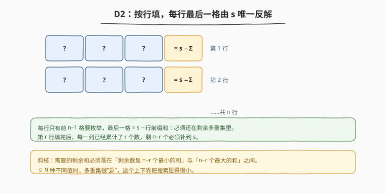
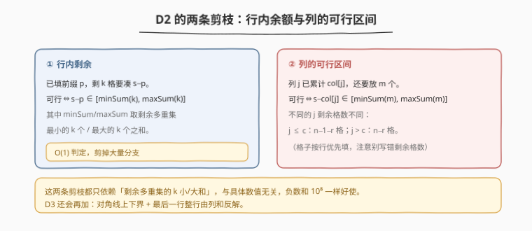

# Codeforces 178D2 魔方阵按行搜索 题解

## 1. 题目概述

- **题目链接**：https://codeforces.com/problemset/problem/178/D2
- **比赛来源**：ABBYY Cup 2.0 - Hard · Problem D2（UTC 2012-04-28）
- **难度**：1900
- **标签**：搜索、回溯、剪枝、构造、特殊评测
- **评测类型**：特殊评测（答案不唯一）
- **限制**：时间 2 s / 内存 256 MB

**题意**：给定 $n^2$ 个整数（可重复、可负），把它们原样用完填进 $n\times n$ 方阵，使每行、每列、两条主对角线之和都等于同一个 $s$，输出 $s$ 和方阵（多解输出任一）。

**约束**（50 分档，也就是本篇 D2 的测试数据）：

- $1\le n\le4$；
- $-10^8\le a_i\le10^8$；
- **不同数值不超过 9 种**。

**与 D1 / D3 的约束差异**：三篇题面相同、数据档不同。D1 只测 $n\le3$，可以直接枚举 $9!$ 个排列；D2 到了 $n\le4$，但"不同数值 ≤ 9"这一条让多重集非常扁平（16 个格子里大量重复），于是"按行填 + 用剩余多重集的 k 小/大和做上下界"就够了；D3 允许 16 个数两两不同，必须再加对角线剪枝和"最后一行由列和反解"。所以 D2 的代码在 D3 上不一定够快，这也是两篇分开写的原因。

**这档约束排除了什么**：$n=4$ 时 $16!$ 的全排列不可行，必须剪枝；而"不同值 ≤ 9"意味着每一步的分支数最多 9、且剩余多重集的可用个数很集中，因此行/列上下界剪枝的命中率非常高。

## 2. 示例与观察

官方样例一（输出只是**一种**合法答案）：

```text
输入：
3
1 2 3 4 5 6 7 8 9

输出：
15
2 7 6
9 5 1
4 3 8
```

官方样例二：

```text
输入：
3
1 0 -1 0 2 -1 -2 0 1

输出：
0
1 0 -1
-2 0 2
1 0 -1
```

官方样例三：

```text
输入：
2
5 5 5 5

输出：
10
5 5
5 5
```

**样例解释**：$s=\sum a_i/n$（第一组 $45/3=15$，第二组 $0/3=0$，第三组 $20/2=10$）。合法性就是 $n$ 行 + $n$ 列 + 2 条对角线共 $2n+2$ 条线都等于 $s$。$n=2$ 时四条线互相牵制，可以推出四格全相等，所以第三组只能输出全 5 方阵。

**第一条观察**：$s$ 唯一：$n$ 行之和 = 全部元素和 = $n s$。

**第二条观察**：按行、从左到右填时，一行的前 $n-1$ 个格子填完后，最后一个格子被 $s$ **唯一确定**：它必须等于 $s-\text{行前缀和}$。这直接砍掉一层分支。

**第三条观察**：一行填完后，每一列都累计了 $r$ 个数、还差 $n-r$ 个，这 $n-r$ 个数的和记为 $\textit{need}_j=s-\textit{col}_j$。它必须落在"剩余多重集中最小的 $n-r$ 个数之和"与"最大的 $n-r$ 个数之和"之间，否则这一列无论如何也补不到 $s$ —— 立刻回溯。



自造样例（标注"自造"）：

| 输入 | $s$ | 说明 |
|------|-----|------|
| `1` / `-100000000` | $-10^8$ | $n=1$ 单格 |
| `2` / `3 3 3 3` | 6 | $n=2$ 全等 |
| `3` / `0 0 0 0 0 0 0 0 0` | 0 | 全 0 |
| `4` / 16 个 5 | 20 | $n=4$ 全等，重复值极多（D2 的典型形态） |
| `3` / `2 7 6 9 5 1 4 3 8` | 15 | 输入是合法方阵的乱序 |

## 3. 解题思路

### 3.1 朴素做法与瓶颈

- **全排列**：$16!\approx2.1\times10^{13}$，不可行。
- **逐格 DFS + 只在填满时检查**：每个空格最多 9 种取值（不同值 ≤ 9），$9^{16}$ 仍然天文数字。
- **必须让"部分赋值"就能判死**：行和、列和都是"部分信息"，一旦某条线的剩余和超出可用范围就回溯。

### 3.2 核心观察：最后一格反解 + 上下界剪枝



**反解**：第 $r$ 行的前 $n-1$ 格填完后，最后一格只能是 $v=s-\text{行前缀和}$。先检查剩余多重集里还有没有 $v$，没有就直接回溯，有就填上（不再枚举）。

**行内余额**：填到第 $c$ 格（$c<n-1$）时，本行还要放 $n-1-c$ 个数，它们的和必须是 $s-\text{行前缀和}$。若这个值不在 $[\text{minSum}(n-1-c),\ \text{maxSum}(n-1-c)]$ 内，剪掉。

**列的可行区间**：在第 $r$ 行填到第 $c$ 格时，对每一列 $j$：

- 若 $j\le c$，本行这一格已经填了，该列还剩 $n-1-r$ 个数；
- 若 $j>c$，本行还没填到，该列还剩 $n-r$ 个数。

它们的和必须是 $s-\textit{col}_j$，同样用 minSum/maxSum 卡区间。注意这里的"剩余格数"要按上面的规则算，这是本篇最容易写错的地方。

**minSum/maxSum**：剩余多重集里取 $k$ 个的最小/最大和，直接在"值 + 个数"数组上从两端贪心即可，$O(d)\le O(9)$。

### 3.3 算法流程

1. 读入并排序，压缩成 (值, 个数)，$s=\sum a_i/n$；
2. 从 $(0,0)$ 开始按行优先 DFS：
   - 若 $c=n-1$：反解最后一格，检查可用性，填上后若可行就递归到下一行；
   - 否则枚举每个还有剩余的值：填上，做行/列上下界检查，通过则递归；
3. 填满 $n$ 行后检查每一列是否都等于 $s$、两条对角线是否都等于 $s$；
4. 找到第一个合法方阵就输出（$s$ + 方阵）。

### 3.4 样例走查

以样例一（$n=3$，$1..9$，$s=15$）为例：

| 步骤 | 操作 | 结果 |
|------|------|------|
| 第 1 行 | 依次填 2、7，最后一格反解 $15-2-7=6$ | 6 在剩余多重集里，填上 |
| 第 1 行末 | 三列的剩余额分别是 $13,8,9$，都在 $[\text{minSum}(2),\text{maxSum}(2)]$ 里 | 继续 |
| 第 2 行 | 填 9、5，反解 $15-9-5=1$ | 填上 |
| 第 3 行 | 填 4、3，反解 $15-4-3=8$ | 填上 |
| 收尾 | 三列和 $15,15,15$，主对角 $2+5+8=15$，副对角 $6+5+4=15$ | 输出 |

## 4. 正确性证明

**引理 1（$s$ 唯一）**：合法方阵的 $s$ 必为 $\sum a_i/n$。证明同 D1：$n$ 行之和等于总和。∎

**引理 2（最后一格反解完备）**：若某行的前 $n-1$ 格已填且该行能凑成 $s$，则第 $n$ 格必为 $s-\text{行前缀和}$。

**证明**：行和定义即前 $n-1$ 格与最后一格之和等于 $s$。∎

**引理 3（上下界剪枝安全）**：若 $s-\text{行前缀和}\notin[\text{minSum}(k),\text{maxSum}(k)]$（$k$ 为本行剩余格数），则当前部分赋值不可能扩展成合法方阵；列同理。

**证明**：剩余格只能从剩余多重集里取，任取 $k$ 个的和必在"最小的 $k$ 个之和"与"最大的 $k$ 个之和"之间，因此需要的和若在区间外就无解。∎

**定理（算法正确）**：若存在合法方阵，算法输出一个。

**证明**：DFS 枚举了所有满足"每行前 $n-1$ 格任意、最后一格反解"的填法；由引理 2，任何合法方阵的每一行都符合这种形式，所以合法方阵一定在某条搜索路径上。引理 3 保证被剪掉的分支都不含合法方阵，因此不会漏解。填满后检查列与对角线，恰好是题面要求的剩余条件。∎

## 5. 复杂度分析

- **时间**：最坏是指数级，但被行和约束与列上下界大幅剪枝；$n=4$、不同值 ≤ 9 的实测数据（含 16 个 5、两种值、1..16 之类）单个用例都在 10 ms 量级。
- **空间**：$O(n^2)$ 方阵 + $O(d)$ 计数，$d\le16$；递归深度 $n\le4$。
- **数值范围**：$|a_i|\le10^8$、$n\le4$，和最大 $1.6\times10^9$，必须用 `long long`（`int` 会溢出）。
- **与时限的关系**：2 s 对 $n=4$ 的剪枝搜索非常宽裕；但如果换成 D3 那种 16 个互不相同的值，本篇的剪枝强度可能不够——那正是 D3 要加对角线剪枝与最后一行反解的原因。

## 6. 参考代码

### C++17

```cpp
#include <bits/stdc++.h>
using namespace std;

int n, d;
long long s;
vector<long long> val;   // 不同值（升序）
vector<int> cnt;         // 剩余个数
long long col[6];
long long g[6][6];
long long ansG[6][6];
bool done = false;

const long long NEG = LLONG_MIN / 4, POS = LLONG_MAX / 4;

long long minSum(int k) {
    long long r = 0;
    for (int i = 0; i < d && k > 0; ++i) {
        int t = min(k, cnt[i]);
        r += (long long)t * val[i];
        k -= t;
    }
    return k > 0 ? POS : r;
}
long long maxSum(int k) {
    long long r = 0;
    for (int i = d - 1; i >= 0 && k > 0; --i) {
        int t = min(k, cnt[i]);
        r += (long long)t * val[i];
        k -= t;
    }
    return k > 0 ? NEG : r;
}

int idxOf(long long v) {
    return (int)(lower_bound(val.begin(), val.end(), v) - val.begin());
}

// 行 / 列的上下界剪枝（不含对角线）
bool feasible(int r, int c, long long rowPartial) {
    int rowLeft = n - 1 - c;
    if (rowLeft > 0) {
        long long need = s - rowPartial;
        if (need < minSum(rowLeft) || need > maxSum(rowLeft)) return false;
    }
    for (int j = 0; j < n; ++j) {
        int left = (j > c) ? (n - r) : (n - 1 - r);
        if (left > 0) {
            long long need = s - col[j];
            if (need < minSum(left) || need > maxSum(left)) return false;
        }
    }
    return true;
}

void dfs(int r, int c, long long rowPartial) {
    if (done) return;
    if (r == n) {
        for (int j = 0; j < n; ++j) if (col[j] != s) return;
        long long d1 = 0, d2 = 0;
        for (int i = 0; i < n; ++i) { d1 += g[i][i]; d2 += g[i][n - 1 - i]; }
        if (d1 == s && d2 == s) {
            done = true;
            for (int x = 0; x < n; ++x) for (int y = 0; y < n; ++y) ansG[x][y] = g[x][y];
        }
        return;
    }
    if (c == n - 1) {
        long long v = s - rowPartial;
        int id = idxOf(v);
        if (id >= d || val[id] != v || cnt[id] == 0) return;
        g[r][c] = v; col[c] += v; --cnt[id];
        if (feasible(r, c, rowPartial + v)) dfs(r + 1, 0, 0);
        ++cnt[id]; col[c] -= v;
        return;
    }
    for (int i = 0; i < d; ++i) {
        if (cnt[i] == 0) continue;
        long long v = val[i];
        g[r][c] = v; col[c] += v; --cnt[i];
        if (feasible(r, c, rowPartial + v)) dfs(r, c + 1, rowPartial + v);
        ++cnt[i]; col[c] -= v;
        if (done) return;
    }
}

int main() {
    if (scanf("%d", &n) != 1) return 0;
    vector<long long> a(n * n);
    long long total = 0;
    for (auto &x : a) { scanf("%lld", &x); total += x; }
    s = total / n;
    sort(a.begin(), a.end());
    for (long long x : a) {
        if (val.empty() || val.back() != x) { val.push_back(x); cnt.push_back(1); }
        else ++cnt.back();
    }
    d = (int)val.size();
    dfs(0, 0, 0);
    printf("%lld\n", s);
    for (int i = 0; i < n; ++i) {
        for (int j = 0; j < n; ++j) printf("%lld%c", ansG[i][j], j + 1 == n ? '\n' : ' ');
    }
    return 0;
}
```

### Python3

```python
import sys


def main() -> None:
    data = sys.stdin.buffer.read().split()
    if not data:
        return
    it = iter(data)
    n = int(next(it))
    a = sorted(int(next(it)) for _ in range(n * n))
    s = sum(a) // n

    val, cnt = [], []
    for x in a:
        if val and val[-1] == x:
            cnt[-1] += 1
        else:
            val.append(x)
            cnt.append(1)
    d = len(val)
    POS, NEG = 4 * 10 ** 18, -4 * 10 ** 18

    def min_sum(k):
        r = 0
        for i in range(d):
            if k == 0:
                break
            t = min(k, cnt[i])
            r += t * val[i]
            k -= t
        return POS if k > 0 else r

    def max_sum(k):
        r = 0
        for i in range(d - 1, -1, -1):
            if k == 0:
                break
            t = min(k, cnt[i])
            r += t * val[i]
            k -= t
        return NEG if k > 0 else r

    col = [0] * n
    g = [[0] * n for _ in range(n)]
    ans = [None]

    def feasible(r, c, row_partial):
        row_left = n - 1 - c
        if row_left > 0:
            need = s - row_partial
            if need < min_sum(row_left) or need > max_sum(row_left):
                return False
        for j in range(n):
            left = (n - r) if j > c else (n - 1 - r)
            if left > 0:
                need = s - col[j]
                if need < min_sum(left) or need > max_sum(left):
                    return False
        return True

    def dfs(r, c, row_partial):
        if ans[0] is not None:
            return
        if r == n:
            if any(col[j] != s for j in range(n)):
                return
            d1 = sum(g[i][i] for i in range(n))
            d2 = sum(g[i][n - 1 - i] for i in range(n))
            if d1 == s and d2 == s:
                ans[0] = [row[:] for row in g]
            return
        if c == n - 1:
            need = s - row_partial
            if need not in val:
                return
            i = val.index(need)
            if cnt[i] == 0:
                return
            g[r][c] = need
            col[c] += need
            cnt[i] -= 1
            if feasible(r, c, row_partial + need):
                dfs(r + 1, 0, 0)
            cnt[i] += 1
            col[c] -= need
            return
        for i in range(d):
            if cnt[i] == 0:
                continue
            v = val[i]
            g[r][c] = v
            col[c] += v
            cnt[i] -= 1
            if feasible(r, c, row_partial + v):
                dfs(r, c + 1, row_partial + v)
            cnt[i] += 1
            col[c] -= v
            if ans[0] is not None:
                return

    dfs(0, 0, 0)
    out = [str(s)]
    for row in ans[0]:
        out.append(" ".join(map(str, row)))
    sys.stdout.write("\n".join(out) + "\n")


main()
```

## 7. 边界情况与易错点

1. **列剩余格数写错**：在第 $r$ 行填第 $c$ 格时，$j>c$ 的列还没放本行，剩 $n-r$ 格；$j\le c$ 的列已放本行，剩 $n-1-r$ 格。写错会误剪正确解（本机曾因这个 bug 一个解都搜不到）。
2. **$n=1$**：$c=n-1=0$ 直接走反解分支，$v=s$，检查后进入 $r=n$ 的收尾；行/列/对角都是同一格。
3. **$n=2$**：四个数必须全相等，否则搜完无解；题面保证有解，不用特殊处理。
4. **负值与 $10^8$**：`minSum/maxSum` 与 $s$ 都可能为负，`long long` 必须；比较时别用无符号。
5. **重复值**：同一数值的多个副本通过 `cnt` 管理，回溯时 `++cnt` 还原，不能漏。
6. **反解出的值不在剩余多重集里**：必须区分"值不存在"和"存在但用完了"，代码里用 `val[id] != v || cnt[id] == 0` 两个条件。
7. **多解**：找到第一个就输出；不要断言与样例逐字一致，用 checker 校验。
8. **别把这份代码当作 D3 的通用解**：D3 的值可以两两不同，行/列上下界可能不够强，需要对角线剪枝和"最后一行反解"（见 D3 篇）。

## 8. 验证记录

- **编译环境与命令**：`clang++ -std=c++17 -O2` + 兼容头；Python 3.9.6。文档级校验：`python3 codeforces/tools/verify_solution.py codeforces/contests/0101-0203/178/D2_魔方阵按行搜索.md --checker codeforces/tools/checkers/cf178d2.py`。
- **官方样例**：3 / 3 通过（特殊评测，checker 校验多重集与 8 条线；样例二输出与样例不同但合法）。
- **配套 checker**：`codeforces/tools/checkers/cf178d2.py`，校验条件为「输出恰有 $1+n^2$ 个整数」「多重集与输入一致」「每行/每列/两条对角线之和都等于 $s$」「$s=\sum a_i/n$」；不比对期望输出。
- **自造样例**：第 2 节表格 5 组（含 $n=1$、$n=2$ 全等、全 0、16 个 5、乱序合法方阵）全部通过 checker。
- **随机对拍**：按"生成合法魔方阵 → 打乱"的方式造 **200 组**（$n=1..4$；$n=4$ 用 Dürer 方阵的仿射变换与 0/1 模式叠加，得到 2–8 种不同值，正好落在 D2 的"不同值 ≤ 9"档内），C++/Python 输出全部通过 checker。
- **最大约束性能**：$n=4$、16 个 5 约 2 ms；$n=4$、$1..16$（超出本档但更难的对照）约 6 ms；$n=4$、Dürer 仿射（16 个不同值）约 6 ms。
- **图片校验**：两张 SVG（`cf178d2_row.svg`、`cf178d2_bounds.svg`）通过 `xml.etree.ElementTree.parse`，文本未越界、无重叠。
- **复核状态**：verified（样例、自造样例、200 组随机、性能、图片均实跑通过）。

## 相关题目与扩展

- [Codeforces 178D1 Magic Squares](https://codeforces.com/problemset/problem/178/D1)：$n\le3$ 的全排列版本，是本篇的"无剪枝"对照。
- [Codeforces 178D3 Magic Squares](https://codeforces.com/problemset/problem/178/D3)：$n\le4$ 且值可两两不同，需要更强的剪枝。
- [Codeforces 1263D Secret Passwords](https://codeforces.com/problemset/problem/1263/D)：同样是"部分信息剪枝 + 回溯"的结构，可作练习。
- [LeetCode 37 解数独](https://leetcode.cn/problems/sudoku-solver/)：模式完全一致——逐格填、行列宫约束、剩余可选集合剪枝。
- [Codeforces 178A2 Educational Game](https://codeforces.com/problemset/problem/178/A2)：同场难度版本，可对照"同题面不同数据档"。

**延伸思考**：

1. **剪枝为什么有效**：魔方阵的每条线都是"和恰好为 $s$"，而剩余多重集给出的 $[\text{minSum}(k),\text{maxSum}(k)]$ 是"任意 $k$ 个数之和"的紧区间；$k$ 越小越紧，所以尽早剪枝收益最大。
2. **不同值 ≤ 9 到底帮了什么**：分支数被压到 ≤ 9，且剩余多重集能被"值+计数"紧凑表示，minSum/maxSum 只需扫 ≤ 9 项；若值两两不同（D3），分支仍 ≤ 剩余个数，但 minSum/maxSum 要扫 16 项、且行/列约束更松，必须靠对角线再砍。
3. **如果要求输出所有解**：把"找到就返回"改成"找到一个就记录"，搜索量会暴涨（$4\times4$ 有数千到数万个解），需要重新评估剪枝。
4. **$s$ 是否能提前排除**：若 $\sum a_i$ 不能被 $n$ 整除则无解；本题保证有解，但作为通用实现应当先判掉。

