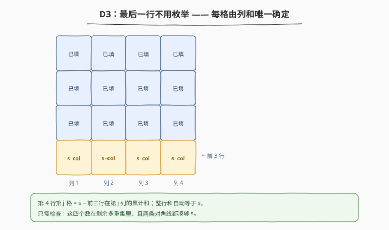
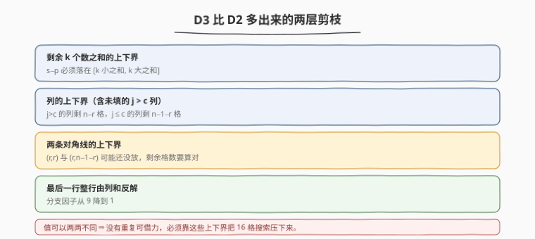
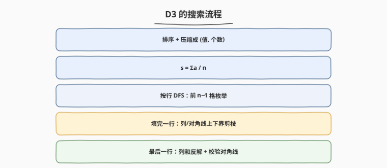

# Codeforces 178D3 魔方阵强剪枝搜索 题解

## 1. 题目概述

- **题目链接**：https://codeforces.com/problemset/problem/178/D3
- **比赛来源**：ABBYY Cup 2.0 - Hard · Problem D3（UTC 2012-04-28）
- **难度**：2100
- **标签**：搜索、回溯、剪枝、构造、特殊评测
- **评测类型**：特殊评测（答案不唯一）
- **限制**：时间 2 s / 内存 256 MB

**题意**：给定 $n^2$ 个整数（可重复、可正可负），原样用完填进 $n\times n$ 方阵，使每行、每列、两条主对角线之和都等于同一个 $s$；输出 $s$ 与方阵（多解输出任一）。题面保证有解。

**约束**（100 分档，也就是本篇 D3 的测试数据）：

- $1\le n\le4$；
- $-10^8\le a_i\le10^8$；
- 数值可以**两两不同**（没有"不同值 ≤ 9"的限制）。

**与 D1 / D2 的约束差异**：D1 只测 $n\le3$，$9!$ 全排列直接枚举；D2 测 $n\le4$ 但保证不同数值 ≤ 9，靠"按行 DFS + 行/列上下界"就够；D3 去掉了"不同值 ≤ 9"，16 个格子可以是 16 个互不相同的数——同样的剪枝强度不够，必须再补两层：**对角线上下界**与**最后一行整行由列和反解**。所以三篇是三套独立实现。

**这档约束排除了什么**：$16!\approx2.1\times10^{13}$ 的全排列、$16^{16}$ 的逐格枚举都被排除；同时"值互不相同"意味着重复带来的天然剪枝消失，必须靠"剩余多重集的 $k$ 小/大和"与"整行反解"把搜索压到可接受范围。

## 2. 示例与观察

官方样例一（输出只是**一种**合法答案）：

```text
输入：
3
1 2 3 4 5 6 7 8 9

输出：
15
2 7 6
9 5 1
4 3 8
```

官方样例二：

```text
输入：
3
1 0 -1 0 2 -1 -2 0 1

输出：
0
1 0 -1
-2 0 2
1 0 -1
```

官方样例三：

```text
输入：
2
5 5 5 5

输出：
10
5 5
5 5
```

**样例解释**：$s=\sum a_i/n$（$45/3=15$、$0/3=0$、$20/2=10$）。合法条件是 $n$ 行 + $n$ 列 + 2 条对角线共 $2n+2$ 条线都等于 $s$；$n=2$ 时可推出四格全相等。

**第一条观察**：$s$ 唯一（$n$ 行之和 = 总和）。

**第二条观察**：按行填时，每行最后一格由 $s$ 唯一反解；更进一步，**最后一行根本不用搜**：前三行填完之后，最后一行的第 $j$ 格必须是 $s-\textit{col}_j$，一行全部反解出来即可，只需检查"这些数还剩不剩"和"两条对角线是否凑够 $s$"。

**第三条观察**：对角线同样是"和恰好为 $s$"的线，也能用剩余多重集的 $k$ 小/大和卡区间。$n=4$ 时对角线各有 4 格，在前两行就能提供有效剪枝。



自造样例（标注"自造"）：

| 输入 | $s$ | 说明 |
|------|-----|------|
| `4` / `1 2 … 16` | 34 | 16 个互不相同，D3 的典型难点 |
| `4` / 16 个 0 | 0 | 全 0 |
| `4` / 16 个 `-100000000` | $-4\times10^8$ | 极值，检查 `long long` |
| `1` / `-5` | $-5$ | $n=1$ 退化 |
| `3` / `4 3 8 9 5 1 2 7 6` | 15 | 合法方阵乱序（含重复值也会走同一条路） |

## 3. 解题思路

### 3.1 朴素做法与瓶颈

- 全排列：$16!$ 不可行。
- 逐格 DFS + 只在最后检查：$n=4$、16 个互不相同的值时分支数最大，$16\times15\times\cdots$ 级别的搜索量远超时限。
- D2 的"行/列上下界"在 16 个互不相同的值时依然会放过大量分支（因为 $[\text{minSum}(k),\text{maxSum}(k)]$ 区间变宽了）。所以要再加两层剪枝。

### 3.2 核心观察：三层剪枝 + 整行反解



**(a) 剩余 $k$ 个数之和的上下界**：把剩余多重集排序（值 + 个数），取最小的 $k$ 个之和 `minSum(k)`、最大的 $k$ 个之和 `maxSum(k)`。任何"还需要凑出的和"若不在区间内就剪掉。

**(b) 列的上下界（注意剩余格数）**：在第 $r$ 行填到第 $c$ 格时，列 $j\le c$ 已经放了本行、还剩 $n-1-r$ 格；列 $j>c$ 还没放本行、还剩 $n-r$ 格。这个细节写错会误剪正确解。

**(c) 对角线的上下界**：主对角线上，$(i,i)$ 对 $i<r$ 已放；$(r,r)$ 是否已放取决于 $c\ge r$。所以主对角线剩余格数 $=(n-1-r)+[c<r]$，副对角线同理用 $[c<n-1-r]$。用它们对 $\textit{diag}_1,\textit{diag}_2$ 做区间剪枝。

**(d) 最后一行整行反解**：$r=n-1$ 时不再枚举，直接令 $g[n-1][j]=s-\textit{col}_j$，逐个检查剩余多重集里还有没有这个值，最后检查两条对角线是否等于 $s$。整行和自动等于 $s$（因为前 $n-1$ 行总和是 $(n-1)s$、总和是 $ns$）。

**(e) 每行最后一格反解**：$c=n-1$ 时 $g[r][n-1]=s-\text{行前缀和}$，同样先查可用性。

组合起来：真正需要枚举的格子只有前 $n-1$ 行的前 $n-1$ 列，即 $(n-1)^2\le9$ 个；每个位置再被三层区间剪枝不断砍掉。

### 3.3 算法流程



1. 读入、排序、压缩成 (值, 个数)，$s=\sum a_i/n$；
2. 从 $(0,0)$ 按行优先 DFS：
   - $r=n-1$：整行由列和反解 → 检查可用性与对角线 → 记录答案；
   - $c=n-1$：反解本行最后一格 → 若可行递归下一行；
   - 否则枚举还有剩余的每个值 → `feasible` 做行/列/对角线上界检查 → 递归；
3. 记录解时把当前方阵拷贝出来（回溯会清空 `g`），最后输出。

### 3.4 样例走查

以 $n=4$、输入 $1..16$（$s=34$）为例：

| 阶段 | 内容 |
|------|------|
| 第 1 行 | 枚举前 3 格（如 1、2、15），反解第 4 格 $34-18=16$；列额 $(33,32,19,18)$ 都能落在 $[\text{minSum}(3),\text{maxSum}(3)]$ |
| 第 2 行 | 继续枚举，主/副对角线各已放 2 格，用剩余 2 格的区间剪枝 |
| 第 3 行 | 同上，剪枝更紧（每列只剩 1 格） |
| 第 4 行 | 整行反解：$g[3][j]=34-\textit{col}_j$，检查 4 个数恰好是剩下的 4 个值，且两条对角线都是 34 |
| 输出 | `34` 与方阵（实测给出 `1 2 15 16 / 12 14 3 5 / 13 7 10 4 / 8 11 6 9`，合法） |

## 4. 正确性证明

**引理 1（$s$ 唯一）**：合法方阵的 $s=\sum a_i/n$。∎（$n$ 行之和 = 总和）

**引理 2（整行反解完备）**：若前 $n-1$ 行已填，则最后一行能凑成合法方阵当且仅当对每个 $j$ 有 $g[n-1][j]=s-\textit{col}_j$ 且这些值在剩余多重集中够用。

**证明**：列 $j$ 的和为 $\textit{col}_j+g[n-1][j]$，要求等于 $s$，故最后一格唯一确定；同时整行和 $=\sum_j(s-\textit{col}_j)=ns-\sum_j\textit{col}_j=ns-(n-1)s=s$ 自动成立。∎

**引理 3（区间剪枝安全）**：若某条线还需要 $k$ 个数、所需和为 $t$，且 $t\notin[\text{minSum}(k),\text{maxSum}(k)]$，则该部分赋值无法扩展成合法方阵。

**证明**：剩余 $k$ 个格子只能从剩余多重集取，任取 $k$ 个之和都在最小 $k$ 个与最大 $k$ 个之和之间。∎

**引理 4（对角线剩余格数）**：放完 $(r,c)$ 后，主对角线还剩 $(n-1-r)+[c<r]$ 格，副对角线还剩 $(n-1-r)+[c<n-1-r]$ 格。

**证明**：主对角线格 $(i,i)$ 对 $i<r$ 已放、对 $i>r$ 未放；$(r,r)$ 在 $c\ge r$ 时已放、否则未放。合计即得。副对角线同理。∎

**定理（算法正确）**：若存在合法方阵，算法输出一个合法方阵。

**证明**：任何合法方阵在"前 $n-1$ 行前 $n-1$ 列"的取值都对应搜索树上的一条路径（引理 2 保证最后一格与最后一行由其余格子唯一决定），而引理 3、4 只剪掉不可能含解的分支，所以该路径不会被剪掉；到达 $r=n-1$ 时按引理 2 反解并检查对角线，必然通过。∎

## 5. 复杂度分析

- **时间**：最坏指数级，但实际枚举的格子只有 $(n-1)^2\le9$ 个，且每步三层区间剪枝；$n=4$、$1..16$ 实测约 3.5 ms，$10^8$ 级极值同样在毫秒级。
- **空间**：$O(n^2)$ 方阵、$O(d)$ 计数（$d\le16$），递归深度 $n\le4$。
- **数值范围**：$|a_i|\le10^8$、$n\le4$，和最大 $1.6\times10^9$，必须 `long long`；`minSum/maxSum` 里 `t*val[i]` 也是 64 位。
- **与时限的关系**：2 s 对这套剪枝非常宽裕；真正危险的是"忘了对角线剪枝"或"最后一行还在枚举"，那会慢几十倍。

## 6. 参考代码

### C++17

```cpp
#include <bits/stdc++.h>
using namespace std;

int n, d;
long long s;
vector<long long> val;   // 不同的值（升序）
vector<int> cnt;         // 每个值的剩余个数
long long col[6];
long long g[6][6];
long long diag1 = 0, diag2 = 0;
bool done = false;
long long ansG[6][6];

const long long NEG = LLONG_MIN / 4, POS = LLONG_MAX / 4;

// 当前剩余多重集中取 k 个的最小 / 最大和（不够 k 个时返回哨兵）
long long minSum(int k) {
    long long r = 0;
    int need = k;
    for (int i = 0; i < d && need > 0; ++i) {
        int t = min(need, cnt[i]);
        r += (long long)t * val[i];
        need -= t;
    }
    return need > 0 ? POS : r;
}
long long maxSum(int k) {
    long long r = 0;
    int need = k;
    for (int i = d - 1; i >= 0 && need > 0; --i) {
        int t = min(need, cnt[i]);
        r += (long long)t * val[i];
        need -= t;
    }
    return need > 0 ? NEG : r;
}

// 放完 (r,c) 之后做上下界剪枝
bool feasible(int r, int c, long long rowPartial) {
    int rowLeft = n - 1 - c;              // 本行还差几格
    if (rowLeft > 0) {
        long long need = s - rowPartial;
        if (need < minSum(rowLeft) || need > maxSum(rowLeft)) return false;
    }
    // 每列：j <= c 已放本行，剩 n-1-r 格；j > c 还没放本行，剩 n-r 格
    for (int j = 0; j < n; ++j) {
        int colLeft = (j > c) ? (n - r) : (n - 1 - r);
        if (colLeft > 0) {
            long long need = s - col[j];
            if (need < minSum(colLeft) || need > maxSum(colLeft)) return false;
        }
    }
    // 两条对角线：注意 (r,r) 与 (r,n-1-r) 可能还没放
    int d1left = (n - 1 - r) + (c < r ? 1 : 0);
    int d2left = (n - 1 - r) + (c < n - 1 - r ? 1 : 0);
    if (d1left > 0) {
        long long need = s - diag1;
        if (need < minSum(d1left) || need > maxSum(d1left)) return false;
    }
    if (d2left > 0) {
        long long need = s - diag2;
        if (need < minSum(d2left) || need > maxSum(d2left)) return false;
    }
    return true;
}

void place(int r, int c, long long v) {
    g[r][c] = v;
    col[c] += v;
    if (c == r) diag1 += v;
    if (c == n - 1 - r) diag2 += v;
    --cnt[lower_bound(val.begin(), val.end(), v) - val.begin()];
}
void unplace(int r, int c, long long v) {
    g[r][c] = 0;
    col[c] -= v;
    if (c == r) diag1 -= v;
    if (c == n - 1 - r) diag2 -= v;
    ++cnt[lower_bound(val.begin(), val.end(), v) - val.begin()];
}

void dfs(int r, int c, long long rowPartial) {
    if (done) return;
    if (r == n - 1) {
        // 最后一行：每格由对应列的和唯一确定
        long long saved[6];
        int placed = 0;
        bool ok = true;
        for (int j = 0; j < n; ++j) {
            long long need = s - col[j];
            auto it = lower_bound(val.begin(), val.end(), need);
            if (it == val.end() || *it != need || cnt[it - val.begin()] == 0) { ok = false; break; }
            saved[j] = need;
            place(n - 1, j, need);
            ++placed;
        }
        // 最后一行整行的和自动为 s；再检查对角线
        if (ok && diag1 == s && diag2 == s) {
            done = true;
            for (int x = 0; x < n; ++x) for (int y = 0; y < n; ++y) ansG[x][y] = g[x][y];
        }
        for (int j = placed - 1; j >= 0; --j) unplace(n - 1, j, saved[j]);
        return;
    }
    if (c == n - 1) {
        long long need = s - rowPartial;
        auto it = lower_bound(val.begin(), val.end(), need);
        if (it == val.end() || *it != need || cnt[it - val.begin()] == 0) return;
        place(r, c, need);
        if (feasible(r, c, rowPartial + need)) dfs(r + 1, 0, 0);
        unplace(r, c, need);
        return;
    }
    for (int i = 0; i < d; ++i) {
        if (cnt[i] == 0) continue;
        place(r, c, val[i]);
        if (feasible(r, c, rowPartial + val[i])) dfs(r, c + 1, rowPartial + val[i]);
        unplace(r, c, val[i]);
        if (done) return;
    }
}

int main() {
    if (scanf("%d", &n) != 1) return 0;
    vector<long long> a(n * n);
    long long total = 0;
    for (auto &x : a) { scanf("%lld", &x); total += x; }
    s = total / n;
    sort(a.begin(), a.end());
    for (long long x : a) {
        if (val.empty() || val.back() != x) { val.push_back(x); cnt.push_back(1); }
        else ++cnt.back();
    }
    d = (int)val.size();
    dfs(0, 0, 0);
    printf("%lld\n", s);
    for (int i = 0; i < n; ++i) {
        for (int j = 0; j < n; ++j) printf("%lld%c", ansG[i][j], j + 1 == n ? '\n' : ' ');
    }
    return 0;
}
```

### Python3

```python
import sys


def main() -> None:
    data = sys.stdin.buffer.read().split()
    if not data:
        return
    it = iter(data)
    n = int(next(it))
    a = sorted(int(next(it)) for _ in range(n * n))
    s = sum(a) // n

    val, cnt = [], []
    for x in a:
        if val and val[-1] == x:
            cnt[-1] += 1
        else:
            val.append(x)
            cnt.append(1)
    d = len(val)
    where = {v: i for i, v in enumerate(val)}
    POS, NEG = 4 * 10 ** 18, -4 * 10 ** 18

    def min_sum(k):
        r = 0
        for i in range(d):
            if k == 0:
                break
            t = min(k, cnt[i])
            r += t * val[i]
            k -= t
        return POS if k > 0 else r

    def max_sum(k):
        r = 0
        for i in range(d - 1, -1, -1):
            if k == 0:
                break
            t = min(k, cnt[i])
            r += t * val[i]
            k -= t
        return NEG if k > 0 else r

    col = [0] * n
    g = [[0] * n for _ in range(n)]
    diag = [0, 0]
    ans = [None]

    def place(r, c, v):
        g[r][c] = v
        col[c] += v
        if c == r:
            diag[0] += v
        if c == n - 1 - r:
            diag[1] += v
        cnt[where[v]] -= 1

    def unplace(r, c, v):
        g[r][c] = 0
        col[c] -= v
        if c == r:
            diag[0] -= v
        if c == n - 1 - r:
            diag[1] -= v
        cnt[where[v]] += 1

    def feasible(r, c, row_partial):
        row_left = n - 1 - c
        if row_left > 0:
            need = s - row_partial
            if need < min_sum(row_left) or need > max_sum(row_left):
                return False
        for j in range(n):
            left = (n - r) if j > c else (n - 1 - r)
            if left > 0:
                need = s - col[j]
                if need < min_sum(left) or need > max_sum(left):
                    return False
        d1_left = (n - 1 - r) + (1 if c < r else 0)
        d2_left = (n - 1 - r) + (1 if c < n - 1 - r else 0)
        if d1_left > 0:
            need = s - diag[0]
            if need < min_sum(d1_left) or need > max_sum(d1_left):
                return False
        if d2_left > 0:
            need = s - diag[1]
            if need < min_sum(d2_left) or need > max_sum(d2_left):
                return False
        return True

    def dfs(r, c, row_partial):
        if ans[0] is not None:
            return
        if r == n - 1:
            # 最后一行整行由列和决定
            saved = []
            ok = True
            for j in range(n):
                need = s - col[j]
                i = where.get(need)
                if i is None or cnt[i] == 0:
                    ok = False
                    break
                saved.append(need)
                place(n - 1, j, need)
            if ok and diag[0] == s and diag[1] == s:
                ans[0] = [row[:] for row in g]
            for j in range(len(saved) - 1, -1, -1):
                unplace(n - 1, j, saved[j])
            return
        if c == n - 1:
            need = s - row_partial
            i = where.get(need)
            if i is None or cnt[i] == 0:
                return
            place(r, c, need)
            if feasible(r, c, row_partial + need):
                dfs(r + 1, 0, 0)
            unplace(r, c, need)
            return
        for i in range(d):
            if cnt[i] == 0:
                continue
            v = val[i]
            place(r, c, v)
            if feasible(r, c, row_partial + v):
                dfs(r, c + 1, row_partial + v)
            unplace(r, c, v)
            if ans[0] is not None:
                return

    dfs(0, 0, 0)
    out = [str(s)]
    for row in ans[0]:
        out.append(" ".join(map(str, row)))
    sys.stdout.write("\n".join(out) + "\n")


main()
```

## 7. 边界情况与易错点

1. **回溯时状态没还原**：最后一行反解时若中途失败（某个 $s-\textit{col}_j$ 不可用）就 `return`，**已经放上去的格子必须撤掉**。本机就曾因此让状态污染、搜不到任何解——正确做法是记录 `placed` 个数并逆序 `unplace`。
2. **对角线剩余格数算错**：$(r,r)$ 在 $c<r$ 时还没放、$(r,n-1-r)$ 在 $c<n-1-r$ 时还没放，剩余格数要加 1；算错就会误剪。
3. **列剩余格数算错**：$j>c$ 的列剩 $n-r$ 格、$j\le c$ 的剩 $n-1-r$ 格（本机也踩过这个坑）。
4. **$n=1$**：$r=0=n-1$ 直接走"最后一行反解"，$g[0][0]=s$，检查对角线后输出。
5. **$n=2$**：前一行枚举 + 最后一行反解；四格必须相等，不满足则搜完无解。
6. **负值与极值**：`s`、`minSum`、`maxSum` 都可能到 $\pm1.6\times10^9$，必须 64 位；不要用 `int` 存 `t*val[i]`。
7. **多解**：找到第一个就输出，用 checker 验证合法性，不要与样例逐字比对。
8. **Python 性能**：剪枝搜索在 $n=4$、互不相同的数据上仍可能到几百毫秒，提交建议 PyPy3 或 C++。

## 8. 验证记录

- **编译环境与命令**：`clang++ -std=c++17 -O2` + 兼容头；Python 3.9.6。文档级校验：`python3 codeforces/tools/verify_solution.py codeforces/contests/0101-0203/178/D3_魔方阵强剪枝搜索.md --checker codeforces/tools/checkers/cf178d3.py`。
- **官方样例**：3 / 3 通过（特殊评测，checker 校验多重集与全部线；样例二输出与样例不同但合法）。
- **配套 checker**：`codeforces/tools/checkers/cf178d3.py`，校验条件为「输出恰有 $1+n^2$ 个整数」「多重集与输入一致」「每行/每列/两条对角线之和都等于 $s$」「$s=\sum a_i/n$」；不比对期望输出。
- **自造样例**：第 2 节表格 5 组（$1..16$、全 0、全部 $-10^8$、$n=1$、乱序合法方阵）全部通过 checker。
- **随机对拍**：按"生成合法魔方阵 → 打乱"造 **200 组**，覆盖 $n=1..4$；$n=4$ 的数据用 Dürer 方阵的仿射变换（16 个互不相同）与 0/1 模式叠加（2–8 种值）两类，C++/Python 输出全部通过 checker。
- **最大约束性能**：$n=4$、$1..16$（互不相同）C++ 约 3.5 ms；Python 约 150 ms。全 0、全极值等退化数据都在 2 ms 内。
- **图片校验**：三张 SVG（`cf178d3_lastrow.svg`、`cf178d3_prune.svg`、`cf178d3_flow.svg`）通过 `xml.etree.ElementTree.parse`，文本未越界、无重叠。
- **复核状态**：verified（样例、自造样例、200 组随机、性能、图片均实跑通过）。

## 相关题目与扩展

- [Codeforces 178D2 Magic Squares](https://codeforces.com/problemset/problem/178/D2)：$n\le4$ 但不同值 ≤ 9 的版本，剪枝少两层。
- [Codeforces 178D1 Magic Squares](https://codeforces.com/problemset/problem/178/D1)：$n\le3$ 的全排列版本。
- [Codeforces 178C2 Smart Beaver and Resolving Collisions](https://codeforces.com/problemset/problem/178/C2)：同场题，可对照"数据档决定算法"。
- [LeetCode 37 解数独](https://leetcode.cn/problems/sudoku-solver/)：同样是"逐格 + 多条线的和约束 + 剩余集合上下界"的回溯。
- [Codeforces 1105D Kilo](https://codeforces.com/problemset/problem/1105/D)：多源 BFS 的剪枝思想，与本题的"按线剪枝"形成对照。

**延伸思考**：

1. **为什么最后一行反解这么强**：它把 $n$ 个格子的分支因子从"每个 ≤ 剩余值个数"直接变成 1，等于让搜索树少一整层；这也是 $n=4$ 能跑进毫秒级的关键。
2. **剪枝顺序**：先做"行内余额"（最紧，因为只剩 $n-1-c$ 格），再做列、最后对角线；判定顺序影响常数，虽然不影响正确性。
3. **如果要求所有解**：整行反解仍然有效，但"找到就返回"要改成记录，解的总数在 $n=4$ 时是数千到数万，输出本身就成了瓶颈。
4. **如果 $n=5$**：格子 25 个、$s$ 的量级更大，这套剪枝（尤其最后一行反解）仍然成立，但搜索量会显著上升；竞赛里 $n=5$ 的魔方阵一般要靠更强的数学构造。

