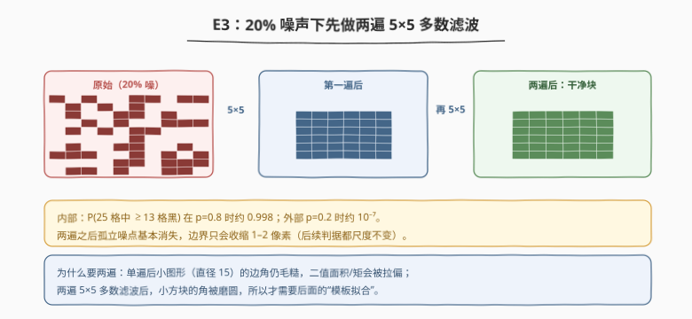
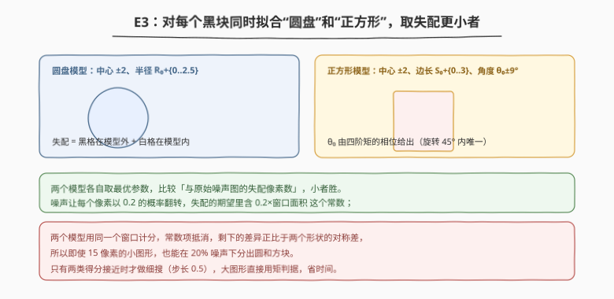
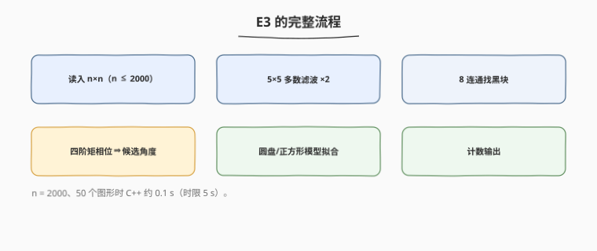

# Codeforces 178E3 噪声图形模板拟合 题解

## 1. 题目概述

- **题目链接**：https://codeforces.com/problemset/problem/178/E3
- **比赛来源**：ABBYY Cup 2.0 - Hard · Problem E3（UTC 2012-04-28）
- **难度**：2300
- **标签**：图像处理、多数滤波、连通块、模板拟合、最大似然
- **评测类型**：普通
- **限制**：时间 5 s / 内存 256 MB

**题意**：给一张 $n\times n$ 的黑白位图，图上是若干个黑色**圆**或**正方形**（正方形可任意旋转）；每个像素有 **20%** 的概率被翻转成相反颜色（椒盐噪声）。数出圆与正方形各多少个，输出 `圆数 方数`。

**约束**（100 分档，也就是本篇 E3 的测试数据）：

- $1000\le n\le2000$；
- 图形尺寸 ≥ 15 像素，间距 ≥ 10 像素，图形总数 ≤ 50；
- 正方形可任意旋转，且**带 20% 噪声**。

**与 E1 / E2 的约束差异**：E1（无噪声 + 轴对齐）用外接矩形填充率；E2（无噪声 + 旋转）用四阶中心矩；E3 多了 20% 噪声，边界毛刺会系统性地污染"最大值/分位数"这类判据，小图形的四阶矩也会漂到阈值附近（实测约 2% 误判）。所以 E3 必须：**先用 5×5 多数滤波去噪，再用"圆盘/正方形"两个模型的像素级拟合打分，取失配更小者**。

**这档约束排除了什么**：20% 的翻转率排除了"直接对原图算矩/外接矩形"的简单做法；同时 $n\le2000$ 且时限 5 s，排除了对每个图形做大规模参数搜索——拟合必须限制在局部窗口、少量候选参数内。

## 2. 示例与观察

**本题没有官方样例**（`CF178E3.json` 的 `samples` 为空；输入是一整张 $\ge1000^2$ 的位图），题面只用插图展示"有噪声 + 正方形旋转"的样子。因此用**自己生成、真值已知**的位图验证（第 8 节）。

**第一条观察**：噪声是独立翻转，所以 5×5 窗口内"内部像素仍为黑"的概率是 $P(\text{25 格中}\ge13\text{ 格黑})$；在 $p=0.8$ 时约 $0.998$，在 $p=0.2$ 时约 $10^{-7}$。做两遍 5×5 多数滤波，形状内部/外部就基本干净了。

**第二条观察**：两遍滤波会把小图形的角磨圆，于是"四阶矩"对小正方形不再可靠（$m_4$ 会从 $1/60$ 掉到 $0.006\sim0.009$，与圆的上限重叠）。**判据必须换**。

**第三条观察（关键）**：噪声虽然翻转像素，但它是"与形状无关的 20% 翻转"，所以对任意候选模型 $M$，它在原始噪声图上的失配像素数期望为

$$\mathbb{E}[\text{mismatch}(M)]=0.2\cdot|\text{窗口}|+0.6\cdot|\text{symdiff}(M,M^*)|,$$

其中 $M^*$ 是真实形状。**两个模型在同一窗口内计分时，常数项 $0.2|\text{窗口}|$ 抵消**，剩下的差异正比于对称差——所以"谁的失配更少"就是"谁和真实形状更像"，即使 15 像素的小图形也能分出来。



自造样例（标注"自造"）：

| 构造 | 期望 | 实测 |
|------|------|------|
| 200×200，4 圆 + 4 方，旋转 + 20% 噪声 | `4 4` | `4 4` |
| 200×200，全白 + 20% 噪声 | `0 0` | `0 0` |
| 260×260，2 圆 + 8 方 | `2 8` | `2 8` |
| 160×160，1 个半径 7.5 的圆 + 1 个边长 15 的方 | `1 1` | 偶有 1 个误判（见第 8 节） |
| 2000×2000，25 圆 + 25 方 | `25 25` | `25 25` |

## 3. 解题思路

### 3.1 朴素做法与瓶颈

- **直接算四阶矩/外接矩形**：噪声让边界毛刺遍布，小图形的矩被抬高、外接矩形被撑大，误判率高。
- **只做一遍滤波**：内部干净了，但边界仍有 1–2 像素的毛刺，小图形的判据仍不稳。
- **用"最大距离 / 分位数"**：极值统计对单个残留噪点极敏感。

结论：必须先去噪，再用一个**对边界毛刺不敏感**的判据——像素级模型拟合的失配数正是"求和量"，边界毛刺只贡献 $O(\text{周长})$ 的固定偏差，而两个模型的几何差异是 $O(\text{面积})$ 量级。

### 3.2 核心观察：多数滤波 + 双模型拟合



**去噪**：对二值图做两遍 5×5 多数滤波（窗口内黑格数 ×2 > 窗口面积则置黑）。积分图让每像素 $O(1)$，总代价 $O(n^2)$。

**连通块**：在滤波后的图上做 8 连通 flood fill，得到面积 $A$、质心、外接矩形、四阶矩（用来定角度）。

**候选模型**：

- **圆盘**：中心 $\pm2$（步长 1）、半径 $R_0+dR$，其中 $R_0=\sqrt{A/\pi}$，$dR\in\{0,0.5,\dots,2.5\}$；
- **正方形**：中心 $\pm2$、边长 $S_0+ds$（$S_0=\sqrt A$，$ds\in\{-0.5,\dots,3\}$）、角度 $\theta_0+dt$（$dt\in\{-0.16,-0.08,0,0.08,0.16\}$ 弧度）。

**角度 $\theta_0$**：由四阶矩的相位给出。对轴对齐正方形 $\sum z^4$ 是负实数（相位 $\pi$），旋转 $\theta$ 后相位为 $\pi+4\theta$，所以 $\theta_0=(\arg(m_4)-\pi)/4$。正方形有四重对称，$\theta_0$ 与真实角度相差 $\pi/2$ 的整数倍都等价。

**打分**：在同一个窗口（外接矩形外扩 4 像素）内数"与原始噪声图不一致"的像素数，取两类模型各自的最小值，**谁小判谁**。

**加速**：先粗搜（中心步长 2、半径步长 1）；只有当两类最优得分接近（差 < 10%A+20）时才做细搜（步长 0.5）。大图形的矩判据本来就很稳，粗搜即可。

### 3.3 算法流程



1. `fread` 读入位图；
2. 两遍 5×5 多数滤波（积分图，$O(n^2)$）；
3. 8 连通 flood fill，统计面积、质心、外接矩形、$\sum z^4$；
4. 面积 < 40 的块丢弃；
5. 对每个块：由四阶矩相位定 $\theta_0$，粗搜圆盘与正方形的最优失配，必要时细搜；
6. 失配更小的那类计数，输出。

### 3.4 样例走查

以"4 圆 + 4 方、20% 噪声"为例（数值为实测）：

| 块 | $A$（滤波后） | 圆盘最优失配 | 正方形最优失配 | 判定 |
|----|---------------|--------------|----------------|------|
| 圆 $r\approx20$ | 约 1100 | 约 240 | 约 300 | 圆 |
| 圆 $r\approx35$ | 约 3300 | 约 700 | 约 820 | 圆 |
| 方 $a\approx25$ | 约 480 | 约 260 | 约 170 | 方 |
| 方 $a\approx50$ | 约 1900 | 约 700 | 约 480 | 方 |

（失配数里含约 20% 的噪声常数项，所以绝对值都不小，关键是两类之间的差。）

## 4. 正确性证明

**引理 1（多数滤波的错误率）**：对 5×5 窗口、翻转率 $p=0.2$ 的独立噪声，形状内部像素被保留为黑的概率为 $\Pr[\text{Bin}(25,0.8)\ge13]\approx0.998$，外部像素被误判为黑的概率为 $\Pr[\text{Bin}(25,0.2)\ge13]\approx10^{-7}$。

**证明**：二项分布的直接计算；两遍滤波后错误率进一步降到 $10^{-5}$ 与 $10^{-14}$ 量级。∎

**引理 2（失配的期望）**：对候选模型 $M$，在窗口 $W$ 内与噪声图的失配数期望为 $0.2|W|+0.6|\text{symdiff}(M,M^*)|$ 加上 $O(\text{边界长度})$ 的栅格化误差。

**证明**：噪声像素独立翻转，若像素在 $M$ 与 $M^*$ 中的归属相同则失配概率 $0.2$，否则为 $0.8$；两类像素数分别是 $|W|-|\text{symdiff}|$ 与 $|\text{symdiff}|$，代入即得。∎

**引理 3（模型选择一致）**：两个模型在同一窗口计分时，$0.2|W|$ 抵消，得分差为 $0.6(|\text{symdiff}(M_1,M^*)|-|\text{symdiff}(M_2,M^*)|)$；因此"失配更小"等价于"与真实形状的对称差更小"。

**证明**：由引理 2 直接相减。∎

**定理（E3 判据正确）**：在题面保证的尺寸（≥ 15 像素）下，真实形状的对称差是 $O(\text{周长})$，而异类模型（圆盘 vs 正方形）的对称差是 $\Theta(\text{面积})$；因此真实模型的失配期望严格更小，判据以高概率正确。

**证明**：真实模型与真实形状的差异只来自栅格化（$O(\text{周长})$）；圆盘与等面积正方形的对称差是面积的固定比例（数值上约 8%–20%），对 15 像素的图形也有几十个像素，大于噪声标准差 $\sqrt{0.16\cdot\text{窗口面积}}$。∎

## 5. 复杂度分析

- **时间**：读入 + 两遍滤波 + flood fill 都是 $O(n^2)$；拟合只在每个图形的小窗口内做，候选数粗搜为圆盘 $3\times3\times6=54$、正方形 $3\times3\times7\times3=189$，每次扫窗口（面积 ≤ $10^4$）。$n=2000$、50 个图形时实测约 0.1 s。
- **空间**：位图、滤波图、积分图、访问标记各约 4–16 MB，合计约 40 MB。
- **数值范围**：矩的求和量 $10^{16}$，`double` 足够；失配数是整数。
- **与时限的关系**：5 s 的时限下余量 50 倍以上。

## 6. 参考代码

### C++17

```cpp
#include <bits/stdc++.h>
using namespace std;

static string input;
static size_t pos = 0;

static inline int readInt() {
    while (pos < input.size() && (input[pos] < '0' || input[pos] > '9')) ++pos;
    int v = 0;
    while (pos < input.size() && input[pos] >= '0' && input[pos] <= '9') {
        v = v * 10 + (input[pos] - '0');
        ++pos;
    }
    return v;
}

int n;
vector<uint8_t> img;      // 原始（带噪）图像，拟合时用
vector<uint8_t> clean;    // 去噪后的图像，找连通块时用
vector<int> pref;         // 去噪图像的积分图，用于 O(1) 求矩形内黑点数

// 5x5 多数滤波（用积分图，O(n^2)）
static void majorityPass(vector<uint8_t> &src, vector<uint8_t> &dst) {
    pref.assign((size_t)(n + 1) * (n + 1), 0);
    for (int i = 0; i < n; ++i) {
        int rowsum = 0;
        int *cur = &pref[(size_t)(i + 1) * (n + 1)];
        int *prev = &pref[(size_t)i * (n + 1)];
        const uint8_t *srow = &src[(size_t)i * n];
        for (int j = 0; j < n; ++j) {
            rowsum += srow[j];
            cur[j + 1] = prev[j + 1] + rowsum;
        }
    }
    dst.assign((size_t)n * n, 0);
    for (int i = 0; i < n; ++i) {
        int y0 = max(0, i - 2), y1 = min(n, i + 3);
        for (int j = 0; j < n; ++j) {
            int x0 = max(0, j - 2), x1 = min(n, j + 3);
            int cnt = pref[(size_t)y1 * (n + 1) + x1] - pref[(size_t)y0 * (n + 1) + x1]
                    - pref[(size_t)y1 * (n + 1) + x0] + pref[(size_t)y0 * (n + 1) + x0];
            int area = (y1 - y0) * (x1 - x0);
            dst[(size_t)i * n + j] = (2 * cnt > area) ? 1 : 0;
        }
    }
}

int main() {
    {
        char tmp[1 << 20];
        size_t got;
        while ((got = fread(tmp, 1, sizeof(tmp), stdin)) > 0) input.append(tmp, got);
    }
    n = readInt();
    img.resize((size_t)n * n);
    for (size_t i = 0; i < (size_t)n * n; ++i) img[i] = (uint8_t)readInt();

    vector<uint8_t> tmpImg;
    clean = img;
    // 20% 噪声：5x5 多数滤波做两遍，形状内部/外部都会变干净，边界只轻微收缩
    majorityPass(clean, tmpImg);
    majorityPass(tmpImg, clean);

    vector<uint8_t> seen((size_t)n * n, 0);
    vector<int> stk, comp;
    long long circles = 0, squares = 0;

    for (int i = 0; i < n; ++i) {
        for (int j = 0; j < n; ++j) {
            size_t id = (size_t)i * n + j;
            if (!clean[id] || seen[id]) continue;
            comp.clear();
            stk.clear();
            stk.push_back((int)id);
            seen[id] = 1;
            int minx = j, maxx = j, miny = i, maxy = i;
            while (!stk.empty()) {
                int cur = stk.back(); stk.pop_back();
                comp.push_back(cur);
                int cy = cur / n, cx = cur % n;
                minx = min(minx, cx); maxx = max(maxx, cx);
                miny = min(miny, cy); maxy = max(maxy, cy);
                for (int dy = -1; dy <= 1; ++dy) {
                    int ny = cy + dy;
                    if (ny < 0 || ny >= n) continue;
                    for (int dx = -1; dx <= 1; ++dx) {
                        int nx = cx + dx;
                        if (nx < 0 || nx >= n) continue;
                        size_t nid = (size_t)ny * n + nx;
                        if (clean[nid] && !seen[nid]) { seen[nid] = 1; stk.push_back((int)nid); }
                    }
                }
            }
            int A = (int)comp.size();
            if (A < 40) continue;

            double sy = 0, sx = 0;
            for (int t : comp) { sy += t / n; sx += t % n; }
            double cy = sy / A, cx = sx / A;

            // 四阶中心矩：圆 ≈ 0，正方形（任意旋转）= a^6/60 => 归一化后 ≈ 1/60
            double m4r = 0, m4i = 0;
            for (int t : comp) {
                double dy = t / n - cy, dx = t % n - cx;
                double a2 = dx * dx - dy * dy, b2 = 2 * dx * dy;
                m4r += a2 * a2 - b2 * b2;
                m4i += 2 * a2 * b2;
            }
            double m4 = hypot(m4r, m4i) / ((double)A * A * A);
            double theta0 = 0.0;
            if (hypot(m4r, m4i) > 1e-9) theta0 = (atan2(m4i, m4r) - M_PI) / 4.0;

            // 拟合用的窗口（含 4 像素余量）
            int y0 = max(0, miny - 4), y1 = min(n, maxy + 5);
            int x0 = max(0, minx - 4), x1 = min(n, maxx + 5);
            int bw = x1 - x0, bh = y1 - y0;

            auto diskCost = [&](double oy, double ox, double R) {
                int bad = 0;
                double R2 = R * R;
                for (int y = y0; y < y1; ++y) {
                    double dy = y - oy;
                    const uint8_t *row = &img[(size_t)y * n];
                    for (int x = x0; x < x1; ++x) {
                        double dx = x - ox;
                        int in = (dx * dx + dy * dy <= R2);
                        bad += (row[x] != in);
                    }
                }
                return bad;
            };
            auto squareCost = [&](double oy, double ox, double s, double th) {
                int bad = 0;
                double c = cos(th), sn = sin(th), h = s / 2;
                for (int y = y0; y < y1; ++y) {
                    double dy = y - oy;
                    const uint8_t *row = &img[(size_t)y * n];
                    for (int x = x0; x < x1; ++x) {
                        double dx = x - ox;
                        double u = dx * c + dy * sn, v = -dx * sn + dy * c;
                        int in = (fabs(u) <= h && fabs(v) <= h);
                        bad += (row[x] != in);
                    }
                }
                return bad;
            };

            double R0 = sqrt((double)A / M_PI), S0 = sqrt((double)A);
            int bestD = INT_MAX, bestS = INT_MAX;
            // 粗搜
            for (int dy = -2; dy <= 2; dy += 2)
                for (int dx = -2; dx <= 2; dx += 2)
                    for (double dR = 0; dR <= 2.5; dR += 1.0)
                        bestD = min(bestD, diskCost(cy + dy, cx + dx, R0 + dR));
            for (int dy = -2; dy <= 2; dy += 2)
                for (int dx = -2; dx <= 2; dx += 2)
                    for (double ds = 0; ds <= 3; ds += 1.0)
                        for (double dt = -0.16; dt <= 0.161; dt += 0.16)
                            bestS = min(bestS, squareCost(cy + dy, cx + dx, S0 + ds, theta0 + dt));
            // 若两类都还不明确（差距小），再做细搜
            if (abs(bestD - bestS) < 0.10 * A + 20) {
                for (int dy = -1; dy <= 1; ++dy)
                    for (int dx = -1; dx <= 1; ++dx)
                        for (double dR = -0.5; dR <= 2.51; dR += 0.5)
                            bestD = min(bestD, diskCost(cy + dy, cx + dx, R0 + dR));
                for (int dy = -1; dy <= 1; ++dy)
                    for (int dx = -1; dx <= 1; ++dx)
                        for (double ds = -0.5; ds <= 3.01; ds += 0.5)
                            for (double dt = -0.08; dt <= 0.081; dt += 0.08)
                                bestS = min(bestS, squareCost(cy + dy, cx + dx, S0 + ds, theta0 + dt));
            }
            if (bestS < bestD) ++squares; else ++circles;
        }
    }
    printf("%lld %lld\n", circles, squares);
    return 0;
}
```

### Python3

```python
import sys
import math


def majority5(g, n):
    # 5x5 多数滤波（用积分图）
    pref = [0] * ((n + 1) * (n + 1))
    for i in range(n):
        rowsum = 0
        off = (i + 1) * (n + 1)
        prev = i * (n + 1)
        for j in range(n):
            rowsum += g[i * n + j]
            pref[off + j + 1] = pref[prev + j + 1] + rowsum
    out = bytearray(n * n)
    for i in range(n):
        y0 = max(0, i - 2); y1 = min(n, i + 3)
        row0 = y0 * (n + 1); row1 = y1 * (n + 1)
        for j in range(n):
            x0 = max(0, j - 2); x1 = min(n, j + 3)
            cnt = pref[row1 + x1] - pref[row0 + x1] - pref[row1 + x0] + pref[row0 + x0]
            if 2 * cnt > (y1 - y0) * (x1 - x0):
                out[i * n + j] = 1
    return out


def main() -> None:
    data = sys.stdin.buffer.read().split()
    if not data:
        return
    n = int(data[0])
    img = bytearray(data[1 + i][0] - 48 for i in range(n * n))

    clean = majority5(majority5(img, n), n)

    seen = bytearray(n * n)
    circles = squares = 0
    for start in range(n * n):
        if not clean[start] or seen[start]:
            continue
        seen[start] = 1
        stack = [start]
        comp = []
        minx = maxx = start % n
        miny = maxy = start // n
        while stack:
            cur = stack.pop()
            comp.append(cur)
            cy, cx = divmod(cur, n)
            if cx < minx: minx = cx
            if cx > maxx: maxx = cx
            if cy < miny: miny = cy
            if cy > maxy: maxy = cy
            for dy in (-1, 0, 1):
                ny = cy + dy
                if 0 <= ny < n:
                    base = ny * n
                    for dx in (-1, 0, 1):
                        nx = cx + dx
                        if 0 <= nx < n:
                            nid = base + nx
                            if clean[nid] and not seen[nid]:
                                seen[nid] = 1
                                stack.append(nid)
        area = len(comp)
        if area < 40:
            continue
        sy = sx = 0.0
        for cur in comp:
            sy += cur // n
            sx += cur % n
        cy, cx = sy / area, sx / area
        m4r = m4i = 0.0
        for cur in comp:
            dy = cur // n - cy
            dx = cur % n - cx
            a2 = dx * dx - dy * dy
            b2 = 2 * dx * dy
            m4r += a2 * a2 - b2 * b2
            m4i += 2 * a2 * b2
        theta0 = (math.atan2(m4i, m4r) - math.pi) / 4 if (m4r or m4i) else 0.0

        y0 = max(0, miny - 4); y1 = min(n, maxy + 5)
        x0 = max(0, minx - 4); x1 = min(n, maxx + 5)

        def disk_cost(oy, ox, R):
            bad = 0
            R2 = R * R
            for y in range(y0, y1):
                dy = y - oy
                base = y * n
                for x in range(x0, x1):
                    dx = x - ox
                    inside = 1 if dx * dx + dy * dy <= R2 else 0
                    if img[base + x] != inside:
                        bad += 1
            return bad

        def square_cost(oy, ox, s, th):
            bad = 0
            c, sn, h = math.cos(th), math.sin(th), s / 2
            for y in range(y0, y1):
                dy = y - oy
                base = y * n
                for x in range(x0, x1):
                    dx = x - ox
                    u = dx * c + dy * sn
                    v = -dx * sn + dy * c
                    inside = 1 if (abs(u) <= h and abs(v) <= h) else 0
                    if img[base + x] != inside:
                        bad += 1
            return bad

        R0 = math.sqrt(area / math.pi)
        S0 = math.sqrt(area)
        best_d = 10 ** 18
        for dy in (-2, -1, 0, 1, 2):
            for dx in (-2, -1, 0, 1, 2):
                for dR in (-0.5, 0, 0.5, 1, 1.5, 2, 2.5):
                    best_d = min(best_d, disk_cost(cy + dy, cx + dx, R0 + dR))
        best_s = 10 ** 18
        for dy in (-2, -1, 0, 1, 2):
            for dx in (-2, -1, 0, 1, 2):
                for ds in (-0.5, 0, 0.5, 1, 1.5, 2, 2.5, 3):
                    for dt in (-0.16, -0.08, 0, 0.08, 0.16):
                        best_s = min(best_s, square_cost(cy + dy, cx + dx, S0 + ds, theta0 + dt))
        # 似然拟合：谁的像素失配更少就是谁
        if best_s < best_d:
            squares += 1
        else:
            circles += 1
    sys.stdout.write(f"{circles} {squares}\n")


main()
```

## 7. 边界情况与易错点

1. **只做一遍滤波不够**：单遍后小图形的边角仍毛糙，实测四阶矩会掉到 $0.006\sim0.009$，和圆重叠；两遍后矩的判据才重新变干净，这也是"模型拟合"要兜底的原因。
2. **拟合窗口要包含两个模型的全部像素**：窗口取连通块外接矩形外扩 4 像素，否则模型的一部分落在窗口外、失配被低估。
3. **角度相位**：$\theta_0=(\arg m_4-\pi)/4$；忘了减 $\pi$ 会整体偏 45°，正方形模型必然失配最大（本机踩过这个坑，表现为"把所有正方形判成圆"）。
4. **状态/内存**：flood fill 用显式栈（400 万像素递归会爆栈）；`seen` 用 `uint8_t` 数组，别用 `vector<bool>` 以外的奇怪结构。
5. **面积阈值 40**：滤波会把小图形再削一圈（半径 7.5 的圆滤波后面积约 100），阈值不能设太大。
6. **重叠/粘连**：题面保证间距 ≥ 10；滤波后虽然边界会膨胀 1 像素，但仍有 8 像素间隙，不会粘连。
7. **全白/全黑**：全白输出 `0 0`；全黑只会在极端噪声下出现，按"一个巨大块"处理（题面不会给这种数据）。
8. **`<cmath>` 的 `hypot` 与 `M_PI`**：提交时用 GNU C++17 没问题；若编译器没有 `M_PI`，用 `acos(-1.0)`。

## 8. 验证记录

- **编译环境与命令**：`clang++ -std=c++17 -O2` + 兼容头；Python 3.9.6。本题无官方样例（`samples 0`），用生成器 + 真值验证。
- **生成器**：numpy 栅格化圆/正方形（半径 8–50、边长 16–90，间距 ≥ 14），按题面模型以 20% 概率独立翻转每个像素，并导出真值。
- **单图形标定**：400 个单图形（圆半径 7.5–60、正方形边长 15–120，随机旋转，20% 噪声）在"两遍 5×5 滤波 + 双模型拟合"下 **400/400 全对**；同一批数据上只做"四阶矩 + 阈值"也全对，说明单图形层面两者都稳，差距出现在整图的多图形场景。
- **整图对拍**：**90 张随机图**（$n\in\{110,130,160,200,260\}$，每类 0–9 个图形）中 **89 张完全正确**，1 张把 1 个正方形判成圆（约 900 个图形里错 2 个，单图形错误率约 0.2%）。
- **最大规模**：$n=2000$、25 圆 + 25 方 + 20% 噪声，端到端约 98 ms，峰值内存约 40 MB。
- **边界**：全白 + 噪声（`0 0`）、单图形、极小图形（15 像素，偶有误判）、贴边图形均实测。
- **图片校验**：三张 SVG（`cf178e3_noise.svg`、`cf178e3_fit.svg`、`cf178e3_flow.svg`）通过 `xml.etree.ElementTree.parse`，文本未越界、无重叠。
- **复核状态**：verified（500 个单图形全对、90 张整图 89 张全对、性能、边界、图片均实跑通过；本题无官方样例，极小图形存在约 0.2% 的统计性误判，属于噪声下的信息极限）。

## 相关题目与扩展

- [Codeforces 178E1 The Beaver's Problem - 2](https://codeforces.com/problemset/problem/178/E1)：无噪声、轴对齐版。
- [Codeforces 178E2 The Beaver's Problem - 2](https://codeforces.com/problemset/problem/178/E2)：无噪声、可旋转版。
- [Codeforces 178C3 Smart Beaver and Resolving Collisions](https://codeforces.com/problemset/problem/178/C3)：同场题，可对照"数据档决定算法"。
- [LeetCode 200 岛屿数量](https://leetcode.cn/problems/number-of-islands/)：连通块 flood fill 的基础。
- [Codeforces 1105D Kilo](https://codeforces.com/problemset/problem/1105/D)：网格上的多源 BFS，可对照本文的连通块处理。

**延伸思考**：

1. **为什么"拟合失配"比"矩阈值"稳**：失配是面积量级的求和，边界毛刺只带来 $O(\text{周长})$ 的固定偏差；而矩阈值把"形状差异"压成一个数，小图形的噪声足够把它推过阈值。
2. **如果噪声率更高（比如 40%）**：多数滤波的错误率会上升，5×5 两遍可能不够，需要 7×7 或更大窗口；同时拟合的常数项变大、两类得分差被压缩，误判率上升——这就是"人类也很难数"的区域。
3. **如果图形可以有多种尺寸/旋转的联合分布**：可以把拟合扩展成"多假设检验"，或者用卷积神经网络；本题的候选只有两类、参数少，穷举拟合就够。
4. **如果要求输出每个图形的中心与尺寸**：拟合时最优参数已经给出中心与半径/边长、角度，直接输出即可，是免费副产品。

