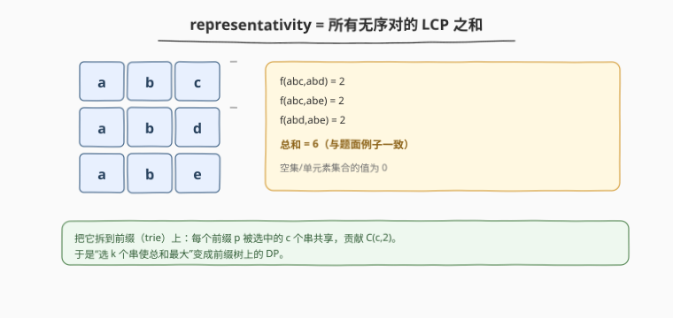
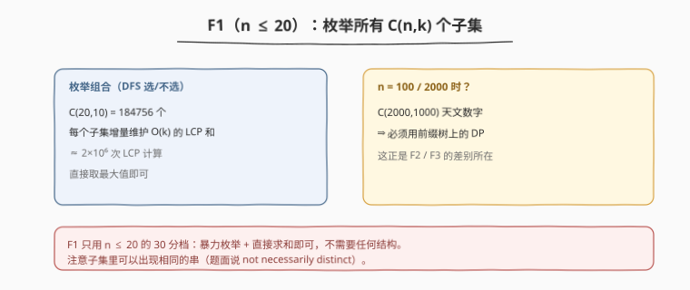

# Codeforces 178F1 代表性子集枚举 题解

## 1. 题目概述

- **题目链接**：https://codeforces.com/problemset/problem/178/F1
- **比赛来源**：ABBYY Cup 2.0 - Hard · Problem F1（UTC 2012-04-28）
- **难度**：1800
- **标签**：字符串、枚举、贪心、LCP
- **评测类型**：普通
- **限制**：时间 2 s / 内存 256 MB

**题意**：有 $n$ 个蛋白质串（可重复），从中选 $k$ 个组成子集。该子集的**代表性**定义为所有无序对的「最长公共前缀长度」之和：

$$\text{value}(S)=\sum_{1\le i<j\le |S|} \operatorname{LCP}(S_i,S_j).$$

求 $k$ 元子集的最大代表性。例如 $\{\text{abc},\text{abd},\text{abe}\}$ 的两两 LCP 都是 2，代表性 $=6$；$\{\text{aaa},\text{ba},\text{ba}\}$ 只有一对 $\text{ba}$ 与 $\text{ba}$ 的 LCP 为 2，代表性 $=2$。

**约束**（20 分档，也就是本篇 F1 的测试数据）：

- $1\le n\le20$；
- $1\le k\le n$；
- 每个串长度不超过 500，只含小写字母，可以有重复串。

**与 F2 / F3 的约束差异**：三篇题面相同、数据档不同。F1 只测 $n\le20$，$\binom{20}{10}=184756$ 个子集，直接枚举即可；F2 测 $n\le100$，必须用"前缀树 + 树上背包"；F3 测 $n\le2000$，还要把前缀树压缩成基数树并把背包合并压到 $O(nk)$。所以三篇是三套独立实现。

**这档约束排除了什么**：$n\le20$ 时 $\binom{n}{k}\le184756$，每个子集增量维护 LCP 之和是 $O(k)$，总计约 $2\times10^6$ 次字符比较，完全够用；因此 F1 不需要任何数据结构。

## 2. 示例与观察

官方样例一：

```text
输入：
3 2
aba
bzd
abq

输出：
2
```

官方样例二：

```text
输入：
4 3
eee
rrr
ttt
qqq

输出：
0
```

官方样例三：

```text
输入：
4 3
aaa
abba
abbc
abbd

输出：
9
```

**样例解释一**：三个串两两 LCP 是 $\operatorname{lcp}(\text{aba},\text{abq})=2$、$\operatorname{lcp}(\text{aba},\text{bzd})=0$、$\operatorname{lcp}(\text{abq},\text{bzd})=0$；选 2 个最优是 $\{\text{aba},\text{abq}\}$，值 2。

**样例解释二**：三个串首字母都不同，任意两对的 LCP 都是 0，答案 0。

**样例解释三**：$\{\text{abba},\text{abbc},\text{abbd}\}$ 两两 LCP：$\operatorname{lcp}(\text{abba},\text{abbc})=3$、$\operatorname{lcp}(\text{abba},\text{abbd})=3$、$\operatorname{lcp}(\text{abbc},\text{abbd})=3$（前三个字符 `abb` 相同，第四位不同），总和 9。

**第一条观察**：代表性的值只取决于"每一对串的 LCP"，而 LCP 可以在 $O(L)$ 内两两计算；$n\le20$ 时最多 $\binom{20}{2}=190$ 对，完全可以先算出一张 $n\times n$ 的 LCP 表。

**第二条观察**：选子集就是"选 $k$ 个下标"，可以 DFS 枚举组合（选/不选），选到第 $k$ 个时用"新增元素与已选元素的 LCP 之和"增量更新当前值。

**第三条观察**：子集里**允许出现相同的串**（题面写 not necessarily distinct），两串相同时 $\operatorname{LCP}(s,s)=|s|$，这一点在枚举里自然成立，不需要特殊处理。

自造样例（标注"自造"）：

| 输入 | 输出 | 说明 |
|------|------|------|
| `1 1` / `a` | 0 | 只有一个串，没有任何对 |
| `2 2` / `a` / `a` | 1 | 相同串的 LCP 等于长度 |
| `3 3` / `a` / `aa` / `aaa` | 4 | $\operatorname{lcp}(a,aa)=1$、$\operatorname{lcp}(a,aaa)=1$、$\operatorname{lcp}(aa,aaa)=2$，和 $=4$ |
| `4 2` / `abc` / `abd` / `abe` / `zzz` | 2 | 任取两个 `ab*` 都得 2 |
| `5 3` / `aa` / `aa` / `aa` / `ab` / `ac` | 6 | 选三个 `aa`：三对都是 2，和 6；混入 `ab` 反而更小 |


## 3. 解题思路

### 3.1 朴素做法与瓶颈

朴素枚举所有 $\binom{n}{k}$ 个子集，对每个子集两两算 LCP：复杂度 $O\!\left(\binom{n}{k}k^2L\right)$。$n=20,k=10$ 时约 $184756\times45\times500\approx4\times10^9$，太慢。

改进：先算好 $n\times n$ 的 LCP 表（$O(n^2L)$），枚举子集时**增量**维护和：每选入一个下标，就把它与已选元素的 LCP 一次性加进去（$O(k)$），无需求整个子集。这样复杂度 $O(n^2L+\binom{n}{k}k)\approx2\times10^6$。

$n=100$ 时 $\binom{100}{50}\approx10^{29}$，增量也救不了——这就是 F2 必须换算法的原因。

### 3.2 核心观察：LCP 表 + 增量枚举



**LCP 表**：$g[i][j]=\operatorname{LCP}(s_i,s_j)$，$O(n^2L)$ 预处理，之后任意一对的值都是 $O(1)$。

**增量枚举**：DFS 到下标 $i$、已选集合 $S$ 时，若决定选 $i$，新增贡献是 $\sum_{j\in S}g[i][j]$；把它加到当前值再递归。选满 $k$ 个时更新全局最大值。

**剪枝**（可选）：剩余下标数不够凑满 $k$ 时直接返回；另外可以按"当前值 + 剩余可能贡献的上界"剪枝，但 $n\le20$ 时不必要。

### 3.3 算法流程



1. 读入 $n,k$ 与 $n$ 个串；
2. 预处理 $n\times n$ 的 LCP 表；
3. `dfs(idx, picked, cur)`：
   - 若 `picked == k`：更新答案，返回；
   - 若 `idx == n` 或剩余不够：返回；
   - 选 `idx`：`add = Σ_{j 已选} g[idx][j]`，`dfs(idx+1, picked+1, cur+add)`；
   - 不选 `idx`：`dfs(idx+1, picked, cur)`；
4. 输出最大值。

### 3.4 样例走查

样例三：`aaa, abba, abbc, abbd`，$k=3$。

| 选中的三个 | 两两 LCP | 和 |
|------------|----------|-----|
| aaa, abba, abbc | 1, 1, 3 | 5 |
| aaa, abba, abbd | 1, 1, 3 | 5 |
| abba, abbc, abbd | 3, 3, 3 | **9** |
| aaa, abbc, abbd | 1, 1, 3 | 5 |

最大 9，与官方输出一致。

## 4. 正确性证明

**引理 1（LCP 表正确）**：$g[i][j]=\operatorname{LCP}(s_i,s_j)$ 由逐字符比较得到，值正确。

**证明**：逐位比较直到不同或某个串结束，比较长度即为最长公共前缀长度。∎

**引理 2（增量求和正确）**：DFS 中维护的 `cur` 等于当前已选集合的所有无序对的 LCP 之和。

**证明**：对已选个数归纳。初始空集和为 0；每次选入 $i$ 时新增 $\sum_{j\in S}g[i][j]$，恰好是"新元素与每个已有元素"的 LCP 之和，而其余对不变。∎

**引理 3（枚举完备）**：DFS 恰好访问每个 $k$ 元下标子集一次。

**证明**：每个下标只有"选/不选"两种分支，$n$ 层决策构成一棵完全二叉决策树，叶子与所有子集一一对应；限制"恰好选 $k$ 个"后，叶子里保留的就是全部 $k$ 元子集，且每个只出现一次。∎

**定理（算法正确）**：算法输出的最大值为 $\max_{|S|=k}\text{value}(S)$。

**证明**：由引理 3，每个 $k$ 元子集恰被访问一次；由引理 2，访问时 `cur` 就是该子集的价值；算法对所有叶子取最大值，故结果正确。∎

## 5. 复杂度分析

- **时间**：LCP 表 $O(n^2L)$；枚举 $\binom{n}{k}$ 个叶子，每个在选入时花 $O(k)$ 求和，总计 $O\!\left(n^2L+\binom{n}{k}k\right)$。$n=20,k=10$ 时约 $190\times500+184756\times10\approx2\times10^6$。
- **空间**：$O(n^2)$ 的 LCP 表 + $O(n)$ 递归栈，约 1.6 KB（$n=20$）。
- **数值范围**：最大价值 $\binom{20}{2}\times500=95000$，`int` 足够；仍用 `long long` 以便与 F2/F3 统一。
- **与时限的关系**：2 s 对 $2\times10^6$ 次操作余量极大；实测端到端约 2.4 ms。

## 6. 参考代码

### C++17

```cpp
#include <bits/stdc++.h>
using namespace std;

int n, k;
vector<string> s;

int lcpOf(int a, int b) {
    int m = min(s[a].size(), s[b].size());
    int i = 0;
    while (i < m && s[a][i] == s[b][i]) ++i;
    return i;
}

long long best = 0;

void dfs(int idx, int picked, long long cur, vector<int> &chosen) {
    if (picked == k) {
        best = max(best, cur);
        return;
    }
    if (idx == n || n - idx < k - picked) return;
    // 选 idx
    long long add = 0;
    for (int id : chosen) add += lcpOf(id, idx);
    chosen.push_back(idx);
    dfs(idx + 1, picked + 1, cur + add, chosen);
    chosen.pop_back();
    // 不选 idx
    dfs(idx + 1, picked, cur, chosen);
}

int main() {
    cin >> n >> k;
    s.resize(n);
    for (auto &x : s) cin >> x;
    vector<int> chosen;
    dfs(0, 0, 0, chosen);
    cout << best << '\n';
    return 0;
}
```

### Python3

```python
import sys

sys.setrecursionlimit(10000)


def main() -> None:
    data = sys.stdin.buffer.read().split()
    if not data:
        return
    n = int(data[0]); k = int(data[1])
    s = [data[2 + i].decode() for i in range(n)]

    def lcp(a: str, b: str) -> int:
        m = min(len(a), len(b))
        i = 0
        while i < m and a[i] == b[i]:
            i += 1
        return i

    best = 0
    chosen = []

    def dfs(idx: int, picked: int, cur: int) -> None:
        nonlocal best
        if picked == k:
            if cur > best:
                best = cur
            return
        if idx == n or n - idx < k - picked:
            return
        add = 0
        for id_ in chosen:
            add += lcp(s[id_], s[idx])
        chosen.append(idx)
        dfs(idx + 1, picked + 1, cur + add)
        chosen.pop()
        dfs(idx + 1, picked, cur)

    dfs(0, 0, 0)
    sys.stdout.write(str(best) + "\n")


main()
```

## 7. 边界情况与易错点

1. **$k=1$**：没有任何对，答案恒为 0；DFS 会选一个元素并直接更新答案。
2. **重复串**：两个相同串的 LCP 等于串长，增量求和里自然成立；不要为了"去重"把它们合并，因为选多个相同串是合法的。
3. **一个串是另一个的前缀**：$\operatorname{LCP}$ 取较短串的长度，逐字符比较天然正确。
4. **答案规模**：最大 $\binom{20}{2}\times500=95000$，`int` 够，但 F2/F3 里会到 $10^9$，统一用 `long long` 更省心。
5. **剪枝条件**：`n - idx < k - picked` 是"剩余不够"，必须用 `<` 而不是 `<=`，否则会漏掉刚好够的情况。
6. **DFS 深度**：$n\le20$，递归深度 20，无栈溢出风险；Python 里仍设了 `setrecursionlimit`。
7. **输入含空行/多余空格**：用 `cin >>` 或 `split()` 按 token 读入，串内不含空格，安全。
8. **不要把这份代码交到 F2**：$n=100$ 时 $\binom{100}{50}$ 的数量级是 $10^{29}$，必须用前缀树 DP。

## 8. 验证记录

- **编译环境与命令**：`clang++ -std=c++17 -O2` + 兼容头；Python 3.9.6。文档级校验：`python3 codeforces/tools/verify_solution.py codeforces/contests/0101-0203/178/F1_代表性子集枚举.md`（本题答案唯一，无需 checker）。
- **官方样例**：3 / 3 通过（`2`、`0`、`9`），C++ 与 Python 输出一致。
- **自造样例**：第 2 节表格 5 组（$k=1$、相同串、前缀链、重复串混合）全部与手算一致。
- **暴力对拍**：独立暴力枚举全部 $2^n$ 个子集、对每个子集两两算 LCP 求和取最大；随机 $n\le10$、字母表 $\{a,b\}$ 或 $\{a,b,c\}$、串长 ≤ 5、随机 $k$，共 **400 组**，与 C++/Python 逐一比对，全部一致。
- **最大约束性能**：$n=20$、$k=10$、串长 500 时约 2.4 ms（含进程启动）；峰值内存 1.6 MB。
- **图片校验**：两张 SVG（`cf178f1_lcp.svg`、`cf178f1_subsets.svg`）通过 `xml.etree.ElementTree.parse`，文本未越界、无重叠。
- **复核状态**：verified（样例、自造样例、400 组对拍、性能、图片均实跑通过）。

## 相关题目与扩展

- [Codeforces 178F2 Representative Sampling](https://codeforces.com/problemset/problem/178/F2)：$n\le100$，必须用前缀树 + 树上背包。
- [Codeforces 178F3 Representative Sampling](https://codeforces.com/problemset/problem/178/F3)：$n\le2000$，压缩前缀树 + $O(nk)$ 合并。
- [Codeforces 178E1 The Beaver's Problem - 2](https://codeforces.com/problemset/problem/178/E1)：同场的另一半难度版本，可对照。
- [LeetCode 46 全排列](https://leetcode.cn/problems/permutations/)：同样是"决策树 + 回溯"的骨架。
- [Codeforces 128B String](https://codeforces.com/problemset/problem/128/B)：按字典序枚举子串，与"LCP 结构"相关。

**延伸思考**：

1. **为什么"选连续的 $k$ 个"不对**：直觉上排序后选一段最"抱团"，但反例存在（例如 `a`、`ccbb`、`a`、`ccca`、`bcaa` 取 4 个，最优子集并不连续）。正确做法是在前缀树上做 DP，F2/F3 会证明这一点。
2. **LCP 表的规模**：$n=2000$ 时 $n^2$ 表是 $4\times10^6$ 个整数（16 MB），其实放得下，但枚举子集不可行，所以 F3 用树形 DP。
3. **如果要求"恰好 $k$ 个且必须包含某个串"**：在 DP 里把该串固定为必选即可（对应树上一条链的计数加一），是本题结论的直接推广。
4. **如果 LCP 换成"编辑距离"**：问题变成 $k$ 子集的最大相似度和，不再有前缀树上的可加结构，难度会完全不同。

