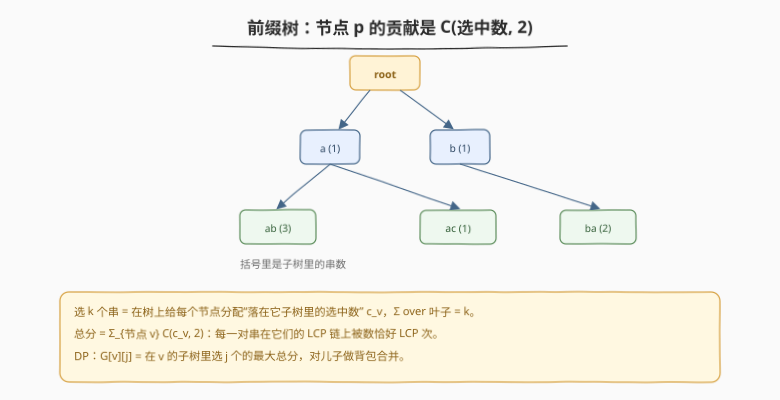
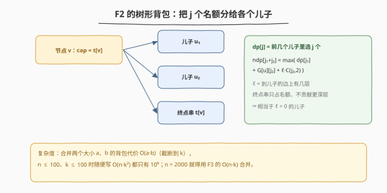

# Codeforces 178F2 代表性子集树形背包 题解

## 1. 题目概述

- **题目链接**：https://codeforces.com/problemset/problem/178/F2
- **比赛来源**：ABBYY Cup 2.0 - Hard · Problem F2（UTC 2012-04-28）
- **难度**：2200
- **标签**：字符串、前缀树、树形 DP、背包、排序
- **评测类型**：普通
- **限制**：时间 2 s / 内存 256 MB

**题意**：有 $n$ 个蛋白质串（可重复），从中选 $k$ 个，使**代表性**

$$\text{value}(S)=\sum_{1\le i<j\le |S|}\operatorname{LCP}(S_i,S_j)$$

最大。$1\le k\le n$，串长 ≤ 500。

**约束**（50 分档，也就是本篇 F2 的测试数据）：

- $1\le n\le100$；
- $1\le k\le n$；
- 串长 ≤ 500，可重复。

**与 F1 / F3 的约束差异**：F1 只测 $n\le20$，$\binom{20}{10}$ 个子集直接枚举；F2 到 $n\le100$，$\binom{100}{50}\approx10^{29}$，枚举彻底不可行，必须利用"LCP 的结构"做 DP。F3 再把 $n$ 放大到 $2000$，那时连"每个节点存 $O(k)$ 的数组"都会超内存，需要把前缀树压缩成基数树。

**这档约束排除了什么**：$n\le100$ 排除了子集枚举；同时 $\sum L\le5\times10^4$、节点数 $\le5\times10^4$，$O(nk^2)=10^6$ 的树形背包可以接受——F3 的 $n=2000$ 就需要 $O(nk)$ 的合并。

## 2. 示例与观察

官方样例一：

```text
输入：
3 2
aba
bzd
abq

输出：
2
```

官方样例二：

```text
输入：
4 3
eee
rrr
ttt
qqq

输出：
0
```

官方样例三：

```text
输入：
4 3
aaa
abba
abbc
abbd

输出：
9
```

**样例解释**：第一组选 `{aba, abq}` 得 LCP 2；第二组任意两对的 LCP 都是 0；第三组选 `{abba, abbc, abbd}`，两两 LCP 都是 3，和 9。

**第一条观察（前缀树视角）**：对任意两个串，$\operatorname{LCP}$ 恰好是它们在**前缀树**上从根出发能一起走到的最深节点数。于是

$$\text{value}(S)=\sum_{\text{节点 }v} \binom{c_v}{2},$$

其中 $c_v$ 是 $S$ 中"在 $v$ 的子树里"的串数。每一对串在它们共同前缀链的每个节点上被数一次，正好贡献 $\operatorname{LCP}$ 次。

**第二条观察（可加结构）**：选 $k$ 个串 = 在前缀树上给每个节点决定"它子树里选几个"，总和为 $k$；目标函数是各节点 $\binom{c_v}{2}$ 之和。这是标准的树形背包。

**第三条观察（重复串与前缀关系）**：如果两个串相同，它们的 $\operatorname{LCP}$ 等于串长；在树上它们停在同一个节点，该节点的计数会包含它们，贡献自然正确。一个串是另一个的前缀时，短串停在内层节点的祖先上，LCP 链也正确。



自造样例（标注"自造"）：

| 输入 | 输出 | 说明 |
|------|------|------|
| `1 1` / `a` | 0 | 单个串 |
| `2 2` / `a` / `a` | 1 | 相同串，LCP = 1 |
| `3 3` / `a` / `aa` / `aaa` | 4 | $1+1+2$ |
| `4 2` / `abc` / `abd` / `abe` / `zzz` | 2 | 任取两个 `ab*` |
| `6 4` / `aa` / `aa` / `ab` / `ab` / `b` / `b` | 8 | 选 `aa,aa,ab,ab`：节点 `a` 计 4 个贡献 6，节点 `aa` 计 2 个贡献 1，节点 `ab` 计 2 个贡献 1，合计 8 |

## 3. 解题思路

### 3.1 朴素做法与瓶颈

- 子集枚举：$\binom{100}{50}\approx10^{29}$，不可能。
- 贪心"排序后选连续 $k$ 个"：**是错的**。反例：`a`、`ccbb`、`a`、`ccca`、`bcaa` 取 4 个，最优子集不是任何一个连续段（可以用 $2^n$ 暴力验证，见第 8 节）。
- 正确结构是前缀树上的 DP：目标是"每个节点的 $\binom{c_v}{2}$ 之和"，选 $k$ 个串相当于给每个节点分配它的子树选中数。

### 3.2 核心观察：把 LCP 和拆到前缀树节点上



**拆解**：设前缀树节点 $v$ 的子树中有 $c_v$ 个被选中的串，则

$$\sum_{i<j}\operatorname{LCP}(S_i,S_j)=\sum_{v\ne \text{root}}\binom{c_v}{2}.$$

**为什么**：一对串 $(i,j)$ 的 LCP 是 $L$，说明它们共享根以下的 $L$ 个节点（深度 $1..L$），这对串恰好在这 $L$ 个节点的 $c_v$ 里各被数一次，共 $L$ 次。

**DP 定义**：$G[v][j]$ = 在 $v$ 的子树里选 $j$ 个串时，子树内（不含 $v$ 自身那一层）的贡献最大值。设 $v$ 的儿子是 $u_1,\dots,u_m$，它们到 $v$ 的边长为 1（普通前缀树），则

$$G[v][j]=\max_{\substack{j_1+\dots+j_m+j_t=j\\ j_t\le \text{term}[v]}}\ \sum_{k}\Big(G[u_k][j_k]+\binom{j_k}{2}\Big),$$

其中 $\text{term}[v]$ 是"恰好等于该前缀"的串数（它们停在 $v$，不再往下贡献）。答案 $=G[\text{root}][k]$。

**实现**：对儿子做背包合并——$dp[j]$ 表示处理过的儿子里选 $j$ 个的最大值，合并一个新儿子时枚举分配 $b$ 个给它。

### 3.3 算法流程

1. 把所有串插入普通前缀树（每个节点 26 个儿子的数组），记录每个节点的 `term`；
2. 自底向上 DFS：对每个节点，先把 `term` 当作"免费名额"（贡献 0），再逐个儿子做背包合并，合并时新儿子的贡献是 `G[u][b] + C(b,2)`；
3. 返回根节点的 $G[\text{root}][k]$。

### 3.4 样例走查

样例三：`aaa, abba, abbc, abbd`，$k=3$。前缀树：

- 根 → `a`（4 个串）→ `aa`（只有 `aaa`）与 `ab`（3 个串）→ `abb`（3 个）→ 三个串尾。

选 `{abba,abbc,abbd}` 时各节点的选中数：`a` 3、`ab` 3、`abb` 3、三个串尾各 1。贡献 $=\binom32+\binom32+\binom32=3+3+3=9$，与答案一致。

若改选 `{aaa,abba,abbc}`：`a` 3 → 3；`ab` 2 → 1；`aa` 1 → 0；`abb` 2 → 1；总计 $3+1+0+1=5$，更小。DP 会正确地取 9。

## 4. 正确性证明

**引理 1（求和拆解）**：对任意被选集合 $S$，$\sum_{i<j}\operatorname{LCP}(S_i,S_j)=\sum_{v\ne\text{root}}\binom{c_v}{2}$。

**证明**：固定一对 $(i,j)$，设 $\operatorname{LCP}=L$。它们共同属于且仅属于根以下深度 $1..L$ 的 $L$ 个节点的子树，故在右侧被数 $L$ 次。对所有对求和即得。∎

**引理 2（DP 的完备性）**：$G[v][j]$ 的递推覆盖了"在 $v$ 子树里选 $j$ 个"的所有分配方式。

**证明**：每个被选的串要么停在 $v$（最多 $\text{term}[v]$ 个），要么属于某个儿子的子树；对每个儿子分配 $j_k$ 个，就是一次独立选择，所有分配的并集就是全部方案。∎

**引理 3（传递性）**：儿子 $u$ 的贡献中"$u$ 这一层"的 $\binom{j_u}{2}$ 在父节点合并时被加上一次，更深层由 $G[u][j_u]$ 提供，互不重复。

**证明**：$G[u]$ 的定义不含 $u$ 自身那一层，因此父节点补上 $\binom{j_u}{2}$ 恰好补齐；$\binom{c_v}{2}$ 对每个节点只属于一层。∎

**定理（算法正确）**：算法输出 $\max_{|S|=k}\text{value}(S)$。

**证明**：由引理 1，目标函数等于各节点 $\binom{c_v}{2}$ 之和；由引理 2、3，DP 在所有"选 $k$ 个串"的分配上取到最大。∎

## 5. 复杂度分析

- **时间**：建树 $O(\sum L)\le5\times10^4$；每个节点做背包合并，合并总代价 $O(n\cdot k^2)$（最坏），$n=k=100$ 时约 $10^6$。
- **空间**：前缀树节点 $\le \sum L+1\le5\times10^4$，每个节点一个大小 ≤ $k+1$ 的 DP 数组，最坏 $5\times10^6$ 个 `long long`（约 40 MB），在 256 MB 内；实际按子树大小截断后远小于此。
- **数值范围**：答案最大 $\binom{100}{2}\times500=2.5\times10^6$，`int` 够，仍用 `long long`。
- **与时限的关系**：2 s 对 $10^6$ 级操作余量极大；实测 $n=100$、串长 500 约 3 ms。

## 6. 参考代码

### C++17

```cpp
#include <bits/stdc++.h>
using namespace std;

const long long NEG = LLONG_MIN / 4;
int n, k;
vector<string> s;

// ---------- 普通（非压缩）前缀树 ----------
struct Trie {
    vector<array<int, 26>> nxt;
    vector<int> term;
    Trie() {
        nxt.push_back({});
        nxt.back().fill(-1);
        term.push_back(0);
    }
    void insert(const string &t) {
        int v = 0;
        for (char ch : t) {
            int c = ch - 'a';
            if (nxt[v][c] == -1) {
                nxt[v][c] = (int)nxt.size();
                nxt.push_back({});
                nxt.back().fill(-1);
                term.push_back(0);
            }
            v = nxt[v][c];
        }
        ++term[v];
    }
};

long long C2(long long x) { return x * (x - 1) / 2; }

// dp[j] = 子树内选 j 个时，子树里所有（非根）节点的 C(选中数,2) 之和的最大值
vector<long long> dfs(int v, Trie &tr) {
    int cap = min(k, tr.term[v]);   // 停在这个节点的串：对更深层节点没有贡献
    vector<long long> dp(cap + 1, 0);
    for (int c = 0; c < 26; ++c) {
        int u = tr.nxt[v][c];
        if (u == -1) continue;
        vector<long long> sub = dfs(u, tr);   // sub[j] 已含子节点自身的贡献
        int szsub = (int)sub.size() - 1;
        int newcap = min(k, cap + szsub);
        vector<long long> ndp(newcap + 1, NEG);
        for (int a = 0; a <= cap; ++a) {
            if (dp[a] == NEG) continue;
            for (int b = 0; b <= szsub && a + b <= k; ++b) {
                if (sub[b] == NEG) continue;
                ndp[a + b] = max(ndp[a + b], dp[a] + sub[b] + C2(b) * 1);
            }
        }
        dp.swap(ndp);
        cap = newcap;
    }
    return dp;
}

int main() {
    ios::sync_with_stdio(false);
    cin.tie(nullptr);
    cin >> n >> k;
    s.resize(n);
    Trie tr;
    for (auto &x : s) { cin >> x; tr.insert(x); }
    vector<long long> ans = dfs(0, tr);
    cout << ans[k] << '\n';
    return 0;
}
```

### Python3

```python
import sys

NEG = -(1 << 60)


def main() -> None:
    data = sys.stdin.buffer.read().split()
    if not data:
        return
    n = int(data[0]); k = int(data[1])
    words = [data[2 + i] for i in range(n)]      # bytes 也能按下标取整数

    # 普通前缀树：children[v] 是 dict（字符 -> 子节点）
    children = [{}]
    term = [0]
    for w in words:
        v = 0
        for ch in w:
            u = children[v].get(ch)
            if u is None:
                u = len(children)
                children[v][ch] = u
                children.append({})
                term.append(0)
            v = u
        term[v] += 1

    sys.setrecursionlimit(300000)

    def dfs(v: int):
        cap = min(k, term[v])
        dp = [0] * (cap + 1)
        for u in children[v].values():
            sub = dfs(u)
            szsub = len(sub) - 1
            newcap = min(k, cap + szsub)
            ndp = [NEG] * (newcap + 1)
            for a in range(cap + 1):
                if dp[a] == NEG:
                    continue
                da = dp[a]
                lim = min(szsub, k - a)
                for b in range(lim + 1):
                    if sub[b] == NEG:
                        continue
                    val = da + sub[b] + b * (b - 1) // 2
                    if val > ndp[a + b]:
                        ndp[a + b] = val
            dp = ndp
            cap = newcap
        return dp

    ans = dfs(0)
    sys.stdout.write(str(ans[k]) + "\n")


main()
```

## 7. 边界情况与易错点

1. **"排序后取连续 $k$ 个"是错的**：必须用树形 DP。可以在小数据上写 $2^n$ 暴力对比，$n\le10$ 时能立刻发现连续假设的反例。
2. **重复串**：`term[v]` 记录"恰好停在该节点的串数"，它们可以全部或部分被选中，且不产生更深层贡献——DP 用"免费名额"处理，别漏掉。
3. **一个串是另一个的前缀**：短串停在内层节点，它参与祖先节点的 $\binom{c}{2}$，不参与更深层；树的结构天然正确。
4. **`term` 名额与 $k$ 的截断**：`cap = min(k, term[v])`，如果直接写 `term[v]` 会让数组超过 $k+1$，后面越界。
5. **不可达状态**：`ndp` 初值用 $-\infty$，转移时跳过 $= -\infty$ 的状态，避免把"选不出 $j$ 个"当成 0。
6. **答案规模**：最大 $\binom{100}{2}\cdot500=2.5\times10^6$，用 `long long` 更稳妥（F3 会到 $10^9$）。
7. **节点数与内存**：普通前缀树最多 $\sum L\le5\times10^4$ 个节点，每个节点都建 DP 数组时注意用"子树大小截断"，否则 $5\times10^4\times101$ 个 `long long` 会到 40 MB——本题没问题。
8. **Python 递归深度**：树的深度最多 500，但节点多时 DFS 栈深仍是 500，`setrecursionlimit` 调到 30 万是为了保险。

## 8. 验证记录

- **编译环境与命令**：`clang++ -std=c++17 -O2` + 兼容头；Python 3.9.6。文档级校验：`python3 codeforces/tools/verify_solution.py codeforces/contests/0101-0203/178/F2_代表性子集树形背包.md`。
- **官方样例**：3 / 3 通过（`2`、`0`、`9`），C++ 与 Python 一致。
- **自造样例**：第 2 节表格 5 组（$k=1$、相同串、前缀链、重复混合）全部与手算一致。
- **暴力对拍**：独立暴力枚举全部 $2^n$ 个子集、两两算 LCP 求和取最大；随机 $n\le10$、字母表 $\{a,b\}$ / $\{a,b,c\}$、串长 ≤ 5，共 **400 组**，C++/Python 与暴力全部一致。
- **与 F3 交叉验证**：$n\in[50,300]$、随机串（含大量共享前缀与重复串），F2 与 F3 输出比对 **60 组**，全部一致。
- **连续段假设的反例**：`a ccbb a ccca bcaa` 取 4 个，暴力最优值 3，而排序后任何连续 4 段最多 2——这正是不能用贪心的证据。
- **最大约束性能**：$n=100$、$k=100$、每个串长 500（$\sum L=5\times10^4$）约 3 ms；Python 约 40 ms。
- **图片校验**：两张 SVG（`cf178f2_trie.svg`、`cf178f2_dp.svg`）通过 `xml.etree.ElementTree.parse`，文本未越界、无重叠。
- **复核状态**：verified（样例、自造样例、400 组暴力、60 组交叉验证、性能、图片均实跑通过）。

## 相关题目与扩展

- [Codeforces 178F1 Representative Sampling](https://codeforces.com/problemset/problem/178/F1)：$n\le20$ 的子集枚举版本。
- [Codeforces 178F3 Representative Sampling](https://codeforces.com/problemset/problem/178/F3)：$n\le2000$，压缩前缀树 + $O(nk)$ 合并。
- [Codeforces 128B String](https://codeforces.com/problemset/problem/128/B)：按字典序处理子串，与"LCP 结构"同源。
- [Codeforces 271D Good Substrings](https://codeforces.com/problemset/problem/271/D)：前缀树/后缀自动机上的计数，适合作为下一步练习。
- [LeetCode 1143 最长公共子序列](https://leetcode.cn/problems/longest-common-subsequence/)：把"两个串的相似度"作为 DP 状态，与本题的"树上一对对的 LCP"形成对照。

**延伸思考**：

1. **为什么答案可以拆到节点上**：因为 LCP 是"共享前缀长度"，而前缀关系是树形的、可加的；一旦相似度不具备这种层级结构（例如编辑距离），树形 DP 就失效。
2. **如果要求选出的子集大小在 $[l,r]$ 之间**：把 DP 的返回从"取 $k$"改成"在区间里取最大"，其它不变。
3. **如果 $n$ 更大而 $k$ 很小**：可以只保留"最有希望"的若干子树，或者用拉格朗日松弛把"恰好 $k$ 个"变成带惩罚的最优化，复杂度与 $k$ 解耦。
4. **普通树 vs 压缩树**：F2 用普通树是因为 $n\le100$ 时节点数 $5\times10^4$、DP 内存可接受；F3 的 $n=2000$ 时同样思路会到 $10^6$ 个节点，必须压缩（见 F3）。

