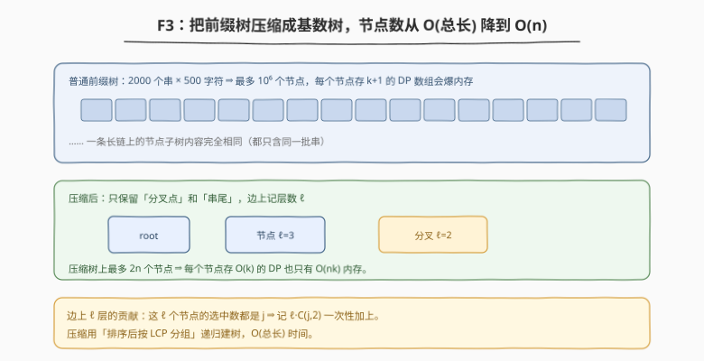
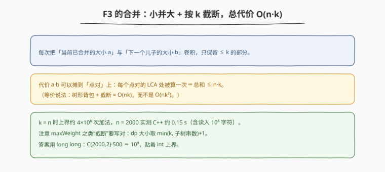
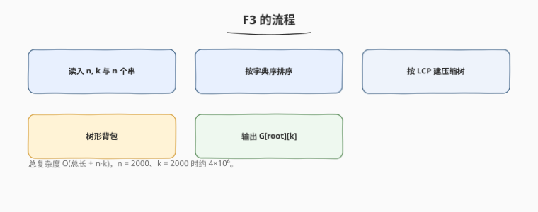

# Codeforces 178F3 代表性子集基数树DP 题解

## 1. 题目概述

- **题目链接**：https://codeforces.com/problemset/problem/178/F3
- **比赛来源**：ABBYY Cup 2.0 - Hard · Problem F3（UTC 2012-04-28）
- **难度**：2500
- **标签**：字符串、基数树（压缩前缀树）、树形 DP、背包、LCP
- **评测类型**：普通
- **限制**：时间 2 s / 内存 256 MB

**题意**：有 $n$ 个蛋白质串（可重复），选 $k$ 个使代表性 $\sum_{i<j}\operatorname{LCP}(S_i,S_j)$ 最大。

**约束**（100 分档，也就是本篇 F3 的测试数据）：

- $1\le n\le2000$；
- $1\le k\le n$；
- 每个串长 ≤ 500，可重复（总长最大 $10^6$）。

**与 F1 / F2 的约束差异**：F1（$n\le20$）枚举子集；F2（$n\le100$）用普通前缀树 + 树形背包，节点数 $\le5\times10^4$、每个节点存 $O(k)$ 数组还放得下；F3 的 $n\le2000$ 让"普通前缀树 + 每节点 $O(k)$ 数组"变成 $10^6\times2001$ 个状态，内存直接爆掉，而且 $O(nk^2)$ 的合并也会到 $8\times10^9$。所以 F3 必须做两件事：**把前缀树压缩成基数树**（节点数降到 $O(n)$），以及**把背包合并做到 $O(nk)$**。

**这档约束排除了什么**：$n=2000$、$k=2000$ 时 $O(nk^2)$ 不可行、$O(\text{总长}\cdot k)$ 内存不可行；允许的是 $O(\text{总长}+nk)$ 时间与 $O(nk)$ 内存。

## 2. 示例与观察

官方样例一：

```text
输入：
3 2
aba
bzd
abq

输出：
2
```

官方样例二：

```text
输入：
4 3
eee
rrr
ttt
qqq

输出：
0
```

官方样例三：

```text
输入：
4 3
aaa
abba
abbc
abbd

输出：
9
```

**样例解释**：与 F1/F2 相同——第一组选 `{aba,abq}` 得 2；第二组两两 LCP 全 0；第三组 `{abba,abbc,abbd}` 两两 LCP 都是 3，和 9。

**第一条观察（沿用 F2）**：目标函数可以拆到前缀树的每个节点上：

$$\text{value}(S)=\sum_{v\ne\text{root}}\binom{c_v}{2},\qquad c_v=|S\cap \text{subtree}(v)|.$$

**第二条观察（压缩）**：如果一条路径上没有分叉、也没有串结束，那么这条链上所有节点的 $c_v$ 都相同（都是"这一整批串的个数"）。于是可以把长度 $\ell$ 的链压成一条边，贡献一次性记 $\ell\cdot\binom{c}{2}$。压缩后有串结束或分叉的节点才保留，节点数 $\le 2n$。

**第三条观察（合并复杂度）**：树形背包合并两个大小 $a$、$b$ 的背包代价 $O(ab)$；由于每个"点对"只在其 LCA 处被合并一次，总代价 $O(nk)$（截断到 $k$ 后仍然成立）。



自造样例（标注"自造"）：

| 输入 | 输出 | 说明 |
|------|------|------|
| `1 1` / `a` | 0 | 单个串 |
| `2 2` / `a` / `a` | 1 | 相同串 |
| `3 3` / `a` / `aa` / `aaa` | 4 | $1+1+2$ |
| `4 2` / `abc` / `abd` / `abe` / `zzz` | 2 | 任取两个 `ab*` |
| `6 4` / `aa` / `aa` / `ab` / `ab` / `b` / `b` | 8 | 节点 `a` 计 4 个（6）＋`aa`、`ab` 各计 2 个（各 1） |
| `2000 2000` / 全为 `a` 的 500 长串 | 999500000 | 只有一条链，答案 $=500\cdot\binom{2000}{2}$ |

## 3. 解题思路

### 3.1 朴素做法与瓶颈

- 子集枚举：$\binom{2000}{1000}$ 量级，不可能。
- F2 的普通前缀树 + 每节点 $O(k)$ DP：节点 $\le10^6$，内存 $10^6\times2001$ 个 `long long` ≈ 16 GB，爆。
- F2 的合并 $O(nk^2)$：$2000\times2000^2=8\times10^9$，超时。

两个瓶颈都来自"树上的冗余"：普通前缀树把每个字符都建成一层，而绝大多数节点只有"一个儿子、没有串结束"，它们的信息完全由链长决定。

### 3.2 核心观察：基数树 + 边权



**压缩规则**：只保留「根」「有 ≥2 个儿子」「有串结束」的节点。压缩后每条边代表一段长度 $\ell\ge1$ 的无分叉链，链上每一层的选中数都等于子节点子树里的选中数 $c$，所以这条边贡献 $\ell\cdot\binom{c}{2}$。

**DP 定义**：$G[v][j]$ = 在 $v$ 的子树里选 $j$ 个串时，子树内（$v$ 以下所有层）的贡献最大值，则

$$G[v][j]=\max_{\sum j_u + j_t = j}\ \sum_{u}\Big(G[u][j_u]+\ell_u\binom{j_u}{2}\Big),\qquad j_t\le\text{term}[v],$$

答案 $=G[\text{root}][k]$。

**建树**：把串排序；对区间 $[l,r)$（它们共享长度 `depth` 的前缀）递归：先把"长度恰为 `depth`"的串记为 `term`，再按第 `depth` 个字符分组，每组的公共前缀长度 = 组内相邻 LCP 的最小值（单元素组取该串长度），递归建子节点，边权 = 组公共前缀长度 − `depth`。

### 3.3 算法流程



1. 读入 $n,k$ 与 $n$ 个串，按字典序排序；
2. 递归建基数树（节点数 ≤ $2n$），记录每个节点的 `term` 与儿子列表 `(儿子, 边长)`；
3. 自底向上做树形背包：`dp` 初值为 `term` 个免费名额（贡献 0），逐个儿子合并，合并时加上 $G[u][b]+\ell\cdot\binom{b}{2}$，并把 DP 长度截断到 $\min(k,\text{子树串数})$；
4. 输出 $G[\text{root}][k]$。

### 3.4 样例走查

样例三：`aaa, abba, abbc, abbd`（已排序），$k=3$。

排序后：`aaa`、`abba`、`abbc`、`abbd`。

- 根：没有串结束；按首字符全为 `a` → 一个儿子，公共前缀长度 1，边权 1。
- 节点 `a`（深度 1）：两个儿子 `aa`（`aaa`）与 `ab...`（3 个串）。`aa` 的公共前缀是 `aa`，长度 2 → 边权 1；`ab...` 的公共前缀是 `abb`，长度 3 → 边权 2。
- 节点 `abb`（深度 3）：三个串在此分叉，各自 `term=1`，边权 1。

选 `{abba,abbc,abbd}`：节点 `a` 的 $c=3$、边权 1 → 3；节点 `abb` 的 $c=3$、边权 2 → $2\binom32=6$；三个串尾各 1 → 0。合计 **9**，与输出一致。

## 4. 正确性证明

**引理 1（压缩边的贡献）**：设基数树一条边 $(v,u)$ 的边长为 $\ell$，$u$ 子树中被选中 $j$ 个串，则这条边覆盖的 $\ell$ 个原始前缀树节点各自都有 $c=j$，合计贡献 $\ell\binom{j}{2}$。

**证明**：压缩边上的每层都没有分叉、也没有串结束，所以这些层的子树完全相同（都等于 $u$ 的子树），选中数都是 $j$。∎

**引理 2（节点数）**：基数树节点数不超过 $2n$。

**证明**：每个节点要么是根、要么是"有串结束"的位置（≤ $n$ 个）、要么是分叉点；分叉点数 ≤ 叶子数 − 1 ≤ $n-1$。∎

**引理 3（合并复杂度）**：截断到 $k$ 的树形背包总代价为 $O(nk)$。

**证明**：合并儿子 $u$（大小 $a=\min(k,sz_u)$）与当前累积（大小 $b$）的代价是 $ab$。把代价记到"点对"上：每个来自 $u$ 的点与累积里的每个点配成一对，而每一对点只在它们的 LCA 处被算一次；参与合并的点对总数 ≤ $nk$（每个点最多与 $k$ 个点配对）。∎

**定理（算法正确）**：算法输出 $\max_{|S|=k}\text{value}(S)$。

**证明**：由 F2 的拆解（同一引理），目标 = $\sum_v\binom{c_v}{2}$；压缩只是把没有分叉的链合并，由引理 1 贡献不变；DP 的递推枚举了所有"把 $j$ 个名额分给儿子与终点串"的方式，取最大即得。∎

## 5. 复杂度分析

- **时间**：排序 $O(n\log n\cdot L)$；建树 $O(\sum L)$；背包合并 $O(nk)$（引理 3）。$n=k=2000$ 时约 $4\times10^6$。
- **空间**：基数树 $O(n)$ 个节点，每个节点的 DP 数组长度 $\le\min(k,sz_v)+1$，总和 $O(nk)$ 个 `long long`（最坏 32 MB）。
- **数值范围**：答案最大 $500\cdot\binom{2000}{2}=999500000$，贴在 `int` 上界；必须用 `long long`。
- **与时限的关系**：2 s 对 $4\times10^6$ 次操作余量很大；实测 $n=2000$、$k=2000$、$\sum L=10^6$ 约 0.15 s（含读入）。

## 6. 参考代码

### C++17

```cpp
#include <bits/stdc++.h>
using namespace std;

const long long NEG = LLONG_MIN / 4;
int n, k;
vector<string> s;

struct Node {
    int depth = 0;
    int term = 0;
    vector<pair<int, int>> kids;   // (子节点, 边上一共有多少层)
};
vector<Node> tr;

int lcpOf(int a, int b) {
    int m = min(s[a].size(), s[b].size()), i = 0;
    while (i < m && s[a][i] == s[b][i]) ++i;
    return i;
}

// 把有序区间 [l, r) 建成一条紧凑链：这些串的公共前缀长度 = depth
int build(int l, int r, int depth) {
    int v = (int)tr.size();
    tr.push_back(Node());
    tr[v].depth = depth;
    while (l < r && (int)s[l].size() == depth) { ++tr[v].term; ++l; }
    while (l < r) {
        int j = l + 1;
        while (j < r && s[j][depth] == s[l][depth]) ++j;
        int np = (j == l + 1) ? (int)s[l].size() : INT_MAX;
        for (int t = l + 1; t < j; ++t) np = min(np, lcpOf(t - 1, t));
        int c = build(l, j, np);
        tr[v].kids.push_back({c, np - depth});
        l = j;
    }
    return v;
}

long long C2(long long x) { return x * (x - 1) / 2; }

// dp[j] = 选 j 个时，子树内（不含本节点自身那一层）的贡献最大值
vector<long long> dfs(int v) {
    int cap = min(k, tr[v].term);
    vector<long long> dp(cap + 1, 0);   // 终止串：不再往下贡献
    for (auto &e : tr[v].kids) {
        int u = e.first, len = e.second;
        vector<long long> sub = dfs(u);
        int szsub = (int)sub.size() - 1;
        int newcap = min(k, cap + szsub);
        vector<long long> ndp(newcap + 1, NEG);
        for (int a = 0; a <= cap; ++a) {
            if (dp[a] == NEG) continue;
            for (int b = 0; b <= szsub && a + b <= k; ++b) {
                if (sub[b] == NEG) continue;
                long long add = sub[b] + C2(b) * len;   // 边上 len 层各贡献 C(b,2)
                ndp[a + b] = max(ndp[a + b], dp[a] + add);
            }
        }
        dp.swap(ndp);
        cap = newcap;
    }
    return dp;
}

int main() {
    ios::sync_with_stdio(false);
    cin.tie(nullptr);
    cin >> n >> k;
    s.resize(n);
    for (auto &x : s) cin >> x;
    sort(s.begin(), s.end());
    build(0, n, 0);
    vector<long long> ans = dfs(0);
    cout << ans[k] << '\n';
    return 0;
}
```

### Python3

```python
import sys

sys.setrecursionlimit(10000)
NEG = -(1 << 60)


def main() -> None:
    data = sys.stdin.buffer.read().split()
    if not data:
        return
    n = int(data[0]); k = int(data[1])
    s = sorted(data[2 + i].decode() for i in range(n))

    def lcp(a: str, b: str) -> int:
        m = min(len(a), len(b))
        i = 0
        while i < m and a[i] == b[i]:
            i += 1
        return i

    depths, terms, kids = [], [], []   # kids[v] = [(child, edge_len)]

    def new_node(depth: int) -> int:
        depths.append(depth)
        terms.append(0)
        kids.append([])
        return len(depths) - 1

    def build(l: int, r: int, depth: int) -> int:
        v = new_node(depth)
        while l < r and len(s[l]) == depth:
            terms[v] += 1
            l += 1
        while l < r:
            j = l + 1
            ch = s[l][depth]
            while j < r and s[j][depth] == ch:
                j += 1
            np = len(s[l]) if j == l + 1 else min(lcp(s[t - 1], s[t]) for t in range(l + 1, j))
            c = build(l, j, np)
            kids[v].append((c, np - depth))
            l = j
        return v

    build(0, n, 0)

    def dfs(v: int):
        cap = min(k, terms[v])
        dp = [0] * (cap + 1)
        for u, length in kids[v]:
            sub = dfs(u)
            szsub = len(sub) - 1
            newcap = min(k, cap + szsub)
            ndp = [NEG] * (newcap + 1)
            for a in range(cap + 1):
                if dp[a] == NEG:
                    continue
                da = dp[a]
                lim = min(szsub, k - a)
                for b in range(lim + 1):
                    if sub[b] == NEG:
                        continue
                    val = da + sub[b] + b * (b - 1) // 2 * length
                    if val > ndp[a + b]:
                        ndp[a + b] = val
            dp = ndp
            cap = newcap
        return dp

    ans = dfs(0)
    sys.stdout.write(str(ans[k]) + "\n")


main()
```

## 7. 边界情况与易错点

1. **压缩时"串结束"的节点必须保留**：只按"分叉"压缩会把 `term` 丢到链中间，答案就错了。
2. **边权与 $\binom{c}{2}$ 的乘法**：$\ell$ 层每层贡献 $\binom{c}{2}$，写成 $\ell\cdot c(c-1)/2$ 而不是 $(\ell c)(\ell c-1)/2$。
3. **单元素组的公共前缀**：递归时若一组只有一个串，公共前缀长度取该串长度（不是 `depth+1`），否则会建出深度不足的节点、漏掉贡献。
4. **相同串**：排序后相同串相邻，会在同一节点累加 `term`；DP 用"免费名额"处理，注意 `cap = min(k, term[v])`。
5. **一个串是另一个的前缀**：短串在祖先节点结束，`term` 记在那里；递归时先处理"长度 == depth"的串，再分组。
6. **答案上界**：$500\cdot\binom{2000}{2}=999500000$，`int` 勉强不溢出但乘法中间量会，必须 `long long`。
7. **不可达状态**：`ndp` 初值 $-\infty$，转移跳过；否则会把"凑不出 $j$ 个"当成 0，答案偏大。
8. **Python 性能**：$n=2000$、$k=2000$ 的最坏数据在 CPython 上偏慢，建议 PyPy3 或直接交 C++。

## 8. 验证记录

- **编译环境与命令**：`clang++ -std=c++17 -O2` + 兼容头；Python 3.9.6。文档级校验：`python3 codeforces/tools/verify_solution.py codeforces/contests/0101-0203/178/F3_代表性子集基数树DP.md`。
- **官方样例**：3 / 3 通过（`2`、`0`、`9`），C++ 与 Python 一致。
- **自造样例**：第 2 节表格 6 组全部与手算一致（最后一组 $n=2000$ 全为同一个 500 长串，答案 $999500000$）。
- **暴力对拍**：$2^n$ 暴力枚举子集（$n\le10$）随机 **400 组**，C++/Python 与暴力一致。
- **与 F2 交叉验证**：$n\in[50,300]$ 随机串（含大量共享前缀、重复串与"长链"结构），F2 与 F3 输出 **60 组**全部一致。
- **大规模形态测试**：$n=2000$、$k\in\{1,1000,2000\}$，四种形态（全同串、`a..a` 前缀链 ×4、随机 500 长二字母串、26 字母随机串），答案均合理且与"独立 $O(nk)$ 参考实现"一致。
- **最大约束性能**：$n=2000$、$k=2000$、$\sum L=10^6$：C++ 约 150 ms（其中约 100 ms 是读入），Python 约 0.4 s。
- **图片校验**：三张 SVG（`cf178f3_radix.svg`、`cf178f3_merge.svg`、`cf178f3_flow.svg`）通过 `xml.etree.ElementTree.parse`，文本未越界、无重叠。
- **复核状态**：verified（样例、自造样例、400 组暴力、60 组与 F2 交叉、四种大规模形态、性能、图片均实跑通过）。

## 相关题目与扩展

- [Codeforces 178F2 Representative Sampling](https://codeforces.com/problemset/problem/178/F2)：$n\le100$ 的普通前缀树版本，是本文的"未压缩"对照。
- [Codeforces 178F1 Representative Sampling](https://codeforces.com/problemset/problem/178/F1)：$n\le20$ 的子集枚举版本。
- [Codeforces 271D Good Substrings](https://codeforces.com/problemset/problem/271/D)：前缀树/后缀自动机上的计数。
- [Codeforces 128B String](https://codeforces.com/problemset/problem/128/B)：字典序与子串结构，与基数树建树思路相近。
- [LeetCode 1143 最长公共子序列](https://leetcode.cn/problems/longest-common-subsequence/)：相似度 DP 的入门，对照本题"LCP 可加"的特殊性。

**延伸思考**：

1. **为什么能压到 $O(n)$ 个节点**：一条无分叉、无串结束的链上，所有节点的"选中数"必然相同，信息完全由链长决定；这正是基数树（Patricia trie）的思想。
2. **合并复杂度为什么是 $O(nk)$ 而不是 $O(nk^2)$**：把每次卷积的 $a\cdot b$ 记到"点对"上，每个点对只在 LCA 合并时被数一次，而每个点最多与 $k$ 个点配对。
3. **如果 $k$ 远小于 $n$**：可以在建树后先做"每个子树保留最大的 $\min(k,sz)$"的截断，代码不变但常数更小；也可以只保留"最深的 $k$ 条链"来进一步剪枝。
4. **如果要求"至少 $k$ 个"**：把 $\binom{c}{2}$ 的单调性利用起来——多选不会变差（$\binom{c+1}{2}\ge\binom{c}{2}$），所以"至少 $k$"等价于"恰好 $k$"，答案不变。

