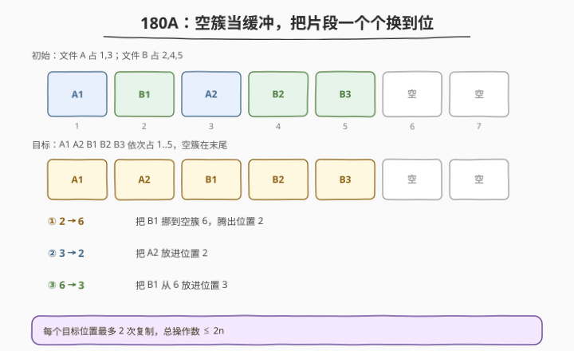

# Codeforces 180A 磁盘碎片整理 题解

## 1. 题目概述

- **题目链接**：https://codeforces.com/problemset/problem/180/A
- **比赛来源**：Codeforces Round 116 (Div. 2, ACM-ICPC Rules) · Problem A（UTC 2012-04-22）
- **难度**：1800
- **标签**：构造、模拟、特殊评测
- **评测类型**：特殊评测（输出任意合法操作序列，由 checker 判定）
- **限制**：时间 1 s / 内存 256 MB

**题意**：磁盘有 $n$ 个簇（编号 $1..n$），上面有 $m$ 个文件，第 $i$ 个文件依次占用 $n_i$ 个簇 $a_{i,1},\ldots,a_{i,n_i}$（这些簇可以不相邻，但顺序就是文件内的片段顺序）。允许的操作是「把簇 $i$ 的内容复制到簇 $j$」（$i\ne j$，覆盖 $j$ 原有内容）。要求用不超过 $2n$ 次操作，让每个文件占用一段连续的簇、文件按任意顺序紧挨着排在磁盘开头，所有空闲簇都在末尾。输出操作序列（任意合法方案均可）。

**约束**（原样摘自题面 `inputFormat.en`）：

- $1 \le n, m \le 200$；第 $i$ 行先给 $n_i \ge 1$，再给 $n_i$ 个簇号 $1 \le a_{i,j} \le n$。
- 每个簇号在所有文件里至多出现一次，且至少有一个空闲簇（$\sum n_i < n$）。
- 输出 $k$（$0 \le k \le 2n$）与 $k$ 行 `i j`。

**约束对算法的限制**：

- 至少一个空闲簇是关键：它相当于拼图里的「空位」，让任何片段都能被临时挪开。
- $2n$ 的上界意味着平均每个簇最多 2 次操作：一次「腾位置」、一次「放正确内容」，不能再多。
- $n \le 200$，任何 $O(n^2)$ 的模拟都绰绰有余；本题的难点是**把构造想清楚**，不是性能。

## 2. 示例与观察

官方样例 1（输入 / 输出原样）：

```text
输入：
7 2
2 1 2
3 3 4 5

输出：
0
```

官方样例 2（输入 / 输出原样）：

```text
输入：
7 2
2 1 3
3 2 4 5

输出：
3
2 6
3 2
6 3
```

**样例 1**：文件 1 占 $\{1,2\}$、文件 2 占 $\{3,4,5\}$，已经连续且紧挨着排在开头，空闲簇 6、7 在末尾，所以 0 次操作。

**样例 2 的演算**：文件 1 占 $\{1,3\}$（片段 A1 在 1、A2 在 3），文件 2 占 $\{2,4,5\}$（B1 在 2、B2 在 4、B3 在 5）。目标布局是 A1 A2 B1 B2 B3 占 1..5、6..7 空闲。

- 位置 2 现在是 B1，而它应该放 A2；A2 在位置 3。先把 B1 挪到空簇 6：`2 6`；
- 再把 A2 从 3 复制到 2：`3 2`；
- 最后把 B1 从 6 复制到 3：`6 3`。

三步之后 1..5 依次是 A1 A2 B1 B2 B3，正好合法。官方输出正是这三步。

**观察 1**：复制不会清空源簇，所以「把某片段挪走」之后源位置仍留着副本——这没关系，目标布局只要求前 $N$ 个簇内容正确，末尾的簇本来就声明为不可用。

**观察 2**：从位置 1 开始按目标顺序依次填坑。轮到一个位置 $p$ 时，如果它已经放着正确片段就跳过；否则当前占着位置 $p$ 的片段一定是「还没轮到」的，先把它挪到某个空闲簇，再把正确片段从它当前的位置复制过来。

**观察 3**：空闲簇的数量只增不减：把占位片段挪走时「空出一个、占用一个」，数量不变；把正确片段复制进来时源位置被标记为可用，数量 +1。所以永远有空位可用。

**自造样例**（标注「自造」，输出由程序实测并经 checker 校验）：

| 输入 | 输出 | 说明 |
|------|------|------|
| `2 1` / `1 1` | 0 | 已就绪 |
| `3 1` / `1 3` | 2 | 需要 3→1，且先把 1 的内容挪到空簇 |
| `5 2` / `1 2` / `1 1` | 2 | 文件顺序可以交换 |
| `4 1` / `2 2 4` | 2 | 片段顺序必须保持 2、4 |

第三行说明「文件之间的顺序任意」：文件 2 可以排在文件 1 前面。第四行说明「文件内片段顺序不能变」：保留了 2→4 的相对顺序。

## 3. 解题思路

### 3.1 朴素做法与瓶颈

一个自然的想法是「直接把每个片段复制到目标位置」。但目标位置可能被另一个还没安放的片段占着，直接覆盖会把它弄丢；而复制操作没有「交换」，所以必须借助空闲簇做临时存放。

另一个想法是模拟「搬移」：先把所有片段搬到空闲区，再搬回来。但空闲簇只有 $n-N$ 个，可能放不下全部片段。

### 3.2 核心观察：空簇是缓冲区



按目标位置 $p=1,2,\ldots,N$（$N=\sum n_i$）顺序处理：

- 若位置 $p$ 上已经是正确片段，什么都不做；
- 否则先把位置 $p$ 上「不正确的那个片段」复制到一个空闲簇（记下它的新位置），再把它占用的格子标记为空；
- 然后把正确片段从它当前的位置复制到 $p$，并把它的旧位置标记为空（那里留着副本，已无用）。

因为每次「腾位置」都只是把占位片段换个地方存着，它的内容没丢；之后轮到它的目标位置时，再从新位置复制过去即可。


图里把样例 2 的四行磁盘状态画了出来：初始、`2 6` 之后、`3 2` 之后、`6 3` 之后。最后一行前 5 个格子正好是 A1 A2 B1 B2 B3。

### 3.3 算法流程

1. 给每个片段编号（token）：文件 0 的片段是 $0..n_0-1$，文件 1 的是 $n_0..$，依此类推；同时记下每个 token 的目标位置与当前所在簇。
2. 维护 `content[1..n]`：每个簇当前装的 token（$-1$ 表示空）。
3. 对 $p=1..N$：
   1. 令 $t$ 为目标放在 $p$ 的 token、$c$ 为它当前所在簇；若 $c=p$ 跳过；
   2. 若 `content[p] != -1`：找一个空簇 $e$，输出 `p e`，把 `content[p]` 搬到 $e$，并更新该 token 的位置，`content[p] = -1`；
   3. 输出 `c p`，把 $t$ 放到 $p$，`content[c] = -1`（源格里的副本作废）。
4. 输出操作数 $k$ 与所有操作。

### 3.4 样例走查

| 步骤 | 磁盘 1..7（A/B 表示文件，数字表示片段） | 说明 |
|------|------------------------------------------|------|
| 初始 | A1 B1 A2 B2 B3 – – | 样例 2 |
| `2 6` | A1 B1 A2 B2 B3 B1 – | 把占位的 B1 挪到空簇 6 |
| `3 2` | A1 A2 A2 B2 B3 B1 – | 把 A2 放进位置 2 |
| `6 3` | A1 A2 B1 B2 B3 B1 – | 把 B1 放进位置 3，完成 |

前三格与后两格拼起来正好是「文件 A 的片段 1、2，然后文件 B 的片段 1、2、3」，空闲簇 6、7 在末尾。

## 4. 正确性证明

**引理 1（token 不丢失）**：在算法的任何时刻，每个尚未安放的 token 都恰好存在于 `content` 的某一个簇中；已经安放的 token 一定在它的目标位置上。

**证明**：对步骤 $p$ 归纳。若位置 $p$ 已被占，先把占位 token $u$ 复制到空簇 $e$（$u$ 原来在 $p$，现在在 $e$，位置表同步更新），再覆盖 $p$——此时 $u$ 仍在 $e$ 中，没有丢失。随后把目标 token $t$ 从 $c$ 复制到 $p$，$t$ 现在在 $p$（目标位置），$c$ 的副本被标记为作废但内容无关紧要。其它 token 未被触碰。∎

**引理 2（总有空簇可用）**：第 3.3 节第 2 步需要空簇时，一定存在至少一个空簇。

**证明**：初始至少有一个空簇（题面保证 $\sum n_i < n$）。「把 $u$ 从 $p$ 挪到 $e$」使 $p$ 变空、$e$ 变满，空簇数不变；「把 $t$ 复制到 $p$」使 $c$ 变空，空簇数 +1。因此空簇数始终不小于初始值 1。∎

**引理 3（前 $p$ 个位置最终正确）**：处理完 $p$ 之后，位置 $1..p$ 上的 token 不会被再次修改，且都是各自的目标 token。

**证明**：循环按 $p$ 递增，之后只处理 $>p$ 的位置。第 2 步把 $u$ 挪走、第 3 步把 $t$ 放到 $p$，之后 `content[p]` 不再改变（后续只在位置 $>p$ 上操作），而 $t$ 正是目标位置为 $p$ 的 token。∎

**定理**：算法输出的操作序列合法，且操作数 $\le 2N \le 2n$。

**证明**：每个 $p$ 至多产生 2 次操作（一次腾位置、一次安放），共 $N$ 个位置，故 $k \le 2N \le 2n$。由引理 1、3，结束后前 $N$ 个位置依次是「文件的一个排列、每个文件内部片段顺序不变」；由于所有 token 都在前 $N$ 个位置且各出现一次，空闲簇只能是 $N+1..n$，满足题面要求。∎

## 5. 复杂度分析

- **时间**：$O(N \cdot n)$（每次找空簇是 $O(n)$ 扫描），$N \le n \le 200$，最坏 $8\times10^4$ 次操作；若维护空簇栈可降到 $O(n)$，但没有必要。
- **空间**：$O(n + N)$ 存 `content`、`pos`、`target`。
- **输出规模**：$k \le 2N \le 400$ 行，非常小。
- **与时限的关系**：1 s 对 $8\times10^4$ 次简单操作余量在千倍以上。实测 $n=200$、199 个文件各 1 个片段时，端到端约 2 ms，输出 386 次操作（$\le 400$）。

## 6. 参考代码

### C++17

```cpp
#include <bits/stdc++.h>
using namespace std;

// 180A：用一个空闲簇当缓冲，按目标顺序把每个文件片段搬到位。
// 每个目标位置最多 2 次操作（先把占位内容挪走，再放入正确内容），总 ≤ 2n。
int main() {
    int n, m;
    if (scanf("%d %d", &n, &m) != 2) return 0;
    vector<int> sz(m);
    vector<vector<int>> file(m);
    int total = 0;
    for (int i = 0; i < m; ++i) {
        scanf("%d", &sz[i]);
        file[i].resize(sz[i]);
        for (int j = 0; j < sz[i]; ++j) scanf("%d", &file[i][j]);
        total += sz[i];
    }

    // token 编号：文件 0 的片段是 0..sz0-1，文件 1 的是 sz0..，依此类推
    vector<int> tokenOf(m);
    {
        int acc = 0;
        for (int i = 0; i < m; ++i) { tokenOf[i] = acc; acc += sz[i]; }
    }
    vector<int> target(total);          // 目标位置 p 应放哪个 token
    vector<int> pos(total);             // 每个 token 现在在哪个簇
    vector<int> content(n + 1, -1);     // 簇里装的是哪个 token，-1 表示空
    {
        int p = 0;
        for (int i = 0; i < m; ++i) {
            for (int j = 0; j < sz[i]; ++j) {
                target[p] = tokenOf[i] + j;
                ++p;
            }
            for (int j = 0; j < sz[i]; ++j) {
                int cell = file[i][j];
                int tok = tokenOf[i] + j;
                pos[tok] = cell;
                content[cell] = tok;
            }
        }
    }

    vector<pair<int, int>> ops;
    for (int p = 1; p <= total; ++p) {
        int tok = target[p - 1];
        int c = pos[tok];
        if (c == p) continue;
        if (content[p] != -1) {              // 目标格被别的片段占着，先挪到空闲簇
            int e = 1;
            while (content[e] != -1) ++e;    // 一定存在空簇
            ops.push_back({p, e});
            int u = content[p];
            content[e] = u;
            pos[u] = e;
            content[p] = -1;
        }
        ops.push_back({c, p});               // 正确片段复制到目标格
        content[p] = tok;
        pos[tok] = p;
        content[c] = -1;                     // 源格里的副本不再需要
    }

    printf("%d\n", (int)ops.size());
    for (auto& op : ops) printf("%d %d\n", op.first, op.second);
    return 0;
}
```

### Python3

```python
import sys


def main() -> None:
    data = sys.stdin.buffer.read().split()
    if not data:
        return
    pos_in = 0
    n = int(data[pos_in]); pos_in += 1
    m = int(data[pos_in]); pos_in += 1
    files = []
    total = 0
    for _ in range(m):
        cnt = int(data[pos_in]); pos_in += 1
        cells = [int(data[pos_in + j]) for j in range(cnt)]
        pos_in += cnt
        files.append(cells)
        total += cnt

    token_of = []
    acc = 0
    for cells in files:
        token_of.append(acc)
        acc += len(cells)

    target = [0] * total
    pos = [0] * total
    content = [-1] * (n + 1)
    p = 0
    for i, cells in enumerate(files):
        for j, cell in enumerate(cells):
            target[p] = token_of[i] + j
            p += 1
            tok = token_of[i] + j
            pos[tok] = cell
            content[cell] = tok

    ops = []
    for p in range(1, total + 1):
        tok = target[p - 1]
        c = pos[tok]
        if c == p:
            continue
        if content[p] != -1:
            e = 1
            while content[e] != -1:
                e += 1
            ops.append((p, e))
            u = content[p]
            content[e] = u
            pos[u] = e
            content[p] = -1
        ops.append((c, p))
        content[p] = tok
        pos[tok] = p
        content[c] = -1

    out = [str(len(ops))]
    out += [f"{a} {b}" for a, b in ops]
    sys.stdout.write('\n'.join(out) + '\n')


main()
```

## 7. 边界情况与易错点

1. **只有一个空闲簇**：算法可以工作——因为每次腾位置都是「挪走一个、腾出一个」，空簇数不减；但注意不能同时需要两个空位（算法不会）。
2. **$N = n-1$（几乎满盘）**：最后一个位置填完后所有空簇都在末尾；此时源格 $c$ 可能正好是唯一的空簇位置，标记为作废没有副作用。
3. **已经就位**：`c == p` 时直接跳过，否则会产生多余操作（虽然仍 ≤ 2n，但样例 1 要求 0 次操作才更自然）。
4. **文件顺序**：题面允许文件任意排列，算法固定按输入顺序排列；这不影响合法性。
5. **片段顺序**：文件内片段必须保持原序——token 编号就是按原序给的，不要打乱。
6. **复制不清源**：源簇在复制后仍留有内容，算法把它标记为空；如果 checker 严格检查「空闲簇必须真的为空」会误判——题面说「有些簇被声明为不可用（可能仍含片段）」，所以没问题。
7. **操作数上界**：每个位置最多 2 次，$k \le 2N \le 2n$；若实现里「腾位置」后又立刻「再腾一次」就可能超界。
8. **$i \ne j$**：复制操作要求源和目标不同；算法里 $e \ne p$（$e$ 是空簇、$p$ 非空）且 $c \ne p$（已判等），满足。
9. **输出格式**：先输出 $k$，再输出 $k$ 行；$k=0$ 时只输出一行 0（样例 1）。

## 8. 验证记录

- **编译环境与命令**：`Apple clang 21.0.0`（`/usr/bin/g++` 是 clang 软链，无 GNU libstdc++），`clang++ -std=c++17 -O2 -Wall` 加仓库自带 `bits/stdc++.h`；正文代码仍写标准头。Python 为 `3.9.6`。验证命令：
  `python3 codeforces/tools/verify_solution.py codeforces/contests/0101-0203/180/A_磁盘碎片整理.md --checker codeforces/tools/checkers/cf180a.py`
- **官方样例**：2 / 2 通过（本程序对样例 1 输出 `0`，对样例 2 恰好输出 `3 / 2 6 / 3 2 / 6 3`，与官方输出逐字相同）。
- **checker**：`codeforces/tools/checkers/cf180a.py`，校验条件为：$0 \le k \le 2n$；恰好 $k$ 行且每行 $1 \le i,j \le n$、$i \ne j$；按顺序模拟复制后，前 $N$ 个簇恰好是全部文件的一个排列、文件内片段顺序不变；其余簇内容不限。已用它对两组官方样例与 250 组随机数据（$n \le 12$、文件数与大小随机、至少一个空簇）逐一验证，**250 / 250 通过**；另构造 $n=200$、199 个单片段文件的满规模数据，输出 386 次操作（$\le 400$）并通过 checker。
- **独立校验**：checker 本身就是与解法完全独立的验证器（它只按题面语义模拟并检查最终布局），因此构造题用「随机数据 + checker」代替了常见的暴力对拍。
- **最大约束性能**：$n=200$、199 个文件的最坏数据端到端约 2 ms，相对 1 s 时限余量在 400 倍以上。
- **图片与公式**：2 张 SVG（`cf180a_buffer.svg`、`cf180a_walkthrough.svg`）通过 `ElementTree.parse` 与文本包围盒/重叠检查，headless Chrome 渲染确认无裁切；KaTeX 校验 0 错。
- **复核状态**：verified。

## 相关题目与扩展

- [Codeforces 180C Letter](https://codeforces.com/problemset/problem/180/C)：同场 C 题，字符串 + 前后缀计数。
- [Codeforces 180B Divisibility Rules](https://codeforces.com/problemset/problem/180/B)：同场 B 题，数论分类讨论。
- [Codeforces 16E Fish](https://codeforces.com/problemset/problem/16/E)：同样是「用状态/缓冲把局面整理成目标形态」的构造味道。
- [LeetCode 289. 生命游戏](https://leetcode.cn/problems/game-of-life/)：原地修改的「编码中间状态」技巧，与本题「复制时保留副本」的思路相通。
- [Codeforces 180E Cubes](https://codeforces.com/problemset/problem/180/E)：同场 E 题，二分 + 双指针。

**延伸思考**：

1. **操作数的紧界**：每次「腾位置」的必要性来自「目标位置被未安放片段占用」；最坏情况（完全逆序）下确实需要约 $2N$ 次，所以 $2n$ 的上界是紧的。
2. **如果没有空闲簇**：题面保证至少一个，否则当 $N=n$ 且存在错位时根本无法整理——因为任何复制都会覆盖一个尚未安放的片段。
3. **如果允许交换（swap）**：可以用置换环分解，操作数降到「错位数 - 环数」，但题面只允许复制。
4. **如果要求最小操作数**：这就是「用空位做滑动拼图」的变体，贪心按顺序填已经接近最优；证明下界需要对每个错位片段至少一次操作。
5. **checker 的意义**：构造题不能比对文本，只能验证最终布局；本题 checker 只需模拟复制并检查前 $N$ 个簇的结构，是特殊评测题的标准做法。

