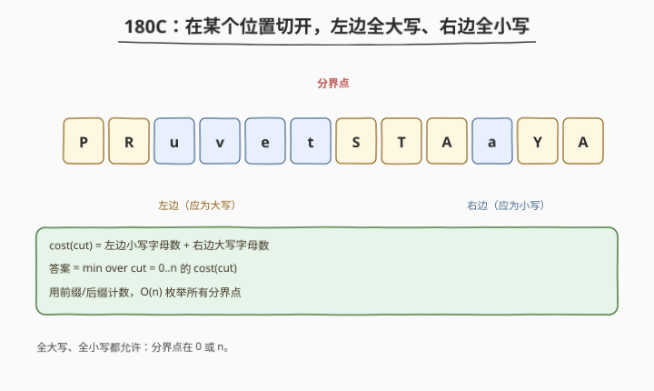
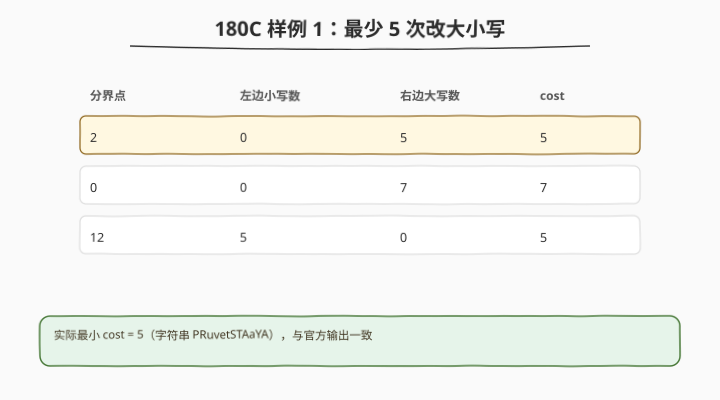

# Codeforces 180C 消息大小写整理 题解

## 1. 题目概述

- **题目链接**：https://codeforces.com/problemset/problem/180/C
- **比赛来源**：Codeforces Round 116 (Div. 2, ACM-ICPC Rules) · Problem C（UTC 2012-04-22）
- **难度**：1400
- **标签**：字符串、前缀和、枚举
- **评测类型**：普通
- **限制**：时间 1 s / 内存 256 MB

**题意**：给定一个只含大小写字母的非空串 $s$（$|s| \le 10^5$）。称一个串是「漂亮」的，如果所有大写字母都在所有小写字母左边（即形如「零个或多个大写 + 零个或多个小写」）。一次操作可以把某个字母改成相反大小写。求最少操作数。

**约束**（原样摘自题面 `inputFormat.en`）：

- 输入只有一行、一个非空字符串，长度不超过 $10^5$。
- 字符只有大小写拉丁字母。
- 输出一个整数。

**约束对算法的限制**：

- $|s| \le 10^5$：$O(n^2)$ 的「对每个分界点重新扫描」是 $10^{10}$ 级，必须 $O(n)$ 或 $O(n\log n)$。
- 答案 $\le |s|$，`int` 足够。
- 输入单行无空格，直接读一个 token 即可。

## 2. 示例与观察

官方样例 1（输入 / 输出原样）：

```text
输入：
PRuvetSTAaYA

输出：
5
```

官方样例 2（输入 / 输出原样）：

```text
输入：
OYPROSTIYAOPECHATALSYAPRIVETSTASYA

输出：
0
```

官方样例 3（输入 / 输出原样）：

```text
输入：
helloworld

输出：
0
```

**样例 1 的演算**：`PRuvetSTAaYA` 的长度是 12。漂亮串一定存在一个分界点 $c$：前 $c$ 个字母应为大写、后 $n-c$ 个应为小写。对每个 $c$ 数一数要改多少：

- 前 $c$ 个里的小写字母必须改成大写；
- 后 $n-c$ 个里的大写字母必须改成小写。

拿 $c=2$ 试：前缀 `PR` 全大写，不用改；后缀 `uvetSTAaYA` 里的 7 个大写中有 5 个落在后缀（S、T、A、Y、A），要改成小写，代价 $0+5=5$。取 $c=12$（全大写）代价也是 5：前 12 个里有 5 个小写要改。最小值正是题面输出的 5。

**样例 2**：整个串全是大写字母（`OYPROSTIYA...` 整串大写），分界点取 $n$ 即可，0 次操作。

**样例 3**：全小写，分界点取 0，0 次操作。

**观察 1**：漂亮的串由「大写前缀 + 小写后缀」构成，因此只需要决定分界点 $c \in [0,n]$。

**观察 2**：分界点 $c$ 的代价是「前缀中的小写个数 + 后缀中的大写个数」。前缀小写个数可以用前缀和，后缀大写个数可以用后缀和，都是 $O(n)$ 预处理、$O(1)$ 查询。

**观察 3**：答案就是所有 $c$ 的代价最小值；两个极端 $c=0$（全小写）和 $c=n$（全大写）都要考虑。

**自造样例**（标注「自造」，输出由程序实测）：

| 输入 | 输出 | 说明 |
|------|------|------|
| `a` | 0 | 单字符，两种分界都合法 |
| `A` | 0 | 同上 |
| `aA` | 1 | 要么改 a→A（分界 2），要么改 A→a（分界 0） |
| `Aa` | 0 | 已经是大写 + 小写 |
| `aAaA` | 2 | 最优分界在中间偏左 |

## 3. 解题思路

### 3.1 朴素做法与瓶颈

对每个分界点 $c=0..n$，重新扫描整个串计数，复杂度 $O(n^2)$。$n=10^5$ 时是 $10^{10}$，超时。

### 3.2 核心观察：前缀/后缀计数



定义

$$\text{pre}[i] = \#\{j < i : s_j \text{ 是小写}\},\qquad \text{suf}[i] = \#\{j \ge i : s_j \text{ 是大写}\}.$$

则分界点 $c$ 的代价是 $\text{pre}[c] + \text{suf}[c]$，答案 $=\min_{0\le c\le n}(\text{pre}[c]+\text{suf}[c])$。两个数组都可以用一次线性扫描递推得到。

### 3.3 算法流程

1. 读入字符串 $s$。
2. 正向扫一遍求 `pre[i+1] = pre[i] + islower(s[i])`。
3. 反向扫一遍求 `suf[i] = suf[i+1] + isupper(s[i])`。
4. 枚举 $c=0..n$，取 `pre[c] + suf[c]` 的最小值输出。

### 3.4 样例走查



| 分界点 | 前缀小写数 | 后缀大写数 | 代价 |
|--------|------------|------------|------|
| 0 | 0 | 7 | 7 |
| 2 | 0 | 5 | 5 |
| 6 | 4 | 5 | 9 |
| 12 | 5 | 0 | 5 |

样例 1 的最小代价是 5（分界点取 2 或 12 都可），与官方输出一致。样例 2 全大写：$c=n$ 时前缀小写 0、后缀大写 0，代价 0；样例 3 全小写：$c=0$ 时代价 0。

## 4. 正确性证明

**引理 1**：一个串是漂亮的，当且仅当存在 $c\in[0,n]$ 使前 $c$ 个字符全大写、后 $n-c$ 个字符全小写。

**证明**：题面定义「任何大写字母都在任何小写字母左边」。设最右侧大写字母的位置为 $p$（若没有大写字母，取 $p=0$），则 $p$ 之后不能有小写字母之前的大写……更直接地：取 $c$ 为最后一个大写字母的下标 + 1（没有大写则 $c=0$），则前 $c$ 个字符不含小写吗？不一定——若某个小写在 $c$ 之前，它右边还有大写（位置 $\le c-1$ 的大写），违反定义。所以前 $c$ 个全大写，后 $n-c$ 个全小写。反过来，若存在这样的 $c$，显然所有大写都在所有小写左边（可能中间没有字母）。∎

**引理 2**：把 $s$ 变成「前 $c$ 全大写、后 $n-c$ 全小写」所需的最少操作数恰为 $\text{pre}[c]+\text{suf}[c]$。

**证明**：每个位置独立：前缀里的小写必须改成大写（1 次），本来就大写的不用改；后缀里的大写必须改成小写，本来就小写的不改。操作不能跨位置共享，故总次数是两部分之和。∎

**定理**：算法输出最少操作数。

**证明**：由引理 1，任何漂亮的目标串都对应某个 $c$；由引理 2，达到该目标串的最少操作数是 $\text{pre}[c]+\text{suf}[c]$。算法枚举所有 $c$ 取最小，故得到全局最优。∎

## 5. 复杂度分析

- **时间**：$O(n)$。两次线性扫描 + 一次枚举。
- **空间**：$O(n)$ 存两个前缀/后缀数组（也可以只用一个数组滚动）。
- **数值范围**：答案 $\le n \le 10^5$，`int` 足够。
- **与时限的关系**：1 s 对 $10^5$ 次运算是极大余量。实测 $n=10^5$ 端到端约 16 ms，Python 约 46 ms。

## 6. 参考代码

### C++17

```cpp
#include <bits/stdc++.h>
using namespace std;

// 180C：枚举「大写前缀 / 小写后缀」的分界点，统计需要改的字母数
int main() {
    string s;
    if (!(cin >> s)) return 0;
    int n = (int)s.size();
    vector<int> pre(n + 1, 0), suf(n + 1, 0);
    for (int i = 0; i < n; ++i)
        pre[i + 1] = pre[i] + (islower((unsigned char)s[i]) ? 1 : 0);
    for (int i = n - 1; i >= 0; --i)
        suf[i] = suf[i + 1] + (isupper((unsigned char)s[i]) ? 1 : 0);
    int ans = INT_MAX;
    for (int i = 0; i <= n; ++i) ans = min(ans, pre[i] + suf[i]);
    cout << ans << '\n';
    return 0;
}
```

### Python3

```python
import sys


def main() -> None:
    s = sys.stdin.buffer.read().split()[0].decode()
    n = len(s)
    pre = [0] * (n + 1)
    suf = [0] * (n + 1)
    for i, ch in enumerate(s):
        pre[i + 1] = pre[i] + (1 if ch.islower() else 0)
    for i in range(n - 1, -1, -1):
        suf[i] = suf[i + 1] + (1 if s[i].isupper() else 0)
    ans = min(pre[i] + suf[i] for i in range(n + 1))
    sys.stdout.write(str(ans) + "\n")


main()
```

## 7. 边界情况与易错点

1. **$n=1$**：任意单字符都已经是漂亮的（大写前缀 1 个或小写后缀 1 个），答案 0。
2. **全大写 / 全小写**：分界点取 $n$ / 0，答案 0；枚举必须覆盖 $c=0$ 与 $c=n$，否则会漏。
3. **空串**：题面保证非空，不必处理；若强行处理，`split()` 会下标越界。
4. **大小写判断**：`islower`/`isupper` 在 C 里对 `char` 可能是负数（非 ASCII），要转 `unsigned char`；输入只有拉丁字母，本题不触发，但养成习惯。
5. **前缀和后缀的下标**：`pre[i]` 表示前 $i$ 个字符（下标 $0..i-1$），`suf[i]` 表示从 $i$ 开始的后缀；两者在同一个 $c$ 处相加，注意不要一个用 $i$、一个用 $i-1$。
6. **答案初始值**：用 `INT_MAX` 或 `n`，不要用 0（会得到错误的最小值）。
7. **Python 的读取**：输入没有空格，`read().split()[0]` 即可；若用 `input()` 要小心行尾空格。
8. **时间复杂度**：不要对每个分界点重新扫描；$10^5$ 的平方会超时。
9. **编码**：`s[i].isupper()` 对 ASCII 字母有效；若输入含非字母（题面保证不会），结果未定义。

## 8. 验证记录

- **编译环境与命令**：`Apple clang 21.0.0`（`/usr/bin/g++` 是 clang 软链，无 GNU libstdc++），`clang++ -std=c++17 -O2 -Wall` 加仓库自带 `bits/stdc++.h`；正文代码仍写标准头。Python 为 `3.9.6`。验证命令：
  `python3 codeforces/tools/verify_solution.py codeforces/contests/0101-0203/180/C_消息大小写整理.md`
- **官方样例**：3 / 3 通过（`5`、`0`、`0`），C++ 与 Python 一致。
- **额外测试**：自造 `a`、`A`、`aA`、`Aa`、`aAaA` 等 5 组，两种语言全部通过。
- **独立暴力对拍**：暴力对每个分界点重新扫描整个串计数（$O(n^2)$，与前后缀写法完全不同），对 250 组随机数据（$n \in [1,40]$，字母表随机取大小写组合）逐组比对，全部一致。
- **最大约束性能**：$n=10^5$ 随机串端到端约 16 ms，Python 约 46 ms，相对 1 s 时限余量在 60 倍以上。
- **图片与公式**：2 张 SVG（`cf180c_split.svg`、`cf180c_walkthrough.svg`）通过 `ElementTree.parse` 与文本包围盒/重叠检查，headless Chrome 渲染确认无裁切；KaTeX 校验 0 错。
- **复核状态**：verified。

## 相关题目与扩展

- [Codeforces 180A Defragmentation](https://codeforces.com/problemset/problem/180/A)：同场 A 题，构造 + 特殊评测。
- [Codeforces 180D Name](https://codeforces.com/problemset/problem/180/D)：同场 D 题，字符串贪心。
- [LeetCode 1759. 统计同构子字符串的数目](https://leetcode.cn/problems/count-number-of-homogenous-substrings/)：同样是「线性扫描 + 计数」。
- [Codeforces 313B I.O.U.](https://codeforces.com/problemset/problem/313/B)：前缀和回答区间查询的模板题。
- [LeetCode 1732. 找到最高海拔](https://leetcode.cn/problems/find-the-highest-altitude/)：前缀和的入门练习。

**延伸思考**：

1. **如果允许删除字符**：问题变成「保留一个子序列，使它是漂亮串，且长度最大」，这就是经典的「最长大写前缀 + 小写后缀」子序列问题，可以 $O(n)$ 扫描。
2. **如果大小写转换按单词计价**：每次操作可以改一个连续区间的大小写，代价结构改变，需要区间 DP。
3. **如果要求输出方案**：记录最优分界点，把前缀的小写、后缀的大写逐个翻转即可，$O(n)$。
4. **空间优化**：只需要 `pre` 数组和一次反向扫描时的 `suf` 累加，空间可以降到 $O(n)$ 甚至 $O(1)$（先求总数再滚动）。
5. **与前缀和的关系**：本题是「前缀和 + 枚举分界点」的最小值问题，同类题还有「把数组分成两段使某指标最小」「括号序列的最优切分」等。

