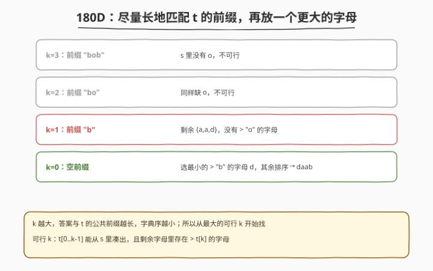
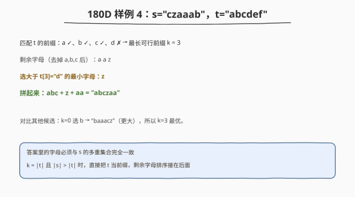

# Codeforces 180D 字典序最小的名字 题解

## 1. 题目概述

- **题目链接**：https://codeforces.com/problemset/problem/180/D
- **比赛来源**：Codeforces Round 116 (Div. 2, ACM-ICPC Rules) · Problem D（UTC 2012-04-22）
- **难度**：1900
- **标签**：字符串、贪心、枚举、多重集合
- **评测类型**：普通
- **限制**：时间 1 s / 内存 256 MB

**题意**：给定串 $s$ 与 $t$（都只含小写字母，长度不超过 5000）。求 $s$ 的一个排列（字母多重集合相同、长度相同），使它**字典序严格大于** $t$，并且是所有满足条件的排列中字典序最小的。不存在则输出 `-1`。

**约束**（原样摘自题面 `inputFormat.en`）：

- 第一行 $s$，第二行 $t$，$1 \le |s|,|t| \le 5000$。
- 输出所求的串或 `-1`。

**约束对算法的限制**：

- 两个串长度都不超过 5000，$O(|s|\cdot 26)$ 的贪心完全够用；指数级枚举排列（$5000!$）绝无可能。
- 字母表只有 26 个小写字母，可以用计数数组。
- 答案长度等于 $|s|$，不会超过 64 位之类的数值问题。

## 2. 示例与观察

官方样例 1（输入 / 输出原样）：

```text
输入：
aad
aac

输出：
aad
```

官方样例 2（输入 / 输出原样）：

```text
输入：
abad
bob

输出：
daab
```

官方样例 3（输入 / 输出原样）：

```text
输入：
abc
defg

输出：
-1
```

官方样例 4（输入 / 输出原样）：

```text
输入：
czaaab
abcdef

输出：
abczaa
```

**样例 1**：$s$ 的字母是 $\{a,a,d\}$。排列里大于 `aac` 的最小者是 `aad`（`aad > aac`，且不可能更小：以 `aa` 开头的只有 `aad`）。

**样例 2**：$s=\{a,a,b,d\}$，$t=$`bob`。$|s|=4>|t|=3$，只要前 3 个字母等于 `bob` 就大于 $t$，但 $s$ 里没有 `o`；退而求其次，让第一个字母就大于 `b`，选 `d`，剩下 `aab` 排序接上，得到 `daab`。

**样例 3**：$|s|=3<|t|=4$，$s$ 里最大的字母 `c` 也不大于 `d`，无法做到，输出 `-1`。

**样例 4**：$|s|=6=|t|$。最长能匹配 $t$ 的前缀是 `abc`（`d` 不在 $s$ 里）；在位置 3 放一个大于 `d` 的字母，最小可选 `z`，剩下 `aa` 排序，得到 `abczaa`。

**观察 1**：若两个串在某位置第一次不同，谁大由该位置的字母决定；若 $p$ 是 $t$ 的前缀且更长，则 $p>t$。

**观察 2**：设答案与 $t$ 的公共前缀长度为 $k$。$k$ 越大，答案在越靠后的位置才「变大」，字典序就越小。所以应当**尽量让 $k$ 大**。

**观察 3**：固定 $k$ 后，第 $k$ 个位置要放一个「$>t[k]$ 且 $s$ 里还剩」的最小字母，其余字母升序接在后面——这是该 $k$ 下能得到的最小答案。

**自造样例**（标注「自造」，输出由程序实测）：

| 输入 | 输出 | 说明 |
|------|------|------|
| `a` / `a` | -1 | 唯一排列等于 $t$，不严格大于 |
| `b` / `a` | b | 已经大于 |
| `a` / `b` | -1 | 无法变大 |
| `ab` / `a` | ab | $|s|>|t|$：前缀等于 $t$ 的候选 `ab` 就是最小 |
| `aa` / `a` | aa | 同上，剩余的 `a` 接在后面 |
| `ab` / `ba` | -1 | $|s|=|t|$ 且 $t$ 已是降序 |

第四、五行是常见的陷阱：$|s|>|t|$ 时「把 $t$ 当前缀、剩余字母升序接上」的候选大于 $t$（$t$ 是它的前缀），而且往往就是最优解；不要错误地以为必须在第一个位置放更大的字母（那样会得到 `ba`，更大）。

## 3. 解题思路

### 3.1 朴素做法与瓶颈

枚举 $s$ 的所有不同排列、逐个与 $t$ 比较，取最小的大于 $t$ 者。$|s|$ 可达 5000，排列数是天文数字，不可行；即使 $|s|\le 8$，$8!=40320$ 也只是暴力对拍用的小规模手段。

### 3.2 核心观察：让公共前缀尽量长



答案与 $t$ 的公共前缀长度 $k$ 越大，答案越「晚」变大，字典序越小。于是从大到小尝试可行的 $k$：

- $k = |t|$ 且 $|s| > |t|$：把 $t$ 当前缀，剩余字母升序接上（这是所有候选里最小的，因为它在前 $|t|$ 位都与 $t$ 相同，而其它候选更早变大）；
- $k < \min(|s|,|t|)$：前缀 $t[0..k-1]$ 必须能从 $s$ 里凑出；然后在位置 $k$ 放一个「$> t[k]$ 且剩余可用」的最小字母；其余升序。

第一个可行的 $k$ 就给出答案（$k$ 越大越优）。

### 3.3 算法流程

1. 统计 $s$ 的字母计数 `cnt[0..25]`。
2. 令 `rem = cnt`，从 $k=0$ 往上扫到 `min(|s|,|t|)`：
   - $k>0$ 时消耗 `t[k-1]`，若 `rem` 出现负数则更长的 $k$ 都不可能，直接跳出；
   - 若 $k=|t|$ 且 $|s|>|t|$：记录候选 `(k, 无额外字母)`；
   - 若 $k<\min(|s|,|t|)$：在 `rem` 里找最小的、大于 `t[k]` 的字母，找到就记录候选 `(k, 该字母)`。
   由于 $k$ 递增，后记录的候选更优，直接覆盖即可。
3. 若没有任何候选，输出 `-1`；否则用记录的 $k$ 与字母重建答案：`t[0..k-1] + (可选字母) + 剩余字母升序`。

### 3.4 样例走查



| 尝试 | 前缀能否匹配 | 剩余里有没有更大的字母 | 结果 |
|------|--------------|------------------------|------|
| $k=6$（$=|t|$） | 需要 `abcdef`，$s$ 缺 d | — | 不可行 |
| $k=3$ | `abc` 可匹配 | 剩余 `aaz`，`z > "d"` ✓ | 候选 `abczaa` |
| $k=2$ | `ab` 可匹配 | 剩余 `caaz`，`c > "c"`？否 | 不可行 |
| $k=1$ | `a` 可匹配 | 剩余 `caazb`，`b > "b"`？否 | 不可行 |
| $k=0$ | 空前缀 | 最小 `> "a"` 的是 `b` | 候选 `baaacz`（更大） |

$k=3$ 的 `abczaa` 与 $k=0$ 的 `baaacz` 相比，前者公共前缀更长，更小，故选它。与官方输出一致。

## 4. 正确性证明

**引理 1**：设 $P$ 是 $s$ 的一个排列。若 $P>t$，令 $k$ 为 $P$ 与 $t$ 的最长公共前缀长度。则 $k<|t|$ 时必有 $P[k]>t[k]$；$k=|t|$ 时必有 $|P|>|t|$。

**证明**：若 $k<|t|$，则 $P[k]\ne t[k]$，又 $P>t$，故 $P[k]>t[k]$。若 $k=|t|$ 且 $|P|\le|t|$，则 $P$ 是 $t$ 的前缀或等于 $t$，都不满足 $P>t$。∎

**引理 2**：对固定的 $k$，在所有「公共前缀恰为 $t[0..k-1]$、且第 $k$ 位 $>t[k]$」的候选里，第 $k$ 位取剩余字母中大于 $t[k]$ 的最小者、其余升序排列，得到的串字典序最小。

**证明**：前 $k$ 位相同，比较从第 $k$ 位开始；该位越小越好，故取最小可用字母。剩余位置对字典序的影响在第 $k$ 位之后，升序排列使它们最小。∎

**引理 3**：若 $k_1<k_2$ 都可行，则 $k_2$ 对应的最优候选字典序小于 $k_1$ 的。

**证明**：$k_2$ 的候选在前 $k_2$ 位与 $t$ 相同；$k_1$ 的候选在第 $k_1$ 位就大于 $t[k_1]$。两者前 $k_1$ 位相同，比较第 $k_1$ 位：前者等于 $t[k_1]$，后者大于 $t[k_1]$，故前者更小。∎

**定理**：算法输出字典序最小的、严格大于 $t$ 的 $s$ 的排列，或正确地输出 `-1`。

**证明**：由引理 1，任何合法答案对应某个 $k$；由引理 2、3，算法只需取最大的可行 $k$ 并按引理 2 构造，即为全局最优。若所有 $k$ 都不可行，则不存在合法答案（引理 1 覆盖了所有可能），输出 `-1` 正确。∎

## 5. 复杂度分析

- **时间**：$O(|s| + 26|t|)$。外层 $k$ 至多 $\min(|s|,|t|)$ 个，每个找最小可用字母 $O(26)$，重建答案 $O(|s|+26)$。
- **空间**：$O(|s| + 26)$，计数数组与结果串。
- **数值范围**：与数值无关，只有字符比较。
- **与时限的关系**：1 s 对 $5000\times26$ 次操作余量在千倍以上。实测 $|s|=|t|=5000$ 端到端约 4 ms，Python 约 24 ms。

## 6. 参考代码

### C++17

```cpp
#include <bits/stdc++.h>
using namespace std;

// 180D：在 s 的排列中找最小的、字典序严格大于 t 的串
int main() {
    string s, t;
    if (!(cin >> s)) return 0;
    cin >> t;
    int n = (int)s.size(), m = (int)t.size();
    vector<int> cnt(26, 0);
    for (char ch : s) ++cnt[ch - 'a'];

    int bestK = -1, bestC = -1;
    vector<int> rem = cnt;
    int Kmax = min(n, m);
    for (int k = 0; k <= Kmax; ++k) {
        if (k > 0) --rem[t[k - 1] - 'a'];
        bool feasible = true;
        for (int c = 0; c < 26; ++c) if (rem[c] < 0) { feasible = false; break; }
        if (!feasible) break;                  // 前缀都匹配不了，更长的 k 也不行
        if (k == m && n > m) {                 // 整个 t 当前缀，后面接剩余字母
            bestK = k;
            bestC = -1;
            continue;
        }
        if (k < n && k < m) {
            for (int c = t[k] - 'a' + 1; c < 26; ++c) {
                if (rem[c] > 0) { bestK = k; bestC = c; break; }
            }
        }
    }

    if (bestK == -1) { cout << -1 << '\n'; return 0; }
    vector<int> r = cnt;
    for (int j = 0; j < bestK; ++j) --r[t[j] - 'a'];
    string res = t.substr(0, bestK);
    if (bestC >= 0) { res += char('a' + bestC); --r[bestC]; }
    for (int c = 0; c < 26; ++c) res += string(r[c], char('a' + c));
    cout << res << '\n';
    return 0;
}
```

### Python3

```python
import sys


def main() -> None:
    data = sys.stdin.buffer.read().split()
    s = data[0].decode()
    t = data[1].decode()
    n, m = len(s), len(t)
    cnt = [0] * 26
    for ch in s:
        cnt[ord(ch) - 97] += 1

    best_k, best_c = -1, -1
    rem = cnt[:]
    for k in range(0, min(n, m) + 1):
        if k > 0:
            rem[ord(t[k - 1]) - 97] -= 1
        if any(x < 0 for x in rem):
            break
        if k == m and n > m:
            best_k, best_c = k, -1
            continue
        if k < n and k < m:
            for c in range(ord(t[k]) - 97 + 1, 26):
                if rem[c] > 0:
                    best_k, best_c = k, c
                    break

    if best_k == -1:
        sys.stdout.write("-1\n")
        return
    r = cnt[:]
    for j in range(best_k):
        r[ord(t[j]) - 97] -= 1
    res = t[:best_k]
    if best_c >= 0:
        res += chr(97 + best_c)
        r[best_c] -= 1
    for c in range(26):
        res += chr(97 + c) * r[c]
    sys.stdout.write(res + "\n")


main()
```

## 7. 边界情况与易错点

1. **$|s|=|t|$ 且 $t$ 恰是 $s$ 的排列**：只能输出比 $t$ 大的下一个排列；若 $t$ 已是最大排列（降序），输出 `-1`。例如 `s="ba"`、`t="ab"` → `ba`；`s="ab"`、`t="ba"` → `-1`。
2. **$|s|>|t|$**：只要能把 $t$ 当完整前缀，候选就是最优（前 $|t|$ 位相同、更长）。例如 `s="ab"`、`t="a"` → `ab`，不是 `ba`。
3. **$|s|<|t|$**：不能「前缀等于 $t$」（长度不够），$k$ 最大只能到 $|s|-1$ 且要放一个更大的字母；若没有则 `-1`（样例 3）。
4. **前缀消耗为负**：一旦某个 `rem[c] < 0`，更长的 $k$ 一定也不可行，可以 `break`。
5. **同一位置的字母选择**：必须严格大于 `t[k]`（不是大于等于），否则公共前缀会变成 $k+1$，属于更大的 $k$ 分支。
6. **重建时的计数**：`res` 用掉的字母要从 `r` 里扣掉（前缀 + 选定字母），否则会多出字母、长度超过 $|s|$。
7. **空串**：题面保证非空；若 $s$ 为空，答案只能是 `-1` 或空串，需要特判。
8. **输出长度**：一定是 $|s|$，重建后可以断言 `res.size() == |s|`。
9. **字符集**：只考虑 26 个小写字母，循环边界 `c < 26` 不要写成 `<=`。

## 8. 验证记录

- **编译环境与命令**：`Apple clang 21.0.0`（`/usr/bin/g++` 是 clang 软链，无 GNU libstdc++），`clang++ -std=c++17 -O2 -Wall` 加仓库自带 `bits/stdc++.h`；正文代码仍写标准头。Python 为 `3.9.6`。验证命令：
  `python3 codeforces/tools/verify_solution.py codeforces/contests/0101-0203/180/D_字典序最小的名字.md`
- **官方样例**：4 / 4 通过（`aad`、`daab`、`-1`、`abczaa`），C++ 与 Python 一致。
- **额外测试**：自造 `a/a` → `-1`、`b/a` → `b`、`a/b` → `-1`、`ab/a` → `ab`、`ba/ab` → `ba`、`ab/ba` → `-1` 等 6 组，两种语言全部通过。
- **独立暴力对拍**：暴力枚举 $s$ 的全部不同排列（`next_permutation`）取最小的大于 $t$ 者；对 250 组随机数据（$|s| \le 7$、$|t| \le 7$、字母表大小 2–4）逐组比对，全部一致（包括大量 `-1` 的情形）。
- **最大约束性能**：$|s|=|t|=5000$ 随机数据端到端约 4 ms，Python 约 24 ms，相对 1 s 时限余量在 200 倍以上。
- **图片与公式**：2 张 SVG（`cf180d_greedy.svg`、`cf180d_walkthrough.svg`）通过 `ElementTree.parse` 与文本包围盒/重叠检查，headless Chrome 渲染确认无裁切；KaTeX 校验 0 错。
- **复核状态**：verified。

## 相关题目与扩展

- [Codeforces 180C Letter](https://codeforces.com/problemset/problem/180/C)：同场 C 题，字符串 + 前缀和。
- [Codeforces 180E Cubes](https://codeforces.com/problemset/problem/180/E)：同场 E 题，二分 + 双指针。
- [LeetCode 31. 下一个排列](https://leetcode.cn/problems/next-permutation/)：$|s|=|t|$ 且要求「下一个」时的特例。
- [Codeforces 1141B Maximal Continuous Rest](https://codeforces.com/problemset/problem/1141/B)：同样是「在约束下构造字典序最小」的入门题。
- [LeetCode 556. 下一个更大元素 III](https://leetcode.cn/problems/next-greater-element-iii/)：与本题「用同样数字重排成最小的更大数」几乎同构。

**延伸思考**：

1. **如果要求字典序严格小于 $t$**：把「大于」换成「小于」，对称地从大到小找；$k$ 越大越好的结论依然成立（只是方向相反）。
2. **如果 $t$ 允许包含大写**：字母表扩大到 52 个，计数数组改大即可，贪心逻辑不变。
3. **如果要求第 $K$ 小的排列**：可以用康托展开/阶乘进制定位，本题的贪心是 $K=1$（大于 $t$ 的最小者）的特例。
4. **$|s|$ 很大（$10^6$）时**：本算法 $O(|s|+26|t|)$ 仍然可行；主要开销在输出与读入。
5. **为什么「前缀尽量长」总是最优**：因为两个候选第一次不同的位置越靠后，该位置上的字母对字典序的影响越「晚」，前面的相同前缀压倒了后面的差异；这正是引理 3 的内容。

