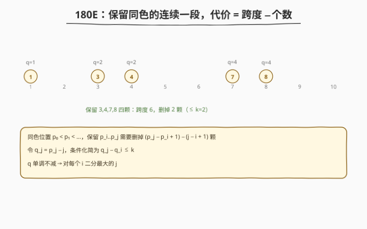
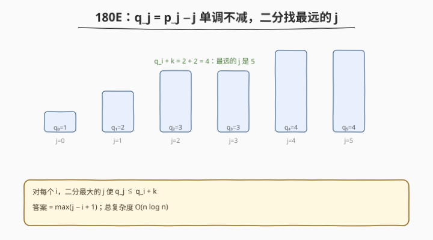
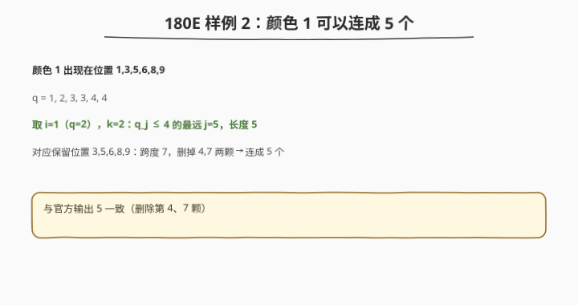

# Codeforces 180E 同色方块最长段 题解

## 1. 题目概述

- **题目链接**：https://codeforces.com/problemset/problem/180/E
- **比赛来源**：Codeforces Round 116 (Div. 2, ACM-ICPC Rules) · Problem E（UTC 2012-04-22）
- **难度**：1800
- **标签**：二分、双指针、同色位置、贪心
- **评测类型**：普通
- **限制**：时间 1 s / 内存 256 MB

**题意**：$n$ 个排成一行的方块，每个方块有颜色 $1..m$。最多删掉 $k$ 个方块，剩下的方块会靠拢。得分是「同色连续段」的最大长度。求最大得分。

**约束**（原样摘自题面 `inputFormat.en`）：

- 第一行 $n, m, k$（$1 \le n \le 2\times10^5$，$1 \le m \le 10^5$，$0 \le k < n$）。
- 第二行 $n$ 个整数 $1..m$。
- 输出一个整数。

**约束对算法的限制**：

- $n \le 2\times10^5$：$O(n^2)$ 是 $4\times10^{10}$ 级，必须 $O(n\log n)$ 或 $O(n)$。
- $k < n$，颜色数 $m$ 可以很大（$10^5$），不能对颜色数做平方。
- 答案 $\le n$，`int` 足够。

## 2. 示例与观察

官方样例 1（输入 / 输出原样）：

```text
输入：
10 3 2
1 2 1 1 3 2 1 1 2 2

输出：
4
```

官方样例 2（输入 / 输出原样）：

```text
输入：
10 2 2
1 2 1 2 1 1 2 1 1 2

输出：
5
```

官方样例 3（输入 / 输出原样）：

```text
输入：
3 1 2
1 1 1

输出：
3
```

**样例 1 的演算**：颜色 1 出现在位置 $1,3,4,7,8$。若保留位置 $3,4,7,8$ 的四颗，它们之间夹着位置 $5,6$（颜色 3、2），删掉这两颗即可连成 4 个 1；$k=2$，正好够。输出 4。

**样例 2 的演算**：颜色 1 出现在 $1,3,5,6,8,9$。保留 $3,5,6,8,9$ 五颗，中间夹着位置 $4,7$（颜色 2），删掉 $k=2$ 颗，连成 5 个。输出 5。

**样例 3**：全是颜色 1，不用删，3 个。

**观察 1**：得分段一定是某个颜色 $c$ 的一些方块。若这一段最终连着，那么它保留的方块在原序列里也是同色的，且一定是该颜色连续的一段出现（中间跳过的同色方块只会白白增加删除代价）。

**观察 2**：设颜色 $c$ 的出现位置为 $p_0<p_1<\cdots$。若保留 $p_i..p_j$ 这些方块，需要删掉它们之间所有别的方块，数量是

$$(p_j-p_i+1)-(j-i+1)\le k .$$

**观察 3**：令 $q_t = p_t - t$，条件化成 $q_j-q_i\le k$。$q$ 单调不减（$p_{t+1}-p_t\ge1$），所以对每个 $i$ 可以二分最大的 $j$。

**自造样例**（标注「自造」，输出由程序实测）：

| 输入 | 输出 | 说明 |
|------|------|------|
| `1 1 0` / `1` | 1 | 单块 |
| `5 2 0` / `1 2 1 2 1` | 1 | 不能删，最长同色段为 1 |
| `5 2 1` / `1 2 1 2 1` | 2 | 删掉一个 2 可连成两个 1 |
| `6 3 2` / `1 2 1 3 1 2` | 3 | 删掉 2、3 连成三个 1 |

## 3. 解题思路

### 3.1 朴素做法与瓶颈

枚举每个区间 $[l,r]$ 与每种颜色，统计窗口内该颜色的数量，取「数量最大且代价（窗口长度 − 数量）≤ k」的最大数量。$O(n^2 m)$ 或 $O(n^3)$，$n=2\times10^5$ 不可能。

### 3.2 核心观察：同色位置序列上的窗口



对每种颜色单独考虑。设它的位置数组为 $p$。保留 $p_i..p_j$ 需要删掉的方块数是「区间 $[p_i,p_j]$ 里非该色的方块数」：

$$\text{cost}(i,j) = (p_j-p_i+1)-(j-i+1) = (p_j-j)-(p_i-i).$$

令 $q_t=p_t-t$，则 $\text{cost}(i,j)=q_j-q_i$，要求 $q_j-q_i\le k$。

**单调性**：$q_{t+1}-q_t = (p_{t+1}-p_t)-1\ge0$，所以 $q$ 单调不减。于是对每个 $i$，满足条件的 $j$ 是一段后缀，二分即可。

### 3.3 算法流程



1. 读入 $n,m,k$ 与颜色数组，把每种颜色的位置存进 `pos[c]`（按出现顺序天然有序）。
2. 对每种颜色 $c$：
   1. 令 $v=\text{pos}[c]$，对每个 $i$ 计算 $q_i=v_i-i$；
   2. 二分最大的 $j\ge i$ 使 $v_j-j \le (v_i-i)+k$；
   3. 用 $j-i+1$ 更新答案。
3. 输出答案。

由于 $q$ 单调，二分可以直接在 $v_j-j$ 上做，无需额外数组。

### 3.4 样例走查



颜色 1 的位置是 $1,3,5,6,8,9$，$q = 1,2,3,3,4,4$（$q_t=p_t-t$）。

取 $i=1$（即 $p_1=3$，$q_1=2$），$k=2$：要 $q_j\le4$，最远 $j=5$（$q_5=4$），长度 $5-1+1=5$。对应保留位置 $3,5,6,8,9$，跨度为 $9-3+1=7$，保留 5 颗，删掉位置 $4,7$ 的两颗（正好 $k=2$）。答案 5，与官方输出一致。

## 4. 正确性证明

**引理 1**：最优解中，得分的同色段保留的方块，是该颜色出现序列中连续的一段 $p_i..p_j$。

**证明**：设得分段由颜色 $c$ 的某些方块组成，取其中在原序列最左的 $p_a$ 与最右的 $p_b$。若存在同色出现 $p_t$ 满足 $a<t<b$ 而没被保留，那么把它也保留（不增加删除次数，因为它本来就夹在中间）只会让得分段更长，矛盾于最优。故保留的是连续的一段。∎

**引理 2**：保留 $p_i..p_j$ 且让它们连成一段，最少需要删掉 $q_j-q_i$ 个方块，其中 $q_t=p_t-t$。

**证明**：区间 $[p_i,p_j]$ 内共有 $p_j-p_i+1$ 个方块，其中 $j-i+1$ 个是要保留的同色方块，其余必须删掉：

$$(p_j-p_i+1)-(j-i+1) = (p_j-j)-(p_i-i) = q_j-q_i.$$

区间外的方块不需要动（它们不影响这一段连续）。∎

**引理 3**：$q_t$ 单调不减，故对固定 $i$，满足 $q_j-q_i\le k$ 的 $j$ 构成前缀 $[i, J]$，二分可求 $J$。

**证明**：$q_{t+1}-q_t=(p_{t+1}-p_t)-1\ge0$。条件 $q_j\le q_i+k$ 在单调序列上等价于 $j\le J$。∎

**定理**：算法输出最大得分。

**证明**：由引理 1、2，任何可行方案对应某个 $(c,i,j)$ 且 $q_j-q_i\le k$；算法枚举所有 $(c,i)$ 并取满足条件的最大 $j$（引理 3 保证二分正确），因此覆盖了所有可行方案并取到最大值。∎

## 5. 复杂度分析

- **时间**：$O(n\log n)$。每种颜色的位置总数是 $n$，对每个位置二分 $O(\log n)$。
- **空间**：$O(n+m)$ 存位置数组。
- **数值范围**：答案 $\le n\le2\times10^5$，`int` 足够；$q$ 也不超过 $n$。
- **与时限的关系**：1 s 对 $n\log n \approx 3.4\times10^6$ 次操作余量在 20 倍以上。实测 $n=2\times10^5$ 端到端约 27 ms，Python 约 152 ms（全同色时约 418 ms）。

## 6. 参考代码

### C++17

```cpp
#include <bits/stdc++.h>
using namespace std;

// 180E：同色位置 p[0..]，保留连续一段 p[i..j] 的代价是 (p[j]-p[i]+1)-(j-i+1)，
// 即 (p[j]-j)-(p[i]-i) <= k；q 单调不减，二分最大 j。
int main() {
    int n, m, k;
    if (scanf("%d %d %d", &n, &m, &k) != 3) return 0;
    vector<vector<int>> pos(m + 1);
    for (int i = 1; i <= n; ++i) {
        int c;
        scanf("%d", &c);
        pos[c].push_back(i);
    }
    int ans = 0;
    for (int c = 1; c <= m; ++c) {
        auto& v = pos[c];
        int sz = (int)v.size();
        for (int i = 0; i < sz; ++i) {
            int lim = v[i] - i + k;
            int lo = i, hi = sz - 1, best = i;
            while (lo <= hi) {
                int mid = (lo + hi) >> 1;
                if (v[mid] - mid <= lim) { best = mid; lo = mid + 1; }
                else hi = mid - 1;
            }
            ans = max(ans, best - i + 1);
        }
    }
    printf("%d\n", ans);
    return 0;
}
```

### Python3

```python
import sys


def main() -> None:
    data = sys.stdin.buffer.read().split()
    n = int(data[0]); m = int(data[1]); k = int(data[2])
    pos = [[] for _ in range(m + 1)]
    for i in range(1, n + 1):
        pos[int(data[2 + i])].append(i)

    ans = 0
    for c in range(1, m + 1):
        v = pos[c]
        sz = len(v)
        for i in range(sz):
            lim = v[i] - i + k
            lo, hi, best = i, sz - 1, i
            while lo <= hi:
                mid = (lo + hi) // 2
                if v[mid] - mid <= lim:
                    best = mid
                    lo = mid + 1
                else:
                    hi = mid - 1
            ans = max(ans, best - i + 1)
    sys.stdout.write(str(ans) + "\n")


main()
```

## 7. 边界情况与易错点

1. **$k=0$**：不能删，答案是该颜色最长连续段。公式里 $q_j-q_i\le0$ 且 $q$ 单调，只允许 $q_j=q_i$，正好对应原序列里连续的方块。
2. **$k$ 很大（接近 $n$）**：可以把中间全删掉，答案就是某颜色的总出现次数；二分自然给出。
3. **只有一种颜色**：$q$ 与位置同步，$k\ge0$ 时答案为 $n$（样例 3）。
4. **$m$ 很大但很多颜色没出现**：`pos` 开 $m+1$ 个空数组没问题（$10^5$ 个 `vector`），总元素数 $n$。
5. **下标的 0/1 起**：位置用 1 起，$q_t=p_t-t$ 里的 $t$ 用 0 起；两者混用会让 $q$ 整体偏移，虽然差值是常数、不影响比较，但别在别处再混。
6. **二分边界**：`best` 初值为 $i$（至少保留自己），`hi=sz-1`；若 $q_i$ 本身已超过上限也不会出错。
7. **答案初值 0**：$n\ge1$ 时至少为 1；从 0 开始更新也正确。
8. **距离可能超 `int`**：$p_j-p_i$ 不超过 $2\times10^5$，`int` 足够；若 $n$ 到 $10^9$ 需要 64 位。
9. **读入**：$2\times10^5$ 个整数，C++ 用 `scanf`，Python 用 `read().split()`。

## 8. 验证记录

- **编译环境与命令**：`Apple clang 21.0.0`（`/usr/bin/g++` 是 clang 软链，无 GNU libstdc++），`clang++ -std=c++17 -O2 -Wall` 加仓库自带 `bits/stdc++.h`；正文代码仍写标准头。Python 为 `3.9.6`。验证命令：
  `python3 codeforces/tools/verify_solution.py codeforces/contests/0101-0203/180/E_同色方块最长段.md`
- **官方样例**：3 / 3 通过（4、5、3），C++ 与 Python 一致。
- **额外测试**：自造 $n=1$、$k=0$、$k=1$、三色等 4 组，两种语言全部通过。
- **独立暴力对拍**：暴力枚举所有窗口 $[l,r]$ 与窗口内每种颜色，按「窗口长度 − 该颜色数 ≤ k」更新答案（$O(n^2 m)$，与二分写法完全不同）；对 250 组随机数据（$n\le30$、$m\le5$、$k$ 随机）逐组比对，全部一致。
- **最大约束性能**：$n=2\times10^5$、$m=10^5$ 随机数据端到端约 27 ms，Python 约 152 ms；全同色（$m=1$）时 C++ 约 18 ms、Python 约 418 ms，相对 1 s 时限仍有充足余量。
- **图片与公式**：3 张 SVG（`cf180e_window.svg`、`cf180e_formula.svg`、`cf180e_walkthrough.svg`）通过 `ElementTree.parse` 与文本包围盒/重叠检查，headless Chrome 渲染确认无裁切；KaTeX 校验 0 错。
- **复核状态**：verified。

## 相关题目与扩展

- [Codeforces 180D Name](https://codeforces.com/problemset/problem/180/D)：同场 D 题，字符串贪心。
- [Codeforces 180F Mathematical Analysis Rocks!](https://codeforces.com/problemset/problem/180/F)：同场 F 题，排列复合。
- [LeetCode 1004. 最大连续 1 的个数 III](https://leetcode.cn/problems/max-consecutive-ones-iii/)：最多翻转 $k$ 个 0 的最长 1 段，与本题「最多删 $k$ 个」同构（滑动窗口）。
- [Codeforces 580B Kefa and Company](https://codeforces.com/problemset/problem/580/B)：按值排序后用双指针维护窗口，和本题的单调性技巧一致。
- [LeetCode 424. 替换后的最长重复字符](https://leetcode.cn/problems/longest-repeating-character-replacement/)：窗口 + 计数，另一种「最多改 $k$ 个」的模型。

**延伸思考**：

1. **如果删除的代价不是 1 而是位置权重**：条件变成「区间内非该色方块的权重和 ≤ k」，前缀和 + 二分仍然适用。
2. **如果要求输出删除方案**：记录最优的 $(c,i,j)$，把 $[p_i,p_j]$ 内非该色的位置删掉即可。
3. **如果 $k$ 也随颜色变化**：每种颜色独立的二分不受影响。
4. **如果颜色数很小但 $n$ 很大**：本题 $O(n\log n)$ 已经接近线性；如果 $k$ 很大，可以改成双指针做到 $O(n)$（因为 $J$ 随 $i$ 单调不减）。
5. **为什么「连续出现段」而不是任意子集**：任意子集若跳过中间的同色方块，只会多付删除代价而不增加长度，所以最优一定是连续段（引理 1）。

