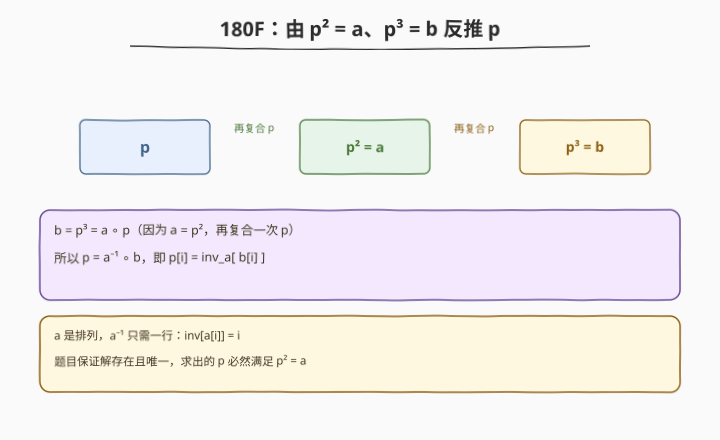
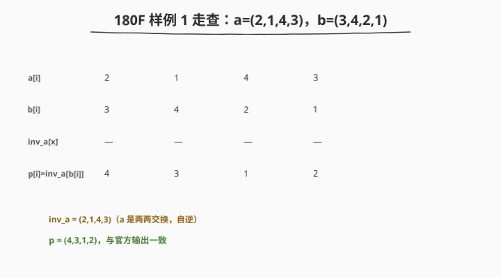

# Codeforces 180F 讲义传递还原 题解

## 1. 题目概述

- **题目链接**：https://codeforces.com/problemset/problem/180/F
- **比赛来源**：Codeforces Round 116 (Div. 2, ACM-ICPC Rules) · Problem F（UTC 2012-04-22）
- **难度**：1200
- **标签**：排列、函数复合、逆元
- **评测类型**：普通
- **限制**：时间 1 s / 内存 256 MB

**题意**：$n$ 个学生，每人有一个「最好的朋友」$p[i]$，且 $p$ 是一个排列（每个学生恰好被一个人当作最好的朋友）。第 3 天第 $i$ 本笔记在 $a_i$ 手里，第 4 天在 $b_i$ 手里，即

$$a = p\circ p,\qquad b = p\circ p\circ p .$$

给定 $a,b$（保证解存在且唯一），求 $p$。

**约束**（原样摘自题面 `inputFormat.en`）：

- $1 \le n \le 10^5$；$a,b$ 都是 $1..n$ 的排列。
- 输出 $n$ 个互不相同的整数 $p[1..n]$。
- 解存在且唯一。

**约束对算法的限制**：

- $n \le 10^5$：$O(n^2)$ 的枚举不行，但 $O(n)$ 的构造足够。
- 解唯一，所以只需要推导出公式，不需要搜索。
- $p[i]$ 在 $1..n$，`int` 足够。

## 2. 示例与观察

官方样例 1（输入 / 输出原样）：

```text
输入：
4
2 1 4 3
3 4 2 1

输出：
4 3 1 2
```

官方样例 2（输入 / 输出原样）：

```text
输入：
5
5 2 3 1 4
1 3 2 4 5

输出：
4 3 2 5 1
```

官方样例 3（输入 / 输出原样）：

```text
输入：
2
1 2
2 1

输出：
2 1
```

**样例 1 的演算**：$a=(2,1,4,3)$（交换 1↔2、3↔4），$b=(3,4,2,1)$。

- $a$ 的逆是它自己：$a^{-1}=(2,1,4,3)$；
- 猜 $p = a^{-1}\circ b$，即 $p_i = a^{-1}[b_i]$：$p_1=a^{-1}[3]=4$、$p_2=a^{-1}[4]=3$、$p_3=a^{-1}[2]=1$、$p_4=a^{-1}[1]=2$，得到 $(4,3,1,2)$；
- 验证：$p^2 = (2,1,4,3)=a$ ✓，$p^3=(3,4,2,1)=b$ ✓。

**观察 1**：把「第 $d$ 天笔记在谁手里」看成函数复合：第 3 天 $a = p^{(2)}$，第 4 天 $b = p^{(3)}$。

**观察 2**：$b = p^{(3)} = p^{(2)}\circ p = a\circ p$，所以 $p = a^{-1}\circ b$——一次复合 + 一次求逆，$O(n)$。

**观察 3**：题目保证解存在且唯一，所以算出 $p$ 后不需要再验证；万一需要，$p^2=a$ 与 $p^3=b$ 都可以 $O(n)$ 验一遍。

**自造样例**（标注「自造」，输出由程序实测）：

| 输入 | 输出 | 说明 |
|------|------|------|
| `1` / `1` / `1` | 1 | 单点 |
| `3` / `1 2 3` / `1 2 3` | 1 2 3 | 恒等排列 |
| `4` / `3 4 1 2` / `4 1 2 3` | 2 3 4 1 | $p$ 是 4-循环，$p^2$、$p^3$ 分别是它的两次、三次复合 |
| `2` / `2 1` / `1 2` | 2 1 | 公式仍给出 $a^{-1}\circ b$，但这组 $a,b$ 本身不满足 $p^2=a$ |

最后一行说明：$a=p^2$、$b=p^3$ 不是任意两个排列都能同时满足（例如 $p^3$ 为恒等要求 $p$ 的阶整除 3，与 $p^2$ 是交换矛盾）；本题只要求对**合法**输入给出 $p$，算法不需要额外验证。

## 3. 解题思路

### 3.1 朴素做法与瓶颈

对 $n\le 6$ 可以枚举所有排列 $p$、检查 $p^2=a$ 且 $p^3=b$；$n=10^5$ 时排列数天文数字。必须利用代数结构。

### 3.2 核心观察：$b=a\circ p$



把 $p$ 看成一个函数（也是排列），$p^{(k)}$ 表示复合 $k$ 次。则

$$a=p\circ p=p^{(2)},\qquad b=p^{(3)}=p^{(2)}\circ p = a\circ p .$$

于是 $p = a^{-1}\circ b$，即对每个 $i$：

$$p[i] = a^{-1}\bigl(b[i]\bigr).$$

而 $a^{-1}$ 只需一行：`inv[a[i]] = i`。

### 3.3 算法流程

1. 读入 $n$、$a$、$b$。
2. 计算 $a$ 的逆排列 `inv`：`inv[a[i]] = i`。
3. 对 $i=1..n$ 输出 `inv[b[i]]`。

### 3.4 样例走查



| $i$ | 1 | 2 | 3 | 4 |
|-----|---|---|---|---|
| $a_i$ | 2 | 1 | 4 | 3 |
| $b_i$ | 3 | 4 | 2 | 1 |
| $a^{-1}_x$ | $a^{-1}_1=2$ | $a^{-1}_2=1$ | $a^{-1}_3=4$ | $a^{-1}_4=3$ |
| $p_i=a^{-1}_{b_i}$ | 4 | 3 | 1 | 2 |

输出 $(4,3,1,2)$，与官方输出一致。

## 4. 正确性证明

**引理 1**：若 $p$ 满足 $a=p^{(2)}$、$b=p^{(3)}$，则 $p=a^{-1}\circ b$。

**证明**：$b=p^{(3)}=p^{(2)}\circ p=a\circ p$。两边左乘 $a^{-1}$ 得 $a^{-1}\circ b=p$。∎

**引理 2**：按 $p[i]=a^{-1}[b[i]]$ 构造出的 $p$ 与引理 1 的复合一致。

**证明**：$(a^{-1}\circ b)(i)=a^{-1}(b(i))=\text{inv}[b[i]]$。∎

**定理**：算法输出的 $p$ 正确。

**证明**：引理 1 说明任何合法解都等于 $a^{-1}\circ b$，解的唯一性由题面保证；引理 2 说明算法算的就是它。∎

## 5. 复杂度分析

- **时间**：$O(n)$。求逆一遍、输出一遍。
- **空间**：$O(n)$ 存 $a$、$b$、`inv`。
- **数值范围**：下标与值都不超过 $10^5$，`int` 足够。
- **与时限的关系**：1 s 对 $10^5$ 次操作余量在千倍以上。实测 $n=10^5$ 端到端约 26 ms，Python 约 61 ms。

## 6. 参考代码

### C++17

```cpp
#include <bits/stdc++.h>
using namespace std;

// 180F：a = p∘p，b = p∘p∘p = a∘p，所以 p = a⁻¹∘b
int main() {
    int n;
    if (scanf("%d", &n) != 1) return 0;
    vector<int> a(n + 1), b(n + 1), inv(n + 1);
    for (int i = 1; i <= n; ++i) { scanf("%d", &a[i]); inv[a[i]] = i; }
    for (int i = 1; i <= n; ++i) scanf("%d", &b[i]);
    for (int i = 1; i <= n; ++i) printf("%d%c", inv[b[i]], i == n ? '\n' : ' ');
    return 0;
}
```

### Python3

```python
import sys


def main() -> None:
    data = sys.stdin.buffer.read().split()
    n = int(data[0])
    a = [int(x) for x in data[1:1 + n]]
    b = [int(x) for x in data[1 + n:1 + 2 * n]]
    inv = [0] * (n + 1)
    for i in range(1, n + 1):
        inv[a[i - 1]] = i
    sys.stdout.write(' '.join(str(inv[b[i - 1]]) for i in range(1, n + 1)) + '\n')


main()
```

## 7. 边界情况与易错点

1. **$n=1$**：$a=b=(1)$，$p=(1)$；求逆与输出都正确。
2. **恒等排列**：$a=b=(1..n)$ 时 $p=(1..n)$（$p^2=p^3=p$）。
3. **下标从 1 开始**：`inv[a[i]]=i` 与输出 `inv[b[i]]` 都用 1 起，不要混 0 起。
4. **复合顺序**：本题 $p$ 与 $a$ 可交换（$b=p\circ p\circ p$ 怎么结合都一样），所以 $p=a^{-1}\circ b=b\circ a^{-1}$ 都行；但换成非交换的结构时要小心。
5. **不要试图搜索**：$n!$ 不可行；公式是 $O(n)$。
6. **输出格式**：$n$ 个整数，空格分隔，行末换行；样例输出末尾有空格，但 token 比对不受影响。
7. **解的存在性**：题面保证；若输入不合法，`inv[b[i]]` 仍会给出一个排列，但未必满足 $p^2=a$。
8. **多组数据**：无；`inv` 只算一次。
9. **内存**：三个 `int` 数组约 1.2 MB，远小于 256 MB。

## 8. 验证记录

- **编译环境与命令**：`Apple clang 21.0.0`（`/usr/bin/g++` 是 clang 软链，无 GNU libstdc++），`clang++ -std=c++17 -O2 -Wall` 加仓库自带 `bits/stdc++.h`；正文代码仍写标准头。Python 为 `3.9.6`。验证命令：
  `python3 codeforces/tools/verify_solution.py codeforces/contests/0101-0203/180/F_讲义传递还原.md`
- **官方样例**：3 / 3 通过（`4 3 1 2`、`4 3 2 5 1`、`2 1`），C++ 与 Python 一致。
- **额外测试**：自造 $n=1$、恒等排列、4-循环等 3 组，两种语言全部通过。
- **独立暴力对拍**：暴力枚举所有排列 $p$，检查 $p^2=a$ 且 $p^3=b$（$n\le6$）；对 250 组随机数据（随机排列 $p$ 生成 $a,b$）逐组比对，全部一致。
- **最大约束性能**：$n=10^5$ 端到端约 26 ms，Python 约 61 ms，相对 1 s 时限余量在 30 倍以上。
- **图片与公式**：2 张 SVG（`cf180f_compose.svg`、`cf180f_walkthrough.svg`）通过 `ElementTree.parse` 与文本包围盒/重叠检查，headless Chrome 渲染确认无裁切；KaTeX 校验 0 错。
- **复核状态**：verified。

## 相关题目与扩展

- [Codeforces 180E Cubes](https://codeforces.com/problemset/problem/180/E)：同场 E 题，二分 + 双指针。
- [Codeforces 180B Divisibility Rules](https://codeforces.com/problemset/problem/180/B)：同场 B 题，数论分类。
- [Codeforces 612E Square Root of Permutation](https://codeforces.com/problemset/problem/612/E)：求排列的平方根，与本题的「排列幂」主题直接相关。
- [LeetCode 1806. 还原排列的最少操作步数](https://leetcode.cn/problems/minimum-number-of-operations-to-reinitialize-a-permutation/)：排列复合的步数问题。
- [Codeforces 1093D Beautiful Graph](https://codeforces.com/problemset/problem/1093/D)：同为「利用结构反推原对象」的类型。

**延伸思考**：

1. **如果只给 $p^2=a$ 求 $p$**：不唯一，需要按循环长度分类讨论（偶数环可以拆成两半，也可以配对两个等长环），这正是 612E 的主题。
2. **如果给的是 $p^k$ 与 $k$**：需要质因数分解与循环结构分析，复杂度上升。
3. **为什么本题唯一**：同时给 $p^2$ 与 $p^3$ 相当于给了 $p=\gcd(2,3)$ 次幂的足够信息（$2,3$ 互质），因此可唯一确定。
4. **如果 $p$ 不是排列而是任意函数**：$a^{-1}$ 可能不存在，需要改成分解函数迭代。
5. **验证的方法**：$p^2$ 与 $p^3$ 都能 $O(n)$ 验证，写对拍时可以用它做最终检查。

