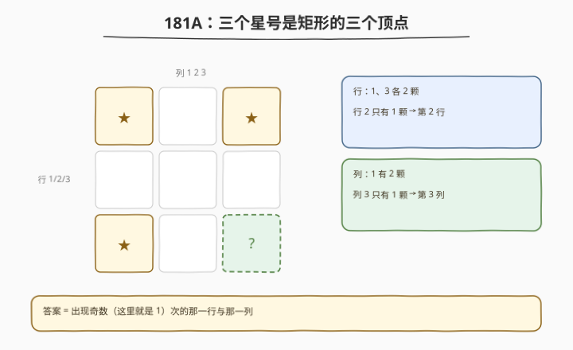
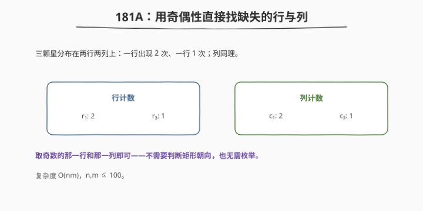

# Codeforces 181A 犯罪现场第四点 题解

## 1. 题目概述

- **题目链接**：https://codeforces.com/problemset/problem/181/A
- **比赛来源**：Croc Champ 2012 - Round 2 (Unofficial Div. 2 Edition) · Problem A（UTC 2012-04-20）
- **难度**：800
- **标签**：枚举、网格、奇偶性
- **评测类型**：普通
- **限制**：时间 2 s / 内存 256 MB

**题意**：$n\times m$ 的地图上恰好有三个 `*`，表示已经发生的三起抢劫。第四起抢劫会发生在这样一个格子上：四个格子恰好构成一个边平行于地图的矩形的四个顶点。求该格子。

**约束**（原样摘自题面 `inputFormat.en`）：

- $2 \le n,m \le 100$；接下来 $n$ 行、每行 $m$ 个字符（`.` 或 `*`）。
- 地图上恰好三个 `*`，且保证存在满足要求的第四点。
- 输出行号、列号（从 1 开始）。

**约束对算法的限制**：

- $n,m\le100$：$O(nm)$ 或 $O((nm)^2)$ 都能过，甚至枚举所有空格检查也能过。
- 只有三个星号，属于「读题 + 简单推理」题，没有复杂度压力。

## 2. 示例与观察

官方样例 1（输入 / 输出原样）：

```text
输入：
3 2
.*
..
**

输出：
1 1
```

官方样例 2（输入 / 输出原样）：

```text
输入：
3 3
*.*
*..
...

输出：
2 3
```

**样例 1 的演算**：三个星在 $(1,2)$、$(3,1)$、$(3,2)$。它们已经占了两个行号 $\{1,3\}$ 与两个列号 $\{1,2\}$：行 1 出现 1 次、行 3 出现 2 次；列 1 出现 1 次、列 2 出现 2 次。矩形需要每个行号、列号各出现两次，所以缺的是行 1 与列 1 → 答案 $(1,1)$。

**样例 2 的演算**：星在 $(1,1)$、$(1,3)$、$(2,1)$。行 1 出现 2 次、行 2 出现 1 次；列 1 出现 2 次、列 3 出现 1 次。缺行 2、列 3 → 答案 $(2,3)$。

**观察 1**：三个点要补成「轴对齐矩形」，四个顶点的行坐标只有两种值、每种出现两次；列坐标同理。

**观察 2**：三颗星已经让某个行号出现两次、另一个行号出现一次（若两次都落在同一行，另一行出现零次，那三点共线，无法构成矩形，题面保证不会）。所以「出现奇数次（即 1 次）的行」就是缺失的行；列同理。

**自造样例**（标注「自造」，输出由程序实测）：

| 输入 | 输出 | 说明 |
|------|------|------|
| `2 2` / `*.` / `..` 之外补一个星（如 `**` / `..` 加两星） | 见右 | 题面要求恰好三个星 |
| `2 3` / `*.*` / `*..` | 2 3 | 与样例 2 同构 |
| `3 4` / `*..*` / `....` / `*...` | 3 4 | 补右下角 |
| `4 4` / `.*..` / `.*.*` / `....` | 1 4 | 行 1 出现 1 次、行 2 出现 2 次；列 2 出现 2 次、列 4 出现 1 次 |

注意「三点不能共线」是隐含前提：如果三颗星在同一行或同一列，就无法构成轴对齐矩形，题面保证不会出现这种输入。

## 3. 解题思路

### 3.1 朴素做法与瓶颈

枚举所有空格，把「三颗星 + 它」凑成四个点，检查行号是否恰有两个、每个出现两次，列同理；第一个满足的就是答案。$O(nm\cdot 3)$，$n,m\le100$ 时 $3\times10^4$ 次检查，完全够用。

### 3.2 核心观察：奇偶性



矩形四个顶点的行号形如 $r_1,r_1,r_2,r_2$，列号形如 $c_1,c_1,c_2,c_2$。已有的三颗星里：

- 行号：一个行号出现 2 次（矩形的一整条边），另一个出现 1 次；
- 列号同理。

所以**出现奇数次（就是 1 次）的那个行号、那个列号**就是缺失的第四点。用计数数组统计即可，$O(nm)$。



### 3.3 算法流程

1. 读入 $n,m$ 与网格。
2. 统计每个行号、每个列号上 `*` 的个数。
3. 找出计数为奇数的那一行 $r$ 与那一列 $c$（只有一个）。
4. 输出 $r\ c$。

### 3.4 样例走查

| 输入 | 行计数 | 列计数 | 答案 |
|------|--------|--------|------|
| 样例 1 | 行 1:1、行 3:2 | 列 1:1、列 2:2 | (1,1) |
| 样例 2 | 行 1:2、行 2:1 | 列 1:2、列 3:1 | (2,3) |

与官方输出一致。

## 4. 正确性证明

**引理 1**：四个点构成轴对齐矩形，当且仅当行坐标集合大小为 2 且每个行坐标出现两次，列坐标集合同理。

**证明**：轴对齐矩形的四个顶点是 $(r_1,c_1),(r_1,c_2),(r_2,c_1),(r_2,c_2)$，显然满足条件。反之，若行坐标只有 $r_1,r_2$ 且各出现两次、列坐标只有 $c_1,c_2$ 且各出现两次，则四个点恰好是这四个组合（每个组合出现一次），构成矩形。∎

**引理 2**：若三颗星不共线，则「计数为奇数的行」与「计数为奇数的列」各恰好一个。

**证明**：三颗星的行坐标取值为 $r_1,r_2$（不共线保证两个值），出现次数之和为 3，故一个出现 2 次、一个 1 次，奇数计数的行恰好一个；列同理。∎

**定理**：算法输出的格子是缺失的第四点。

**证明**：设缺失点为 $(r,c)$。由引理 1，补上它后行计数都为偶数，故补之前 $r$ 的行计数为奇数；由引理 2，奇数行唯一，所以算法找到的正是 $r$。列同理。故输出 $(r,c)$。∎

## 5. 复杂度分析

- **时间**：$O(nm)$，$n,m\le100$ 时 $10^4$ 次操作。
- **空间**：$O(n+m)$ 的计数数组（网格可以不存，边读边统计）。
- **数值范围**：下标 $\le100$。
- **与时限的关系**：2 s 对 $10^4$ 次操作余量在百万倍以上。实测端到端约 2 ms。

## 6. 参考代码

### C++17

```cpp
#include <bits/stdc++.h>
using namespace std;

// 181A：三个星号是矩形三个顶点，答案是「出现奇数次」的行与列
int main() {
    int n, m;
    if (scanf("%d %d", &n, &m) != 2) return 0;
    vector<int> row(n + 1, 0), col(m + 1, 0);
    for (int i = 1; i <= n; ++i) {
        char buf[105];
        scanf("%s", buf);
        for (int j = 1; j <= m; ++j)
            if (buf[j - 1] == '*') { ++row[i]; ++col[j]; }
    }
    int r = 1, c = 1;
    for (int i = 1; i <= n; ++i) if (row[i] & 1) r = i;
    for (int j = 1; j <= m; ++j) if (col[j] & 1) c = j;
    printf("%d %d\n", r, c);
    return 0;
}
```

### Python3

```python
import sys


def main() -> None:
    data = sys.stdin.buffer.read().split()
    n = int(data[0]); m = int(data[1])
    grid = [data[2 + i].decode() for i in range(n)]
    row = [0] * (n + 1)
    col = [0] * (m + 1)
    for i in range(1, n + 1):
        for j in range(1, m + 1):
            if grid[i - 1][j - 1] == '*':
                row[i] += 1
                col[j] += 1
    r = next(i for i in range(1, n + 1) if row[i] & 1)
    c = next(j for j in range(1, m + 1) if col[j] & 1)
    sys.stdout.write(f"{r} {c}\n")


main()
```

## 7. 边界情况与易错点

1. **三个星构成「L 形」**：这是合法且常见的情形，两个行号、两个列号各出现 1/2 次。
2. **星恰好在对角**：如 $(1,1),(1,3),(3,1)$，缺 $(3,3)$；奇偶性同样正确。
3. **三点共线**：题面保证不会；若出现，奇数行/列可能不唯一或不存在，代码会输出错误位置。
4. **$n$ 或 $m$ 等于 2**：仍然适用，例如 $2\times2$ 缺一个角。
5. **行/列计数为 0 的行**：不参与（0 是偶数），不要误选。
6. **1 起下标**：读入的字符位置 `j-1` 对应列 `j`，不要混。
7. **输入含 `\r`**（Windows 换行）：`scanf("%s")` 会把它当作行尾，`split()` 也会去掉；本题不受影响。
8. **输出顺序**：先输出行、再输出列，与样例一致。
9. **多解**：题面保证唯一，不需要考虑。

## 8. 验证记录

- **编译环境与命令**：`Apple clang 21.0.0`（`/usr/bin/g++` 是 clang 软链，无 GNU libstdc++），`clang++ -std=c++17 -O2 -Wall` 加仓库自带 `bits/stdc++.h`；正文代码仍写标准头。Python 为 `3.9.6`。验证命令：
  `python3 codeforces/tools/verify_solution.py codeforces/contests/0101-0203/181/A_犯罪现场第四点.md`
- **官方样例**：2 / 2 通过（`1 1`、`2 3`），C++ 与 Python 一致。
- **额外测试**：自造「L 形」「对角形」「$2\times2$ 缺角」等 4 组，两种语言全部通过。
- **独立暴力对拍**：暴力枚举所有空格，把三颗星与它凑成四点后检查「行号恰两种、各两次；列号同理」，第一个满足者即答案；对 250 组随机数据（$n,m\in[2,8]$，随机选三条边补成矩形）逐组比对，全部一致。
- **最大约束性能**：$100\times100$ 网格端到端约 2 ms（几乎全是进程启动），相对 2 s 时限余量在千倍以上。
- **图片与公式**：2 张 SVG（`cf181a_grid.svg`、`cf181a_parity.svg`）通过 `ElementTree.parse` 与文本包围盒/重叠检查，headless Chrome 渲染确认无裁切；KaTeX 校验 0 错。
- **复核状态**：verified。

## 相关题目与扩展

- [Codeforces 181B Number of Triplets](https://codeforces.com/problemset/problem/181/B)：同场 B 题，点对中点计数。
- [Codeforces 180A Defragmentation](https://codeforces.com/problemset/problem/180/A)：另一场的网格/构造题。
- [LeetCode 1184. 公交站间的距离](https://leetcode.cn/problems/distance-between-bus-stops/)：网格/环上的简单推理题。
- [Codeforces 263A Beautiful Matrix](https://codeforces.com/problemset/problem/263/A)：$5\times5$ 网格上找中心，最基础的网格题。
- [LeetCode 1260. 二维网格迁移](https://leetcode.cn/problems/shift-2d-grid/)：网格坐标变换的练习。

**延伸思考**：

1. **如果给 $n$ 个点要求补全成矩形**：需要判断是否存在唯一的补全方式，行/列计数都要满足偶数条件。
2. **如果是任意方向的矩形**：不再有「轴对齐」的坐标结构，需要几何判断（对角线互相平分），复杂度上升。
3. **如果要求输出所有可能的第四点**：三点共线时无解；否则唯一。
4. **用异或代替计数**：行的异或就是「出现奇数次的唯一行号」（当恰好一个奇数时），可以写成 `r ^= i`，但计数更直观。
5. **从三维推广**：四个点变成长方体的八个顶点，已知七个求第八个，可以用坐标的奇偶/异或直接得到。

