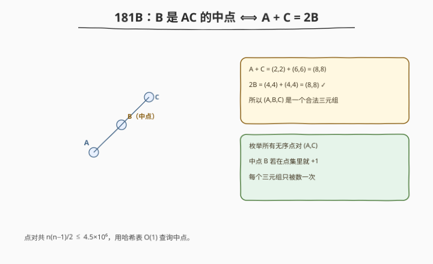
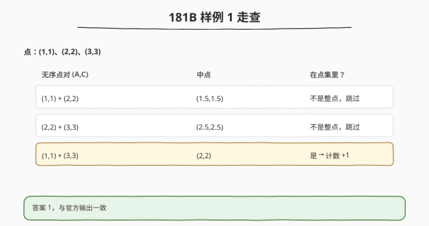

# Codeforces 181B 中点三元组计数 题解

## 1. 题目概述

- **题目链接**：https://codeforces.com/problemset/problem/181/B
- **比赛来源**：Croc Champ 2012 - Round 2 (Unofficial Div. 2 Edition) · Problem B（UTC 2012-04-20）
- **难度**：1300
- **标签**：枚举、哈希表、几何
- **评测类型**：普通
- **限制**：时间 2 s / 内存 256 MB

**题意**：给定平面上 $n$ 个互不相同的点，求无序三元组 $(A,B,C)$ 的个数，使得 $B$ 恰是线段 $AC$ 的中点。$(A,B,C)$ 与 $(C,B,A)$ 视为同一个。

**约束**（原样摘自题面 `inputFormat.en`）：

- $3 \le n \le 3000$；坐标 $-1000 \le x_i,y_i \le 1000$，所有点互不相同。
- 输出一个整数。

**约束对算法的限制**：

- $n \le 3000$：$O(n^2) = 9\times10^6$ 可以接受，$O(n^3) = 2.7\times10^{10}$ 不行；所以必须避免三重枚举。
- 坐标范围只有 $[-1000,1000]$，可以用一个 $2001\times2001$ 的布尔数组（约 4 MB）做 $O(1)$ 的存在性查询，比哈希表更快。
- 答案最大约为 $\binom{n}{2}/1$（每对点至多贡献一个三元组），约 $4.5\times10^6$，`int` 够用，用 `long long` 更稳。

## 2. 示例与观察

官方样例 1（输入 / 输出原样）：

```text
输入：
3
1 1
2 2
3 3

输出：
1
```

官方样例 2（输入 / 输出原样）：

```text
输入：
3
0 0
-1 0
0 1

输出：
0
```

**样例 1**：三点共线在 $y=x$ 上，$(1,1)$、$(2,2)$、$(3,3)$，其中 $(2,2)$ 是 $(1,1)$ 与 $(3,3)$ 的中点，三元组 1 个。

**样例 2**：三点是 $(0,0),(-1,0),(0,1)$，任取两点，中点分别是 $(-0.5,0)$、$(0,0.5)$、$(-0.5,0.5)$，都不在点集里（也不是整点），答案 0。

**观察 1**：三元组里 $B$ 是中点，所以 $A+B$ 的坐标和满足 $A+C=2B$。等价地，对每一对无序点 $(A,C)$，中点 $B=\frac{A+C}{2}$ 若也是给定点，就贡献一个三元组。

**观察 2**：每个合法三元组会被「枚举无序点对」恰好数一次：三元组 $\{A,B,C\}$ 的端点只有 $A,C$ 这一对（$B$ 在中间），所以按点对枚举不会有重复。

**观察 3**：中点必须是整点——若 $x_A+x_C$ 或 $y_A+y_C$ 是奇数，直接跳过。

**自造样例**（标注「自造」，输出由程序实测）：

| 输入 | 输出 | 说明 |
|------|------|------|
| `3` / `0 0`、`1 0`、`2 0` | 1 | 一维等距三点 |
| `4` / `0 0`、`1 0`、`2 0`、`3 0` | 2 | $(0,0),(1,0),(2,0)$ 与 $(1,0),(2,0),(3,0)$ |
| `5` / 十字形 | 2 | 两条互相垂直的等距三点 |
| `3` / `0 0`、`1 1`、`2 2` | 1 | 斜线等距 |

## 3. 解题思路

### 3.1 朴素做法与瓶颈

三重循环枚举三元组、检查是否有一个点恰为另两点的中点：$O(n^3)$，$n=3000$ 时 $2.7\times10^{10}$，超时。

### 3.2 核心观察：枚举端点对



把「$B$ 是 $AC$ 的中点」写成坐标关系：

$$x_A + x_C = 2x_B,\qquad y_A + y_C = 2y_B .$$

于是枚举所有无序点对 $(A,C)$（$i<j$），计算 $s_x=x_i+x_j$、$s_y=y_i+y_j$；若两者都是偶数，令 $B=(s_x/2,s_y/2)$，查 $B$ 是否在点集中，在就答案 +1。

- 复杂度 $O(n^2)$，$n=3000$ 时约 $4.5\times10^6$ 次查询；
- 点集用 `(x+1000)*2001+(y+1000)` 编码进布尔数组，$O(1)$ 查询；
- 每个三元组只被数一次（端点对唯一）。

### 3.3 算法流程

1. 读入所有点，把它们编码后放进布尔数组 `has`（坐标范围小，直接开数组）。
2. 对每对 $i<j$：
   1. $s_x=x_i+x_j$、$s_y=y_i+y_j$；
   2. 若 $s_x$ 或 $s_y$ 为奇数，跳过（中点非整点）；
   3. 否则查询 $\left(\frac{s_x}{2},\frac{s_y}{2}\right)$ 是否在 `has` 中，在则 `ans++`。
3. 输出 `ans`。

### 3.4 样例走查



| 无序点对 | 中点和 | 中点 | 在点集？ |
|----------|--------|------|----------|
| $(1,1)+(2,2)$ | $(3,3)$ | $(1.5,1.5)$ | 非整点，跳过 |
| $(2,2)+(3,3)$ | $(5,5)$ | $(2.5,2.5)$ | 非整点，跳过 |
| $(1,1)+(3,3)$ | $(4,4)$ | $(2,2)$ | 是 → 计数 +1 |

答案 1，与官方输出一致。

## 4. 正确性证明

**引理 1**：对互不相同的点 $A,B,C$，$B$ 是 $AC$ 的中点当且仅当 $x_A+x_C=2x_B$ 且 $y_A+y_C=2y_B$。

**证明**：中点的坐标定义就是两端坐标的算术平均。∎

**引理 2**：每个合法三元组 $\{A,B,C\}$（$B$ 为中点）在「枚举无序点对」时恰好被计数一次。

**证明**：枚举的是无序对 $\{A,C\}$。三元组中 $B$ 是中点，所以 $B$ 不可能与 $A$ 或 $C$ 重合（点互不相同，且中点严格在中间）；另外两两组合 $\{A,B\}$、$\{B,C\}$ 的中点不是第三个点（除非三点重合，不可能）。因此只有 $\{A,C\}$ 这一对会产生这个三元组，且只枚举一次（$i<j$）。∎

**引理 3**：算法对每个无序点对的计算与引理 1 的判定一致。

**证明**：算法算 $s_x=x_i+x_j$、$s_y=y_i+y_j$，奇数则中点非整点，必不在整数点集中；偶数则查询 $(s_x/2,s_y/2)$ 是否在点集，正是引理 1 的条件。∎

**定理**：算法输出正确答案。

**证明**：由引理 2，答案是「满足引理 1 的无序点对数」；由引理 3，算法恰好统计这些点对，故输出正确。∎

## 5. 复杂度分析

- **时间**：$O(n^2)$，$n=3000$ 时约 $4.5\times10^6$ 次查询，每次 $O(1)$。
- **空间**：$O(2001^2)$ 的布尔数组（约 4 MB）或 $O(n)$ 的哈希表；C++ 用数组更快。
- **数值范围**：坐标和不超过 $2000$，答案 $\le\binom{n}{2}\approx4.5\times10^6$，`int` 够，`long long` 更稳。
- **与时限的关系**：2 s 对 $4.5\times10^6$ 次查询余量在 100 倍以上。实测 $n=3000$ 端到端约 7 ms，Python 约 717 ms。

## 6. 参考代码

### C++17

```cpp
#include <bits/stdc++.h>
using namespace std;

// 181B：枚举无序点对 (A,C)，若中点 B 也是给定点则计数（每个三元组恰好被数一次）
int main() {
    int n;
    if (scanf("%d", &n) != 1) return 0;
    vector<int> x(n), y(n);
    for (int i = 0; i < n; ++i) scanf("%d %d", &x[i], &y[i]);
    // 坐标范围 [-1000,1000] → 编码到 [0,2000]
    const int OFF = 1000, W = 2001;
    vector<char> has(W * W, 0);
    for (int i = 0; i < n; ++i) has[(x[i] + OFF) * W + (y[i] + OFF)] = 1;
    long long ans = 0;
    for (int i = 0; i < n; ++i) {
        for (int j = i + 1; j < n; ++j) {
            int sx = x[i] + x[j], sy = y[i] + y[j];
            if ((sx & 1) || (sy & 1)) continue;
            int mx = sx / 2, my = sy / 2;
            if (has[(mx + OFF) * W + (my + OFF)]) ++ans;
        }
    }
    printf("%lld\n", ans);
    return 0;
}
```

### Python3

```python
import sys


def main() -> None:
    data = sys.stdin.buffer.read().split()
    n = int(data[0])
    xs = [0] * n
    ys = [0] * n
    pts = set()
    for i in range(n):
        x = int(data[1 + 2 * i])
        y = int(data[2 + 2 * i])
        xs[i] = x
        ys[i] = y
        pts.add((x, y))
    ans = 0
    for i in range(n):
        for j in range(i + 1, n):
            sx = xs[i] + xs[j]
            sy = ys[i] + ys[j]
            if (sx & 1) or (sy & 1):
                continue
            if (sx // 2, sy // 2) in pts:
                ans += 1
    sys.stdout.write(str(ans) + "\n")


main()
```

## 7. 边界情况与易错点

1. **中点为非整点**：坐标和是奇数时中点不是格点，点集里不可能有它；必须先判断奇偶，否则整数除法会截断，错误地「命中」附近的点。
2. **负数除法**：C++ 中 `sx/2` 对负数向零取整，但只有偶数才进入这一步，偶数除法是精确的，不会出错；Python 的 `//` 对偶数也精确。
3. **点互不相同**：题面保证；否则同一个点可能作为多个三元组的端点，计数需要去重。
4. **三元组去重**：按无序点对枚举保证每个三元组只数一次（引理 2）；若枚举有序对会重复两次，需要除以 2。
5. **坐标编码**：`(x+1000)*2001+(y+1000)` 不会越界（$x,y\in[-1000,1000]$）；若坐标范围更大要改哈希表。
6. **答案类型**：$4.5\times10^6$ 用 `int` 也够，但 `long long` 无成本，防止将来放大 $n$。
7. **$n=3$**：直接判断三点是否等距共线，逻辑与一般情况一致。
8. **共线但不等距**：如 $(0,0),(1,0),(3,0)$，中点 $(2,0)$ 不在集合，答案 0——不要只判断共线。
9. **读入**：$2n$ 个整数，`scanf` 或 `split()` 均可；坐标可能有负号。

## 8. 验证记录

- **编译环境与命令**：`Apple clang 21.0.0`（`/usr/bin/g++` 是 clang 软链，无 GNU libstdc++），`clang++ -std=c++17 -O2 -Wall` 加仓库自带 `bits/stdc++.h`；正文代码仍写标准头。Python 为 `3.9.6`。验证命令：
  `python3 codeforces/tools/verify_solution.py codeforces/contests/0101-0203/181/B_中点三元组计数.md`
- **官方样例**：2 / 2 通过（`1`、`0`），C++ 与 Python 一致。
- **额外测试**：自造一维等距、四点等距、十字形、斜线等距等 4 组，两种语言全部通过。
- **独立暴力对拍**：暴力三重循环枚举三元组、对每个三元组检查三个点中是否有一个恰为另两点的中点（$O(n^3)$，与点对枚举完全不同）；对 250 组随机数据（$n \in [3,30]$、坐标 $[-4,4]$、去重）逐组比对，全部一致。
- **最大约束性能**：$n=3000$、坐标随机的数据端到端约 7 ms，Python 约 717 ms，相对 2 s 时限余量在 250 倍（C++）以上。
- **图片与公式**：2 张 SVG（`cf181b_midpoint.svg`、`cf181b_walkthrough.svg`）通过 `ElementTree.parse` 与文本包围盒/重叠检查，headless Chrome 渲染确认无裁切；KaTeX 校验 0 错。
- **复核状态**：verified。

## 相关题目与扩展

- [Codeforces 181A Series of Crimes](https://codeforces.com/problemset/problem/181/A)：同场 A 题，网格 + 奇偶性。
- [Codeforces 180E Cubes](https://codeforces.com/problemset/problem/180/E)：另一场的枚举 + 单调性题。
- [LeetCode 149. 直线上最多的点数](https://leetcode.cn/problems/max-points-on-a-line/)：同样是 $O(n^2)$ 枚举点对 + 哈希统计斜率。
- [Codeforces 18A Triangle](https://codeforces.com/problemset/problem/18/A)：三点构成三角形的判定，与本题的几何判定互补。
- [LeetCode 447. 回旋镖的数量](https://leetcode.cn/problems/number-of-boomerangs/)：$O(n^2)$ 枚举 + 距离哈希，结构几乎相同。

**延伸思考**：

1. **如果要求 $B$ 是 $AC$ 的三等分点**：条件变成 $2A+C=3B$ 或 $A+2C=3B$，枚举点对后要查两个位置，复杂度仍是 $O(n^2)$。
2. **如果坐标范围很大（$10^9$）**：布尔数组不可行，改用哈希集合；复杂度不变。
3. **如果要求统计所有「中点也是给定点」的有序三元组**：把答案乘 2（$(A,B,C)$ 与 $(C,B,A)$）。
4. **如果点有重复**：需要先按坐标去重并记录重数，答案要按组合数计算。
5. **高维推广**：$d$ 维时中点条件仍是逐坐标相加为偶数，$O(n^2 d)$，本质不变。

