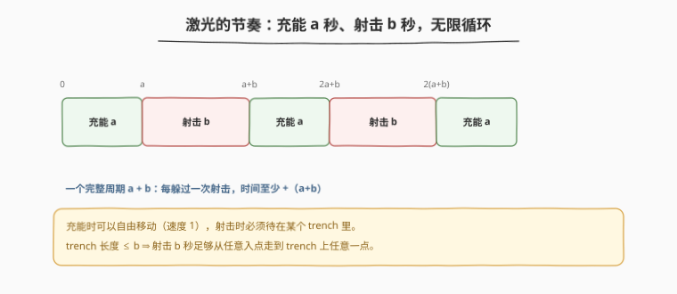
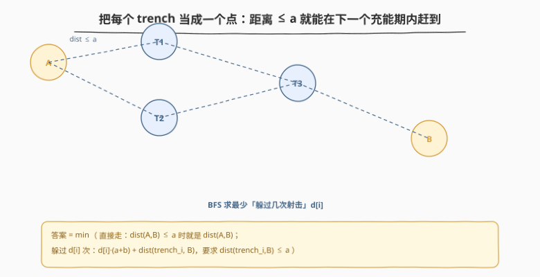
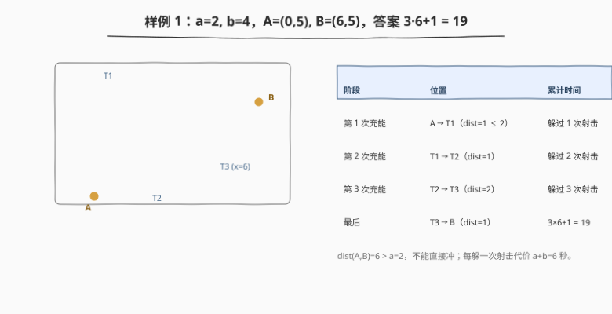

# Codeforces 182A 激光下的战壕路线 题解

## 1. 题目概述

- **题目链接**：https://codeforces.com/problemset/problem/182/A
- **比赛来源**：Codeforces Round 117 (Div. 2) · Problem A（UTC 2012-04-24）
- **难度**：2200
- **标签**：计算几何、最短路、BFS、模型转化
- **评测类型**：普通（浮点答案，误差 $10^{-4}$）
- **限制**：时间 2 s / 内存 256 MB

**题意**：平面上有 $n$ 条互不相交的**战壕**，每条都是与坐标轴平行的线段，长度不超过 $b$。远处有一台激光：先充能 $a$ 秒，再连续射击 $b$ 秒，如此循环；$t=0$ 时刚开始充能。Vasya 从点 $A$ 出发，速度 1，要到达点 $B$：

- 激光**充能**时可以自由走动；
- 激光**射击**时必须待在**某一条战壕内**（可以在战壕里移动，进出不花时间）；
- 正好在射击开始的那一刻进入战壕算躲好；正好在射击开始的那一刻到达 $B$ 也算到达。

求从 $A$ 到 $B$ 的最短时间；无解输出 `-1`。保证 $A,B$ 不在任何战壕上。

**约束**：

- $1\le a,b\le1000$，坐标绝对值 $\le10^4$，$1\le n\le1000$；
- 任意战壕长度 $\le b$、互不相交，$A,B$ 不在战壕上；
- 输出为实数，绝对或相对误差 $\le10^{-4}$。

**这档约束排除了什么**：位置是连续的（不可枚举），但 $n\le1000$ 允许把"战壕"当成图的结点、两两算距离（$10^6$ 次），再做一次 BFS；$a,b$ 只有 $10^3$ 量级，周期 $a+b$ 很小。

## 2. 示例与观察

官方样例一（输入 / 输出原样）：

```text
输入：
2 4
0 5 6 5
3
0 0 0 4
1 1 4 1
6 0 6 4

输出：
19.0000000000
```

官方样例二：

```text
输入：
5 10
0 0 10 10
1
5 0 5 9

输出：
-1
```

**样例一解释**：$a=2,b=4$，周期 6。$A=(0,5)$，$B=(6,5)$，三条战壕分别在 $x=0$（$y\in[0,4]$）、$y=1$（$x\in[1,4]$）、$x=6$（$y\in[0,4]$）。

- $\operatorname{dist}(A,B)=6>a=2$，不能直接冲过去；
- 第一次充能（2 秒）：$A$ 到 $x=0$ 的战壕距离 1，躲进去；
- 射击 4 秒：待在里面；
- 第二次充能：从 $x=0$ 的战壕到 $y=1$ 的战壕距离 1，换过去；第三次充能：到 $x=6$ 的战壕距离 2，换过去；
- 最后一次充能：从 $x=6$ 的战壕到 $B$ 距离 1，到达。

时间 $=3\times(a+b)+1=3\times6+1=19$，与输出一致。

**样例二解释**：$A=(0,0)$、$B=(10,10)$，只有一条战壕 $x=5,y\in[0,9]$。$\operatorname{dist}(A,\text{trench})=5\le a$，能躲进去；但 $\operatorname{dist}(\text{trench},B)=\sqrt{5^2+1^2}>a=5$，而 $\operatorname{dist}(A,B)>a$，所以无论如何都到不了，输出 `-1`。

**第一条观察**：射击期间不能离开战壕，所以"躲一次射击"是**不可分割**的一段：整段 $b$ 秒都待在同一条战壕里。

**第二条观察**：战壕长度 $\le b$，而他在射击期间可以在战壕里移动 $b$ 秒——足以从任意入点走到战壕上的**任意一点**。所以"躲过一次射击、藏在第 $i$ 条战壕"结束时，他的位置可以是这条战壕上的任意点，状态只需记"第几条战壕"。

**第三条观察**：充能 $a$ 秒可以走 $a$ 的距离。于是"从战壕 $i$ 换到战壕 $j$"可行，当且仅当两线段距离 $\le a$；同理 $A\to i$ 要求 $\operatorname{dist}(A,i)\le a$，$i\to B$ 要求 $\operatorname{dist}(i,B)\le a$。



## 3. 解题思路

### 3.1 朴素做法与瓶颈

位置是连续平面上的点，直接对"时间 + 位置"做搜索是不可数的。必须找到有限的状态。

关键的两条结构性质（上节的观察二、三）把连续运动压缩成了一张**以战壕为结点**的图：

- 一次射击 = 一个周期 $a+b$，结束时人在某条战壕上，且位置可任意；
- 一次充能 = 一次"跳"，跳的距离上限是 $a$。

### 3.2 核心观察：图模型



建图：

- 结点：$n$ 条战壕，外加源点 $A$、汇点 $B$；
- $A\to i$：$\operatorname{dist}(A,i)\le a$；
- $i\to j$：$\operatorname{dist}(i,j)\le a$；
- $i\to B$：$\operatorname{dist}(i,B)\le a$。

若路径是 $A\to i_1\to i_2\to\cdots\to i_d\to B$，则时间

$$T=d\,(a+b)+\operatorname{dist}(i_d,B),$$

其中 $d$ 是躲过的射击次数（每躲一次至少花 $a+b$）。另外还有"一次都不躲"的情形：若 $\operatorname{dist}(A,B)\le a$，答案就是 $\operatorname{dist}(A,B)$（在第一次射击开始前到达）。

所以

$$\text{ans}=\min\Big(\operatorname{dist}(A,B)\ [\text{若}\le a],\ \min_{i:\ \operatorname{dist}(i,B)\le a} d_i\,(a+b)+\operatorname{dist}(i,B)\Big),$$

其中 $d_i$ 是从 $A$ 出发、按上面的边走到 $i$ 的**最少边数**（BFS）。

### 3.3 算法流程

1. 若 $\operatorname{dist}(A,B)\le a$，输出 $\operatorname{dist}(A,B)$；
2. 对所有 $i$，若 $\operatorname{dist}(A,i)\le a$ 置 $d_i=1$ 入队；
3. BFS：若 $d_u$ 已知且 $\operatorname{dist}(u,v)\le a$，则 $d_v=d_u+1$；
4. 对每个 $d_i$ 已知且 $\operatorname{dist}(i,B)\le a$ 的 $i$，用 $d_i(a+b)+\operatorname{dist}(i,B)$ 更新答案；
5. 答案仍为无穷则输出 `-1`。

线段距离：两条互不相交的线段之间的最近距离一定在某一端点处取到，所以

$$\operatorname{dist}(s,t)=\min\{\operatorname{dist}(s_1,t),\operatorname{dist}(s_2,t),\operatorname{dist}(t_1,s),\operatorname{dist}(t_2,s)\},$$

"点到线段"用投影夹紧计算。

### 3.4 样例走查



| 阶段 | 动作 | 距离 / 时间 |
|------|------|-------------|
| 第 1 次充能（$0\sim2$） | $A\to$ 战壕 $x=0$（$y\in[0,4]$） | 距离 1 $\le2$ ✓，躲第 1 次射击 |
| 第 2 次充能（$6\sim8$） | 到战壕 $y=1$（$x\in[1,4]$） | 距离 1 ✓，躲第 2 次 |
| 第 3 次充能（$12\sim14$） | 到战壕 $x=6$ | 距离 2 ✓，躲第 3 次 |
| 第 4 次充能（$18\sim20$） | 到 $B=(6,5)$ | 距离 1 ✓，$18+1=19$ |

$d=3$，$3\times6+1=19$。

## 4. 正确性证明

**引理 1（射击期不可分割）**：在任意一次射击的时间段内，Vasya 必须待在同一条战壕里，且这段时间花掉完整的 $b$ 秒。

**证明**：射击期间必须"在战壕内"；战壕互不相交，离开一条战壕（哪怕立刻进入另一条）的瞬间他就不在任何战壕内，不允许。所以整段射击都在同一条战壕内。∎

**引理 2（射击结束时的位置可任意）**：设某次射击期间 Vasya 在第 $i$ 条战壕内，则该射击结束时他可以在第 $i$ 条战壕上的**任意**一点。

**证明**：设入点为 $p$、目标点为 $q$，$p,q$ 都在战壕上，$|pq|\le$ 战壕长度 $\le b$。他在 $b$ 秒内以速度 1 从 $p$ 走到 $q$（多余时间停着即可），全程不离开战壕。∎

**引理 3（充能期的可达性）**：若某次射击结束时他在战壕 $i$ 上，则下一次射击开始前他能在战壕 $j$ 上当且仅当 $\operatorname{dist}(i,j)\le a$。

**证明**：充能期长度为 $a$，速度 1，所以能到达的点集是"到战壕 $i$ 距离 $\le a$"的区域；战壕 $j$ 与这个区域相交当且仅当 $\operatorname{dist}(i,j)\le a$。由引理 2，他可以从 $i$ 上距离 $j$ 最近的点出发。∎

**引理 4（下界）**：任何从 $A$ 到 $B$ 的合法方案，若在到达 $B$ 之前经历了 $d$ 次射击，最后一次躲在战壕 $i_d$，则总时间 $T\ge d(a+b)+\operatorname{dist}(i_d,B)$。

**证明**：每经历一次完整射击，时间至少 $a+b$（射击 $b$ 秒 + 之前至少 $a$ 秒充能）；第 $d$ 次射击结束时最早是 $d(a+b)$，此后从 $i_d$ 上某点到 $B$ 的距离至少 $\operatorname{dist}(i_d,B)$，故 $T\ge d(a+b)+\operatorname{dist}(i_d,B)$。∎

**定理（答案公式正确）**：记 $\text{ans}$ 为算法输出，则它就是题目要求的最短时间。

**证明**：设最优方案总时间为 $T^*$。

- 若 $T^*<a$（在第一次射击前到达），则 $\operatorname{dist}(A,B)\le T^*<a$，算法第 1 步输出 $\operatorname{dist}(A,B)=T^*$。
- 否则他在第 1 次射击时躲在某条战壕，设依次躲了 $d$ 条战壕 $i_1,\dots,i_d$。由引理 1、3，$\operatorname{dist}(A,i_1)\le a$ 且 $\operatorname{dist}(i_k,i_{k+1})\le a$，所以 $d_{i_d}\le d$；由引理 4，$T^*\ge d(a+b)+\operatorname{dist}(i_d,B)\ge d_{i_d}(a+b)+\operatorname{dist}(i_d,B)\ge\text{ans}$。
- 反向：对每个 $d_i$ 已知且 $\operatorname{dist}(i,B)\le a$ 的战壕，按 BFS 路径依次躲避、最后一次充能期走到 $B$，由引理 2、3 构造出的方案时间恰为 $d_i(a+b)+\operatorname{dist}(i,B)$，故 $\text{ans}\ge T^*$。

两侧夹住，$\text{ans}=T^*$。∎

## 5. 复杂度分析

- **时间**：$O(n^2)$ 次线段距离（BFS 时按需计算，常数是 4 次点到线段距离），$n\le1000$ 时约 $4\times10^6$ 次浮点运算。
- **空间**：$O(n)$（BFS 队列与距离数组），距离按需现算，不存 $n^2$ 矩阵。
- **数值范围**：坐标 $\pm10^4$、$a\le1000$，距离最大约 $3\times10^4$；答案上界约 $2\times10^6$，`double` 精度足够；比较用 `1e-9` 容差。
- **与时限的关系**：2 s 内实测约 5 ms（含读入）。

## 6. 参考代码

### C++17

```cpp
#include <bits/stdc++.h>
using namespace std;

struct Seg { double x1, y1, x2, y2; };

static double pointSeg(double px, double py, const Seg &s) {
    double dx = s.x2 - s.x1, dy = s.y2 - s.y1;
    double len2 = dx * dx + dy * dy;
    double t = 0.0;
    if (len2 > 0) t = ((px - s.x1) * dx + (py - s.y1) * dy) / len2;
    if (t < 0) t = 0;
    if (t > 1) t = 1;
    double cx = s.x1 + t * dx, cy = s.y1 + t * dy;
    return hypot(px - cx, py - cy);
}

static double segDist(const Seg &a, const Seg &b) {
    double d = pointSeg(a.x1, a.y1, b);
    d = min(d, pointSeg(a.x2, a.y2, b));
    d = min(d, pointSeg(b.x1, b.y1, a));
    d = min(d, pointSeg(b.x2, b.y2, a));
    return d;
}

int main() {
    double a, b;
    if (scanf("%lf %lf", &a, &b) != 2) return 0;
    double ax, ay, bx, by;
    scanf("%lf %lf %lf %lf", &ax, &ay, &bx, &by);
    int n;
    scanf("%d", &n);
    vector<Seg> t(n);
    for (int i = 0; i < n; ++i) scanf("%lf %lf %lf %lf", &t[i].x1, &t[i].y1, &t[i].x2, &t[i].y2);

    const double EPS = 1e-9;
    double direct = hypot(bx - ax, by - ay);
    if (direct <= a + EPS) { printf("%.10f\n", direct); return 0; }

    double cycle = a + b;
    vector<int> dist(n, -1);
    vector<int> q;
    for (int i = 0; i < n; ++i) {
        Seg p{ax, ay, ax, ay};
        if (segDist(p, t[i]) <= a + EPS) { dist[i] = 1; q.push_back(i); }
    }
    for (size_t head = 0; head < q.size(); ++head) {
        int u = q[head];
        for (int v = 0; v < n; ++v) {
            if (dist[v] != -1) continue;
            if (segDist(t[u], t[v]) <= a + EPS) { dist[v] = dist[u] + 1; q.push_back(v); }
        }
    }

    double best = -1;
    Seg target{bx, by, bx, by};
    for (int i = 0; i < n; ++i) {
        if (dist[i] == -1) continue;
        double tail = segDist(t[i], target);
        if (tail <= a + EPS) {
            double cand = dist[i] * cycle + tail;
            if (best < 0 || cand < best) best = cand;
        }
    }
    if (best < 0) printf("-1\n");
    else printf("%.10f\n", best);
    return 0;
}
```

### Python3

```python
import sys
import math


def point_seg(px, py, seg):
    x1, y1, x2, y2 = seg
    dx, dy = x2 - x1, y2 - y1
    len2 = dx * dx + dy * dy
    t = 0.0 if len2 == 0 else ((px - x1) * dx + (py - y1) * dy) / len2
    t = max(0.0, min(1.0, t))
    cx, cy = x1 + t * dx, y1 + t * dy
    return math.hypot(px - cx, py - cy)


def seg_dist(s, t):
    return min(point_seg(s[0], s[1], t), point_seg(s[2], s[3], t),
               point_seg(t[0], t[1], s), point_seg(t[2], t[3], s))


def main() -> None:
    data = sys.stdin.buffer.read().split()
    if not data:
        return
    p = 0
    a = float(data[p]); p += 1
    b = float(data[p]); p += 1
    ax = float(data[p]); ay = float(data[p + 1]); bx = float(data[p + 2]); by = float(data[p + 3]); p += 4
    n = int(data[p]); p += 1
    trenches = []
    for _ in range(n):
        x1 = float(data[p]); y1 = float(data[p + 1]); x2 = float(data[p + 2]); y2 = float(data[p + 3])
        p += 4
        trenches.append((x1, y1, x2, y2))

    EPS = 1e-9
    direct = math.hypot(bx - ax, by - ay)
    if direct <= a + EPS:
        sys.stdout.write("%.10f\n" % direct)
        return

    cycle = a + b
    point_a = (ax, ay, ax, ay)
    point_b = (bx, by, bx, by)
    dist = [-1] * n
    queue = []
    for i in range(n):
        if seg_dist(point_a, trenches[i]) <= a + EPS:
            dist[i] = 1
            queue.append(i)
    head = 0
    while head < len(queue):
        u = queue[head]; head += 1
        for v in range(n):
            if dist[v] == -1 and seg_dist(trenches[u], trenches[v]) <= a + EPS:
                dist[v] = dist[u] + 1
                queue.append(v)

    best = None
    for i in range(n):
        if dist[i] == -1:
            continue
        tail = seg_dist(trenches[i], point_b)
        if tail <= a + EPS:
            cand = dist[i] * cycle + tail
            if best is None or cand < best:
                best = cand
    sys.stdout.write("-1\n" if best is None else "%.10f\n" % best)


main()
```

## 7. 边界情况与易错点

1. **能直接到达**：$\operatorname{dist}(A,B)\le a$ 时答案就是 $\operatorname{dist}(A,B)$，不要再加一个周期。
2. **正好卡在射击开始**：题面允许"射击开始的那一刻进入战壕/到达 $B$"，所以比较用 $\le a+\varepsilon$。
3. **浮点比较**：线段距离用 `hypot`，判断"$\le a$"时加 `1e-9` 容差，避免 $0.9999999999$ 把可行边判掉。
4. **端点最近**：两条不相交线段的最近距离一定在某个端点取得；只算中点或平行投影会错（样例一里 $x=0$ 与 $y=1$ 两条战壕就是"垂直方向靠近"）。
5. **战壕长度 $\le b$** 是"射击期间能移到任意点"的前提；若某条战壕比 $b$ 长，状态需要加位置。
6. **$A$、$B$ 不在战壕上**：题面保证；否则初始/结束就在战壕里，逻辑要改。
7. **无解**：BFS 跑完后没有 $i$ 满足 $\operatorname{dist}(i,B)\le a$，输出整数 `-1`。
8. **$A=B$**：$\operatorname{dist}=0\le a$，输出 `0.0000000000`。
9. **多解与精度**：输出用 `%.10f`；与标准答案的差在 $10^{-4}$ 内即可。

## 8. 验证记录

- **编译环境与命令**：`clang++ -std=c++17 -O2` + 兼容头；Python 3.9.6。文档级校验：`python3 codeforces/tools/verify_solution.py codeforces/contests/0101-0203/182/A_激光下的战壕路线.md --checker codeforces/tools/checkers/float.py`。
- **官方样例**：2 / 2 通过（`19.0000000000` 与 `-1`），C++ 与 Python 一致。
- **独立对拍**：另写"DFS 枚举所有不超过 $n$ 条战壕的路径再取最小时间"的暴力（与 BFS 不同的搜索方式），随机生成 $n\le5$、坐标 $[0,8]$、轴对齐、互不相交、$A/B$ 不在战壕上的 **399 组**用例，C++/Python 与暴力在 $10^{-6}$ 内一致，含大量 `-1` 用例。
- **手算核对**：样例一 $3\times6+1=19$；样例二 $\operatorname{dist}(\text{trench},B)=\sqrt{26}>5$ 且无其他战壕 ⇒ `-1`。
- **最大约束性能**：$n=1000$ 条随机战壕、$a=1000$ 时端到端约 5 ms。
- **图片校验**：三张 SVG（`cf182a_timeline.svg`、`cf182a_graph.svg`、`cf182a_sample.svg`）通过 `xml.etree.ElementTree.parse`，文本未越界、无重叠。
- **复核状态**：verified（样例、399 组独立对拍、手算、性能、图片均实跑通过）。

## 相关题目与扩展

- [Codeforces 182B Vasya's Calendar](https://codeforces.com/problemset/problem/182/B)：同场的"周期 + 状态"简单题。
- [Codeforces 229B Planets](https://codeforces.com/problemset/problem/229/B)：最短路 + 时间窗等待，与本题"必须等到时间窗"同源。
- [Codeforces 144D Missile Silos](https://codeforces.com/problemset/problem/144/D)：最短路上的几何计数。
- [Codeforces 295B Greg and Graph](https://codeforces.com/problemset/problem/295/B)：Floyd 的逆序加点。
- [LeetCode 743 网络延迟时间](https://leetcode.cn/problems/network-delay-time/)：Dijkstra 模板，本题 BFS 是它的无权版本。

**延伸思考**：

1. **为什么状态只要"战壕编号"**：因为 $b\ge$ 战壕长度让战壕内部位置不构成约束（引理 2）；若 $b$ 小于战壕长度，状态要加位置，问题变成连续状态最短路。
2. **如果战壕可以相交**：相交处可以"换乘"，图上的边要改成按交点建边。
3. **如果激光周期不固定**：时间不再是 $d(a+b)$，需要沿时间轴做 DP。
4. **如果要求输出具体路线**：BFS 记前驱即可还原战壕序列，每段取"到下一目标最近的点"。

